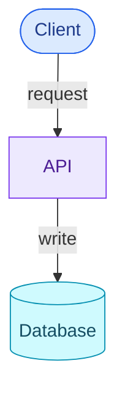

# rishabh0111.github.io

A personal site built with Jekyll and served by GitHub Pages at
<https://rishabh0111.github.io>. It has two sections:

- **Home** (`/`): the portfolio. All of its content lives in `index.md`'s front matter.
- **Blog** (`/blogs/`): long-form posts. A post can stand alone or belong to a series.

A news section (`/news/`, `_posts/news/`) exists but is parked. `_config.yml` lists both
paths under `exclude:`. Remove those two lines to turn it back on.

This file is excluded from the build too, so it is never served.

## Repository layout

```
_config.yml          site settings, plugins, build excludes
index.md             home page content (front matter only)
blogs/index.html     blog index: timeline, series stacks, search, tag filter
_posts/blogs/        blog posts, YYYY-MM-DD-slug.md
_layouts/            default (page chrome), home, post
_includes/           icon set, reusable blocks, built sketch SVGs
_data/               YAML/JSON read by layouts and includes
assets/css/style.css all styles, both themes
assets/js/           home page and blog index scripts
assets/img/          images (see "Images")
assets/downloads/    files offered for download
_templates/          source and build scripts for generated assets; not built
```

## Home page

`_layouts/home.html` renders `index.md`. The body is empty, and every section comes from
a front matter key. To change the page, edit the data, not the layout.

| Key | Section |
| --- | --- |
| `profile` | Hero: name, role, location, portrait, status line, tagline |
| `links` | Link pills in the hero and the contact section |
| `metrics` | Stat tiles |
| `pillars`, `about` | About: claim tiles and the longer essay |
| `lenses` | Project filter by focus area |
| `projects` | Project cards. Any number; the first four show, the rest sit behind a button |
| `experience` | Job timeline. `current: true` marks the present role |
| `skills` | Toolkit logo grid (marks in `assets/img/home/logos/tech/`) |
| `education`, `certifications`, `awards` | Credentials |
| `interests`, `contact` | Closing section |

Conventions:

- Long text (a project's write-up, a job's bullets, the essay) sits in a closed
  `<details>`, so every card is the same size whatever its length.
- An image takes `src`. Add `src_dark` (or `logo_dark`) only when the image is unreadable
  on the dark theme.
- `icon` values name a glyph in `_includes/icon.html`.
- Motion lives in `assets/js/home-fx.js` and `assets/js/home-bits.js` (plain JS and CSS,
  no frameworks). With reduced motion, a touch pointer or no JS, the page stays still and
  stays complete.

## Adding a blog post

Create `_posts/blogs/YYYY-MM-DD-slug.md`. Jekyll skips any file without the date prefix.
The folder sets the category, and the listings, breadcrumb, prev/next and related posts
all key off it.

```yaml
---
layout: post
title: "A short, specific title"
date: 2026-01-15 09:00:00 +0530
author: Rishabh Sharma
categories: blogs
tags: [topic-one, topic-two]
read_time: 12
permalink: /blogs/post-slug/
excerpt: "One or two sentences on what the post covers."
---
```

| Key | Required | Notes |
| --- | --- | --- |
| `layout` | yes | Always `post`. |
| `title` | yes | Quoted. Used for the heading, `<title>`, listings and prev/next. |
| `date` | yes | `YYYY-MM-DD HH:MM:SS +0530`. Match the filename date. Future dates build because `_config.yml` sets `future: true`. |
| `categories` | yes | `blogs`. |
| `permalink` | yes | `/blogs/<slug>/`, with the trailing slash. |
| `tags` | recommended | Shown as pills. |
| `read_time` | recommended | Minutes, set by hand. Omit it to hide the field. |
| `excerpt` | recommended | Shown under the title. Overrides the auto-excerpt. |
| `author` | optional | Shown in the meta line. |
| `links_new_tab` | optional | `true` opens every body link in a new tab. |

### Series

Posts that share a `series` value form a series. They get a parts rail, a series pill in
the breadcrumb, and a grouped stack on the blog index.

| Key | Required | Notes |
| --- | --- | --- |
| `series` | yes | The series name. It must be identical in every part; it is the join key. |
| `series_order` | yes | Part number. Sets the order and the "Part N of M" label. |
| `series_total` | while publishing | Planned part count. Without it, M is the number of parts published so far. |

Keep part dates ascending so prev/next and the index read in order.

## Writing the body

Markdown is kramdown (GFM input) with Rouge highlighting.

- **Headings:** use `##` and `###` only; the title is the `#`. With two or more headings,
  the body gets an "In this article" table of contents. The `§` before each `##` is
  added by CSS, so don't type it.
- **Code:** fence it with a language tag. Line numbers are off.
- **Rules:** `---` renders as a dot separator.
- **Tables:** keep them narrow. Wide tables scroll inside their own box on phones.
- **Images and diagrams** open in a zoomable viewer on click, unless they're wrapped in a link.
- `figure` / `figcaption` are styled.

### Mermaid diagrams

A ```` ```mermaid ```` fence renders a diagram. It follows the light/dark toggle, and
pages without one never load Mermaid. Any `%%{init}%%` directive is stripped.

Colour flowchart nodes with these `classDef` role names only. Write the light colours,
and the site swaps in the dark ones. Any other class name keeps its literal colours and
looks wrong on one theme.

| Role | Use for |
| --- | --- |
| `actor` | external client, person, target |
| `gateway` | API or entry point |
| `service` | worker, background job |
| `store` | database, queue, cache |
| `flow` | plain step |
| `warn` | decision, caution |
| `ok` | success state |
| `error` | failure state |



Sequence diagrams are themed automatically.

A diagram shrinks to fit the column instead of scrolling, so it must read at phone
width:

- Keep the width-to-height ratio between about 1 : 1 and 1.3 : 1.
- Use `flowchart TB`, never `LR`, with at most three nodes side by side.
- Node labels: about 20 characters per line, split with `<br/>`. Edge labels: two or
  three words.
- Sequence diagrams: three participants where possible, and move minor ones into a `Note`.
- If an edge crosses a node, reorder the declarations. Nodes are placed in the order
  they are first declared.

To check, open the page at 390 px wide and run this in the console. Redraw anything
above 1.3 : 1.

```js
[...document.querySelectorAll('svg[id^="mermaid"]')].map(s => {
  const { width, height } = s.viewBox.baseVal;
  return `${Math.round(width)} x ${Math.round(height)}  ${(width / height).toFixed(2)} : 1`;
});
```

### Hand-drawn figures

Write a spec in `_templates/sketches/<folder>/figures.js` and run it with `node`. It
writes SVGs to `_includes/sketches/<folder>/`. Embed one on a single line:

```html
<figure class="sketch"><figcaption>…</figcaption></figure>
```

The SVG colours are CSS classes, so the figures follow the theme. Setup, the drawing
vocabulary and the preview commands are in `_templates/sketches/README.md`.

### Chatbot checkpoints

To have the reader answer a question before seeing any answer, add a coach link. It
opens ChatGPT or Claude with your prompt already typed:

```liquid

Plain-text prompt, no Liquid tags. It must make sense without the post.


```

### Data-driven blocks

Content shared by many posts lives once in `_data/` and is rendered by an include, for
example a problem table from `_data/dsa_problems.yml` via `_includes/dsa-problems.html`.
Each include's header comment documents its parameters. A generated download (such as
`assets/downloads/*.xlsx`) is rebuilt by its script in `_templates/`.

## Images

| Path | Holds |
| --- | --- |
| `assets/img/blogs/<folder>/` | A post's or series' images. Reference as `/assets/img/blogs/<folder>/x.png`. |
| `assets/img/blogs/memes/<post-slug>.jpg` | The image a post opens with. |
| `assets/img/home/` | Portrait, `projects/<project>/` screenshots, `logos/` marks. Posts may reuse these. |
| `assets/img/og-card.jpg` | The social share image for every page (source in `_templates/og-card/`). |

## Build and publish

Pushing to `main` publishes the site: GitHub Pages builds it with Jekyll 3.10 and the
plugins in `_config.yml` (`jekyll-feed`, `jekyll-seo-tag`, `jekyll-sitemap`).

- `_config.yml` `exclude:` keeps `README.md`, `_templates/`, `_preview/` and local files out
  of the build. The repo is public, so keep private files out of this directory
  altogether.
- `_site/` is build output. Don't edit or commit it.

### Local preview

Use the `github-pages` gem so the local build matches the one Pages runs. On Windows,
install Ruby with DevKit first (`winget install RubyInstallerTeam.RubyWithDevKit.3.2`).

```
# Gemfile (not committed; Pages ignores it)
source "https://rubygems.org"
gem "github-pages", group: :jekyll_plugins
```

```
bundle install
bundle exec jekyll serve --port 4001 --watch     # http://127.0.0.1:4001/
```

If a layout change doesn't show up, restart without `--incremental`.

## New post checklist

- [ ] `_posts/blogs/YYYY-MM-DD-slug.md`, with the date matching `date:`
- [ ] `layout`, `title`, `date`, `categories`, `permalink: /blogs/<slug>/`
- [ ] `tags`, `read_time`, `excerpt`
- [ ] Series: `series`, `series_order`, and `series_total` until the last part ships
- [ ] Headings are `##` / `###` only
- [ ] Mermaid: role classes only, `TB`, at most 1.3 : 1 at 390 px
- [ ] Images under `assets/img/blogs/<folder>/`; opening image at `memes/<post-slug>.jpg`
