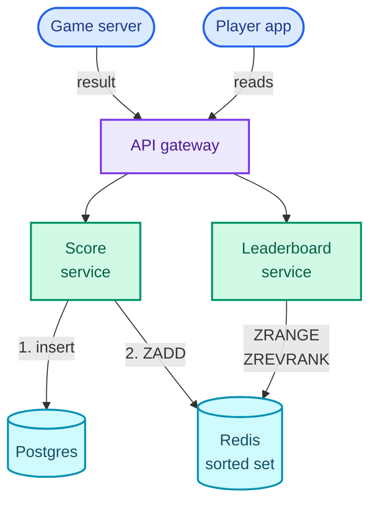

The most common way I've watched strong engineers fail a system design round isn't by saying something wrong. It's by running out of time with something half right. Twenty minutes on the perfect ID scheme, ten on a database debate nobody asked for, and at minute 45 there's a beautiful box in the corner of the board and no way for a request to get from the user to the data and back.

The interviewer can't hire that, however good the box is. They can hire a plain design that works end to end, has one or two parts examined in depth, and comes with reasons for every choice. So the goal of this series is one sentence: **given an interview question you haven't rehearsed, deliver a working, defensible design inside the time box.**

This post is the method the next sixteen posts follow. It covers the delivery framework (the order of stages and what each one has to produce), one worked example run through every stage, the eight patterns that keep coming back, the building blocks and numbers you'll reach for, and how to study with all of it. It assumes the fundamentals from the [System Design series](/blogs/system-design-foundations/): caching, sharding, queues, CAP. Those were taught there; here they get used. [Part 2](/blogs/hld-url-shortener/) starts the questions with a URL shortener.

## Why candidates fail

Almost nobody fails for lack of knowledge. By the time you're in a senior loop you know what a cache is. The failures I see are failures of focus, and they come in four shapes.

**Depth before breadth.** The candidate hears "URL shortener", gets excited about short-code generation, and spends fifteen minutes on it before anything else exists. Deep dives are worth a lot, but only on top of a design that already works. Depth with no system under it scores as "couldn't scope the problem".

**Designing the wrong system.** No requirements were agreed, so the candidate builds for whatever they assumed. Halfway through, the interviewer mentions that links expire, or that the feed must be real-time, and half the board is wrong.

**Estimation theatre.** Eight minutes of arithmetic on storage and bandwidth, ending with no decision. A number that doesn't change the design is time you didn't spend designing.

**Technology names instead of reasons.** "We'll put Kafka here." Why? What does it buy that a plain queue doesn't? An interviewer can't score a name. They score the reason.

The fix for all four is the same, and it isn't talking faster. It's knowing at every minute which stage you're in, what "done" means for that stage, and moving on when you get there.

## The delivery framework

The stages and their order come from [Hello Interview's delivery framework](https://www.hellointerview.com/learn/system-design/in-a-hurry/delivery), which is worth reading in its own words. What follows is how I run each stage, the mistakes I see at each one, and what I believe the interviewer is writing down while you work. Every question post in this series uses the stages as its headings, so reading a post is rehearsing the interview.

Here is where the 45 minutes go. Read the clock from the top: the colours are the stages, and the red hand at minute 30 is the one deadline that matters most.

<figure class="sketch"></figure>

The boxes are guides, not laws. A question with a tricky API takes more than five minutes there; a question with an obvious one takes two. What doesn't bend is the red hand: by minute 30, every functional requirement has a path through your design, even if some of those paths are naive. The deep dives then fix the naive parts. A design that's still incomplete at minute 30 rarely recovers, because the deep dives have nothing to stand on.

### Requirements (about 5 minutes)

You're agreeing on what to build, in two lists.

**Functional requirements** are what the system does, written as "Users should be able to…". Keep the top three. A real product has thirty features; an interview has time for three. Then say what you're leaving out, out loud, with one reason each ("editing a link after creation: it changes caching, happy to come back to it"). That line is cheap and it shows judgement.

**Non-functional requirements** are the qualities the system must have, and they're where most of the design comes from. The rule is that each one is **quantified and tied to this system**: "a redirect answers in under 50 ms at p99" (p99, the 99th percentile: 99% of requests finish within that time), not "low latency". "Low latency" can't be designed for. 50 ms can: it tells you there's no room for a database round trip across a region.

I run down this checklist and keep the three to five items that matter for the question:

| Checklist item | The question to ask yourself | A quantified answer looks like |
| --- | --- | --- |
| Consistency vs availability | During a network partition, is a stale answer or no answer worse? ([CAP](/blogs/system-design-cap-consistency/)) | "Seat booking is consistent (never double-sell); the event page is available (stale for 10 s is fine)" |
| Environment | Who are the clients and what are their constraints? | "Mobile on flaky 3G; uploads must resume after a drop" |
| Scalability | How many users, requests, bytes? What is the read:write ratio? Is traffic bursty? | "10B redirects a day, 100 reads per write, 3x peaks and one viral link at 50,000 a second" |
| Latency | Which operation is latency-sensitive, and how fast? | "Typeahead suggestions in < 100 ms p99" |
| Durability | What must never be lost, and what may be? | "A sent message is never lost; typing indicators may be" |
| Security | Who may do what? What's the abuse case? | "Only the owner sees click stats; rate-limit link creation" |
| Fault tolerance | What happens when a component dies? | "Losing one cache node must not take redirects down" |
| Compliance | Any legal constraint on the data? | "EU users' data stays in EU regions" |

**Capacity estimation** comes last, and only the arithmetic that changes the design. The test: before you compute a number, know which decision it will make. "Do the links fit on one machine?" is a question with two different designs behind its two answers. "What's the bandwidth?" usually isn't. The [System Design series](/blogs/system-design-foundations/) has the full method; in an interview, I compute two or three numbers and say what each one decided.

- **Good looks like:** three functional lines, three to five quantified non-functional lines, the out-of-scope list, and one or two estimates that end in a conclusion ("so it fits on one node").
- **The common mistake:** skipping this stage to get to the "real" design, or spending fifteen minutes on it.
- **On the scorecard:** whether you scoped an ambiguous problem yourself, and whether the numbers drove decisions.

### Core entities (about 2 minutes)

A short list of the nouns the system stores and moves around: for a URL shortener, a Link, a User and a Click. One clause each. You don't need full schemas yet; fields get added in the high-level design, next to the store that holds them, when a step needs them.

- **Good looks like:** four to six entities, said in under two minutes.
- **The common mistake:** designing every column now, before you know which ones matter.
- **On the scorecard:** a shared vocabulary for the rest of the interview.

### API (about 5 minutes)

The contract between clients and the system, one endpoint per functional requirement, roughly. REST is the default because it's what every client speaks: resource nouns, HTTP verbs, a status code that means something. Reach for WebSockets (a persistent two-way connection) or SSE (server-sent events, a one-way stream from server to client) only when the server must push, as in chat or live location. The [communication part](/blogs/system-design-communication/) covers when each one fits.

Two habits that interviewers notice. The current user comes from the auth token, never from the request body, because a body can say anything: `POST /links`, not `POST /links {user_id: 42}`. And list endpoints page with a cursor (an opaque marker of where the last page ended), not an offset, because offsets get slow and skip items when rows are inserted.

- **Good looks like:** three to six endpoints, written as method, path, the important fields, and what comes back.
- **The common mistake:** an RPC-style list of verbs (`/createShortLink`, `/getStats`) with user IDs in the body.
- **On the scorecard:** whether the interface matches the requirements and is safe by construction.

### Data flow (optional, about 5 minutes)

For pipeline-shaped questions only: a web crawler, a video transcoding service, an ad click aggregator. Data moves through stages, and the order of those stages *is* the design, so write it as a numbered list before drawing boxes: fetch, parse, deduplicate, store, enqueue the new links. For a request-response system (most questions), skip this stage and give the five minutes to the high-level design.

### High-level design (about 10–15 minutes)

Now you draw. The rule that saves the most interviews: **build it one functional requirement at a time.** Take requirement 1 and walk a request through it. What arrives, which component handles it, what state changes in which store. Draw only what that requirement needs. Then requirement 2, adding to the same board. Then requirement 3.

As each store appears, write the few schema fields that matter beside it: `links: code (PK), long_url, owner_id, expires_at`. Not every column, only the ones that the request you're walking touches.

Keep it deliberately simple. The first version of the redirect path can read the database directly. When you know it won't survive the numbers, say so in one line and move on: "this read path hits the database 350,000 times a second at peak; that's a deep dive." Naming the bottleneck shows you saw it. Fixing it now costs you requirement 3.

- **Good looks like:** by minute 30, one diagram where every requirement has a path, every store has its key fields, and the known weak spots are named.
- **The common mistake:** drawing the final, scaled architecture first (sharded clusters, three caches, two queues) without walking a single request through it.
- **On the scorecard:** a working design, and whether you can explain each box's job.

### Deep dives (about 10 minutes)

The deep dives are where the design meets the non-functional requirements. Each one takes a requirement from your list ("< 50 ms p99", "never double-book") and shows how the design meets it under load, under failure, or under concurrency. How many you get through depends on the interviewer and your level; two or three done well beats five done thinly.

Present each one as a short ladder of options, worst first, each with how it works and why it fails or holds. That's the **Bad / Good / Great** ladder this series uses throughout, explained [below](#how-each-post-is-built). Put numbers on the rungs wherever a number decides between them.

- **Good looks like:** you pick the deep dives that matter for this system (or answer the interviewer's), give two or three options, choose one, and say what it costs.
- **The common mistake:** one option, presented as the answer, with no trade-off named.
- **On the scorecard:** depth, and whether you know what your choice gives up.

## A worked example: a mobile game leaderboard

Here is the method on a question this series doesn't otherwise cover, run fast, so the stages are the only new thing. The interviewer says:

> "Design the leaderboard for a mobile game. After every match, players see the global top 100 and their own rank."

**Requirements.** Functional, the top three:

1. Game servers should be able to submit a player's score at the end of a match.
2. Players should be able to see the global top 100.
3. Players should be able to see their own rank and score.

Below the line: friends-only leaderboards (a different read pattern, worth a mention), anti-cheat (a separate validation service that sits before submission), and past seasons (an archive, not the hot path).

Non-functional, quantified:

- **Scale:** 50M daily players, about 10 matches each.
- **Latency:** top 100 and my rank both answer in < 100 ms p99, because they're on the match-end screen.
- **Freshness:** a new score shows on the board within 2 seconds. Eventual consistency is fine: if a partition makes the board a few seconds stale, nobody is harmed, so this leans available (AP).
- **Durability:** a submitted score is never lost, even if the leaderboard store dies.

The estimate, only the two numbers that decide something:

- **Writes:** 50M players × 10 matches = 500M scores a day. 500,000,000 ÷ 86,400 s ≈ 5,800 a second on average, and about 17,000 a second at a 3x peak.
- **Memory:** say 100M players have ever played. A Redis sorted set (a structure that keeps members ordered by a numeric score, so rank lookups are fast) costs about 100 bytes per member. I measured it rather than guessing: 1,000,000 members with 17-character IDs took 102 MB on Redis 7.4. So 100M players is about 10 GB.

10 GB fits in one machine's memory, and 17,000 writes plus 17,000 rank reads a second is well inside what one Redis node handles (a rule of thumb of about 100,000 simple operations a second). **So the whole hot path is one sorted set on one node, with a replica, and no sharding.** That conclusion is what the estimate was for.

**Core entities.** A Player; a MatchResult (one player's score in one match, the durable record); a LeaderboardEntry (a player's best score, the ranked view).

**API.** The score comes from the game server, not the phone, because a phone can claim any score it likes:

```text
POST /matches/{match_id}/results        (game server, service credentials)
     { player_id, score }  -> 202 Accepted

GET  /leaderboard?limit=100             -> [{ rank, player_id, name, score }]
GET  /leaderboard/me                    -> { rank, score }    (player from the token)
```

**High-level design**, one requirement at a time.

*Submit a score.* The game server calls the Score service, which does two writes. First the durable one, into Postgres: `match_results: match_id, player_id, score, created_at`. Then the ranked one, into Redis: `ZADD lb GT <score> <player_id>`, where `GT` (Redis 6.2+) only updates the member if the new score is greater, so the set always holds each player's best.

*Top 100.* The Leaderboard service runs `ZRANGE lb 0 99 REV WITHSCORES`, the 100 highest scores. Every player sees the same list, so the service caches the response for one second. However many players finish a match in that second, Redis sees one query per service instance.

*My rank.* `ZREVRANK lb <player_id>` returns how many members have a higher score, which is the player's rank counting from 0. A sorted set answers it in O(log N) time, about 27 steps for 100M members, because its skiplist (a linked list with express lanes stacked on top) keeps a count of the members each lane skips.

The assembled design, top to bottom: phones and game servers enter through the gateway, the two services split writes from reads, and the two stores split the record (Postgres) from the ranking (Redis).



Every requirement has a path. The bottleneck I'd name and leave: if Redis dies, the board is gone until something rebuilds it.

**Deep dives.** Two, each tied to a non-functional requirement.

*How do you compute a player's rank fast?* (latency)

**Bad:** `SELECT COUNT(*) FROM best_scores WHERE score > :mine` in Postgres. Correct, and a B-tree index on score makes it faster, but a count still walks every index entry above you. For a median player that's 50M entries per request, at 17,000 requests a second.

**Good:** precompute ranks with a batch job every few minutes. Fast reads, but a player who climbed 10,000 places a minute ago still sees the old rank, which breaks the 2-second freshness requirement.

**Great:** the sorted set. `ZREVRANK` is O(log N) because the skiplist stores span counts, so the rank is a by-product of finding the member. Fresh on every write, about 27 steps per lookup.

*What happens when the Redis node dies?* (durability)

**Bad:** treat Redis as the only copy. A crash loses every score.

**Good:** Redis is a view, Postgres is the record. Every score was written to Postgres first, so the set can be rebuilt: read each player's best score and `ZADD` it, pipelined (many commands sent without waiting for each reply). At a rule-of-thumb million pipelined commands a second, 100M players takes minutes, not hours.

**Great:** a replica (a second Redis node holding a copy) with automatic failover, so a dead primary costs seconds, and the rebuild only runs if both copies are lost. The staff-level follow-up is what happens past one node, say 2 billion players: split the set by score range (0 to 999, 1,000 to 9,999, and so on) and compute a rank as the player's rank in their range plus the sizes of every range above it.

The whole design fits in one line, and that line is the thing to remember: **one Redis sorted set holds each player's best score, ZADD GT on every match and ZREVRANK for a rank, with Postgres as the record it can be rebuilt from.** Every question post ends with a line like that.

## The patterns map

Sixteen questions sounds like sixteen things to learn. It's closer to eight, because the same hard parts keep coming back under different product names. A URL shortener and a news feed are both read-heavy, so both are about scaling reads. Ticketmaster and Uber both hand out something scarce (a seat, a driver) to whoever asks first, so both are about contention. Learn the eight patterns and a new question becomes "which of these is it, and where's the twist?"

| Pattern | The hard part | Taught in |
| --- | --- | --- |
| Scaling reads | Serving many more reads than writes without the database melting: caches, CDNs, replicas, precomputation | [URL shortener](/blogs/hld-url-shortener/), [news feed](/blogs/hld-news-feed/) |
| Scaling writes | Absorbing a firehose of writes: sharding, batching, pre-aggregation, stream processing | [rate limiter](/blogs/hld-rate-limiter/), [top-K](/blogs/hld-top-k/), [ad click aggregator](/blogs/hld-ad-click-aggregator/) |
| Large blobs | Moving gigabytes without your servers in the path: presigned URLs, chunked and resumable uploads, CDN downloads | [Dropbox](/blogs/hld-dropbox/), [YouTube](/blogs/hld-youtube/) |
| Contention | Many requests racing for one thing: atomic operations, locks with expiry, optimistic concurrency | [rate limiter](/blogs/hld-rate-limiter/), [Ticketmaster](/blogs/hld-ticketmaster/) |
| Real-time updates | Pushing changes to clients within a second: WebSockets, connection registries, pub/sub | [WhatsApp](/blogs/hld-whatsapp/), [Google Docs](/blogs/hld-google-docs/) |
| Long-running tasks | Work that outlives a request: queues, workers, retries, dead letter queues, leases | [YouTube](/blogs/hld-youtube/), [web crawler](/blogs/hld-web-crawler/), [notifications](/blogs/hld-notification-system/), [job scheduler](/blogs/hld-job-scheduler/) |
| Multi-step processes | A workflow that must finish correctly even when a step fails halfway: state machines, idempotency, sagas | [payment system](/blogs/hld-payment-system/) |
| Proximity and search | Finding things by location or text without scanning everything: geospatial and inverted indexes | [Uber](/blogs/hld-uber/), [post search](/blogs/hld-post-search/) |

Most questions use more than one. The grid shows each part's main pattern as a filled cell and the patterns it also leans on as dots. Read a row to see everywhere a pattern shows up, or a column to see what one question combines.

<figure class="sketch"></figure>

The dots are why the order of the series matters a little. Ticketmaster (Part 6) uses contention, scaling reads, search and a multi-step booking, so it lands after the parts that introduce reads and contention on their own.

### Sixteen questions, about sixty interviews

Every question post ends with a table called **Variants this unlocks**: real interview questions that reuse the same design with one or two changes. Pastebin is a URL shortener whose value is a blob. A login brute-force guard is a rate limiter that fails closed. A food delivery app is Uber with restaurants. Each post has three to six of those rows, so the sixteen designs cover something like sixty to eighty questions you could be asked, as long as you learn the design's crux and not its product name.

## The building blocks you'll reach for

The same dozen components appear in almost every design. This table is the shortlist, when each one earns its place, and where the System Design series teaches it. If a row is unfamiliar, read that part before the questions that lean on it.

| Building block | Reach for it when | Taught in |
| --- | --- | --- |
| DNS and CDN | Static or cacheable content read from many places; global latency | [The edge](/blogs/system-design-the-edge/) |
| Load balancer | More than one server behind one address | [The edge](/blogs/system-design-the-edge/) |
| API gateway | Auth, rate limiting and routing in one place in front of many services | [Application layer](/blogs/system-design-application-layer/) |
| Stateless app servers | Always; scale them horizontally because they hold nothing | [Application layer](/blogs/system-design-application-layer/) |
| Relational database (Postgres, MySQL) | Related data, transactions, constraints that must hold | [Relational databases](/blogs/system-design-databases-relational/) |
| Key-value or wide-column store (DynamoDB, Cassandra) | Huge volume, simple access by key, horizontal scale | [NoSQL](/blogs/system-design-databases-nosql/) |
| Cache (Redis, Memcached) | Hot reads, counters, sorted sets, short-lived state with a TTL | [Caching](/blogs/system-design-caching/) |
| Message queue (SQS, RabbitMQ) | Hand one task to one worker, off the request path | [Async](/blogs/system-design-async/) |
| Event stream (Kafka, Kinesis) | One event read by many consumers, replayable, ordered per partition | [Async](/blogs/system-design-async/) |
| Blob store (S3, GCS) | Files, images, video: anything over a few hundred KB | [NoSQL](/blogs/system-design-databases-nosql/) |
| Search index (Elasticsearch) | Full-text search, ranking by relevance | [NoSQL](/blogs/system-design-databases-nosql/) |
| Geospatial index (geohash, Redis GEO, PostGIS) | "What's near this point?" | [NoSQL](/blogs/system-design-databases-nosql/) |
| WebSockets or SSE | The server must push to the client | [Communication](/blogs/system-design-communication/) |
| Unique ID generation (Snowflake) | IDs minted on many machines with no coordinator | [Distributed primitives](/blogs/system-design-distributed-primitives/) |
| Consensus and coordination (etcd, ZooKeeper) | Leader election, a lock that must be safe under partition | [CAP and consistency](/blogs/system-design-cap-consistency/) |

### Numbers to know

Estimates need raw material. These are the ballparks I carry into an interview. **Almost all of them are rules of thumb**: real figures swing by 2x to 10x with hardware, payload size and configuration, so treat them as orders of magnitude and say so when you use one. The exceptions are labelled.

| Quantity | Ballpark | What it usually decides |
| --- | --- | --- |
| Seconds in a day | 86,400, round to 10⁵ (exact) | Turning daily volumes into per-second rates |
| 1M a day | ≈ 12 a second (exact arithmetic) | Same, in one step; 1B a day ≈ 12,000 a second |
| Peak over average | 2–3x for steady products, 10x+ for event-driven ones (rule of thumb) | Sizing for the spike, not the mean |
| Round trip inside a datacenter | ≈ 0.5 ms (rule of thumb) | How many hops a request can afford |
| Round trip across continents | ≈ 150 ms (rule of thumb) | Whether a synchronous cross-region call is acceptable (usually not) |
| Redis node | ~100,000 simple operations a second, sub-millisecond each (rule of thumb) | Whether a cache or counter tier needs sharding |
| Relational primary | low thousands to ~10,000 simple writes a second; reads scale out with replicas (rule of thumb) | When writes force sharding or a different store |
| Kafka partition | a few to tens of MB a second (rule of thumb) | How many partitions a stream needs |
| Connections per WebSocket server | tens to hundreds of thousands with tuning (rule of thumb) | How many connection servers a chat system needs |
| RAM in one server | 64–512 GB (rule of thumb) | "Does the hot set fit in one cache node?" |
| SSD sequential read | ≈ 1 GB a second (rule of thumb) | Rebuild and scan times |
| DynamoDB item | 400 KB maximum (documented AWS limit) | Whether a value belongs in the table or in a blob store |

The [System Design foundations part](/blogs/system-design-foundations/) has the full latency table and a worked estimate. In an interview, two of these numbers and a conclusion beat a page of arithmetic.

## How each post is built

Every question post (parts 2 to 17) has the same skeleton, and the skeleton is the framework, so reading a post in order is a rehearsal of the interview:

1. **The opening:** the question as an interviewer says it, the one hard part it's really testing, the pattern it teaches, and the System Design parts it leans on. Then a mock-interview coach (below).
2. **Requirements:** functional (top three plus what's out of scope), non-functional (quantified, with the consistency call), and the capacity estimate that changes the design.
3. **Core entities** and the **API**.
4. **Data flow**, only for pipeline-shaped questions.
5. **High-level design**, one functional requirement per section, ending in one assembled diagram, with the bottlenecks named and left for later.
6. **Deep dives:** three to five, each tied to a non-functional requirement, each a Bad / Good / Great ladder.
7. **What each level is expected to show**, **Variants this unlocks**, and **The one-page version**, ending in the key sentence.
8. **A defend-it coach** and a link to the next part.

Diagrams come in two kinds. Architecture, request flows and state machines are Mermaid diagrams, because there the boxes and arrows are the point. Anything where exact position, quantity or time is the point (a token bucket refilling, a counter range split between servers, two requests racing) is a hand-drawn sketch.

### The Bad / Good / Great ladder

Each deep dive lists the options in the order a candidate tends to meet them:

- **Bad** is the first idea, the one that works in a demo and fails at the stated scale or under concurrency. It's on the page because naming it and saying why it fails is part of a strong answer.
- **Good** is a sound answer that a solid engineer ships, with a cost the requirements might not accept.
- **Great** meets every requirement in play and names what it gives up. It isn't always the most complex rung. Sometimes the great answer is to not add the extra component.

When only one sane answer exists, the ladder is shorter. The point of the ladder isn't the labels; it's that you show the interviewer you saw the alternatives and chose.

### What changes with level

Every post has a table of what a mid-level, senior and staff+ candidate is expected to show on that question. The pattern across all of them: the same question, judged on **who drives the deep dives**.

| Level | What the interviewer expects |
| --- | --- |
| Mid-level | A complete, working high-level design with sensible components. The interviewer leads the deep dives; you answer them soundly when asked. |
| Senior | The same design faster, and you raise two or three of the deep dives yourself, with numbers and named trade-offs. You know where your design breaks before you're told. |
| Staff+ | You drive the whole conversation and pick the deep dives that matter most for this business. You talk about failure modes, operability, cost and how the design evolves, and you know when the simpler design is the right one. |

## How to study with it

Reading a design trains you to recognise it once you've seen it. The interview asks you to produce one from a blank board. The system below is the same one the [DSA series method](/blogs/dsa-the-method/) uses, adjusted for design questions.

1. **Try it cold.** Before reading a question post, open its mock-interview coach and do the 45 minutes with a timer, out loud or on paper. You'll get stuck. That's the point: the post then answers questions you actually had.
2. **Read the post.** Compare stage by stage. Note where you diverged and why: a missed requirement, a missed number, a weaker rung on a ladder.
3. **Defend it.** Answer the defend-it coach at the end of the post. It asks the follow-ups an interviewer would and checks your answers against the post's reasoning.
4. **Redraw it the next day from the key sentence.** Blank paper, ten minutes, only the one-line key sentence in front of you. If you can't rebuild the design from it, the gap is exactly what to reread.
5. **Spaced repetition.** Redo the redraw after 1, 3, 7 and 14 days. Most reviews take two minutes: say the requirements, the main components and the deep dives aloud. A failed review resets that question to day 1.
6. **Say it aloud.** A design you can draw but not narrate isn't ready for an interview. The parts you can't explain smoothly are the parts you don't know yet.
7. **Do a variant cold.** Once a question is solid, take one row from its Variants table and run the mock coach on it. That's where the pattern becomes yours instead of the post's.

### A mock interview for any question

This coach takes any question, including variants and questions this series doesn't cover. It asks which one you want, then runs the 45 minutes with the time boxes above.


You are a senior engineer interviewing me for a system design round. First ask me which question I want to practise, in one line. If I don't name one, offer me five classic system design interview questions to choose from and wait for my choice.
Run it as a realistic 45-minute interview following this structure: requirements (5 min), core entities (2 min), API (5 min), high-level design (10-15 min), deep dives (10 min). If the question is pipeline-shaped (a crawler, a video pipeline, a stream aggregator), allow a short data flow stage before the high-level design.
Rules: state the question in one sentence and stop. Answer my clarifying questions the way a real interviewer would, briefly, and only what I ask. Give me concrete numbers for scale when I ask for them. Never propose designs, components or classes yourself. If I skip a stage or run long on one, say so in one line and keep time. When I finish a stage, write one line of the note you would put on the scorecard, then move on. Push back if a non-functional requirement I state is not quantified, or if an estimate I compute does not lead to a design decision.
Once my design is in place, choose the four to six deep dives a strong interviewer would actually ask about this specific question, each tied to one of the non-functional requirements we agreed, and probe them one at a time, waiting for my answer each time. Ask what fails at the stated scale, what happens when a component dies, and what my chosen option gives up.
At the end, grade me as hire / lean hire / lean no hire / no hire for a senior engineer, with the two strongest and two weakest moments, and the one thing to fix first.



## The parts

| Part | Question | Main pattern |
| --- | --- | --- |
| 1 | [The method](/blogs/hld-the-method/) (this post) | |
| 2 | [Design a URL shortener (Bitly)](/blogs/hld-url-shortener/) | Scaling reads |
| 3 | [Design a distributed rate limiter](/blogs/hld-rate-limiter/) | Contention, scaling writes |
| 4 | [Design Dropbox / Google Drive](/blogs/hld-dropbox/) | Large blobs |
| 5 | [Design YouTube / Netflix](/blogs/hld-youtube/) | Large blobs, long-running tasks |
| 6 | [Design Ticketmaster](/blogs/hld-ticketmaster/) | Contention |
| 7 | [Design a news feed](/blogs/hld-news-feed/) | Scaling reads (fan-out) |
| 8 | [Design WhatsApp](/blogs/hld-whatsapp/) | Real-time updates |
| 9 | [Design Uber](/blogs/hld-uber/) | Proximity and search |
| 10 | [Design post search and typeahead](/blogs/hld-post-search/) | Proximity and search |
| 11 | [Design top-K trending videos](/blogs/hld-top-k/) | Scaling writes |
| 12 | [Design an ad click aggregator](/blogs/hld-ad-click-aggregator/) | Scaling writes |
| 13 | [Design a web crawler](/blogs/hld-web-crawler/) | Long-running tasks |
| 14 | [Design a notification system](/blogs/hld-notification-system/) | Long-running tasks |
| 15 | [Design a distributed job scheduler](/blogs/hld-job-scheduler/) | Long-running tasks |
| 16 | [Design a payment system](/blogs/hld-payment-system/) | Multi-step processes |
| 17 | [Design Google Docs](/blogs/hld-google-docs/) | Real-time updates |

Next: [Design a URL shortener](/blogs/hld-url-shortener/), the first question: a read path that must stay one lookup long under a hundred readers per writer, and a write path whose only hard problem is minting a unique seven-character key.
