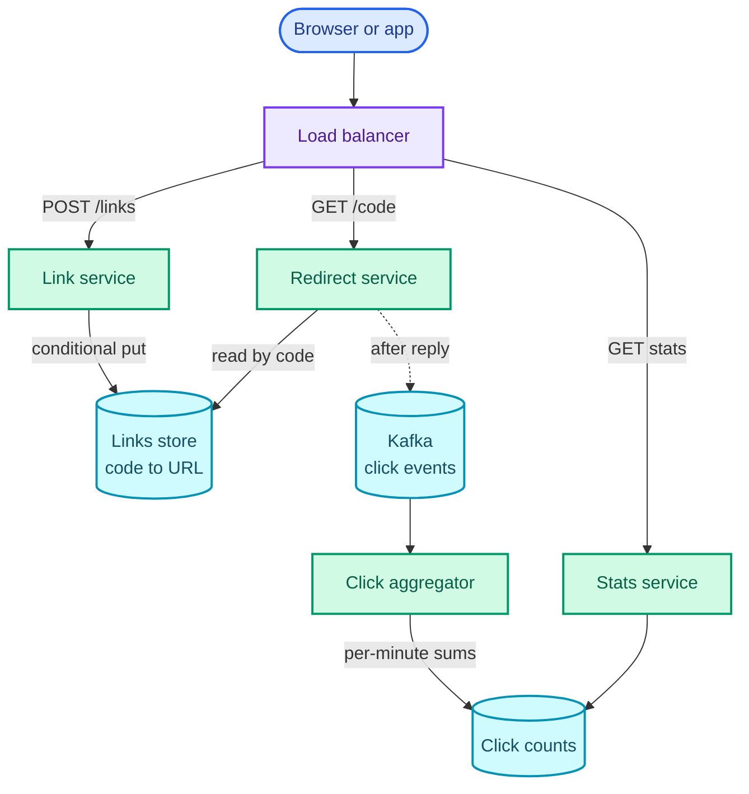
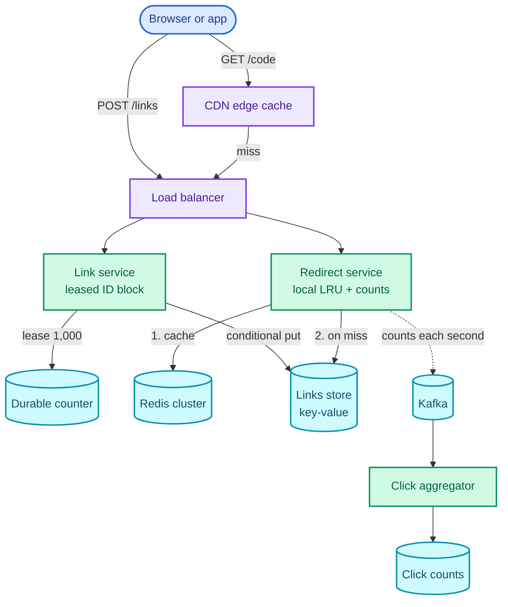

"Design a URL shortener like Bitly. Users paste a long URL and get a short link that redirects to it."

It sounds like the easiest question in the book, and the redirect really is one lookup: code in, long URL out. What the question is testing is the two places that lookup gets hard. The first is the write: **minting a short code that is unique across many servers**, short enough to be worth having, and not guessable, without every creation waiting on one machine. The second is the read: **keeping the redirect one lookup long when reads outnumber writes a hundred to one**, and one link can go viral at tens of thousands of clicks a second.

The pattern it teaches is *scaling reads*: layered caches, a CDN, immutable data that never needs invalidating, and getting the write traffic that reads cause (click counting) off the request path. The [news feed](/blogs/hld-news-feed/) (Part 7) reuses it with precomputed timelines, and [Ticketmaster](/blogs/hld-ticketmaster/) uses it for event pages. It leans on five System Design parts: [the estimate method](/blogs/system-design-foundations/), [caching](/blogs/system-design-caching/), [CDNs](/blogs/system-design-the-edge/), [distributed IDs](/blogs/system-design-distributed-primitives/) and [key-value stores](/blogs/system-design-databases-nosql/).

How to use this post: [the method](/blogs/hld-the-method/). Try the question cold first, then read.


You are a senior engineer interviewing me for a system design round. The question is: "Design a URL shortener like Bitly: users paste a long URL, get a short link, and anyone who opens the short link is redirected to the original. Owners can see how many clicks their links got." Run it as a realistic 45-minute interview following this structure: requirements (5 min), core entities (2 min), API (5 min), high-level design (10-15 min), deep dives (10 min).
Rules: state the question in one sentence and stop. Answer my clarifying questions the way a real interviewer would, briefly, and only what I ask. If I ask about scale, say 100 million new links a day and 10 billion redirects a day, kept for at least five years. Never propose designs, components or classes yourself. If I skip a stage or run long on one, say so in one line and keep time. When I finish a stage, write one line of the note you would put on the scorecard, then move on.
Once my design is in place, probe it with these, one at a time, waiting for my answer each time: 1) How exactly do you generate a short code, and how long must it be? Why not hash the long URL? Put a number on the collision rate at our scale. 2) If your codes come from a counter, what stops someone from walking through every link we have ever created? 3) A link goes viral at 50,000 clicks a second. Which component feels it first, and what do you do? 4) Do you answer with a 301 or a 302, and what does that choice do to click counts and to expiring a link? 5) Two users ask for the same custom alias at the same instant. Who gets it, and what enforces that? 6) The cache cluster loses a node at peak. What happens to the database?
At the end, grade me as hire / lean hire / lean no hire / no hire for a senior engineer, with the two strongest and two weakest moments, and the one thing to fix first.



## Requirements

### Functional

1. Users should be able to create a short URL from a long URL, optionally with a custom alias and an expiry date.
2. Users should be able to open a short URL and be redirected to the original.
3. Users should be able to see how many times each of their links was clicked.

Below the line (out of scope):

- **Editing where a link points after creation.** It turns immutable data into mutable data, which changes the whole caching story. Worth offering as a follow-up.
- **Accounts and sign-in.** Assume an auth token arrives with every request that needs one.
- **Malware and spam scanning of destinations.** A separate asynchronous pipeline that can disable a link; it doesn't change this design.
- **Rich analytics** (referrers, countries, devices over time). Counts per day are in; dashboards are a reporting system of their own (see the [ad click aggregator](/blogs/hld-ad-click-aggregator/)).

### Non-functional

- **Redirect latency: under 50 ms at p99**, measured at our load balancer. The redirect sits in front of every page load the link leads to, so it can't afford a slow database read on the common path.
- **Redirect availability: 99.99%**, which is about 53 minutes of downtime a year (525,960 minutes × 0.0001). During a partition, a redirect served from a slightly stale replica beats no redirect, so the read path is **available (AP)**. Because links never change after creation, "stale" can only mean "a link created in the last second isn't visible yet", which is cheap to accept.
- **Uniqueness: one code maps to one URL, forever.** Two different URLs must never get the same code, even when two servers create links at the same instant. Code assignment is **consistent (CP)**: if we can't guarantee uniqueness, creation fails rather than guessing.
- **Scale: 100M new links a day and 10B redirects a day**, a 100:1 read:write ratio, with peaks of 3x and single links that go viral at 50,000 clicks a second.
- **Click counts lag by at most a minute** and may be approximate: losing a second's worth of counts in a server crash is acceptable; counting a click twice routinely is not.

### Capacity estimate

The [System Design series](/blogs/system-design-foundations/) ran this estimate at 100M links a *month* and concluded that one primary database plus a cache was plenty. At 100M a *day*, thirty times more, the conclusions change, which is why the estimate is worth doing again.

- **Writes:** 100,000,000 ÷ 86,400 s ≈ 1,160 links a second, about 3,500 at a 3x peak.
- **Reads:** 10,000,000,000 ÷ 86,400 ≈ 115,700 redirects a second, about **347,000 at peak**. No single database serves that; **so a cache tier is mandatory, not an optimisation.**
- **Storage:** 100M a day × 365 × 5 years = 182.5 billion links. At about 500 bytes each (code, URL, owner, timestamps, index overhead), that's 182.5 × 10⁹ × 500 B ≈ **91 TB**. **So the link store must be partitioned across machines.**
- **Code length:** with base62 (the 62 characters 0–9, a–z, A–Z, all safe in a URL), six characters give 62⁶ ≈ 56.8 billion codes, fewer than the 182.5 billion we need. Seven give 62⁷ ≈ 3.52 trillion, of which five years uses 5.2%. **So codes are seven characters.**
- **Clicks:** every redirect is also a click to count, 115,700 a second on average. **So the biggest write stream in the system isn't link creation, it's click counting**, and it can't be a database write on the redirect path.

## Core entities

- **User:** owns links; comes from the auth token.
- **Link:** a code, the long URL it points to, an owner, an optional expiry. Immutable once created.
- **Click:** one redirect event (code, time); never stored one row per click.
- **ClickCount:** clicks per link per time bucket, the thing owners read.

## API

```text
POST /links                                  (owner from the auth token)
     { long_url, custom_alias?, expires_at? }
  -> 201 { code, short_url, expires_at }
  -> 409 Conflict if custom_alias is taken
  -> 400 if long_url isn't an http(s) URL under 2,048 characters

GET /{code}
  -> 302 Found, Location: <long_url>
  -> 404 Not Found if the code doesn't exist
  -> 410 Gone if the link has expired

GET /links/{code}/stats                      (owner only)
  -> { code, total_clicks, clicks_by_day: [{ day, clicks }] }
```

The redirect returns 302, not 301; deep dive 3 is why. The owner comes from the token on both authenticated endpoints, so nobody can create links as someone else or read someone else's stats by changing a body field.

## High-level design

### 1. Users can create a short URL

`POST /links` arrives at the load balancer and goes to the **Link service**, a stateless service that validates the URL, gets a code and stores the mapping. For now, the code comes from a counter, base62-encoded: the counter's next value, written in base 62, padded to seven characters. Deep dive 1 replaces that with something that survives scale and doesn't leak every link we own.

The service writes one row to the **links store** with a conditional write, one that succeeds only if no row with that code exists yet:

```text
links:  code (partition key), long_url, owner_id, created_at, expires_at
```

The partition key is the field that decides which machine holds a row; with 91 TB the table spans many machines (deep dive 5). The conditional write is what makes uniqueness a property of the store rather than a hope about the application. The service then returns the short URL to the client.

### 2. Users are redirected

`GET /abc1234` arrives at the load balancer and goes to the **Redirect service**, a separate deployment from the Link service. Same codebase or not, they scale differently: redirects are a hundred times the traffic and need nothing but a read.

The Redirect service reads the row by code, checks `expires_at`, and answers `302 Found` with a `Location` header carrying the long URL. Unknown code: 404. Expired: 410 Gone, which tells clients and crawlers the link existed and is deliberately dead.

This reads the store 347,000 times a second at peak, which it won't survive. That's deep dive 2.

### 3. Owners see click counts

After answering, the Redirect service publishes a click event (`code`, `timestamp`) to **Kafka**, an event stream that holds events durably and lets consumers read them at their own pace. Publishing happens after the response is written, so the user never waits for analytics. A **Click aggregator** consumes the stream, adds up clicks per code per minute, and writes the totals:

```text
click_counts:  code (partition key), minute (sort key), clicks
```

`GET /links/{code}/stats` goes to a small **Stats service**, which checks that the caller owns the link and sums the rows. Here is the whole design so far. Read it from the top: the gateway splits creation from redirects, and everything below the Redirect service happens after the user has their response.



Every requirement has a path. The weak spots, named and left for the deep dives: where codes come from, the redirect reading the store directly, and what the response code does to counting.

## Deep dives

### 1. How do you mint a unique seven-character code?

This is the uniqueness requirement, at 3,500 creations a second, from many Link service instances at once.

**Bad: hash the long URL and keep seven characters.** Take an MD5 or SHA-256 of the URL, encode it in base62, keep the first seven characters. It needs no coordination, which is its appeal. It fails on collisions, and the birthday problem (the chance that some pair of random values matches grows with the square of how many you draw) makes them common at this scale:

- In year five, with 182.5 billion codes taken out of 3.52 trillion, a new code collides with an existing one 182.5 ÷ 3,521.6 ≈ **5.2%** of the time.
- Over the five years, the expected number of collisions is about n² ÷ 2N = (1.825 × 10¹¹)² ÷ (2 × 3.52 × 10¹²) ≈ **4.7 billion**.

Each collision has to be detected (a conditional write that fails) and retried with a salt, so the "no coordination" scheme ends up with a retry loop on one write in forty. It also gives two users who shorten the same URL the same code, so their click counts merge, and it lets anyone compute the code for a URL in advance.

**Good: one global counter, base62-encoded.** A counter can't collide: every call returns a number nobody else got. Redis `INCR` does it in well under a millisecond, and it's atomic because Redis executes commands one at a time on a single thread, so two `INCR`s can't interleave. 3,500 calls a second is a few percent of one node's capacity.

Two problems remain. First, every creation now waits on one machine, and Redis replicates asynchronously: if the primary fails over to a replica that hadn't received the last few increments, the new primary hands those numbers out again, and **two links get the same code**. A durable counter (a row in Postgres updated in a transaction, or a key in etcd, which replicates through Raft consensus) fixes that but is slower. Second, sequential codes are guessable. If my link is `…/000a1Bc`, the next one is `…/000a1Bd`, and a script can walk the whole space, including links people assumed were private, like shared documents.

**Great: lease ranges from a durable counter, then scramble.** Each Link service instance asks the counter for a block of 1,000 IDs at a time (`UPDATE counter SET next = next + 1000 RETURNING next`, or a compare-and-swap on an etcd key) and hands them out from memory. The figure shows four leases and one crash. Watch the hatched part of each block (the IDs already used) and the arrow, which marks where the next lease will start.

<figure class="sketch"></figure>

At the 3,500-a-second peak, the counter sees 3.5 calls a second, so it can live in the slowest, safest store you have. A crash throws away the rest of a block, at most 999 IDs, which is nothing against 3.52 trillion.

Then the ID goes through a **keyed permutation** before encoding: a function that maps every number in the code space to a different number in the same space, so uniqueness survives, but in an order nobody can predict without the key. A small Feistel cipher does it. Split the ID's 42 bits (2⁴² ≈ 4.40 trillion, a little above 62⁷) into two halves, mix one half with a keyed hash of the other, swap, and repeat for a few rounds; that construction is reversible, so distinct inputs always give distinct outputs. If a result lands at or above 62⁷, encrypt it again until it's in range ("cycle-walking"), which takes 1.25 passes on average (4.40 ÷ 3.52). The conditional write stays as a safety net.

The obvious alternative is a [Snowflake ID](/blogs/system-design-distributed-primitives/), which needs no counter at all. It loses on length. Its millisecond timestamp sits above 22 bits of machine and sequence, so each millisecond adds 2²² ≈ 4.2 million to the ID whether or not anyone created a link. Even with an epoch starting today, IDs pass 62⁷ after about 14 minutes (3.52 × 10¹² ÷ 4.2 × 10⁶ ≈ 840,000 ms) and need ten base62 characters within about five weeks. Snowflake is the right answer for message IDs. For a code whose whole job is to be short, a counter over a dense range wins.

### 2. How do redirects stay under 50 ms at 347,000 a second?

This is the latency and availability requirements together, and it's the heart of the scaling-reads pattern.

**Bad: every redirect reads the links store.** 347,000 reads a second at peak reach the database. A partitioned key-value store could be provisioned for it at a high bill; a relational primary can't do it at all. And every redirect pays a network round trip to storage that the data didn't need, because the answer for a code never changes.

**Good: a Redis cache in front of the store, cache-aside.** Cache-aside means the Redirect service checks Redis first, and on a miss reads the store and writes the answer into Redis for next time ([caching](/blogs/system-design-caching/) has the alternatives). The property that makes this easy is that **links are immutable**. The usual hard part of caching, invalidating entries when the data changes, doesn't exist here: an entry is correct until the link expires or is deleted, so the TTL (time to live, after which Redis drops the entry) can be a day, capped at the link's remaining lifetime.

Sizing it, from the numbers:

- **Memory:** clicks follow a power law, a few links get most of them. Say the hot set is 20% of the last 30 days' links: 0.2 × 3 billion = 600 million entries. At about 200 bytes each (a 7-byte code, a 100-byte URL and Redis's per-key overhead) that's **120 GB**.
- **Throughput:** at a rule-of-thumb 100,000 operations a second per node, 347,000 lookups need at least four nodes, more with headroom. **So the cluster is sized by throughput, not memory:** about six nodes of 32–64 GB, each with a replica.
- **The store:** at an assumed 99% hit rate, 1% of 347,000 ≈ 3,500 reads a second reach it. That's a comfortable load for the store in deep dive 5.

**Great: a CDN in front, a tiny in-process cache for viral links, and coalesced misses.** Three additions, each for a specific failure of the Good rung.

A **CDN** (a network of caches near users) can answer redirects itself if the response says it may: `Cache-Control: public, max-age=0, s-maxage=300`. `s-maxage` applies only to shared caches like the CDN, and `max-age=0` tells the browser not to keep it, so the CDN serves a link for up to five minutes while every browser still asks. The cost is that a click answered by the CDN never reaches the Redirect service, so counting must read the CDN's logs. The figure follows one peak second through the layers, with the hit rates marked as assumptions.

<figure class="sketch"></figure>

The CDN removes half and Redis almost all of the rest, so the store ends up serving 1,700 reads a second instead of 347,000, a 200x cut.

**Viral links** are the second fix. A Redis cluster spreads keys across nodes by hashing them, so all 50,000 clicks a second on one viral link land on one node: half that node's budget, for one key. That's a hot key. A small in-process LRU cache in each Redirect service instance (least recently used: when full, it evicts whatever was read longest ago), holding the 10,000 hottest codes for a few seconds, takes the viral link off Redis entirely. Immutability makes this safe: a five-second-old copy is still correct.

**Coalesced misses** are the third. When a Redis node dies, every key it held misses at once, and without care thousands of requests for the same code each read the store. Single-flight (one in-flight store read per key per server; other requests for that key wait for its answer) turns a thundering herd into one read per key per server. Behind that, a circuit breaker sheds load before the store falls over, and Redis replicas mean a failed node is replaced in seconds.

### 3. 301 or 302, and how are clicks counted?

This is the analytics requirement, and it starts with the status code.

A **301 Moved Permanently** tells the browser the move is permanent, and HTTP lets clients cache a 301 even with no cache headers ([RFC 9110](https://www.rfc-editor.org/rfc/rfc9110#section-15.4.2) calls it "heuristically cacheable"). Browsers do: the second click on the same link goes straight to the destination. A **302 Found** is a temporary redirect, which browsers don't store unless the response tells them to, so every click comes back through us. The figure runs two clicks on the same link under each code; watch where the green dots (counted clicks) appear.

<figure class="sketch"></figure>

A 301 is cheaper (fewer requests) but undercounts and, worse, can't be taken back: once a browser has cached it, expiring or disabling the link does nothing for that browser. Since we promised click counts and expiry, the answer is **302** (or 307, the temporary redirect that also forbids changing the request method). When I built [LinkPulse](/blogs/production-grade-devops-platform/), a shortener with click analytics, the redirect did exactly this: one read, a 302, and the click handed to a queue.

Counting the clicks, then:

**Bad: increment a counter column on every redirect.** `UPDATE links SET clicks = clicks + 1` turns 115,700 reads a second into 115,700 writes a second on the redirect path, and a viral link becomes one row taking 50,000 writes a second, each waiting for the previous one's row lock. Analytics now sets the latency of redirects, which is backwards.

**Good: publish an event and aggregate off the path.** This is the high-level design: a click event to Kafka after the response, an aggregator that sums per code per minute. Sizing: 115,700 events a second at about 100 bytes each is 11.6 MB a second, 35 MB a second at peak; at a rule-of-thumb few to tens of MB a second per Kafka partition, a dozen partitions keyed by code is plenty. Keying by code keeps one link's events on one partition, so one aggregator owns that link's count. The aggregator stores each minute's sums together with the Kafka offset (its position in the partition) they include, so after a restart it resumes from that offset and doesn't count the same events twice. The flaw: a viral link is now a hot partition, 50,000 events a second into one aggregator.

**Great: pre-aggregate in the Redirect service.** Each instance keeps an in-memory map of code to clicks and flushes it once a second as `(code, count)` events. A viral link at 50,000 clicks a second spread over 100 instances becomes 100 events a second instead of 50,000. The cost is that a crashed instance loses up to one second of its counts, which the requirements allowed ("approximate, a minute behind"). If counts were money, as in an ad system, that trade wouldn't be acceptable; the [ad click aggregator](/blogs/hld-ad-click-aggregator/) is the question about doing it exactly.

### 4. Custom aliases and expiry

This is uniqueness again, from a different direction, plus correctness at the end of a link's life.

**Custom aliases share the code namespace.** If Asha asks for `…/launch`, nobody else may have it, and two requests for it can arrive at the same instant.

**Bad: check, then insert.** `SELECT` to see if `launch` is free, then `INSERT`. Both requests see it free and both write; with a plain put (DynamoDB's `PutItem` replaces an existing item), the second silently overwrites the first. This is the check-then-act race: the gap between the check and the act is where the other request gets in.

**Good: let the store enforce it.** Insert with a condition: DynamoDB's `attribute_not_exists(code)`, or a Postgres primary key with `INSERT … ON CONFLICT DO NOTHING`. Exactly one insert succeeds, and the other gets a 409. The same conditional write protects generated codes: an alias that happens to be seven base62 characters could equal a code the generator produces years later, and when that happens the generator's conditional write fails and it takes the next ID.

**Great:** the conditional write, plus rules that keep aliases from causing trouble: 4–30 characters from `[A-Za-z0-9_-]`, a reserved list (`api`, `admin`, `login`, `stats`) so an alias can't shadow a route, and the same rate limit on creation as on any abusable endpoint ([the next part](/blogs/hld-rate-limiter/) designs that limiter).

**Expiry** has a subtle trap. Three mechanisms work together:

- **On read:** the Redirect service checks `expires_at` on every request and answers 410 after it. This is the one that makes expiry correct; the others are clean-up.
- **In caches:** the Redis TTL and the CDN's `s-maxage` are both capped at the link's remaining lifetime, so no cache serves a link past its expiry.
- **In the store:** a TTL attribute or a sweeper job deletes expired rows to reclaim space. DynamoDB's TTL deletes lazily, typically within a few days, which is why the read-path check can't be skipped.

The trap is **reusing expired codes**. The code space is 95% empty after five years, so there's never a reason to, and doing it means a QR code printed on a 2026 poster could send someone to a stranger's page in 2028. Expired codes stay dead.

### 5. Where do 91 TB live?

This is durability and scale for the store itself.

**Bad: one relational primary.** 91 TB on one machine is beyond comfortable, and restoring it or bootstrapping a replica takes days, during which you're one failure from an outage.

**Good: Postgres sharded by a hash of the code.** Every query is by code, so each request touches one shard, and [consistent hashing](/blogs/system-design-databases-relational/) limits how much data moves when shards are added. It works. The cost is operating it: resharding, per-shard failover and backups are now your team's job.

**Great: a partitioned key-value store with the code as the partition key** (DynamoDB or Cassandra). The access pattern is pure key-value, which is exactly what these stores are built for: they spread partitions across nodes, replicate each write to three copies, and add capacity without a resharding project. Scrambled codes spread evenly, so there are no hot partitions from the key design (viral reads were absorbed by the caches above). The one extra query, "list my links", is served by a secondary index on `owner_id`.

With the deep dives in, the design grows a CDN, a cache layer and a counter. Read it top down again: the dotted edges are the asynchronous ones, off the user's path.



The Stats service is left out of this one to keep it readable; it still reads the click counts as before.

## What each level is expected to show

| Level | What a strong answer shows on this question |
| --- | --- |
| Mid-level | A working create and redirect path with a cache, a defensible code scheme (counter plus base62), and the reason the code is seven characters. Answers 301 vs 302 correctly when asked. |
| Senior | Raises code generation and hot links unprompted, with numbers: collision rates for hashing, range leasing, cache sizing by throughput. Moves click counting off the redirect path and explains why links being immutable makes caching easy. |
| Staff+ | Drives the trade-offs end to end: guessable codes as a security issue, counter durability under failover, CDN caching versus analytics, never reusing codes, and what changes if links become editable. Knows where the design is deliberately simple and says why that's right. |

## Variants this unlocks

| Question | What changes |
| --- | --- |
| Design Pastebin | The value is a text blob, not a URL: store it in a blob store (S3) and keep the code-to-object mapping here. Same codes, same caching; reads are larger, so the CDN matters more. |
| Design a QR code generator | The code is rendered as an image, and printed links can never change: 302s through your own domain so the destination can still be fixed, and code reuse is absolutely out. |
| Design an invite or referral code system | Codes must be unguessable and often single-use: the scrambled counter fits, plus a conditional "redeem once" write. Volume is tiny; correctness is the question. |
| Design a deep-link router (open the app if installed, else the store or the web) | The redirect decision depends on the device: the Redirect service reads user-agent rules, which makes responses less cacheable at the CDN. |
| Design short IDs for a video or photo site | The same dense-range-plus-permutation trick produces short, unguessable public IDs for any resource, separate from the internal primary key. |

## The one-page version

- Requirements: create (alias, expiry), redirect, click counts; 100M creates and 10B redirects a day.
- Estimate: 347k redirects/s at peak, 91 TB over five years, codes of seven base62 characters (62⁷ ≈ 3.52T), 115k clicks/s to count.
- Link service leases blocks of 1,000 IDs from a durable counter: 3.5 counter calls a second at peak.
- Each ID goes through a keyed 42-bit Feistel permutation (cycle-walk into range), then base62: unique, short, unguessable.
- Links are stored once, immutable, in a key-value store partitioned by code, written with a conditional put.
- Redirect service: in-process LRU, then a Redis cluster (cache-aside, TTL capped at expiry), then the store; misses coalesced per key.
- CDN in front with `s-maxage`, browsers told `max-age=0`.
- Answer 302, never 301, so every click is seen and links can expire.
- Clicks are pre-aggregated per second in each Redirect instance and published to Kafka; an aggregator writes per-minute counts.
- Custom aliases share the namespace and rely on the same conditional write; reserved words are blocked; expired codes are never reused.

**Key sentence: mint codes from leased counter ranges scrambled into seven base62 characters, store each code once and immutably, and answer every redirect with a 302 from CDN, then cache, then a key-value store, counting clicks off the hot path.**


You are my system design interview coach. I have studied a design for a URL shortener like Bitly (100 million new links a day, 10 billion redirects a day, five years retained, click counts for owners) and I want you to test whether I can defend it. Ask me the questions below one at a time. After each, wait for my answer. Judge it against the expected key points, which you must not reveal before I answer. If I'm right, confirm briefly and add any nuance I missed. If I'm stuck, give a small hint, then a bigger one, before explaining. Never show an answer before I've attempted it.
1. How long must a code be, and why? Expected: base62; 62^6 is about 56.8 billion, fewer than the 182.5 billion links in five years (100M a day x 365 x 5); 62^7 is about 3.52 trillion, so seven characters, about 5% used.
2. Why not hash the long URL and keep seven characters? Expected: collisions by the birthday problem; in year five about 5.2% of new codes collide (182.5B / 3.52T), roughly 4.7 billion collisions over five years (n squared over 2N); needs a retry loop anyway; identical URLs from different users share a code and stats; codes are predictable.
3. What is wrong with a single Redis INCR counter, and what do you do instead? Expected: single dependency on every create; Redis replication is asynchronous, so a failover can reissue recent IDs and create duplicate codes; sequential codes are enumerable. Fix: lease blocks of about 1,000 IDs from a durable counter (Postgres row or etcd), about 3.5 lease calls a second at the 3,500/s peak; lost blocks on crash are harmless; pass IDs through a keyed permutation (Feistel cipher over 42 bits with cycle-walking) before base62; keep a conditional write as a safety net. Snowflake rejected because its timestamp bits make IDs need ten base62 characters within weeks.
4. How do redirects stay under 50 ms p99 at 347,000 a second? Expected: cache-aside Redis; links are immutable so no invalidation, TTL capped at expiry; hot set about 600M entries x 200 B, about 120 GB, but sized by throughput (at about 100k ops/s per node, four or more nodes, about six with headroom); at 99% hit about 3,500 reads/s reach the store; CDN with s-maxage and max-age=0; in-process LRU for viral hot keys; single-flight on misses; circuit breaker.
5. 301 or 302? Expected: 302 (or 307). A 301 is heuristically cacheable and browsers keep it, so repeat clicks bypass the service: undercounted analytics and no way to expire or disable the link for browsers that cached it.
6. How are 115,000 clicks a second counted, and what about a link at 50,000 clicks a second? Expected: never a database increment on the redirect path (hot row, lock queue, analytics setting redirect latency); publish events to Kafka after responding, partitioned by code, about 11.6 MB/s average; pre-aggregate per code per second in each Redirect instance so a viral link becomes one event per instance per second; accepts losing up to a second of counts on a crash, which the requirements allow.
7. Two users request the same custom alias at the same instant. Expected: check-then-insert races; use a conditional insert (attribute_not_exists or primary key with ON CONFLICT), one wins, the other gets 409; the same conditional write stops a generated code colliding with an alias; reserved words list.
8. A link expires. What must happen, and may its code be reused? Expected: check expires_at on every read and return 410; cap cache TTL and CDN s-maxage at remaining lifetime; store TTL or a sweeper is clean-up only (DynamoDB TTL is lazy); never reuse codes, because printed links and QR codes would land on someone else's page.
At the end, tell me which answers were interview-ready and which need another pass.



Next: [Design a distributed rate limiter](/blogs/hld-rate-limiter/), where the shared state is a counter that a hundred servers increment at once, and the question is how wrong it's allowed to be.
