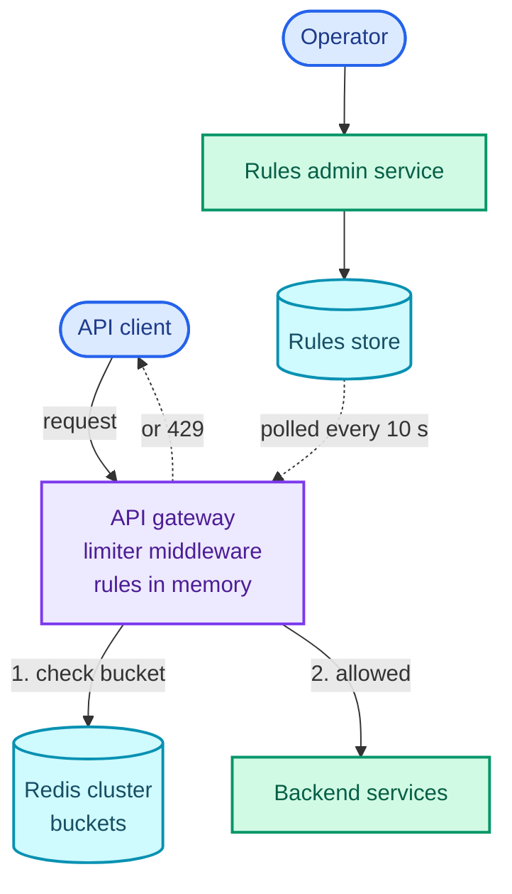
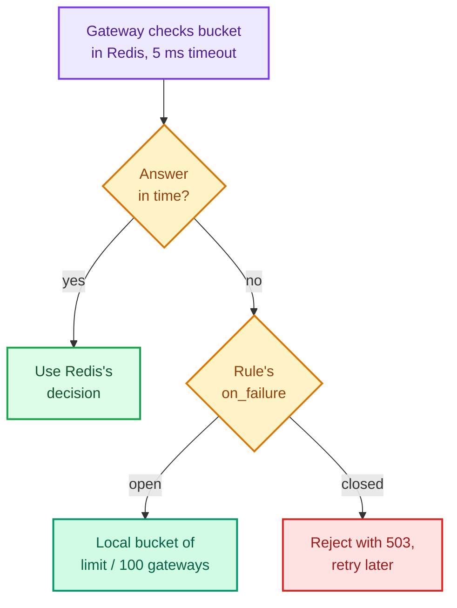

"Design a rate limiter for our public API. Each client gets a limit, say 100 requests a minute, and requests over it are rejected."

On one server this is a dictionary of counters. The question is hard because there isn't one server: a hundred API gateway instances each see a slice of every client's traffic, and the limit is for the client as a whole. So what it's really testing is **a shared counter that many machines read and update at the same instant**, on the path of every request, in a millisecond or two. Get the read-modify-write wrong and the limit leaks; put a slow network hop in front of it and you've slowed the whole API; let the counter store fail and you might take the API down with it.

The pattern it teaches is *shared counters under concurrency*: atomic operations on a central store, sharding that store by key, hot keys, and an explicit decision about what happens when the store is unreachable. [Ticketmaster](/blogs/hld-ticketmaster/) reuses the atomicity half for seat holds, [Uber](/blogs/hld-uber/) for one-driver-one-ride, and the [web crawler](/blogs/hld-web-crawler/) and [notification system](/blogs/hld-notification-system/) embed a limiter of their own. It leans on four System Design parts: [rate limiting at the edge](/blogs/system-design-the-edge/) (where the algorithms are introduced), [Redis](/blogs/system-design-caching/), [the API gateway](/blogs/system-design-application-layer/) and [CAP](/blogs/system-design-cap-consistency/).

How to use this post: [the method](/blogs/hld-the-method/). Try the question cold first, then read.


You are a senior engineer interviewing me for a system design round. The question is: "Design a distributed rate limiter for our public API: each client gets a configurable limit, such as 100 requests a minute, enforced across all our API servers, and requests over the limit are rejected." Run it as a realistic 45-minute interview following this structure: requirements (5 min), core entities (2 min), API (5 min), high-level design (10-15 min), deep dives (10 min).
Rules: state the question in one sentence and stop. Answer my clarifying questions the way a real interviewer would, briefly, and only what I ask. If I ask about scale, say 1 million requests a second at peak across about 100 gateway instances, about 10 million clients active in any minute, and three regions. Never propose designs, components or classes yourself. If I skip a stage or run long on one, say so in one line and keep time. When I finish a stage, write one line of the note you would put on the scorecard, then move on.
Once my design is in place, probe it with these, one at a time, waiting for my answer each time: 1) Which algorithm did you pick, and what does a fixed window let through at its boundary? 2) Two gateways check the same client at the same instant with one request left. Walk me through exactly what stops both from being allowed. 3) We have 1 million checks a second. How many counter nodes is that, and what happens when one client sends 200,000 requests a second? 4) The counter store is down for two minutes. Does the API stay up, and is anything still limited? Is that the same for the login endpoint? 5) We run in three regions. Is the limit global, and what does it cost to make it so? 6) What does a rejected client receive, and how should it behave?
At the end, grade me as hire / lean hire / lean no hire / no hire for a senior engineer, with the two strongest and two weakest moments, and the one thing to fix first.



## Requirements

### Functional

1. The system should be able to limit each client's requests against a configured rule, such as 100 requests a minute per API key, enforced across every gateway instance.
2. Clients over their limit should receive a `429 Too Many Requests` that tells them when they may retry.
3. Operators should be able to add and change rules (per endpoint, per plan) without a deploy.

Below the line (out of scope):

- **Billing quotas** ("1 million calls a month on the Pro plan"). That's metering: exact, durable, auditable, and read once a month. A limiter is fast, approximate and forgets; mixing the two gets you neither.
- **Network-level DDoS.** Floods of packets that never form an HTTP request are absorbed by the CDN or a scrubbing provider before they reach anything we build.
- **Queueing instead of rejecting** (holding a request until there's capacity). A different product, discussed under the leaky bucket below.

### Non-functional

- **Overhead: the limiter adds under 2 ms at p99** to each request, because it runs on every request. That rules out anything slower than one round trip to a store in the same datacenter.
- **Scale: 1 million requests a second at peak**, spread over about 100 gateway instances, from about 10 million clients active in any given minute.
- **Accuracy: a client never gets more than about 10% over its limit** in normal operation. Exactness isn't required; nobody is billed from these counters.
- **Availability: a limiter failure must not take the API down.** The limiter is a protection, not a dependency. During a partition or an outage of the counter store, the default is to keep serving (**available, AP**) with a degraded limit, except on endpoints where one unlimited request costs real money or security, like login and sending SMS codes, which **fail closed** (refuse when unsure).
- **Rule changes take effect within 30 seconds.**

### Capacity estimate

Two numbers decide the shape of the counter store, and they point in opposite directions.

- **Memory says one node.** A token bucket (the algorithm deep dive 1 lands on) is two numbers per client: tokens left and when they were counted. I measured it in Redis 7.4 rather than guessing: 393,541 buckets took 55.9 MB, about **142 bytes each**. 10 million active clients × 142 B ≈ **1.4 GB**, which fits in a corner of one machine's memory.
- **Throughput says about twenty.** Every request is one check, so the store sees 1 million operations a second at peak. The check is a small script, not a single command; on my laptop, inside Docker, it ran at about 19,700 calls a second against 42,800 for a plain `INCR`, so it costs roughly twice a simple command. Applied to the rule of thumb of 100,000 simple operations a second per production node, that's a budget of about 50,000 checks a second per node. 1,000,000 ÷ 50,000 = **20 nodes at full load**, so about 30 to run at two-thirds.

**So the counters must be sharded by client key, for throughput, not for space.**

## Core entities

- **Rule:** what to match (endpoint, plan), what to key on (API key, user, IP), the bucket's capacity and refill rate, and whether to fail open or closed.
- **Client key:** the identity a rule counts against, taken from the authenticated request.
- **Bucket:** the counter state for one client under one rule.
- **Decision:** allowed or not, tokens remaining, and how long until a retry can succeed.

## API

A rate limiter is mostly an internal component, so it has two interfaces: the check every gateway calls, and what the client sees.

```text
check(client_key, rule_id, cost = 1)
  -> { allowed, remaining, retry_after_ms }

Any API endpoint, over the limit:
  HTTP/1.1 429 Too Many Requests
  Retry-After: 1                     (seconds until a request can succeed)
  X-RateLimit-Limit: 100
  X-RateLimit-Remaining: 0

PUT /admin/rules/{rule_id}             (operators only)
    { match, key_by, capacity, refill_per_sec, on_failure: open | closed }
```

`X-RateLimit-*` headers are a convention, not a standard, and APIs disagree on details such as whether a reset time is a timestamp or a number of seconds. The IETF has a draft standardising this as [`RateLimit` and `RateLimit-Policy` fields](https://datatracker.ietf.org/doc/draft-ietf-httpapi-ratelimit-headers/); worth naming in an interview, but `Retry-After` is the one clients already honour. The client key comes from the authenticated request, never from a header the client chooses: a limit keyed on something the client sets is a limit the client can reset.

## High-level design

### 1. Limit each client's requests across all gateways

A request arrives at an **API gateway** instance, the entry point that already terminates TLS and checks auth. That's where the limiter belongs, for the reason the [edge part](/blogs/system-design-the-edge/) gives: rejecting is cheapest before the request has cost anything. The alternatives are worse. In the client, it's advisory, because clients can be modified. In each backend service, every team rebuilds it and a rejected request has already used a connection and some CPU. A separate rate-limit service called over RPC works (Envoy's global rate limiting is built that way) and is a reasonable choice when services are written in several languages and can't share one middleware, at the cost of one extra hop.

So: limiter middleware inside the gateway. For each request it finds the matching rules (held in memory, see step 3), builds the bucket key, and asks the **counter store**, a Redis cluster, whether to allow it. Once deep dive 1 has picked the algorithm, the state kept per client and rule looks like this:

```text
Redis key   rl:{api_key_123}:search          (the braces are deliberate; deep dive 3)
Hash        tokens = 37.4, ts = 1793608800123
```

For the first version, the check can be a fixed window: `INCR` a key named for the client and the current minute, set it to expire after the minute, and allow while the count is at most the limit. It works, and it's wrong at the window edges, which is deep dive 1.

### 2. Reject with a 429 the client can act on

When the check says no, the gateway answers immediately with `429 Too Many Requests` and `Retry-After`, without forwarding anything. 429 is distinct from 503 Service Unavailable on purpose: 429 says *you* sent too much, 503 says *we* can't cope. A well-written client backs off for `Retry-After` seconds on a 429; a client that retries immediately is hammering a door that's already shut, which is why the headers matter as much as the rejection.

### 3. Change rules without a deploy

Rules live in a small **rules store** (a Postgres table behind an admin service). Every gateway polls it every 10 seconds and keeps the whole rule set in memory, so no request ever waits on a rules lookup. A rule change reaches every gateway within one poll interval, inside the 30-second requirement. Polling beats push here because the rule set is small (hundreds of rows) and a gateway that missed a push would be wrong silently; a gateway that missed a poll catches up on the next one.

Here is the design so far. Requests flow from the top; the counter store is on every request's path, the rules store on none of them.



Every requirement has a path. What's left for the deep dives: the fixed window's edge, two gateways updating one counter at once, a million checks a second, and the counter store going away.

## Deep dives

### 1. Which algorithm?

This is the accuracy requirement against the memory budget. There are five standard algorithms, and the [edge part](/blogs/system-design-the-edge/) introduced them in a table; here they get numbers.

**Bad: fixed window.** Count requests per client per clock minute and reset at the top of the minute. One counter per client, one `INCR` per request, which is why it's the first thing everyone builds. The flaw is the reset. The figure shows a client with a limit of 100 a minute sending 100 requests at 0:59 and another 100 at 1:00; read the two window labels, then the brace above.

<figure class="sketch"></figure>

Each window counted exactly 100, so all 200 were allowed, within two seconds. Up to 2x the limit can get through at any boundary, which breaks the "at most 10% over" requirement for any client that times its bursts.

**Good: sliding window log.** Keep a timestamp for every request in a Redis sorted set; on each check, drop timestamps older than a minute and count the rest. It's exact: the window really is "the last 60 seconds". It's also expensive. I measured a log of 100 timestamps at 3.2 KB per client in Redis's compact encoding, so 10 million clients × 3.2 KB ≈ **32 GB**, 22 times the token bucket. And Redis switches a sorted set to its larger skiplist encoding past 128 entries by default, so a limit like 1,000 an hour costs far more per client.

**Good: sliding window counter.** Keep only two fixed-window counts, the previous minute's and the current minute's, and estimate the last 60 seconds by assuming the previous minute's requests were spread evenly. The figure is at 1:15, a quarter of the way into the current minute; watch how much of the previous minute the green brace covers.

<figure class="sketch"></figure>

The last 60 seconds cover 75% of the previous minute, so the estimate is 84 × 0.75 + 36 = 99. Two counters per client, no boundary burst, and it's approximate only when traffic inside a minute is very uneven. Cloudflare published how close it gets on real traffic: across 400 million requests, [0.003% were wrongly allowed or limited](https://blog.cloudflare.com/counting-things-a-lot-of-different-things/).

**Great: token bucket.** Each client has a bucket that holds up to `capacity` tokens and refills at `rate` tokens a second; a request spends one token, or is rejected if there isn't one. Two numbers of state (tokens, and the time they were last counted), and no timer anywhere: refilling is computed lazily on each check as `tokens + elapsed × rate`, capped at capacity. The figure is the trace my test run printed for a bucket of 10 refilling at 1 a second; follow the blue line.

<figure class="sketch"></figure>

Twelve requests at t = 0: ten spend the full bucket, two are rejected with "retry in about a second". By t = 3 the bucket has refilled to 3, so of five more requests three pass and two don't.

It wins on this question for three reasons. Burst and steady rate are separate, explicit knobs: capacity 100 with a refill of 100 a minute means "a burst of up to 100, then 100 a minute on average", which is what most API plans want to say. A request can cost more than one token (an expensive search might cost 10), which no window counter expresses cleanly. And `retry_after` falls out of the arithmetic: the missing tokens divided by the rate.

The fifth algorithm, **leaky bucket**, queues requests and lets them out at a fixed rate, so the output is perfectly smooth and nothing is bursty. That's the right tool for the opposite direction, when *you* are the client of someone else's limit (a partner API or SMS provider that allows exactly 100 calls a second): queue your outbound calls and drain them at that rate. For inbound requests it adds queueing delay to requests that should have been answered or rejected at once.

### 2. Two gateways, one counter, the same instant

This is the correctness of the counter itself: the "at most 10% over" requirement under concurrency.

**Bad: read, decide, write from the gateway.** The gateway `GET`s the bucket, computes the refill and the decision, and `SET`s the new value. Between its `GET` and its `SET`, another gateway can do the same. The figure shows two gateways and one token left; read it top to bottom.

<figure class="sketch"></figure>

Both read 1, both write 0, both allow. Two requests on one token, and the stored count looks perfectly healthy. This is the lost update, the same race the [relational databases part](/blogs/system-design-databases-relational/) opens with. I ran it for real: 50 concurrent clients against a 10-token budget, each doing `GET` then `SET` from its own process. **All 50 were allowed, in each of three runs**, and the counter ended at 5, 7 and 6. That test exaggerates (each client was a separate `redis-cli` process, so the gap between read and write was tens of milliseconds), but the race only needs the gap to exist, not to be large.

**Good: let Redis do the arithmetic.** For a fixed window, `INCR` is enough: Redis executes commands one at a time, so increments can't interleave, and the gateway compares the returned count with the limit. A token bucket needs a read, a calculation and a write, which one command can't do. `WATCH` plus `MULTI`/`EXEC` makes it optimistic (the transaction aborts if the key changed after the `WATCH`, and the gateway retries), which is correct but degrades exactly when it matters: under an attack, every gateway is retrying on the same hot key.

**Great: one Lua script per check.** Redis runs a script atomically: [while a script executes, nothing else runs on that node](https://redis.io/docs/latest/develop/programmability/eval-intro/), so the read, the refill and the write are one indivisible step, in one network round trip. This is the whole limiter:

```lua
-- KEYS[1]  the bucket, e.g. rl:{key_123}:search
-- ARGV[1]  capacity (burst size), ARGV[2] refill rate per second, ARGV[3] cost of this request
local capacity = tonumber(ARGV[1])
local rate     = tonumber(ARGV[2])
local cost     = tonumber(ARGV[3])

-- One clock for every gateway: Redis's own, so gateway clock skew can't mint tokens.
local t   = redis.call('TIME')
local now = tonumber(t[1]) * 1000 + math.floor(tonumber(t[2]) / 1000)   -- milliseconds

local state  = redis.call('HMGET', KEYS[1], 'tokens', 'ts')
local tokens = tonumber(state[1]) or capacity    -- unknown key: a full bucket
local ts     = tonumber(state[2]) or now

-- Lazy refill: no timer anywhere; credit the time since the last call.
tokens = math.min(capacity, tokens + (now - ts) * rate / 1000)

local allowed = tokens >= cost
if allowed then tokens = tokens - cost end

redis.call('HSET', KEYS[1], 'tokens', tokens, 'ts', now)
-- An idle bucket is full again after capacity / rate seconds, so it may as well vanish.
redis.call('PEXPIRE', KEYS[1], math.ceil(capacity / rate * 1000))

local retry_ms = 0
if not allowed then retry_ms = math.ceil((cost - tokens) / rate * 1000) end
return { allowed and 1 or 0, math.floor(tokens), retry_ms }
```

Three details carry weight. The clock is Redis's `TIME`, not the gateway's, so a gateway whose clock runs fast can't refill buckets early; calling `TIME` before a write is safe because since Redis 7.0 scripts are replicated by their effects (the writes they make), not re-run on replicas. The expiry deletes idle buckets after they would have refilled anyway, which is what keeps memory at 1.4 GB rather than growing with every client who ever called. And gateways load the script once with `SCRIPT LOAD` and call it by its hash with `EVALSHA`, so the script's text isn't sent on every request.

I ran the same 50-concurrent-clients test against this script with a 10-token bucket: **exactly 10 allowed and 40 rejected, in each of three runs.** The earlier trace (10 of 12, then 3 of 5 after three seconds) is the same script.

### 3. A million checks a second, and the client sending 200,000 of them

This is the scale requirement, and a hot key inside it.

**Bad: one Redis node.** The estimate already ruled it out: at about 50,000 checks a second per node, one node carries 5% of the peak.

**Good: a Redis Cluster sharded by client key.** Redis Cluster splits the key space into 16,384 hash slots spread over the primaries, and each key lives in the slot its name hashes to. With 30 primaries each carrying about 33,000 checks a second at peak, every check is still one round trip to one node. The braces in `rl:{api_key_123}:search` are a **hash tag**: only the part inside them is hashed, so every bucket for one client (search, uploads, the global limit) lands in the same slot. That matters because a cluster runs a script only when all its keys are in one slot, and it lets one script check several of a client's rules at once.

Each primary has a replica. A failed primary is replaced in seconds, and the few increments lost in an asynchronous failover cost a client a handful of extra requests, which the accuracy requirement absorbs.

**Great: stop asking Redis about clients you've already rejected.** Sharding spreads clients, not one client's traffic. A single abusive key at 200,000 requests a second is four times one node's whole budget, all on one slot. The fix is in the gateways: when a check comes back rejected with `retry_after_ms = 800`, the gateway remembers "this key is denied until now + 800 ms" in local memory, and rejects that key's requests locally until then, without calling Redis. An abuser's flood then costs Redis about one call per gateway per retry interval, and legitimate clients on the same shard never notice. Cloudflare described the [same idea for their edge](https://blog.cloudflare.com/counting-things-a-lot-of-different-things/): once a client is being mitigated, the decision is cached in server memory until it expires.

The opposite case, a *legitimate* client with a very high limit (an internal service allowed 50,000 a second), has a variant fix: each gateway takes tokens in batches (spend 50 from the shared bucket in one call, then hand them out locally). It cuts the calls fifty-fold and lets the client overshoot by at most one batch per gateway, a trade worth making only for clients you trust.

### 4. The counter store is slow or down

This is the availability requirement: the limiter must not become the outage.

**Bad: call Redis with the client library's default timeout.** Defaults are often seconds. If a Redis node stalls, every request for its keys waits that long, gateway threads pile up, and a protection component has taken down the API it was protecting.

**Good: a tight timeout, a circuit breaker, and fail open.** A healthy check takes about a millisecond, so give it 5 ms; after a run of failures, a circuit breaker stops calling that node for a few seconds and lets a probe through now and then. While Redis can't answer, allow the request. The API stays up, which the requirements put first. The cost is that for the duration of the outage nothing is limited, which is an open door for exactly the clients the limiter exists for.

**Great: fail open to a local limit, and fail closed where it matters.** The decision on a failed check depends on the rule, so each rule carries `on_failure`. The flowchart below is the decision a gateway makes on every check; start at the top and follow the "no" branch.



**Fail open** (the default) falls back to a bucket in the gateway's own memory, sized at the rule's limit divided by the number of gateways. With 100 gateways and a limit of 100 a minute, each gateway allows a client 1 a minute. The load balancer spreads a client's requests across gateways, so across the fleet the client gets roughly its 100 a minute: rougher than Redis's answer, but a limit, not an open door.

**Fail closed** is for rules where one unlimited request has a real cost: login (an unlimited window for password guessing), sending an SMS code (each one is paid for, and SMS pumping fraud exists precisely to exploit unlimited sends), password reset. Those reject with a 503, because the problem is ours, not the client's. A two-minute Redis outage then means two minutes without new logins, which is a deliberate trade: the alternative is two minutes of unlimited guessing.

### 5. Three regions: is the limit global?

This is the consistency requirement, and the CAP trade in its plainest form.

**Bad: one Redis cluster in one region, called from all three.** The limit is exact and global. Every request from the other two regions now pays a cross-region round trip, tens to 150 ms, against a 2 ms budget. During a partition between regions, those regions either can't check at all or fall back to failing open. That's consistency bought with everyone's latency.

**Good: a Redis cluster per region, each enforcing the full limit.** Checks are local and fast again. A client that spreads its traffic over all three regions gets up to 3x its limit. Splitting the limit statically (each region gets a third) fixes the overshoot and breaks the common case: a client whose traffic all lands in one region, which is most of them, gets a third of what it paid for.

**Great: regional enforcement, with regions sharing what they've counted.** Each region enforces locally against the full limit, and every second each region publishes, per active key, how many tokens it spent; the other regions subtract those from their copy of the bucket. A client that spreads its traffic overshoots by at most about one second of spending in the other regions before the counts catch up, and a client that stays in one region sees exactly its limit. During a partition, each region keeps working on its own counts, which is availability chosen on purpose: these are soft limits, and no requirement here is worth an outage. If a business needs a hard global limit, the honest answer is to route each client to a home region by key, so one region owns its counter.

## What each level is expected to show

| Level | What a strong answer shows on this question |
| --- | --- |
| Mid-level | Places the limiter at the gateway, keys it on the client, uses Redis as a shared store, and names token bucket or sliding window with a correct description. Returns 429 with `Retry-After`. Sees the race when asked about two servers. |
| Senior | Explains why fixed windows leak at boundaries, makes the check atomic with a Lua script and explains why it must be, sizes the cluster from the throughput number (not memory), and makes fail-open versus fail-closed an explicit per-rule decision. |
| Staff+ | Drives the edges: hot keys and local denial caching, clock skew (Redis's clock in the script), multi-region trade-offs with a bounded overshoot, separating limiting from billing quotas, and what the limiter itself does to latency and availability when its store degrades. |

## Variants this unlocks

| Question | What changes |
| --- | --- |
| Design login brute-force protection | Two keys per attempt (per account and per IP) checked in one script, a much longer window, and fail closed. Lockouts must not let an attacker lock out a victim on purpose, so limit the attacker's IP harder than the account. |
| Design an OTP / SMS sending limiter | Each request costs money: fail closed, small limits per phone number and per account, and a global budget per destination country to blunt SMS pumping. |
| Design an API quota and billing meter | Durable and exact instead of fast and approximate: count from an event log (see the [ad click aggregator](/blogs/hld-ad-click-aggregator/)), reconcile, and use the limiter only to enforce a cached "over quota" flag. |
| Design web crawler politeness (one request per domain per second) | The limiter faces outward: per-domain leaky buckets that schedule your own fetches. See the [web crawler](/blogs/hld-web-crawler/). |
| Design a concurrency limiter (at most 10 requests in flight per client) | Count in-flight requests, not arrivals: increment on start, decrement on finish, with a lease expiry so a crashed request doesn't hold its slot forever. |
| Design an in-process rate limiter class | The same algorithms in one process, where the hard parts become thread safety and an injectable clock for tests: the [LLD rate limiter](/blogs/lld-rate-limiter/). |

## The one-page version

- Requirements: per-client limits across ~100 gateways, 429 with `Retry-After`, rules changed without a deploy; 1M checks/s, under 2 ms overhead, at most ~10% over.
- Estimate: a bucket is ~142 bytes (measured), 10M clients ≈ 1.4 GB, so memory fits one node; 1M checks/s at ~50k per node needs ~20 nodes. Shard for throughput.
- Limiter middleware in the API gateway; rules polled every 10 s and held in memory.
- Algorithm: token bucket (capacity = burst, refill = rate, cost per request); fixed window leaks 2x at boundaries, sliding log costs ~22x the memory.
- One Lua script per check: read, lazy refill, decide, write, expire, all atomic on the node, using Redis's `TIME`.
- Redis Cluster sharded by client key; `{client}` hash tag keeps a client's buckets in one slot.
- Hot keys: gateways cache "denied until T" locally; trusted high-rate clients take tokens in batches.
- Store failure: 5 ms timeout, circuit breaker; fail open to a local bucket of limit / N gateways; fail closed for login, SMS and password reset.
- Multi-region: regional enforcement, spent tokens shared every second, overshoot bounded by about a second of traffic.

**Key sentence: keep a token bucket per client in a Redis cluster sharded by client key, check and update it with one atomic Lua script per request on Redis's clock, cache rejections locally against hot keys, and when Redis can't answer, fall back to a local share of the limit, or refuse where one free request is too expensive.**


You are my system design interview coach. I have studied a design for a distributed rate limiter for a public API (1 million requests a second at peak over about 100 gateway instances, about 10 million active clients a minute, three regions, under 2 ms overhead, at most about 10% over a limit) and I want you to test whether I can defend it. Ask me the questions below one at a time. After each, wait for my answer. Judge it against the expected key points, which you must not reveal before I answer. If I'm right, confirm briefly and add any nuance I missed. If I'm stuck, give a small hint, then a bigger one, before explaining. Never show an answer before I've attempted it.
1. Why not a fixed window counter? Expected: the count resets at the window edge, so a client can send the full limit right before the boundary and again right after, up to 2x the limit in a couple of seconds.
2. Compare sliding window log, sliding window counter and token bucket. Expected: the log is exact but stores a timestamp per request (about 3.2 KB per client at 100 entries, about 32 GB for 10M clients, worse past 128 entries when Redis changes encoding); the counter keeps two counts and weights the previous window (84 x 0.75 + 36 = 99 at a quarter past), approximate but close in practice; the token bucket keeps two numbers, refills lazily, separates burst (capacity) from rate, supports per-request cost and gives retry_after directly.
3. Two gateways check the same client with one token left at the same instant. What goes wrong with GET then SET, and what is the fix? Expected: both read 1, both write 0, both allow, a lost update; INCR is atomic but only fits fixed windows; WATCH/MULTI/EXEC retries under contention; a Lua script runs atomically on the node in one round trip, using Redis TIME so gateway clock skew does not matter; safe with TIME since Redis 7 replicates script effects.
4. Size the counter store. Expected: memory is about 142 B per bucket, about 1.4 GB for 10M clients, one node; throughput is 1M checks/s, a script costs about twice a simple command, about 50k per node, so about 20 primaries at full load and about 30 with headroom; Redis Cluster with 16,384 slots and a hash tag on the client key so a client's buckets share a slot.
5. One client sends 200,000 requests a second. Expected: all on one slot, four times a node's budget; gateways cache the rejection locally until retry_after expires and stop calling Redis for that key; for trusted high-rate clients, take tokens in batches and accept overshoot of one batch per gateway.
6. Redis is down for two minutes. Expected: tight timeout (about 5 ms) and a circuit breaker so the API does not stall; per-rule on_failure; fail open to a local bucket of limit divided by the number of gateways (100 a minute over 100 gateways is 1 a minute each); fail closed with a 503 for login, SMS codes and password reset, because one unlimited request there costs money or security.
7. Is the limit global across three regions? Expected: a single global store costs a cross-region round trip on every request and fails under partition; per-region full limits allow up to 3x; a static split punishes single-region clients; enforce regionally and share spent tokens every second, overshoot bounded by about a second; for a hard global limit, route each client to a home region.
8. What does a rejected client receive and why does it matter? Expected: 429 Too Many Requests with Retry-After (and remaining-quota headers, X-RateLimit-* or the IETF RateLimit draft fields); 429 means the caller sent too much, 503 means the service cannot cope; clients should back off rather than retry immediately.
At the end, tell me which answers were interview-ready and which need another pass.



Next: [Design Dropbox](/blogs/hld-dropbox/), the first question about large blobs: how gigabytes get from a laptop to storage without your servers in the path, and how every other device finds out.
