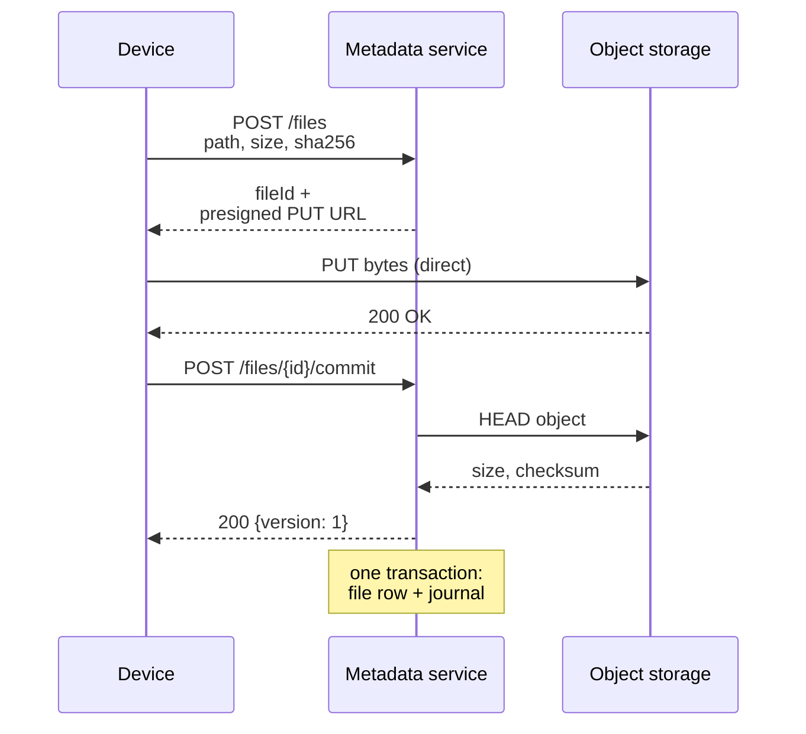
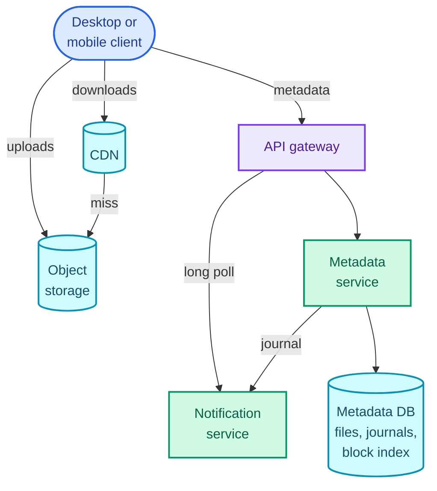
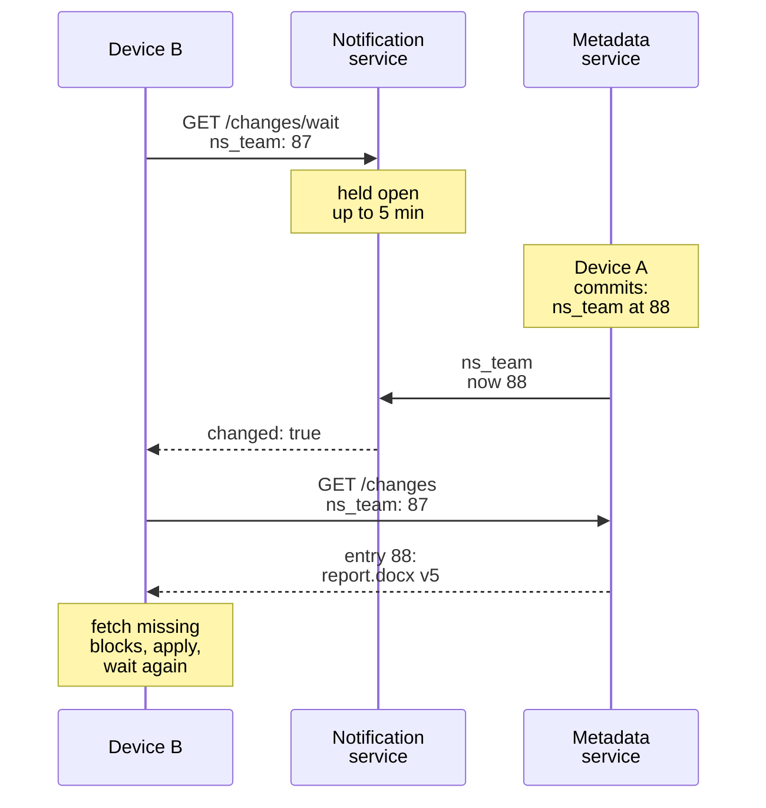

"Design Dropbox. Users put files in a folder on one device and they show up on all their other devices."

It sounds like a storage question, and that's the trap. Storing bytes is the one part you don't build: object storage (S3, GCS, Azure Blob) already does it at eleven nines of durability. What the question is really testing is **how you keep large blobs off your own servers** while still controlling who may read and write them, and **how a device learns what changed** since it last looked, without asking the database every few seconds. Those two halves, a blob path and a metadata path that never meet on the same machine, are the design.

The pattern it teaches is *handling large blobs*: presigned URLs straight to object storage, chunked and resumable uploads, content fingerprints for deduplication, and a CDN on the way back down. [YouTube](/blogs/hld-youtube/) (Part 5) reuses all of it and bolts a processing pipeline on the end; chat media in [WhatsApp](/blogs/hld-whatsapp/) reuses the upload half. It leans on four System Design parts: [object storage and presigned URLs](/blogs/system-design-databases-nosql/), [the CDN](/blogs/system-design-the-edge/), [long polling and push](/blogs/system-design-communication/), and [optimistic locking](/blogs/system-design-databases-relational/).

How to use this post: [the method](/blogs/hld-the-method/). Try the question cold first, then read.


You are a senior engineer interviewing me for a system design round. The question is: "Design Dropbox (or Google Drive): users upload files from any device, share them with other people, and see changes on all their devices automatically." Run it as a realistic 45-minute interview following this structure: requirements (5 min), core entities (2 min), API (5 min), high-level design (10-15 min), deep dives (10 min).
Rules: state the question in one sentence and stop. Answer my clarifying questions the way a real interviewer would, briefly, and only what I ask. Never propose designs, components or classes yourself. If I skip a stage or run long on one, say so in one line and keep time. When I finish a stage, write one line of the note you would put on the scorecard, then move on.
Once my design is in place, probe it with these, one at a time, waiting for my answer each time: 1) A user uploads a 50 GB video over hotel Wi-Fi and the connection drops at 80 percent. What happens, and what is re-sent? 2) The user edits one paragraph of a 2 GB file. How many bytes go over the network, and why? 3) Fifty million devices are online. How does each one learn within seconds that a file changed, without hammering your database? 4) Two laptops edit the same file while both are offline, then reconnect. What does each user see, and is any edit lost? 5) A folder is shared with 1,000 people and someone is removed from it. When do they lose access, and to what exactly? 6) Can a user download a file that someone else uploaded just by knowing its hash?
At the end, grade me as hire / lean hire / lean no hire / no hire for a senior engineer, with the two strongest and two weakest moments, and the one thing to fix first.



## Requirements

### Functional

1. Users should be able to upload a file (any size, up to 50 GB) from any device.
2. Users should be able to share a file or folder with other users, and anyone with access should be able to download it.
3. Users' devices should sync automatically: a change made on one device appears on every other device that has access.

Below the line (out of scope):

- **Editing a file together in real time.** That is a different system with different consistency rules; it's [Google Docs](/blogs/hld-google-docs/), Part 17.
- **Full version history.** Keeping every past version is a storage-cost decision on top of this design (keep old blocklists longer), not a new mechanism.
- **Searching inside files.** It needs a text-extraction pipeline and an inverted index, which [post search](/blogs/hld-post-search/) covers.
- **Quotas, billing, virus scanning.** Real, but each is a side path that reads the same metadata; none changes the core design.

### Non-functional

1. **Durability: a file the client has been told is saved is never lost.** Object storage gives the bytes eleven nines; the design's job is to never write metadata that points at bytes which didn't land.
2. **Large files and bad networks: uploads up to 50 GB resume after a dropped connection without re-sending what already arrived.** A phone on a train is the normal case, not the edge case.
3. **Efficiency: editing a small part of a large file sends roughly the changed part, not the whole file.** Change one paragraph of a 2 GB file and the upload should be megabytes, not gigabytes.
4. **Sync latency: a committed change reaches every other online device within 10 seconds p99.** Availability over consistency here (AP, in [CAP](/blogs/system-design-cap-consistency/) terms): a device seeing a change a few seconds late is fine, a device unable to open its files because a sync server is down is not.
5. **Correctness of each file's history: two concurrent edits to the same file never silently overwrite each other.** This one is consistent, not eventual: the commit of a new version is a compare-and-set on a single row.

### Capacity estimate

Assume 500 million registered users, 100 million daily active, about 10 GB stored per user, and an active user uploading 2 files a day averaging 5 MB.

**Storage.** 500M × 10 GB = 5 × 10⁹ GB = **5 EB** (exabytes). No database holds that; the bytes go to object storage, and the database holds only metadata. At this size every 1% saved by deduplication is 50 PB, which is why deep dive 2 exists.

**Upload bandwidth.** 100M × 2 × 5 MB = 10⁹ MB = 1 PB per day. Spread over 86,400 seconds that's 1.16 × 10¹⁰ bytes/s, about **11.6 GB/s, or 93 Gbps on average**, and around 280 Gbps at a 3× peak. Routed through application servers, that's roughly 28 servers' worth of 10 Gbps network cards doing nothing but copying bytes from one socket to another, and every deploy or crash killing every upload in flight. **So the bytes go straight from the device to object storage, and our servers only hand out permission.**

**Metadata rows.** Say 1,000 files per user: 500M × 1,000 = 5 × 10¹¹ file rows. At about 500 bytes a row (path, size, version, the list of block hashes), that's 2.5 × 10¹⁴ bytes, **250 TB**. Too big and too busy for one machine, **so the metadata store is sharded**, and the shard key matters (it's chosen in the high-level design).

**Sync checks.** Say 50 million devices are online at peak. If each asked "anything new?" every 10 seconds, that's **5 million requests a second**, nearly all answered "no". **So devices must not poll the database**; deep dive 3.

## Core entities

- **User**: an account; owns one root namespace.
- **Namespace**: a tree of files and folders with its own change log. Every user's root is one; every shared folder is another, mounted into each member's tree.
- **File**: metadata for one file: its namespace, path, size, current version, and the ordered list of block hashes that make up its content.
- **Block**: a 4 MiB piece of file content, stored in object storage under the SHA-256 hash of its bytes.
- **Membership**: which user can access which namespace, with what role (owner, editor, viewer).
- **Journal entry**: one change in a namespace's log (file added, updated, moved, deleted), numbered by a per-namespace sequence number.
- **Cursor**: how far a device has read each namespace's journal.

## API

The current user always comes from the auth token, never from the request body. The first version uploads a file as a single object:

```text
POST   /files                         { namespaceId, path, size, sha256 }
         -> 201 { fileId, uploadUrl }            presigned PUT, expires in 15 min
PUT    <uploadUrl>                    raw bytes, client to object storage directly
POST   /files/{fileId}/commit         { baseVersion }
         -> 200 { version }  |  409 { currentVersion }   someone else committed first

GET    /files/{fileId}                -> { path, size, version, downloadUrl }

POST   /namespaces/{namespaceId}/members      { email, role: "editor" | "viewer" }
DELETE /namespaces/{namespaceId}/members/{userId}

GET    /changes?cursor=<cursor>       -> { entries: [...], cursor, hasMore }
GET    /changes/wait?cursor=<cursor>  long poll, held up to 5 min -> { changed: true | false }
```

Deep dive 1 replaces the single `uploadUrl` with one URL per block; the shape of the calls stays the same.

## High-level design

Two services carry everything. The **metadata service** owns files, namespaces, memberships and journals, and hands out presigned URLs. **Object storage** holds the bytes. A **presigned URL** is a link the metadata service signs with its storage credentials, granting one operation (PUT or GET) on one object until an expiry time; the device uses it to talk to object storage directly, and object storage checks the signature, not our servers. [System Design Part 7](/blogs/system-design-databases-nosql/) walks through it.

### 1. Upload a file

The request is `POST /files`. The metadata service checks the user may write to that namespace, inserts a file row with status `uploading`, and returns a presigned PUT URL for a fresh object key. The device uploads the bytes straight to object storage, then calls commit.

The sequence below has three participants; follow the bytes (the middle arrow) and notice they never pass through the metadata service.



Commit is where durability (NFR 1) is decided. The metadata service doesn't take the device's word that the upload finished: it asks object storage for the object's size and checksum (a `HEAD` request), and only if they match does it write the new version. A file row never points at bytes that aren't there.

The state that changes, and where it lives:

```text
files     (namespace_id, file_id)  PK
            path, size, version, status, block_hashes[], updated_at
journal   (namespace_id, seq)      PK
            file_id, version, op: added | updated | moved | deleted
```

**The shard key is `namespace_id`.** A commit must update the file row and append to that namespace's journal atomically, and putting both on the same shard makes that one local transaction instead of a distributed one. The journal's `seq` is a counter per namespace, so it can be assigned inside the same transaction.

The bottleneck left for later: a 50 GB file is one PUT that restarts from zero if the connection drops, and object storage caps a single PUT at 5 GB anyway (S3's limit). Deep dive 1.

### 2. Share and download

**Sharing.** `POST /namespaces/{id}/members` inserts a membership row. If the user shares a folder that isn't yet its own namespace, the metadata service first promotes it to one: its files move under a new `namespace_id`, and every member gets a mount pointing at it. Sharing a single file works the same way, as a namespace holding one file.

```text
namespaces   (namespace_id)  PK      owner_id, next_seq
memberships  (user_id, namespace_id) PK   role, mount_path
```

Why make shared folders separate namespaces instead of tagging files with an access list? Because sync reads one change log per namespace. A folder shared with 1,000 people gets one journal entry per change, and each member's devices read that journal. With per-user logs, the same change would be copied into 1,000 logs. Deep dive 3 comes back to this.

**Downloading.** `GET /files/{fileId}`: the metadata service looks up the caller's memberships (cached, since every request needs them), checks the file's namespace is among them, and returns metadata plus a presigned GET URL valid for about 5 minutes. The device downloads from object storage, or from a CDN in front of it (deep dive 5).

### 3. Sync across devices

Each device runs a local watcher on its sync folder. The operating system reports file events (inotify on Linux, FSEvents on macOS, ReadDirectoryChangesW on Windows), and a change on disk triggers the upload flow above.

The other direction is the journal. A device keeps a **cursor**, the last sequence number it has applied for every namespace it can see, for example `{ns_rishabh: 1042, ns_team_docs: 87}`. It calls `GET /changes?cursor=…`, receives the journal entries after those numbers, applies each one (download the new version, rename, delete), and stores the new cursor. A device that was offline for a week does exactly the same thing; it just gets more entries.

The bottleneck left for later: in this first version the device polls `/changes` every few seconds, which at 50 million online devices is the 5 million requests a second from the estimate. Deep dive 3.

### The assembled design

Read it top to bottom: the device talks to object storage and the CDN (left) for bytes, and to the API gateway (right) for everything else. The two paths only meet inside the metadata service, which signs the URLs. The metadata DB box is three tables: files and journals, sharded by namespace, and the block index, sharded by hash.



The block index and the notification service appear here ahead of the deep dives that introduce them (1 and 3), and the CDN ahead of deep dive 5. Everything else was built above.

## Deep dives

### 1. A 50 GB upload that survives a dropped connection

This is NFR 2. The question an interviewer asks: "The connection drops at 80%. What happens?"

**Bad: one PUT for the whole file.** It works up to 5 GB (S3's single-PUT limit) and fails badly before that. An upload is all-or-nothing, so a drop at 80% of a 50 GB file throws away 40 GB, and the retry has the same odds of dying. On a 20 Mbps uplink, 50 GB takes 50 × 8,000 / 20 = 20,000 seconds, about 5.5 hours, and few home connections stay up that long without a hiccup.

**Good: object storage's multipart upload, with a presigned URL per part.** The metadata service starts a multipart upload, which returns an `uploadId`, and presigns a URL for each part number. The device uploads parts independently (several at once for throughput) and records each part's ETag (the checksum object storage returns). When all are in, the metadata service calls `CompleteMultipartUpload` with the list of part numbers and ETags, and object storage stitches them into one object. After a drop, the device asks which parts arrived (`ListParts`) and uploads only the rest.

The limits shape the part size (from the [S3 multipart limits](https://docs.aws.amazon.com/AmazonS3/latest/userguide/qfacts.html)): parts are 5 MiB to 5 GiB, at most 10,000 of them. A 50 GiB file is 51,200 MiB, and 51,200 / 10,000 = 5.12 MiB, so even the minimum part size is too small for it; the client must pick the part size from the file size (16 MiB gives 3,200 parts). An abandoned multipart upload keeps its parts, and you pay for them, until someone aborts it, so a lifecycle rule (`AbortIncompleteMultipartUpload` after, say, 7 days) cleans up.

This fixes resumability and nothing else. Edit one byte of the file and the next upload is 50 GB again.

**Great: split every file into 4 MiB blocks, name each block by its SHA-256 hash, and make the block the unit of upload, storage and sync.** The device cuts the file into 4 MiB blocks (Dropbox's real block size, per its [engineering blog](https://dropbox.tech/infrastructure/streaming-file-synchronization)), hashes each one, and sends the list of hashes, called the **blocklist**, with the upload request. The metadata service checks its **block index** (a table from hash to storage key, sharded by hash) and answers with presigned PUT URLs for only the blocks it doesn't already have. The device uploads those, then commits the blocklist as the file's new version.

The sketch shows one upload of a 6-block file. Look at the colours: two blocks were already stored, one failed mid-upload and was retried on its own, and nothing else was ever sent twice.

<figure class="sketch"></figure>

Resumability falls out for free. After a drop, the device asks again and the server's answer already excludes the blocks that landed. So do the next two deep dives: deduplication (a block the server has is never uploaded again, by anyone) and delta sync (an edit changes a few blocks, so only those move).

Why not use multipart parts as the blocks? Because 4 MiB is below S3's 5 MiB minimum part size, and because a part belongs to one object, while a block is meant to be shared by many files. Each block is its own small object at `blocks/<sha256>`.

The trade-off is object count and request cost. 5 EB / 4 MiB ≈ 1.2 × 10¹² objects. Uploads of 1 PB a day are 10¹⁵ / 4,194,304 ≈ 2.4 × 10⁸ PUT requests a day, which at S3's list price of about $0.005 per 1,000 PUTs is about $1,200 a day in request fees alone. At Dropbox's scale that and the storage bill are why it moved most data off S3 to its own store, Magic Pocket, in 2016. In the interview, name the cost and keep S3.

One more thing commit must do: never trust the client's hash. A buggy or malicious client could upload bytes under a hash they don't match, corrupting every file that later deduplicates against that block. Presign each PUT with the expected SHA-256 as a required checksum (S3 verifies `x-amz-checksum-sha256` and rejects a mismatch), or verify asynchronously before the block is marked usable.

The API from earlier changes in one place:

```text
POST /files/upload-session   { namespaceId, path, size, blockHashes[] }
       -> { uploadId, missing: [ { hash, putUrl } ] }
POST /files/upload-session/{uploadId}/commit   { baseVersion }
       -> 200 { fileId, version }  |  409 { currentVersion }
```

### 2. Fingerprints and dedup: an edit uploads a block, not the file

This is NFR 3 (efficiency) and the storage bill. The question: "The user edits one paragraph of a 2 GB file. How many bytes cross the network?"

**Bad: deduplicate whole files by their hash.** If two users upload the same installer, store it once. It helps with identical files and does nothing for edits: change one byte and the file's hash is new, so the whole 2 GB goes up again.

**Good: fixed 4 MiB blocks with per-block hashes (the design from deep dive 1).** An edit that overwrites bytes in place, such as a database file or a disk image updating a record, changes the one block it lands in. The new blocklist differs from the old in one hash, one 4 MiB block is uploaded, and the commit writes the new blocklist. 2 GB down to 4 MiB.

Its weak spot is insertion. Add a sentence near the start of a document and every byte after it shifts. Every fixed boundary now cuts the content in a different place, every block's hash changes, and the whole file goes up again.

**Great: content-defined chunking.** Instead of cutting every 4 MiB, slide a small window (tens of bytes) across the file computing a rolling hash (a hash that updates in constant time as the window moves one byte, such as a Rabin fingerprint), and cut wherever the hash's low 22 bits are all zero. Each position has a 1 in 2²² chance of matching, so boundaries land on average every 2²² bytes = 4 MiB, with a minimum and maximum size to bound the extremes. Boundaries now depend on the content near them, not on the offset from the start, so after an insertion the cuts downstream re-align on the same content and those blocks keep their hashes.

The sketch shows the same insertion under both schemes: on the fixed grid every block after the insert is new (red); with content-defined cuts only the block containing the insert is.

<figure class="sketch"></figure>

The trade-off: variable block sizes, more client CPU, and a less predictable object count. Backup tools such as restic and borg use content-defined chunking for exactly this reason. Dropbox, per its blog, uses fixed 4 MB blocks, which is a defensible choice too: most large files that change often (databases, VM images, Office files rewritten in place) change in place, and fixed blocks are simpler. Saying which you'd pick and why is the senior answer.

Two things a strong candidate adds without being asked:

- **Cross-user dedup leaks information.** If the server says "I already have block X", anyone holding a hash can learn that someone stored that content, and in a naive design can add it to their own account without ever having the bytes. A 2011 tool called Dropship did exactly this to Dropbox. The fix is to never accept a hash as proof of possession: dedupe across users only after the bytes are uploaded and verified (saving storage, not bandwidth), or dedupe bandwidth only within one user's own blocks.
- **Deleting is garbage collection.** A block can be referenced by thousands of files. Keep a reference count in the block index, decrement it when a version stops referencing the block, and delete only after the count has been zero for a grace period (say 7 days). The grace period covers the race where an upload has just been told "you don't need to send that block" while a delete is about to remove it.

### 3. Sync: 50 million devices hear about a change within seconds

This is NFR 4: a change reaches other online devices within 10 seconds p99. The question: "How does my phone know I just saved a file on my laptop?"

**Bad: every device polls the metadata database.** Every 10 seconds, 50 million devices run a query, which is the 5 million requests a second from the estimate, almost all returning nothing. Poll every 60 seconds instead and the load drops to 830,000 a second while sync latency rises to a minute, failing the requirement. Polling trades load against latency, and at this scale both ends are bad.

**Good: long polling against a notification service.** A device calls `GET /changes/wait?cursor=…` on a separate **notification service** whose only job is holding these requests open. Long polling means the server doesn't answer until it has something to say or a timeout passes. When a commit appends to a namespace's journal, the metadata service tells the notification service "namespace X is now at seq 1043"; the notification service answers every held request whose cursor for X is behind that with `changed: true`; those devices call `/changes` to read the entries, then go back to waiting. Dropbox's public API works exactly this way: `list_folder/longpoll` holds a request for 30 to 480 seconds, adds up to 90 seconds of random jitter so devices don't all reconnect at once, and answers only `changes: true` or `false`.

The sequence below shows device B learning about a commit made on device A, folded into a note to keep it to three participants.



The arithmetic now works. With a 5-minute timeout, each of 50 million devices reconnects once every 300 seconds, so 50,000,000 / 300 ≈ 167,000 cheap reconnects a second, and the database sees reads only from devices that actually have something to fetch. The notification service holds 50 million open connections; at a rule-of-thumb 100,000 idle connections per well-tuned server, that's about 500 servers, each holding its share by device ID, with the "namespace advanced" messages fanned out to them through pub/sub (Redis or Kafka, [System Design Part 9](/blogs/system-design-async/)).

The detail that makes it robust: **the notification carries no data, only a hint.** The journal and cursor are the truth. If a notification is lost (a server restarts, a message is dropped), nothing breaks: the long poll times out, the device calls `/changes` anyway, and the cursor brings it up to date. Sync is correct without the notification service; the notification service only makes it fast.

**Great: the same hint-plus-cursor design over a persistent connection (WebSocket or SSE), with per-namespace cursors.** A WebSocket removes the reconnect churn and lets the server push other things (share invitations, quota warnings). Long polling is the easier sell in an interview because it survives every corporate proxy, so state both and pick long polling with a WebSocket upgrade where the network allows it ([System Design Part 3](/blogs/system-design-communication/) has the trade-offs).

The part that makes this design and not a generic push design is **one journal per namespace, not per user**. Share a folder with 1,000 people and a per-user log turns every change into 1,000 log writes, which is the fan-out-on-write problem that [news feeds](/blogs/hld-news-feed/) are built around. A per-namespace journal takes one write; each device merges the journals of the namespaces it's mounted, which is why the cursor is a map. A user in 300 shared folders has a cursor with 300 entries, a few kilobytes, which is fine.

Two edge cases to name: a journal can't be kept forever, so entries older than, say, 90 days are compacted away, and a device whose cursor points before that gets a `reset` and re-lists the whole namespace (Dropbox's API has exactly this error). And a user who loses access to a namespace stops getting its entries; the device deletes that mount locally.

### 4. Conflicts: two laptops edit the same file offline

This is NFR 5: no edit is silently lost. The question: "Both laptops were offline on a plane, both edited `budget.xlsx`, both land and reconnect. What happens?"

**Bad: last writer wins.** Each commit overwrites the file's blocklist. The second laptop to reconnect replaces the first one's edit, and the first user's work disappears with no error anywhere. This is the [lost update](/blogs/system-design-databases-relational/) in its purest form.

**Good: a version check on commit, and a conflicted copy for the loser.** Every commit carries `baseVersion`, the version the device started editing from. The metadata service commits with a compare-and-set:

```text
UPDATE files
   SET version = version + 1, block_hashes = :new, updated_at = now()
 WHERE namespace_id = :ns AND file_id = :id AND version = :baseVersion
```

One row updated means you were first. Zero rows means someone else committed since you started, and the API returns `409` with the current version. The client then does what Dropbox does: it keeps the server's version under the real name and uploads its own as a new file, `budget (Rishabh's conflicted copy 2026-11-04).xlsx`. Both edits survive; the humans decide which to keep.

The sketch is the timeline: both devices start from version 3, laptop A reconnects first and becomes version 4, laptop B's commit still says "base 3", and the server refuses it.

<figure class="sketch"></figure>

This is [optimistic locking](/blogs/system-design-databases-relational/), and it's the right kind here: conflicts on the same file are rare (most files are edited by one person on one device at a time), so taking no lock and handling the rare loser is cheaper than locking every file on open.

There isn't a third rung worth having for arbitrary files. Merging two edits automatically only works when the format is understood, which for plain text is a three-way merge and for a spreadsheet or a Photoshop file is nothing sensible. A product that needs merging (Google Docs) changes the whole design to stream operations instead of files ([Part 17](/blogs/hld-google-docs/)).

### 5. Downloads at scale, and revoking a share

This is availability, latency and security together. The questions: "How are downloads fast everywhere?" and "Someone is removed from a shared folder. When do they lose access?"

**Bad: public object URLs.** Make blocks readable by anyone who knows the key. Keys are SHA-256 hashes, which nobody can guess, so it feels safe, but a URL that never expires can be copied into an email or a log and works forever, and there's no moment at which access is checked.

**Good: a presigned GET per download, issued after a permission check.** `GET /files/{id}` checks the caller's memberships, then returns presigned URLs for the file's blocks, each valid for 5 minutes. The device downloads blocks in parallel, skipping any it already has locally (the same delta trick as upload, in reverse). Access is checked every time a URL is issued.

Revocation follows from that. Removing a member deletes the membership row and invalidates the cached membership list for that user, so the next `GET /files` call fails. URLs already issued keep working until they expire, so **the worst case is 5 minutes**. That's the window you're choosing when you pick the expiry; say it out loud. Revocation doesn't reach files already synced to the removed user's disk (nothing can), and their device deletes the mount when it stops receiving the namespace's journal.

**Great: put a CDN in front of object storage for blocks, keyed by hash.** Content-addressed blocks are a CDN's ideal object: the key is the hash, so the content behind a key never changes and can be cached forever with no invalidation. A file shared with a 5,000-person company, or a public share link that goes viral, is served from edge caches near each user instead of from one storage region. The CDN must still enforce access, so it uses signed URLs or signed cookies (CloudFront and every major CDN support them) carrying the same short expiry. For a single user's private files the CDN hit rate is low (one person downloads their own file to a few devices), so the win is mainly for shared and popular content, and that's fine: it costs little where it doesn't help. [System Design Part 4](/blogs/system-design-the-edge/) covers pull CDNs and their cache keys.

## What each level is expected to show

| Level | What good looks like on this question |
| --- | --- |
| Mid-level | Separates metadata (database) from bytes (object storage), uses presigned URLs so uploads skip the app servers, and gets a working upload, download and polling-based sync on the board. Reaches chunking when prompted. |
| Senior | Drives the block design unprompted: hashes, upload only missing blocks, resumable for free, dedup and delta sync from the same idea. Replaces polling with long-poll plus cursor, explains why a lost notification is harmless, and handles conflicts with a version check and a conflicted copy. |
| Staff+ | Owns the trade-offs: fixed versus content-defined chunking for real workloads, the hash-as-proof-of-possession leak, block garbage collection with a grace window, per-namespace journals versus per-user fan-out, the revocation window as a chosen number, and the storage and request cost that decides build versus buy. |

## Variants this unlocks

| Question | What changes |
| --- | --- |
| Design Google Drive / OneDrive / Box | The same design. Box-style enterprise adds audit logs and retention holds on the journal; Drive adds in-browser editing, which hands that part to the Google Docs design. |
| Design Google Photos (photo backup) | One-way upload, so sync is simpler (no conflicts), but every upload starts a pipeline (thumbnails, face and object labels) like [YouTube](/blogs/hld-youtube/)'s. Dedup by hash is the headline feature. |
| Design WeTransfer (send a large file) | No sync, no namespaces. Keep resumable multipart upload; add a share link with an expiry and a download count, and a lifecycle rule that deletes the object after 7 days. |
| Design a device backup service (iCloud backup, Time Machine to the cloud) | Snapshots instead of live sync: each backup is a manifest of block hashes, content-defined chunking matters more (large files with insertions), and GC of unreferenced blocks across snapshots is the hard part. |
| Design chat attachments for a messaging app | Only the upload half: presigned upload, a media ID in the message, a CDN-backed signed download URL. The rest belongs to [WhatsApp](/blogs/hld-whatsapp/). |
| Design Pastebin / a code snippet host | Small blobs, so a single presigned PUT (or even the database) is enough; the read path (cache, CDN, expiry) is the [URL shortener](/blogs/hld-url-shortener/)'s. |

## The one-page version

- Two paths that never share a machine: metadata through the API, bytes directly between the device and object storage via presigned URLs.
- Files are lists of 4 MiB blocks named by SHA-256; the blocklist is the file's content in the metadata row.
- Upload: send hashes, receive PUT URLs for only the missing blocks, upload them, commit the blocklist. Resumable, deduplicated and delta-synced by the same mechanism.
- Commit checks the bytes landed (and that hashes match) before writing metadata, so metadata never points at missing bytes.
- Metadata sharded by namespace, so a file row and its journal entry commit in one local transaction; block index sharded by hash.
- Every user's root and every shared folder is a namespace with its own journal and per-namespace sequence numbers.
- Sync: a device holds a cursor per namespace, long-polls a notification service for a "something changed" hint, then reads journal entries after its cursor. Lost hints are harmless.
- Conflicts: commit is a compare-and-set on `version`; the loser keeps its edit as a conflicted copy.
- Downloads: permission check, then presigned or CDN-signed URLs with a 5-minute expiry; that expiry is the revocation window.
- Content-defined chunking for insert-heavy workloads; dedup across users only after the bytes are proven; delete blocks by refcount after a grace period.

**Key sentence: the servers only decide who may touch which bytes and in what order versions happened; the bytes move as hash-named blocks straight to storage, and every device catches up by reading a per-namespace change log from its cursor.**


You are a senior engineer checking my understanding of a system design for Dropbox / Google Drive. The design: files are split into 4 MiB blocks named by their SHA-256 hash and stored in object storage; the metadata service stores each file's blocklist and hands out presigned URLs; the device uploads only blocks the server lacks and then commits; metadata is sharded by namespace (a user's root or a shared folder), each namespace has a journal with sequence numbers; devices keep a cursor per namespace and long-poll a notification service for change hints; commit is a compare-and-set on the file version.
Ask me the questions below one at a time. Wait for my answer each time. Judge my answer against the expected key points, which you must not reveal before I answer. If I'm stuck, give one hint at a time, starting small. After each answer, tell me what I got right, what I missed, and the strongest phrasing of the answer in two or three sentences.
1. A 50 GB upload drops at 80 percent. What is re-sent and how does the client know? Expected: only blocks the server doesn't have; the client re-sends its hash list (or asks), the server answers with URLs for missing blocks only; nothing already stored is sent again; with plain multipart, ListParts plays the same role; part size must be at least file size / 10,000 for S3.
2. Why can't each 4 MiB block be a part of an S3 multipart upload? Expected: 5 MiB minimum part size; a part belongs to one object while a block is shared by many files; so each block is its own object keyed by hash.
3. A user inserts a sentence at the start of a 2 GB document. How many bytes upload with fixed blocks, and what fixes it? Expected: fixed boundaries shift so nearly every block changes and nearly the whole file uploads; content-defined chunking with a rolling hash cuts on content (low 22 bits zero gives ~4 MiB average) so only the block with the insert changes; trade-off is variable sizes and client CPU; fixed blocks are fine for in-place edits.
4. Why is cross-user dedup by hash a security problem, and what do you do? Expected: a hash would act as proof of possession, letting someone claim content they never had and revealing that content exists; dedupe across users only after the bytes are uploaded and verified, or dedupe bandwidth only within a user.
5. How do 50 million online devices learn about changes within 10 seconds without polling the database, and what happens if a notification is lost? Expected: long poll or WebSocket to a notification service that holds connections; commit publishes "namespace advanced to seq N"; the hint carries no data; the device then reads the journal after its cursor; a lost hint only delays until the long-poll timeout because the cursor is the source of truth; around 167k reconnects per second at a 5-minute timeout versus 5M polls per second.
6. Why one journal per namespace instead of per user? Expected: a folder shared with 1,000 people would need 1,000 log writes per change with per-user logs (fan-out on write); per-namespace is one write and devices merge the journals they mount; cursor is a map of namespace to seq.
7. Two offline laptops edit the same file. What happens on reconnect? Expected: commit carries baseVersion; compare-and-set on version; the second commit gets 409; the client keeps its version as a conflicted copy; nothing is lost; optimistic because conflicts are rare.
8. A member is removed from a shared folder. When do they lose access? Expected: membership row deleted and cache invalidated so no new URLs are issued; already-issued presigned or CDN-signed URLs work until expiry, so the window equals the expiry (about 5 minutes); synced local copies can't be revoked; the device drops the mount.
At the end, give me a one-paragraph verdict on whether I could defend this design in a senior interview.



Next: [Design YouTube](/blogs/hld-youtube/), which takes the same upload path and adds what happens after the bytes land: a transcoding pipeline and adaptive streaming through a CDN.
