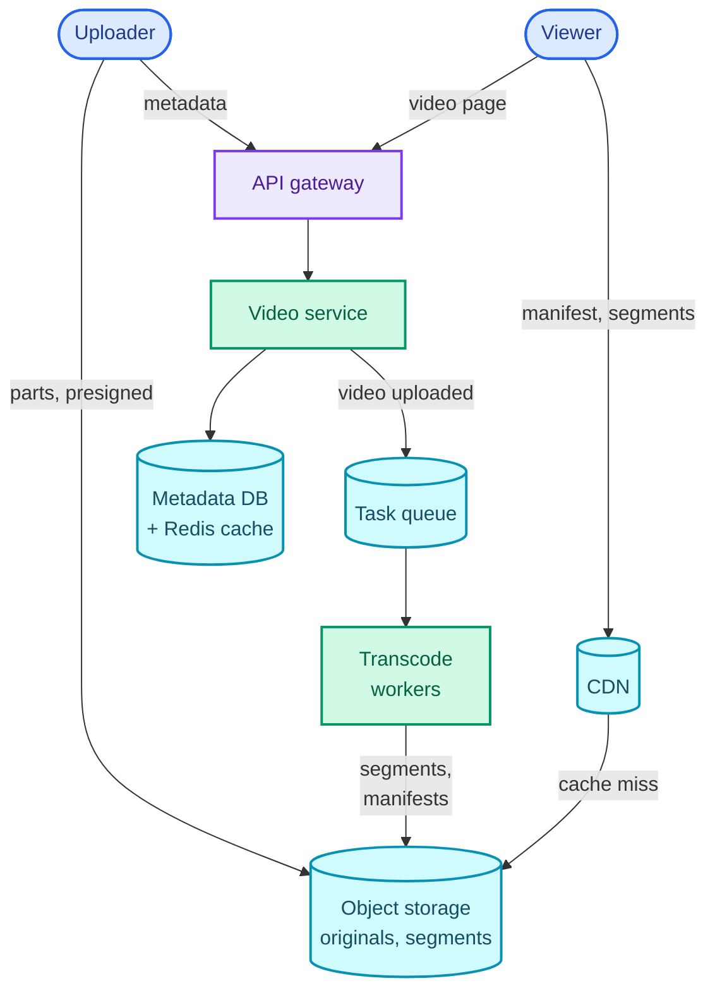
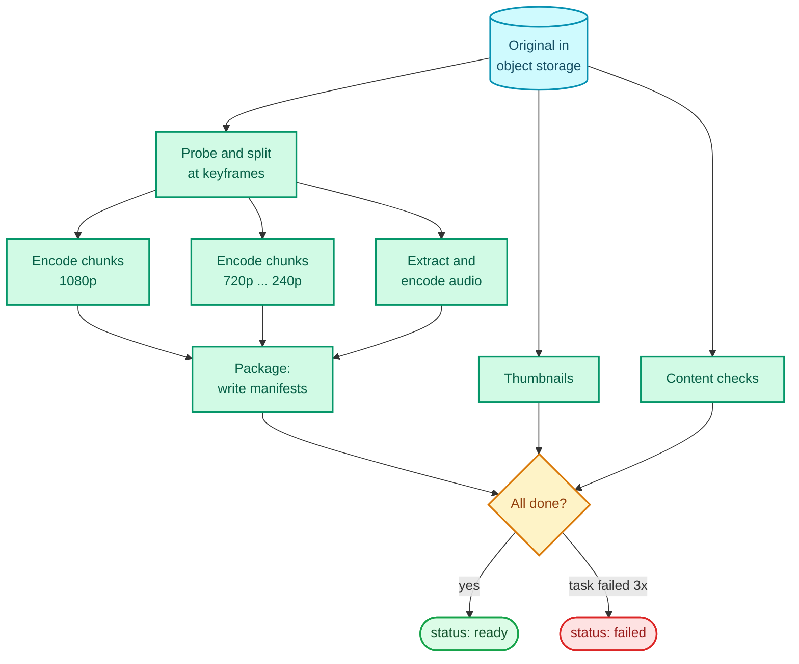
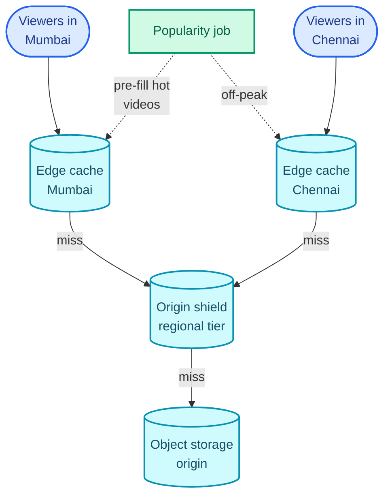

"Design YouTube. Users upload videos, and other users watch them on any device."

Upload is the part you already know: it's the large-blob path from [Dropbox](/blogs/hld-dropbox/), presigned URLs and multipart, almost unchanged. What the question is really testing is **what happens between upload and the first frame**: a long-running, failure-prone pipeline that turns one file into hundreds or thousands of small ones, and a delivery format that lets a phone on a train and a television on fibre both play the same video without stalling. A candidate who says "store the MP4 in S3 and stream it" has skipped the whole question.

The pattern it teaches is *blobs plus a long-running pipeline*: accept the upload fast, then hand the slow work to a graph of independent, retryable tasks whose results land back in object storage. [The web crawler](/blogs/hld-web-crawler/) and [the job scheduler](/blogs/hld-job-scheduler/) reuse the pipeline half; [top-K trending videos](/blogs/hld-top-k/) picks up where the view counter here stops. It leans on [object storage and multipart upload](/blogs/system-design-databases-nosql/), [CDNs](/blogs/system-design-the-edge/), [queues and retries](/blogs/system-design-async/), and [caching](/blogs/system-design-caching/).

How to use this post: [the method](/blogs/hld-the-method/). Try the question cold first, then read.


You are a senior engineer interviewing me for a system design round. The question is: "Design YouTube (or Netflix): users upload videos, and other users watch them on any device and network." Run it as a realistic 45-minute interview following this structure: requirements (5 min), core entities (2 min), API (5 min), high-level design (10-15 min), deep dives (10 min).
Rules: state the question in one sentence and stop. Answer my clarifying questions the way a real interviewer would, briefly, and only what I ask. Never propose designs, components or classes yourself. If I skip a stage or run long on one, say so in one line and keep time. When I finish a stage, write one line of the note you would put on the scorecard, then move on.
Once my design is in place, probe it with these, one at a time, waiting for my answer each time: 1) A creator uploads a 2-hour 4K film. Walk me through how it becomes watchable, and how long that takes. 2) A transcoding worker dies halfway through. What is redone, and how do you avoid doing it twice? 3) A viewer's bandwidth drops from 20 Mbps to 2 Mbps mid-video. What does the player do, and what did the backend have to prepare for that to work? 4) Your viewers pull around 100 Tbps at peak. Where does that traffic actually come from, and what does the origin see? 5) A 50 GB upload from a phone drops at 90 percent. What happens? 6) A video goes viral and gets 50,000 views a second. How do you count them?
At the end, grade me as hire / lean hire / lean no hire / no hire for a senior engineer, with the two strongest and two weakest moments, and the one thing to fix first.



## Requirements

### Functional

1. Users should be able to upload a video.
2. Users should be able to watch a video, on any device, at a quality that suits their network.
3. Users should be able to open a video's page and see its title, description, uploader and view count.

Below the line (out of scope):

- **Search.** It needs an inverted index fed from the metadata store; that's [post search](/blogs/hld-post-search/), Part 10.
- **Recommendations and the home feed.** A machine-learning system that reads the same metadata and watch history; it doesn't change how video is stored or served.
- **Comments, likes, subscriptions.** A social graph and a feed, covered by [the news feed](/blogs/hld-news-feed/).
- **Live streaming.** It removes the time to transcode ahead of viewers, which changes the pipeline completely; it's listed under variants below.
- **Ads and trending.** Their own questions: [ad click aggregation](/blogs/hld-ad-click-aggregator/) and [top-K](/blogs/hld-top-k/).

### Non-functional

1. **Playback starts within 2 seconds p95 and stalls (rebuffers) for less than 1% of watch time**, on networks from 1 Mbps mobile to fibre. This is what viewers notice and what the delivery design exists for.
2. **Availability over consistency for watching (AP).** A video that's ready should play even if the metadata service is degraded. A new upload appearing a minute late, or a view count a few minutes behind, is fine. Target 99.99% for playback.
3. **Uploads up to 256 GB that survive a dropped connection.** That's YouTube's real cap (256 GB or 12 hours, whichever is less, per its help centre), and most uploads come from phones.
4. **Processing time: a typical 10-minute upload is watchable within about 5 minutes**, and even a 2-hour upload within about 10. Creators wait for this and refresh the page.
5. **Durability: an upload that completed is never lost**, and the original is kept so the video can be re-encoded later with better codecs.

### Capacity estimate

YouTube said in 2019 that more than **500 hours of video are uploaded every minute**, and in 2017 that viewers watch **a billion hours a day**. Use those.

**Uploads.** 500 hours a minute is 500 × 3,600 = 1.8 million seconds of video arriving every 60 seconds, so **30,000 seconds of video arrive every second**, or 720,000 hours a day.

**Storage.** Each video is stored as its original plus five renditions (a **rendition** is one encoded version at one resolution and bitrate). Assume this ladder, plus a 15 Mbps original, which is typical for 1080p phone footage:

| Rendition | Bitrate |
| --- | --- |
| 1080p | 5 Mbps |
| 720p | 3 Mbps |
| 480p | 1.5 Mbps |
| 360p | 0.8 Mbps |
| 240p | 0.4 Mbps |

The renditions sum to 10.7 Mbps; with the original, 25.7 Mbps. One hour is 25.7 × 3,600 = 92,520 megabits, about **11.6 GB per hour of video**. Times 720,000 hours a day: 11.6 GB × 720,000 ≈ **8.3 PB a day, about 3 EB a year**. Two conclusions: this lives in object storage, and the original is 15 / 25.7 = 58% of it, **so originals move to an archive tier once processed**.

**Transcoding compute.** Assume encoding one rendition costs about 1 CPU-core-second per second of video (a rule of thumb for H.264 at a reasonable preset; it varies tenfold with codec and settings). Five renditions × 30,000 seconds arriving per second = **150,000 cores busy around the clock**, with daily peaks above that. **So transcoding is a queue feeding an autoscaled worker fleet**, and the unit of work had better be small (deep dive 1).

**Watch bandwidth.** A billion hours a day is 3.6 × 10¹² seconds of playback. At an average of 2.5 Mbps (assumed: mostly phones at 480p and 720p, some TVs at 1080p and above), that's 9 × 10¹⁸ bits a day, divided by 86,400 seconds: **about 104 Tbps on average.** No origin serves that. Even with 95% of bytes served by caches, the origin sends 5 Tbps. **So a CDN is not an optimisation here, it's the delivery system**, and its hit ratio is the number that matters (deep dive 3).

Reads dwarf writes: a billion hours watched against 720,000 uploaded is about 1,400 : 1.

Metadata is small by comparison. At an average of 10 minutes per video, 720,000 hours a day is 4.3 million new videos a day; at 1 KB of metadata each, that's about 4 GB a day, 1.6 TB a year. Any sharded database handles it, so the estimate says nothing more about it.

## Core entities

- **User**: an uploader or viewer.
- **Video**: the metadata row: title, description, uploader, duration, status (`uploading`, `processing`, `ready`, `failed`).
- **Original**: the uploaded file, as received, in object storage.
- **Rendition**: one encoded version of the video at one resolution and bitrate.
- **Segment**: a few seconds of one rendition, a small file the player downloads on its own.
- **Manifest**: a text file listing the renditions and, for each, its segments in order. The player reads it first.
- **Transcode task**: one unit of pipeline work (encode chunk 37 at 720p), with a status.

## API

The current user comes from the auth token, never the body.

```text
POST /videos                     { title, description, sizeBytes }
       -> 201 { videoId, uploadId, partSize, partUrls: [ { partNumber, url } ] }
PUT  <partUrl>                   one part's bytes, straight to object storage
POST /videos/{videoId}/upload-complete   { parts: [ { partNumber, etag } ] }
       -> 202 { status: "processing" }

GET  /videos/{videoId}           -> { title, description, uploader, status,
                                      viewCount, manifestUrl, thumbnails }
GET  <cdn>/v/{videoId}/master.m3u8        then rendition playlists, then segments
POST /videos/{videoId}/views     { playbackId, watchedSeconds } -> 202
```

For a large file, `partUrls` comes back a page at a time (the first hundred, more on request), since a 256 GB upload has thousands of parts. Playback never touches the API servers after the first `GET /videos/{id}`: the manifest and every segment come from the CDN.

## Data flow

The question is pipeline-shaped, so it's worth stating the flow before drawing boxes:

1. The client uploads the original straight to object storage with presigned multipart URLs.
2. On `upload-complete`, the video service marks the video `processing` and puts a "video uploaded" message on a queue.
3. A splitter reads the original's container and cuts it into chunks of about a minute at keyframes, without re-encoding.
4. Transcode workers encode every chunk at every rendition in parallel and write the output, already cut into 6-second segments, to object storage.
5. In parallel, other tasks extract audio, render thumbnails and run content checks (copyright matching, moderation).
6. When every task for the video is done, a packager writes the manifests.
7. The video service marks the video `ready`. The CDN fetches segments from object storage the first time anyone asks for them.

## High-level design

### 1. Upload a video

`POST /videos` reaches the **video service**, which inserts a row with status `uploading`, starts a multipart upload in object storage, and returns presigned part URLs. The client uploads parts directly; the bytes never touch our servers ([Dropbox, deep dive 1](/blogs/hld-dropbox/) has the mechanics and the part-size arithmetic). On `upload-complete` the service calls `CompleteMultipartUpload`, sets status `processing`, and publishes a message to the pipeline queue.

```text
videos  video_id PK
          uploader_id, title, description, status, duration_s,
          original_key, manifest_key, created_at
```

In the first version, one **transcode worker** takes the message, downloads the original, encodes all five renditions one after another, cuts them into segments, writes the manifests and flips the status to `ready`. That works for a 3-minute clip and fails NFR 4 for a 2-hour film: the work is serial, and a crash at minute 50 starts it over. Deep dive 1.

### 2. Watch a video

The player doesn't download "the video". It downloads a **manifest**, then a sequence of **segments**, each a few seconds long, choosing for each segment which rendition to fetch. This is **HLS** (HTTP Live Streaming, Apple's format) or **DASH** (Dynamic Adaptive Streaming over HTTP, the ISO standard); they differ in syntax, not idea.

The master manifest lists the renditions with their bandwidth:

```text
#EXTM3U
#EXT-X-STREAM-INF:BANDWIDTH=5000000,RESOLUTION=1920x1080
1080p/playlist.m3u8
#EXT-X-STREAM-INF:BANDWIDTH=3000000,RESOLUTION=1280x720
720p/playlist.m3u8
#EXT-X-STREAM-INF:BANDWIDTH=1500000,RESOLUTION=854x480
480p/playlist.m3u8
```

Each rendition's playlist lists its segments in order:

```text
#EXTM3U
#EXT-X-TARGETDURATION:6
#EXT-X-PLAYLIST-TYPE:VOD
#EXT-X-MAP:URI="init.mp4"
#EXTINF:6.000,
seg_00001.m4s
#EXTINF:6.000,
seg_00002.m4s
#EXT-X-ENDLIST
```

All of these are plain files in object storage, served through the CDN like any other static asset. A `GET` for `720p/seg_00042.m4s` is a cache lookup, not a call to our code. The video service's only job at watch time is the `GET /videos/{id}` that returns the manifest URL.

How many files? A 2-hour video is 7,200 / 6 = 1,200 segments per rendition, 6,000 across five renditions. A 6-second 1080p segment is 5 Mbps × 6 s = 30 megabits, about 3.75 MB; at 240p, 300 KB.

Left for the deep dives: how the player picks a rendition for each segment (deep dive 2), and how 104 Tbps reaches viewers (deep dive 3).

### 3. The video page and its view count

`GET /videos/{id}` reads the video row and its view count. Video rows are read far more than written, so the video service reads through a Redis cache keyed by `video_id` ([cache-aside](/blogs/system-design-caching/)), invalidated when the uploader edits the title. The metadata database is sharded by `video_id`; YouTube built [Vitess](https://vitess.io/) to shard MySQL for exactly this table.

The naive view count is `UPDATE videos SET views = views + 1` per view, which collapses on a viral video, since every view is a write to the same row. Deep dive 5.

### The assembled design

The diagram splits into two flows that share only object storage. Uploads come in at the top left and go down through the queue and workers; views come in at the top right and go through the CDN. Notice that the API path (gateway, video service) carries neither the uploaded bytes nor the watched ones.



## Deep dives

### 1. Transcoding a 2-hour film in minutes, not an hour

This is NFR 4. The question: "A creator uploads a 2-hour film. How long until it plays, and what happens if a worker dies?"

First, what transcoding is. Video is compressed mostly as differences between frames. A **keyframe** (an I-frame) is a complete picture; the frames after it until the next keyframe are stored as changes. A run from one keyframe to the next is a **GOP** (group of pictures). You can only start decoding at a keyframe, and that fact decides how the work can be split. **Transcoding** is decoding the original and re-encoding it at each target resolution and bitrate.

**Bad: one worker, the whole video, every rendition in turn.** At the 1 core-second per video-second rule of thumb, 2 hours × 5 renditions is 7,200 × 5 = 36,000 core-seconds, 10 core-hours. A 16-core machine, assuming perfect scaling, finishes in 36,000 / 16 = 2,250 seconds, about 37 minutes, and real encoders scale worse than that. A crash at minute 35 throws everything away. Worse, the fleet gets lumpy: one machine is pinned by one film while short clips queue behind it.

**Good: split into chunks, fan out chunk × rendition tasks to a worker pool, and fan back in.** The **splitter** cuts the original at keyframes into chunks of about 60 seconds. Because each chunk starts at a keyframe, it decodes on its own, and the split is a copy of bytes, not a re-encode (the same thing `ffmpeg -c copy -f segment` does), so it takes seconds. A 2-hour film becomes 120 chunks, and with 5 renditions that's **600 tasks of about 60 core-seconds each**. Each task goes on the queue; any free worker takes one, encodes it, and writes segments to object storage. With 600 cores free, the film's encoding finishes in about a minute; the wall clock is set by the slowest task plus the split and the packaging.

The sketch puts the two side by side on one time axis. The serial bar is the single-worker design; the stack of short bars is the same work spread across workers, with the packaging step waiting for the last one.

<figure class="sketch"></figure>

One detail makes the outputs fit back together: every task encodes with a **forced keyframe every 2 seconds** and cuts segments every 6, so segment *n* covers the same 6 seconds in every rendition and starts with a keyframe. That's what lets the player switch rendition between any two segments (deep dive 2), and it's an encoder setting, not a coincidence.

**Great: a DAG (directed acyclic graph) of idempotent tasks, with tracked state, retries and fan-in.** The pipeline isn't one kind of task. The diagram below is the graph for one video: the split feeds the encode tasks; audio, thumbnails and content checks run beside them; packaging waits for every encode; publishing waits for packaging and the checks.



What makes it reliable is state, kept in a tasks table rather than in a worker's memory:

```text
tasks   (video_id, task_id) PK
          kind: split | encode | audio | thumbs | check | package
          rendition, chunk_no, status: queued | running | done | failed,
          attempts, output_key
videos  ... remaining_tasks
```

- **Retries without double work.** The queue redelivers a task whose worker didn't acknowledge it in time (SQS calls this the visibility timeout). A retry writes to the same deterministic key (`v/{id}/720p/chunk_037/…`), so running a task twice overwrites identical output rather than producing two copies. After 3 failed attempts the task goes to a dead-letter queue and the video is marked `failed` ([System Design Part 9](/blogs/system-design-async/) covers both).
- **Fan-in without a race.** When a task finishes, the worker runs `UPDATE tasks SET status = 'done' WHERE … AND status = 'running'`, and only if that changed a row does it decrement `remaining_tasks`. The worker whose decrement reaches zero enqueues the package task. The status check is what stops a redelivered task from counting twice.
- **Priorities.** Short videos and big creators go on a high-priority queue, so a 30-second clip isn't stuck behind a film's 600 tasks. A useful trick: encode 360p first and publish as soon as it's packaged, then add renditions as they finish. The video is watchable in about a minute, at lower quality.

Writing the orchestration yourself is fine in an interview. In production, a workflow engine (Temporal, AWS Step Functions) holds the DAG state and the retries for you; name it as the buy option.

### 2. Adaptive bitrate: the player picks quality every six seconds

This is NFR 1: start in under 2 seconds and almost never stall. The question: "The viewer's bandwidth drops from 20 Mbps to 2 Mbps mid-video. What happens?"

**Bad: one MP4 file per resolution, downloaded progressively.** The viewer, or the player, picks 1080p at the start. When the train enters a tunnel and bandwidth falls below 5 Mbps, the buffer drains and the video stalls; switching to 480p means opening a different file and seeking in it. Start-up is slow too, since the player must fetch the file's index before playing.

**Good: HLS or DASH segments, with the player choosing a rendition per segment.** Every rendition is cut into 6-second segments on the same boundaries, as set up in deep dive 1. After each segment downloads, the player knows how fast it came (bytes ÷ seconds) and how many seconds of video are buffered ahead. It picks the next segment's rendition from those: if throughput is about 4 Mbps, take the highest rung safely below it, 3 Mbps 720p; if the buffer is running low, step down regardless. Because segment *n* starts with a keyframe in every rendition, switching costs nothing: the next file is just from a different folder.

The sketch is a grid: rows are renditions, columns are segments in time, and the dark line is the player's path through it as the measured bandwidth (top) dips and recovers. The player climbs, drops two rungs in the dip, and climbs back, without a stall.

<figure class="sketch"></figure>

Fast start falls out of the same mechanism. On a 10 Mbps connection, the first 1080p segment (30 megabits) takes 3 seconds to arrive, failing NFR 1 before anything plays. The first 480p segment (1.5 Mbps × 6 s = 9 megabits) takes 0.9 seconds. So players start low and climb, which is why the first seconds of a video often look soft.

The player logic is client code, but say what it is. Throughput-based rules pick by measured speed; buffer-based rules pick by how full the buffer is (BOLA, used by the dash.js reference player, is the known example); real players blend both.

**Great: CMAF segments and per-title encoding ladders.** Two refinements that cut cost at this scale:

- **CMAF** (Common Media Application Format) is a single fragmented-MP4 segment format that both HLS and DASH can reference. Before it, HLS used MPEG-TS segments and DASH used fragmented MP4, so serving every device meant storing and caching every segment twice. CMAF halves both.
- **Per-title encoding** picks the ladder per video instead of one fixed ladder for all. A cartoon with flat colours looks perfect at 1080p and 2 Mbps; a football match needs 6. Netflix popularised the approach in 2015. It costs an analysis pass in the pipeline and saves bandwidth on every view, and views outnumber uploads 1,400 to 1.

### 3. Serving 100 Tbps without the origin noticing

This is NFR 1 and NFR 2 together. The question: "Where does the 104 Tbps actually come from?"

**Bad: serve segments from object storage directly.** One region's object storage serving 104 Tbps worldwide means every viewer pays the round trip to that region on every segment, and egress at that volume is the largest bill in the company. Playback would start slowly far from the region and fail outright when it struggles.

**Good: a pull CDN in front of object storage, with segments cached forever.** Segments never change once written (a re-encode writes new keys), so they're served with `Cache-Control: max-age=31536000, immutable` and need no invalidation. The first viewer near an edge pulls a segment from origin; everyone after them gets it from the edge. Between the edges and the origin sits an **origin shield**, a regional cache tier, so that when 200 edges all miss on the same new segment, origin sees one request instead of 200. The diagram below is that three-tier path.



The hit ratio is everything. At 104 Tbps, a 95% hit ratio leaves 5.2 Tbps at the origin; 99% leaves about 1 Tbps. The ratio is high because views follow a steep popularity curve: a small fraction of videos takes most of the watch time. The sketch shows that curve and what it means for caching.

<figure class="sketch"></figure>

**Great: push the head of the curve into ISPs, and tier the tail in storage.** The biggest platforms put cache servers inside ISPs' own networks (YouTube's Google Global Cache, Netflix's Open Connect), so a popular segment travels from a box in the viewer's ISP, not across the internet. Netflix fills its boxes during off-peak hours with what it predicts will be watched tomorrow, which works because its catalogue is small and its viewing predictable. YouTube's catalogue is enormous and unpredictable, so it relies more on pull caching, with the popularity job pre-filling what's trending.

The tail is the other half. Most videos are rarely watched, and their segments sit in storage at full price. Move renditions of videos with no views in 90 days to an infrequent-access storage tier, and originals to an archive tier as soon as processing finishes (they're 58% of the bytes, from the estimate). The trade-off is retrieval time: archive tiers can take hours to return an object, which is fine for re-encoding a 2014 video into a new codec and not fine for playback, so playback never reads from archive.

Edge capacity: at a rule-of-thumb 100 Gbps per edge server, 104 Tbps needs about 1,040 fully loaded servers, and many more in practice, because traffic peaks in each time zone's evening and caches must sit near viewers.

### 4. A 50 GB upload from a phone that drops at 90%

This is NFR 3. Part 4 answered most of it, so keep this short in the interview and say what's different.

**Bad: a single POST of the file to an upload server.** It ties up an app server for hours, can't exceed S3's 5 GB single-PUT limit, and a drop at 90% restarts from zero.

**Good: multipart upload with presigned part URLs, resumable.** The video service creates the multipart upload and stores the `uploadId` on the video row; the client stores it too. After a drop, the client asks which parts landed (`ListParts`) and sends only the rest. Part size comes from file size: a 256 GiB file is 262,144 MiB, and with at most 10,000 parts each must be at least 26.2 MiB, so 64 MiB parts give 4,096 of them. A lifecycle rule aborts multipart uploads left incomplete for 7 days, so abandoned uploads don't bill forever.

**Great: start processing before the upload finishes.** Since the pipeline works on independent chunks, the splitter could begin on the first gigabytes while the rest is still arriving, and a 2-hour upload could be mostly encoded by the time its last byte lands. The catch is the container format. An MP4 file keeps its index (the `moov` box, which says where each frame is) in one place, and many recorders write it at the end, because they don't know the sizes until recording stops. Without the index the splitter can't find keyframes, so this only works for files with the index at the front (written "faststart") or fragmented MP4. A staff-level answer names that dependency instead of assuming streaming always works.

Also worth a sentence: upload to the region nearest the uploader, or through an accelerated upload endpoint, because a phone in Bengaluru uploading to a bucket in Virginia pays the long round trip on every part.

### 5. View counts at scale (briefly)

This is NFR 2: counts may lag, but they must not be lost or melt the database. The question: "A video gets 50,000 views a second. How do you count them?"

**Bad: increment the row on every view.** 50,000 `UPDATE`s a second on one row means 50,000 transactions queueing for the same row lock, far beyond what one row can take (a few thousand serialised updates a second, as a rule of thumb). The viral video's page stops loading because its own row is locked.

**Good: count in Redis, flush periodically.** Each view does `INCR views:{videoId}` in a Redis cluster sharded by video ID. A single Redis node runs commands one at a time on one thread at around 100,000 simple operations a second (rule of thumb), so even 50,000 a second on one key fits. Every 10 seconds a job reads and resets the counter and adds it to the database row: one write per video per 10 seconds instead of 500,000. A Redis failure loses at most 10 seconds of counts, which NFR 2 allows.

**Great: views as events, counted by a stream processor.** The player's `POST /views` becomes an event on Kafka, partitioned by `video_id` so each video's events stay together. A stream job counts per video per minute, drops duplicates (the same playback reported twice) and filters bots before anything is counted, and writes totals to the database. The page reads the total from cache. The same event stream feeds trending and ads, which is why the large platforms count this way; the details are in [top-K](/blogs/hld-top-k/) and the [ad click aggregator](/blogs/hld-ad-click-aggregator/).

## What each level is expected to show

| Level | What good looks like on this question |
| --- | --- |
| Mid-level | Uploads via presigned URLs to object storage, a queue and workers that transcode into several resolutions, a CDN for playback, a metadata store for video rows. Knows video is served in segments with a manifest when asked. |
| Senior | Drives the pipeline: split at keyframes, chunk × rendition tasks, idempotent retries and a fan-in counter. Explains adaptive bitrate (aligned segments, the player choosing per segment) and why the CDN hit ratio decides the origin load, with numbers. Handles view counts without a hot row. |
| Staff+ | Owns cost and edge cases: per-title ladders and CMAF to cut bytes, archive tiering for originals, ISP-embedded caches against pull-only CDNs, publishing at low quality first, the `moov`-at-the-end limit on early processing, and how the design changes for live streaming. |

## Variants this unlocks

| Question | What changes |
| --- | --- |
| Design Netflix | Uploads are internal and few, so the pipeline can be slow and thorough (per-title, per-scene encoding). The catalogue is small, so caches are pre-filled off-peak. DRM (encrypted segments, a licence server) is added. |
| Design TikTok / Instagram Reels | Short videos, so the pipeline is a few tasks and publish time matters more than parallelism. Playback is a feed: prefetch the first segment of the next few videos while the current one plays. Feed design is [Part 7](/blogs/hld-news-feed/). |
| Design Twitch (live streaming) | No time to transcode ahead: a live ingest server transcodes in real time, segments are 1 to 2 seconds (low-latency HLS), manifests change every segment and get short TTLs. Chat is [WhatsApp](/blogs/hld-whatsapp/)-style WebSockets. |
| Design Spotify (or a podcast app) | Audio only, so files are small (a 3-minute song at 160 kbps is about 3.6 MB) and the ABR ladder has three or four rungs. Offline downloads and licensing take over as the hard parts. |
| Design an image hosting service (Instagram photos, Imgur) | The same upload then pipeline shape with cheaper tasks: resize to a few sizes, strip metadata, generate thumbnails, serve from a CDN. |
| Design Loom or a video-message tool | Uploads stream while recording, so processing starts early (the format is chosen to allow it), and a shareable link with view tracking replaces the public catalogue. |

## The one-page version

- Upload: presigned multipart parts straight to object storage; resume with `ListParts`; part size at least file size / 10,000.
- On upload-complete: video row goes `processing`, a message goes on the pipeline queue.
- Split the original at keyframes into ~60 s chunks (byte copy, no re-encode).
- Fan out chunk × rendition encode tasks to an autoscaled worker pool; forced keyframes every 2 s, segments every 6 s, aligned across renditions.
- Tasks are tracked in a table, idempotent (deterministic output keys), retried 3 times then dead-lettered; a conditional status update plus a remaining-tasks counter does the fan-in.
- Package: write HLS/DASH manifests (CMAF segments serve both); publish low quality first, add renditions as they finish.
- Playback: the player reads the manifest and picks a rendition per segment from measured throughput and buffer level; starts low for a fast first frame.
- Delivery: segments are immutable, cached forever on a CDN with an origin shield; the hit ratio decides origin load (104 Tbps at 99% is about 1 Tbps).
- Storage: originals to archive once processed, cold renditions to infrequent access; playback never reads archive.
- Video metadata in a sharded DB behind a Redis cache; view counts via Redis counters flushed periodically, or Kafka plus a stream job.

**Key sentence: accept the upload straight into object storage, turn it into aligned six-second segments at every quality through a graph of small retryable tasks, and let a CDN serve those immutable files to a player that chooses the next one itself.**


You are a senior engineer checking my understanding of a system design for YouTube / Netflix. The design: uploads go straight to object storage via presigned multipart URLs; a queue triggers a pipeline that splits the original at keyframes into ~60-second chunks, fans out chunk x rendition encode tasks to a worker pool, tracks tasks in a table with deterministic output keys and a remaining-tasks counter for fan-in, then packages HLS/DASH manifests; segments are 6 seconds, aligned across renditions; a CDN with an origin shield serves immutable segments; the player picks a rendition per segment; view counts go through Redis counters or Kafka.
Ask me the questions below one at a time. Wait for my answer each time. Judge my answer against the expected key points, which you must not reveal before I answer. If I'm stuck, give one hint at a time, starting small. After each answer, tell me what I got right, what I missed, and the strongest phrasing of the answer in two or three sentences.
1. Why does a single worker transcoding a 2-hour film fail the processing-time requirement, and what is the fix? Expected: 2 h x 5 renditions at ~1 core-second per video-second is 36,000 core-seconds, ~37 minutes even on 16 cores with perfect scaling, and a crash restarts it; split at keyframes into ~60 s chunks (byte copy) giving 600 tasks of ~60 core-seconds; parallel workers finish in about a minute plus split and package.
2. Why must chunks be cut at keyframes, and why must every rendition force keyframes at the same interval? Expected: decoding can only start at a keyframe, so a chunk that starts elsewhere can't be decoded alone; aligned keyframes and 6-second segments mean segment n covers the same time in every rendition and starts with a keyframe, so the player can switch rendition between any two segments.
3. A worker dies mid-task, and the queue redelivers the task. How do you avoid duplicate output and a double-counted fan-in? Expected: deterministic output keys so a rerun overwrites the same objects; a conditional update from running to done, and decrement remaining_tasks only if that update changed a row; the worker that reaches zero enqueues packaging; after 3 attempts dead-letter and mark the video failed.
4. Bandwidth drops from 20 Mbps to 2 Mbps mid-video. What happens, and why does playback start at low quality? Expected: player measures throughput and buffer after each segment and picks a lower rendition for the next segment; no stall because switching means fetching a different folder's next segment; a first 1080p segment (30 megabits) takes 3 s on 10 Mbps while a 480p one (9 megabits) takes 0.9 s, so start low and climb.
5. Viewers pull about 104 Tbps. What does the origin see, and what makes that possible? Expected: CDN with immutable segments cached forever, origin shield collapses many edge misses into one; 95 percent hit ratio leaves ~5.2 Tbps, 99 percent ~1 Tbps; steep popularity curve makes high hit ratio possible; ISP-embedded caches for the head; tail tiered in storage.
6. What is CMAF and why does it matter at this scale? Expected: one fragmented MP4 segment format both HLS and DASH can use; before it, segments were stored and cached twice (TS for HLS, fMP4 for DASH); halves storage and cache footprint.
7. Can you start transcoding before a large upload finishes? Expected: yes in principle, since chunks are independent, but an MP4's moov index is often written at the end, so the splitter can't find keyframes until the last bytes arrive; works for faststart or fragmented MP4.
8. A video gets 50,000 views a second. How do you count without a hot row? Expected: not UPDATE per view; Redis INCR per video (single node ~100k ops/s fits), flushed every 10 s as one DB write per video; or Kafka partitioned by video_id plus a stream job that dedups and filters bots; counts may lag minutes.
At the end, give me a one-paragraph verdict on whether I could defend this design in a senior interview.



Next: [Design Ticketmaster](/blogs/hld-ticketmaster/), where the hard part stops being size and becomes contention: a million people wanting the same 50,000 seats at the same second.
