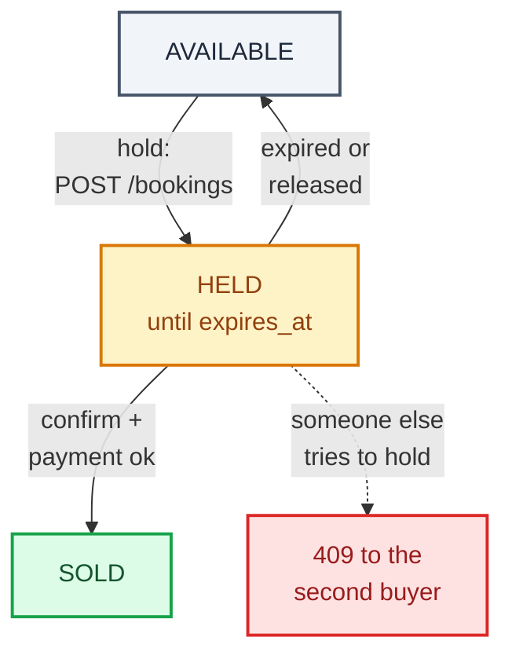
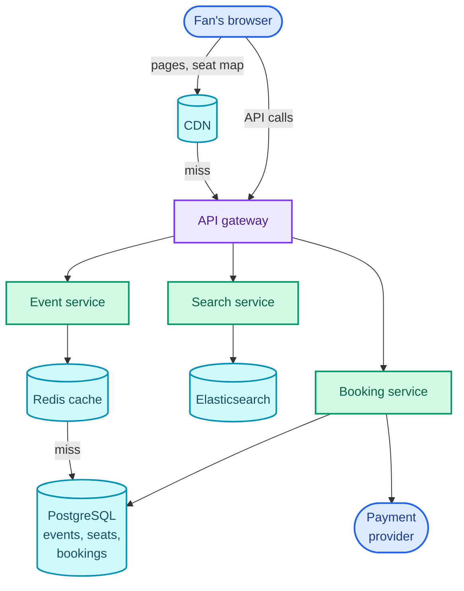
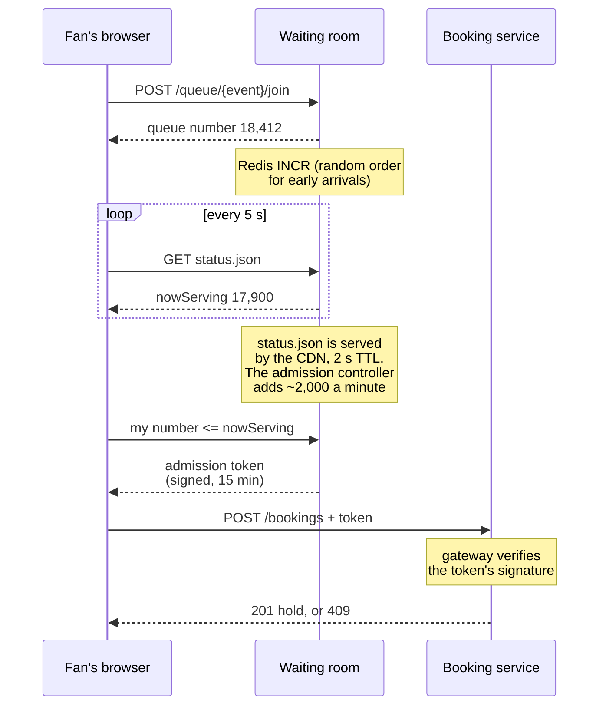
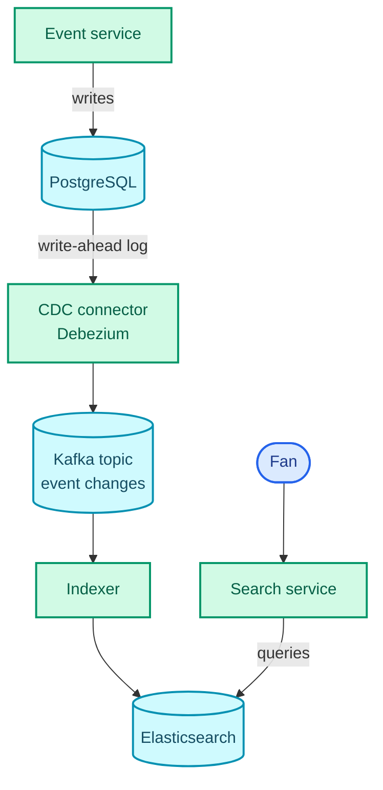

"Design Ticketmaster. Users find an event, pick seats and buy tickets."

Most of it is an ordinary read-heavy website: event pages, a search box, a seat map. What the question is really testing is **contention**: many people trying to change the same few rows at the same instant, where being wrong once (two people holding tickets for seat 14C) is worse than being slow. And contention at its most extreme, the on-sale for a stadium tour, when millions of people arrive in the same minute for 50,000 seats and the system's real job is to tell almost all of them "no" quickly, fairly and without falling over.

The pattern it teaches is *dealing with contention*: hold a scarce thing for a bounded time, make the claim a single atomic write, and control how many claimants reach that write at once. [Uber](/blogs/hld-uber/) reuses it for "one driver, one ride", [the job scheduler](/blogs/hld-job-scheduler/) for worker leases, and [the payment system](/blogs/hld-payment-system/) for idempotent money movement. It leans on [locking and isolation](/blogs/system-design-databases-relational/), [CAP per subsystem](/blogs/system-design-cap-consistency/), [caching](/blogs/system-design-caching/), [search indexes](/blogs/system-design-databases-nosql/), and [rate limiting at the edge](/blogs/system-design-the-edge/).

How to use this post: [the method](/blogs/hld-the-method/). Try the question cold first, then read.


You are a senior engineer interviewing me for a system design round. The question is: "Design Ticketmaster: users browse and search events, view a seat map, pick seats and buy tickets." Run it as a realistic 45-minute interview following this structure: requirements (5 min), core entities (2 min), API (5 min), high-level design (10-15 min), deep dives (10 min).
Rules: state the question in one sentence and stop. Answer my clarifying questions the way a real interviewer would, briefly, and only what I ask. Never propose designs, components or classes yourself. If I skip a stage or run long on one, say so in one line and keep time. When I finish a stage, write one line of the note you would put on the scorecard, then move on.
Once my design is in place, probe it with these, one at a time, waiting for my answer each time: 1) A user picks seats and takes six minutes to type in their card details. How are the seats kept for them, and what happens if they walk away? 2) Two users click the same seat in the same millisecond. Walk me through exactly what your database does. 3) Why not hold seats with a Redis lock that expires? 4) Ten million people arrive at 10:00:00 for a 50,000-seat stadium. What do they see, and what does your booking database see? 5) Users search for "coldplay mumbai". How is that served, and how does a newly added show appear in results? 6) The seat map is being viewed millions of times a minute during the on-sale. How fresh is it, and why is stale acceptable?
At the end, grade me as hire / lean hire / lean no hire / no hire for a senior engineer, with the two strongest and two weakest moments, and the one thing to fix first.



## Requirements

### Functional

1. Users should be able to view an event, including a seat map showing which seats are available.
2. Users should be able to search for events by performer, venue, city and date.
3. Users should be able to book tickets: pick seats, have them held while they pay, and receive tickets once payment succeeds.

Below the line (out of scope):

- **Creating and managing events.** A low-volume admin tool writing the same tables; it changes nothing about contention.
- **Dynamic pricing and resale.** Pricing rules and a second marketplace on top of the same inventory.
- **Refunds and transfers.** State transitions on a sold ticket, after the hard part is over.
- **Notifications** ("your tickets are ready"). Fire-and-forget after confirmation; that's [the notification system](/blogs/hld-notification-system/).

### Non-functional

1. **No seat is ever sold twice.** This is the one place the system chooses consistency over availability (CP): if the booking database can't confirm a hold, the user gets an error, not a maybe. [Part 2 of System Design](/blogs/system-design-cap-consistency/) makes the per-subsystem argument; this is its textbook case.
2. **Browsing and search stay available and fast (AP): event pages under 200 ms p99, search under 500 ms p99.** A seat map a couple of seconds stale is acceptable, because the hold, not the map, is the real check.
3. **Holds: seats a user picks are reserved for 10 minutes while they pay, and are released automatically if they don't.** No seat stays stuck because a user closed the tab.
4. **Hot on-sales: 10 million users arriving in the same few minutes for a 50,000-seat event must not take the system down**, and the order in which they get to buy must be fair (roughly first come, first served), not won by whoever refreshes fastest.
5. **Read-heavy: around 100 views and searches per booking attempt** on normal days, far more during an on-sale.

### Capacity estimate

Storage doesn't change the design. Say 100,000 events a year at an average of 5,000 seats: 5 × 10⁸ seat rows a year at about 100 bytes each is 50 GB. A single relational database holds years of it.

The on-sale is the number that changes everything. Assume 10 million people arrive within ten minutes for a 50,000-seat stadium (Ticketmaster said its 2022 Eras Tour presale drew [3.5 billion system requests, four times its previous peak](https://digital.abcaudio.com/news/ticketmaster-says-taylor-swifts-eras-tour-broke-several-ticket-sales-records-and-parts-our)).

- **Seat-map reads.** If each person's page refreshes availability every 2 seconds, that's 10M / 2 = **5 million reads a second** of a 50,000-seat map. **So the seat map must be served from cache, never from the database.**
- **Hold attempts.** If they all try to grab seats in the first minute, that's 10M / 60 ≈ **167,000 write attempts a second, all on the same 50,000 rows.** Sharding doesn't help: sharding by `event_id` spreads *different* events across machines, but this is one event, so every write lands on one shard. **So the number of people allowed to attempt a hold at once must be capped before they reach the database** (deep dive 3).
- **How many buyers it takes to sell out.** At about 4 tickets per order, 50,000 seats is 12,500 orders. If 60% of people let in actually buy, about 21,000 people need to be let in. Everyone after that is waiting for nothing, which deep dive 3 uses.

## Core entities

- **Event**: a performer at a venue at a time, with an on-sale time.
- **Venue**: the physical layout: sections, rows, seats and their positions on the map.
- **Seat (event seat)**: one sellable seat at one event, with a status (available, held, sold) and, while held, who holds it and until when.
- **Booking**: one user's attempt to buy a set of seats: pending while held, then confirmed or expired.
- **Ticket**: issued when a booking is confirmed; exactly one per event and seat.
- **Performer**: the artist or team, for search.

## API

The current user comes from the auth token, never from the body.

```text
GET    /events/{eventId}                 -> event, venue, performer, price tiers
GET    /events/{eventId}/seats           -> availability for every seat (may lag ~2 s)
GET    /search?q=&city=&from=&to=&cursor=     -> { events: [...], nextCursor }

POST   /bookings                         { eventId, seatIds: [...] }
         -> 201 { bookingId, expiresAt }  |  409 { unavailable: [seatIds] }
POST   /bookings/{bookingId}/confirm     { paymentToken }   header Idempotency-Key
         -> 200 { status: "confirmed", tickets: [...] }  |  410 hold expired
DELETE /bookings/{bookingId}             release the hold early
```

Booking is two calls on purpose: `POST /bookings` holds the seats, `confirm` pays for them. Between the two, the user types their card details, which takes minutes, and the hold is what makes those minutes safe. The `Idempotency-Key` on confirm means a retried request (the user double-clicks, the network times out) can't charge twice; [the payment system](/blogs/hld-payment-system/) covers that mechanism in depth.

## High-level design

### 1. View an event and its seat map

`GET /events/{id}` goes through the API gateway to the **event service**, which reads the event, venue and performer from a relational database (PostgreSQL here). Event details change rarely, so they're cached in Redis and on the CDN with a TTL of a few minutes, invalidated when an admin edits the event.

`GET /events/{id}/seats` returns availability. In the first version it's a query:

```text
seats    (event_id, seat_id) PK
           section, row, number, price_tier,
           status: AVAILABLE | HELD | SOLD,
           hold_expires_at, booking_id
```

`SELECT seat_id, status FROM seats WHERE event_id = ?` returns 50,000 rows per page view. Fine on a quiet Tuesday; at 5 million views a second it's the outage. Deep dive 5.

The venue's geometry (where each seat is drawn) is separate from availability and never changes for an event, so it's a static file on the CDN. Only the status overlay is dynamic.

### 2. Search for events

The **search service** answers `GET /search`. The first version is SQL: `WHERE name ILIKE '%coldplay%' AND city = ? AND starts_at BETWEEN ? AND ?`. A leading wildcard can't use a normal index, so this scans the events table on every search, and it has no idea which match is most relevant. Deep dive 4.

### 3. Book tickets

The **booking service** owns seats, bookings and tickets. Booking is two steps.

**Hold.** `POST /bookings` creates a booking row (`PENDING`, `expires_at = now + 10 min`) and sets the chosen seats to `HELD` with that booking's ID. If any seat isn't available, nothing is held and the user gets `409` with the seats that failed.

**Confirm.** `POST /bookings/{id}/confirm` charges the card through a payment provider (Stripe, Razorpay, Adyen: an external service), then sets the seats to `SOLD`, the booking to `CONFIRMED`, and inserts one ticket per seat.

```text
bookings (booking_id) PK   user_id, event_id, status, expires_at, payment_id
tickets  (ticket_id)  PK   event_id, seat_id, booking_id
           UNIQUE (event_id, seat_id)
```

A seat moves through three states. The diagram is that lifecycle; the arrow from `HELD` back to `AVAILABLE` is the one users never see, the hold quietly ending, and the dotted one is what every other buyer of that seat gets meanwhile.



In this first version, releasing an expired hold is a cron job that runs every minute and sets stale `HELD` rows back to `AVAILABLE`. Three things are left for the deep dives: whether that hold is the right mechanism (deep dive 1), whether two simultaneous holds on one seat can both succeed (deep dive 2), and what happens when 10 million people press "find seats" at once (deep dive 3).

### The assembled design

Read it from the top: a fan's browser reaches the CDN for anything cacheable (event pages, venue maps, the seat-availability snapshot) and the API gateway for everything else. Under the gateway, each service owns its data: the event service reads the database through Redis, the search service reads Elasticsearch, and the booking service is the only writer of seats.



Elasticsearch's feed from the database (deep dive 4) and the waiting room in front of the booking service (deep dive 3) are added below.

## Deep dives

### 1. Holding a seat while the user pays

This is NFR 1 and NFR 3. The question: "A user picks seats and spends six minutes typing card details. How are the seats kept for them, and what if they leave?"

**Bad: lock the rows for the whole checkout.** Open a transaction, `SELECT … FOR UPDATE` the seats (a pessimistic lock: other transactions touching those rows wait), and commit only after payment succeeds. It's correct and it's a disaster. A database transaction is tied to a database connection, so every user in checkout holds a connection for minutes. With 10,000 people in checkout and a connection pool of a few hundred, the pool is exhausted in seconds and nobody can even load a page. A lock held across a network call to a payment provider is the textbook way to turn a slow dependency into an outage ([System Design Part 6](/blogs/system-design-databases-relational/) says the same).

**Good: a Redis lock with a TTL per seat.** On hold, run `SET hold:{eventId}:{seatId} <bookingId> NX PX 600000` for each seat: `NX` means "only if the key doesn't exist", `PX 600000` means "delete it after 600,000 ms", 10 minutes. Redis executes commands one at a time, so of two simultaneous `SET NX`s on one key exactly one succeeds. Expiry is automatic, with no cron. It's fast, and it keeps hold traffic off the database. To hold four seats all-or-nothing, run the `SET`s in a Lua script, which Redis also runs atomically; in a Redis Cluster, put `{eventId}` in braces in every key (a hash tag), so that all of an event's keys land on one node and one script can touch them all.

Where it breaks: there are now **two sources of truth.** Redis says who holds a seat; the database says who bought it. Redis replicates to its replicas asynchronously, so if the primary acknowledges your lock and crashes before the replica has it, the promoted replica has never heard of your hold and will give the seat to someone else. Both users reach checkout. The database must check again at confirm anyway, at which point it's the database deciding, and Redis was only a filter.

**Great: the hold is state in the seat row, with the expiry as part of the condition.** One conditional `UPDATE` claims the seats:

```text
UPDATE seats
   SET status = 'HELD', booking_id = :b, hold_expires_at = now() + interval '10 minutes'
 WHERE event_id = :e
   AND seat_id IN (:s1, :s2, :s3, :s4)
   AND (status = 'AVAILABLE'
        OR (status = 'HELD' AND hold_expires_at < now()))
```

If it reports 4 rows updated, the hold is yours; anything less, roll back and return `409`. Look at the last line: **an expired hold counts as available in the condition itself.** Expiry is a comparison, not a job. If the cleanup cron is late, or down, no seat is ever stuck, because the next person's `UPDATE` treats an expired hold as free. A cron job still runs every few seconds to flip expired rows back to `AVAILABLE`, but only so the seat map looks right; correctness doesn't depend on it.

The sketch is one section of the stadium a few minutes into the on-sale, with holds shown with the minutes they have left. Red is sold, blue is the seats you are picking, and the amber seat marked 0 in row D has expired: on the map it still looks held until the cleanup runs, but the next `UPDATE` will take it.

<figure class="sketch"></figure>

Confirming uses the same idea, and the order of steps around the payment provider matters:

1. **Authorise** the card for the amount (the bank reserves the money but doesn't move it).
2. Claim the sale: `UPDATE seats SET status = 'SOLD' WHERE booking_id = :b AND status = 'HELD' AND hold_expires_at > now()`, and insert the tickets, in one transaction.
3. If that updated every seat, **capture** the payment (move the money). If not (the hold expired at minute 10:01 and someone else took a seat), **void** the authorisation and tell the user the hold ran out.

Authorising first and capturing last means no user is ever charged for seats they didn't get, and no seat is sold to someone whose card was declined. A small courtesy: show the user a 9-minute countdown for a 10-minute hold, so the last minute absorbs slow payment pages.

Finally, a backstop that doesn't depend on any of this logic being right: `UNIQUE (event_id, seat_id)` on tickets. If a bug ever lets two bookings reach step 2 for the same seat, the second insert fails and the transaction rolls back. The database refuses to issue two tickets for one seat, whatever the application believes.

### 2. Two users click the same seat in the same millisecond

This is NFR 1 at the level of one row. The question: "Walk me through exactly what the database does."

**Bad: check, then write, in the application.** The booking service reads the seat (`SELECT status …` returns `AVAILABLE`), decides it's free, and writes `HELD`. Two requests interleave: both read `AVAILABLE` before either writes, both write `HELD`, the second write overwrites the first, and both users are told the seat is theirs. This is check-then-act, and no amount of speed fixes it; the gap between the read and the write is the bug.

**Good: pessimistic locking, held for milliseconds.** In one short transaction: `SELECT … FROM seats WHERE … FOR UPDATE` on the requested seats, check they're available, update them, commit. The second request blocks on the row lock until the first commits, then reads `HELD` and gives up. This is correct, and unlike deep dive 1's bad rung the lock lives for one transaction, a few milliseconds, never across a payment. Two details: lock the seats in a consistent order (`ORDER BY seat_id`), or two users grabbing overlapping seats in opposite orders deadlock; and expect throughput to fall under heavy contention, since transactions queue on the hot rows.

**Great: the single conditional `UPDATE` from deep dive 1, with no separate read.** The check and the write are one statement, so there's no gap. Here's what PostgreSQL does at its default isolation level (READ COMMITTED) when two such `UPDATE`s hit the same row: the first locks the row and proceeds; the second waits for that lock; when the first commits, the second **re-evaluates its `WHERE` clause against the new version of the row**, finds `status = 'HELD'` with an expiry in the future, and updates zero rows. It returns at once with a count the service turns into `409`. No explicit lock, no read-modify-write, no retry loop.

The sketch puts the two approaches on one timeline. On top, two check-then-act requests both read "available" and both win; below, two conditional updates on the same row, where the second waits a few milliseconds, re-checks, and loses cleanly.

<figure class="sketch"></figure>

This is sometimes called optimistic, though strictly it's an atomic compare-and-set: optimistic locking in the version-column sense (`WHERE version = :v`, [System Design Part 6](/blogs/system-design-databases-relational/)) is the same idea when the new value depends on something you read first. Either way the rule from that part applies: pick the lock by the expected conflict rate. On a hot on-sale the conflict rate on popular seats is very high, and a design that makes every loser fail in one round trip, rather than queue behind a lock and then fail, is the one that holds up. The waiting room in the next deep dive keeps that contention bounded.

### 3. Ten million people at 10:00:00: the virtual waiting room

This is NFR 4. The question: "Ten million people arrive at once for 50,000 seats. What do they see, and what does your database see?"

**Bad: let everyone in and autoscale.** The 167,000 hold attempts a second land on one event's rows on one database shard. Autoscaling adds web servers in minutes, but the database can't be autoscaled at all in that window, and the contention is on rows, not machines. Latency climbs, requests time out, users retry, and retries multiply the load. Whoever's request happens to get through wins, which is neither first come, first served nor anything a fan would call fair.

**Good: rate-limit the booking endpoints at the gateway.** Allow, say, 500 hold attempts a second and reject the rest with `429` ([the rate limiter](/blogs/hld-rate-limiter/), Part 3). The database is now safe. The users aren't: a `429` tells them nothing about when to try again, so they hammer refresh, and the order of who gets in is decided by luck and reflexes. Rate limiting protects the system; it doesn't organise the crowd.

**Great: a virtual waiting room that admits people at the rate the booking system can serve.** Everyone who arrives for the on-sale joins a queue, sees their place in it, and is let into the booking flow in order, a few thousand a minute. The sequence below follows one fan: they get a number, watch a "now serving" number climb towards it, swap their number for an admission token, and only then reach the booking service.



How each piece works:

- **Joining.** `POST /queue/{eventId}/join` gives the user a queue number. People who arrive after the on-sale opens get the next number from a Redis counter (`INCR`), first come, first served. People who arrived early and waited on the page before 10:00 are all equally early, so they get random positions among themselves at 10:00, which removes the incentive to arrive at 9:59:59.9 with a script.
- **Waiting.** The waiting page polls a tiny JSON file, `{ "nowServing": 18400, "soldOut": false }`, served by the CDN with a 2-second TTL. Ten million browsers polling every 5 seconds is 2 million requests a second, all served by CDN edges; the origin sees about one request per edge every 2 seconds. It's the deli-counter trick: the server publishes one number, and each client compares it with the number on its own ticket.
- **Admitting.** An **admission controller** advances `nowServing` at a rate tuned to what the booking system can absorb, for example 2,000 users a minute. When a user's number is reached, the waiting room issues an **admission token**: a short-lived signed token (a JWT, [System Design Part 10](/blogs/system-design-distributed-primitives/)) carrying the event, the user and a 15-minute expiry. The gateway verifies the signature on every booking request without calling anyone; no token, no access.
- **Feedback.** The controller watches the booking service's latency and the number of seats left, and slows or stops admission when either says so. When available plus held seats reach zero, it sets `soldOut: true` and the whole queue learns at once.

The arithmetic from the estimate now pays off. Admitting 2,000 a minute, with each admitted user spending about 5 minutes picking and paying, there are about 2,000 × 5 = 10,000 people in the booking flow at any moment. If each makes three hold attempts in those 5 minutes, that's 10,000 × 3 / 300 = **100 hold attempts a second**, down from 167,000. The database barely notices. About 21,000 admissions sell the event out, which at 2,000 a minute takes about 10.5 minutes. Someone at position 1,000,000 has no realistic chance, and the honest design tells them early ("you're behind 1,000,000 people for 50,000 seats") instead of letting them wait an hour to read "sold out".

The sketch shows the shape over the first quarter-hour: arrivals spike to millions in the first minutes, admissions run as a flat line, and the queue absorbs the difference.

<figure class="sketch"></figure>

Two more things a strong candidate adds. **Bots** are a large share of on-sale traffic, so the queue is the place to filter: require a logged-in account (or pre-registration, as Ticketmaster's Verified Fan does), put a CAPTCHA on join, and allow one queue position per account and per payment card. And the waiting room is **only switched on for hot events**: a 300-seat comedy club on a Tuesday doesn't need it, and the admin flag that turns it on is part of setting up a big on-sale.

### 4. Search: "coldplay mumbai" without scanning the table

This is NFR 2 for search. The question: "How is search served, and how does a newly added show get into the results?"

**Bad: `ILIKE '%…%'` on the events table.** A leading wildcard can't use a B-tree index, so every search scans the table. There's no relevance ranking ("Coldplay" in the title should beat "Coldplay tribute band"), no typo tolerance, and every search load lands on the database that also has to take holds.

**Good: an Elasticsearch index, written to by the application alongside the database.** Elasticsearch keeps an inverted index (each word mapped to the events containing it, [System Design Part 7](/blogs/system-design-databases-nosql/)) with relevance scoring, fuzzy matching for typos, and filters on city and date. The event service, on every create or update, writes to PostgreSQL and then to Elasticsearch. The weakness is that dual write: if the second write fails (Elasticsearch is down, the process crashes between the two), the index silently disagrees with the database, and nothing notices until a user can't find a show.

**Great: change data capture (CDC) from the database into the index.** Instead of the application writing twice, a CDC tool (Debezium, for example) reads PostgreSQL's write-ahead log, the log every committed change is written to anyway, and publishes each change to Kafka. An indexer consumes the topic and updates Elasticsearch. The diagram is that pipeline.



Every committed change reaches the index, because the log contains every committed change; if the indexer is down, Kafka keeps the changes until it catches up. The index is eventually consistent, typically seconds behind: Kafka's delay plus Elasticsearch's refresh interval, which defaults to 1 second before a new document becomes searchable. That's fine for "a show was just announced". The index can also be rebuilt from scratch by replaying, which matters when the mapping changes.

What doesn't go in the index: seat availability. It changes every second during an on-sale and search results don't need it. Search returns events; the event page shows availability from the seat-map cache. For the head of the query distribution ("coldplay", "ipl final") cache results in Redis for a minute, since thousands of people type the same thing during an announcement.

### 5. Event pages and the seat map under read load

This is NFR 2 and NFR 5. The question: "The seat map is viewed millions of times a minute during the on-sale. How fresh is it?"

**Bad: query the seats table on every view.** 5 million views a second × 50,000 rows each is not a database workload; it's a denial of service against the same database taking the holds.

**Good: a cached availability snapshot, rebuilt every second or two.** The booking service is the only writer of seat status, so after every hold, release or sale it updates a compact availability structure in Redis: with three states, 2 bits per seat, so 50,000 seats is 100,000 bits = **12.5 KB** per event (a Redis bitmap, or a byte array in a string). A small job publishes that snapshot to the CDN every second with a 1-second TTL. Five million views a second become CDN hits on a 12.5 KB object, and the origin serves about one request per edge per second. Event details (the page text, the performer, the venue map geometry) sit on the CDN with TTLs of minutes, since they hardly change.

Why stale is safe here: the seat map is advice. A user who clicks a seat that was taken a second ago gets a `409` from the hold, which is the only check that counts, and the UI greys the seat out and suggests the nearest free ones. Making the map perfectly fresh would cost a lot and prevent nothing.

**Great: push changes to admitted users, cache for everyone else.** During an on-sale only the 10,000 admitted users can actually hold seats, and for them a 2-second-old map means more `409`s. Give them a server-sent events stream (SSE: a long-lived HTTP response the server writes events into, [System Design Part 3](/blogs/system-design-communication/)) of seat changes for their event, so their map updates within a few hundred milliseconds. Ten thousand SSE connections is a modest load; ten million would not be, which is the waiting room earning its keep a second time. Everyone else, still in the queue or just browsing, gets the CDN snapshot.

## What each level is expected to show

| Level | What good looks like on this question |
| --- | --- |
| Mid-level | A two-step hold then confirm, with seats in a relational database, a status column and an expiry; recognises the double-booking race and prevents it with a lock or a conditional update; caches event pages; mentions a search index. |
| Senior | Defends the hold mechanism against the alternatives (lock across checkout, Redis TTL lock) and makes expiry part of the `UPDATE` condition. Explains what the database does with two simultaneous updates, orders payment as authorise, claim, capture, and designs a waiting room with admission tokens and numbers for how many get in. CDC for search. |
| Staff+ | Treats the on-sale as the design: fairness rules (randomised pre-queue, FIFO after), admission rate driven by feedback, early "you won't get in" honesty, bot controls, a 12.5 KB availability snapshot on the CDN with SSE only for admitted users, and the unique constraint as a backstop independent of application logic. |

## Variants this unlocks

| Question | What changes |
| --- | --- |
| Design BookMyShow (movie seats) | The same hold and conditional update, with smaller venues and many more shows. On-sales are rarely hot enough for a waiting room, except for a blockbuster's first day. The class-level version is the [LLD movie booking](/blogs/lld-movie-ticket-booking/) post. |
| Design a flight booking system | Inventory is counted per fare class, not per named seat (seat choice comes later), so the hold is a counter decrement with a condition (`WHERE remaining >= :n`). Airlines deliberately overbook, which changes NFR 1. |
| Design a hotel reservation system (Booking.com) | Inventory is room type × night; a booking for three nights must decrement three rows atomically. Holds are shorter or skipped, and cancellations with refunds matter more. |
| Design a flash sale (Amazon Lightning Deal, a sneaker drop) | No seat identity, only a stock counter, and the waiting room is the whole design. Some drops replace the queue with a raffle: collect entries for 10 minutes, pick winners at random, which removes the race entirely. |
| Design a restaurant reservation system (OpenTable) | Tables × time slots as inventory, low contention most of the time, so a plain conditional insert with a unique constraint on (table, slot) is enough. |
| Design a meeting-room booking system | The same unique-constraint trick on (room, time slot); overlapping ranges need an exclusion constraint or a slot table. Concurrency is low, correctness still absolute. |

## The one-page version

- Read path and write path are different systems: event pages, venue maps and seat availability come from the CDN and Redis; only holds and sales touch the database.
- Seats are one row per seat per event in PostgreSQL with `status`, `booking_id` and `hold_expires_at`.
- Hold: one conditional `UPDATE` that treats an expired hold as available; rows updated must equal seats requested, else roll back and `409`.
- Expiry is a predicate, not a job: a sweeper only tidies the map.
- Never hold a lock across payment. Redis TTL locks are a fast filter, not a source of truth: async replication can lose them.
- Two simultaneous updates: the second waits on the row lock, re-checks its `WHERE`, updates zero rows, returns at once.
- Confirm: authorise card, then conditionally mark `SOLD` and insert tickets, then capture (or void). `UNIQUE (event_id, seat_id)` on tickets as the backstop.
- Hot on-sale: waiting room with queue numbers (randomised for early arrivals), a "now serving" number on the CDN, an admission controller at ~2,000 a minute, signed admission tokens checked at the gateway: 167,000 writes a second become about 100.
- Search: Elasticsearch fed by CDC (Debezium, Kafka), seconds behind, no availability in the index.
- Seat map: a 12.5 KB availability snapshot pushed to the CDN every second; SSE updates only for admitted users. Stale is safe because the hold is the check.

**Key sentence: let everyone read from cache, let only as many people as the database can serve into the booking flow, and make every claim on a seat one conditional write whose condition includes the hold's expiry.**


You are a senior engineer checking my understanding of a system design for Ticketmaster. The design: one row per seat per event in PostgreSQL with status (AVAILABLE, HELD, SOLD), booking_id and hold_expires_at; a hold is one conditional UPDATE that treats expired holds as available; confirm authorises the card, conditionally marks seats SOLD and inserts tickets with a UNIQUE (event_id, seat_id) constraint, then captures; a virtual waiting room with queue numbers, a CDN-served now-serving number, an admission controller and signed admission tokens fronts hot on-sales; search is Elasticsearch fed by CDC through Kafka; the seat map is a small availability snapshot on the CDN.
Ask me the questions below one at a time. Wait for my answer each time. Judge my answer against the expected key points, which you must not reveal before I answer. If I'm stuck, give one hint at a time, starting small. After each answer, tell me what I got right, what I missed, and the strongest phrasing of the answer in two or three sentences.
1. Why not hold seats by locking the rows with SELECT FOR UPDATE until payment completes? Expected: the lock and the DB connection are held for minutes across a network call; with thousands in checkout the connection pool is exhausted and the whole site stalls; a lock across a payment call turns a slow dependency into an outage.
2. Why not a Redis lock with a TTL as the hold? Expected: SET NX PX is atomic and auto-expires, fast; but it creates two sources of truth, and Redis async replication can lose an acknowledged lock on failover, so two users can both reach checkout; the database must decide at confirm anyway; fine as a filter, not as the truth.
3. Write the hold and explain how expiry works without a cron job. Expected: UPDATE seats SET status HELD, booking_id, hold_expires_at = now + 10 min WHERE event_id and seat_id IN (...) AND (status AVAILABLE OR (status HELD AND hold_expires_at < now)); rows updated must equal seats requested, else roll back and 409; expiry is part of the condition, so a late sweeper never leaves seats stuck; the sweeper only fixes the map.
4. Two users send that UPDATE for the same seat at the same instant. What exactly happens in PostgreSQL? Expected: the first takes the row lock; the second waits; under READ COMMITTED, after the first commits, the second re-evaluates its WHERE against the new row version, finds HELD with a future expiry, updates zero rows and returns immediately; no read-then-write gap; contrast with check-then-act where both win.
5. In what order do you talk to the payment provider and the database on confirm, and why? Expected: authorise first, then conditionally mark SOLD and insert tickets in one transaction (WHERE booking_id and HELD and not expired), then capture; if the update fails, void the authorisation; nobody is charged for seats they didn't get; the UNIQUE (event_id, seat_id) constraint is a backstop; Idempotency-Key prevents double charges on retries.
6. Ten million people arrive for 50,000 seats. What do they see, and what load reaches the booking database? Expected: a waiting room with queue numbers (random among early arrivals, FIFO after), a now-serving number served from the CDN, admission at ~2,000 per minute with signed short-lived tokens checked at the gateway; ~10,000 people in the booking flow, ~100 hold attempts per second instead of ~167,000; about 21,000 admissions sell out (12,500 orders at 4 seats, 60 percent conversion), so tell people far back early; rate limiting alone protects the system but is unfair and causes retry storms.
7. How does a newly announced show get into search results, and why not have the app write to both stores? Expected: dual writes can fail halfway and silently diverge; CDC reads the WAL (Debezium) into Kafka and an indexer updates Elasticsearch; every committed change arrives, buffered if the indexer is down; seconds of lag (Elasticsearch refresh defaults to 1 s); availability isn't indexed.
8. How is the seat map served during an on-sale, and why is staleness acceptable? Expected: availability snapshot at 2 bits per seat, 12.5 KB for 50,000 seats, updated by the booking service and pushed to the CDN every second with a 1 s TTL; the hold is the real check, so a stale map only causes a 409 and a suggestion; SSE seat updates only for the ~10,000 admitted users.
At the end, give me a one-paragraph verdict on whether I could defend this design in a senior interview.



Next: [Design a news feed](/blogs/hld-news-feed/), where contention gives way to fan-out: one post, millions of timelines, and the celebrity account that breaks the obvious design.
