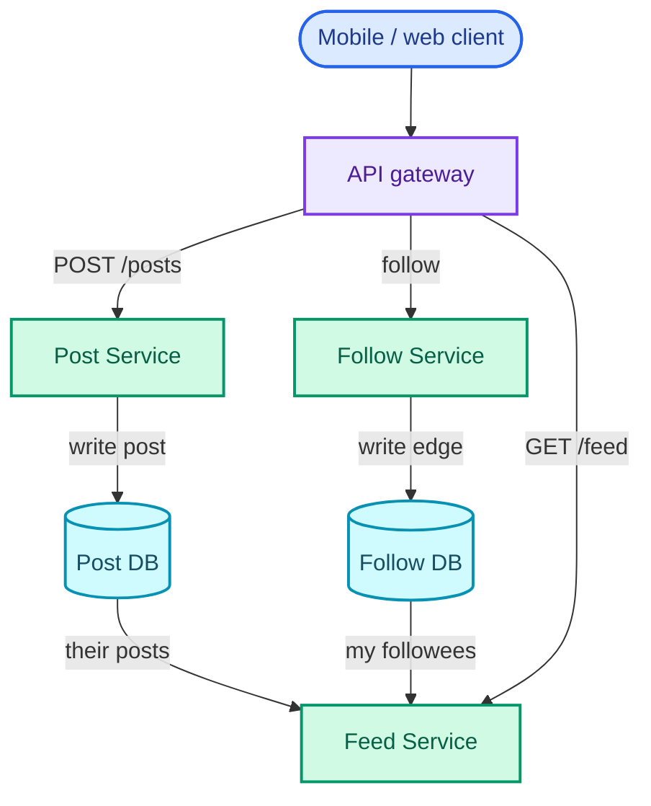
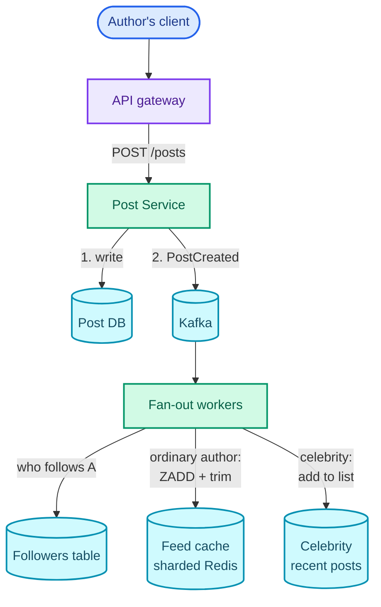
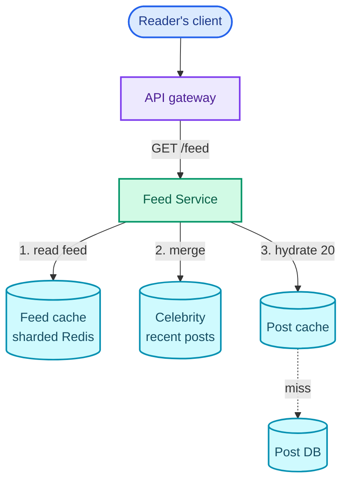

"Design a news feed. Users post, follow each other, and see the posts of the people they follow, newest first."

The hard part is one decision: **when the feed gets assembled**. Either you do the work when someone posts, copying the post into every follower's precomputed feed, or you do it when someone opens the app, gathering posts from everyone they follow. Each answer is fine for ordinary accounts and falls over on a different kind of account: the reader who follows thousands, or the author followed by a hundred million.

The pattern this question teaches is **fan-out**: one event that has to reach many places, and the choice of whether to pay for that at write time or at read time. WhatsApp's group messages ([Part 8](/blogs/hld-whatsapp/)), the notification system ([Part 14](/blogs/hld-notification-system/)) and every "activity feed" variant reuse it. The design leans on [the async part](/blogs/system-design-async/) (fan-out on write versus read, Kafka), [caching](/blogs/system-design-caching/) (Redis and its sorted sets), [NoSQL](/blogs/system-design-databases-nosql/) (wide-column tables) and [distributed primitives](/blogs/system-design-distributed-primitives/) (Snowflake IDs, which make cursors possible).

How to use this post: [the method](/blogs/hld-the-method/). Try the question cold first, then read.


You are a senior engineer interviewing me for a system design round. The question is: "Design a news feed like Facebook's or Twitter's home timeline: users create posts, follow other users, and see a feed of posts from the people they follow, newest first." Run it as a realistic 45-minute interview following this structure: requirements (5 min), core entities (2 min), API (5 min), high-level design (10-15 min), deep dives (10 min).
Rules: state the question in one sentence and stop. Answer my clarifying questions the way a real interviewer would, briefly, and only what I ask. Never propose designs, components or classes yourself. If I skip a stage or run long on one, say so in one line and keep time. When I finish a stage, write one line of the note you would put on the scorecard, then move on.
Once my design is in place, probe it with these, one at a time, waiting for my answer each time: 1. The first page of the feed must load in under 200 ms at p99 for 500 million daily users. How does your design get there? 2. An account with 100 million followers posts. Walk me through exactly what happens, and how long until followers see it. 3. A user loads page one, five new posts arrive, then they scroll to page two. Do they see duplicates or miss anything? 4. How do you store the follow graph so both "who do I follow" and "who follows this account" are fast at this scale? 5. A post goes viral and gets 50,000 likes per second. What breaks first, and how do you fix it? 6. How much memory do your precomputed feeds need, and what would you change to shrink it?
At the end, grade me as hire / lean hire / lean no hire / no hire for a senior engineer, with the two strongest and two weakest moments, and the one thing to fix first.



## Requirements

### Functional

1. Users should be able to create a post (text, plus an optional link to media stored elsewhere).
2. Users should be able to follow and unfollow other users.
3. Users should be able to view their feed: posts from the accounts they follow, newest first, paged as they scroll.

Below the line (out of scope):

- **Ranking.** A ranked feed scores the same candidate posts this design gathers; ranking is a stage on top, not a different architecture. Chronological keeps the hour about fan-out.
- **Comments and replies.** A separate store keyed by post, with no effect on how feeds are built.
- **Media upload.** Images and video go to a blob store through presigned URLs, covered in [Dropbox](/blogs/hld-dropbox/) and [YouTube](/blogs/hld-youtube/). A post only carries the URL.
- **Search over posts.** That is [Part 10](/blogs/hld-post-search/).
- **Notifications** ("X liked your post"). That is [Part 14](/blogs/hld-notification-system/).

Likes are in scope only as the counter each post shows in the feed (deep dive 5), because a viral post's counter is a classic place for this design to break.

### Non-functional

1. **The first page of the feed (20 posts) returns in under 200 ms at p99** (99 out of 100 requests are faster), measured at the server. This is the requirement the whole design bends around.
2. **A new post appears in followers' feeds within 10 seconds at p99.** Freshness is eventual, not immediate. In CAP terms the feed is AP: during a partition, serve a feed that is a few seconds stale rather than an error. (CAP and the AP/CP split per subsystem are in [Part 2 of System Design](/blogs/system-design-cap-consistency/).)
3. **Scale: 500 million daily active users, and follower counts anywhere from 0 to over 100 million.** The spread matters as much as the average.
4. **A post is durable once the API returns 201.** The post store is the source of truth; every feed is a derived copy that can be rebuilt from it.
5. **Like counts may lag by up to about 10 seconds, but a like is never counted twice.**

### Capacity estimate

Inputs, stated as assumptions you would say aloud: 500M daily active users (DAU), each loading the feed 10 times a day; 10% of them post once a day; the average account has 200 followers.

- **Feed reads:** 500M × 10 = 5 billion loads a day. 5 × 10⁹ ÷ 86,400 s ≈ 57,900 per second on average. Peaks run about 3× the average, so **about 175,000 feed loads per second**.
- **Posts:** 10% of 500M = 50 million a day. 5 × 10⁷ ÷ 86,400 ≈ 580 per second, about 1,700 at peak. Read : write ≈ 5B ÷ 50M = **100 : 1**.
- **Fan-out on read** (build each feed when it is loaded): each load looks up the recent posts of all 200 followees. 175,000 × 200 = **35 million author lookups per second** at peak. That number rules it out as the default.
- **Fan-out on write** (copy each post into each follower's feed): 50M posts × 200 followers = 10 billion feed inserts a day, about 116,000 per second on average and **about 350,000 per second at peak**. Large, but spread over many keys and machines, and it buys a read that is one lookup.
- **One celebrity post:** 100M followers means 100M inserts. At the whole fleet's peak rate of 350,000 per second that is 100 × 10⁶ ÷ 3.5 × 10⁵ ≈ **286 seconds, nearly five minutes of every fan-out worker**, against a 10-second freshness target. That number is why the design ends up hybrid.
- **Memory for precomputed feeds:** keep the newest 500 post IDs per active user. I measured this on Redis 7.4: a 500-entry sorted set takes 54,488 bytes in Redis's default encoding and 10,288 bytes in its compact encoding (deep dive 1 explains the difference). For 500M users that is **27 TB or 5.1 TB of RAM**. At roughly 100 GB of usable memory per node, 272 nodes or 52. So the feed cache must be sharded by user either way, and one config setting is worth about 220 machines.
- **Post storage:** 50M posts × about 1 KB (text, IDs, timestamps, media URL) = 50 GB a day, about 18 TB a year before replication. The post store must be sharded too, by post ID.

## Core entities

- **User**: an account; can post and follow.
- **Post**: one immutable piece of content, with an author and a creation time.
- **Follow**: a directed edge, follower → followee.
- **Feed**: a user's precomputed list of post IDs, newest first; a derived cache, not a source of truth.
- **Like**: a (user, post) pair, plus a per-post counter derived from those pairs.

## API

```text
POST   /v1/posts                         create a post
       body: { "text": "...", "media_url": "https://..." }   (media_url optional)
       → 201 { "post_id": "1849302183746011136", "created_at": "..." }

PUT    /v1/users/{user_id}/follow        follow user_id (idempotent)
DELETE /v1/users/{user_id}/follow        unfollow user_id
       → 204

GET    /v1/feed?cursor=<opaque>&limit=20 the caller's feed, newest first
       → 200 { "posts": [ { post_id, author, text, media_url,
                             like_count, created_at }, ... ],
               "next_cursor": "<opaque>" }

PUT    /v1/posts/{post_id}/like          like (idempotent); DELETE to unlike
```

The author of a post and the follower in a follow come from the auth token, never the body, so nobody can post as someone else. `PUT` for follow and like makes retries safe: following twice is the same as following once. The cursor is opaque to the client, which lets deep dive 3 change what is inside it without changing the API.

## High-level design

Three requirements, one at a time, deliberately simple. The bottlenecks get named and left for the deep dives.

### 1. Users create a post

`POST /v1/posts` reaches the API gateway (the single entry point that authenticates the token and routes the request), which sends it to the **Post Service**. The service generates a Snowflake ID, a 64-bit ID whose top bits are a millisecond timestamp, so IDs sort by creation time without a central counter ([how Snowflake works](/blogs/system-design-distributed-primitives/)). It writes the post to the **Post DB** and returns 201.

```text
posts   (partition key: post_id)
  post_id     bigint    Snowflake, time-ordered
  author_id   bigint
  text        string
  media_url   string?
  created_at  timestamp
```

The Post DB is a wide-column store such as Cassandra or DynamoDB: 18 TB a year of rows written once and read by key, with no joins, is the workload they are built for. A secondary index on `(author_id, created_at)` serves "this author's recent posts", which the feed needs in a moment.

### 2. Users follow and unfollow

`PUT /v1/users/{id}/follow` goes to the **Follow Service**, which writes one edge to the **Follow DB**.

```text
follows (partition key: follower_id, sort key: followee_id)
  follower_id  bigint
  followee_id  bigint
  created_at   timestamp
```

Partitioning by follower makes "who do I follow" a single-partition read. Fan-out needs the reverse question, "who follows this author", which this table cannot answer without asking every partition. Deep dive 4 fixes it.

### 3. Users view their feed

The simplest correct design builds the feed at read time. The **Feed Service** reads the caller's followees from the Follow DB, asks the Post DB for each followee's recent posts, merges them by time, and returns the newest 20.

That is **fan-out on read**, and the estimate already priced it: 200 lookups per load, 35 million a second at peak, then a merge, all inside 200 ms. It is correct and far too slow at this scale. Deep dive 1 replaces it.

Here is the design assembled. The two write paths run down the left and the middle; the Feed Service sits at the bottom because it reads from both stores. Arrows show the direction data moves.



Everything is stateless except the two stores, so the services scale by adding instances. The one line to leave on the board: "fan-out on read is 35M lookups a second at peak; deep dive 1."

## Deep dives

### 1. How does the feed load in under 200 ms? (non-functional 1)

**Bad: fan-out on read with a cache in front.** Cache each author's recent posts in Redis so the 200 lookups hit memory, not disk. Each lookup is now well under a millisecond, but a feed load is still 200 network round trips plus a merge of 200 lists, and the fleet is still serving 35 million lookups a second. Batching the lookups per cache shard helps, but the work per load grows with how many accounts the reader follows and a reader who follows 2,000 accounts pays ten times what one who follows 200 does.

**Good: fan-out on write into precomputed feeds.** Move the work to post time: about 350,000 cheap inserts a second at peak instead of 35 million lookups a second on the read path. When a post is created, the Post Service publishes a `PostCreated` event to Kafka, a durable log that consumers read at their own pace ([Kafka and why ordering is per partition](/blogs/system-design-async/)). **Fan-out workers** consume it, look up the author's followers, and insert the post ID into each follower's feed in a sharded Redis cluster. A feed read becomes one lookup of one key.

The figure below puts the two strategies side by side with this system's numbers. Look at where the arrows multiply: on the post in the left panel, on the read in the right.

<figure class="sketch"></figure>

The precomputed feed is a Redis **sorted set** per user, a set of members each with a numeric score, kept ordered by score:

```text
key:    feed:{user_id}
member: post_id            (64-bit Snowflake)
score:  created_at in ms   (≈ 1.8 × 10¹², exact in a double)

insert: ZADD feed:{u} <ms> <post_id>
trim:   ZREMRANGEBYRANK feed:{u} 0 -501     keep the newest 500
read:   ZRANGE feed:{u} +inf -inf BYSCORE REV LIMIT 0 20
```

Two details here are what interviewers probe. First, the score is the millisecond timestamp, not the post ID. Redis scores are 64-bit floating-point numbers, exact only up to 2⁵³ ≈ 9 × 10¹⁵, and a Snowflake ID from 2026 is around 1.8 × 10¹⁸, so two different IDs could round to the same score. A millisecond timestamp fits exactly. Second, the feed holds only IDs. The post text lives once in the Post DB with a cache in front (the post cache), and the Feed Service "hydrates" a page by fetching 20 posts in one `MGET`. Copying full posts into a million feeds would multiply storage by the follower count and make every edit a fan-out.

The workers process the event asynchronously, so the author's 201 does not wait for the fan-out. Freshness (non-functional 2) becomes a question of consumer lag: as long as the workers keep up with 350,000 inserts a second at peak, a post lands in feeds in seconds.

**Great: fan-out on write, kept only for people who will read it, in the compact encoding.** Two refinements turn the Good answer into one that survives the memory estimate.

- **Only active users get a precomputed feed.** A registered base of, say, 2 billion against 500M DAU means three quarters of the inserts would go into feeds nobody opens. Workers skip followers who have not been active in the last 30 days (a flag in the user cache). When an inactive user returns, the Feed Service builds their feed once by fan-out on read, writes it to Redis, and from then on the normal path keeps it current. One slow load per returning user, instead of 4× the memory forever.
- **Keep the sorted set in Redis's compact encoding.** Redis stores a small sorted set as a *listpack*, one flat byte array, and converts it to a skiplist plus a hash table once it passes `zset-max-listpack-entries`, 128 entries by default. I measured 500 entries at 54,488 bytes as a skiplist and 10,288 bytes as a listpack, about 109 against 21 bytes per entry. Raising the threshold to 512 turns 27 TB into 5.1 TB. The cost: inserting into a listpack is O(n) in its length instead of O(log n), and for n = 500 that is a memmove of about 10 KB, microseconds. This is a trade only worth making because the feed is capped.

The feed cache is sharded by `user_id` with consistent hashing (which shard owns which key, [explained here](/blogs/system-design-databases-relational/)), one replica per shard. Losing a shard is not data loss: those feeds are rebuilt from the Post DB, the same path an inactive user takes.

### 2. What happens when an account with 100 million followers posts? (non-functional 2 and 3)

This is the question the interviewer is waiting for. The estimate already answered it: 100M inserts, about 286 seconds of the entire fan-out fleet at peak. And it is worse than "one slow post", because the fan-out queue is shared. The figure shows what one celebrity post does to everyone else's posts queued behind it.

<figure class="sketch"></figure>

**Bad: fan out every post, celebrity or not, and add workers.** Doubling the fleet halves the 286 seconds and doubles the cost of a fleet that sits mostly idle between celebrity posts. It also does nothing for the other problem: ten celebrities posting in the same minute (a cup final, an election) is a billion inserts.

**Good: don't fan out celebrities; pull their posts at read time.** Mark accounts above a follower threshold as celebrities. Their posts are stored in the Post DB as usual, but when a fan-out worker sees a celebrity author it skips the followers entirely and adds the post to that author's **recent-posts cache** instead (a Redis sorted set of their last 100 post IDs). Each user also keeps a short list of the celebrities they follow. The Feed Service reads the user's precomputed feed, reads the recent posts of each celebrity they follow, and merges the lists by timestamp before taking the top 20.

This is fan-out on read, but only for the handful of accounts where fan-out on write is ruinous. A reader who follows 5 celebrities adds 5 cache lookups to a feed load, not 200. The celebrity caches are the hottest keys in the system, and that is fine: they are tiny, read-only between posts, and can be replicated to every cache node or held in each Feed Service instance's memory for a second or two.

Here is that merge on a small example: the reader's precomputed feed on the left, two celebrities' recent posts on the right, and the page the reader sees.

<figure class="sketch"></figure>

**Great: hybrid with a tuned threshold, parallel fan-out for the middle, and a cap on the merge.** Three refinements.

- **Pick the threshold with arithmetic, not a round number.** Below it, a post is fanned out; above it, pulled. Set it so the largest fanned-out post finishes inside the freshness target. A 100,000-follower account is 100,000 inserts; split into 100 batches of 1,000 handled by 100 workers in parallel, each pipelining its batch to Redis, that finishes in well under a second. A 100M-follower account cannot be made to fit that way without a dedicated fleet.
- **Big but sub-celebrity fan-outs are split, not serialised.** The worker that reads a `PostCreated` event for a 90,000-follower author does not do 90,000 inserts itself. It pages through the followers list in batches of 1,000 and publishes one "fan-out batch" message per page, which many workers process at once. A large post becomes many small jobs that interleave with everyone else's.
- **Bound the read-side merge.** A user who follows 300 celebrities would make every feed load 300 lookups, the original problem in miniature. Cap the pulled set (the 20 or so celebrities they interact with most), and fan out the rest of those accounts' posts to that user lazily, or accept a slightly staler view of celebrities they never engage with.

Real systems converged on the same shape. A Twitter engineering talk, summarised by High Scalability in 2013, described home timelines held in Redis, capped at 800 entries, filled by fan-out on write, with very-high-follower accounts handled differently ([summary on High Scalability](https://highscalability.com/the-architecture-twitter-uses-to-deal-with-150m-active-users/)).

### 3. How does pagination avoid duplicates and gaps? (non-functional 1)

The reader loads page one, scrolls, and asks for page two while new posts keep arriving at the top. The figure shows what happens with two different ways of asking for "the next 20".

<figure class="sketch"></figure>

**Bad: offset pagination.** `GET /feed?offset=20&limit=20` returns ranks 20 to 39. If 5 posts arrived since page one, every older post has moved down 5 places, so ranks 20 to 24 are the last 5 posts the reader already saw. They see duplicates. If posts are deleted instead, they skip posts without knowing. Offsets also cost O(offset) to find in many stores.

**Good: a cursor that names the last post seen.** The response carries `next_cursor`, which encodes the timestamp and post ID of the last post on the page. Page two asks for posts at or before that timestamp:

```text
ZRANGE feed:{u} <ts> -inf BYSCORE REV LIMIT 0 25     newest first, from ts down
```

New posts at the top do not move the cursor, because it points at a post, not a position. The cursor holds the ID as well as the timestamp because two posts can share a millisecond. So the fetch starts at `<ts>` inclusive, with a few spare entries, and the service drops the entries with that same timestamp whose ID is not smaller than the cursor's (the ones already shown); the first 20 left are the page. Snowflake IDs make the tie-break tidy, since ID order is time order.

**Great: an opaque cursor that also covers the celebrities and the end of the cache.** The hybrid merge reads several lists, so the cursor must record a position in each: in practice, one timestamp-and-ID pair is enough, because every list is time-ordered and "older than this post" means the same thing in all of them. The cursor also has to handle the end of the cache: the precomputed feed holds only 500 posts, a few days for most people. When a reader scrolls past it, the Feed Service falls back to fan-out on read against the Post DB's `(author_id, created_at)` index, with the same cursor. That path is slow, and it is acceptable, because the reader who scrolls past 500 posts is rare and is not waiting on the first 200 ms. The cursor is base64-encoded and signed (an HMAC, a keyed hash the server can check) so clients cannot forge one that points into someone else's feed; the API never promised its contents, so this can change freely.

The same cursor answers "anything new?" at the top: the client sends the newest post it has, and the service returns the count of entries with a larger score.

### 4. How do you store the follow graph? (non-functional 3)

The two questions the design asks of the graph are "whom does user U follow" (the Feed Service, on every load that pulls celebrities, and when rebuilding a feed) and "who follows author A" (the fan-out workers, on every post). Both are single hops. Nothing in this design walks friends-of-friends.

**Bad: one relational table with an index on each column.** `follows(follower_id, followee_id)` with two indexes answers both questions on one machine. At, say, 2 billion users × 200 edges = 400 billion edges, it does not fit on one machine, and once you shard it you can only shard by one of the two columns. Shard by follower and "who follows A" has to ask every shard.

**Good: store each edge twice, in two tables partitioned opposite ways.** `following` is partitioned by `follower_id`; `followers` is partitioned by `followee_id`. A follow writes both rows; each question is a single-partition read in a wide-column store. This is denormalisation, keeping a second copy shaped for a second query ([why NoSQL designs do this early](/blogs/system-design-databases-nosql/)). The two writes are not atomic across partitions, so the Follow Service writes `following` (the copy the user sees) synchronously and puts the `followers` write on an outbox, a table of pending events written in the same transaction and published reliably afterwards ([outbox pattern](/blogs/system-design-async/)). A periodic job reconciles the two tables.

```text
following (partition: follower_id, sort: followee_id)   "whom do I follow"
followers (partition: followee_id, sort: follower_id)   "who follows me"
  plus on users: follower_count, is_celebrity
```

**Great: the same two tables, with the celebrity partition split.** A 100M-follower account is one partition of 100M rows in `followers`. Wide-column stores want partitions bounded (the commonly cited Cassandra guidance is to keep a partition under about 100 MB, and 100M rows of 16 bytes is 1.6 GB before overhead). Partition `followers` by `(followee_id, bucket)` instead, where `bucket = follower_id mod 64` for large accounts, so the fan-out workers from deep dive 2 can read the 64 buckets in parallel. A graph database earns its place only when the questions become multi-hop ("people you may know"); one-hop lookups by key are what a wide-column store does best.

`is_celebrity` is a derived flag recomputed when `follower_count` crosses the threshold in either direction. When an account becomes a celebrity, fan-out stops for its new posts and its followers start pulling it; the posts already fanned out stay where they are and age out of the feeds.

### 5. A post goes viral: like counters and hot posts (non-functional 1 and 5)

Every post in the feed shows a like count, so a viral post is both written to (likes) and read from (hydration in millions of feeds) harder than anything else. Say it peaks at 50,000 likes a second.

**Bad: increment a column on the post row.** `UPDATE posts SET like_count = like_count + 1 WHERE post_id = ?` takes the row's write lock for the length of each transaction, so all 50,000 updates a second to one row run one after another. As a rule of thumb, a single hot row tops out somewhere in the low thousands of committed updates a second, and the queue behind it backs up into the like API. It also gives no protection against counting the same user twice.

**Good: a likes table for truth, a Redis counter for display.** A like writes `(post_id, user_id)` to a `likes` table with that pair as the primary key, so a retried or duplicated like is a no-op: that is non-functional 5's "never counted twice". If the insert actually created a row, the service runs `INCR likes:{post_id}` in Redis. Redis executes commands one at a time on a single thread per node, so `INCR` is atomic without locks, and a single node handles on the order of 100,000 simple commands a second (a rule of thumb, more with pipelining). The feed reads counts from Redis and a background job writes them back to the Post DB every few seconds.

**Great: shard the hottest counters and the hottest post.** One key lives on one Redis node, and for the very top posts that node is now carrying the whole world's likes plus every read of the count. Split a hot post's counter into 16 sub-keys, `likes:{post_id}:0` to `:15`; each like increments one chosen at random, and the displayed count is the sum, recomputed every second or so and cached as a single value. Writes spread across nodes; reads hit one cached number that is at most a second stale, inside the 10-second budget. Do the same for the post object itself: the viral post is hydrated into millions of feed pages, so the Feed Service keeps the hottest few thousand post objects in its own process memory for a few seconds, and the post cache holds replicas of hot keys on several nodes. A user's own like must show immediately even though the count is eventually consistent, and the client handles that: it shows the count it was given plus its own like.

Here is the design after the deep dives, in two halves so each stays readable. First the write path: the post is stored, then Kafka hands it to the fan-out workers, which either insert it into followers' feeds or, for a celebrity author, add it to that author's recent-posts list.



Then the read path: one feed read, one merge with the celebrities the reader follows, one hydration of 20 posts.



The Follow Service and the like path are left off; they are unchanged from the steps above.

## What each level is expected to show

| Level | What a strong answer shows on this question |
| --- | --- |
| Mid-level | A working design with posts, follows and a feed; names fan-out on write versus read and picks one with a reason; uses a cache for feeds and cursor pagination when prompted. |
| Senior | Drives to the celebrity problem unprompted, quantifies it (inserts per post, seconds of backlog), and lands the hybrid with a threshold. Stores IDs not posts in feeds, uses Kafka between post and fan-out, and handles the follow graph's reverse lookup. |
| Staff+ | Treats the feed as a rebuildable derived view and designs for its loss; prices the cache in terabytes and changes the encoding or the cap to cut it; bounds the read-side merge, splits large fan-outs into parallel batches, and plans for hot keys on both the counter and the post. |

## Variants this unlocks

| Question | What changes |
| --- | --- |
| Design Instagram's feed | Posts are media-first, so the upload path (presigned URL to a blob store, CDN on read) matters; the feed itself is the same hybrid fan-out. |
| Design Twitter / X, with retweets | A retweet is a new feed entry that points at an existing post; dedup in the merge so a post retweeted by three followees shows once. |
| Design LinkedIn's or Facebook's ranked feed | Fan-out gathers a few hundred candidates; a ranking service scores them before the first page. The cursor becomes a snapshot of the ranked list for the session. |
| Design an activity feed (GitHub, Strava) | Events instead of posts, usually smaller follower counts, so pure fan-out on write is often enough; aggregation ("3 people starred your repo") happens before insert. |
| Design Reddit or Hacker News front page | No personal fan-out at all: one global ranked list per community, recomputed periodically and cached. The interesting part becomes ranking with time decay and vote counters. |
| Design a notification inbox | Same fan-out-on-write into a per-user list; adds read/unread state and delivery channels, which is [Part 14](/blogs/hld-notification-system/). |

## The one-page version

- Posts: Post Service writes to a sharded wide-column Post DB, Snowflake IDs so ID order is time order.
- Follow graph: two tables, `following` by follower and `followers` by followee, big accounts' followers bucketed.
- Read : write is 100 : 1, so feeds are precomputed: fan-out on write via Kafka and fan-out workers.
- Each active user's feed is a Redis sorted set of the newest 500 post IDs, score = millisecond timestamp.
- Feeds hold IDs only; a page is hydrated from a post cache in one `MGET`.
- Inactive users get no precomputed feed; rebuilt by fan-out on read when they return.
- Celebrities (above a follower threshold) are not fanned out; their posts sit in a small recent-posts cache and are merged in at read time.
- Large sub-celebrity fan-outs are split into parallel batches so they don't block the queue.
- Pagination by an opaque, signed cursor (timestamp + post ID); past the cache's end, fall back to the Post DB.
- Likes: a `(post, user)` table for truth, Redis `INCR` for display, sharded counters and in-process caching for viral posts.
- Feeds are derived and rebuildable; the Post DB is the only source of truth.

**Do the fan-out when the post is written, for everyone except the few accounts whose follower counts would make that write take minutes; pull those at read time and merge.**


You are a senior engineer checking my understanding of a news feed design (Facebook or Twitter home timeline: users post, follow, and read a chronological feed of followees' posts; 500 million daily users, 10 feed loads each a day, 50 million posts a day, average 200 followers, some accounts over 100 million followers; first page under 200 ms p99, new posts visible within 10 seconds). Ask me the questions below one at a time. Wait for my answer each time. Judge it against the key points listed, but do not reveal the key points before I answer. If I am stuck, give a small hint first, then a bigger one, and only then the answer. After each question, tell me briefly what I got right and what I missed.
1. Why is fan-out on write the default here, with numbers? Key points: about 175,000 feed loads per second at peak versus about 1,700 posts per second; fan-out on read is 200 lookups per load, about 35 million per second; fan-out on write is about 350,000 inserts per second at peak but makes a read one key lookup; feeds store post IDs only and are hydrated from a post cache.
2. An account with 100 million followers posts. What happens in a pure fan-out-on-write design, and what do you do instead? Key points: 100 million inserts, about 286 seconds of the whole fleet at 350,000 per second; it delays every post queued behind it; hybrid: no fan-out above a follower threshold, celebrity posts go to a small recent-posts cache and are merged at read time; threshold chosen so the largest fanned-out post finishes within the freshness target; cap how many celebrities one reader merges.
3. Why not use the Snowflake post ID as the Redis sorted-set score? Key points: scores are doubles, exact only up to 2^53, about 9 x 10^15; Snowflake IDs are around 10^18; use the millisecond timestamp as score and the ID as member; the cursor carries both to break ties within a millisecond.
4. Offset pagination versus cursor pagination when new posts arrive between pages. Key points: offsets shift, so new posts at the top cause duplicates on the next page and deletions cause skips; a cursor names the last post seen (timestamp and ID) and asks for strictly older posts; opaque and signed; past the end of the 500-entry cache, fall back to fan-out on read from the post store.
5. How do you store the follow graph so both directions are fast? Key points: two tables, following partitioned by follower and followers partitioned by followee; dual write with an outbox and reconciliation; bucket the followers partition for very large accounts; graph DB not needed for one-hop queries.
6. A post gets 50,000 likes per second. What breaks and what is the fix? Key points: a counter column on one row serialises on the row lock; a likes table keyed by (post, user) prevents double counting; Redis INCR is atomic because commands run one at a time; for the hottest posts, split the counter into sub-keys and cache the sum; cache the hot post object in process and replicate hot keys.
7. How much memory do the precomputed feeds need, and how would you cut it? Key points: 500 entries per active user; measured about 109 bytes per entry as a skiplist versus about 21 as a listpack; 27 TB versus 5.1 TB for 500 million users; raise zset-max-listpack-entries, keep feeds only for active users, cap the length; feeds are rebuildable so losing a shard is not data loss.



Next: [WhatsApp](/blogs/hld-whatsapp/), where the fan-out target stops being a list in Redis and becomes an open connection on one of thousands of servers.
