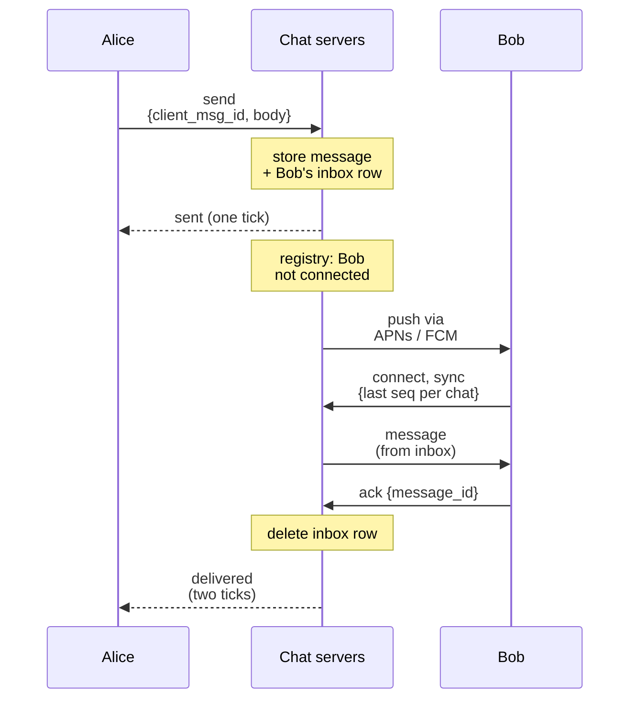
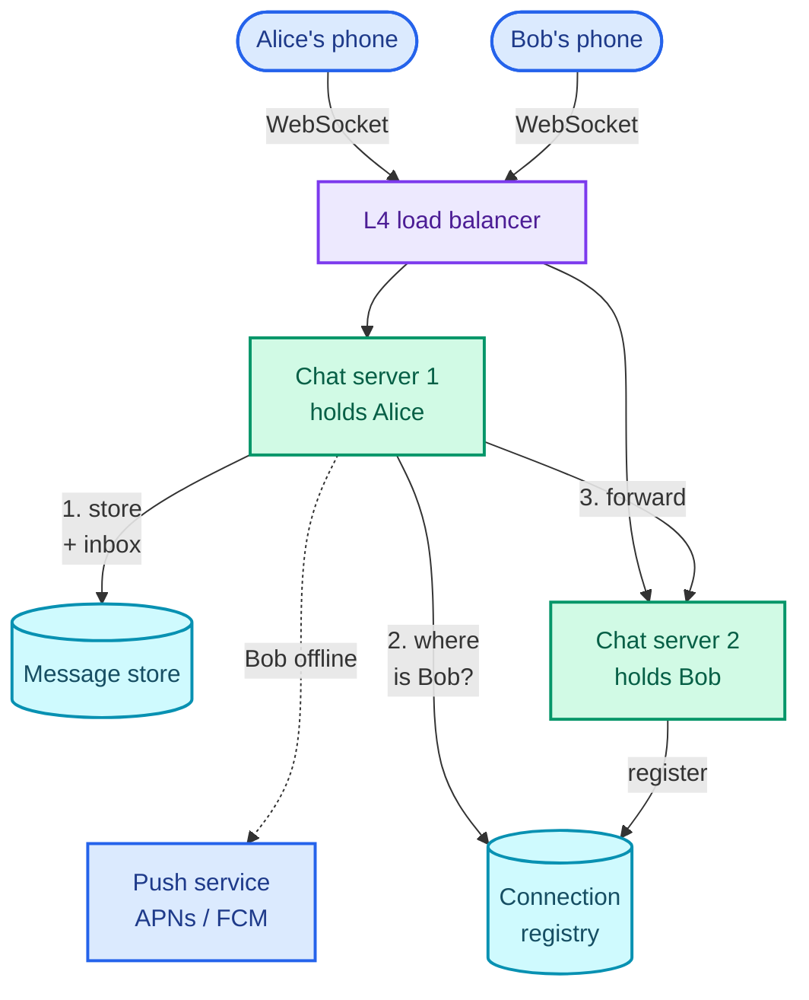

"Design WhatsApp. Users send messages to each other and to groups, and messages arrive in real time."

What it is really testing is **real-time delivery over persistent connections**. A REST request can land on any server; a message for Bob has to reach the one server, out of thousands, that holds Bob's open connection right now, and if Bob has no connection, it has to wait somewhere safe until he does. Everything else (receipts, ordering, groups, presence) is built on how you answer that.

The pattern is **real-time updates**: push to a client over a long-lived connection, with a durable fallback for when the push can't happen. Uber's driver offers and live map ([Part 9](/blogs/hld-uber/)) and Google Docs' collaborative editing ([Part 17](/blogs/hld-google-docs/)) reuse it, and group delivery reuses the fan-out from [Part 7](/blogs/hld-news-feed/). The design leans on [communication protocols](/blogs/system-design-communication/) (WebSockets and why they are stateful), [async messaging](/blogs/system-design-async/) (at-least-once delivery, idempotency, per-partition ordering), [distributed primitives](/blogs/system-design-distributed-primitives/) (IDs) and [NoSQL](/blogs/system-design-databases-nosql/) (wide-column storage).

How to use this post: [the method](/blogs/hld-the-method/). Try the question cold first, then read.


You are a senior engineer interviewing me for a system design round. The question is: "Design WhatsApp: users send messages to other users and to groups, messages arrive in real time when the recipient is online and later when they come back online, and senders see sent, delivered and read status." Run it as a realistic 45-minute interview following this structure: requirements (5 min), core entities (2 min), API (5 min), high-level design (10-15 min), deep dives (10 min).
Rules: state the question in one sentence and stop. Answer my clarifying questions the way a real interviewer would, briefly, and only what I ask. Never propose designs, components or classes yourself. If I skip a stage or run long on one, say so in one line and keep time. When I finish a stage, write one line of the note you would put on the scorecard, then move on.
Once my design is in place, probe it with these, one at a time, waiting for my answer each time: 1. Alice is connected to one of 4,000 chat servers and Bob to another. How does Alice's message find Bob's server? 2. The chat server crashes right after receiving Alice's message. Is the message lost? What does Alice's phone show? 3. Two people in a group send messages at almost the same moment from different servers. How does everyone see them in the same order? 4. A message goes to a 1,024-member group where half the members are offline. What does the server write and send? 5. How do you show "online" and "last seen" without flooding the system? 6. Bob uses his phone and a laptop. What changes?
At the end, grade me as hire / lean hire / lean no hire / no hire for a senior engineer, with the two strongest and two weakest moments, and the one thing to fix first.



## Requirements

### Functional

1. Users should be able to send a text message to another user or to a group (up to 1,024 members, WhatsApp's own cap since 2022).
2. Users should be able to receive messages in real time while online, and receive everything sent while they were offline as soon as they reconnect.
3. Senders should be able to see each message's status: sent (the server has it), delivered (it reached the recipient's device), read.

Below the line (out of scope):

- **Media** (photos, voice notes, video). Uploaded to a blob store through a presigned URL and sent as a link inside a normal message, the [Dropbox](/blogs/hld-dropbox/) pattern.
- **Voice and video calls.** A separate media path (WebRTC, relays); signalling could ride on this design's connections, but the call itself does not.
- **End-to-end encryption internals.** With the Signal protocol the server only ever sees ciphertext. That changes nothing in this design, which never reads a message body, so I'd state it and move on.
- **Contact discovery, status updates, message search, backups.**

Presence ("online", "last seen") and multiple devices per user are not in the top three, but they are where the interviewer goes next, so deep dive 5 covers both.

### Non-functional

1. **Delivery latency under 500 ms at p99** (99 out of 100 messages are faster) from send to the recipient's screen, when both are online in the same region.
2. **No message acknowledged as sent is ever lost.** Delivery is at-least-once over the network, displayed exactly once on the device. The server holds a message only until every recipient device confirms it, and at most 30 days (WhatsApp's published policy for undelivered messages, [its privacy policy](https://www.whatsapp.com/legal/privacy-policy)).
3. **Every participant sees a chat's messages in the same order.** No ordering promise across different chats.
4. **Scale: 1 billion daily active users, about 1 million messages a second at peak, 400 million open connections.**
5. **Availability over consistency for presence and receipts** (a stale "last seen" is harmless); messages favour accepting and storing over refusing. In CAP terms ([the per-subsystem split](/blogs/system-design-cap-consistency/)): presence is AP, the per-chat order needs one owner per chat, which deep dive 3 makes cheap.

### Capacity estimate

Inputs, stated as assumptions: 1B daily active users, each sending 40 messages a day; 40% of them connected at the evening peak; average message 200 bytes including metadata.

- **Messages:** 1B × 40 = 40 billion a day. 4 × 10¹⁰ ÷ 86,400 s ≈ 463,000 a second on average; with a 2× peak, **about 925,000 a second**. Every 1:1 message also produces a delivered receipt and a read receipt, so the server routes **about 2.8 million events a second** at peak. Receipts are two thirds of the traffic, which is why deep dive 4 aggregates them for groups.
- **Connections:** 40% of 1B = **400 million open connections at peak**. If a chat server holds 100,000 connections (a conservative planning figure for a typical stack), that is 4,000 servers. WhatsApp's tuned FreeBSD and Erlang servers held over 2 million connections each in 2012 ([their blog post](https://blog.whatsapp.com/1-million-is-so-2011)), which would be 200. Either way, **the connection fleet is sized by open connections, not by message rate**: 925,000 messages a second over 4,000 servers is only 231 per server.
- **Connection registry** (which server holds which device): 400M entries at about 100 bytes each (key, server ID, Redis overhead) = 40 GB. It fits in memory on a handful of nodes, but every message needs a lookup, about 925,000 a second; at roughly 100,000 simple commands a second per Redis node (a rule of thumb), **about 10 shards** carry it.
- **Storage:** 40B × 200 bytes = 8 TB a day written. Because messages are deleted once delivered, the resident data is only the undelivered backlog: if 10% of messages wait an average of a day for an offline device, that is 0.8 TB on disk at any moment. Keeping full history forever (the Messenger or Slack model) would be 8 TB × 365 ≈ 2.9 PB a year, a different storage design. **Deleting on delivery is a product decision that shrinks the store from petabytes to under a terabyte** (2.9 PB against 0.8 TB after a year, about 3,600×).

## Core entities

- **User**: an account, identified by phone number.
- **Device**: one of a user's phones or laptops; each device has its own connection and its own delivery state.
- **Chat**: a 1:1 conversation or a group, with a participant list.
- **Message**: one message in one chat, with a per-chat sequence number.
- **Inbox entry**: a message waiting to be delivered to one device.
- **Connection**: the fact that device D is connected to chat server S right now.

## API

Clients hold one **WebSocket** per device: a single TCP connection, upgraded from HTTP, over which either side can send at any time ([why WebSockets, and what they cost](/blogs/system-design-communication/)). Long polling or server-sent events would work for receiving, but a chat client sends as often as it receives, so a two-way channel is the honest fit. The device authenticates once when it connects; every frame after that is attributed to the authenticated user and device, never to an ID in the frame.

```text
connect  wss://chat.example.com/v1/ws     Authorization: Bearer <token>

client → server
  send      { client_msg_id, chat_id, body }       client_msg_id: UUID made on the phone
  ack       { message_ids: [...] }                  "these reached this device"
  read      { chat_id, up_to_seq }                  "I have read up to here"
  sync      { cursors: { chat_id: last_seq, ... } } after a reconnect

server → client
  sent      { client_msg_id, message_id, seq, ts }  the server has it: one tick
  message   { message_id, chat_id, seq, sender, body, ts }
  receipt   { chat_id, seq, status: delivered | read, by }

REST, for things that aren't real time
  POST   /v1/chats                       { member_ids }   create a group
  POST   /v1/chats/{chat_id}/members     { user_id }      add a member
  GET    /v1/chats/{chat_id}/messages?after_seq=..        catch-up page
```

`client_msg_id` is the phone's own ID for the message. If the phone sends, loses the connection before it hears back, and sends again, the server recognises the retry by that ID and does not create a second message.

## High-level design

### 1. Users send a message

Alice's phone holds a WebSocket to a **chat server**, reached through a layer 4 load balancer (one that forwards TCP connections without reading them, so long-lived connections pass through untouched; [L4 versus L7](/blogs/system-design-the-edge/)). The chat server is the only stateful piece: it holds connections in memory. Everything else it knows lives in stores.

On a `send` frame, the chat server checks Alice is a member of the chat, assigns the message an ID and a sequence number within the chat (deep dive 3), and writes it, plus one inbox entry per recipient device, to the **message store**. Only after that write succeeds does it reply `sent`, which is the single tick on Alice's screen.

```text
messages (partition: chat_id, sort: seq)          deleted when fully delivered, TTL 30 days
  chat_id, seq, message_id, sender_id, body (ciphertext), created_at

inbox    (partition: device_id, sort: message_id) one row per device still owed a message
  device_id, message_id, chat_id, seq
```

A wide-column store such as Cassandra fits: writes by key at a million a second, reads by key, per-row TTLs (a time to live, after which the store deletes the row itself), no joins. Partitioning `messages` by `chat_id` keeps a chat's messages together and sorted by `seq`, so "messages in chat C after 40" is one partition read.

### 2. Users receive messages, now or later

To deliver, the chat server needs to know where Bob's devices are connected. Each chat server, when a device connects, writes `device → server` into a **connection registry** in Redis and removes it on disconnect.

```text
conn:{user_id}   hash   { device_id: "chat-server-1873", ... }   refreshed by heartbeat, TTL 60 s
```

Alice's chat server reads `conn:bob`, finds `chat-server-1873`, and forwards the message to it over an internal RPC; that server writes it down Bob's WebSocket. If `conn:bob` has no devices, Bob is offline: the inbox entry already written in step 1 is the message's safe place, and the chat server asks a **push notification service** to send a notification through Apple's or Google's push gateways (APNs, FCM) so the phone wakes up and connects.

When a device connects, it sends `sync` with the last sequence number it has for each chat, and its chat server drains the device's inbox: every row in `inbox` for that device, oldest first.

The sequence below follows one message to an offline recipient. The "chat servers" participant is Alice's and Bob's servers folded together; the notes say which store is touched.



Both phones only ever talk to "the chat servers"; neither knows or cares which machine the other is on.

### 3. Senders see sent, delivered, read

**Sent** is the reply to `send`, after the durable write. **Delivered** starts at Bob's device: when it has stored the message locally it sends `ack`, its chat server deletes the inbox row, and a `receipt` goes back to Alice, routed exactly like a message (registry lookup, forward, or Alice's own inbox if she is now offline). **Read** works the same way, but as a watermark: `read { chat_id, up_to_seq: 57 }` means "everything up to 57", so one frame covers a whole screen of messages.

Here is the assembled design. Alice's chat server is in the middle, Bob's on the right; the message store and the registry are shared by every chat server.



Chat server 2 then writes the message down Bob's connection. The bottlenecks left for the deep dives: how the registry lookup survives server crashes (1), what happens on every kind of failure between the ticks (2), ordering (3), groups (4), and presence and multiple devices (5).

## Deep dives

### 1. How does a message find the recipient's server? (non-functional 1 and 4)

**Bad: broadcast to every chat server.** Alice's server sends the message to all 4,000 servers, and the one holding Bob delivers it. No lookup, no shared state. And 925,000 messages a second × 4,000 servers is 3.7 billion internal messages a second, almost all of them discarded. It also gets worse as you add servers, which is backwards.

**Good: a pub/sub channel per user.** Use Redis pub/sub, where publishers send to a named channel and every client subscribed to that channel receives it, nothing stored. Each chat server subscribes to `user:{id}` for every user connected to it (100,000 subscriptions per server), and sending to Bob is `PUBLISH user:bob <message>`. Redis does the routing, and chat servers never address each other. The weakness is that pub/sub is at-most-once: if Bob's server's link to Redis blips, the message is gone, and nothing records that it was. It is safe only because the inbox from step 1 already holds the message, so Bob gets it on his next sync. That works, but the common case (online recipient) now silently degrades to the slow path (reconnect and sync) on any hiccup.

**Great: a connection registry with direct forwarding, the inbox as the source of truth.** The registry from step 2 maps each device to its server; the sender's server looks it up and makes a direct RPC to that server. What makes it Great is how failure is handled, because the registry is a cache of reality that can be wrong:

- **Write durably first, push second.** The inbox row exists before any push is attempted, so a wrong registry entry costs latency, never a message.
- **Registry entries expire.** Each chat server refreshes its devices' entries with a heartbeat (`EXPIRE` to 60 s every 30 s). A crashed server's entries vanish within a minute; meanwhile pushes to it fail fast and fall back to "offline" handling.
- **The receiving server checks.** If a forwarded message arrives for a device that disconnected a moment ago, the server says so, and the sender's server treats Bob as offline.
- **A crash is a reconnect storm.** When a server holding 100,000 connections dies, 100,000 phones reconnect at once. Clients retry with exponential backoff plus random jitter (each waits a random fraction of a growing interval), so the load balancer spreads them over seconds instead of one instant.

One more option is worth naming: route connections so that the user ID decides the server (consistent hashing of `user_id` at the load balancer), which removes the registry lookup. It costs every connection on a server whenever the server set changes, and with 400M long-lived connections, scaling events become outages. A lookup of under a millisecond is cheaper.

### 2. How is a message never lost? (non-functional 2)

The figure lays one message out on a timeline across Alice's phone, the server and Bob's phone, through Bob being offline. Each tick is earned by a specific event, and each gap between events is a place where something can fail.

<figure class="sketch"></figure>

**Bad: deliver from memory, store afterwards.** The chat server pushes to Bob and writes to the store in the background. Fast, until the server crashes with messages in memory: they are gone, and Alice may already have seen a tick that promised otherwise.

**Good: store before acknowledging, keep until acknowledged.** The `sent` reply comes only after the message and its inbox rows are durably written (a quorum write, acknowledged by a majority of the replicas, so one store node failing doesn't lose it). The inbox row is deleted only when the recipient device sends `ack`. A crash at any point now either happens before `sent` (Alice's phone shows a clock icon and resends) or after the write (the inbox still has it). That is at-least-once delivery: the message may arrive twice, never zero times.

**Great: at-least-once on the wire, exactly once on the screen.** At-least-once means duplicates, and both ends have to absorb them ([why exactly-once delivery is a simulation](/blogs/system-design-async/)):

- **Sender retries are idempotent** (repeating one has no extra effect). The server keeps `(sender_device, client_msg_id) → message_id` for 24 hours (`SET ... NX EX 86400` in Redis). A resend after a lost `sent` finds the key and gets the original `message_id` back instead of a second message.
- **Recipient duplicates are dropped by ID.** Bob's phone may receive the same message twice (pushed, then again on sync because the `ack` was lost). It stores messages keyed by `message_id`, so the second copy is a no-op, and it re-sends `ack`.
- **Sync is cursor-based.** On reconnect the device sends its last `seq` per chat, and the server sends what is after it. A device that missed a push for any reason (pub/sub blip, crash, flaky network) heals on its next connection without anyone tracking what went wrong.
- **Expiry is explicit.** Undelivered messages carry a 30-day TTL; the device that comes back after 31 days is told some messages expired rather than shown a silent gap.

### 3. How does everyone see the same order? (non-functional 3)

Order only matters within a chat, but there it matters a lot: "lunch?" followed by "yes" means something different from the reverse. The figure shows two messages in a group, sent 50 ms apart through two chat servers whose clocks disagree by 80 ms.

<figure class="sketch"></figure>

**Bad: order by the phone's timestamp.** Phone clocks are set by users and drift by seconds or more. Anyone can make their message sort first.

**Good: order by the server's timestamp.** Better, but servers drift too: NTP (the protocol servers use to sync clocks) typically keeps them within milliseconds, not exactly in step, and a server that has drifted further can swap two close messages, which is what the figure shows. It also cannot tell "two messages in the same millisecond" apart.

**Great: a per-chat sequence number from one owner.** Each message gets the next integer for its chat, assigned atomically by a single owner of that chat's counter, for example `INCR seq:{chat_id}` in Redis. Redis runs commands one at a time, so two concurrent sends to one chat get 41 and 42, never both 41. Clients display by `seq`, not by time; the timestamp is only for showing "10:00".

- **Gaps are visible.** If Bob's phone has 40 and receives 42, it knows 41 exists, and asks for it (`GET ...messages?after_seq=40`) before showing 42, or shows 42 and slots 41 in when it arrives.
- **The owner is per chat, so it scales.** Chats are independent, so the counters shard by `chat_id` across nodes. One hot group is one key, and a 1,024-member group still produces only a few messages a second.
- **The trade-off is availability per chat.** If the shard holding `seq:{chat_id}` is unreachable, that chat cannot assign sequence numbers until failover. A replica promoted after a failure must not hand out a number already used, so the counter is also persisted with each message: on recovery, the next number is the highest `seq` in the message store plus one.

An alternative with the same effect is to send every message for a chat through one Kafka partition keyed by `chat_id`; Kafka orders messages within a partition ([ordering is per partition](/blogs/system-design-async/)). It works, at the cost of a queue hop on every message, against a 500 ms budget.

### 4. How do group messages fan out? (non-functional 4)

A message to a 1,024-member group has 1,023 recipients, and each has one or more devices. Done the 1:1 way, that is 1,023 inbox rows, 1,023 pushes, and then 1,023 delivered receipts and up to 1,023 read receipts back to the sender, for one message.

**Bad: the sender's chat server loops over the members synchronously.** One `send` frame turns into thousands of writes and RPCs on one server before Alice sees a tick, and a busy group stalls everything else on that server.

**Good: store once, fan out asynchronously.** The chat server writes the message once (in `messages`, partitioned by the group's `chat_id`), replies `sent`, and publishes a fan-out job to Kafka. Group fan-out workers read the member list, write inbox rows, and push to online devices, batched by destination chat server: one RPC per server carrying every member on it, not one per member.

Batching by server helps less than it sounds. With 1,023 members spread at random over 4,000 servers, the expected number of distinct servers is 4,000 × (1 − (1 − 1/4,000)¹⁰²³) ≈ 903, so batching saves about 12%. On 200 larger servers (2M connections each) the same formula gives about 199 servers, a 5× saving. Bigger connection servers make group fan-out cheaper.

**Great: one log per group, a cursor per device, receipts aggregated.** Per-member inbox rows are the expensive part: if a tenth of the 40 billion daily messages are group messages with 50 members on average, inbox rows alone are 4 × 10⁹ × 50 = 200 billion writes a day, five times the message count. Instead, the group's `messages` partition *is* the log, and each member device keeps a cursor, the last `seq` it has for that group. The figure shows one group log and where four members' cursors sit.

<figure class="sketch"></figure>

- **Online members are pushed** the message directly, as before; their cursor moves when they `ack`.
- **Offline members get nothing written for them.** Their device's set of "chats with news" (a small Redis set per device, one `SADD` per group message per device rather than a full row) tells sync which groups to read, and sync reads each group's log after the device's cursor.
- **The server deletes a group message** once every member's cursor has passed it, or at 30 days.
- **Receipts are aggregated.** Instead of 1,023 delivered receipts to the sender, the server tracks the lowest cursor across members and sends the sender one receipt when the message is delivered to all, and one when read by all. Per-member detail ("read by Ana, Raj…") is fetched only when the sender opens message info.

The threshold for switching models is a tuning knob: 1:1 chats and small groups keep per-device inbox rows, which make sync trivial; large groups use the log and cursors.

### 5. Presence and multiple devices (non-functional 4 and 5)

**Presence** is "online" or "last seen at 21:14" under a contact's name.

**Bad: push every change to every contact.** A user with 200 contacts who goes online or offline 20 times a day generates 4,000 presence events. Over 1B DAU that is 4 trillion events a day, about 46 million a second, fifty times the peak message rate, for a feature nobody looks at most of the time.

**Good: store presence, read it on demand.** Each chat server writes `presence:{user} = online` with a 60-second TTL, refreshed by the same heartbeat as the registry, and `last_seen:{user}` on disconnect. A client asks for a contact's presence when it opens that chat. No pushes at all, and the data is at most a heartbeat stale.

**Great: subscribe only while someone is looking.** When Alice opens her chat with Bob, her client subscribes to Bob's presence and unsubscribes when she leaves the screen. Bob's presence changes are pushed only to current subscribers, typically zero or one. Changes are debounced: a phone flapping between Wi-Fi and mobile data does not report offline unless it stays disconnected for, say, 10 seconds. Presence is the least important data in the system, so it is the first thing to shed under load: drop presence updates before dropping a message.

**Multiple devices.** Bob uses a phone and a laptop (WhatsApp's limit is the phone plus four linked devices). The change is that the unit of delivery is the **device**, not the user, and the design already has that shape:

- The registry maps a user to a set of devices, each with its own server (the `conn:{user_id}` hash above).
- Inbox rows and sync cursors are per device, so the laptop that was closed all weekend catches up without affecting the phone.
- The sender's own other devices are recipients too: Alice's message from her phone must also appear on her laptop, so it gets an inbox row like any other device.
- "Delivered" means delivered to at least one of Bob's devices; "read" is a watermark from whichever device read it, propagated to Bob's other devices so they clear their unread badge.

With end-to-end encryption each device has its own keys, which is why WhatsApp encrypts a message separately per recipient device. It doesn't change the routing; it does multiply inbox payloads by device count, which is another reason the group log stores one copy where the protocol allows it.

## What each level is expected to show

| Level | What a strong answer shows on this question |
| --- | --- |
| Mid-level | WebSockets to chat servers, a message store, and some way to find the recipient's server; handles offline recipients with stored messages and push notifications; describes the three ticks. |
| Senior | Stores before acknowledging and deletes on device `ack`; idempotent sends by client ID and dedup on the device; per-chat sequence numbers instead of timestamps; registry with TTL heartbeats; asynchronous group fan-out with aggregated receipts; sizes the connection fleet by connections. |
| Staff+ | Treats the registry and pub/sub as best-effort caches over a durable inbox and designs the failure paths (crash, reconnect storm, failover of the sequence owner); moves large groups to a log with per-device cursors after pricing the inbox writes; makes the device the unit of delivery; sheds presence first under load. |

## Variants this unlocks

| Question | What changes |
| --- | --- |
| Design Facebook Messenger or Slack | History is kept forever and synced to new devices, so the message store becomes the 2.9 PB-a-year archive, partitioned by `(chat_id, time bucket)`; Slack adds channels with thousands of readers, which is the group-log model by default. |
| Design a live comments feed (Facebook Live, YouTube chat) | Millions of viewers, almost all read-only, no delivery guarantee per viewer: fan-out by pub/sub to the servers holding viewers, sampling comments when the rate is too high to read. |
| Design a notification push service | One-way, so SSE or the platform push gateways replace WebSockets; the inbox, at-least-once delivery and dedup are the same. That is [Part 14](/blogs/hld-notification-system/). |
| Design a multiplayer game lobby or chat | Same connection layer and registry; ordering and state move to a game server that owns each match, the way a sequence owner owns each chat here. |
| Design online presence for a large app | Deep dive 5 on its own: heartbeats with TTL, subscribe-while-visible, debouncing, shed first. |

## The one-page version

- Each device holds one WebSocket to a chat server through an L4 load balancer; chat servers are sized by open connections (400M at peak).
- A connection registry in Redis maps each device to its chat server; entries refreshed by heartbeat with a 60 s TTL.
- Send: check membership, assign `seq` from a per-chat counter, write the message and recipient inbox rows durably, then reply `sent`.
- Deliver: look up the recipient's devices, forward to their servers, push down the socket; offline means a push notification and the inbox waits.
- Delivered: the device `ack`s, the inbox row is deleted, a receipt routes back to the sender the same way; read is a per-chat watermark.
- At-least-once on the wire: idempotent sends by `client_msg_id`, dedup by `message_id` on the device, cursor-based sync on reconnect.
- Order by per-chat sequence number from one owner, never by clocks; gaps are detectable.
- Groups: store once, fan out asynchronously, batch by server; large groups use a log with per-device cursors and aggregated receipts.
- Presence: TTL keys and subscribe-while-visible, debounced, shed first.
- The device, not the user, is the unit of delivery.
- Messages are deleted once delivered (30-day cap), so storage is the undelivered backlog, not history.

**Write the message durably, then push it to wherever the registry says the recipient is connected; if the push fails for any reason, the inbox and the next sync deliver it anyway.**


You are a senior engineer checking my understanding of a WhatsApp-style chat design (1:1 and group messages up to 1,024 members, real-time when online, delivered later when offline, sent/delivered/read ticks; 1 billion daily users, about 925,000 messages a second at peak, 400 million open connections). Ask me the questions below one at a time. Wait for my answer each time. Judge it against the key points listed, but do not reveal the key points before I answer. If I am stuck, give a small hint first, then a bigger one, and only then the answer. After each question, tell me briefly what I got right and what I missed.
1. How does a message reach the server holding the recipient's connection, and what happens when that information is wrong? Key points: connection registry mapping device to chat server, in Redis, refreshed by heartbeat with a TTL; direct RPC to that server; broadcast is ruled out (3.7 billion internal messages a second); pub/sub per user works but is at-most-once; the durable inbox written before any push makes a wrong registry entry cost latency, not a message; reconnect storms handled with backoff and jitter.
2. A chat server crashes right after receiving a message. Is it lost? Key points: the server replies sent only after the message and inbox rows are durably written; a crash before that means the phone never got sent and resends; the resend is idempotent through client_msg_id kept for 24 hours; after the write, the inbox holds it until the device acks.
3. Why can't you order messages by timestamp, and what do you use? Key points: phone clocks are user-controlled; server clocks drift by milliseconds and two servers can swap close messages; a per-chat sequence number from one atomic owner (Redis INCR or a single Kafka partition per chat); clients display by seq and can detect gaps; counter persisted with messages so failover never reuses a number.
4. What does the server write and send for one message to a 1,024-member group with half the members offline? Key points: store once, reply sent, fan out asynchronously; batching pushes by server saves about 12% at 4,000 servers and about 5x at 200 large servers; for large groups no per-member inbox rows, a group log with a cursor per device and a small per-device set of chats with news; receipts aggregated to delivered-to-all and read-by-all.
5. How do you build presence without overloading the system? Key points: pushing every change to every contact is about 46 million events a second; TTL presence keys refreshed by heartbeat plus last-seen on disconnect; subscribe only while a chat is open; debounce flapping; shed presence first under load.
6. What changes when a user has a phone and a laptop? Key points: the device is the unit of delivery; registry holds a set of devices per user; inbox rows and sync cursors per device; the sender's own other devices are recipients too; delivered means at least one device, read watermark propagates to the user's other devices.
7. Why does deleting messages on delivery matter for the design? Key points: 40 billion messages a day at 200 bytes is 8 TB a day, about 2.9 PB a year if kept; deleting once delivered leaves only the undelivered backlog, about 0.8 TB under the stated assumption; 30-day TTL for undelivered messages.



Next: [Uber](/blogs/hld-uber/), where the same open connections carry a location every four seconds and the hard query becomes "who is near me".
