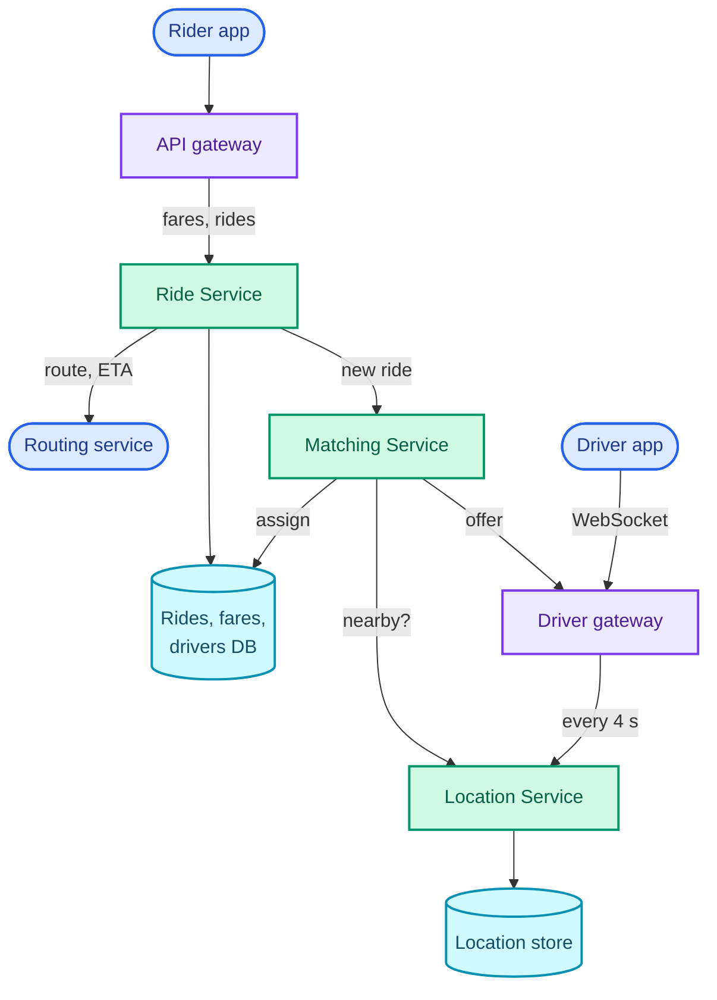
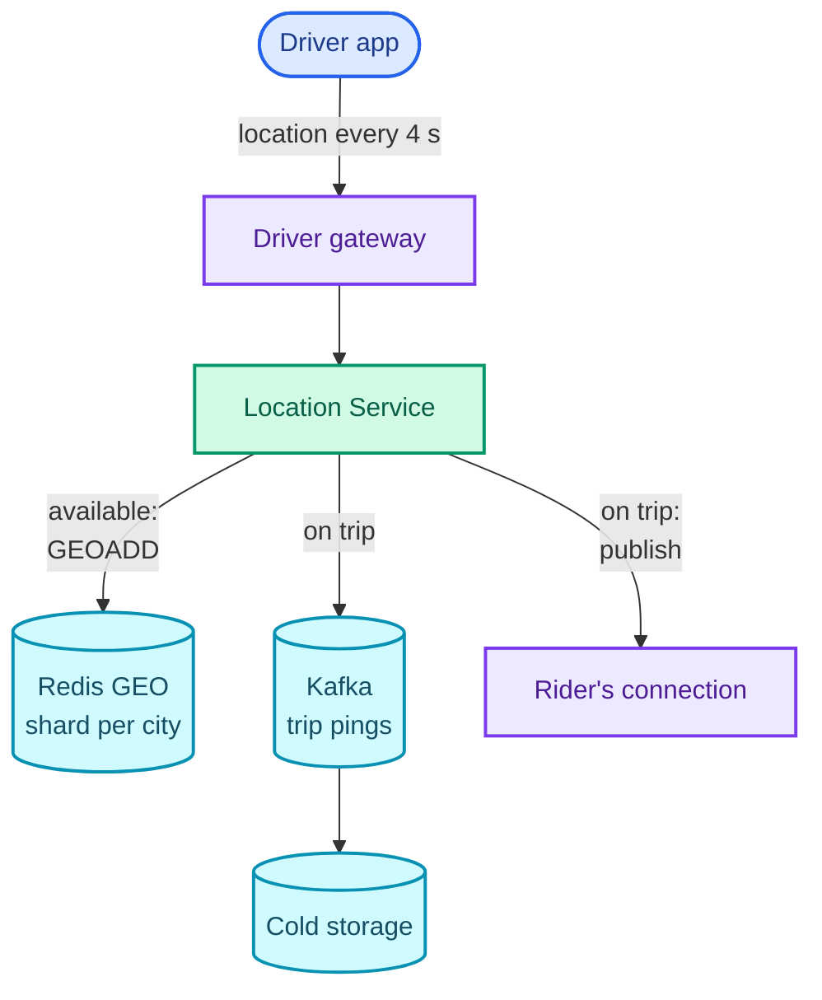
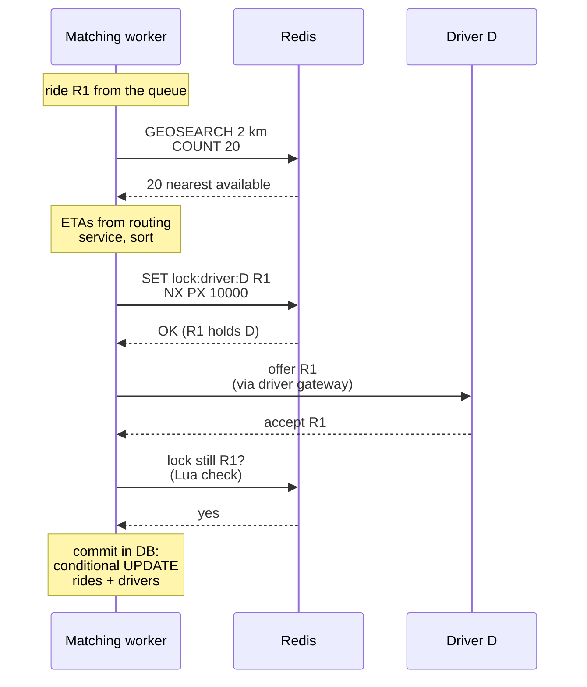

"Design Uber. A rider requests a ride, and the system finds a nearby driver who takes them to their destination."

It is really testing two things. The first is **proximity search over high-frequency writes**: millions of drivers each report a position every few seconds, and the system must answer "available drivers within 3 km of this point" in milliseconds over data that never sits still. The second is **contention**: two riders a block apart request at the same moment, both see the same closest driver, and exactly one of them may get that driver.

The patterns are **proximity search** (geohashes, quadtrees, Redis GEO), reused by any "near me" question (Yelp, food delivery, dating apps), and **contention with expiring holds**, the same shape as [Ticketmaster's seat holds](/blogs/hld-ticketmaster/). The design leans on [NoSQL and geospatial indexes](/blogs/system-design-databases-nosql/), [caching and Redis](/blogs/system-design-caching/), [relational locking](/blogs/system-design-databases-relational/) (optimistic versus pessimistic), [communication](/blogs/system-design-communication/) (WebSockets for the driver's live connection) and the connection layer from [WhatsApp](/blogs/hld-whatsapp/).

How to use this post: [the method](/blogs/hld-the-method/). Try the question cold first, then read.


You are a senior engineer interviewing me for a system design round. The question is: "Design Uber: a rider gets a fare estimate, requests a ride, and is matched with a nearby available driver who can accept or decline; drivers report their location continuously and the rider sees the driver approach." Run it as a realistic 45-minute interview following this structure: requirements (5 min), core entities (2 min), API (5 min), high-level design (10-15 min), deep dives (10 min).
Rules: state the question in one sentence and stop. Answer my clarifying questions the way a real interviewer would, briefly, and only what I ask. Never propose designs, components or classes yourself. If I skip a stage or run long on one, say so in one line and keep time. When I finish a stage, write one line of the note you would put on the scorecard, then move on.
Once my design is in place, probe it with these, one at a time, waiting for my answer each time: 1. Two million drivers send a location every 4 seconds. Where do those writes go, and why there? 2. How do you find available drivers within 3 km of a rider in under 100 ms? What goes wrong at cell boundaries? 3. Two riders near each other request at the same instant and the same driver is closest to both. How do you guarantee the driver gets one ride? 4. The driver ignores the offer. What happens, and what if the matching server crashes while waiting? 5. How do you rank candidate drivers: by straight-line distance or something else? 6. How would surge pricing fit into this design?
At the end, grade me as hire / lean hire / lean no hire / no hire for a senior engineer, with the two strongest and two weakest moments, and the one thing to fix first.



## Requirements

### Functional

1. Riders should be able to enter a pickup and a destination and get a fare estimate.
2. Riders should be able to request a ride and be matched with a nearby available driver, who can accept or decline.
3. Drivers should be able to share their location continuously, and the matched rider should see the driver approach.

Below the line (out of scope):

- **Payments.** Charging the card after the trip is a multi-step process with its own correctness problems, [Part 16](/blogs/hld-payment-system/).
- **Ratings, scheduled rides, shared rides (Pool).** Each is a feature on top of the same matching core.
- **The routing engine itself.** Turning a road graph and live traffic into an ETA is its own system; this design calls it as a service.
- **Driver onboarding, documents, support.** Ordinary CRUD with no bearing on the hard parts.

Surge pricing is not in the top three, but it is a common follow-up, so deep dive 5 covers it briefly.

### Non-functional

1. **"Available drivers near this point" returns in under 100 ms at p99** (99 out of 100 queries are faster). Matching runs this query on every request and every retry.
2. **A driver is never assigned two rides at once, and a ride never gets two drivers.** This is the one place the design needs strong consistency: CP, refuse rather than double-assign. ([CP versus AP per subsystem](/blogs/system-design-cap-consistency/).)
3. **Ingest every driver's location every 4 seconds; matching may use a position up to about 10 seconds old.** Locations are AP: a slightly stale dot is fine, a refused update is not. (Uber's own API pushes trip driver locations every 4 seconds by default, [its developer docs](https://developer.uber.com/docs/guest-rides/references/api/webhooks/driver-location), so 4 s is a realistic interval.)
4. **A rider is matched within 60 seconds or told no driver is available; an offer to a driver expires after 10 seconds.**
5. **An accepted ride request is never silently dropped**, even if the server handling it crashes.

### Capacity estimate

Inputs, stated as assumptions: 2 million drivers online at the global peak; 30 million rides a day; 5 fare estimates per ride actually requested; a location update of about 100 bytes (driver ID, latitude, longitude, heading, speed, timestamp).

- **Location writes:** 2M drivers ÷ 4 s = **500,000 updates a second**, about 50 MB/s of ingress.
- **Searches:** 30M rides ÷ 86,400 s ≈ 350 a second on average; at a 3× peak, about 1,000 ride requests a second, plus about 5,000 fare estimates a second. Matching runs a few proximity searches per ride (retries after declines), so **a few thousand searches a second**. Writes outnumber searches by about **100 : 1**, the opposite of most systems in this series. The index must be built for writes.
- **Memory for current positions:** 2M × 100 bytes = **200 MB**. Every driver's latest position fits in the RAM of one machine many times over. **Size is not the problem; write rate is.** At roughly 100,000 simple commands a second per Redis node (a rule of thumb), 500,000 writes a second needs at least 5 nodes' worth of throughput, so the index is sharded by region, with headroom, 10 to 20 shards.
- **Location history:** keeping every ping is 500,000 × 100 bytes × 86,400 s = 4.3 TB a day. Only pings during trips are needed (for the route on the receipt and for dispute handling); if half the online drivers are on a trip, that is about 2.2 TB a day, written to a log and cold storage, never to the hot index.

## Core entities

- **Rider**: requests rides.
- **Driver**: has a vehicle and a status: offline, available, offered (holding an offer), on trip.
- **Location**: a driver's latest position and when it was reported.
- **Fare**: a priced estimate for a pickup and destination, valid for a few minutes.
- **Ride**: a rider, a fare, eventually a driver, and a status that moves from requested to matched to completed.

## API

```text
Rider
  POST /v1/fares            { pickup: {lat, lng}, destination: {lat, lng} }
                            → 201 { fare_id, price, eta_minutes, expires_at }
  POST /v1/rides            { fare_id }
                            → 202 { ride_id, status: "matching" }
  GET  /v1/rides/{ride_id}  → { status, driver?, driver_location? }
  ride updates are pushed over the rider's WebSocket:
                            driver_assigned, driver_location, arrived

Driver (one WebSocket per driver app; the driver is the token's subject)
  driver → server  location { lat, lng, heading, speed, ts }   every 4 s
                   status   { available | offline }
                   accept   { ride_id }      decline { ride_id }
  server → driver  offer    { ride_id, pickup, destination, price, expires_at }
```

The rider sends a `fare_id`, never a price: the server stored the price when it quoted it, so a client cannot request a ride at a price it invented. `202 Accepted` on `POST /rides` is honest, because matching takes seconds and finishes asynchronously; the result arrives as a push. Drivers keep one WebSocket for both directions because they send every 4 seconds and must receive offers instantly; a request per ping would mean 500,000 new HTTP requests a second.

## High-level design

### 1. Riders get a fare estimate

`POST /v1/fares` goes through the API gateway to the **Ride Service**. It asks a **routing service** (a maps provider or an in-house engine) for the route's distance and duration, applies the pricing formula (base + per km + per minute, times any surge multiplier), and stores the quote.

```text
fares  (key: fare_id)
  fare_id, rider_id, pickup, destination, price, surge_multiplier, expires_at
```

Storing the quote is what makes the price shown the price charged: the ride refers to it by ID.

### 2. Riders request a ride and get matched

`POST /v1/rides` creates a ride and hands it to the **Matching Service**.

```text
rides    (key: ride_id)
  ride_id, rider_id, fare_id, driver_id?, status, created_at
  status: requested → offering → matched → in_progress → completed | no_driver

drivers  (key: driver_id)
  driver_id, status, vehicle, current_ride_id?
```

The Matching Service asks the **Location Service** for available drivers near the pickup, ranks them, and sends the best one an `offer` through the **driver gateway**, the fleet of servers holding drivers' WebSockets (the chat-server layer from [WhatsApp](/blogs/hld-whatsapp/), with the same connection registry). If the driver accepts within 10 seconds, the ride gets its `driver_id`, the driver's status becomes "on trip", and the rider is told. If they decline or time out, the next candidate gets the offer.

As written, two matchers handling two nearby requests can offer the same driver at once. That is deep dive 3.

### 3. Drivers share location; riders watch the driver approach

Every 4 seconds the driver app sends `location` over its WebSocket. The gateway passes it to the Location Service, which records the driver's latest position. The simplest store is a table in the main database:

```text
driver_locations  (key: driver_id; indexes on lat, lng)
  driver_id, lat, lng, updated_at
```

For a driver on a trip, the Location Service also publishes the position to a channel for that ride, `ride:{ride_id}`, and the server holding the rider's connection forwards it, so the rider's map moves.

That table is 500,000 indexed updates a second. Deep dive 1 replaces it.

Here is the assembled design. The rider's path runs down the left through the Ride and Matching services; the driver's path comes in on the right through the gateway and the Location Service; the location store is where the two meet.



The routing service is drawn as an external actor because the design calls it rather than builds it.

## Deep dives

### 1. Where do 500,000 location writes a second go? (non-functional 3)

**Bad: update a row per driver in the relational database.** Each update rewrites a row and two B-tree indexes (on latitude and longitude); in PostgreSQL every update also writes a new row version, because its concurrency control (MVCC) never updates in place. A single relational primary handles indexed updates in the tens of thousands a second (a rule of thumb, highly dependent on hardware), an order of magnitude short of 500,000. Sharding the table by driver helps throughput but makes the proximity query ask every shard. And the data does not need durability: a position 4 seconds old is about to be replaced anyway.

**Good: keep current positions in memory, in Redis.** Redis holds the 200 MB of positions trivially, executes each command in memory on a single thread, and takes a write in microseconds. Shard by region (city or metro area) so each shard's writes stay within one node's budget. Positions are not durable; if a shard fails, its replica takes over, and if both fail the next round of updates rebuilds the shard within 4 seconds. Losing data that regenerates itself every 4 seconds is the cheapest failure mode there is.

**Great: in-memory, sharded by region, with less to write and nothing stale.** Three refinements cut the load and fix correctness.

- **Index only available drivers.** Matching only searches for available drivers, so the proximity index holds only them. A driver going on a trip is removed from it; their pings still flow (to the rider and to the trip log), but not into the index. If a third of online drivers are idle, the index takes a third of the writes.
- **Send less when less changes.** The app sends every 4 seconds while moving, less often when parked, and the server can ask a quiet region's drivers to slow down. Fewer, more useful writes.
- **Expire stale drivers explicitly.** A phone that loses signal stops sending without saying goodbye, and its last position would be offered riders forever. Redis sorted sets have no per-member expiry, so write positions into time-bucketed keys, `drivers:{city}:{minute}`, each with a TTL (time to live) of 2 minutes, and search the current and previous minute's buckets, keeping the newer position when a driver appears in both. A driver who goes silent drops out of the search within two minutes at most, and the whole key is deleted by its TTL, with no sweeper job. The buckets only bound memory; each location update also writes its timestamp to a small `driver:{id}` hash, and the matcher skips any candidate whose timestamp is older than 10 seconds, which is what keeps non-functional requirement 3 true. (The alternative is a second sorted set scored by last-update time, swept every few seconds with `ZRANGEBYSCORE` and `ZREM`.)

Trip pings that must be kept go to Kafka, a durable log, and from there to cold storage for receipts and analytics; the hot index never touches disk.

### 2. How do you find nearby drivers in under 100 ms? (non-functional 1)

**Bad: a bounding-box query on latitude and longitude indexes.** `WHERE lat BETWEEN ? AND ? AND lng BETWEEN ? AND ?` looks reasonable, but a B-tree index on latitude alone selects a band about 6 km tall running around the whole planet (every driver in every city at that latitude), and the database then filters it by longitude. Two one-dimensional indexes do not make a two-dimensional one.

**Good: geohash cells.** A geohash turns a latitude and longitude into a short string by repeatedly halving the world: each character picks one of 32 sub-cells, so a longer string is a smaller cell, and points that share a prefix are in the same cell ([geohash in the NoSQL part](/blogs/system-design-databases-nosql/)). Cell sizes are fixed by length, roughly:

| Length | Cell size (latitude × longitude, near the equator) |
| --- | --- |
| 5 | 4.9 km × 4.9 km |
| 6 | 0.61 km × 1.2 km |
| 7 | 153 m × 153 m |

Store each available driver's geohash in an indexed column (or as a key), and "drivers near the rider" becomes "drivers whose geohash starts with the rider's prefix": an ordinary index range scan. For a 2 km search, length-5 cells are the right size.

The catch is the edge of a cell. Two points a few hundred metres apart can sit in different cells whose strings share almost nothing. The figure shows a rider in central Bengaluru near the top edge of cell `tdr1v`; the cell directly north is `tdr4j`, sharing only `tdr`.

<figure class="sketch"></figure>

Searching only the rider's own cell returns driver A, 3.5 km away, and misses driver B, 1 km away across the edge. The fix is to search the rider's cell and its 8 neighbours, then filter by true distance. Nine prefix lookups, all in memory, is still well inside 100 ms.

**Great: Redis GEO, which is geohashing done for you, sharded by region.** Redis's geospatial commands store members in a sorted set whose score is a 52-bit interleaved geohash. `GEOADD` writes a position; `GEOSEARCH` finds members within a radius by computing the covering cells, the centre and its 8 neighbours, scanning their score ranges, and filtering by distance. That is the Good answer as one command, at in-memory speed:

```text
GEOADD    drivers:blr:{minute} 77.5946 12.9716 driver:8812     longitude first
GEOSEARCH drivers:blr:{minute} FROMLONLAT 77.5900 13.0040
          BYRADIUS 2 km ASC COUNT 20 WITHDIST
```

(I ran these on Redis 7.4; note that `GEOADD` takes longitude before latitude, a classic bug. `GEOSEARCH` replaced the older `GEORADIUS` in Redis 6.2.) Each insert is O(log N) in the set's size, and a search costs about O(N + log M) for the N members in the covering cells, so a city shard of tens of thousands of drivers answers in well under a millisecond.

The alternative interviewers expect you to weigh is a **quadtree**: a tree that splits a square into four children whenever it holds more than a set number of points, so dense areas get small cells and sparse ones stay large. The figure builds one from 70 points with a leaf capacity of 4.

<figure class="sketch"></figure>

A quadtree adapts to density, which a fixed geohash grid cannot: a length-5 cell downtown might hold thousands of drivers and one in the suburbs none. Its cost is the write path: every driver who moves is a delete and an insert, and nodes split and merge as drivers drift. With 500,000 moves a second, a quadtree is rebuilt as a snapshot every few seconds rather than updated in place, which means more staleness. For this question, where writes dominate and positions churn, a geohash index in Redis is the better fit; a quadtree earns its place for slower-moving points (restaurants, shops) and for density-dependent queries ("the 20 nearest, however far").

### 3. One driver, one ride: how do you prevent double assignment? (non-functional 2)

Two riders a block apart request at the same moment. Two Matching Service instances each run `GEOSEARCH`, and both see driver D as closest.

**Bad: check, then act.** Each matcher reads D's status ("available"), then sends an offer and later sets the status. Both reads happen before either write, so both offer D, and if D taps accept on both screens, D has two rides. This is the classic check-then-act race: the decision is made on a value that changes before the action lands ([the lost update](/blogs/system-design-databases-relational/)).

**Good: a conditional update in the database.** Make the check and the write one atomic statement:

```text
UPDATE drivers
   SET status = 'offered', current_ride_id = :ride, offer_expires_at = now() + 10 s
 WHERE driver_id = :d
   AND (status = 'available' OR (status = 'offered' AND offer_expires_at < now()))
-- 1 row updated: this matcher holds D.  0 rows: someone else does, try the next driver.
```

This is optimistic concurrency: no lock is held while thinking, and the loser finds out from the row count. The expiry is built into the condition, so an offer nobody answered stops counting after 10 seconds without a cleanup job. It is correct. Its cost is that every offer attempt, including every losing race at peak in a dense area, is a write to the main database, and the hottest drivers (at airports, stadiums) become hot rows.

**Great: an expiring lock in Redis for the offer, a conditional write in the database for the commit.** Hold the 10-second offer in Redis, which is built for short-lived keys, and touch the database only once, when the driver accepts.

```text
offer:   SET lock:driver:{d} {ride_id} NX PX 10000
         NX: only if the key does not exist.  PX 10000: delete it after 10 s.
         OK  → this ride holds D; send the offer.
         nil → another ride holds D; offer the next candidate.

accept:  the lock's value still equals this ride_id?   (checked atomically, in Lua)
         then UPDATE rides SET driver_id = :d, status = 'matched'
               WHERE ride_id = :ride AND status = 'offering'
          and UPDATE drivers SET status = 'on_trip' WHERE driver_id = :d
               AND status IN ('available', 'offered')        one transaction
```

The figure follows one race and one ignored offer on a timeline.

<figure class="sketch"></figure>

- **The race is settled in Redis.** Redis runs commands one at a time, so of two `SET ... NX` calls on the same key exactly one succeeds. The loser moves to its next candidate within milliseconds.
- **Expiry is free.** If D ignores the offer, the key deletes itself after 10 seconds and D becomes offerable again; the matcher that held it moves on.
- **A late accept is refused.** D taps accept at second 11, after the lock expired and perhaps after another ride took it: the accept checks that the lock still holds this `ride_id`, finds it does not, and is rejected.
- **The database is the source of truth.** A Redis lock can be lost (a failover to a replica that had not received the key), so it is used as a fast filter, not the guarantee. The final conditional updates on `rides` and `drivers` cannot both succeed for two rides, because each checks the current status in the same transaction. The worst a lost lock can cause is a wasted offer, never a double assignment.

The ride side has the mirror problem: a ride must not be matched twice (say, two matchers picked up the same request). The `WHERE status = 'offering'` condition on `rides` covers it.

### 4. What happens when a driver ignores the offer, or a matcher crashes? (non-functional 4 and 5)

Matching one ride is a small workflow that lasts up to a minute: find candidates, offer to the first, wait up to 10 seconds, offer to the next, and stop at 60 seconds. Something has to remember where each ride is in that workflow.

**Bad: keep it in the matcher's memory.** The Matching Service instance that took the request loops through candidates with a timer. If it crashes or is redeployed mid-loop, every ride it was matching is forgotten: those riders stare at "finding your driver" until they give up. At 1,000 requests a second and a minute each, one instance going down strands hundreds of riders.

**Good: a queue of ride requests, with the state in the database.** `POST /rides` writes the ride as `requested` and publishes it to a queue partitioned by region (Kafka, keyed by city). Matchers consume their regions' partitions and record progress on the ride itself: which driver is being offered and until when. If a matcher dies, its partitions are reassigned to another instance, which re-reads the uncommitted rides and continues from the recorded state. Because work can be redone after a crash, each step must be idempotent (safe to repeat): re-offering a driver who already holds this ride's lock is a no-op.

**Great: a durable workflow with timers, and a notification path that degrades gracefully.**

- **Durable timers.** The "wait 10 seconds, then move on" and "give up at 60 seconds" steps are timers that must survive crashes. A workflow engine (Temporal, AWS Step Functions) or the job scheduler from [Part 15](/blogs/hld-job-scheduler/) stores them durably and fires them on whichever worker is alive. The matcher's code reads as a straight loop; the engine makes it crash-proof.
- **Reaching the driver.** The offer goes down the driver's WebSocket via the connection registry, which is the fast path. If the registry has no live connection (the app was backgrounded and the OS closed the socket), the offer is also sent as a high-priority push notification through APNs or FCM, and the 10-second window starts when the offer is sent, so a slow push costs that driver the offer, not the rider the minute.
- **Batch rather than first-come, when demand is dense.** Offering each request its nearest driver one at a time can be globally poor: rider 1 takes the driver who was the only good option for rider 2. Collecting the requests in a region over a second or two and solving the assignment together (minimising total pickup time) does better at peak, at the cost of a second of latency. This is the step from Great to what real dispatch systems do, and saying it is enough.

### 5. ETA and surge, briefly (non-functional 1 and 4)

**Rank by ETA, not distance.** The 20 drivers `GEOSEARCH` returns are sorted by straight-line distance, but a driver 800 m away across a river can be 15 minutes out. So take the nearest 10 to 20 by distance (cheap, from the index), ask the routing service for the driving ETA from each to the pickup (one batched call), and offer in ETA order. The straight-line filter keeps routing calls bounded; the routing call makes the choice right.

**Surge is supply and demand per cell.** A stream job counts open requests and available drivers per geohash cell (length 6, about 0.6 km × 1.2 km) over the last few minutes, and computes a multiplier from the ratio, clamped and smoothed so it doesn't flicker. The Ride Service reads the current multiplier when it quotes a fare, and the quote's `expires_at` holds that price for a couple of minutes, so a rider is never charged a surge that appeared after they said yes.

Here is the design after the deep dives, in two halves. First the location path: updates come in over the driver gateway and land in time-bucketed Redis GEO shards per city, with trip pings sent to Kafka for keeping.



Then the matching path, as one ride's sequence: a matching worker takes the request from the queue (partitioned by city), searches the index, ranks by ETA, takes the driver's lock, makes the offer, and on accept checks the lock and commits in the database. Redis appears once, standing for both the GEO shards and the locks.



## What each level is expected to show

| Level | What a strong answer shows on this question |
| --- | --- |
| Mid-level | A working flow: fare, request, match, accept; current locations kept somewhere fast; some spatial index (geohash or Redis GEO) instead of scanning; notices that two requests could take one driver and adds a lock. |
| Senior | Computes the 500,000 writes a second and concludes the index must be in memory and sharded by region; explains geohash boundaries and the 9-cell search; uses an expiring lock for the offer and a conditional update as the commit; keeps ride state durable so a crash doesn't strand riders; ranks by ETA. |
| Staff+ | Treats positions as regenerable data and designs failure around that; removes stale and busy drivers from the index by design (time buckets, index only available); weighs quadtree against geohash on write churn; makes the Redis lock an optimisation over a database guarantee; raises batched assignment and how surge interacts with quoted fares. |

## Variants this unlocks

| Question | What changes |
| --- | --- |
| Design Yelp / nearby places | Points barely move, reads dominate, so a quadtree or a geohash column in the database fits; the hard parts become ranking and reviews, not write rate. |
| Design food delivery (Swiggy, DoorDash) | Three parties: restaurant, courier, customer. Courier matching is this design, but the assignment is triggered when food is nearly ready, and one courier may carry several orders. |
| Design Find My Friends / live location sharing | The location path without matching: positions fan out to a small set of followers over WebSockets, the WhatsApp delivery layer plus TTL'd positions. |
| Design a dating app's "people near me" (Tinder) | Proximity search over slow-moving users plus filters (age, preferences) and a seen-list; contention disappears, a recommendation layer appears. |
| Design a scooter or bike rental | Vehicles report location and battery; the "one rider per vehicle" lock is the same `SET NX` hold, but the hold is made by unlocking a physical device. |
| Design Ticketmaster | The same contention pattern on seats instead of drivers: expiring holds plus a conditional commit, with a waiting room for spikes, [Part 6](/blogs/hld-ticketmaster/). |

## The one-page version

- Ride Service quotes fares (routing service for distance and time) and stores the quote; rides refer to it by `fare_id`.
- Drivers hold a WebSocket to a driver gateway and send a location every 4 s: 500,000 writes a second at 2M drivers.
- Current positions are 200 MB but 500k writes/s, so they live in memory: Redis GEO, sharded by city, not durable.
- Only available drivers are in the index; positions go into minute-bucketed keys with a TTL so silent phones age out.
- Trip pings go to Kafka and cold storage, never the hot index.
- Proximity: geohash cells, search the rider's cell plus 8 neighbours; `GEOSEARCH BYRADIUS` does exactly that.
- Rank the nearest 20 by straight line, then by routing-service ETA.
- Contention: `SET lock:driver:{d} {ride} NX PX 10000` holds the offer; one ride wins, the lock expires on its own.
- Commit on accept with conditional updates on `rides` and `drivers` in one transaction; the database, not Redis, is the guarantee.
- Requests are queued by region, ride state is durable, timers live in a workflow engine, so a crashed matcher strands nobody.
- Surge: requests versus available drivers per geohash cell, applied at quote time and held by the fare's expiry.

**Keep every driver's position in memory, indexed by geohash and sharded by city, because writes outnumber searches 100 to 1; then give each driver to one ride with an expiring lock and commit it with a conditional write.**


You are a senior engineer checking my understanding of an Uber-style ride-hailing design (fare estimate, request, match to a nearby available driver who accepts or declines, live driver location; 2 million drivers online at peak sending a location every 4 seconds, about 1,000 ride requests a second at peak; nearby search under 100 ms; a driver never assigned two rides). Ask me the questions below one at a time. Wait for my answer each time. Judge it against the key points listed, but do not reveal the key points before I answer. If I am stuck, give a small hint first, then a bigger one, and only then the answer. After each question, tell me briefly what I got right and what I missed.
1. Where do the location updates go and why? Key points: 2 million / 4 s = 500,000 writes a second; positions total only about 200 MB, so the constraint is write rate, not size; a relational table with lat/lng indexes cannot take it; in-memory Redis sharded by city; positions are regenerable every 4 s so durability is not needed; index only available drivers; minute-bucketed keys with TTL remove silent drivers; trip pings go to Kafka and cold storage.
2. How do you find available drivers within 2 to 3 km fast, and what breaks at cell edges? Key points: separate lat and lng B-tree indexes select a band around the planet; geohash prefixes give 2-D cells, length 5 is about 4.9 km; a nearby driver can sit across a cell edge with a different prefix, so search the cell plus its 8 neighbours and filter by real distance; Redis GEOSEARCH does this over a sorted set scored by a 52-bit geohash; GEOADD takes longitude first.
3. Geohash or quadtree for this problem? Key points: quadtree adapts cell size to density; but every move is a delete and insert and nodes split and merge, which is costly at 500,000 moves a second, so it tends to be rebuilt periodically and is staler; geohash in Redis suits high-churn points; quadtree suits slow-moving points like restaurants.
4. Two riders request at once and the same driver is closest to both. How do you guarantee one ride per driver? Key points: check-then-act is a race; a conditional UPDATE with status and offer expiry in the WHERE clause is correct but makes every attempt a DB write; Redis SET lock:driver NX PX 10000 settles the race because Redis runs commands one at a time and expires the hold automatically; on accept, verify the lock still holds this ride and commit with conditional updates on rides and drivers in one transaction; the DB is the guarantee because a Redis lock can be lost in failover.
5. The driver ignores the offer, or the matching server crashes. What happens? Key points: lock expires after 10 seconds and the next candidate is offered; a late accept is rejected because the lock no longer holds this ride; ride requests are queued by region and ride state is in the database; durable timers in a workflow engine or job scheduler; steps are idempotent; offer via WebSocket with push-notification fallback; batching assignments in dense areas at peak.
6. How do you rank candidates, and where does surge fit? Key points: straight-line distance from the index picks the nearest 10 to 20, then the routing service gives driving ETAs and you offer in ETA order; surge is demand over supply per geohash cell over recent minutes, clamped and smoothed, applied at quote time and held by the fare's expiry.



Next: [Post search and typeahead](/blogs/hld-post-search/), where the index stops being about where things are and starts being about which words they contain.
