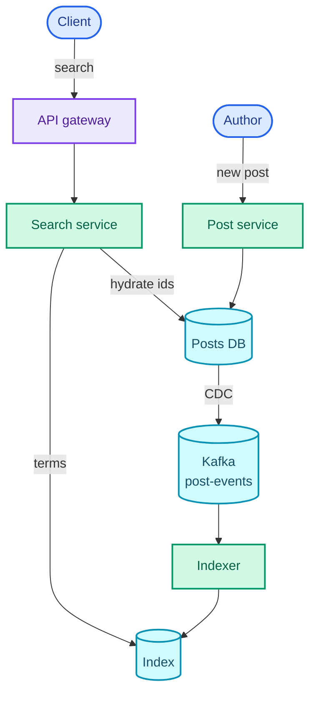
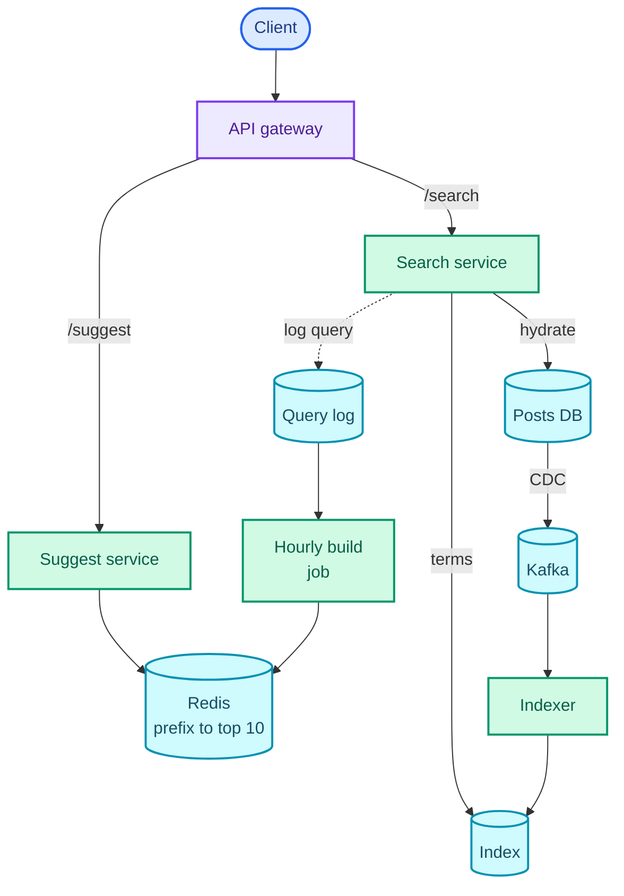
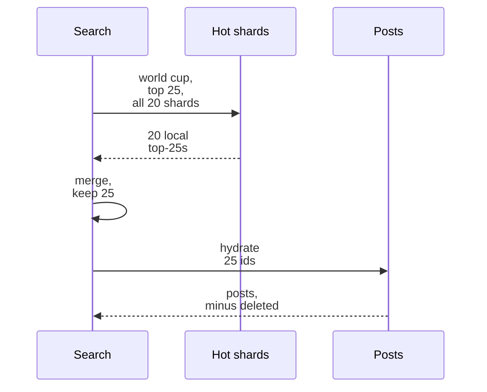
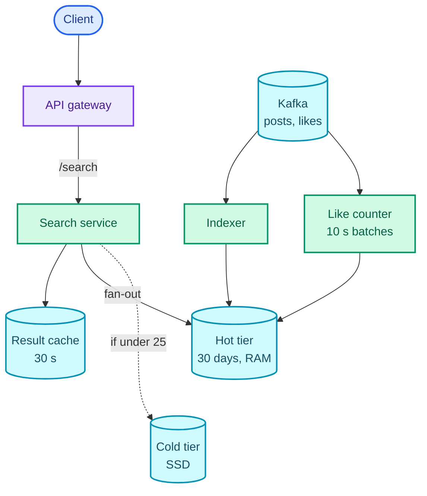

"Design post search for Facebook: users type keywords, get matching posts sorted by recency or by likes, and see suggestions as they type."

The question sounds like "put Elasticsearch in front of it", and a candidate who says only that has named a product, not a design. What it is really testing is whether you can build and run an **inverted index** yourself: a map from each word to the list of posts that contain it, which is the posts table filed backwards. Every hard part follows from that one structure. It is too big for one machine, so you have to choose how to cut it. It is a copy, so you have to keep it fresh from a stream of changes without ever making it the source of truth. And it is organised by word, so anything that changes per post (a like count moving 100,000 times a second) is expensive to keep inside it.

The pattern it teaches is **indexes for search**: a derived, read-optimised index fed asynchronously from the primary store. You will reuse it for event search in [Ticketmaster](/blogs/hld-ticketmaster/), for "places near me" in [Uber](/blogs/hld-uber/)-style questions, and for every "add search to X" follow-up an interviewer can bolt onto another design. It leans on the inverted index from [NoSQL and search](/blogs/system-design-databases-nosql/), change streams and Kafka from [async processing](/blogs/system-design-async/), sharding and consistent hashing from [relational databases](/blogs/system-design-databases-relational/), and [caching](/blogs/system-design-caching/).

How to use this post: [the method](/blogs/hld-the-method/). Try the question cold first, then read.


You are a senior engineer interviewing me for a system design round. The question is: "Design post search for Facebook: users type keywords, get matching posts sorted by recency or by likes, and see search suggestions as they type." Run it as a realistic 45-minute interview following this structure: requirements (5 min), core entities (2 min), API (5 min), high-level design (10-15 min), deep dives (10 min).
Rules: state the question in one sentence and stop. Answer my clarifying questions the way a real interviewer would, briefly, and only what I ask. Never propose designs, components or classes yourself. If I skip a stage or run long on one, say so in one line and keep time. When I finish a stage, write one line of the note you would put on the scorecard, then move on.
Once my design is in place, probe it with these, one at a time, waiting for my answer each time: 1) The index for ten years of posts is hundreds of terabytes. Do you shard it by term or by post, and what does a two-word query cost in each? 2) A user publishes a post. Walk me through exactly how it becomes searchable, how long that takes, and what happens if the indexer crashes halfway. 3) Likes arrive at over 100,000 per second. How does sort-by-likes work for a common word without reindexing a post on every like? 4) Typeahead has to answer every keystroke in under 100 ms at well over 100,000 requests a second. Where do the suggestions come from and how fresh are they? 5) A breaking-news word suddenly gets 50,000 searches a second. What happens to your index servers? 6) A user deletes a post. How quickly does it stop appearing in results, and how do you guarantee it?
At the end, grade me as hire / lean hire / lean no hire / no hire for a senior engineer, with the two strongest and two weakest moments, and the one thing to fix first.



## Requirements

### Functional

1. Users should be able to search posts by one or more keywords and get the matching posts.
2. Users should be able to sort those results by recency or by like count.
3. Users should be able to see query suggestions (typeahead) as they type into the search box.

Below the line (out of scope):

- **Privacy filtering** (friends-only posts, blocked users). It is real and large: every result has to pass a per-viewer access check. Assume every post is public for now and come back to it as a staff-level extension at the end.
- **Fuzzy matching and spelling correction.** A separate query-rewriting layer in front of the same index; it changes the query, not the design.
- **Personalised or learned ranking.** Recency and likes are the two sorts asked for; a machine-learned ranker would re-score the same candidates.
- **Searching people, pages, photos and video.** Each is another index of the same shape over different documents.

### Non-functional

- **Search latency: results in under 500 ms at p99** (p99 means 99 out of 100 requests are at least this fast). A search page that takes a second feels broken.
- **Typeahead latency: under 100 ms at p99 per keystroke.** People type a character every 150 to 200 ms, so a suggestion slower than that arrives after the next key and is already stale.
- **Freshness: a new post is searchable within 1 minute at p99.** This is an availability-over-consistency (AP) call from [CAP](/blogs/system-design-cap-consistency/): the index is allowed to lag the posts database by seconds, and it must keep answering queries even when the pipeline feeding it is behind. Nobody is harmed by a post that shows up in search 20 seconds late.
- **Scale: 1B new posts a day, 10B likes a day, 1B searches a day, ten years of posts searchable.**
- **Deletes are not eventual.** A deleted post must never be shown, even while the index still holds it. Freshness can lag; deletion cannot.

### Capacity estimate

Only four numbers change the design.

**Index size.** Ten years of posts at 1B a day is 1B × 365 × 10 = 3.65 trillion posts. Assume about 30 distinct indexable words per post after cleanup, and about 4 bytes per entry in a word's list once it is compressed (a rule of thumb for compressed lists of IDs without word positions). That is 3.65 × 10¹² × 30 × 4 B ≈ 438 TB. **So the index must be split across hundreds of machines**, and how you split it is the first deep dive.

**The recent slice.** The last 30 days is 30 × 1B = 30B posts, so 30B × 30 × 4 B = 3.6 TB. **So the part most queries need fits in RAM on about 20 machines** (at roughly 180 GB each), and that observation shapes the whole design: hot recent data in memory, ten years of history on cheaper disks.

**Likes.** 10B a day ÷ 86,400 s ≈ 116,000 likes a second. Posts arrive at 1B ÷ 86,400 ≈ 11,600 a second. **So like updates outnumber new posts ten to one**, and an index that rewrites a post on every like would spend most of its effort on likes. That is the third deep dive.

**Typeahead.** 1B searches a day is about 11,600 a second on average; call it 35,000 at a 3x peak. If each search fires about 5 suggestion requests while the user types (after the client waits for a short pause between keys), that is 5 × 35,000 = 175,000 suggestion requests a second at peak. **So suggestions cannot touch the search index at all**; they have to come from a precomputed table in memory.

## Core entities

- **Post**: `post_id`, `author_id`, `text`, `created_at`, `deleted`; owned by the post service, the source of truth.
- **Like**: a (user, post) pair; owned by the like service, which also keeps each post's count.
- **Posting list**: for one term, the list of `post_id`s containing it. A **term** is a normalised word: lower-cased, punctuation stripped, so "Goal!" and "goal" are the same term.
- **Suggestion**: for one prefix ("tay"), the top 10 full queries that start with it ("taylor swift", "taylor swift tickets", …).

## API

```text
GET /v1/search?q=world+cup&sort=recent|likes&limit=25&cursor=<opaque>
  -> 200 { "posts": [ { "post_id", "author", "text", "created_at", "like_count" } ],
           "next_cursor": "<opaque>" }

GET /v1/suggest?prefix=world+c
  -> 200 { "suggestions": [ "world cup", "world cup final", "world cup 2026 schedule" ] }
```

The viewer comes from the auth token on both calls, not from a parameter; it is not used yet, but privacy filtering would read it. The cursor is opaque so the server can change what is inside it (the last `post_id` seen for recency sort, a rank offset for likes) without breaking clients.

Creating posts and liking them are not this system's API. They belong to the post and like services. This system *consumes* their changes, which is the first design decision: search is a reader of other people's data.

## High-level design

### 1. Search posts by keyword

A search request arrives at the API gateway and goes to a **search service**. The naive answer is to ask the posts database: `SELECT … WHERE text LIKE '%world cup%'`. A leading wildcard cannot use a B-tree index, so the database reads every row, and at 3.65 trillion rows that is a scan nobody waits for.

The fix is the inverted index. For each post, a **tokeniser** splits the text into terms; for each term, the post's ID is appended to that term's **posting list**. A query is then: tokenise the query the same way, fetch the posting list of each term, and **intersect** them (keep the IDs that appear in every list). The sketch shows four posts, the lists they produce, and a two-word query walking two lists.

<figure class="sketch"></figure>

Two details in that sketch carry the design. First, the lists are sorted by `post_id` descending. Post IDs are [Snowflake IDs](/blogs/system-design-distributed-primitives/), which start with a timestamp, so sorting by ID is sorting by time: the newest post is at the front of every list. Second, the intersection walks both lists with one pointer each, always advancing the pointer on the larger ID, so it touches each entry at most once and can stop as soon as it has 25 matches.

The index returns only IDs. The search service then **hydrates** them: it fetches the actual posts (text, author, current like count) from the posts store, through a cache. Hydration has a second job that matters later: it is the moment the source of truth gets a say, so a post that was deleted a second ago is dropped here even if the index still lists it.

How a post gets into the index is the other half. The post service writes the post to the posts database and does nothing else. **Change data capture** (CDC: a process that reads the database's own replication log and turns each committed row change into an event) publishes the change to a Kafka topic, and **indexer** workers consume the topic, tokenise the post and add it to the index. The post service never talks to search, so search being slow or down can never fail a post.

Both halves in one picture: the read path from the client through the search service, and the write path from the author through CDC into the index.



State that changes, and where:

```text
posts (Posts DB, source of truth)     index (derived, rebuildable)
  post_id     bigint  PK (Snowflake)    term          -> [post_id, post_id, ...]  newest first
  author_id   bigint                    post_id       -> deleted? (tombstone bit)
  text        text
  created_at  timestamp
  deleted     boolean
```

The whole index sits on one box in this step. That is false at 438 TB; deep dive 1.

### 2. Sort by recency or by likes

**Recency** comes free from step 1. Posting lists are already newest-first, so the intersection produces matches in time order and stops at 25. The cursor for the next page is the last `post_id` returned, and page 2 resumes the walk below it.

**Likes** do not come free. A like does not change any word in the post, so it does not touch any posting list. The like service keeps the count, and for this step the search service fetches all matching IDs, looks up each count and sorts. That works for rare words. For a common word it means fetching and scoring millions of matches per query, and keeping counts current means absorbing 116,000 updates a second. Both are deep dive 3.

### 3. Typeahead suggestions

Every keystroke (after a short pause) sends the current prefix to a **suggest service**. It does not search posts. It looks the prefix up in a precomputed table, held in Redis, that maps each prefix to its 10 most popular full queries:

```text
suggest (Redis)
  key   "world c"
  value ["world cup", "world cup final", "world cup 2026 schedule", ...]   top 10, best first
```

A batch job rebuilds that table every hour from the **query log** (every search anyone ran, with a timestamp). It counts queries, drops rare and blocked ones, and for each prefix of each surviving query keeps the top 10. A lookup is one key read, so the latency target holds. How the table is built, how big it is, and how it handles a query that started trending ten minutes ago is deep dive 4.

The assembled design: two read paths (search, suggest), one write path (CDC into the indexer), and one batch job.



Three bottlenecks are left for the deep dives on purpose: the index is one box (deep dive 1), the like sort scans everything (deep dive 3), and a trending query hits the index thousands of times a second with the same question (deep dive 5).

## Deep dives

### 1. How do you shard a 438 TB index?

This maps to the latency and scale requirements. There are two ways to cut an inverted index, and the choice decides what every query and every write costs.

**Bad: one big index on one machine.** 438 TB does not fit, and a single machine cannot absorb 35,000 queries a second plus 11,600 new posts a second. This rung exists to name the number that rules it out.

**Good: shard by term.** Each shard owns a range of terms (or a hash of them): shard 3 holds the complete posting lists for "world", "cup" and a few million other terms. A one-word query goes to exactly one shard, which sounds ideal. It falls apart on three counts. A two-word query needs two shards to intersect lists they each hold whole, so one of them ships its list to the other, and the posting list for a common word like "the" or "happy" is billions of entries long. A single trending word ("earthquake") lands all its traffic on the one shard that owns it. And every new post, with its 30 terms, writes to up to 30 different shards.

**Great: shard by document.** Each shard owns a subset of posts and holds a complete little inverted index over only those posts: its own posting list for "world", its own for "cup". A query goes to every shard (this is **scatter-gather**: send the query to all shards in parallel, gather their partial answers). Each shard intersects its local lists, returns its local top 25, and the search service merges the per-shard lists into the global top 25. A new post writes to exactly one shard. Intersections never cross the network. A trending word spreads over every shard, because its posts do.

<figure class="sketch"></figure>

The sketch is the trade in one picture: term sharding sends a two-word query to two shards that must exchange whole lists, and a post write to as many shards as it has words; document sharding sends every query everywhere, but each shard answers alone and each write lands once.

The cost of document sharding is the fan-out. Every query touches every shard, so a query is as slow as the slowest shard (its **tail latency**). Three things keep that honest:

- **Split by time first, then by document.** Posts are bucketed into **tiers** by age: a hot tier for the last 30 days, which we computed at 3.6 TB, held in RAM across about 20 shards; and a cold tier for everything older, 434 TB on SSD across a few hundred shards. A recency query asks the hot tier first and only goes to the cold tier if the hot tier returns fewer than 25 matches, which for most queries it does not. So most queries fan out to 20 shards, not hundreds. Twitter's search index is split the same way: a realtime cluster for roughly the last 7 days and an archive cluster for everything, each partitioned, with root servers fanning queries out ([Earlybird README](https://github.com/twitter/the-algorithm/blob/main/src/java/com/twitter/search/earlybird/README.md)).
- **Replicas are the knob for query load, shards are the knob for size.** At 35,000 queries a second, each of the 20 hot shards sees all 35,000. With 3 replicas per shard, each replica serves about 11,700 queries a second; add replicas, not shards, when traffic grows. Add shards when the data outgrows RAM.
- **Hedged requests and partial results.** If one shard replica has not answered by the p95 time, send the same request to another replica and take whichever answers first. If a whole shard is down, return results from the other 19 and mark the response partial. For search, 95% of the answer now beats 100% of it never: that is the AP choice from the requirements, applied per query.

Within the hot tier, posts are grouped by day, and each day's posts are spread over the 20 shards by `hash(post_id) mod 20`. Every night the oldest day moves to the cold tier. Growing to 24 shards means new days are spread over 24; the old layout ages out within 30 days, so there is never a live reshard.

One recency query through the hot tier, end to end: scatter to all 20 shards, gather 20 short lists, merge, then hydrate only the 25 winners.



### 2. How does a new post become searchable within a minute?

This maps to the freshness requirement and to "deletes are not eventual".

**Bad: the post service writes to the database and to the index.** A **dual write**: two separate writes with no transaction around them. If the service crashes between them, the post exists but is never searchable, or (if it wrote the index first) the index points at a post that does not exist. And search latency or an index outage now fails post creation, which is the wrong way round for a derived index.

**Good: CDC into Kafka, indexers consume.** The database's replication log is the one record of what actually committed, so CDC cannot publish a post that rolled back or miss one that committed. The Kafka topic is partitioned by `post_id`, which keeps every change to one post (create, edit, delete) in order on one partition. Indexers consume, and if one crashes, its partitions move to another indexer that resumes from the last committed offset (Kafka's per-partition read position). That replays a few changes, so indexing must be **idempotent**: applying the same change twice leaves the same index. Writing "post 9001, version 3, these terms" as an upsert keyed by `post_id` and ignoring any version older than the one stored is idempotent; "append 9001 to these lists" is not.

**Great: the Good pipeline, plus an index built for near-real-time writes.** Search engines built on Lucene, and the in-house ones modelled on it, do not edit posting lists in place. New posts go into a small in-memory buffer; on each **refresh** the buffer becomes a new immutable **segment** (a small, self-contained inverted index) that queries can see, and background merges combine small segments into bigger ones. Elasticsearch refreshes every second by default. So the pipeline latency is roughly: CDC lag (under a second) + Kafka (milliseconds) + indexer batch (a second or two) + refresh (1 s), comfortably inside the 1-minute target with room for a backlog. The 1 minute is the *p99 during a bad day*, not the normal case.

Deletes and edits use the same path. A delete becomes a **tombstone**: a "this ID is dead" bit that every query checks, with the dead entries physically removed at the next segment merge. And because hydration (step 1) reads the posts store, a post deleted in the last few seconds is dropped there even before the tombstone lands. That is how a lagging index meets a non-lagging delete requirement: the index may suggest a post, but only the source of truth can show one.

The index is derived, so it is also rebuildable: replay the posts table through the same indexer code into a fresh cluster and switch over. Keep that path tested. It is how you change the tokeniser, add a field, or recover from a corrupted shard.

### 3. How do you sort by likes when likes arrive 116,000 times a second?

This maps to the scale requirement (10B likes a day).

**Bad: reindex the post on every like.** Put `like_count` in the indexed document and update it on each like. In a segment-based index an update is a delete plus a re-add of the whole document, so 116,000 likes a second become 116,000 document rewrites a second, ten times the rate of new posts. Worse, likes are skewed: a viral post getting 20,000 likes a second sends all of them to the one shard that owns it (document sharding put it there), and that shard spends its life rewriting one post.

**Good: keep counts beside the index, not in it, and batch them.** Each shard holds a plain in-memory array from local post to like count, separate from the posting lists, updated in place. A small stream job reads like events from Kafka, sums them per post per 10 seconds, and sends each shard one update per changed post, so the viral post costs one write every 10 seconds instead of 200,000. To sort by likes, the shard walks the intersection as before but scores each match by its count, keeping the best 25 in a **min-heap** (a heap whose smallest element is on top, so each new candidate is compared against the weakest of the current 25 in O(1), see [heaps](/blogs/dsa-heaps/)).

That holds for rare words and fails for common ones. If "goal" appears in 1% of posts, the hot tier alone has 30B × 1% = 300 million matches, 15 million per shard, and every one must be scored for every like-sorted query. At even 100 million entries a second per core (a generous rule of thumb), that is 150 ms per shard before anything else, and the cold tier is 120 times larger.

**Great: champion lists for the like sort.** For each term, keep a second, short posting list: the 1,000 posts containing that term with the most likes, per tier, sorted by likes. Information retrieval calls these **champion lists**. A background job rebuilds them every few minutes from the like-count arrays. A like-sorted query for one word reads the term's champion list and returns the first 25. For two words, intersect the two champion lists (posts in both top-1,000s). If that yields fewer than 25, fall back to the Good scan, but only over the shorter of the two posting lists, which for "world cup" is "cup".

The order this gives is a few minutes stale, and that is fine: nobody can tell whether a post with 41,200 likes should rank above one with 41,350. The **number** shown next to each post is exact, because hydration reads it from the like service. Stale order, fresh numbers: a trade that costs nothing a user can see.

### 4. How does typeahead answer every keystroke in under 100 ms?

This maps to the typeahead latency requirement, at 175,000 requests a second.

**Bad: run a prefix query against the search index.** Find every term starting with "world c", and rank queries by… what? The search index knows which posts contain words, not which *queries* people run. It would suggest rare words that happen to start with the prefix, at index-query cost, on every keystroke.

**Good: a trie of past queries with the top 10 stored at every node.** A **trie** (see [tries](/blogs/dsa-tries/)) is a tree where each edge is one character, so the path from the root spells a prefix and every query sharing a prefix shares that path. Built from the query log, each node stores the 10 most frequent queries in the subtree below it, so answering a prefix is walking a handful of characters down and reading one list: O(prefix length), not a search. The sketch shows a tiny trie with the top 3 stored at each node.

<figure class="sketch"></figure>

The precomputation is the point. At node "ca", the answer ("cat videos" first at 900 searches) is already sitting there; nobody walks the subtree at query time.

A trie in one process's memory has two problems at this scale: one machine cannot take 175,000 requests a second, and rebuilding it means rebuilding the whole tree.

**Great: flatten the trie into a prefix table, cache the short prefixes at the edge, and blend in a fast layer for trends.**

- **Flatten.** Store each node as a key-value pair, `prefix → top 10`, in Redis, sharded by prefix. Sizing it for real: keep queries searched at least 5 times in the last 30 days, say 10M distinct queries averaging 20 characters. Each has at most 20 prefixes, so at most 200M keys (the real number is far lower, since "taylor swift" and "taylor swift tour" share their first 12). At 20 bytes of key and 10 × 20 bytes of suggestions, about 220 bytes each, the upper bound is 200M × 220 B = 44 GB. That is 4 Redis shards of about 11 GB each, and at roughly 100,000 simple reads a second per Redis node (a rule of thumb), 4 shards that each have a primary and one replica (8 nodes) serve 175,000 a second at about 22,000 per node.
- **Cache the short prefixes.** There are only 26 one-letter and 676 two-letter prefixes in English, they get the most traffic, and their answer is the same for everyone. Serve them from a CDN (Content Delivery Network: caches near the user, see [the edge](/blogs/system-design-the-edge/)) and the browser with a cache lifetime of an hour, so they never reach Redis.
- **Debounce on the client.** Send a request only when the user pauses for about 200 ms, and cancel the previous one. That is how 15 typed characters become about 5 requests, the number the capacity estimate assumed.
- **A fast layer for trends.** The hourly rebuild cannot know that "earthquake" started trending 8 minutes ago. A stream job counts queries per prefix over the last 10 minutes and keeps a small trending table (top 3 per prefix whose count jumped well above its usual rate); the suggest service merges it into the hourly list. Detecting what is hot in a stream is exactly the next post's problem, [top K](/blogs/hld-top-k/).
- **Filter before you publish.** The build job drops queries on a blocklist (slurs, private names) before writing the table. A suggestion is the platform speaking; a search result is the user asking.

### 5. A breaking-news term gets 50,000 searches a second. Now what?

This maps to search latency under spikes. When something happens, a large fraction of all searches become the same few queries, and document sharding sends each one to all 20 hot shards: 50,000 × 20 = 1 million shard requests a second for one question whose answer changes every few seconds at most.

**Bad: no result cache.** Every identical query recomputes the same answer on every shard.

**Good: cache first-page results.** Key the cache on the normalised query (tokenised, sorted terms) plus the sort: `"cup world|recent"`. Value: the top 25 IDs, not the hydrated posts, so a deleted post is still dropped at hydration. Cache lifetime (TTL) 30 seconds, which sits inside the 1-minute freshness target, so caching cannot break a promise the system made. Cache only page 1; most people never ask for page 2, and deeper pages would multiply the keys.

**Great: the cache, plus request coalescing.** A cache with a 30-second TTL still has a moment every 30 seconds when the entry expires and 50,000 requests a second all miss at once: a **cache stampede**. **Request coalescing** (also called single-flight) makes the first miss compute the answer while every other request for the same key waits on that one computation. The index then sees one scatter-gather per hot query per 30 seconds, instead of 1.5 million.

The final search path adds the time tiers, the batched like counter and the result cache to the assembled diagram.



The suggest path (deep dive 4), hydration from the posts store and the CDC feed into Kafka are unchanged from the earlier diagram and left out here to keep this one readable. The dotted edge is the cold tier, asked only when the hot tier returns fewer than 25 matches.

## What each level is expected to show

| Level | What good looks like on this question |
| --- | --- |
| Mid-level | Proposes an inverted index fed asynchronously from the posts database, explains tokenising and intersecting posting lists, and serves typeahead from a precomputed prefix table rather than the search index. |
| Senior | Drives the shard-by-document decision with the two-word-query and write-fan-out argument, splits the index into time tiers from the capacity numbers, keeps like counts out of the posting lists, and makes deletes safe through hydration. |
| Staff+ | Treats the index as a rebuildable derived view with a tested rebuild path, reasons about tail latency in scatter-gather (hedging, partial results, replicas versus shards), and raises privacy filtering unprompted: where the per-viewer check runs and what it does to cacheability. |

## Variants this unlocks

| Question | What changes |
| --- | --- |
| Design Twitter search | Almost nothing: shorter documents, a heavier recency bias, so the hot tier is days rather than a month. |
| Design search autocomplete (Google) | Only deep dive 4, at a larger scale: the prefix table becomes the whole system, with per-language tables and heavier trend blending. |
| Add search to Ticketmaster or Airbnb | Far fewer documents (events, listings), so a single Elasticsearch cluster fed by CDC is enough; filters (date, price, location) become extra indexed fields. |
| Design log search (Splunk, Kibana) | Time is the primary key: index by time bucket only, drop old buckets on a retention schedule, and accept that most queries scan one bucket. |
| Design e-commerce product search | Relevance (BM25 text scoring plus business signals) replaces recency, and facets ("brand: X, 4 stars and up") are counted per query. |
| Design hashtag search on Instagram | The "text" is the hashtag list; posting lists per hashtag, sorted by recency, with the same like-sorted champion lists. |

## The one-page version

- Posts DB is the source of truth; search is a derived inverted index (term → post IDs, newest first, Snowflake IDs give time order).
- Writes: post service → Posts DB → CDC → Kafka (partitioned by `post_id`) → idempotent indexers → index.
- Near-real-time segments, 1 s refresh: searchable in seconds, 1 minute at p99.
- Deletes: tombstone in the index, and hydration from the posts store drops anything deleted. Only the source of truth shows a post.
- Shard by document, not by term: intersections stay local, writes land once, trending words spread out.
- Time tiers: hot 30 days (3.6 TB, RAM, about 20 shards), cold 434 TB on SSD, queried only if hot returns too few.
- Scatter-gather with local top 25 per shard, merge; replicas for QPS, shards for size; hedge slow replicas, return partial results.
- Like counts in a separate per-shard array, batched every 10 s; champion lists (top 1,000 by likes per term) for the like sort; exact counts at hydration.
- Typeahead: hourly build from the query log into Redis `prefix → top 10` (≤ 44 GB), short prefixes at the CDN, client debounce, a 10-minute trending layer.
- Hot queries: 30 s cache of first-page IDs plus request coalescing.

**Key sentence: build a second copy of the posts filed by word, shard it by post so every query fans out but every shard answers alone, and let it lag a few seconds while the source of truth keeps the final say on what is shown.**


You are a senior engineer checking my answers on a system design I have studied: Facebook post search with typeahead. Ask me the questions below one at a time, wait for my answer each time, and judge it against the key points listed. Do not reveal the key points before I answer. If I am stuck, give one hint at a time, starting vague and getting more specific. After each answer, tell me what I got right, what I missed, and what an interviewer would push on next. At the end, list which questions I should revisit.
1) Why shard the inverted index by document rather than by term? Key points: term sharding makes multi-word queries ship whole posting lists between shards (common words have billions of entries), concentrates a trending word on one shard, and makes every post write to as many shards as it has terms; document sharding keeps intersections local, writes land on one shard, trending words spread; the cost is that every query fans out to every shard (scatter-gather).
2) With document sharding every query hits every shard. How do you keep that affordable and fast? Key points: split by time first (hot tier of recent posts in RAM on few shards, cold tier queried only if the hot tier returns too few results); replicas scale query throughput while shards scale data size; hedged requests to a second replica after the p95 time; return partial results if a shard is down, since search is an AP system.
3) Walk through how a new post becomes searchable, and why not have the post service write the index directly. Key points: dual writes have no atomicity and couple post creation to search availability; CDC reads the database's replication log so it publishes exactly what committed; Kafka partitioned by post_id keeps each post's changes ordered; indexers are idempotent (upsert by post_id with a version) because replays happen; near-real-time segment refresh (about 1 s) gives seconds of lag against a 1-minute p99 target.
4) A user deletes a post. How do you guarantee it never shows, even though the index lags? Key points: a tombstone in the index removes it at query time and physically at segment merge; hydration reads the posts store and drops anything deleted, so the source of truth has the final say; result caches store IDs, not posts, so hydration still filters cached results.
5) How do you support sort-by-likes when likes arrive at about 116,000 per second? Key points: never reindex a document per like (an update is delete plus re-add, and viral posts concentrate updates on one shard); keep counts in a separate in-place array per shard, batched by a stream job (one update per post per window); scoring all matches of a common word is too slow, so keep champion lists (top N posts by likes per term, rebuilt every few minutes); the order can be minutes stale but the displayed count is exact from hydration.
6) Design typeahead for about 175,000 requests per second under 100 ms. Key points: suggestions come from the query log, not the post index; a trie with top 10 stored at each node, flattened into a prefix to top-10 key-value table in Redis, rebuilt hourly; size it (about 10M queries, at most 200M prefixes, about 44 GB upper bound); serve 1 and 2 character prefixes from CDN and browser cache; debounce on the client; blend a short-window trending layer; filter blocked queries before publishing.
7) A breaking-news query hits 50,000 searches a second. What protects the index? Key points: cache first-page result IDs keyed by normalised query plus sort, with a TTL inside the freshness budget (about 30 s); request coalescing (single-flight) so an expiry triggers one recomputation, not thousands; caching IDs rather than posts keeps deletes safe.



Next: [Top-K trending videos](/blogs/hld-top-k/), where the hard part moves from finding documents to counting events: a billion videos, a few hundred thousand views a second, and a ranking that has to be ready before anyone asks for it.
