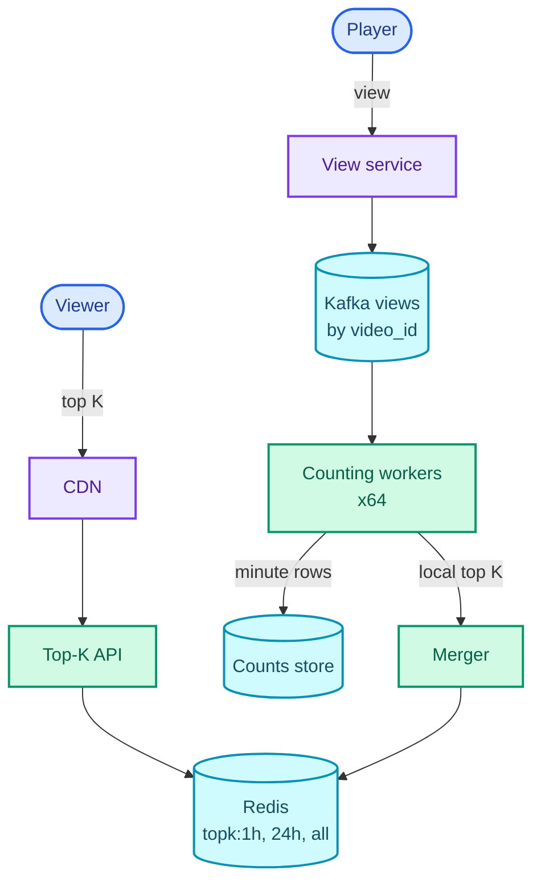
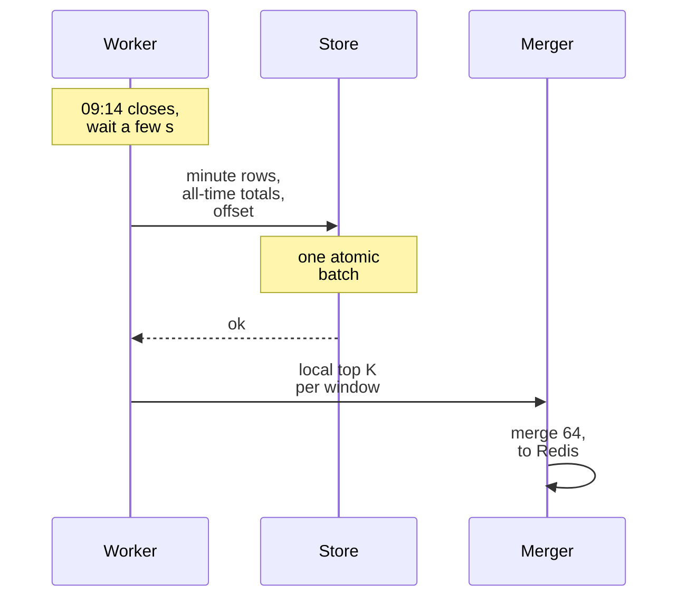

"Design a service that returns the top K most-viewed YouTube videos for the last hour, the last 24 hours, and all time."

It sounds like a sorting question: keep a count per video, sort, take the first K. What it is really testing is **counting at a rate no single counter can absorb**, and answering "top K over a window that slides every minute" without ever sorting a billion counters. The answer has two halves: aggregate the views in a stream so that the counters see one write per video per minute instead of one per view, and split the counting so that each video is counted in exactly one place, which is what makes merging small per-partition top-K lists give the exact global answer.

The pattern is **stream aggregation**: pre-aggregate events in a stream processor, keep windowed state, publish precomputed results to a cache. The [ad click aggregator](/blogs/hld-ad-click-aggregator/) in the next part is the same pattern with money attached, and the [post search](/blogs/hld-post-search/) trending-suggestions layer was a small version of it. It leans on Kafka partitions and consumer groups from [async processing](/blogs/system-design-async/), [caching](/blogs/system-design-caching/), the availability trade-offs in [CAP](/blogs/system-design-cap-consistency/), and [heaps](/blogs/dsa-heaps/) from the DSA series.

How to use this post: [the method](/blogs/hld-the-method/). Try the question cold first, then read.


You are a senior engineer interviewing me for a system design round. The question is: "Design a service that returns the top K most-viewed YouTube videos for the last hour, the last 24 hours, and all time." Run it as a realistic 45-minute interview following this structure: requirements (5 min), core entities (2 min), API (5 min), high-level design (10-15 min), deep dives (10 min).
Rules: state the question in one sentence and stop. Answer my clarifying questions the way a real interviewer would, briefly, and only what I ask. Never propose designs, components or classes yourself. If I skip a stage or run long on one, say so in one line and keep time. When I finish a stage, write one line of the note you would put on the scorecard, then move on.
Once my design is in place, probe it with these, one at a time, waiting for my answer each time: 1) Views peak at about 350,000 per second and one premiere alone gets 50,000 per second. Where does each view get counted, and what stops a hot video from melting a counter? 2) You have 64 counting workers, each with its own top K. Prove to me that merging their lists gives the exact global top K, and tell me when it would not. 3) How do you maintain "last hour" and "last 24 hours" so the list updates every minute without re-scanning raw views? 4) A counting worker crashes and restarts from its last Kafka offset. Why are you not double-counting? 5) Memory is suddenly tight, or the keys are unbounded (top search queries rather than videos). What changes, and what do you give up?
At the end, grade me as hire / lean hire / lean no hire / no hire for a senior engineer, with the two strongest and two weakest moments, and the one thing to fix first.



## Requirements

### Functional

1. Users should be able to get the top K most-viewed videos for the last hour, the last 24 hours, and all time, for any K up to 1,000.
2. Every view a player reports should count towards those rankings.

Two lines, not three: the question is narrow, and padding it with invented features costs minutes the deep dives need.

Below the line (out of scope):

- **Arbitrary time ranges** ("top videos between 3 March and 9 April"). Any range defeats precomputation and turns this into an analytics query; that is the [ad click aggregator's](/blogs/hld-ad-click-aggregator/) OLAP store.
- **Per-country or per-category rankings.** The same design keyed by (country, video) instead of video; it multiplies state, not ideas. I would say so and move on.
- **Deciding what counts as a view** (watch-time thresholds, bot filtering). An upstream service decides; this system counts what it is told is a view.
- **Personalised trending.** A recommender's job, not a counter's.

### Non-functional

- **Freshness: rankings at most 1 minute behind the view stream.** An AP choice in [CAP](/blogs/system-design-cap-consistency/) terms: the list should always be served, even if it is a minute or two stale during an incident. Nobody is harmed by a ranking that is 90 seconds old.
- **Read latency: under 50 ms at p99** (99 out of 100 requests at least this fast). A list that is precomputed and cached should be as fast as a static file.
- **Write scale: 10B views a day, peaking at about 350,000 a second, over a catalogue of 1B videos.**
- **Accuracy: the published counts are exact** (for the minute they describe), not estimates. Deep dive 5 asks what changes if the interviewer relaxes this.
- **Durability: all-time counts survive any single machine failing.** An hour of views is recoverable from the stream; five years of all-time counts are not.

### Capacity estimate

Three numbers drive the design.

**Write rate.** 10B views ÷ 86,400 s ≈ 116,000 views a second on average. Assume a 3x evening peak: about 350,000 a second. A single Redis node handles roughly 100,000 simple commands a second (a rule of thumb), and a relational database can update one hot row perhaps a thousand times a second before row-lock waits dominate. **So no store can take one write per view; views must be aggregated before they reach storage.**

**Distinct videos per minute.** A minute holds 116,000 × 60 ≈ 7M views on average. Views are skewed (a few videos get most of them), so assume about 2M distinct videos per minute. **So aggregating per minute cuts 7M writes to at most 2M, and for a hot video, millions of views become one write.**

**Window state.** "Last 24 hours" at one-minute resolution needs 1,440 one-minute buckets. At 2M distinct videos per minute and about 16 bytes per (video, count) entry packed, that is 1,440 × 2M × 16 B ≈ 46 GB. All-time counts for 1B videos are 1B × 16 B = 16 GB. **So the state fits in memory, but not comfortably on one machine; spread over 64 workers, the windows cost about 720 MB each.**

And one number that does not change the design: the answer itself. Three windows × 1,000 entries × about 100 bytes (ID, count, title) is 300 KB. Reads cost nothing, so this is a write problem, not a read problem.

## Core entities

- **View event**: `video_id`, `viewed_at`, plus the viewer for upstream deduplication; emitted by the player.
- **Minute bucket**: the number of views of one video in one minute, `(video_id, minute) → count`.
- **Window count**: a video's running total over the last hour or the last 24 hours, and its all-time total.
- **Top-K list**: for one window, as of one minute, the ordered list of `(video_id, count)`.

## API

```text
POST /v1/views
  body: { "video_id": "dQw4w9WgXcQ", "position_s": 31 }
  -> 202 Accepted          viewer and timestamp come from the auth token and the server clock

GET /v1/top-videos?window=1h|24h|all&k=100
  -> 200 { "window": "24h", "as_of": "2026-11-20T09:14:00Z",
           "videos": [ { "video_id", "title", "views" } ] }
```

`202 Accepted` means "received, counted later": the player never waits for counting. `as_of` tells the client which minute the list describes, which is how a 1-minute freshness promise becomes something a client can check.

## Data flow

The question is pipeline-shaped, so the order of stages comes before the boxes.

1. The player sends a view to the **view service**, which validates it and publishes it to a Kafka topic `views`, **partitioned by `video_id`**.
2. A **counting worker** owns a fixed set of partitions. It adds each view to an in-memory map for the current minute: `video_id → count`.
3. When the minute closes, the worker updates its window counts (1 hour, 24 hours, all time) from that minute's map, writes the minute and the all-time totals to a durable store, and computes its **local top K** for each window.
4. A **merger** collects the 64 local top-K lists, merges them into the global top K per window, and writes the result to Redis.
5. The **top-K API** reads Redis. A CDN (content delivery network: caches close to the user, see [the edge](/blogs/system-design-the-edge/)) caches the response for the rest of the minute.

## High-level design

### 1. Count every view

A view arrives at the view service, which does almost nothing: check the request, stamp it with the server's time, publish it to Kafka, return 202. Kafka absorbs 350,000 events a second easily (at about 100 bytes each, 35 MB/s), and it decouples the player from everything downstream: if counting falls behind, views queue in Kafka instead of failing.

The naive next step is a counter per video in a database, `UPDATE videos SET views = views + 1 WHERE id = ?`, once per view. At 350,000 a second, with a premiere taking 50,000 of them on one row, that row's lock becomes the whole system's throughput. The fix is to aggregate in memory first. Counting workers read the topic and keep `video_id → count` for the current minute; once a minute they flush one row per distinct video. Seven million views a minute become at most 2 million writes a minute, and a premiere's 3 million views in a minute become one.

```text
minute_counts (wide-column store, e.g. Cassandra)     all_time (same store)
  video_id   PK part 1                                  video_id   PK
  minute     PK part 2  (e.g. 2026-11-20T09:14)         views      bigint
  views      int
  TTL 25 hours
```

The minute rows expire after 25 hours, because no window needs them after that. The all-time row never expires.

### 2. Return the top K for all time

A request for `window=all&k=100` should not trigger any computation. Each worker keeps, for the videos it owns, a **min-heap** of size K: a heap whose smallest element sits on top, so deciding whether a video belongs in the current top K is one comparison with the weakest member (see [heaps](/blogs/dsa-heaps/)). Once a minute each worker sends its local top K to the merger, which merges 64 lists of 1,000 into one list of 1,000 and writes it to Redis under `topk:all`. The API reads that key and slices the first K.

Merging 64 lists of 1,000 is 64,000 candidates, a few milliseconds of work. Whether those 64,000 candidates are guaranteed to contain the true top 1,000 is the question deep dive 2 answers.

### 3. Return the top K for the last hour and the last 24 hours

The windowed lists need counts that go *down* as old views leave the window. Each worker keeps a ring of the last 1,440 minute-maps (24 hours; the hour window is the newest 60 of them), plus a running total per video for each window. When a minute closes, the newest minute is added to the totals and the minute that has left the window is subtracted. Then the worker recomputes its local top K for each window and the merger publishes `topk:1h` and `topk:24h` alongside `topk:all`. How that ring works, and why it is not "reset the counts every hour", is deep dive 3.

The assembled design:



Two entry points, the view service for writes and the CDN for reads, and the two never meet: a read never waits on counting. The bottleneck left for the deep dives is all on the right: whether one worker can hold a hot partition (deep dive 1), whether the merge is exact (deep dive 2), and what happens when a worker dies mid-minute (deep dive 4).

## Deep dives

### 1. Where does each of 350,000 views a second get counted?

This maps to the write-scale requirement, and to the premiere that sends 50,000 views a second to one video.

**Bad: one counter row per video in a relational database.** Every view is an `UPDATE … SET views = views + 1`. Each update takes the row's lock until commit, so one row tops out at roughly a thousand updates a second, and the premiere needs fifty times that. The table with an index on `views` (to answer "top K" by `ORDER BY views DESC`) is worse: every increment also moves the row in that index.

**Good: Redis counters, sharded by video.** `INCR views:<id>` is atomic and fast, and a sorted set (`ZINCRBY topk 1 <id>`) even keeps the ranking for you. Sharded across nodes it can take the total rate: at roughly 100,000 commands a second per node, 350,000 a second needs at least 4 nodes before replicas. It still fails twice. The premiere's 50,000 a second all land on the one node that owns its key, half that node's capacity for one video. And it sends one network write per view, 350,000 round trips a second, to answer a question that only changes once a minute.

**Great: aggregate in the stream, one place per video.** Partition the Kafka topic by `video_id`, so every view of a video lands on the same partition and therefore the same worker, and let that worker count in memory and flush once a minute. Check the hot partition against real limits. The premiere's 50,000 views a second at 100 bytes is 5 MB/s, plus its partition's share of everything else (350,000 ÷ 64 ≈ 5,500 views a second, 0.55 MB/s), about 5.5 MB/s in all. That is under the 10 MB/s per partition that is a conservative rule of thumb for Kafka, and 55,000 hash-map increments a second is a trivial load for one CPU core, which can do millions. So keying by video is safe even for the hottest video, and it buys the property deep dive 2 needs: **each video's entire count lives on exactly one worker.**

If a single video ever outgrew one partition, the fix is to pre-aggregate in the view service (sum views per video per second in memory, publish one event with a count) rather than to split the video across partitions. Splitting is what the [ad click aggregator](/blogs/hld-ad-click-aggregator/) has to do for its hottest ads, and it costs a second merge stage; here it is not needed, and the arithmetic is the argument.

### 2. Is merging 64 local top-K lists exact?

This maps to the accuracy requirement. It is the question that separates "I put a heap in it" from an understanding of why the heap works.

**Bad: sort every counter every minute.** Read all 1B all-time counters (16 GB), sort, take 1,000. Sorting a billion entries takes minutes of CPU, and the result is a minute stale by the time it is done, every minute. It is correct and useless.

**Good: a heap per worker, merged.** Each worker scans the videos it owns and keeps the best K in a min-heap: for each video, compare its count with the heap's minimum, and only if it is larger, replace the minimum and re-heapify in O(log K). The merger then keeps the best K of the 64 × K candidates. For the 24-hour window, assuming about 200M distinct videos are viewed in a day, that is 200M ÷ 64 ≈ 3M per worker; most are rejected by a single comparison with the heap minimum, so the scan takes tens of milliseconds.

It is exact for one reason, and the reason is the partitioning. Take any video V in the true global top K. At most K − 1 videos have a higher count than V anywhere, so at most K − 1 have a higher count on V's own worker, so V is in that worker's local top K, so it reaches the merger. That argument needs V's **whole** count to be on one worker. Split one video's views across workers and it falls apart, as the sketch shows with K = 2.

<figure class="sketch"></figure>

In the top half, video X's 80 views are split 40 and 40 across two workers, so neither worker ranks it in its top 2, and the merge publishes C and A when X should be first. In the bottom half, partitioned by video, X's 80 sits on one worker, tops that worker's list, and the merge is right. Partitioning by `video_id` is not a performance detail; it is what makes the answer correct.

**Great: the Good design, plus incremental work where the counts only grow.** All-time counts only ever increase, so the all-time heap can be maintained per view batch rather than rebuilt: when a video's count rises above the heap minimum, insert it (or update it if it is already there, tracked with a map from video to heap position). Windowed counts go down as minutes expire, which breaks that trick, so the hour and day heaps are rebuilt by a scan once a minute, which the arithmetic above says is affordable. Say this distinction out loud: it shows you know why the cheap trick works where it works.

### 3. How do you keep "the last hour" sliding every minute?

This maps to the freshness requirement: the list should describe the hour ending at the most recent minute, not the hour starting at the last o'clock.

**Bad: keep every view's timestamp and count the ones inside the window.** A sliding log. The 24-hour window would hold 10B timestamps, and each recount would scan them.

**Good: tumbling windows.** A **tumbling window** is a fixed, non-overlapping interval: 09:00 to 10:00, then 10:00 to 11:00. Keep one counter per video per hour and reset it on the hour. Memory is tiny, but the "last hour" list at 10:02 is built on two minutes of views and jumps around wildly, and a video that went viral at 09:50 vanishes from the list at 10:00.

**Great: a sliding window made of one-minute buckets.** Keep the last 60 one-minute maps in a ring (for the day, the same ring holds 1,440), plus a running total per video. Each minute, add the newest minute's counts to the totals and subtract the counts of the minute that has fallen out of the window. The work per minute is proportional to the videos in those two minutes, not to the 60 in between. The sketch runs it for one video with a 5-minute window to keep the picture small; the hour is the same with 60 buckets, the day with 1,440.

<figure class="sketch"></figure>

Each slide is one addition and one subtraction: 21 + 6 − 3 = 24, then 24 + 1 − 5 = 20. Nothing is re-summed. The capacity estimate already priced the 24-hour ring at about 720 MB per worker, so one-minute resolution costs nothing worth trading away.

One subtlety worth a sentence in the interview: which minute a view belongs to. The worker uses the view service's timestamp (**event time**: when it happened), not the time the worker reads it (**processing time**), so a view delayed in Kafka for 20 seconds still lands in the right minute. The worker closes a minute a few seconds after it ends to let stragglers arrive. For a ranking, a view that arrives later than that can go into the next minute with no visible harm; in the [ad click aggregator](/blogs/hld-ad-click-aggregator/), where clicks are money, late events get a whole deep dive.

### 4. A worker crashes mid-minute. Do you lose or double-count views?

This maps to the durability and accuracy requirements.

**Bad: in-memory state only.** The worker holds the windows in RAM and commits its Kafka offset (its read position in each partition) every few seconds. A crash loses the windows, and since the offsets have moved on, the views behind them are never re-read. All-time counts start drifting downwards forever.

**Good: commit the offset after the flush.** Write the minute's rows and all-time increments to the counts store, then commit the Kafka offset. A crash before the flush loses nothing: the new worker re-reads from the old offset. But a crash *after* the flush and *before* the offset commit replays a minute that was already written, and the all-time `views = views + n` is applied twice. This is **at-least-once** processing: nothing lost, duplicates possible.

**Great: make the flush idempotent by storing the offsets with the data.** Idempotent means applying it twice has the same effect as applying it once. Two changes get there:

- Minute rows are written with `SET` (the count for this video in this minute is n), never `INCR`. Replaying a minute overwrites the row with the same value.
- The all-time increments and the partition's new offset are written in the same atomic batch, so the store always knows which offset its totals include. On restart, a worker reads the stored offset, not Kafka's, and resumes from there. A minute is applied to the totals exactly once, because "applied" and "offset recorded" are one write.

Stream processors package this as a feature. Apache Flink, for example, periodically snapshots its in-memory state together with the Kafka offsets that produced it (a **checkpoint**), and on failure restores both and replays from those offsets, so the state reflects each event once. The next part goes deeper on that, because for ad clicks it decides an invoice. Here it decides whether a ranking drifts, and the design above is enough.

Recovery time matters too. A restarted worker must rebuild its 24-hour ring. It can replay 24 hours of its partitions from Kafka (keep at least 25 hours of retention), or, faster, reload the minute rows for its videos from the counts store, which is why the minute table exists at all.



The sequence fixes the order that makes recovery safe: the durable write, with its offset, happens before anything is published, so a list never shows counts the store could lose.

### 5. What if memory is tight, or the keys are unbounded?

This maps to the accuracy requirement, by asking what you would trade it for. Videos are a bounded key space and exact counting fits in about 60 GB across the fleet. Change the question to "top K search queries" or "top K URLs shared" and the keys are unbounded: every typo is a new key.

**Bad: an exact counter for every key, wherever the events arrive.** Memory grows with the number of distinct keys, which for queries grows without limit, and the long tail of keys seen once dominates it.

**Good: a count-min sketch plus a heap.** A **count-min sketch** is a small grid of counters, d rows by w columns, with one hash function per row. To count a key, hash it once per row and add 1 to the cell each hash picks. To estimate a key's count, read its d cells and take the minimum. Different keys can share a cell, so an estimate can only be too high, never too low, and taking the minimum across rows discards most of the collision noise. The sketch stores no keys, so a min-heap of size K sits beside it: after each update, if the key's estimate beats the heap's minimum, it goes into the heap.

<figure class="sketch"></figure>

In the sketch, "cats" collides with another key in row 1, which inflates that cell to 9, but row 2 has no collision and the minimum gives the true 5. Only when a key collides in *every* row is its estimate too high.

The size comes from the error you can accept. With w = ⌈e / ε⌉ and d = ⌈ln(1/δ)⌉, the estimate exceeds the true count by more than ε × N (N being the total events counted) with probability at most δ (the bound from Cormode and Muthukrishnan's original paper). For a day of 10B events, ε = 10⁻⁶ allows an error of 10,000, and δ = 1% gives a 99% guarantee: w = ⌈2.71828 / 10⁻⁶⌉ = 2,718,282 and d = ⌈ln 100⌉ = ⌈4.61⌉ = 5. That is 13.6M counters, 54 MB at 4 bytes each, against gigabytes for exact counts of hundreds of millions of keys. The sketch is also **linear**: two sketches with the same hashes can be added or subtracted cell by cell, so one sketch per minute supports the same sliding ring as deep dive 3, and per-worker sketches can be summed.

What you give up is exactness near the cut-off: the 1,000th and 1,001st keys may be within 10,000 of each other and swap places.

**Great: approximate where it is cheap to be wrong, exact where it is shown.** Use the sketch where memory is tight and the result is a hint: edge servers spotting a key that is suddenly hot, a "trending now" strip, the suggestion layer in [post search](/blogs/hld-post-search/). Keep exact counts for the rankings you publish, since for videos they fit. And say to the interviewer which side of that line the question sits on. For YouTube's published top videos the answer is exact; for "what are people searching for in the last five minutes" it is the sketch.

The final design is the assembled one with the durable flush made idempotent; no new boxes, so no new diagram. What changed is inside the arrows: SET instead of INCR, offsets written with the data, and the merge proved exact by the partition key.

## What each level is expected to show

| Level | What good looks like on this question |
| --- | --- |
| Mid-level | Puts views on Kafka, aggregates in memory before writing, uses a min-heap of size K, and serves a precomputed list from a cache rather than computing per request. |
| Senior | Partitions by `video_id` and can prove the per-partition heap merge is exact (and say when it is not), builds sliding windows from per-minute buckets with add-and-subtract, and makes the flush idempotent with offsets stored alongside the data. |
| Staff+ | Sizes every piece from the numbers (hot-partition throughput, ring memory, merge cost), chooses exact versus approximate deliberately with the count-min error bound, and plans recovery time, not only recovery correctness. |

## Variants this unlocks

| Question | What changes |
| --- | --- |
| Top trending hashtags on Twitter | Unbounded keys and "trending" means growth, not volume: compare a key's last-hour count to its usual rate, and a count-min sketch becomes reasonable. |
| Top K songs on Spotify (daily charts) | Daily tumbling windows are the product (charts are per day), so the sliding ring shrinks to one bucket a day; exactness matters because charts are published. |
| Top sellers on Amazon by category | Keyed by (category, product); thousands of small top-K lists instead of three large ones; counts come from orders, which are far fewer than views. |
| Game leaderboard (top 100 by score) | Scores replace counts and can go down; a Redis sorted set is enough at most game scales, because writes are per game played, not per view. |
| Most-read news articles right now | A 10-minute sliding window with one-minute buckets; small key space, so a single worker is enough. |
| Heavy hitters in network traffic (top source IPs) | Unbounded keys at line rate on a router: count-min sketch or a heavy-hitters counter in a few megabytes, no exact path at all. |

## The one-page version

- Player → view service (stamp time, return 202) → Kafka `views`, partitioned by `video_id`.
- 350,000 views/s at peak: no store takes one write per view, so aggregate in memory per minute (7M views → at most 2M rows a minute).
- 64 counting workers; each video's whole count lives on exactly one worker. A premiere at 50,000/s is about 5.5 MB/s on its partition: safe.
- Per worker: one ring of 1,440 one-minute maps (the hour is the newest 60; about 720 MB) plus running totals per window; each minute add the newest bucket, subtract the expired one.
- All-time totals in a durable store; minute rows with a 25-hour TTL for fast recovery.
- Flush per minute: SET minute rows, all-time increments and the partition offset in one atomic batch: replays are harmless.
- Local min-heap top K per window per worker → merger merges 64 × 1,000 candidates → Redis `topk:1h`, `topk:24h`, `topk:all`.
- Exact because partitioned by video: anything in the global top K is in its own worker's top K.
- API reads Redis, CDN caches for the rest of the minute; `as_of` shows which minute.
- Unbounded keys or tight memory: count-min sketch (54 MB for ε = 10⁻⁶, δ = 1%) plus a heap; overestimates only.

**Key sentence: aggregate views per minute in a stream partitioned by video, so each video is counted in exactly one place, keep a sliding ring of minute buckets, and merge the per-partition heaps into a list that is published before anyone asks for it.**


You are a senior engineer checking my answers on a system design I have studied: top K most-viewed YouTube videos for the last hour, the last 24 hours and all time. Ask me the questions below one at a time, wait for my answer each time, and judge it against the key points listed. Do not reveal the key points before I answer. If I am stuck, give one hint at a time, starting vague and getting more specific. After each answer, tell me what I got right, what I missed, and what an interviewer would push on next. At the end, list which questions I should revisit.
1) Why can't each view be a database or Redis increment, and what do you do instead? Key points: about 116,000 views/s average and 350,000/s peak; one database row takes roughly a thousand locked updates a second, and Redis about 100,000 commands a second per node with a hot key concentrated on one node; instead publish views to Kafka partitioned by video_id, aggregate in memory per minute, flush one row per distinct video per minute (about 7M views become at most 2M rows), so a hot video's views become one write.
2) Is keying Kafka by video_id safe for a premiere getting 50,000 views a second? Key points: 50,000 times about 100 bytes is 5 MB/s plus the partition's share of other traffic, about 5.5 MB/s, under a conservative 10 MB/s per partition; 55,000 in-memory increments a second is trivial for a core; if it ever did not fit, pre-aggregate in the view service rather than split the video.
3) Prove that merging per-worker top-K lists gives the exact global top K. When does it fail? Key points: if V is in the global top K, at most K-1 videos beat it anywhere, so at most K-1 beat it on its own worker, so it is in that worker's local top K; this requires each video's whole count on one worker; with random partitioning a video split across workers (40 plus 40) can miss every local list while being first globally.
4) How do you maintain sliding "last hour" and "last 24 hours" windows updated every minute? Key points: not a sliding log of timestamps (10B a day) and not tumbling windows (the list resets and jumps on the hour); a ring of one-minute buckets with running totals, add the newest minute and subtract the expired one; 24 hours at one-minute resolution is about 46 GB across the fleet, about 720 MB per worker over 64 workers; windowed heaps are rebuilt by a scan each minute because counts decrease, while the all-time heap can be updated incrementally because counts only grow; bucket by event time with a few seconds of grace.
5) A worker crashes after writing a minute but before committing its Kafka offset. What happens? Key points: committing offsets after the flush is at-least-once and would double-apply all-time increments on replay; make the flush idempotent: SET minute rows rather than INCR, and write the all-time increments and the partition offset in one atomic batch, resuming from the stored offset; Flink checkpoints package the same idea (state plus offsets snapshotted together); rebuild the ring from the minute rows or by replaying Kafka with at least 25 hours of retention.
6) When would you use a count-min sketch, how big is it, and what does it get wrong? Key points: for unbounded keys or tight memory; d rows by w columns with one hash per row, increment d cells, estimate is the minimum, so it only overestimates; w = ceil(e/epsilon), d = ceil(ln(1/delta)); for N = 10B, epsilon = 1e-6 (error 10,000) and delta = 1% gives w = 2,718,282, d = 5, about 54 MB; needs a heap beside it because it stores no keys; linear, so per-minute sketches support sliding windows; use it where approximate is acceptable, keep exact counts for published rankings.



Next: [Ad click aggregator](/blogs/hld-ad-click-aggregator/), the same stream-aggregation pattern when every count is a line on an invoice: deduplication, late events, hot ads and a batch job that checks the stream's arithmetic.
