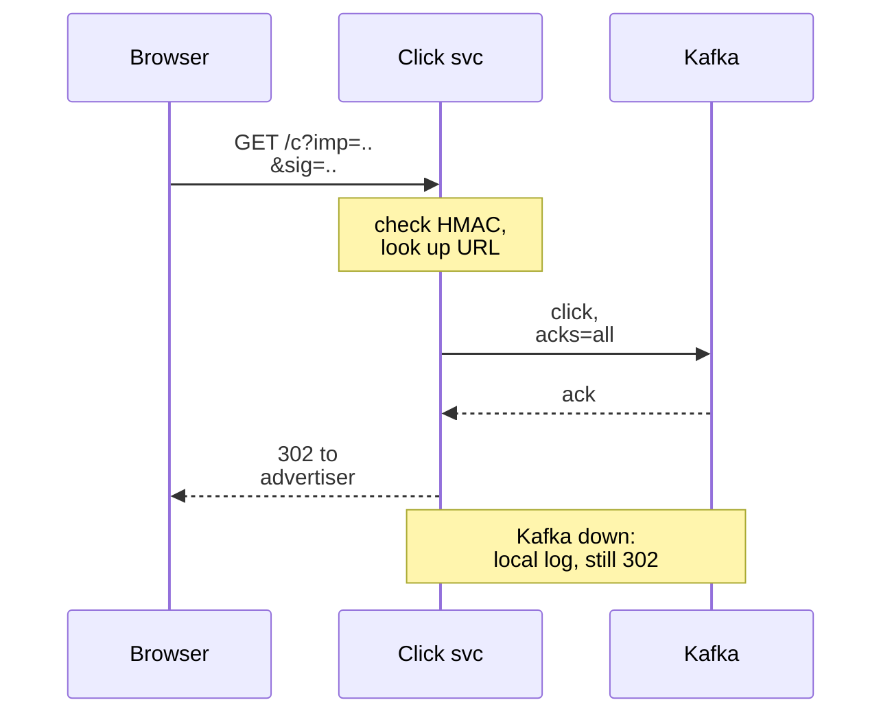
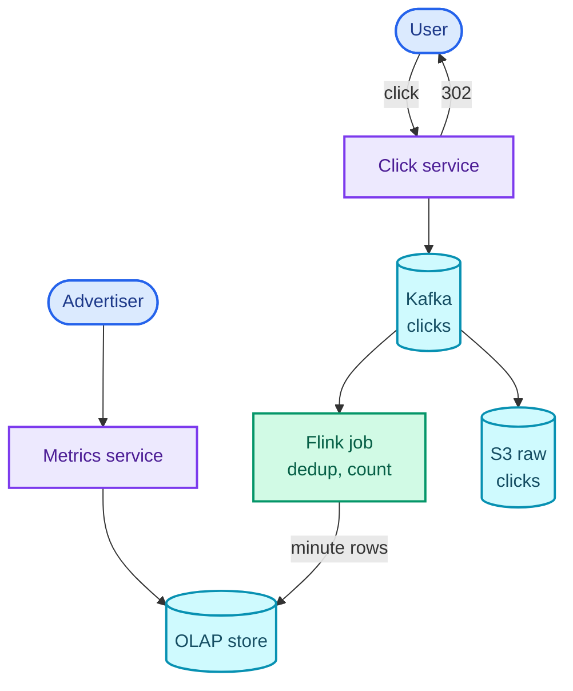
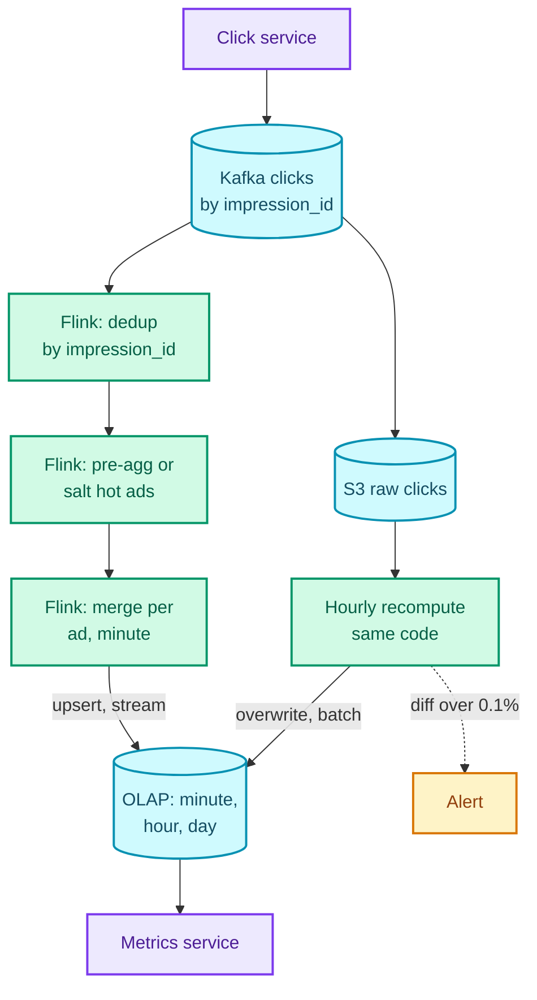

"Design an ad click aggregator: users click ads and land on the advertiser's site, and advertisers can query how many clicks their ads got, over any time range, down to the minute."

On the surface it is the [top K](/blogs/hld-top-k/) design again: events in, counts out. What changes is that every count is a line on an invoice. Advertisers pay per click, so a click lost is revenue lost and a click counted twice is an overcharge someone will dispute. What the question is really testing is **exactly-once-ish stream processing**: how close you can get to "every click counted exactly once" on infrastructure where any machine can die mid-write, and what you add when the stream alone is not good enough. The honest answer is three mechanisms layered on each other: a log that can be replayed, a key that makes duplicates detectable, and a batch job that recomputes the answer from the raw clicks and corrects the stream.

The pattern is **stream processing you can trust**: windowed aggregation with checkpointed state, idempotent output, event-time windows with watermarks, and reconciliation against an immutable log. It is the backbone of any metering or billing pipeline, and the [payment system](/blogs/hld-payment-system/) reuses its reconciliation idea. It leans on delivery semantics, idempotency and Kafka from [async processing](/blogs/system-design-async/), [NoSQL and storage](/blogs/system-design-databases-nosql/), and [CAP](/blogs/system-design-cap-consistency/).

How to use this post: [the method](/blogs/hld-the-method/). Try the question cold first, then read.


You are a senior engineer interviewing me for a system design round. The question is: "Design an ad click aggregator: users click ads and are redirected to the advertiser's site, and advertisers can query click counts for their ads over any time range at one-minute granularity." Run it as a realistic 45-minute interview following this structure: requirements (5 min), core entities (2 min), API (5 min), high-level design (10-15 min), deep dives (10 min).
Rules: state the question in one sentence and stop. Answer my clarifying questions the way a real interviewer would, briefly, and only what I ask. Never propose designs, components or classes yourself. If I skip a stage or run long on one, say so in one line and keep time. When I finish a stage, write one line of the note you would put on the scorecard, then move on.
Once my design is in place, probe it with these, one at a time, waiting for my answer each time: 1) Why does the click go through your server at all, and what happens to a click if Kafka is unavailable at that moment? 2) A stream-processing task crashes mid-minute. Walk me through why no click is lost and none is counted twice, including the write to the store advertisers query. 3) A user double-clicks an ad, and your click service retries a publish after a timeout. How do you deduplicate, and how much state does that take? 4) A click that happened at 10:00:58 reaches your aggregator at 10:01:15. Which minute is it counted in, and when do you stop waiting for late clicks? 5) A Super Bowl ad takes 30,000 clicks a second. What breaks and how do you fix it? 6) An advertiser asks for a year of hourly clicks across 1,000 ads. How does that return in under a second? 7) How do you know the real-time numbers are right, and which numbers does billing use?
At the end, grade me as hire / lean hire / lean no hire / no hire for a senior engineer, with the two strongest and two weakest moments, and the one thing to fix first.



## Requirements

### Functional

1. Users should be able to click an ad and be redirected to the advertiser's website.
2. Advertisers should be able to query click counts for their ads over any time range, at one-minute granularity.
3. Advertisers should be able to filter and group those counts by a few fixed dimensions: campaign, country and device type.

Below the line (out of scope):

- **Fraud and bot detection.** A separate system that scores clicks and marks some invalid. This one deduplicates; it does not judge intent. The hook for fraud is that reconciliation (deep dive 5) can apply its verdicts later.
- **Impressions and click-through rate.** Impressions are the same pipeline with ten to a hundred times the volume; CTR is a query joining the two.
- **Billing and invoicing.** A consumer of the reconciled numbers this system produces.
- **Ad serving and the auction** (which ad to show). Upstream of everything here.

### Non-functional

- **The redirect is fast and never fails because of analytics: under 100 ms p99 server time** (p99: 99 out of 100 requests at least this fast). The user is waiting on a blank tab. This is an availability call in [CAP](/blogs/system-design-cap-consistency/) terms: the click path keeps working even when the aggregation pipeline does not.
- **No click is lost once the redirect is sent, and none is counted twice in the numbers billing uses.** This is the requirement the whole design bends around.
- **Freshness: a click appears in advertiser queries within 2 minutes.** Advertisers watching a launch want near real time; the final, billable numbers can take hours.
- **Queries return in under 1 s at p99** for any range up to a year, across up to 1,000 ads.
- **Scale: 10M active ads, 10,000 clicks a second on average, 100,000 at peak** (a big sporting event).

### Capacity estimate

**Click volume.** 10,000 clicks a second × 86,400 s = 864M clicks a day. At about 500 bytes per click event (impression ID, ad ID, timestamp, country, device, IP, user agent), the peak is 100,000 × 500 B = 50 MB/s. **So one Kafka topic handles it**, with partitions sized for parallelism: at a conservative 10 MB/s per partition (a rule of thumb) the peak needs 5, and 32 gives headroom and 32 parallel consumers.

**Raw storage.** 864M × 500 B = 432 GB a day, about 158 TB a year. **So keep every raw click in object storage (S3) indefinitely**; at that size it is cheap, and it is the evidence for every reconciliation and every billing dispute.

**Aggregate rows.** 864M clicks a day across 10M ads is 86 clicks per ad per day, under one per minute. **So the minute-grain table is nearly as large as the click stream itself** (at most one row per click, and most minute rows hold a count of 1), which is why minute grain cannot be the only grain kept for a year. Hour grain is at most 10M ads × 24 = 240M rows a day, day grain at most 10M. Deep dive 4 turns this into rollup tiers.

## Core entities

- **Ad**: `ad_id`, `advertiser_id`, `campaign_id`, `target_url`; owned by the ads system, read here.
- **Impression**: one showing of one ad to one user, identified by an `impression_id` minted when the ad is served. The click inherits it.
- **Click event**: `impression_id`, `ad_id`, `clicked_at`, country, device; immutable once logged.
- **Click aggregate**: `(ad_id, minute, country, device) → clicks`, the row advertisers query, plus its hourly and daily rollups.

## API

```text
GET /v1/c?imp=<impression_id>&ad=<ad_id>&sig=<hmac>
  -> 302 Found
     Location: https://advertiser.example/landing?utm_source=...

GET /v1/ads/metrics?ad_ids=a1,a2&from=2026-11-01T00:00Z&to=2026-11-23T00:00Z
                   &granularity=minute|hour|day&group_by=country
  -> 200 { "rows": [ { "ad_id", "bucket_start", "country", "clicks" } ],
           "final_until": "2026-11-22T00:00Z" }
```

The click URL is signed: `sig` is an HMAC (a keyed hash only the ad server and click service can compute) over the impression ID and ad ID, so nobody can mint fake impression IDs or tamper with the ad. The redirect target comes from the ad's record, never from the URL, so the endpoint cannot be used as an **open redirect** (a trusted domain bouncing users to any site an attacker names).

`302` (temporary) rather than `301` (permanent), because browsers cache a 301 and would skip the click service next time. Every click must come back through us.

On the metrics call, the advertiser comes from the auth token and the service checks each `ad_id` belongs to them. `final_until` says up to when the numbers are reconciled and billable; after it they are the stream's live estimate (deep dive 5).

## Data flow

1. The ad server mints an `impression_id`, signs it into the ad's click URL and logs the impression.
2. A user clicks. The **click service** verifies the signature, publishes the click to Kafka, and returns a 302 to the advertiser.
3. A **Flink** job (Apache Flink: a stream processor that keeps state and checkpoints it) deduplicates clicks by `impression_id` and counts them per ad, minute and dimension.
4. When a minute's window closes, the job writes its rows to the **OLAP store** (a database built for aggregate queries over many rows, such as ClickHouse, Apache Druid or Apache Pinot).
5. In parallel, every raw click is archived from Kafka to S3.
6. A **reconciliation job** recomputes each hour from S3 and overwrites the stream's rows with the exact counts.
7. The **metrics service** answers advertiser queries from the OLAP store.

## High-level design

### 1. Click and redirect

A click arrives at the click service. It checks the HMAC, looks up the ad's target URL (10M ads × about 200 bytes is 2 GB, so the whole map sits in memory on each click server, refreshed from the ads database), publishes the click event to Kafka and answers 302.

Why route the click through our server at all, when the ad could link straight to the advertiser and fire an analytics beacon from the browser? Because a beacon from the browser is lost whenever the page unloads first, a script fails, or an ad blocker eats it, and every lost beacon is an unbilled click. The server-side redirect is the one place every click must pass.

The publish happens before the redirect, with Kafka configured to acknowledge only once the event is replicated (`acks=all`), so "redirect sent" implies "click durable". That publish costs a few milliseconds inside a region. If Kafka is unreachable, the click service appends the event to a local disk log and redirects anyway; a sidecar ships that log to Kafka when it recovers. The click path never waits on, or fails because of, the pipeline.

The whole click path, with the fallback as a note:



### 2. Query clicks over time

The naive store is a row per click in a relational table and `SELECT COUNT(*) … GROUP BY minute` per query. A busy ad's year is millions of rows to count per dashboard load, and the table grows by 864M rows a day. So aggregate before storing.

Flink consumes the click topic, groups clicks into one-minute **tumbling windows** (fixed, non-overlapping intervals: 10:00 to 10:01, 10:01 to 10:02) per `(ad_id, country, device)`, and when a window closes, writes one row per key to the OLAP store. A query for an ad over a range reads pre-counted rows instead of clicks.

```text
clicks_minute (OLAP, columnar)
  ad_id          string      sort key part 1
  minute         timestamp   sort key part 2, partition by day
  country        string
  device         string
  clicks         uint32
  campaign_id    string      denormalised so campaign queries need no join
  source         enum        stream | batch   (deep dive 5)
```

### 3. Filter and group by dimension

The dimensions are columns on the aggregate row, so "clicks by country for campaign X last week" is a filter on `campaign_id` and a `GROUP BY country`. Columnar storage makes this cheap: a query reads only the columns it names (`campaign_id`, `country`, `clicks`, `minute`), and each column compresses well because neighbouring values repeat. Keeping the dimensions to a small fixed set matters, because every dimension multiplies the number of distinct rows per minute. Arbitrary user-defined dimensions would turn this into a different product.

The assembled design:



What this leaves for the deep dives: whether a Flink crash loses or doubles clicks (deep dive 1), which minute a delayed click lands in (deep dive 2), one ad swamping one Flink task (deep dive 3), year-long queries over minute rows (deep dive 4), and how anyone knows the stream's numbers are right (deep dive 5).

## Deep dives

### 1. How is no click lost and none counted twice?

This maps to the accuracy requirement, and it is the question the interview is about. Start from where duplicates and losses come from, because each mechanism answers one of them:

- A **user double-clicks**, or refreshes the landing page through the click URL: two events, same `impression_id`.
- The **click service retries** a publish after a timeout whose original actually succeeded: two events, same `impression_id`.
- A **stream task crashes** and restarts: events it had already counted are read again.
- A **write to the OLAP store** succeeds, and the task crashes before recording that it did: the write happens again.

**Bad: count in the click service, increment a database counter per click.** `UPDATE ad_clicks SET n = n + 1` on every click. The service crashing after the redirect and before the update loses the click; a retried update after a timeout counts it twice; a user's double-click counts twice; and 100,000 updates a second on hot rows locks up the database. Every failure mode on the list hits it.

**Good: Kafka plus a stream job with at-least-once processing, deduplicated by `impression_id`.** Kafka is a durable, replayable log: an event acknowledged with `acks=all` survives a broker failure, and consumers can re-read from any offset (the position of an event in its partition). The Flink job counts and commits offsets as it goes. Deduplication handles the first two sources: the job keeps a set of `impression_id`s it has seen, and drops repeats. Every impression gets at most one billable click, which is also the billing rule advertisers expect.

That set costs real state. At an average of 10,000 clicks a second, a 24-hour dedup window holds 864M IDs. At about 40 bytes per entry in an on-disk key-value store (a 16-byte ID plus overhead), that is about 35 GB, roughly 1.1 GB on each of 32 parallel tasks: comfortable in RocksDB (the embedded on-disk key-value store Flink uses for large state) on local SSD, with entries expiring after 24 hours. A click on an impression older than that is rare, and reconciliation catches it.

At-least-once still fails on the last two sources. A crash between "counted" and "offset committed" replays events into counts that already include them.

**Great: checkpointed state plus an idempotent sink.** Flink's answer to replays is the **checkpoint**: every few seconds, the job snapshots all of its state (the in-progress window counts and the dedup set) together with the Kafka offsets that produced that state, consistently across all tasks, to durable storage. On a crash, Flink restores the last checkpoint's state *and* rewinds the source to that checkpoint's offsets, then replays. The events after the checkpoint were counted into state that has been thrown away, so replaying them counts them exactly once. The sketch walks it through for one ad.

<figure class="sketch"></figure>

The count went 40 at the checkpoint, 52 before the crash, back to 40 on restore, and 52 again after the replay. Not 64. State and position move together or not at all; that is the whole trick.

That makes the job's *state* exactly-once. Its *output* still needs care, because a window that fired and wrote its rows to the OLAP store before the crash will fire again during the replay. Two ways out:

- A **transactional sink**: output is written inside a transaction that commits only when the next checkpoint completes (Flink's two-phase commit sinks, Kafka transactions). Correct, but output is delayed by up to a checkpoint interval and couples the sink to Flink's protocol.
- An **idempotent sink**: each output row has a natural key, `(ad_id, minute, country, device)`, and is written as an upsert (insert, or overwrite if the key exists) of the full count, never as "add n". Writing the same window twice writes the same row twice, and the second write changes nothing. Most OLAP stores support it: Pinot has upsert tables keyed by a primary key, and ClickHouse's ReplacingMergeTree keeps the latest row per key (it collapses duplicates during background merges, so queries use `FINAL` or `argMax` to read the latest).

Choose the idempotent sink here. Windowed aggregates have a natural key, so idempotency is free, and freshness does not wait on checkpoints. The phrase for the interview: **exactly-once state, idempotent output, and the combination behaves as exactly-once end to end** ("effectively once", in the language of [async processing](/blogs/system-design-async/)).

### 2. A click from 10:00:58 arrives at 10:01:15. Which minute is it?

This maps to freshness and accuracy pulling against each other: close the window early and the numbers are fresh but miss clicks; wait and they are complete but late.

**Bad: processing-time windows.** Assign each click to the minute in which Flink happens to read it. A click delayed 17 seconds (a slow click server, a Kafka partition that fell behind, a consumer restarting) is counted in the wrong minute, and a replay after a crash puts old clicks into the current minute. The counts depend on how the pipeline felt that day.

**Good: event-time windows with a watermark.** Assign each click to the minute in its own `clicked_at`, stamped by the click service when the request arrived (a server clock, not the browser's, which can be wrong or forged). The question then becomes when to close the window for 10:00, since a 10:00 click might still be in flight. A **watermark** is the stream's running statement "I do not expect any more events older than T". The simplest, Flink's bounded out-of-orderness, sets T to the largest event time seen so far minus a fixed bound, say 10 seconds. The 10:00 window fires once the watermark passes 10:01:00, that is, once some click stamped 10:01:10 or later has been seen.

<figure class="sketch"></figure>

Read the sketch left to right in arrival order. The 0:57 click arrives after a 1:03 click, out of order, but the watermark is still at 0:53, so it is counted in the 10:00 window. The window fires when the 1:12 click pushes the watermark to 1:02, with 3 clicks. The 0:59 click that arrives after that is late: the window it belongs to has already been written.

The bound is the dial. Ten seconds covers the normal delay between click servers and Flink, since timestamps come from the click service and only a few seconds of queueing separate them. A larger bound makes every minute later for everyone; a smaller one makes more clicks late.

**Great: watermark plus allowed lateness, plus a home for anything later.** Flink lets a window accept late events for a further period after it fires (**allowed lateness**). Set it to, say, 5 minutes: a late click updates the window's state and the window fires again with the corrected count. Because the sink is an upsert (deep dive 1), the corrected row overwrites the earlier one, and the advertiser's dashboard ticks up by one. Clicks later even than that go to a **side output** (a separate stream for events the window refused) and are counted by reconciliation, which reads every click from S3 by event time regardless of when it arrived. Nothing is dropped; the stream handles the common case fast, and the batch handles the tail exactly.

### 3. A Super Bowl ad takes 30,000 clicks a second

This maps to the scale requirement, at its most uneven.

The Kafka topic is partitioned by `impression_id` (effectively random), so the hot ad's clicks spread evenly across all 32 partitions and Kafka never notices. The hotspot appears inside Flink. Counting is keyed by `ad_id`, which sends every click for one ad to the one task that owns that key.

**Bad: key the count by `ad_id` and hope.** With large state in RocksDB, each update is a read-modify-write on local disk, and one task sustains on the order of tens of thousands of updates a second (a rough figure; measure your own). That task now carries the hot ad's 30,000 clicks a second on top of its share of everything else, (100,000 − 30,000) ÷ 32 ≈ 2,200 a second, while 31 others idle. When it falls behind, Flink's **backpressure** (a slow operator makes its upstream operators slow down rather than buffer without limit) stalls the whole job, and every ad's numbers go stale, not only the hot one.

**Good: salt the key.** Count by `(ad_id, salt)` where the salt is a random number from 0 to 7, so the hot ad's clicks split across 8 tasks of about 3,750 a second each. A second, small stage keyed by `(ad_id, minute)` adds the 8 partial counts into one row. That second stage sees 8 rows per ad per minute, not 30,000 clicks a second. The sketch shows the load per task before and after.

<figure class="sketch"></figure>

The cost is an extra stage and an extra hop for every ad, including the millions that never needed it.

**Great: salt only what is hot, or pre-aggregate before the key.** Two refinements, either of which is a strong answer:

- **Salt only known-hot ads.** A small side job watches per-ad click rates over the last minute and publishes a hot list (or campaigns flagged in advance: nobody is surprised by a Super Bowl slot). Hot ads get 8 salts; everyone else keeps salt 0, so the merge stage is a pass-through for them.
- **Local pre-aggregation.** Before the `keyBy`, each task sums the clicks it has already received per `(ad_id, minute)` for a second or so and forwards one partial count, so the keyed stage receives at most 32 partials a second per ad instead of 30,000 clicks. Flink SQL does this for you with its local-global (two-phase) aggregation, which runs when mini-batch processing is turned on.

Deduplication comes first in all of these, keyed by `impression_id`, which is already evenly spread. Dedup, then pre-aggregate or salt, then merge. The [top K](/blogs/hld-top-k/) design could skip all of this because one video fitted on one partition; here the arithmetic says one ad does not fit on one task.

### 4. A year of hourly clicks for 1,000 ads in under a second

This maps to the query latency requirement.

**Bad: count raw clicks per query.** A year of clicks is about 315B rows (864M a day × 365). Even scanning one campaign's share per query is far past a second.

**Good: minute aggregates in a relational database, indexed on `(ad_id, minute)`.** One ad over a day is at most 1,440 rows, a fast index range scan. One ad over a year is up to 525,600 rows (60 × 24 × 365), and 1,000 ads over a year is up to 525 million rows to read and sum, row by row, in a row-oriented store. It holds for "today" and fails for "this year".

**Great: a columnar OLAP store with rollup tiers.** Keep three tables, each written from the one below:

| Grain | Rows for 1 ad, 1 year | Rows for 1,000 ads, 1 year | Retention |
| --- | --- | --- | --- |
| Minute | 525,600 | 525.6M | 90 days |
| Hour | 8,760 | 8.76M | 3 years |
| Day | 365 | 365,000 | forever |

The metrics service picks the coarsest grain that answers the question: a year at hourly granularity reads the hour table, 8.76M rows at most (fewer, since most ads have empty hours), scanning four columns. Columnar engines scan hundreds of millions of rows a second per server on aggregations like this (a rule of thumb for ClickHouse-class engines), so the query is tens of milliseconds. Partition each table by day and sort it by `(advertiser_id, ad_id, time)`, so a query touches only the days and the ads it asks for. Druid and Pinot can produce rollups at ingestion; with ClickHouse a materialised view on the minute table does it.

Retention follows from the capacity estimate. The minute table gains up to 864M rows a day; at roughly 10 to 20 bytes per row after columnar compression (a rule of thumb), 90 days is 78B rows and about 0.8 to 1.6 TB. Minute detail older than 90 days is still recoverable from S3 if a dispute needs it.

### 5. How do you know the stream's numbers are right?

This maps to the "none counted twice in the numbers billing uses" requirement. Everything so far makes the stream very good. None of it makes the stream provably right: a bug in a new job version, a dedup entry that expired, a click later than allowed lateness, an outage window. Money needs a second opinion.

**Bad: trust the stream.** Billing reads whatever the stream wrote. When an advertiser disputes an invoice, there is nothing independent to check it against.

**Good: a nightly batch job recomputes the day from raw clicks.** The raw click log in S3 is immutable and complete (it is archived straight from Kafka, before any processing). A batch job (Spark, say) reads a day of clicks, deduplicates by `impression_id`, groups by `(ad_id, minute, country, device)` using `clicked_at`, and overwrites that day's rows in the OLAP store with `source = batch`. This is the **lambda architecture**, roughly: a fast stream layer for fresh, approximately right numbers, and a slow batch layer for exact ones that replaces it.

The classic weakness of lambda is two implementations of the same logic that drift apart, so the batch job ends up "correcting" the stream to a different bug.

**Great: one implementation, hourly reconciliation, and a clear line between live and final.**

- **Same code for both.** Write the aggregation once (Flink SQL, or one library both jobs call) and run it as a streaming job and as a batch job over S3. Then a difference between the two is a real data problem, not a code difference.
- **Reconcile hourly, compare before overwriting.** For each closed hour (a few hours after it ends, so late clicks have landed), recompute, compare with the stream's rows, overwrite with the batch result, and alert if the difference exceeds a threshold, say 0.1% of an advertiser's clicks. The alert is the point: it turns "the stream drifted" from an invoice dispute into a page.
- **Mark what is final.** The metrics API returns `final_until`, the end of the last reconciled hour. Dashboards show the live estimate after it; billing reads only rows marked final. Reconciliation is also where fraud verdicts land: clicks the fraud system marks invalid are excluded in the batch recompute, and the final numbers change accordingly.

The final design adds the reconciliation loop and shows the Flink job's stages.



Two writers reach the OLAP store, and they cannot fight: the stream upserts live rows, the batch overwrites closed hours with rows marked `batch`, and the stream never touches an hour once it is final.

## What each level is expected to show

| Level | What good looks like on this question |
| --- | --- |
| Mid-level | Routes clicks through a redirect service onto Kafka, aggregates per ad per minute in a stream processor, stores pre-aggregated rows for queries, and deduplicates by impression ID. |
| Senior | Explains exactly-once as checkpointed state plus an idempotent (or transactional) sink, uses event-time windows with a watermark and allowed lateness, handles a hot ad with salting or pre-aggregation, and sizes the rollup tiers from the row counts. |
| Staff+ | Treats the raw log as the source of truth and the stream as an estimate: reconciliation with one shared implementation, alerting on drift, a `final_until` line that billing respects, and a plan for disputes and fraud verdicts landing after the fact. |

## Variants this unlocks

| Question | What changes |
| --- | --- |
| Design metrics and monitoring (Datadog, Prometheus at scale) | Metric points replace clicks; no money, so reconciliation becomes optional, and approximate percentiles (sketches) join the counts. |
| Design a usage-metering and billing pipeline (AWS billing, API metering) | Almost identical: usage events with idempotency keys, windowed aggregation, and reconciliation feeding invoices. |
| Design YouTube view counting | The [top K](/blogs/hld-top-k/) counting path plus this post's dedup and reconciliation, because views also pay creators. |
| Design real-time analytics for a web app (Google Analytics) | Many more dimensions (page, referrer, browser), so the OLAP store and rollup choices dominate; dedup is per session, not per impression. |
| Design an impression and CTR pipeline | A second, 10 to 100 times larger stream through the same job; CTR is a join of the two aggregates at query time. |
| Design a leaderboard of top-spending customers | A windowed aggregate keyed by customer, served as a top-K list; correctness again needs reconciliation if it drives rewards. |

## The one-page version

- Signed click URL (HMAC over impression and ad); target URL from the ad record, never the query string; `302`, not `301`.
- Click service: verify, publish to Kafka with `acks=all`, then redirect; Kafka down → local disk log, redirect anyway.
- Kafka topic partitioned by `impression_id` (32 partitions; 50 MB/s at peak); raw clicks archived to S3 (432 GB a day), immutable.
- Flink: dedup by `impression_id` (24 h of IDs, about 35 GB across 32 tasks in RocksDB), then pre-aggregate or salt hot ads, then merge per (ad, minute).
- Exactly-once state from checkpoints (state and Kafka offsets snapshotted together; restore both, replay).
- Idempotent sink: upsert full counts keyed by (ad, minute, country, device); a replayed window rewrites the same row.
- Event-time one-minute windows; watermark = max event time − 10 s; allowed lateness 5 min with upsert corrections; later clicks to a side output.
- OLAP rollups: minute (90 days), hour (3 years), day (forever); query picks the coarsest grain; sorted by advertiser and ad.
- Hourly reconciliation from S3 with the same code: compare, overwrite, alert above 0.1%; `final_until` marks billable numbers.

**Key sentence: log every click before redirecting, count it in a stream whose state and offsets are checkpointed together and whose output is an upsert, and let a batch job over the immutable raw log decide the final number.**


You are a senior engineer checking my answers on a system design I have studied: an ad click aggregator (click redirect, per-ad per-minute click counts, advertiser queries). Ask me the questions below one at a time, wait for my answer each time, and judge it against the key points listed. Do not reveal the key points before I answer. If I am stuck, give one hint at a time, starting vague and getting more specific. After each answer, tell me what I got right, what I missed, and what an interviewer would push on next. At the end, list which questions I should revisit.
1) Why route clicks through a redirect service, and what happens if Kafka is down? Key points: browser beacons are lost to page unloads, script failures and ad blockers, and a lost click is unbilled; the server-side redirect is the one place every click passes; publish with acks=all before redirecting so a sent redirect implies a durable click; if Kafka is unreachable, append to a local disk log and still redirect, shipping it later; sign the click URL with an HMAC and take the target URL from the ad record to prevent forged impressions and open redirects; 302 so browsers do not cache the redirect.
2) List the sources of duplicates and losses, and the mechanism that handles each. Key points: user double-clicks and producer retries produce the same impression_id and are removed by dedup keyed on impression_id; task crashes replay events, handled by Flink checkpoints that snapshot state and Kafka offsets together and restore both; a window written to the sink before a crash is written again, handled by an idempotent upsert keyed by (ad, minute, dimensions) or a transactional two-phase-commit sink; the combination is effectively once.
3) How big is the dedup state, and where does it live? Key points: about 10,000 clicks per second times 86,400 seconds is 864M IDs per 24 hours; at about 40 bytes each that is about 35 GB, about 1.1 GB per task over 32 tasks, in RocksDB on local SSD with a 24-hour TTL; the dedup state is part of the checkpoint; clicks older than the window are caught by reconciliation.
4) Explain event time, watermarks and allowed lateness using a click from 10:00:58 arriving at 10:01:15. Key points: processing-time windows put delayed or replayed clicks in the wrong minute; use event time stamped by the click service's clock, not the browser's; a bounded out-of-orderness watermark is max event time seen minus a bound (say 10 s), and the 10:00 window fires when the watermark passes 10:01:00; a click arriving after the window fired is late; allowed lateness (say 5 minutes) re-fires the window and the upsert sink corrects the row; anything later goes to a side output and reconciliation counts it.
5) A single ad takes 30,000 clicks per second. What breaks and how do you fix it? Key points: Kafka partitioned by impression_id spreads it evenly, but keying the count by ad_id puts it on one Flink task, which falls behind and backpressure stalls the whole job; salt the key with 0 to N-1, count per (ad, salt), and merge partials per (ad, minute) in a second stage; better, salt only known-hot ads or pre-aggregate locally before the keyBy (Flink SQL two-phase aggregation); dedup by impression_id comes before any of it.
6) How does a query for a year of hourly clicks across 1,000 ads return in under a second? Key points: raw clicks are hundreds of billions of rows a year; minute rows for 1,000 ads over a year are up to 525.6M; keep rollup tiers (minute for 90 days, hour for years, day forever) in a columnar OLAP store, choose the coarsest grain that answers, so the query reads at most 8.76M hourly rows on a few columns; partition by day, sort by advertiser and ad.
7) How do you know the stream's numbers are right, and which numbers does billing use? Key points: the raw log in S3 is immutable and complete; a batch job recomputes closed hours by event time with the same dedup and overwrites the stream rows (lambda-style); use one implementation for stream and batch so they cannot drift; compare before overwriting and alert above a threshold such as 0.1%; mark reconciled data with final_until, and billing reads only final rows; fraud verdicts are applied in the recompute.



Next: [Web crawler](/blogs/hld-web-crawler/), where the pipeline turns outward: a frontier of billions of URLs, politeness towards other people's servers, and queues that must survive any stage failing.
