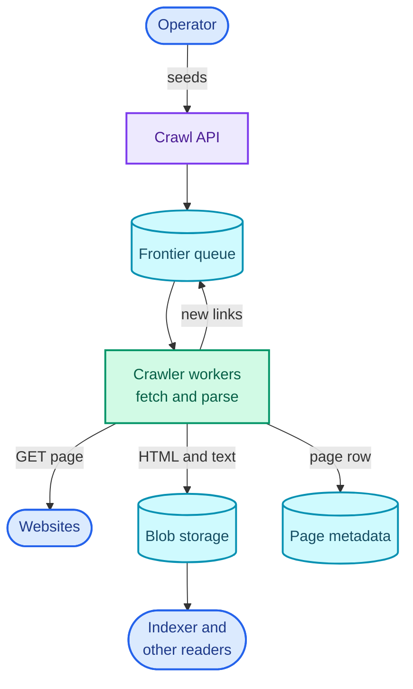
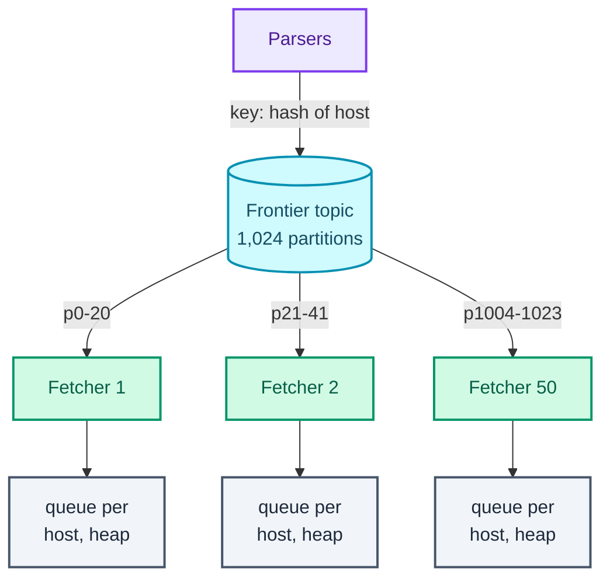
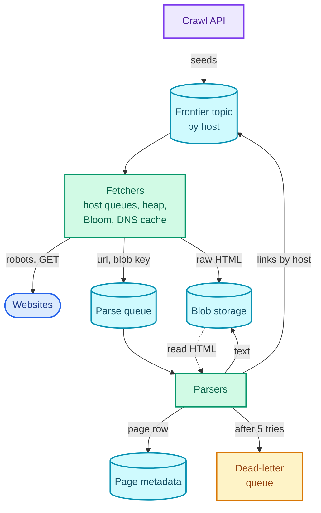

"Design a web crawler that can crawl 10 billion pages in five days." That's the whole question as most interviewers say it, and the number is doing most of the work.

Fetching one page is a single HTTP GET. Fetching 23,000 a second is a fleet of machines. Neither is the hard part. The hard part is **politeness**: no single website may receive more than about one request a second from you, however many machines you run, and a naive queue of URLs will send fifty fetchers at the same site within a second of its first page being parsed. Every interesting decision in this design follows from enforcing that one rule cheaply.

The pattern this question teaches is **a pipeline of stages joined by durable queues**: each stage does one kind of work, writes its result somewhere durable, and hands a small message to the next stage; failures are retried with backoff and finally parked in a dead-letter queue. The [notification system](/blogs/hld-notification-system/) and the [job scheduler](/blogs/hld-job-scheduler/) that follow reuse it directly, and so do [YouTube's transcoding pipeline](/blogs/hld-youtube/) and the [ad click aggregator](/blogs/hld-ad-click-aggregator/). It leans on three System Design parts: [async processing](/blogs/system-design-async/) (queues, partitions, retries, the dead-letter queue), [the edge](/blogs/system-design-the-edge/) (DNS and rate limiting) and [NoSQL and blob storage](/blogs/system-design-databases-nosql/).

How to use this post: [the method](/blogs/hld-the-method/). Try the question cold first, then read.


You are a senior engineer interviewing me for a system design round. The question is: "Design a web crawler that can crawl 10 billion pages in five days." Run it as a realistic 45-minute interview following this structure: requirements (5 min), core entities (2 min), API (5 min), high-level design (10-15 min), deep dives (10 min).
Rules: state the question in one sentence and stop. Answer my clarifying questions the way a real interviewer would, briefly, and only what I ask. Never propose designs, components or classes yourself. If I skip a stage or run long on one, say so in one line and keep time. When I finish a stage, write one line of the note you would put on the scorecard, then move on.
Once my design is in place, probe it with these, one at a time, waiting for my answer each time: 1. Fifty fetchers all pull URLs that belong to the same website. How do you guarantee that site never gets more than one request a second from you? 2. Pages average about 50 links each. How do you answer "have we already seen this URL?" over a million times a second, and how much memory does it take? 3. One fetcher machine dies holding a few hundred thousand URLs it had not fetched yet. What is lost, and how does the crawl resume? 4. A large site starts answering 503 for an hour. What does your crawler do, per URL and per site? 5. One site has 60 million pages. Can you crawl all of it in five days at your politeness rate? 6. Why would you split fetching pages from parsing them into separate stages?
At the end, grade me as hire / lean hire / lean no hire / no hire for a senior engineer, with the two strongest and two weakest moments, and the one thing to fix first.



## Requirements

### Functional

1. Operators should be able to start a crawl from a list of seed URLs (the starting pages) and watch its progress.
2. The crawler should fetch every reachable page, extract the links on it, and keep crawling those links until the page budget is spent.
3. Downstream systems (a search indexer, a training-data pipeline) should be able to read the extracted text of every crawled page.

Below the line (out of scope):

- **Rendering JavaScript.** A headless browser costs one to two orders of magnitude more CPU per page than parsing HTML; it belongs in a separate tier for pages flagged as needing it.
- **Recrawling for freshness.** Deciding how often to revisit a page is a scheduling problem of its own; this design is one crawl of 10 billion pages.
- **Ranking which pages matter most.** The frontier will have a hook for priority, but computing PageRank-style importance is out.
- **Images, video and logged-in pages.** HTML only, public pages only.
- **Building the search index.** That's the [post search](/blogs/hld-post-search/) question; here the output is text in storage.

### Non-functional

- **Throughput: 10 billion pages in 5 days**, which is about 23,000 pages a second sustained (computed below).
- **Politeness: at most one request per second to any one host**, or slower if the site's robots.txt asks for it, and no fetching of paths robots.txt disallows. A host here is a hostname such as `en.wikipedia.org`; robots.txt is the file at `/robots.txt` where a site states which paths crawlers may fetch.
- **Fault tolerance: a crash loses no URLs and costs minutes, not the crawl.** Any machine can die and the crawl resumes from a recent checkpoint. Fetching a page twice after a crash is acceptable; skipping it silently is not. This leans AP: the "seen" set can be briefly stale, because a duplicate fetch wastes work but corrupts nothing.
- **Efficiency: no URL fetched twice and no duplicate content stored twice** within a crawl, so bandwidth and storage go to new pages.
- **Scale out linearly:** twice the machines should give twice the pages a second, up to the politeness ceiling.

### Capacity estimate

Five days is 5 × 86,400 = 432,000 seconds. 10,000,000,000 ÷ 432,000 = **23,148 pages a second**. That's the number everything else is measured against.

Page size. The 2024 Web Almanac puts the median page's HTML at 18 KB on the wire ([HTTP Archive](https://almanac.httparchive.org/en/2024/page-weight)). A median hides a long tail, and an estimate that's too big costs less than one that's too small, so I plan for 100 KB per page.

- **Bandwidth:** 23,148 × 100 KB = 2.3 GB/s, about 18.5 Gbit/s. No single machine does that, so fetching is spread across a fleet.
- **Fetchers:** a fetcher with asynchronous I/O can hold about 1,000 connections open at once, and a fetch from a distant server takes roughly a second end to end (connection, TLS, server time, transfer; a rule of thumb). That's about 1,000 pages a second per machine, using 100 MB/s, so about 24 machines, 50 with headroom.
- **Storage:** 10^10 × 100 KB = 1 PB of raw HTML before compression. That's blob storage (S3 or similar), never a database. The per-page metadata (URL, status, hashes, pointers) is about 300 bytes, so 3 TB, which is a sharded key-value store.
- **The politeness ceiling:** at one request a second, one host yields at most 432,000 pages in five days. A site with 60 million pages would take 60,000,000 seconds, almost two years. So the crawl can't be "finish every site"; it's a budget per host. And to reach 23,148 pages a second at one per second per host, at least 23,148 different hosts must be in flight at every moment. The frontier has to interleave hosts, and that's the core of the design.
- **Dedup checks:** at about 50 links per page (an assumption), parsers emit 23,148 × 50 = 1.16 million URLs a second, and each one needs an "already seen?" check. No database round trip per check survives that; the check has to be in memory.

## Core entities

- **Crawl:** one run, with its seeds, page budget and status.
- **Frontier entry:** a URL waiting to be fetched, with its host, depth (link hops from a seed) and attempt count.
- **Host:** per-site state: cached robots.txt rules, crawl delay, the earliest time it may be fetched next, cached IP address, recent failures.
- **Page:** a fetched URL: status, fetch time, a hash of its content, and pointers to its raw HTML and extracted text in blob storage.

## API

The crawler has almost no public surface. Operators talk to a small control API; the real interfaces are the messages between stages, which the data flow below describes.

```text
POST /crawls
  body: { "seeds": ["https://example.com/", ...], "maxPages": 10000000000,
          "maxPagesPerHost": 400000 }
  -> 201 { "crawlId": "c_81f2" }

GET  /crawls/{crawlId}
  -> 200 { "status": "running", "fetched": 4120338201, "failed": 81220931,
           "frontierSize": 9310022877, "pagesPerSecond": 23410 }

POST /crawls/{crawlId}/pause
POST /crawls/{crawlId}/resume

GET  /pages?url=https%3A%2F%2Fexample.com%2Fabout
  -> 200 { "url": "...", "status": 200, "fetchedAt": "...",
           "contentHash": "9f2c...", "textLocation": "s3://crawl/c_81f2/text/..." }
```

The operator is identified from the auth token on every call, never from the body.

## Data flow

1. Seed URLs enter the **frontier**, the store of URLs waiting to be fetched.
2. A **fetcher** takes a URL whose host is allowed a request now, resolves the host's IP address (from a cache when it can), checks the host's robots.txt rules, and downloads the page.
3. The fetcher writes the raw HTML to blob storage and hands a small "parse this" message (URL plus the blob key) to the **parse queue**.
4. A **parser** reads the HTML, extracts the text (written to blob storage) and the links, and records the page's metadata.
5. Each link is normalised (one spelling per URL), filtered (robots rules, length, depth), checked against the set of URLs already seen, and only new ones are queued for fetching.
6. The loop runs until the frontier is empty or the page budget is spent. Anything that fails is retried with growing delays and, after a limit, parked in a dead-letter queue.

## High-level design

### 1. Operators start a crawl from seeds

The operator calls `POST /crawls`. The **crawl API** (the gateway) writes a crawl record and pushes every seed onto the **frontier queue**, a durable queue so a crash can't lose them. Kafka or SQS both work here; I'll pick Kafka for reasons that show up in deep dive 1.

```text
crawls       crawl_id (PK) | status | max_pages | max_pages_per_host | started_at
frontier msg { crawl_id, url, host, depth, attempt }
```

`GET /crawls/{id}` reads counters that the workers increment, so progress is a cheap read rather than a count over billions of rows.

### 2. The crawler fetches pages and follows links

In the simplest version, one kind of **crawler worker** does everything. It takes a URL off the frontier, fetches `/robots.txt` for the host if it hasn't seen it, downloads the page, stores the HTML in blob storage under a key derived from the URL's hash, and writes a row to the page metadata store. It then parses the HTML, and for every link checks the metadata store ("is there a row for this URL?") and pushes the new ones onto the frontier.

```text
pages   url_hash (PK) | url | host | status | fetched_at | attempts
        | content_hash | raw_key | text_key
hosts   host (PK) | robots_rules | robots_fetched_at | crawl_delay_s
        | next_allowed_at | ip | ip_expires_at | consecutive_failures
```

`url_hash` is a 64-bit hash of the normalised URL. It keys the row, so the same URL always lands on the same shard of the metadata store, a wide-column or key-value store such as Cassandra or DynamoDB at 3 TB.

This works for a thousand pages. At 23,000 a second it breaks in four places, each a deep dive: nothing stops two workers fetching the same host in the same second (deep dive 1), the "seen?" check is a database read 1.16 million times a second (deep dive 2), one worker mixes waiting on the network with burning CPU on parsing (deep dive 3), and a failed fetch has nowhere to go (deep dive 4).

### 3. Downstream systems read the extracted text

The parser writes the page's text to blob storage at `text_key` and the pointer into the page row. A downstream consumer either scans the metadata store for a crawl, or, better, subscribes to a `page-crawled` event the parser publishes after writing both. The event carries the URL and the two blob keys, never the content: a 100 KB page doesn't belong in a queue message.

The assembled design is short: a queue feeding workers, with two stores behind them. Read it top to bottom; the arrow from the workers back to the frontier is the loop that makes it a crawler.



## Deep dives

### 1. Politeness: how do fifty fetchers share one rule per host?

The non-functional requirement is one request per second per host, from the whole fleet. It's harder than it looks because links cluster: most links on a page point back to the same site, so a parsed Wikipedia article puts a few hundred Wikipedia URLs onto the frontier at once, all next to each other.

**Bad: each worker sleeps a second between requests.** It spaces one worker's requests and does nothing about the other 49. With a plain first-in, first-out frontier, those few hundred adjacent Wikipedia URLs get picked up by 50 workers in the same second, which is 50 requests a second to one host. It's also slow for no gain: a worker sleeping a second between fetches does one page a second instead of a thousand.

**Good: a shared per-host lock with a one-second lifetime, in Redis.** Before fetching, a worker runs `SET host:en.wikipedia.org 1 NX PX 1000` (set the key only if it doesn't exist, expiring after 1,000 ms). If the set succeeds, the worker owns the host for the next second and fetches. If it fails, someone fetched that host less than a second ago, and the worker puts the URL back on the queue with a short delay. Redis runs commands one at a time, so two workers can't both win. This is correct across the fleet and it's what I'd say first in an interview.

It fails on waste. Because the frontier is clustered by host, most dequeues hit a locked host. If three out of four dequeues are refused, the fleet reads the frontier four times for every fetch, and Redis takes four round trips per page: 92,000 lock attempts a second to deliver 23,000 fetches. A refused URL also loses its place and comes back later, so a large site's URLs keep bouncing around the queue.

**Great: partition the frontier by host, so one fetcher owns each host.** The frontier is a Kafka topic with, say, 1,024 partitions. Every URL is written to the partition chosen by `hash(host) mod 1024`, so all of a host's URLs land in one partition. Kafka gives each partition to exactly one consumer in a group, so each of the 50 fetchers owns 20 or 21 partitions, and therefore every host in them, outright. Politeness stops being a coordination problem. It's a local decision inside one process.

Inside a fetcher, the design is the one the Mercator crawler made standard (recalled from Manning, Raghavan and Schütze's *Introduction to Information Retrieval*, chapter 20). The fetcher drains its partitions into one in-memory queue per host, and keeps a **min-heap** (a priority queue whose top is always its smallest item) of hosts keyed by each host's next-allowed time. The loop:

1. Look at the top of the heap. If its time is still in the future, wait until it isn't.
2. Pop that host and fetch the next URL from its queue.
3. Set its next-allowed time to now plus its delay: one second, or the robots.txt crawl delay if larger, or longer after an error.
4. Push the host back onto the heap.

The sketch shows one fetcher doing this for three hosts. Watch the spacing on each row and the heap underneath, which is taken at the dashed line.

<figure class="sketch"></figure>

Each host's dots are at least its delay apart, a slow or failing host (c.net) pushes only itself further out, and the heap means the fetcher never polls a host that isn't due. With 1,000 connections in flight, the heap holds hundreds of hosts and the fetcher always has one that's due. The capacity number from earlier says it needs to: 23,148 hosts in flight across 50 fetchers is about 460 hosts per fetcher at any instant.

The flowchart shows the ownership that makes this local. Parsers write links by host; each fetcher reads only its own partitions (p0-20 means partitions 0 to 20) and keeps a queue per host plus the heap for the hosts in them.



The trade-offs. A partition can end up with more big hosts than its neighbours, which is why there are 1,024 partitions for 50 fetchers: rebalancing moves small slices, and no single host can overload a fetcher because it is capped at one request a second anyway. And per-host state now lives in one process's memory, which deep dive 4 has to protect.

robots.txt lives in the same place. The owning fetcher fetches it before the host's first page and caches the parsed rules. RFC 9309, the robots.txt standard, says a crawler should not use a cached copy for more than 24 hours, that a 4xx response means the crawler may fetch anything, and that a 5xx or network failure means it must assume everything is disallowed ([RFC 9309](https://www.rfc-editor.org/rfc/rfc9309.html), sections 2.3.1 and 2.4). That last rule is easy to get backwards: a site whose robots.txt is erroring gets nothing, not everything. `Crawl-delay` isn't in RFC 9309; it's a widely used extension, and honouring it when present is the polite reading.

The delay also adapts. A host that answers 429 (too many requests) or 503 (unavailable) gets its next-allowed time pushed out, honouring the `Retry-After` header when it sends one, and a host whose responses keep getting slower gets a longer delay before it starts failing.

### 2. Dedup: a million "seen it?" checks a second

The efficiency requirement says no URL is fetched twice and no content stored twice. The capacity estimate says URL checks arrive at 1.16 million a second. Two different kinds of duplicate need two different answers.

First, normalisation, because `HTTP://Example.com:80/a?b=2&a=1#top` and `http://example.com/a?a=1&b=2` are the same page. Lowercase the scheme and host, drop the default port and the `#fragment`, resolve `./` and `../`, and strip known tracking parameters (`utm_source` and friends). Sorting query parameters is common but not always safe, since a few sites treat order as meaningful; I'd do it and accept the rare miss.

**Bad: ask the metadata store for every link.** "Is there a row for this `url_hash`?" is a network round trip and a read on a sharded store, 1.16 million times a second, and almost every answer is "yes, seen it", because pages mostly link to things already found. The store is sized for 23,000 writes a second, and this puts fifty times that in reads in front of it.

**Good: an exact in-memory set of URL hashes.** 10 billion 64-bit hashes is 10^10 × 8 bytes = 80 GB of raw data, more once a hash set's overhead is added, so it's a sharded Redis cluster or a set of hash tables on large machines. It's exact, and 64 bits is enough: the expected number of hash collisions among n random 64-bit values is about n² ÷ 2^65, and for 10^10 URLs that's 10^20 ÷ 3.7 × 10^19, about 3 collisions in the whole crawl. It costs hundreds of gigabytes of RAM and a network hop per check unless the shards sit inside the fetchers.

**Great: a Bloom filter per frontier partition, inside the fetcher that owns it.** A **Bloom filter** is a bit array plus k hash functions. Adding a URL sets the k bits its hashes point to. Checking a URL looks at the same k bits: if any is 0, the URL was certainly never added; if all are 1, it was probably added, because other URLs might have set those bits between them. Read the sketch with that in mind: two URLs were added, and the two checks underneath show both possible answers.

<figure class="sketch"></figure>

The sizing formula for n items at false-positive rate p is m = −n ln p ÷ (ln 2)² bits, with k = (m ÷ n) ln 2 hash functions. For n = 10^10 and p = 1%, that's 9.6 bits per URL, so 9.6 × 10^10 bits = **12 GB in total**, with 7 hash functions. At p = 0.1% it's 14.4 bits per URL, 18 GB, with 10 hash functions. Against the exact set's 80 GB-plus, that's a fifth of the memory or less.

Where it lives is what makes it fast. Because the frontier is partitioned by host and a URL's host decides its partition, the fetcher that owns a partition sees every URL for its hosts, so it can own their Bloom filter too. Split across 1,024 partitions, each filter is about 12 MB. The check happens when the fetcher reads a URL off its partition: Bloom says new, add it and queue it; Bloom says seen, drop it. 1.16 million checks a second over 50 fetchers is 23,000 per fetcher, a handful of memory reads each, with no network at all.

The trade-off is the false positive. At 1%, about one new URL in a hundred is wrongly dropped as already seen. For a crawl that's an acceptable loss (the page is usually reachable through another link with a different spelling, and the next crawl gets it); for a system where skipping an item is a bug, it isn't, and the exact set is the answer. A Bloom filter also can't delete, which is fine for one crawl and is why a continuous crawler uses time-sliced filters or a counting variant.

Parsers can shed most of the load before it reaches Kafka: drop links repeated within a page, and keep a small cache of recently emitted URLs, since a site's navigation links appear on every one of its pages.

**Content dedup is a different check.** The same content turns up under different URLs: mirrors, `http` and `https` copies, session IDs in the query string. The parser hashes the page's normalised text (64 bits is enough, by the arithmetic above) and looks the hash up in a `content_hash → first url_hash` table. A hit means the page is stored once, the new URL points at the existing blob, and its links aren't extracted again, since they were extracted the first time. Near-duplicates, pages that differ only by an ad or a timestamp, need a similarity hash instead: **simhash** gives similar documents fingerprints that differ in only a few bits. Google's 2007 near-duplicate paper used 64-bit simhash fingerprints and treated pages within 3 bits of each other as near-duplicates (recalled; [Manku, Jain and Das Sarma](https://research.google/pubs/detecting-near-duplicates-for-web-crawling/)). In the interview, exact content hashing is the expected answer and simhash is the bonus.

### 3. Splitting fetch from parse, and getting DNS out of the way

This is the throughput requirement and half of the fault-tolerance one. A fetch is waiting: about a second on the network, almost no CPU. A parse is computing: no waiting, tens of milliseconds of CPU. Putting them in one worker makes each limit the other.

**Bad: one worker fetches, parses and enqueues links in one go.** A thread pool sized for network waits (a thousand concurrent fetches) is the wrong shape for CPU work, so parsing either starves the fetches or the machine runs at a fraction of its cores. A parser bug that crashes on one malformed page kills the fetcher holding a thousand open connections, and those pages must be fetched again, which costs politeness budget the site already gave you. And when you improve the parser, the only way to re-parse is to re-crawl.

**Good: two stages with a durable queue between them.** Fetchers write the raw HTML to blob storage and put `{ url, raw_key, fetched_at }` on a parse queue. Parsers consume it, write the text and the page row, and emit links to the frontier. Each stage scales by its own bottleneck. Fetchers scale with connections: about 1,000 pages a second each, so 24 machines at minimum. Parsers scale with cores: at 20 ms of CPU per page (a rule of thumb for parsing plus link extraction), 23,148 × 0.02 = 463 cores, about 30 sixteen-core machines. The raw HTML in blob storage is a checkpoint between the stages: a parser crash costs a re-parse, never a re-fetch, and a new parser can re-run over the whole crawl from storage.

**Great: make every stage idempotent, so the queues can deliver twice.** Queues give at-least-once delivery: a consumer that crashes after doing the work but before acknowledging it will see the message again (the [async part](/blogs/system-design-async/) covers why exactly-once delivery doesn't exist). So each stage must produce the same result if it runs twice. The fetcher writes the blob under a key derived from `url_hash`, so a second write replaces the first. The parser upserts the page row by `url_hash` and writes the text blob under a fixed key. Emitting the same links twice is absorbed by the frontier's Bloom filter. With that, a crash anywhere in the pipeline means "redo the last few seconds", and no stage needs to know what the others did.

**DNS.** Every fetch needs the host's IP address. A resolver round trip is typically milliseconds to tens of milliseconds and occasionally seconds when a site's name server is slow, and many standard resolver calls block the thread making them (the Mercator team found DNS was a serious bottleneck for exactly this reason; recalled). Two fixes. Run a caching resolver on each fetcher machine and call it asynchronously. And cache the answer in the host record for as long as its time-to-live allows. Host partitioning makes that cache very effective: all of a host's fetches happen on one machine, so each host is resolved roughly once per TTL. If the crawl averages 100 pages per host (an assumption), 10 billion pages is 100 million hosts, about 230 resolutions a second over five days instead of 23,148.

### 4. Failures: a fetch that fails, and a fetcher that dies

The fault-tolerance requirement says no URL is lost and a crash costs minutes. There are two failure scales: one request failing, and one machine failing.

A single fetch fails in three ways, and they need different handling.

- **Transient:** a timeout, a reset connection, a 503, a 429, a DNS failure. Retry later.
- **Permanent:** a 404 or 410, a path robots.txt disallows, a content type that isn't HTML. Record the outcome on the page row and don't retry.
- **Poison:** a page that crashes the parser every time. Retrying it forever blocks the queue it sits in.

**Bad: retry immediately, in a loop.** The site that returned 503 is overloaded, and three instant retries make it more so. It breaks politeness at the exact moment it matters most, and the worker is stuck on one URL.

**Good: re-enqueue with a growing delay, then dead-letter.** Each failure puts the URL back with `attempt + 1` and a delay that doubles: 1 minute, 2, 4, 8, plus a little random jitter so a thousand URLs that failed together don't come back together. After five attempts the URL goes to a **dead-letter queue** (DLQ), a separate queue for messages that keep failing, where a person or a later batch job can look at them. The sketch shows one URL going through this.

<figure class="sketch"></figure>

The mechanics depend on the queue. SQS has it built in: a consumer that dies leaves its message invisible only until the visibility timeout ends (at most 12 hours), then it reappears; a redrive policy with a maximum receive count moves it to a DLQ; and a message can be delayed by up to 15 minutes. Kafka has no per-message delay, so delayed retries become separate retry topics (`retry-1m`, `retry-10m`) consumed by a small service that waits out the delay and republishes, plus a DLQ topic.

**Great: make retry a host-level decision.** In the host-partitioned fetcher, most transient failures are about the host, not the URL. A 503 means the site is struggling, and the other 400 URLs in its queue will fail too. So a transient failure pushes the *host's* next-allowed time out, doubling per consecutive failure and honouring `Retry-After`, and the URL goes back to the end of that host's own queue with `attempt + 1`. No retry topic is needed for network failures; the heap already is one. After, say, ten consecutive failures the host is parked for an hour: a circuit breaker per host, so a dead site costs one probe an hour instead of a retry per URL. The DLQ is left for what it's good at: poison pages in the parse stage and URLs past their attempt limit.

Now the bigger failure: a fetcher machine dies. In the great design it held per-host queues, heap state and Bloom filters in memory. What survives:

- **The frontier itself.** Every URL was written to Kafka before the fetcher read it, and Kafka replicates partitions across brokers.
- **The consumer offset**, Kafka's record of how far the fetcher had read each partition. The fetcher commits an offset only once every URL before it has been fetched or saved elsewhere, so a restart re-reads at most the uncommitted tail. A slow host holding thousands of unfetched URLs would hold that offset back, so a host's in-memory queue is capped (say 1,000 URLs) and the overflow is appended to a per-host file in blob storage, which counts as saved.
- **The Bloom filters**, snapshotted to blob storage with the offsets they correspond to every few minutes: 12 GB across the fleet, small.

When Kafka reassigns the dead fetcher's partitions, the new owner loads the snapshot, reads from the matching offsets, and rebuilds host queues as it goes. Some URLs between the snapshot and the crash get fetched twice; the idempotent writes from deep dive 3 make that harmless, and a check against the page row (`fetched_at` set?) before fetching skips most of them. Host state (next-allowed times) rebuilds from the hosts table and the cached robots rules. The cost is a few minutes of one fetcher's partitions, which is the requirement.

**Crawler traps** belong here too: sites that generate unlimited URLs, like a calendar with a "next month" link forever or a session ID in every link. The defences are cheap limits: a maximum URL length (around 2,000 characters), a maximum depth from the seed, a per-host page budget (the 432,000-page politeness ceiling is a natural one), and a flag on hosts whose new pages are mostly content-hash duplicates.

With the four deep dives applied, the design has two stages instead of one worker, a partitioned frontier, and a DLQ. Read it top to bottom as one URL's life: frontier, fetcher, blob storage, parse queue, parser, and back to the frontier.



## What each level is expected to show

| Level | What a strong answer shows |
| --- | --- |
| Mid-level | A working loop: frontier queue, fetch, store HTML in blob storage and metadata in a key-value store, extract links, dedup, repeat. Names robots.txt and politeness as requirements, and reaches a per-host lock in Redis when asked how to enforce it. |
| Senior | Computes 23,000 pages a second and lets it drive the design. Partitions the frontier by host so politeness is local, sizes the Bloom filter (12 GB at 1%) and says what a false positive costs, splits fetch from parse with blob storage as the checkpoint, and has a retry ladder ending in a DLQ. |
| Staff+ | Drives the deep dives unprompted and finds the non-obvious limits: the 432,000-pages-per-host ceiling that turns "crawl everything" into a budget, what a dead fetcher loses and how offsets plus snapshots bound it, host-level circuit breakers, traps, and where prioritisation and recrawl scheduling would plug into the frontier. |

## Variants this unlocks

| Question | What changes |
| --- | --- |
| Design a news aggregator (Google News) | Crawl a few hundred thousand feeds, not the web. Recrawl frequency per source becomes the hard part: a scheduler (the [next-but-one part](/blogs/hld-job-scheduler/)) feeding the same fetchers. |
| Design a crawler for LLM training data | Same pipeline; content dedup and quality filtering dominate. Near-duplicate detection (simhash or MinHash) moves from bonus to core, and the output is a deduplicated corpus. |
| Design a price tracker or product scraper | A known list of URLs revisited on a schedule, often needing JavaScript rendering. Politeness per host stays; link discovery mostly disappears. |
| Design a site-scoped crawler (sitemap generator, broken-link checker) | One host, so politeness is the entire throughput limit: 1 request a second is 86,400 pages a day, whatever you spend on machines. |
| Design a search engine's ingestion pipeline | This crawler's `page-crawled` event feeds the indexing pipeline from [post search](/blogs/hld-post-search/). |
| Design an uptime or synthetic monitor | Fetch a fixed set of URLs every minute from several regions; it's a scheduler plus the fetch stage, with alerting where the parser was. |

## The one-page version

- 10 billion pages ÷ 432,000 seconds = 23,148 pages a second; 100 KB a page = 18.5 Gbit/s and 1 PB of HTML in blob storage.
- Politeness caps one host at 432,000 pages per crawl and needs 23,000 hosts in flight at once.
- Frontier: a Kafka topic with 1,024 partitions keyed by `hash(host)`, so each host belongs to exactly one fetcher.
- Fetcher: a queue per host and a min-heap of next-allowed times; pop the earliest due host, fetch, push it back at now + delay.
- robots.txt cached per host for at most 24 hours; a 5xx on robots.txt means disallow all.
- URL dedup: normalise, then a Bloom filter per partition inside the owning fetcher, 12 GB in total at 1% false positives.
- Content dedup: hash the normalised text, store each content once; simhash for near-duplicates.
- Fetch and parse are separate stages joined by a parse queue; raw HTML in blob storage is the checkpoint between them.
- Every write is keyed by `url_hash`, so at-least-once delivery is harmless.
- Transient failures push the host's next-allowed time out (doubling, honouring `Retry-After`); permanent ones are recorded; poison pages go to a DLQ after 5 tries.
- A dead fetcher's partitions move to another; it resumes from committed offsets and the last Bloom snapshot.
- DNS cached per host on the owning fetcher: about 230 lookups a second instead of 23,000.

**Partition the frontier by host so one fetcher owns each host; politeness, dedup and DNS caching then become local decisions, and idempotent stages joined by durable queues turn any crash into a resume.**


You are my system design interview coach. I have studied the design of a web crawler that fetches 10 billion pages in five days. Ask me the questions below one at a time. After each, wait for my answer. Judge it against the key points listed for that question: say which points I hit, which I missed, and correct anything wrong in two or three sentences. If I am stuck, give a small hint first, then a bigger one, and only then the answer. Never reveal the key points before I have answered.
1. Fifty fetchers are crawling and one parsed page has added 300 URLs from the same site. How do you make sure that site gets at most one request a second? Key points: a shared Redis lock per host (SET NX with a 1 s expiry) is correct but wastes most dequeues on refusals and requeues; the strong answer partitions the frontier by hash of host so exactly one fetcher owns each host; inside the fetcher, a queue per host and a min-heap of next-allowed times; politeness becomes a local decision with no coordination.
2. Size the "have we seen this URL?" check. Key points: about 50 links per page gives about 1.16 million checks a second, too many for a database read each; exact set of 64-bit hashes is 80 GB raw plus overhead; Bloom filter at 1% false positives is about 9.6 bits per URL, about 12 GB for 10 billion URLs, 7 hash functions; a false positive means a new URL is wrongly skipped, acceptable for a crawl; the filter lives inside the fetcher that owns the partition, so no network hop.
3. Why separate fetching from parsing? Key points: fetching is network-bound (about a second of waiting, little CPU), parsing is CPU-bound (tens of milliseconds); separate stages scale on their own bottleneck; raw HTML in blob storage is a checkpoint so a parser crash or parser change costs a re-parse, not a re-fetch; stages must be idempotent (writes keyed by url hash) because queues deliver at least once.
4. A big site returns 503 for an hour. What happens? Key points: transient failure; do not retry immediately; back off exponentially with jitter; honour Retry-After; in the host-partitioned design push the host's next-allowed time out rather than retrying each URL; after repeated failures park the whole host (circuit breaker); URLs past their attempt limit and poison pages go to a dead-letter queue.
5. A fetcher machine dies. What is lost and how do you recover? Key points: the frontier is in Kafka, replicated, so URLs survive; offsets are committed only up to URLs fetched or spilled, so the restart replays only the uncommitted tail; per-host overflow spilled to blob storage so a slow host does not hold the offset back; Bloom filters snapshotted with their offsets; a new owner loads the snapshot and resumes; duplicates from replay are harmless because writes are idempotent.
6. Can you crawl a site with 60 million pages in five days? Key points: at one request a second a host gives at most 432,000 pages in 432,000 seconds; 60 million pages would take about 694 days; so the crawl is a per-host budget, not completeness; options are a higher agreed rate with the site, sitemaps to prioritise, or accepting partial coverage.
7. What does robots.txt require, and what happens if fetching it returns a 500? Key points: obey disallowed paths; cache for at most 24 hours per RFC 9309; a 4xx means the crawler may fetch anything; a 5xx or network error means assume everything is disallowed; Crawl-delay is a non-standard extension worth honouring.
At the end, tell me which two answers were weakest and what to re-read.



Next: [Design a notification system](/blogs/hld-notification-system/), where the same queues-and-retries pipeline fans one event out to push, SMS and email, and a sent message can't be taken back.
