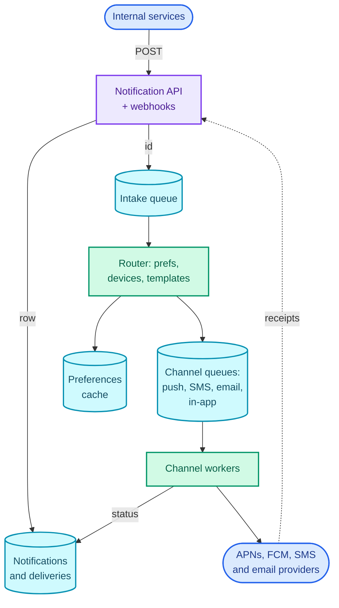
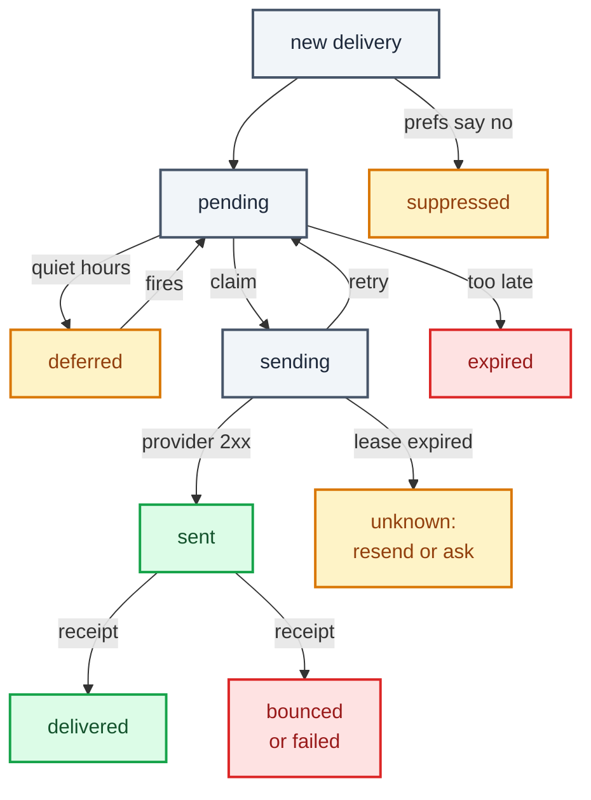
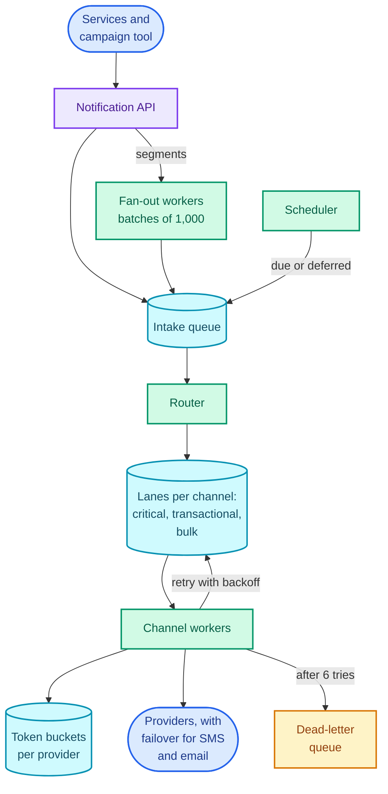

"Design a notification system that any service in the company can use to send push notifications, SMS, email and in-app messages to users." That's the question, and it sounds like plumbing: take a request, call Apple or Twilio, done.

What it's really testing is **fan-out to channels with retries, under two constraints that pull against each other**. A one-time password (OTP) has to reach the provider within a couple of seconds even while a marketing campaign is pushing 50 million messages through the same pipes. And a notification, unlike a database write, can't be rolled back: once an SMS has left, a retry that sends it again is a second SMS on someone's phone and a second charge on your bill. Queues deliver at least once, providers time out after succeeding, and workers crash mid-send, so "never twice" has to be designed, not hoped for.

The pattern is the [web crawler's](/blogs/hld-web-crawler/) pipeline of durable queues with retries and a dead-letter queue, combined with the [news feed's](/blogs/hld-news-feed/) fan-out: one request becomes many messages. The [job scheduler](/blogs/hld-job-scheduler/), next, supplies the "send at 08:00 local time" piece, and the [payment system](/blogs/hld-payment-system/) reuses the idempotency argument with money instead of messages. It leans on [async processing](/blogs/system-design-async/) (queues, the dead-letter queue, idempotent consumers), [caching](/blogs/system-design-caching/) (user preferences), [the edge](/blogs/system-design-the-edge/) (rate limiting with a token bucket) and [communication](/blogs/system-design-communication/) (WebSockets and SSE for in-app delivery).

How to use this post: [the method](/blogs/hld-the-method/). Try the question cold first, then read.


You are a senior engineer interviewing me for a system design round. The question is: "Design a notification system that any service in the company can use to send push notifications, SMS, email and in-app messages to users." Run it as a realistic 45-minute interview following this structure: requirements (5 min), core entities (2 min), API (5 min), high-level design (10-15 min), deep dives (10 min).
Rules: state the question in one sentence and stop. Answer my clarifying questions the way a real interviewer would, briefly, and only what I ask. Never propose designs, components or classes yourself. If I skip a stage or run long on one, say so in one line and keep time. When I finish a stage, write one line of the note you would put on the scorecard, then move on.
Once my design is in place, probe it with these, one at a time, waiting for my answer each time: 1. Marketing launches a campaign to 50 million users. At the same moment a user requests a login code. How long does the code take to arrive in your design, and why? 2. A worker sends an SMS, then crashes before recording that it did. What happens when the message is redelivered? Can you make duplicates impossible? 3. The caller's HTTP request times out and it retries. How do you avoid creating the notification twice? 4. Your SMS provider starts timing out on a third of requests. What does your system do? 5. How do you send a campaign to 50 million users without overrunning the push provider's quota, and how do you respect each user's quiet hours? 6. How do you know whether a notification was actually delivered?
At the end, grade me as hire / lean hire / lean no hire / no hire for a senior engineer, with the two strongest and two weakest moments, and the one thing to fix first.



## Requirements

### Functional

1. Internal services should be able to send a notification to one user or to a segment of users, naming a template, the data to fill it, a category and a priority, either now or at a scheduled time. The system decides which channels to use.
2. Users should be able to choose which categories reach them on which channels, set quiet hours, and unsubscribe.
3. Users should be able to read their in-app notifications (an inbox), and senders should be able to see each notification's delivery status per channel.

Below the line (out of scope):

- **The delivery networks themselves.** Push goes through APNs (Apple Push Notification service) and FCM (Firebase Cloud Messaging), SMS through an aggregator such as Twilio, email through a provider such as Amazon SES. We call them; we don't build them.
- **Campaign authoring and segmentation.** A marketing tool builds the audience; we receive a segment ID that resolves to user IDs.
- **Content experiments** (A/B tests of copy) and open or click analytics beyond delivery status.
- **Chat messages.** Real-time conversations are the [WhatsApp](/blogs/hld-whatsapp/) question; this is one-way notification.

### Non-functional

- **Latency by priority.** Critical (OTPs, security alerts) handed to the provider in under 2 seconds at p99 (for 99 of every 100 messages), *even during a campaign*. Transactional (order shipped) under 30 seconds. Bulk (campaigns) within the campaign's window, which can be hours.
- **No duplicate sends.** A retried request, a redelivered queue message or a crashed worker must not produce a second SMS or email. Internally everything is at-least-once; duplicates are removed before the provider call. (Exactly-once to a third party isn't achievable; deep dive 3 says how close you get.)
- **Nothing silently lost.** Every accepted notification ends in a recorded final state: sent, delivered, failed with a reason, suppressed by preferences, or expired. Durability over availability for the intake: if we can't store a request, we refuse it with a 5xx so the caller retries.
- **Preferences honoured.** An opt-out takes effect within a minute, and bulk sends respect quiet hours and a per-user cap (say, at most 3 marketing notifications a day). Preference reads can be eventually consistent (AP) for categories, with the minute bound as the limit.
- **Scale:** 1 billion notifications a day, campaigns of 50 million recipients.

### Capacity estimate

Assume 100 million daily active users receiving about 10 notifications each, across all channels.

- **Average rate:** 100,000,000 × 10 = 1,000,000,000 a day ÷ 86,400 s = **11,574 a second**. With a 3× daily peak, about 35,000 a second. That's a horizontally scaled worker fleet behind queues, not anything exotic.
- **The provider ceiling.** FCM's HTTP v1 API has a default quota of 600,000 messages a minute per project ([Firebase docs](https://firebase.google.com/docs/cloud-messaging/throttling-and-quotas)), which is 10,000 a second. A 50-million-user campaign at the full quota takes 50,000,000 ÷ 10,000 = 5,000 seconds, **83 minutes**, and during those 83 minutes the campaign is using every token an OTP push would need. This one number is why the design has priority lanes *and* a per-provider rate limiter with a reserved share (deep dive 1).
- **Duplicates cost money.** At 10 million SMS a day, a 1% duplicate rate is 100,000 extra SMS a day, each one billed and each one a confused user. So dedup isn't a nicety.
- **Storage:** about 500 bytes per notification record, so 1,000,000,000 × 500 B = 500 GB a day, 45 TB for 90 days of history. The inbox and status queries are "by user, newest first", so that's a wide-column store partitioned by user, not a single relational table.
- **Preferences:** 200 million registered users × about 1 KB = 200 GB, read once per notification at 11,574 a second. Small enough to keep in a Redis cluster in front of the database.

## Core entities

- **Notification:** one request from a sender: recipient (user or segment), template, data, category, priority, optional send time, idempotency key.
- **Delivery:** one attempt to reach one address on one channel (a device token, a phone number, an email address), with its own status and provider message ID. One notification usually has several.
- **Template:** the message text per channel and per language, with placeholders.
- **Preference:** per user: which categories on which channels, quiet hours, time zone, unsubscribes.
- **Device:** a user's push token for one app install, per platform.

## API

Senders are internal services, authenticated by their own service tokens; users are authenticated by theirs. Neither is ever taken from the body.

```text
POST /notifications
  headers: Authorization: Bearer <service token>
           Idempotency-Key: order-7781-shipped
  body: { "to": { "userId": "u_42" },             // or { "segmentId": "seg_spring_sale" }
          "template": "order_shipped", "data": { "orderId": "7781", "eta": "Fri" },
          "category": "orders", "priority": "transactional",   // critical | transactional | bulk
          "sendAt": null, "expiresAt": "2026-11-27T10:05:00Z" }
  -> 202 { "notificationId": "n_9c1e" }

GET  /notifications/{id}
  -> 200 { "status": "partially_delivered",
           "deliveries": [ { "channel": "push", "status": "delivered" },
                           { "channel": "email", "status": "bounced" } ] }

GET  /me/inbox?cursor=...            -> in-app notifications, newest first
POST /me/inbox/{id}/read
PUT  /me/preferences                 { "orders": ["push","email"], "marketing": [],
                                       "quietHours": { "from": "22:00", "to": "08:00" },
                                       "timeZone": "Asia/Kolkata" }
POST /me/devices                     { "platform": "ios", "token": "..." }

POST /webhooks/{provider}            delivery receipts from providers (signed)
```

`202 Accepted` is deliberate: the API promises the notification is stored and will be processed, not that it has been delivered.

## High-level design

### 1. Services send a notification

A request arrives at the **notification API** (the gateway). It checks the caller may use that template and category, writes a row to the **notifications store**, and puts the notification ID on an **intake queue**, then returns `202`. Storing before queueing is what makes "nothing silently lost" hold: the row exists before anything else can go wrong.

A **router** consumes the intake queue. For each notification it looks up the user's preferences and devices, decides the channels (category `orders` with preferences `push, email` and two devices gives three deliveries), renders each channel's template in the user's language, and writes one message per delivery onto a **channel queue**: push, SMS, email or in-app. **Channel workers** consume their queue and call the provider.

```text
notifications  notification_id (PK) | sender | to | template | data | category
               | priority | send_at | expires_at | status
deliveries     delivery_id (PK) | notification_id | channel | address
               | status | attempts | provider_msg_id | updated_at
```

The split between router and channel workers is the pipeline idea from the crawler: the router does fast lookups, channel workers wait on slow third parties, and each scales by its own bottleneck. It also isolates failures: an SMS provider outage fills the SMS queue and nothing else.

A scheduled notification (`sendAt` in the future) is stored with its time and isn't queued; a scheduler puts it on the intake queue when it's due. That's the whole of the [next part](/blogs/hld-job-scheduler/); here it's a box.

### 2. Users set preferences

`PUT /me/preferences` goes to a **preference service** that writes to its database and updates a Redis cache. The router reads the cache on every notification, so the opt-out-within-a-minute requirement becomes "the cache is updated on write, and entries expire within a minute as a backstop".

```text
preferences   user_id (PK) | channels_by_category | quiet_from | quiet_to
              | time_zone | unsubscribed_all
devices       user_id (PK), device_id (SK) | platform | push_token | last_seen
```

Every marketing email carries an unsubscribe link and a `List-Unsubscribe` header that goes straight to this service; Gmail and Yahoo have required one-click unsubscribe from bulk senders since 2024 (recalled from their sender requirements).

### 3. Users read their inbox; senders see delivery status

The **in-app worker** writes the rendered notification into an **inbox** table partitioned by user and sorted newest first, which is exactly the query `GET /me/inbox` runs. If the user has the app open, the worker also pushes it over the user's WebSocket or server-sent events connection (the [WhatsApp part](/blogs/hld-whatsapp/) covers routing to the right connection); if not, the inbox has it when they next open the app.

```text
inbox   user_id (PK), created_at#notification_id (SK) | title | body | read_at
```

Status comes from two places. Channel workers record `sent` with the provider's message ID when the provider accepts. Providers then report what happened next through webhooks: SES publishes delivery, bounce and complaint events, and Twilio calls a status callback with states such as `delivered`, `undelivered` and `failed`. A **webhook receiver** (behind the same gateway) maps the provider's message ID back to the delivery and updates its status. APNs only confirms that Apple accepted the push, not that it was shown; open tracking, if wanted, comes from the app.

Here is the assembled design. Follow one notification down the middle: API, intake queue, router, channel queues, workers, providers. The store on the left is the record every step updates, the cache under the router is what it reads per notification, and the dotted line is the receipts coming back.



It works, and it has four holes the deep dives fill. One queue per channel puts an OTP behind a campaign (deep dive 1). A segment of 50 million users arrives as one request (deep dive 2). Redelivered messages and retried requests send twice (deep dive 3). And a failing provider has nowhere to send its failures (deep dive 4).

## Deep dives

### 1. Priority: an OTP during a 50-million-user campaign

This is the latency requirement: critical in under 2 seconds p99 while bulk is running.

**Bad: one queue per channel, first in, first out.** The campaign's fan-out writes 50 million push messages to the push queue in a few minutes. A user taps "send me a code" one minute in, and their OTP joins the back of the queue. The workers drain it as fast as FCM allows, 10,000 a second, so the OTP waits behind about 49 million messages: 4,900 seconds, over 80 minutes. The login code arrives an hour after the user gave up.

**Good: separate queues per priority, with their own workers.** Each channel gets three queues, `push.critical`, `push.transactional` and `push.bulk`, and each has a dedicated worker pool. The critical queue is nearly always empty, so an OTP is picked up within milliseconds of arriving, however deep the bulk queue is. This fixes queueing delay and it's what most candidates reach.

It misses that all three pools call the same provider with the same quota. FCM gives the project 10,000 messages a second. The bulk workers, sized to finish the campaign quickly, can use all 10,000; then the critical worker's call is refused with a quota error, retried, refused again. The queue was separate; the bottleneck wasn't.

**Great: priority lanes plus a per-provider rate limiter that holds capacity back.** Put a **token bucket** (a counter refilled at a fixed rate, where each send takes one token and a send with no token waits; the [edge part](/blogs/system-design-the-edge/) covers it) in front of each provider account, shared by all workers through Redis. Then give the lanes different rights to it. The plainest form is two buckets per provider account: bulk draws from one refilled at 8,000 tokens a second; critical and transactional draw from one refilled at 2,000 a second and, when that runs dry, may borrow from the bulk bucket. Bulk can never borrow back. The sketch shows the split.

<figure class="sketch"></figure>

Two thousand sends a second are always available to critical and transactional traffic, and when they don't need them, bulk can't touch them; that's the cost: a 50-million campaign takes 104 minutes at 8,000 a second instead of 83. A smarter version lends idle reserved tokens to bulk for a second at a time, which recovers most of that, at the price of a burst of OTPs briefly waiting for the next refill.

Two more moves finish it. **Pace the campaign at the source**: the fan-out (deep dive 2) produces bulk messages no faster than the bulk share drains them, so the bulk queue stays minutes deep rather than millions deep, and cancelling a campaign halfway is possible. And **send critical messages on their own provider account** where the provider allows it, a separate FCM project or a dedicated SMS sender, so the quota itself is separate. For a campaign that truly needs more than 10,000 a second, ask the provider for a quota increase; no design trick beats a bigger quota.

### 2. Fan-out: 50 million recipients, preferences and quiet hours

This is the scale requirement, plus "preferences honoured" for bulk sends.

**Bad: the router expands the segment in one go.** One notification with `segmentId` reaches one router worker, which loads 50 million user IDs and loops over them. It takes hours on one machine, holds 50 million IDs in memory, and if it crashes at user 31 million it restarts from zero and sends 31 million duplicates (or none, depending on how it's written).

**Good: a fan-out service that pages through the segment in batches.** The segment is read 1,000 user IDs at a time, and each page becomes one batch message on a fan-out queue: 50,000,000 ÷ 1,000 = 50,000 batches. Fan-out workers take a batch, expand it into 1,000 per-user notifications, and hand them to the router. Each batch is a unit of retry: a crash redoes one batch, and the dedup key of `campaign_id + user_id` (deep dive 3) makes redoing it harmless. Batches let the expansion run on many machines at once.

**Great: decide per user inside the batch, with bulk reads, and pace it.** Per-user decisions are cheaper in bulk. A fan-out worker reads 1,000 users' preferences in one `MGET`, filters out the opted-out, checks the daily marketing cap with an `INCR cap:{user}:{date}` that expires at midnight (a fourth marketing message in a day is suppressed, with status `suppressed`), and applies quiet hours. Then it releases messages at the pace the provider share allows, from deep dive 1.

Quiet hours are a time-zone problem, and it's easier to see than to describe. The sketch shows one campaign launched at 20:00 UTC meeting three users whose quiet hours are 22:00 to 08:00 local time.

<figure class="sketch"></figure>

The London user is mid-evening and gets it now. The Mumbai user is at 01:30 and the Sydney user at 07:00, so both are deferred to 08:00 their time, which is 02:30 UTC and 21:00 UTC. A deferred notification is handed to the scheduler with its new time, and when it fires it goes back through the router, which re-checks preferences, since the user may have unsubscribed overnight.

One alternative to know: FCM offers **topic messaging**, where devices subscribe to a topic and one API call reaches every subscriber, with the provider doing the fan-out. It's the fastest way to reach millions, and it gives up everything per-user: no preferences, no caps, no quiet hours, no per-user status. Fine for "breaking news to everyone who follows this team"; wrong for marketing to consented users.

### 3. Never twice: idempotency from the API to the provider

This is the no-duplicates requirement, and it has three separate sources of duplicates, each needing its own fix.

1. **The caller retries.** The `POST` succeeded but the response was lost, so the order service sends it again.
2. **The queue redelivers.** A worker took a message, did the work, and died before acknowledging it, so the queue hands it to another worker.
3. **We retry after an ambiguous provider failure.** The SMS provider timed out, but it had sent the message.

**Bad: trust the queue and the caller.** Every one of the three becomes a duplicate SMS, email or push. At the volumes in the estimate, a 1% duplicate rate is 100,000 extra SMS a day.

**Good: an idempotency key at the API.** The caller sends `Idempotency-Key: order-7781-shipped`. The API writes the key with the new notification ID under a unique constraint (or `SET key id NX EX 86400` in Redis, set only if absent, expiring in 24 hours). A retry finds the key and gets the original `notificationId` back with nothing created. That closes source 1, and only source 1.

**Great: a deterministic delivery ID and a small state machine per delivery, checked before every send.** Each delivery's ID is derived, not random: a hash of `notification_id + channel + address`. However many times the router or fan-out runs, the same delivery gets the same ID, and its row is created once. A channel worker then moves it through states with conditional writes:

1. **Claim:** update `pending → sending`, setting a lease that expires in, say, 30 seconds, *only if* the status is still `pending` (or `sending` with an expired lease). If the update matches no row, someone else has it or it's done; acknowledge and move on.
2. **Call the provider.**
3. **Record:** update `sending → sent` with the provider's message ID.
4. **Acknowledge** the queue message.

The sketch places the three crash points that matter on those four steps.

<figure class="sketch"></figure>

A crash before the provider call (A) is safe: the lease expires and the next worker sends. A crash after recording `sent` (C) is safe: the redelivered message finds `sent` and is skipped. That closes source 2 apart from one gap, B: the provider accepted the message and the worker died before writing `sent`. No design removes B completely, because the provider and our database don't commit together. The aim is to keep it to the milliseconds between a provider's response and one database write, and to decide per channel what happens when a lease expires on a delivery stuck in `sending`:

- **Push and in-app:** resend. A duplicate push is cheap, and both APNs (`apns-collapse-id`) and FCM (`collapse_key`) can collapse repeated notifications with the same key into one on the device.
- **OTP SMS:** resend. The user is waiting, and a second code is better than none.
- **Marketing SMS and email:** if the provider can look the message up by a reference we attached, ask it; otherwise mark the delivery `unknown` and don't resend. A missed marketing message costs less than a duplicate.

Source 3 is the same gap seen from the other side: a timeout from the provider is ambiguous, so treat it as B, not as a plain failure. You can't count on the provider deduplicating a retried send for you, so the decision has to be ours.

Every delivery's life fits on one diagram. Each box is a status in the `deliveries` table ("too late" means past `expiresAt`); green ends are success, red are ends where nothing reached the user, amber are the ones that wait or need a decision.



### 4. Failures: retries, a failing provider, and the dead-letter queue

This is the "nothing silently lost" requirement. Provider errors come in kinds, and each kind gets its own handling.

- **Retryable:** timeouts, 5xx responses, 429 (rate limited, often with `Retry-After`). Try again later.
- **Permanent for this address:** APNs answers 410 for a device token that is no longer active, FCM answers `UNREGISTERED`, an email hard-bounces, a phone number is invalid. Retrying is pointless; the fix is to delete the device token or add the address to a suppression list so nobody sends to it again. Complaints (a user marking email as spam) go on the suppression list too.
- **Permanent for this message:** a template that fails to render for this data. That's a bug, and it goes to the dead-letter queue.

**Bad: retry inline, immediately.** A worker that loops on a struggling provider holds its slot, multiplies the provider's load at the worst moment, and delays everything behind it.

**Good: a retry queue with exponential backoff, a deadline and a DLQ.** A retryable failure returns the delivery to `pending` and re-enqueues it with a delay that doubles each attempt (2 s, 4 s, 8 s and so on, plus random jitter so a thousand failures don't retry in lockstep), up to a maximum, say 6 attempts. Past that it goes to the **dead-letter queue** (DLQ), a queue for messages that keep failing, with an alert, so a person sees it. The deadline matters as much as the count: every notification can carry `expiresAt`, and an OTP that is still undelivered after 5 minutes is marked `expired`, not delivered late. Both APNs (`apns-expiration`) and FCM (`ttl`) accept an expiry as well, so a phone that was offline for an hour doesn't light up with a stale code.

**Great: treat the provider as a dependency that can fail as a whole, with a circuit breaker and a second provider.** If a third of SMS calls are timing out, per-message retries pile load onto a provider that's already failing. A **circuit breaker** watches each provider's error rate; past a threshold (say 20% over 30 seconds) it opens, and sends stop going to that provider for a cooling-off period, after which a few test calls decide whether to close it again (the [application layer part](/blogs/system-design-application-layer/) covers the pattern). With a second provider configured for SMS and email, the channel workers route to it while the breaker is open, so critical messages keep flowing. The trade-offs are real: two contracts, two sets of webhooks to parse, and slightly different behaviour per country, which is why many teams do it for SMS (where carrier issues are common) and not for push (where there's only one APNs).

Webhooks need the same care in reverse. Providers retry their callbacks, so the webhook receiver deduplicates by the provider's event ID, and it only moves a delivery's status forward (`sent → delivered` is allowed; `delivered → sent` from a late, out-of-order callback is ignored).

With the four deep dives in, the design has a fan-out stage, priority lanes, a rate limiter shared by the workers, a retry path and a DLQ. Read it as two paths into the router (single sends and campaigns) and three lanes out of it.



## What each level is expected to show

| Level | What a strong answer shows |
| --- | --- |
| Mid-level | A working pipeline: API stores then queues, a router applies preferences and templates, a queue and workers per channel, provider calls, status in a table, an in-app inbox. Mentions retries and a DLQ. |
| Senior | Separates priorities so an OTP isn't stuck behind a campaign, and notices the shared provider quota (10,000 a second, 83 minutes for 50 million). Has an idempotency key at the API and a per-delivery state machine for redelivery, fan-out in batches, and classifies provider errors (retry, delete token, DLQ). |
| Staff+ | Names the irreducible duplicate window between the provider call and the status write and decides per channel what to do about it. Reserves provider capacity rather than queue capacity, paces campaigns at the source, adds circuit breakers and provider failover with their costs, and covers expiry, webhook ordering and suppression lists unprompted. |

## Variants this unlocks

| Question | What changes |
| --- | --- |
| Design an OTP / two-factor service | One priority only, SMS with fallback to voice or email, short `expiresAt`, rate limits per phone number against SMS pumping fraud, and resending is the right answer to the duplicate window. |
| Design a webhook delivery platform (Stripe-style) | Channels become customer URLs. The same retry ladder, DLQ and per-destination circuit breaker; signing payloads; customers see an attempt log. Ordering per endpoint matters more. |
| Design an email marketing platform (Mailchimp) | Bulk only; the hard parts are sender reputation, bounce and complaint handling, warm-up of new sending IPs, and unsubscribe compliance. |
| Design a reminder or calendar-alert service | Almost everything is scheduled, so the [job scheduler](/blogs/hld-job-scheduler/) is the core and this pipeline is the last mile. |
| Design an alerting system (PagerDuty) | Critical-only with escalation: if not acknowledged in 5 minutes, notify the next person. Escalation is a chain of scheduled jobs; multi-provider redundancy is mandatory. |
| Design in-app notifications for a social app (likes, comments) | Mostly the inbox path; aggregation ("Asha and 12 others liked your post") replaces one notification per event, and fan-out comes from the [news feed](/blogs/hld-news-feed/) design. |

## The one-page version

- API stores the notification, then queues it, then returns 202; an `Idempotency-Key` makes caller retries return the same ID.
- Router: preferences (Redis cache, opt-out within a minute), devices, templates per language; one delivery per channel and address.
- 1 billion a day is 11,574 a second, 35,000 at peak; history is 500 GB a day in a store partitioned by user.
- Each channel has critical, transactional and bulk lanes with their own workers.
- A token bucket per provider account holds back a share (2,000 of FCM's 10,000 a second) that bulk can't use; campaigns are paced at the fan-out.
- Segments fan out in batches of 1,000: bulk preference reads, a daily marketing cap, quiet hours by time zone, deferred sends handed to the scheduler.
- Delivery ID = hash of notification, channel and address; claim `pending → sending` with a lease, call the provider, record `sent`, then ack.
- The gap between the provider accepting and `sent` being written can't be closed; resend push and OTPs, don't resend marketing.
- Retry with exponential backoff and jitter, stop at `expiresAt` or 6 attempts, then the DLQ; delete dead tokens, suppress bounced addresses.
- Circuit breaker per provider, failover to a second SMS and email provider.
- Webhook receipts update status forward only, deduplicated by event ID.

**Reserve provider capacity for the messages that can't wait, and give every delivery a deterministic ID and a claim-send-record sequence, so the only duplicates left are the ones you chose.**


You are my system design interview coach. I have studied the design of a notification system (push, SMS, email, in-app) for about 1 billion notifications a day. Ask me the questions below one at a time. After each, wait for my answer. Judge it against the key points listed for that question: say which points I hit, which I missed, and correct anything wrong in two or three sentences. If I am stuck, give a small hint first, then a bigger one, and only then the answer. Never reveal the key points before I have answered.
1. A campaign to 50 million users is running when a user requests an OTP. What does your design do? Key points: a single FIFO per channel puts the OTP behind the campaign; at FCM's default 10,000 messages a second, 50 million takes about 83 minutes; separate priority queues with their own workers fix queueing delay; but all lanes share the provider quota, so a per-provider token bucket must reserve capacity (for example 2,000 of 10,000 a second) that bulk cannot use; pace the campaign at the fan-out; a separate provider account for critical traffic where possible.
2. Where can duplicates come from, and what removes each? Key points: caller retries, fixed by an Idempotency-Key stored with a unique constraint or SET NX with a TTL; queue redelivery, fixed by a deterministic delivery ID and a conditional claim from pending to sending with a lease, skipping anything already sent; ambiguous provider timeouts; the gap between the provider accepting and the worker recording sent cannot be closed, only kept to milliseconds; decide per channel: resend push (collapse keys) and OTPs, do not resend marketing.
3. How do you send to a 50-million-user segment? Key points: page through the segment in batches of about 1,000, so 50,000 batch messages; each batch is a retry unit; dedup key campaign plus user makes redoing a batch harmless; bulk-read preferences; enforce a daily marketing cap with a Redis counter; apply quiet hours per time zone and defer to the scheduler; release at the pace the provider share allows; topic messaging is faster but loses per-user preferences and status.
4. The SMS provider times out on a third of requests. What happens? Key points: classify errors; retry with exponential backoff and jitter up to a maximum and an expiry; a circuit breaker per provider opens on error rate and stops sending; fail over to a second provider for critical traffic; timeouts are ambiguous and must be treated like the duplicate window, not a clean failure; after the limit, the dead-letter queue with an alert.
5. How do you know a notification was delivered, and what do you do with permanent failures? Key points: sent means the provider accepted; delivery comes from provider webhooks (SES delivery, bounce and complaint events, Twilio status callbacks); APNs confirms acceptance only; webhooks are retried by providers, so dedupe by event ID and only move status forward; APNs 410 or FCM UNREGISTERED means delete the token; hard bounces and complaints go to a suppression list.
6. Why does the API store the notification before queueing it, and why return 202? Key points: nothing silently lost, the row exists before anything else can fail; if the store is down, refuse with a 5xx so the caller retries; 202 promises acceptance, not delivery; status is queried later.
At the end, tell me which two answers were weakest and what to re-read.



Next: [Design a distributed job scheduler](/blogs/hld-job-scheduler/), the "send at 08:00 local time" box from this design opened up: finding due jobs among billions, worker leases, and running each job at least once without running it twice.
