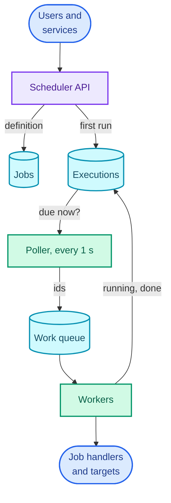
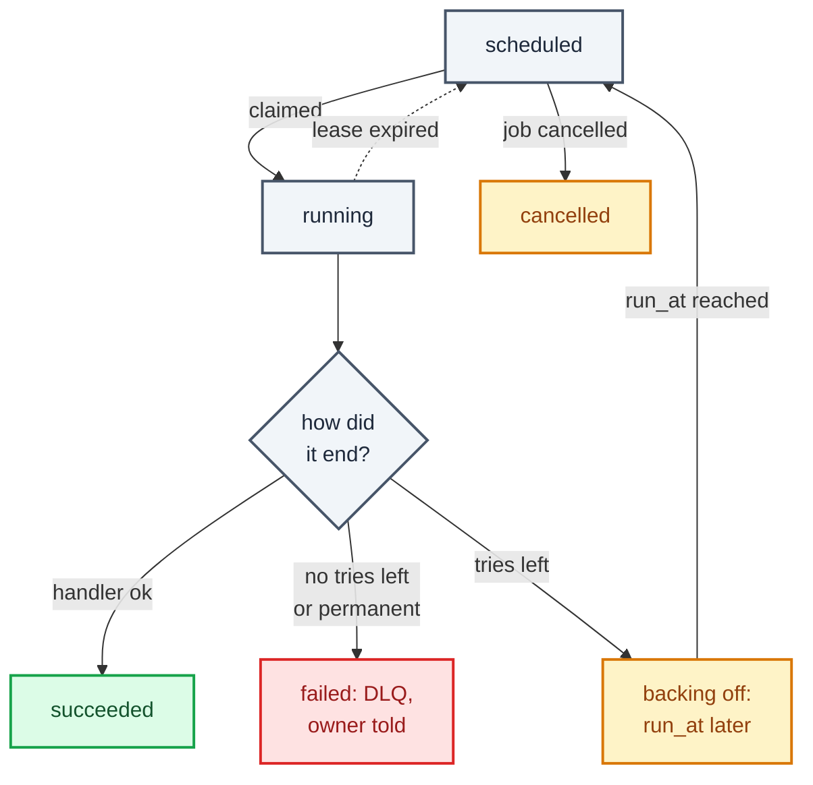
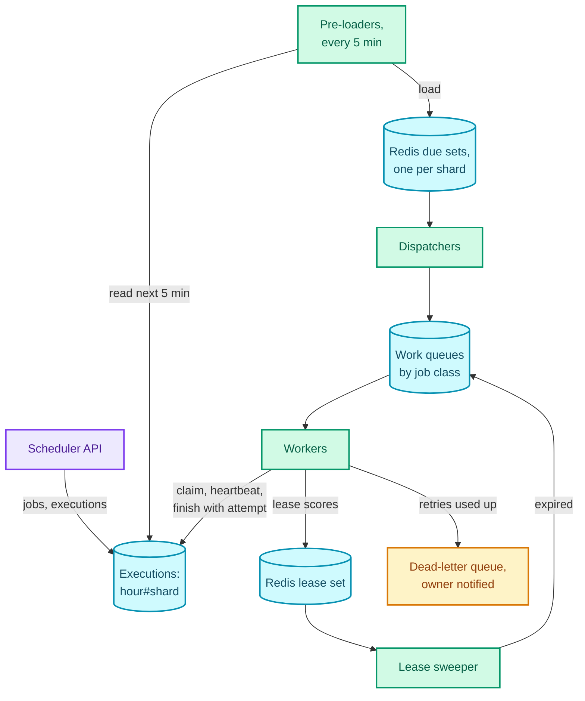

"Design a distributed job scheduler. Users submit jobs that run once at a given time or repeatedly on a cron schedule, and the system runs them." That's the question. The interviewer usually adds a number when asked: 10,000 executions a second at peak.

It tests two things, and both are about time. The first is **finding what's due**: billions of executions are scheduled for the future, a few thousand fall due every second, and the system has to find exactly those without scanning the rest. The second is **managing long-running tasks**: a job can run for an hour on a machine that might die at minute 40, and the scheduler has to notice, run it again, and make sure the machine that died (and wasn't really dead, only paused) can't later report a result over the top of the new run. A **lease**, a claim that expires unless renewed, is the answer to the second, and it's the idea this part leaves you with.

This is the "long-running tasks" pattern, and it reaches well beyond schedulers. [YouTube's transcoding](/blogs/hld-youtube/) jobs, the [notification system's](/blogs/hld-notification-system/) deferred sends and the [web crawler's](/blogs/hld-web-crawler/) recrawls all need "run this later, reliably, once-ish", and the [payment system](/blogs/hld-payment-system/) after this leans on the same idempotency argument. It uses [async processing](/blogs/system-design-async/) (task queues, visibility timeouts, the dead-letter queue), [sharding and consistent hashing](/blogs/system-design-databases-relational/) (why a time-range partition takes every write), [caching](/blogs/system-design-caching/) (Redis), and [CAP and consensus](/blogs/system-design-cap-consistency/) (why "who owns this?" needs a strongly consistent answer).

How to use this post: [the method](/blogs/hld-the-method/). Try the question cold first, then read.


You are a senior engineer interviewing me for a system design round. The question is: "Design a distributed job scheduler. Users submit jobs that run once at a given time or repeatedly on a cron schedule, and the system runs them. Peak load is 10,000 executions a second." Run it as a realistic 45-minute interview following this structure: requirements (5 min), core entities (2 min), API (5 min), high-level design (10-15 min), deep dives (10 min).
Rules: state the question in one sentence and stop. Answer my clarifying questions the way a real interviewer would, briefly, and only what I ask. Never propose designs, components or classes yourself. If I skip a stage or run long on one, say so in one line and keep time. When I finish a stage, write one line of the note you would put on the scorecard, then move on.
Once my design is in place, probe it with these, one at a time, waiting for my answer each time: 1. Billions of executions are stored for the future. How exactly does your system find the ones due in the next second, and what does that query cost? 2. A worker running a two-hour job loses power at minute 40. How long until someone notices, and what happens next? 3. That worker was not dead, only paused for a minute, and now it tries to report success. What stops it overwriting the new attempt? 4. Can you guarantee a job runs exactly once? If not, what do you tell the people writing jobs? 5. At 10,000 executions a second, where is the hot spot in your storage and how do you remove it? 6. A cron job runs every 5 minutes and sometimes takes 7. What happens, and what happens to the runs missed during a 30-minute outage?
At the end, grade me as hire / lean hire / lean no hire / no hire for a senior engineer, with the two strongest and two weakest moments, and the one thing to fix first.



## Requirements

### Functional

1. Users should be able to schedule a job to run once at a given time, or repeatedly on a cron expression in a chosen time zone, with a payload and a retry policy.
2. The system should run each job at its scheduled time, retrying failures as the policy says.
3. Users should be able to see a job's status and its execution history, and pause, resume or cancel it.

Below the line (out of scope):

- **Dependencies between jobs** (run B after A succeeds). That's a workflow engine such as Airflow; it sits on top of this design and appears in the variants.
- **Running untrusted code.** Jobs are handlers registered by internal teams or container images from our own registry; sandboxing arbitrary code is its own problem.
- **Sub-second precision.** "Within two seconds" is the promise; a trading system needing milliseconds wants a different design.
- **Multi-region active-active.** One region, spread across availability zones.

### Non-functional

- **On time: an execution starts within 2 seconds of its scheduled time, p99** (99 of every 100 runs), under normal load.
- **Throughput: 10,000 executions a second at peak**, with billions of executions scheduled ahead.
- **At least once, never silently skipped.** Every due execution runs, or ends in a recorded failure. Running twice is possible after a crash, so every run carries an idempotency key the job can use. Claiming an execution needs a strongly consistent answer (CP): two workers must never both believe they hold the same attempt.
- **Failure noticed fast: a dead worker's job is retried within about 30 seconds**, whether the job was meant to take 2 seconds or 2 hours.
- **Durable:** an accepted job survives the loss of any machine or availability zone.

### Capacity estimate

- **Executions a day**, if peak were sustained: 10,000 × 86,400 = 864 million. At about 200 bytes an execution record, that's 173 GB a day, 5.2 TB for 30 days of history. More than one comfortable database node, so the executions store is partitioned.
- **Writes per second:** each execution is created, claimed and completed, so 3 writes, 30,000 a second. Two of those three, the claim and the completion, happen *now*, so they land on whatever partition holds "now": 20,000 a second. A DynamoDB partition takes at most 1,000 write units a second ([AWS docs](https://docs.aws.amazon.com/amazondynamodb/latest/developerguide/bp-partition-key-design.html)), so a partition key of "this hour" would throttle at 20 times its limit. This number shapes the schema (deep dive 4).
- **Jobs running at once.** By Little's law (items in a system = arrival rate × time each spends there), 10,000 a second × an average of 2 seconds = 20,000 executions in flight. At 100 concurrent jobs per worker machine, that's 200 workers, more for the long tail.
- **What's due soon:** the next 5 minutes hold 10,000 × 300 = 3 million executions. At about 100 bytes each in a sorted set, 300 MB, which fits in one Redis node's memory. That's what makes the two-layer design in deep dive 1 possible.

## Core entities

- **Job:** what to run and when: owner, handler or image, payload, schedule (a time, or a cron expression with a time zone), retry policy, timeout, overlap policy, status (active, paused, cancelled).
- **Execution:** one scheduled run of a job: its scheduled time, status, attempt number, the worker holding it and its lease expiry, and the result. A one-off job has one execution; a cron job gets a new one per run.
- **Worker:** a machine that runs executions and renews their leases while it does.

Keeping job and execution separate is the first thing to get right. The job is the definition, changed rarely. The execution is the run, written three times in seconds. Mixing them forces every run to rewrite the definition and loses the history.

## API

```text
POST /jobs
  headers: Authorization: Bearer <token>       // owner comes from the token
           Idempotency-Key: nightly-invoices-v1
  body: { "name": "nightly-invoices", "handler": "billing.generate_invoices",
          "payload": { "region": "IN" },
          "schedule": { "cron": "0 2 * * *", "timeZone": "Asia/Kolkata" },
                   // or { "at": "2026-12-01T09:00:00Z" }
          "retry": { "maxAttempts": 5, "baseDelaySeconds": 30 },
          "timeoutSeconds": 3600, "overlap": "forbid" }
  -> 201 { "jobId": "j_5d0a", "nextRunAt": "2026-11-30T20:30:00Z" }

GET    /jobs/{jobId}                         -> definition, status, nextRunAt
GET    /jobs/{jobId}/executions?cursor=...   -> runs, newest first
PATCH  /jobs/{jobId}   { "status": "paused" }   // or "active"
DELETE /jobs/{jobId}

Worker-facing (internal):
POST /executions/{id}/heartbeat  { "attempt": 2 }  -> 200, or 409 if no longer yours
POST /executions/{id}/complete   { "attempt": 2, "result": "succeeded" }
```

The `attempt` in the worker calls isn't decoration; deep dive 2 is about why every worker write has to carry it.

## High-level design

### 1. Users schedule a job

`POST /jobs` reaches the **scheduler API** (the gateway). It writes the job definition to a **jobs table**, computes the first run time (the `at` time, or the cron expression's next match after now, in the job's time zone), and writes the first **execution** row with status `scheduled`.

```text
jobs        job_id (PK) | owner | handler | payload | schedule | time_zone
            | retry_policy | timeout_s | overlap | status
executions  execution_id (PK) | job_id | run_at | status | attempt
            | worker_id | lease_until | started_at | finished_at | result
```

Jobs are small and few relative to executions (millions, not billions), and they're read by ID; any replicated relational or key-value store holds them.

### 2. The system runs each job on time

The simplest working version polls. A **poller** wakes every second and asks the executions store for everything with `status = scheduled` and `run_at <= now`, using an index on `(status, run_at)`. Each due execution goes onto a **work queue**. **Workers** take executions off the queue, set them to `running`, run the handler, and set `succeeded` or `failed`. A failed execution with attempts left is rescheduled: same row, `status = scheduled`, `run_at = now + backoff`.

For a cron job, the poller also creates the *next* execution when it dispatches the current one (deep dive 5 explains why at dispatch, not at completion).

### 3. Users see status and history

`GET /jobs/{id}/executions` is a query by `job_id`, newest first, so the executions store needs an index on `(job_id, run_at)` alongside the one the poller uses. Pause sets the job's status; the poller skips executions of paused jobs (it reads the job's status before dispatching), and cancel also deletes the job's future executions.

Here is that first design. Read it top to bottom: the API writes rows, the poller reads the due ones, and the queue and workers turn them into runs; the edge back up from the workers is the status update.



It runs jobs. It doesn't yet hold up: one database answering "what's due?" every second while taking 30,000 writes a second (deep dive 1), a worker that dies leaves its execution `running` forever (deep dive 2), retries are vague (deep dive 3), "now" is one hot spot in the store (deep dive 4), and cron has edge cases (deep dive 5).

## Deep dives

### 1. Finding due executions among billions

The on-time requirement says an execution starts within 2 seconds of `run_at`, at 10,000 a second.

**Bad: scan for due jobs, or keep timers in memory.** Without an index on `run_at`, the poller's query reads every row each second, billions of rows to find thousands. The other tempting version keeps one in-process timer per job on a scheduler machine; it's precise until that machine restarts and forgets every timer, and it can't hold billions of them anyway.

**Good: an indexed table and `SKIP LOCKED` pollers.** In PostgreSQL, several pollers can each run:

```sql
SELECT execution_id FROM executions
WHERE status = 'scheduled' AND run_at <= now()
ORDER BY run_at
LIMIT 500
FOR UPDATE SKIP LOCKED;
```

`FOR UPDATE` locks the rows it returns, and `SKIP LOCKED` makes another poller skip rows already locked instead of waiting for them, so pollers share the due work without blocking each other or taking the same row. This is a real, widely used design, and I'd recommend it up to a few thousand executions a second. At 10,000 a second it puts 30,000 writes a second, plus the updates to two indexes per write, on one primary database. As a rule of thumb that is beyond what one primary does comfortably, and it can't be sharded without giving up the single query.

**Great: two layers. The database holds everything; Redis holds only what's due in the next 5 minutes.** The durable store keeps every execution, partitioned by time (deep dive 4). A **pre-loader** runs every 5 minutes and copies the executions due in the next 5-minute window into a **Redis sorted set**, a set where each member has a numeric score and members can be read back in score order. The member is the execution ID; the score is `run_at` in milliseconds. A **dispatcher** loop then runs every 100 ms or so and takes everything whose score has passed. The sketch shows the layers over fifteen minutes.

<figure class="sketch"></figure>

The dispatcher's "take what's due" has to be atomic, or two dispatchers could both take the same member. A short Lua script does it, because Redis runs a script start to finish without running any other command in between:

```lua
-- KEYS[1] = due set, ARGV[1] = now in ms, ARGV[2] = batch size
local ids = redis.call('ZRANGEBYSCORE', KEYS[1], '-inf', ARGV[1], 'LIMIT', 0, ARGV[2])
if #ids > 0 then redis.call('ZREM', KEYS[1], unpack(ids)) end
return ids
```

The returned IDs go onto the work queue. The amber dot in the sketch is the edge case that catches people out: a job created at 09:07 to run at 09:08 is inside a window that was already pre-loaded at 09:05. So the API writes any execution due before the next pre-load boundary to both layers at once.

Why this holds up: the database answers one cheap query per shard every 5 minutes instead of a contended one every second; the hot "what's due right now?" question is answered from memory in microseconds; and the sorted set is 300 MB, one node. Why it's safe: Redis is not the source of truth. If it loses data, the pre-loader reloads the current window from the database, where those executions are still `scheduled`. If a member is dispatched twice (a reload after a dispatch), the claim in deep dive 2 is a conditional write in the database, so only one dispatch wins.

**An alternative to name: a delay queue.** Amazon SQS can hold a message invisible for up to 15 minutes before delivering it. The pre-loader can send each execution in the next window with a delay of `run_at − now`, and SQS delivers it when due, with no Redis and no dispatcher. It's less code and fully managed. The costs are the 15-minute cap (fine, the window is 5), slightly less control over precision, and no way to pull a message back on cancel, so workers must check the job's status before running.

### 2. Workers die: leases, heartbeats and fencing

This is the at-least-once requirement, plus "a dead worker's job retried within about 30 seconds".

**Bad: mark the execution `running` and trust the worker to finish.** If the worker dies, the row says `running` forever and the job never runs again. The usual patch is a timeout equal to the job's maximum runtime: if it's been `running` for over an hour, retry it. But then a dead worker's one-hour job waits an hour to be noticed, and a two-second job would wait as long as its timeout says.

**Good: a short lease, renewed by heartbeats.** When a worker claims an execution, it sets `lease_until = now + 30 s`. While the job runs, the worker sends a heartbeat every 10 seconds, and each one pushes `lease_until` out to 30 seconds from then. A live worker's lease never expires, whatever the job's length. A dead worker stops heartbeating, and its lease expires within 30 seconds of the last beat. Something has to notice: a **lease sweeper** keeps a second sorted set keyed by `lease_until` (heartbeats update the score) and re-queues any execution whose lease has passed. SQS offers the same thing built in: the visibility timeout is the lease, and `ChangeMessageVisibility` is the heartbeat (up to 12 hours in total per message).

The claim itself is a conditional write, which is where the strong consistency lives:

```text
UPDATE executions
SET status = 'running', attempt = attempt + 1,
    worker_id = 'w-17', lease_until = now() + 30 s
WHERE execution_id = 'e_77'
  AND (status = 'scheduled' OR (status = 'running' AND lease_until < now()))
```

If it changes one row, this worker owns the new attempt. If it changes none, someone else does; drop the message. In DynamoDB the same thing is a conditional `UpdateItem`.

The hole is a worker that *isn't* dead. A long garbage-collection pause, a stalled VM, a network partition: the worker stops heartbeating for a minute while still believing it holds the job. Its lease expires, another worker claims a second attempt, and then the first one wakes up and writes "succeeded" over the second attempt's row, or worse, repeats a side effect.

**Great: fencing tokens, so a stale worker's writes are refused.** The attempt number is a **fencing token**: a number that goes up every time ownership changes, carried on every write the holder makes. The sketch shows the case above: A freezes, its lease runs out, B claims attempt 2, and A's late write fails the check.

<figure class="sketch"></figure>

Every write a worker makes includes `AND attempt = <mine>`: heartbeats, completion, retry scheduling. A's completion for attempt 1 matches no row, the API answers 409, and A abandons the job. Heartbeats returning 409 are also how a worker learns early that it has lost the job and should stop. Fencing protects writes that go through the scheduler. For side effects elsewhere, the target system has to check something too, which is deep dive 3's idempotency key. (Fencing tokens as the fix for expired locks is the argument in Martin Kleppmann's 2016 essay on distributed locking; recalled.)

The trade-off is in the numbers. A 30-second lease with 10-second heartbeats means 20,000 running executions send 2,000 heartbeats a second, which is cheap. A shorter lease notices death faster but turns every GC pause longer than the lease into a duplicate run; a longer one is safer against pauses and slower to recover. Thirty seconds tolerates two missed heartbeats.

### 3. Retries, and why "exactly once" isn't on offer

This is the "never silently skipped" requirement, plus being honest about duplicates.

A run can fail in three ways: the handler reports failure, it exceeds its `timeoutSeconds` (the worker kills it and reports a timeout), or the worker vanishes (the lease expires). The first two are reported failures; the third is detected by the sweeper. All three lead to the same decision: retry or give up.

**Bad: retry immediately, as many times as it takes.** The target that failed (an API at its rate limit, a database restarting) gets hit again at once, by every failing job together. A job that can never succeed (bad payload) retries forever and takes worker slots from jobs that could.

**Good: a fixed delay and a maximum.** Retry after 30 seconds, at most 5 times, then mark the execution `failed`. It's bounded. It still makes a thousand jobs that failed together during one outage retry together, 30 seconds later, into the same recovering service.

**Great: exponential backoff with jitter, and a retry is a rescheduled execution.** The delay before attempt n is a random number between 0 and `min(cap, base × 2^n)`, which spreads simultaneous failures across the whole interval (this "full jitter" form is from the AWS Architecture Blog's 2015 post on backoff and jitter; recalled). A retry isn't a special path: the worker sets the same execution back to `scheduled` with the new `run_at`, and it goes through pre-loader, sorted set and claim like any other execution. One mechanism, tested by every run. Handlers distinguish **retryable** failures (timeouts, 5xx from a dependency) from **permanent** ones (invalid payload), and a permanent failure skips straight to `failed`. A failed execution goes to a dead-letter queue, a queue for runs that exhausted their retries, which notifies the job's owner.

Here is every status an execution can be in. Each box is a value of `status` (the diamond is the worker's report, not a status); read from `scheduled` at the top.



Now the honest part. **The scheduler can't guarantee a job's effect happens exactly once.** A worker can finish charging a card and die before reporting success; the lease expires, and attempt 2 charges again. No amount of scheduler design fixes this, because the scheduler and the card network don't commit together. What the scheduler can do is give every run a stable key: `execution_id`, the same across all attempts of one scheduled run, passed to the handler. A handler that writes to a database upserts by that key; one that calls an external API sends it as that API's idempotency key. The contract to tell job authors is one sentence: **your job will run at least once; make running it twice harmless, using the execution ID.** The [payment system](/blogs/hld-payment-system/) is that sentence at its strictest.

### 4. Scaling to 10,000 a second: the hot "now" partition

This is the throughput requirement. The capacity estimate found the problem: claims and completions both happen at the current time, 20,000 writes a second.

**Bad: partition executions by time alone.** With partition key `hour = 2026-11-30T09`, the pre-loader's query is one partition read, which is nice, and every write in the current hour hits one partition at 20 times what a DynamoDB partition accepts. Cassandra behaves the same way in spirit: one partition key lives on one set of replicas, however big the cluster.

**Good: partition by execution ID.** Writes spread perfectly, and the pre-loader now has no way to ask for "due in the next 5 minutes" without a secondary index, and that index, keyed by time, has the same hot partition.

**Great: time bucket plus shard.** The partition key is `hour#shard`, where `shard = hash(job_id) mod 32`, and the sort key is `run_at#execution_id`. The sketch shows the layout and where the heat goes.

<figure class="sketch"></figure>

Writes for the current hour spread across 32 partitions: 20,000 ÷ 32 = 625 a second each, under the 1,000 limit with room for retries and heartbeats if they're stored there. The pre-loader's 5-minute query becomes 32 small range queries, one per shard (`hour#s`, `run_at` between the window's start and end), every 5 minutes: trivial. Future buckets take only creates. If load grows past 32 shards' worth, the shard count for future buckets goes up, since each bucket's count can be stored with it.

The rest of the pipeline scales the same way, by splitting on the shard:

- **Redis:** one sorted set per shard (`due:{shard}`), spread over a few Redis nodes for headroom and failover. One sorted set would fit; 32 small ones remove the single node and let dispatchers work in parallel.
- **Pre-loaders and dispatchers:** each shard is owned by one pre-loader at a time, through a lease (the same mechanism as deep dive 2, held in Redis or etcd), so a crashed pre-loader's shards move to another in seconds. Dispatchers can overlap safely, because the Lua pop is atomic and the database claim is conditional.
- **Workers:** 20,000 in flight at 100 per machine is about 200 machines, autoscaled on the work queue's depth. Separate queues per job class (short jobs, long jobs, jobs for a particular team) stop a burst of two-hour jobs from occupying every slot while two-second jobs wait.

### 5. Cron: the next run, overlaps, missed runs and clocks

The last requirement is "repeatedly on a cron schedule", and it has four questions an interviewer likes.

**When is the next execution created?** Not when the current one completes. If it were, a job that crashes, or runs long, would delay or end its own schedule. Create the next execution when the current one is *dispatched*, and compute it from the current one's *scheduled* time, not the clock: `next = cron.next(after = this.run_at)`. Computing from "now" makes a job scheduled for 02:00 that was dispatched at 02:00:01.7 drift a little later every run.

**What if a run is still going when the next is due?** That's the job's `overlap` policy, and the three useful options are the ones Kubernetes CronJobs offer as `concurrencyPolicy`: **allow** (run both), **forbid** (skip the new run while the old one is running) and **replace** (stop the old run, start the new). A "generate invoices" job should be `forbid`; a stateless health probe can be `allow`.

**What about runs missed during an outage?** After 30 minutes down, a job that runs every 5 minutes has missed six runs. Running all six at once is rarely right. The usual policies: run once to catch up and skip the rest (the default for most jobs), run them all in order (for jobs where each run processes its own time slice), or skip anything older than a deadline (Kubernetes calls this `startingDeadlineSeconds`). It's a per-job setting, not a global one.

**Which clock, and which time zone?** "02:00 every day in Asia/Kolkata" is computed in that time zone and stored as UTC. India has no daylight saving, but `America/New_York` does, and on the night clocks go forward 02:30 doesn't happen, while on the night they go back 01:30 happens twice. Pick a rule and document it: run a skipped time at the next valid minute, and run a repeated time once. Machine clocks also drift; the dispatchers use the Redis server's time or NTP-synced hosts, and the 2-second promise leaves room for a few hundred milliseconds of skew.

With the deep dives applied, the design has a durable store sharded by time, a pre-loader feeding Redis, dispatchers, a lease sweeper and a DLQ. Follow one execution from the pre-loaders at the top down the right-hand side to the workers; the sweeper's loop at the bottom right is what catches dead workers. (The API's direct write into Redis for executions due before the next pre-load, the amber dot in the first sketch, is left off to keep the lines apart.)



## What each level is expected to show

| Level | What a strong answer shows |
| --- | --- |
| Mid-level | Separate job and execution tables, an indexed "due" query polled by workers (with `SKIP LOCKED` or a conditional claim), a queue to workers, status updates, and retries with a limit. Notices that a dead worker leaves a job stuck. |
| Senior | Leases with heartbeats so detection doesn't depend on job length, a conditional claim as the single point of strong consistency, the two-layer design (database plus Redis sorted set or a delay queue) with its edge case, backoff with jitter, and the "at least once, make it idempotent with the execution ID" contract. Computes the 20,000 writes a second on "now". |
| Staff+ | Fencing tokens for paused-not-dead workers, the bucket-plus-shard schema derived from the partition limit, ownership of shards by lease, cron semantics (next run from scheduled time, overlap and catch-up policies, DST), and job-class isolation in the worker pool, with the trade-offs of lease length stated in numbers. |

## Variants this unlocks

| Question | What changes |
| --- | --- |
| Design a workflow orchestrator (Airflow, Step Functions) | Executions gain dependencies: a run becomes a graph of tasks, each scheduled when its parents succeed. Leases, retries and idempotency carry over unchanged. |
| Design a delayed message queue (SQS delay, Kafka with delays) | The job is "deliver this message at time T": exactly this two-layer design, with the worker being a publish. |
| Design a reminder service (calendar alerts, "remind me tomorrow") | Billions of one-off executions, almost all tiny; the handler hands off to the [notification system](/blogs/hld-notification-system/). Time zones and cancellation dominate. |
| Design distributed cron for a fleet | Few jobs, strict "only one machine runs it" semantics: the lease and fencing parts carry the weight, the scale parts shrink. |
| Design a task queue (Celery-like) for long video jobs | No schedule, only "run soon"; leases with heartbeats over hours, progress checkpoints so a retry resumes rather than restarts (as in [YouTube transcoding](/blogs/hld-youtube/)). |
| Design a rate-limited batch job runner | Adds a token bucket per target (from the [rate limiter](/blogs/hld-rate-limiter/)) between dispatch and workers, so 10,000 due jobs don't hit one API at once. |

## The one-page version

- Job = definition (rarely written); execution = one run (written three times in seconds). Separate tables.
- 10,000 executions a second: 30,000 writes a second, 20,000 of them on "now"; 20,000 jobs in flight (Little's law), about 200 workers.
- Executions partitioned by `hour#shard`, shard = `hash(job_id) mod 32`: 625 writes a second per partition, under the 1,000 limit.
- Every 5 minutes, pre-loaders copy the next window into Redis sorted sets (score = `run_at`); new executions due before the next pre-load go to both layers.
- Dispatchers pop due members with an atomic Lua script and enqueue them; SQS delay messages are the managed alternative.
- Claim is a conditional write: `scheduled` (or expired lease) to `running`, attempt + 1, lease 30 s.
- Heartbeats every 10 s extend the lease; a sweeper re-queues expired leases, so a dead worker is noticed within 30 s.
- The attempt number is a fencing token: every worker write carries it and a stale one matches no row.
- Retries reschedule the same execution with exponential backoff and full jitter; permanent failures and exhausted retries go to a DLQ that tells the owner.
- At least once, never exactly once: pass `execution_id` to the handler as the idempotency key.
- Cron: create the next run at dispatch, from the scheduled time; overlap = allow, forbid or replace; a catch-up policy for missed runs; compute in the job's time zone.

**Store everything durably but serve only the next five minutes from memory, and run each execution under a renewable lease whose attempt number fences out stale workers, so every job runs at least once and the second run can always be recognised.**


You are my system design interview coach. I have studied the design of a distributed job scheduler running one-off and cron jobs at 10,000 executions a second. Ask me the questions below one at a time. After each, wait for my answer. Judge it against the key points listed for that question: say which points I hit, which I missed, and correct anything wrong in two or three sentences. If I am stuck, give a small hint first, then a bigger one, and only then the answer. Never reveal the key points before I have answered.
1. How does the system find executions due in the next second? Key points: separate job and execution tables; a full scan or in-memory timers fail; an indexed query with FOR UPDATE SKIP LOCKED works up to a few thousand a second on one primary; the strong answer is two layers: the database holds everything, a pre-loader copies the next 5-minute window into a Redis sorted set scored by run time, dispatchers pop due members atomically with a Lua script; executions created inside an already loaded window are written to both; Redis is not the source of truth; SQS delay messages (up to 15 minutes) are the managed alternative.
2. A worker running a two-hour job dies at minute 40. What happens? Key points: a timeout equal to the job length detects it too late; a short lease (30 s) renewed by heartbeats (every 10 s) detects death within about 30 s regardless of job length; a sweeper re-queues expired leases (a sorted set by lease expiry, or SQS visibility timeout); the claim is a conditional write that only one worker can win.
3. The worker was only paused and tries to report success after a new attempt started. Key points: fencing token; the attempt number increments on each claim; every worker write includes attempt equals mine; the stale write matches no row and is rejected with 409; heartbeats returning 409 tell a worker to stop; side effects outside the scheduler need the target to check an idempotency key.
4. Can you guarantee exactly once? Key points: no; a worker can complete the side effect and die before reporting; the scheduler guarantees at least once; pass a stable execution_id across attempts as an idempotency key; job authors must make a second run harmless.
5. Where is the hot spot at 10,000 executions a second and how do you remove it? Key points: claims and completions happen now, about 20,000 writes a second; a time-only partition key puts them on one partition with a limit of about 1,000 writes a second in DynamoDB; partitioning by id breaks the due query; use hour bucket plus shard (hash of job id mod 32), 625 writes a second each; the pre-loader runs one range query per shard; shards are owned by pre-loaders through leases; Redis due sets per shard.
6. How do retries work? Key points: exponential backoff with full jitter, a random delay up to min(cap, base times 2 to the attempt); retry reschedules the same execution through the normal path; retryable versus permanent failures; max attempts then failed, dead-letter queue and owner notified; job-level timeout kills runaway runs.
7. A cron job every 5 minutes sometimes takes 7, and the system was down for 30 minutes. Key points: create the next execution at dispatch, computed from the scheduled time, not completion and not now, to avoid drift; overlap policy allow, forbid or replace (as in Kubernetes concurrencyPolicy); missed runs need a catch-up policy: run once, run all, or skip past a deadline; compute schedules in the job's time zone and define behaviour for daylight-saving gaps and repeats.
At the end, tell me which two answers were weakest and what to re-read.



Next: [Design a payment system](/blogs/hld-payment-system/), where "at least once, made harmless" stops being advice to job authors and becomes the whole design: idempotency keys, a ledger and reconciliation for money that must move exactly once in effect.
