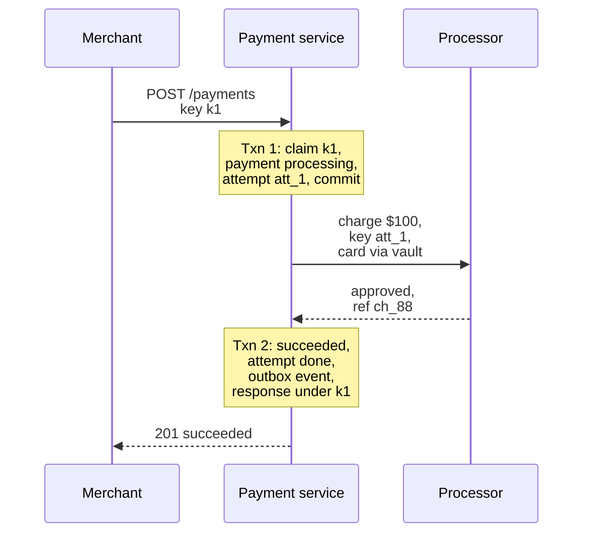
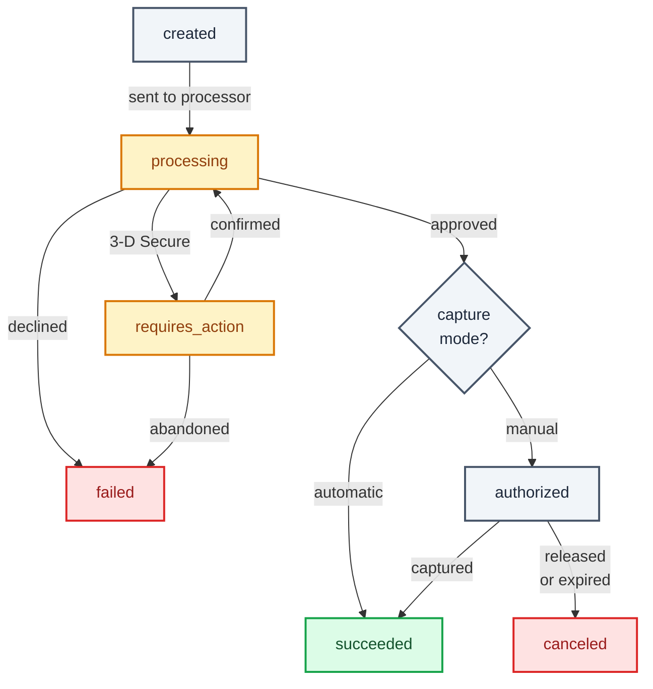
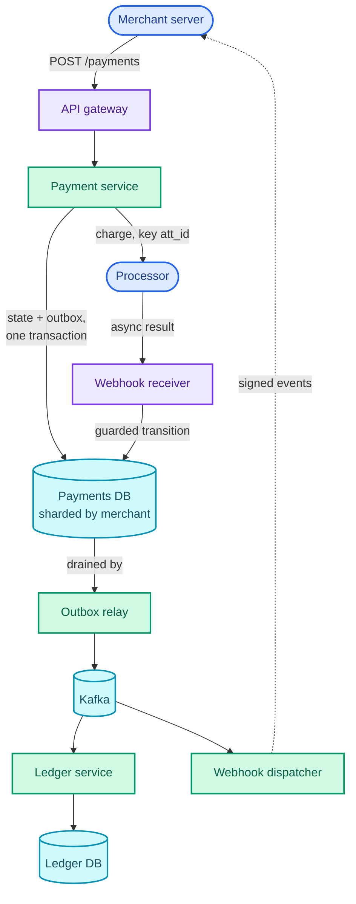
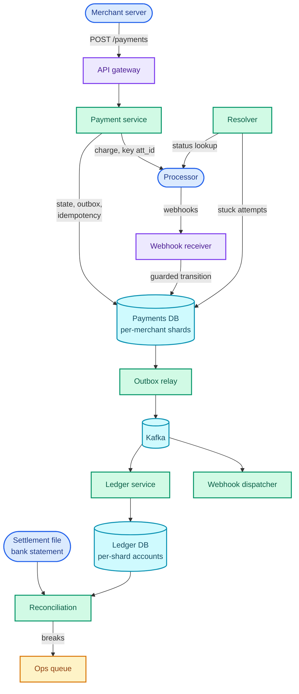

"Design a payment system like Stripe: merchants charge their customers' cards through our API."

It sounds like a CRUD service with one external call. What it is really testing is **correctness across a boundary you don't control**. Every step in a payment talks to something over a network (the merchant's server, a card processor, a bank), and any of those calls can fail *after* it did its work. The card was charged, then the reply was lost. The interviewer wants to see a design that never charges twice, never loses a charge, and can prove both to an auditor.

The pattern it teaches is **multi-step processes**: a state machine whose every transition is idempotent, an outcome that arrives later and out of order, and an audit trail that is the source of truth rather than a log of it. The same machinery runs a subscription renewal, a marketplace payout and an order checkout, and the job scheduler in [Part 15](/blogs/hld-job-scheduler/) and the notification system in [Part 14](/blogs/hld-notification-system/) already used pieces of it.

It leans on [idempotency keys, the outbox pattern and sagas](/blogs/system-design-async/), [transactions and row locks](/blogs/system-design-databases-relational/), [choosing CP for money](/blogs/system-design-cap-consistency/), and [why a ledger belongs in a relational database](/blogs/system-design-databases-nosql/).

How to use this post: [the method](/blogs/hld-the-method/). Try the question cold first, then read.


You are a senior engineer interviewing me for a system design round. The question is: "Design a payment system like Stripe: merchants charge their customers' cards through our API." Run it as a realistic 45-minute interview following this structure: requirements (5 min), core entities (2 min), API (5 min), high-level design (10-15 min), deep dives (10 min).
Rules: state the question in one sentence and stop. Answer my clarifying questions the way a real interviewer would, briefly, and only what I ask. Never propose designs, components or classes yourself. If I skip a stage or run long on one, say so in one line and keep time. When I finish a stage, write one line of the note you would put on the scorecard, then move on.
Once my design is in place, probe it with these, one at a time, waiting for my answer each time: (1) The merchant's server times out on POST /payments and retries. How do you guarantee the customer is charged once, including when two retries arrive in the same millisecond? (2) Your call to the card processor times out. Was the card charged? What does your API return, and how do you find out the truth? (3) The processor's webhook for a payment arrives twice, and an older "processing" event arrives after the "succeeded" one. What does your system do? (4) How do you record money movements so finance can prove where every cent went, and how do you fix a bug that recorded something wrong? (5) Every payment pays a fee into one platform revenue account at 3,000 payments per second at peak. What breaks, and what do you change? (6) How do you know at the end of the day that your records match the money that actually moved?
At the end, grade me as hire / lean hire / lean no hire / no hire for a senior engineer, with the two strongest and two weakest moments, and the one thing to fix first.



## Requirements

A few words first, because payments has its own vocabulary and the interviewer will use it. The **merchant** is our customer, a business that sells something. The **customer** (or cardholder) is the person paying the merchant. The **issuer** is the customer's bank, the one that issued the card and says yes or no. The **acquirer** is the bank that accepts card payments on the merchant's side, and the **card network** (Visa, Mastercard, RuPay) carries messages between acquirer and issuer. We will not talk to networks directly. We call one or more **processors** (a payment service provider or an acquirer's gateway), and they do the network side.

Two words about the money itself. **Authorisation** is the issuer agreeing to hold an amount on the card. **Capture** is asking for the held money to actually move. Most online payments do both in one call; a hotel or a marketplace may capture days later. **Settlement** is the processor depositing the money, minus its own costs, into our bank account, usually a day or more later.

### Functional

1. Merchants should be able to charge a customer's card for an amount and learn the outcome.
2. Merchants should be able to see a payment's status at any time and be notified when it changes.
3. Merchants should be able to refund a payment, in full or in part.

Below the line (out of scope):

- **Fraud and risk scoring.** A separate system we call as one step before charging; its internals are a machine learning question.
- **Merchant onboarding and identity checks (KYC).** A workflow that gates who can be a merchant, not how money moves.
- **Payouts to merchants' bank accounts.** A daily batch over the same ledger described below; I'll mention where it plugs in.
- **Disputes and chargebacks.** A customer contesting a charge adds states to the same machine and entries to the same ledger, weeks later. Worth one sentence if asked.
- **Currency conversion.** A conversion is two ledger entries and a rate; it adds nothing structural.

### Non-functional

- **No double charges, no lost charges.** Every logical payment moves money at most once, and every charge that happened is recorded. This is the requirement the whole design serves. Payment state is **CP**: during a network partition we refuse or delay a write rather than accept two versions of the truth (the trade is explained in [the CAP part](/blogs/system-design-cap-consistency/)).
- **Every cent accounted for.** Every movement of money is an immutable, balanced ledger entry, and our books are reconciled against the processor's and the bank's records every day, with each mismatch flagged within 24 hours.
- **Our overhead is small next to the processor's.** The processor's authorisation is the slow part, often a second or more (a rule of thumb, not a guarantee). Our own work adds under 300 ms p99. If the processor hasn't answered in 3 s, the API answers `processing` and the outcome follows by webhook.
- **Accepting payments is 99.99% available**, about 52.6 minutes of downtime a year (525,600 minutes × 0.0001). Dashboards and analytics can be eventually consistent and less available; nobody loses money when a chart is a minute old.
- **Acknowledged means durable.** Once we return `succeeded`, that fact survives the loss of a data centre: synchronous replication to a standby in another availability zone before the commit returns.
- **Card numbers stay in a small box.** **PCI DSS** is the card industry's security standard, and every system that touches a raw card number (the **PAN**, primary account number) is audited under it. The design keeps PANs in one vault so the rest of the system never sees one.

### Capacity estimate

Inputs, stated as assumptions: 50 million payments a day, a peak five times the average (a festival sale or Black Friday), each payment about 2 KB across all its rows and indexes, and financial records kept for 7 years (the retention period is set by regulators and varies by country).

- **Write rate.** 50,000,000 / 86,400 s ≈ 579 payments/s on average, so about 2,900/s at peak; call it **3,000/s**.
- **Row writes.** One payment writes an idempotency record (insert, then update), a payment row, an attempt row, two status updates, an outbox row, a ledger entry and about three postings: roughly 10 rows in about 4 transactions. At peak that is 30,000 row writes/s in 12,000 transactions/s. A single Postgres primary sustains a few thousand small write transactions per second comfortably (a rule of thumb that depends heavily on hardware and replication), so **one primary is not enough, and the payment store is sharded by merchant**.
- **One hot account.** Every payment pays a fee into the platform's revenue account, so that one account sees 3,000 postings/s. That number decides a deep dive on its own (the ledger, below).
- **Storage.** 50M × 2 KB = 100 GB/day, 36.5 TB/year, about 256 TB over 7 years. So recent data (say 90 days, about 9 TB) lives in the transactional shards and older data moves to cheaper columnar storage that auditors can still query.
- **Idempotency records.** Kept for 7 days at about 500 bytes each: 50M × 500 B × 7 ≈ 175 GB across all shards. Small enough to live **in the same database as the payments**, which turns out to matter.

## Core entities

- **Merchant**: who is charging, with API keys and webhook endpoint.
- **PaymentMethod**: a token (`pm_...`) standing for a card held in the vault; never the card number itself.
- **Payment**: one logical charge, with an amount, a currency and a status that moves through a state machine.
- **Attempt**: one call to a processor on behalf of a payment; a payment may have several (a retry on another processor), and the attempt's id is the key we send downstream.
- **Refund**: money going back to the customer for a payment, with its own small status machine.
- **IdempotencyRecord**: the stored outcome of a merchant request, keyed by the merchant's idempotency key.
- **LedgerEntry and Posting**: one balanced movement of money, made of postings against **Accounts** (owed to merchant, fee revenue, processor receivable, bank cash).
- **Event**: a fact about a payment ("payment.succeeded"), written to an outbox and delivered to the ledger and to merchants.

## API

Amounts are integers in the currency's minor unit (cents, paise), never floating point: 0.1 + 0.2 is not 0.3 in binary floating point, and a ledger that rounds is a ledger that leaks. The merchant is identified by the secret API key on the request, never by a field in the body.

```text
POST /v1/payments
  Idempotency-Key: 6f1c2a9e-...          (generated by the merchant, required)
  { "amount": 10000, "currency": "usd",
    "payment_method": "pm_8Kx...", "capture": "automatic" }
  -> 201 { "id": "pay_123", "status": "succeeded" | "processing"
           | "requires_action" | "failed", "next_action": { ... } }

GET  /v1/payments/{id}
  -> 200 { "id": "pay_123", "status": "succeeded", "amount": 10000,
           "amount_refunded": 2500 }

POST /v1/payments/{id}/capture             Idempotency-Key   (manual capture only)

POST /v1/payments/{id}/refunds             Idempotency-Key
  { "amount": 2500 }
  -> 201 { "id": "re_9", "status": "pending" }

POST /v1/payment_methods     called by our hosted card field in the customer's
  { card number, expiry, CVC }     browser with a publishable key, never by the merchant
  -> 201 { "id": "pm_8Kx...", "brand": "visa", "last4": "4242" }

Webhooks we send to the merchant:
  POST https://merchant.example/hooks
  Signature: t=1794717200, v1=HMAC-SHA256(secret, t + "." + body)
  { "id": "evt_77", "type": "payment.succeeded", "data": { ...payment } }
```

The idempotency key is **required**, not optional. An optional key means the double-charge hole is open by default for every merchant who didn't read the docs.

## High-level design

### 1. Charge a card

The card number never reaches the merchant's server. Our hosted card field (an iframe or SDK served from our domain) sends it from the customer's browser to a **card vault**, a small, separately audited service that stores the PAN encrypted and returns a token. The merchant's server only ever handles `pm_8Kx...`. That one decision shrinks the PCI audit from "the whole platform" to "the vault". When a charge goes out, the vault is also the component that attaches the real card details to the request to the processor, so the PAN never passes through the payment service either.

Then the merchant's server calls `POST /v1/payments`. The **API gateway** authenticates the API key, applies the merchant's rate limit (the [rate limiter part](/blogs/hld-rate-limiter/)), and forwards the request to the **payment service**. Read the sequence top to bottom: two short database transactions, and the slow processor call sitting *between* them, never inside one.



The state lands in the payments database, which is sharded by `merchant_id` (the capacity estimate's conclusion):

```text
payments          id, merchant_id, amount, currency, status, payment_method,
                  capture_mode, amount_refunded, version, created_at
attempts          id (att_...), payment_id, processor, status, processor_ref, error_code
idempotency_keys  (merchant_id, key) UNIQUE, request_hash, state, response, locked_until
outbox            id, payment_id, type, payload, published_at
```

Two choices in that flow carry most of the correctness. The attempt row is written and committed *before* the processor is called, so if our server dies mid-call, there is a durable trace that a charge may be in flight. And the attempt's id travels to the processor as *its* idempotency key, so asking again cannot charge again.

What this step leaves open: the processor's reply can be lost after the card was charged. That is the hardest question in the round, and it gets deep dive 2.

### 2. Know the outcome: status and notifications

Not every payment finishes inside the request. Some cards need **3-D Secure**, a step where the issuer asks the customer to confirm in their banking app or with a one-time code (required for most online card payments in India). Bank debits finish days later. Processors tell us about these outcomes asynchronously, by calling our **webhook receiver**.

So the payment's status is a state machine, and every component that changes a payment does so by a legal transition only. Read it from `created` down; amber states are the ones where we are waiting on someone else, the diamond is the merchant's choice of automatic or manual capture, and green and red are final.



`processing` is the state that does the most work. It means "we have asked, and we do not yet know". The `authorized` state matters for marketplaces and hotels: an authorisation hold doesn't last forever, typically about 7 days for online card payments ([Stripe's documented window](https://docs.stripe.com/payments/place-a-hold-on-a-payment-method)), after which the money is released and the payment is `canceled`.

The webhook receiver verifies the processor's signature, stores the raw event under its event id, answers `200` quickly, and applies the transition. Every transition writes an **event** into the outbox table *in the same transaction* as the status change. A **relay** process reads the outbox and publishes to Kafka, and two consumers act on it: the **ledger service** records the money, and the **webhook dispatcher** tells the merchant. (Why the outbox and not a direct publish is deep dive 3; the pattern itself is taught in [the async part](/blogs/system-design-async/).)

Outgoing webhooks are a notification system in miniature: signed, retried with exponential backoff for days, deduplicated by event id on the merchant's side. [Part 14](/blogs/hld-notification-system/) designs that machinery, and I built one end to end in [a webhook delivery engine](/blogs/webhook-delivery-engine/).

### 3. Refund a payment

`POST /v1/payments/pay_123/refunds` with `{ "amount": 2500 }` arrives with its own idempotency key. The danger is two partial refunds racing: on a $100 payment, two requests for $60 each must not both succeed.

The payment service takes a row lock on the payment (`SELECT ... FOR UPDATE`), checks `amount - amount_refunded >= 2500`, inserts the refund as `pending`, increments `amount_refunded`, writes an outbox event, and commits. The second $60 request waits on the lock, then sees $60 already refunded and $40 left, and is refused with a clear error. This is a pessimistic lock on purpose: refunds on the same payment are rare, so the lock is almost never contended, and the check-then-act must be atomic (the trade-off between locking styles is in [the relational part](/blogs/system-design-databases-relational/)).

Then the refund goes to the processor exactly like a charge: an attempt row first, the attempt id as the processor's idempotency key, the outcome by reply or webhook.

```text
refunds   id (re_...), payment_id, amount, status, processor_ref, created_at
```

### The assembled design

Everything above in one picture. The merchant and the processor are the two outside parties; the payments database holds state and outbox together; Kafka carries events to the ledger and back out to merchants.



It works for the happy path. The deep dives are the unhappy ones, which in payments is where the round is decided.

## Deep dives

### 1. The merchant retried: did we charge twice?

Maps to: no double charges.

The merchant's server sends `POST /payments`, its HTTP client times out at 10 s, and its retry logic sends the same request again. Or the customer double-clicks "Pay". Either way, two requests arrive for one logical payment.

**Bad: check, then insert, in application code.** Look up the idempotency key; if it isn't there, process the payment. Two retries that arrive in the same millisecond both read "not there" and both charge. A check followed by an act, with nothing making the pair atomic, is the textbook race. Disabling the button in the browser helps with double-clicks and does nothing for server retries.

**Good: claim the key atomically in Redis.** `SET k1 started NX EX 86400` succeeds for exactly one of the racing requests (Redis executes commands one at a time, so `NX` is atomic), and the loser is told to retry later. That fixes the race, but Redis is not in the same transaction as the payment row. If the payment service crashes after claiming the key and before committing the payment, the key says "started" and there is no payment; every retry is blocked until the TTL expires. And Redis replication is asynchronous by default, so a failover can lose a freshly claimed key and let a duplicate through. For money, "usually" isn't the bar.

**Great: the idempotency record lives in the payments database, under a unique constraint, written in the same transaction as the payment.** Transaction 1 in the sequence above inserts `(merchant_id, key)` into `idempotency_keys` with a hash of the request body and `state = started`, alongside the payment and attempt rows. The unique index does the arbitration: a racing duplicate blocks on the index until the first transaction commits, then fails the constraint and reads the record instead. Because the capacity estimate showed these records are about 175 GB across all shards, they fit next to the payments, on the same shard, which is what makes the single transaction possible.

What the duplicate sees depends on the record's state:

- `done`: return the stored response byte for byte. The merchant gets the same `201` with the same `pay_123`.
- `started`: the original is still talking to the processor. Answer `409 Conflict` ("a request with this key is in progress, retry shortly"). Stripe's API behaves the same way for concurrent requests on one key ([its idempotency docs](https://docs.stripe.com/api/idempotent_requests)).
- Same key, **different body** (the request hash differs): refuse with an error. Replaying the old response to a different request would be a silent lie, and usually means a bug in the merchant's key generation.

Two details finish it. The key is scoped per merchant, so two merchants' UUIDs can never collide into each other's payments. And the record is kept for at least 24 hours (Stripe prunes keys only after they're at least that old); we keep 7 days, which is cheap and covers a merchant's weekend outage and Monday retry storm.

Why not put the whole thing, processor call included, in one transaction, the way a pure ledger can? Because the processor call takes a second or more, and a database transaction held open across a network call holds its locks and its connection for that long. At 3,000 payments/s that is thousands of open transactions waiting on someone else's server. So the record has two states, and the gap between them is exactly what deep dive 2 has to handle.

### 2. The processor didn't answer: was the card charged?

Maps to: no double charges, no lost charges.

This is the question that separates candidates. The figure shows the timeline: we send the charge, the processor charges the card at about 1 s, its reply is lost on the way back, and our 3 s timeout fires. Look at the "we do not know" box, then at what each retry does to the customer.

<figure class="sketch"></figure>

The timeout tells us nothing about the charge. A timeout means "no reply arrived", and that is equally true when the processor never received the request and when it charged the card a millisecond before the network dropped. Any design that turns a timeout into a fact is wrong.

**Bad: treat the timeout as a failure.** Mark the payment `failed` and tell the merchant. The customer sees "payment failed", tries again, and is charged twice: once for the charge we called failed and once for the new one. Our books show one failed payment and one success; the bank statement shows two debits. This is the top panel of the figure.

**Good: retry with the same downstream key.** Send the charge again with key `att_1`. A processor that honours idempotency keys recognises it and returns the original result instead of charging again: the bottom panel. This fixes the common case. It still leaves a gap: the processor may be down for minutes, and every retry also times out; and a processor's key memory is finite (24 hours is common), so a retry that comes too late is a new charge.

**Great: make "unknown" a state, and resolve it on purpose.** The payment stays in `processing`, which is honest, and the API answers the merchant `201` with `status: "processing"`. Three things then race to settle the truth, and whichever arrives first wins through a guarded state transition (deep dive 3):

1. **The processor's webhook**, which many processors send for every final outcome anyway.
2. **A resolver job** that finds attempts stuck in `processing` for more than 30 s and asks the processor "what happened to `att_1`?" (a status lookup by our reference, not a new charge), with exponential backoff. This is a scheduled job with leases and retries, exactly the machinery of [the job scheduler](/blogs/hld-job-scheduler/).
3. **Reconciliation** (deep dive 5), the backstop that settles anything still unknown when the processor's daily settlement file arrives.

One rule makes the whole thing safe: **never start a new attempt while an earlier attempt's outcome is unknown.** Routing a stuck payment to a second processor feels like resilience and is how customers get charged by two processors. A new attempt is allowed only after the old one is known to have failed.

The write-ahead attempt row from the high-level design is what makes the resolver possible. If our server dies between sending the charge and receiving the reply, the committed `attempts` row with `status = sent` is how anyone ever learns that a charge might exist. Without it, a crash at the wrong moment is a charge with no record: a lost charge, the other half of the requirement.

### 3. State and events must never disagree

Maps to: every cent accounted for, no lost charges.

A successful payment must change three things: the payment row, the ledger, and the merchant's knowledge. Inbound, the processor's webhooks arrive at least once, possibly twice, and in no guaranteed order; Stripe's own docs say so about the webhooks it sends ([event ordering and duplicates](https://docs.stripe.com/webhooks)), and every processor behaves the same way.

**Bad: update the row, then publish to Kafka from the request handler.** That is two writes to two systems with no transaction across them. Crash between them and the payment is `succeeded` with no ledger entry and no merchant webhook: money moved and nobody recorded it. Publish first and then fail the database commit, and the ledger records money that never moved.

**Good: the outbox.** The status change and an `outbox` row are written in one database transaction, so the event exists if and only if the state change committed. A relay publishes outbox rows to Kafka and marks them sent. If the relay crashes after publishing and before marking, it publishes again on restart, so delivery is at least once.

**Great: outbox, plus consumers and transitions that make duplicates harmless.**

- **Guarded transitions.** Every status change is a compare-and-set on the current state: `UPDATE payments SET status = 'succeeded', version = version + 1 WHERE id = 'pay_123' AND status IN ('processing', 'requires_action')`. If it updates zero rows, the event is a duplicate or stale ("processing" arriving after "succeeded") and is acknowledged and ignored. The state machine diagram *is* the list of allowed `WHERE` clauses, so out-of-order events cannot move a payment backwards.
- **Inbound dedupe.** The webhook receiver stores each processor event under a unique `event_id` before acting, so a redelivery is recognised at the door.
- **Idempotent ledger consumer.** The ledger keys each entry on `(payment_id, kind)` with a unique constraint, so `payment.succeeded` delivered twice produces one entry.
- **Ordering where it matters.** The relay publishes with `payment_id` as the Kafka partition key, so all events for one payment arrive at a consumer in order ([ordering is per partition](/blogs/system-design-async/)). Across payments, order doesn't matter.

Some flows have several money-moving steps across systems: a marketplace charges the buyer, transfers the seller's share to the seller's account, and pays out later. That is a **saga**: each step is a local transaction plus an event that triggers the next, and a failure later in the chain runs **compensating** steps (a refund, a reversed transfer) rather than a rollback, because money that has moved cannot be un-moved, only moved back. An orchestrator that owns the saga's state, persisted like any other state machine, is easier to audit than services reacting to each other's events, and in payments auditability wins.

### 4. Every cent accounted for: the ledger

Maps to: every cent accounted for, plus the 3,000 postings/s on one account.

**Bad: a balance column.** `UPDATE merchants SET balance = balance + 9680`. It is fast and it is a disaster. There is no history: when a merchant asks "why is my balance $71.80?", nobody can answer. A bug that adds twice leaves no trace. And money appears or disappears with no other side to the movement, so nothing can check it.

**Good: a double-entry, append-only ledger.** Every movement is an **entry** made of **postings** against accounts, and in every entry the debits equal the credits. A debit records value arriving in something the platform holds or is owed (cash, money the processor owes us); a credit records an obligation or earnings arising (money owed to a merchant, fee revenue). Each side also records the reverse: a debit when an obligation shrinks, a credit when held value leaves, which is how the refund and settlement below balance. Entries are never updated or deleted; a mistake is fixed by a new, reversing entry, so the history of the mistake survives. Balances are the sum of postings, cached in a projection that can always be rebuilt from the entries.

The figure follows one $100 payment with a 2.9% + $0.30 fee ($2.90 + $0.30 = $3.20), a $25 refund, and the processor's settlement of the remaining $75. Check each entry's two columns, then the last line.

<figure class="sketch"></figure>

The last line is the point of the whole method: the $75.00 sitting in the bank is exactly the $71.80 owed to the merchant plus the $3.20 the platform earned. If that equation ever fails, something is wrong, and the ledger says which entry broke it. That's a property a balance column can never give you. (I built one of these, with a database trigger that refuses an unbalanced entry at commit, in [a multitenant double-entry ledger](/blogs/multitenant-double-entry-ledger/).)

The ledger is **derived from payment events**, not written by the request handler. The payment state machine decides *what happened*; the ledger records *what it did to money*. Keeping them separate means the ledger has one writer, one input stream and one job.

**Great: double-entry that survives the hot account.** The capacity estimate found that the platform's fee revenue account receives a posting from every payment, 3,000/s at peak. If an account keeps a running balance on a row (for example, to refuse anything that would overdraw it), every posting to that account takes that row's lock for the life of its transaction. In my ledger's load test, one hot account held its row about 9.5 ms per commit. At 3,000/s that is 3,000 × 9.5 ms = 28.5 s of lock time needed per second of wall clock: about 28 times what one row can give. It doesn't slow down; it falls over.

The fix uses the sharding we already chose. All of a merchant's accounts live on the merchant's shard, and each platform-wide account is split into one **sub-account per shard**: "fee revenue, shard 17". A payment's entry then touches only accounts on one shard, so it commits in one local transaction with no distributed commit, and the hot account becomes 64 rows instead of one. With 64 shards, each fee sub-account sees 3,000 / 64 ≈ 47 postings/s, about 47 × 9.5 ms ≈ 0.45 s of lock time per second: busy, but under half its capacity. The platform's total fee revenue is the sum of 64 sub-account balances, computed asynchronously for finance, where a few seconds of lag is fine.

A second option for accounts that never need a real-time balance check (fee revenue never refuses a posting) is to skip the running balance entirely and compute it from postings in batches. Merchant balances, which payouts and refunds must check, keep the row lock; they are spread across merchants already.

### 5. Reconciliation: proving our books match the money

Maps to: every cent accounted for, flagged within 24 hours.

Everything so far keeps our own records honest. None of it proves they match reality. The processor has its own records, the bank has its own, and only the bank's is the money.

**Bad: trust our ledger.** Every bug, every lost webhook and every unknown outcome nobody resolved stays invisible until a merchant notices their payout is short.

**Good: a nightly match against the processor's settlement file.** Each day the processor publishes a file of every transaction it settled: our attempt id (we sent it as the reference), amount, currency, status and its fees. A batch job joins the file to our attempts on attempt id and compares. The figure shows the outcomes that matter; read each row's verdict.

<figure class="sketch"></figure>

The amber row is deep dive 2 ending: an attempt we never resolved, which the file says was captured, so it is marked `succeeded` and its ledger entry is written by the normal path. The red rows are **breaks**, mismatches no rule can explain: we think we charged and the processor has nothing, the processor charged and we have nothing (a lost write), or the amounts disagree. Each goes to a queue for a person, with the evidence attached. At 50M lines a day the file is about 10 GB (at roughly 200 bytes a line), and a join on one key is minutes of work for a warehouse or a Spark job.

**Great: three-way and continuous.** Match three sources, not two: our ledger, the processor's report, and the **bank statement**, which shows the settlement deposit actually arrived (the $75.00 in the ledger figure). The processor's file can be internally consistent and still not match the cash. Automate the known patterns (unknown resolved as captured, fees as expected differences), so people only see true breaks. Track every break's age and alert on any older than 24 hours, which is how the non-functional requirement becomes something a dashboard enforces. And match continuously as processor events arrive, so most breaks surface within the hour rather than the next morning; the nightly run becomes the final word, not the first.

### Exactly-once money movement, assembled

No single component gives exactly-once. The design gets it by making every hop idempotent and checking the result from outside:

- merchant to us: the merchant's idempotency key, in the same transaction as the payment;
- us to the processor: the attempt id as the processor's key, and no new attempt while one is unknown;
- processor to us: event ids deduplicated at the door, and transitions guarded by current state;
- us to the ledger: the outbox, and one entry per `(payment_id, kind)`;
- us to the merchant: signed webhooks with event ids the merchant deduplicates;
- and reconciliation against the processor and the bank, for whatever slipped through anyway.

Here is the design with the deep dives in it: the resolver for unknown outcomes and the reconciliation job reading the processor's file and the bank statement.



## What each level is expected to show

| Level | What a strong answer shows |
| --- | --- |
| Mid-level | A working flow: tokenised card, an idempotency key on `POST /payments`, a payment status machine, processor webhooks deduplicated by event id, and a ledger table. Often treats a processor timeout as a failure until prompted. |
| Senior | Drives the unknown outcome without being asked: the `processing` state, the attempt id as the downstream key, a resolver, no new attempt while one is unknown. Puts the idempotency record in the payment's transaction, uses an outbox, and explains double-entry with immutable corrections. |
| Staff+ | Frames the system as "every hop idempotent, then verified from outside", and owns the trade-offs: per-shard platform accounts for the hot fee account, three-way reconciliation with a break SLA, PCI scope kept to the vault, routing across several processors without double charges, and retention tiers for 7 years of records. |

## Variants this unlocks

| Question | What changes |
| --- | --- |
| Design a digital wallet (Paytm wallet, Venmo) | Most movements are internal: one ledger entry between two user accounts, no processor. The hard part becomes refusing an overdraft under concurrency, so the per-account row lock and hot accounts (a popular merchant) move to the centre. |
| Design UPI / bank-transfer payments | Push payments where the outcome often arrives late or not at all. The `processing` state, the status lookup and reconciliation become the main event; the "deemed" outcome after a timeout is policy, not code. |
| Design subscription billing (Netflix renewals) | A scheduler creates a payment per billing period with a deterministic idempotency key (`sub_42:2026-12`), and failed renewals retry on a schedule ("dunning"). The job scheduler from Part 15 plus this post. |
| Design marketplace payouts (Uber driver payouts) | Charges, transfers and payouts as a saga over one ledger; payouts are a daily batch that reads merchant balances and writes one entry per payout, with the bank's file as the reconciliation source. |
| Design an e-commerce checkout / order service | The payment is one step in a saga with inventory and shipping; compensation is "release the stock and refund". Idempotency keys on every step. |
| Design a gift card or loyalty points system | The ledger is the product: points are a currency, every grant and redemption is an entry, and expiry is a scheduled entry. |

## The one-page version

- Card numbers go from the browser to a vault; everything else handles tokens. PCI scope is the vault.
- `POST /payments` requires an idempotency key, stored under a unique `(merchant_id, key)` in the same transaction as the payment, with a request hash.
- Two short transactions with the processor call between them, never inside one. The attempt row commits before the call.
- The attempt id is the processor's idempotency key, so asking again never charges again.
- Payment status is a state machine; every change is a compare-and-set on the current state, so duplicates and stale events are no-ops.
- A timeout is not a failure. The payment stays `processing`; webhook, resolver or reconciliation settles it. No new attempt while one is unknown.
- State change and event in one transaction (outbox); relay to Kafka keyed by payment id; consumers idempotent.
- The ledger is double-entry, append-only, derived from events; corrections are reversing entries; balances are projections.
- Shard by merchant; split platform accounts into per-shard sub-accounts so every entry is single-shard and the hot fee account is 64 rows, not one.
- Reconcile daily, three ways: ledger, processor file, bank statement. Breaks go to people, with an age alert at 24 hours.
- **Key sentence: every hop carries an idempotency key, every unknown outcome is a state rather than a failure, every movement is a balanced append-only entry, and reconciliation against the bank is the final word.**


You are my system design interview coach. I have studied the design of a payment system like Stripe. Ask me the questions below one at a time. After each, wait for my answer. Judge it against the expected key points, which you must not reveal before I answer. If I'm right, confirm briefly and add any nuance I missed. If I'm partly right, tell me what's missing. If I'm stuck, give one hint at a time, from gentle to specific, before revealing the answer. Then move on.
1. A merchant's server retries POST /payments, and two copies arrive in the same millisecond. How do you charge once? Expected: a required idempotency key per merchant; the record (merchant_id, key) under a unique constraint, written in the same database transaction as the payment row, so the unique index arbitrates the race; a request-body hash so a reused key with a different body is refused; a duplicate gets the stored response if done, or 409 "in progress" if still started. Why Redis alone is weaker: not in the payment's transaction (a crash leaves a claimed key with no payment), and asynchronous replication can lose a claim on failover.
2. Why not hold one transaction open across the processor call? Expected: the call takes a second or more; an open transaction holds locks and a connection for that long; at thousands of payments per second that exhausts connections and blocks rows. So two short transactions, with the attempt row committed before the call.
3. The processor call times out. Was the card charged, and what do you do? Expected: unknown; a timeout says only that no reply arrived. Marking it failed causes double charges when the customer retries. Retry with the same downstream key (the attempt id) so the processor returns the original result. Keep the payment in processing, return processing to the merchant, and settle it by the processor webhook, a resolver job that does status lookups with backoff, or reconciliation. Never start a new attempt (or route to another processor) while an attempt is unknown. The write-ahead attempt row lets a resolver find charges in flight after a crash.
4. The processor's webhook arrives twice, and an old processing event arrives after succeeded. What happens? Expected: dedupe inbound events by event id; every transition is a compare-and-set on the current status (UPDATE ... WHERE status IN allowed-from-states), so duplicates and stale events update zero rows and are ignored; the state machine never moves backwards.
5. Why an outbox, and what makes the consumers safe? Expected: updating the row and publishing to Kafka are two writes with no shared transaction; a crash between them loses or invents a money event. The outbox writes the event in the same transaction as the state change; a relay publishes at least once; consumers are idempotent (ledger entry unique per payment_id and kind); Kafka partition key payment_id keeps one payment's events in order.
6. Why double-entry instead of a balance column, and how do you fix a wrong entry? Expected: every entry's debits equal its credits, entries are append-only, balances are derived, so every balance has a history and an unbalanced movement is impossible. Fix with a new reversing entry, never an update or delete. Worked check: $100 payment with a $3.20 fee, $25 refund, $75 settled: cash 75.00 equals owed to merchant 71.80 plus fee revenue 3.20.
7. The platform fee account gets a posting from every payment, 3,000 per second. What breaks and what do you change? Expected: a running balance row is locked per posting; at roughly 9.5 ms per commit one row manages about 100 per second, and 3,000 per second needs about 28.5 seconds of lock time per second. Shard by merchant and split platform accounts into one sub-account per shard, so every entry is a single-shard transaction and each sub-account sees about 47 per second with 64 shards; totals summed asynchronously. Or skip running balances for accounts that never need a real-time check.
8. How do you know the books match reality? Expected: reconciliation. Nightly match of the processor settlement file to our attempts by attempt id; auto-resolve known patterns (unknown resolved as captured); breaks (missing on either side, amount mismatch) go to a person. Great: three-way with the bank statement, continuous matching, and an alert on any break older than 24 hours.
9. A marketplace charges the buyer, transfers the seller's share, then pays out. The transfer fails. What happens? Expected: a saga: each step a local transaction plus an event; failure runs compensations (refund the buyer or retry the transfer), not a rollback; an orchestrator persists the saga's state for auditability; every step has its own idempotency key.



Next: [Design Google Docs](/blogs/hld-google-docs/), the series finale: two people typing in the same sentence at the same moment, and a server that has to make both of their screens agree.
