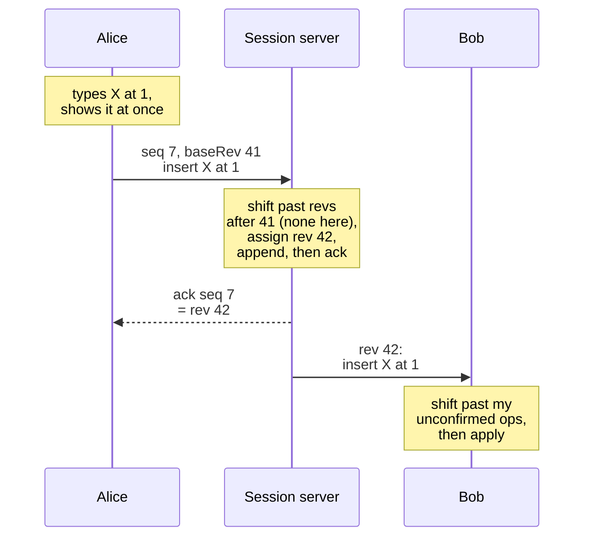
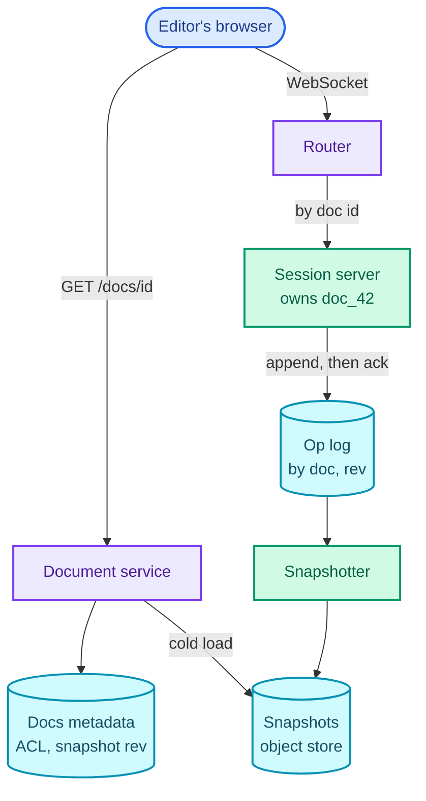
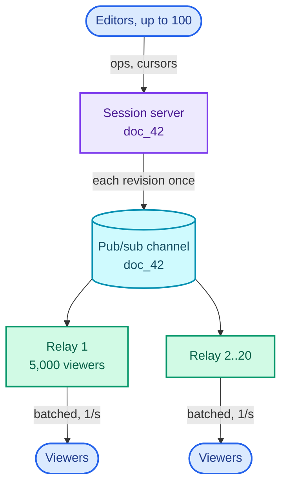
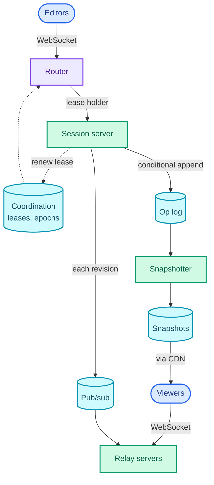

"Design Google Docs: many people editing the same document at once, each seeing the others' changes as they type."

The hard part is one sentence long. **Two people edit the same spot at the same moment, and both screens must end up identical, without either of them waiting for a server before their keystroke appears.** Every other part of the design (connections, storage, history, viewers) exists to make that one property cheap.

The pattern it teaches is **collaborative real-time editing**: a single order per shared object, edits expressed relative to a known version so anyone can adjust them, and a log of edits as the source of truth. It reuses the stateful connection tier from [WhatsApp in Part 8](/blogs/hld-whatsapp/), and the same shape runs Figma, a shared whiteboard, a collaborative code editor and a live spreadsheet.

It leans on [WebSockets and why they are stateful](/blogs/system-design-communication/), [consistent hashing](/blogs/system-design-databases-relational/), [eventual consistency and quorums](/blogs/system-design-cap-consistency/), [wide-column stores](/blogs/system-design-databases-nosql/) and [pub/sub](/blogs/system-design-async/).

How to use this post: [the method](/blogs/hld-the-method/). Try the question cold first, then read.


You are a senior engineer interviewing me for a system design round. The question is: "Design Google Docs: many people editing the same document at once, each seeing the others' changes as they type." Run it as a realistic 45-minute interview following this structure: requirements (5 min), core entities (2 min), API (5 min), high-level design (10-15 min), deep dives (10 min).
Rules: state the question in one sentence and stop. Answer my clarifying questions the way a real interviewer would, briefly, and only what I ask. Never propose designs, components or classes yourself. If I skip a stage or run long on one, say so in one line and keep time. When I finish a stage, write one line of the note you would put on the scorecard, then move on.
Once my design is in place, probe it with these, one at a time, waiting for my answer each time: (1) Two users type at the same position at the same moment. Walk me through how both screens end up identical. Would you use operational transformation or a CRDT, and why? (2) How do all editors of one document reach the same server, and what happens when that server crashes mid-edit? Can two servers ever both think they own a document? (3) How do you store a document so that loading one with years of history is fast, and what does keystroke-level history cost in storage? (4) A user edits for an hour on a plane and reconnects. What happens to their edits? (5) A document goes viral with 100,000 people viewing it while 50 edit. What breaks, and what do you change? (6) How do you show everyone's cursors without flooding the servers?
At the end, grade me as hire / lean hire / lean no hire / no hire for a senior engineer, with the two strongest and two weakest moments, and the one thing to fix first.



## Requirements

### Functional

1. Users should be able to create a document and edit it together, with several people typing at once and each seeing the others' changes as they happen.
2. Users should be able to see who else is in the document and where their cursors and selections are.
3. Users should be able to open any document they have access to and see its current state quickly, however long its history.

Below the line (out of scope):

- **Rich formatting, tables and images.** They add operation types (apply a style to a range, insert an embedded object) to the same machinery; nothing structural changes.
- **Comments and suggestions.** A separate service storing threads anchored to ranges of text; the anchors move with edits the same way cursors do.
- **Sharing and permissions.** Assume an access-control service the document service asks at open and at connect.
- **Search across documents.** An inverted index fed from document changes, which is [Part 10's question](/blogs/hld-post-search/).
- **Export to PDF or Word, Sheets and Slides.** Different renderers and data models on the same collaboration core.

### Non-functional

- **A keystroke appears locally at once and at collaborators' screens within 200 ms p95** (same region). Typing must never wait for a network round trip, so every client applies its own edits **optimistically**, before the server confirms them.
- **Convergence.** Once every editor has received the same set of edits, every editor sees exactly the same document. This is the correctness requirement. Editing is **AP** (it stays available during a network partition and converges once it heals): a user keeps typing locally through a network problem, and the server's order of edits is what every copy converges to.
- **No acknowledged edit is ever lost.** An edit the server has confirmed is on durable storage, replicated, before the confirmation is sent.
- **Up to 100 simultaneous editors per document, and an unlimited number of viewers.** 100 is Google's own published limit: a file can be edited on up to 100 open tabs or devices at once, and beyond that most people get view-only access ([Google's help page](https://support.google.com/docs/answer/2494822)). A viral document can have 100,000 viewers.
- **A session server crash interrupts editing for under 10 s**, with no edit lost; clients reconnect and resend what wasn't confirmed.

### Capacity estimate

Assumptions, stated: 10 million documents open at peak, 1.5 people per open document, 20% of connected people typing at any instant, each typist sending about 2 batched edits per second, about 100 bytes per stored edit, an average document of 50 KB, and an average day at a third of the peak rate.

- **Connections.** 10M × 1.5 = **15 million WebSocket connections**. At about 50,000 connections per server (a rule of thumb, bounded by memory per connection), that is **300 session servers** before any work is done. So connections, not CPU, size the fleet, and the fleet is stateful: each connection lives on one server.
- **Edit rate.** 15M × 0.2 × 2 = **6 million edits/s** globally, or 6M / 300 = 20,000 edits/s per server. Large in total, small per machine.
- **Per document.** The worst case is 100 editors × 2 edits/s = **200 edits/s on one document**. One thread orders 200 small edits a second without noticing. So **one server per document can decide the order of all its edits**, which is the decision the whole design rests on.
- **Edit history.** 6M × 100 B = 600 MB/s at peak; at a third of that on average, 200 MB/s × 86,400 s ≈ **17 TB a day**, about 6.3 PB a year. So keystroke-level history cannot live in the hot store forever: the design needs **snapshots** and a policy for compacting old edits.
- **Viewers.** 200 edits/s × 100,000 viewers = **20 million messages/s** from one document if every edit goes to every viewer. No single server sends that. So **viewers need their own fan-out path**, separate from editors.

## Core entities

- **Document**: id, title, owner, access list, and the revision of its latest snapshot.
- **Operation (op)**: one small edit, such as "insert `X` at position 1" or "delete 1 character at position 3", tagged with its author, a client id and sequence number, and the **base revision** it was made against.
- **Revision**: the number the server gives each op as it accepts it: 1, 2, 3, and so on. The revision log is the document's single, agreed order of edits.
- **Snapshot**: the full document content as of one revision, so nobody has to replay history from the start.
- **Session**: the live, in-memory state of one open document on its session server: the current content, the current revision and the connected clients.
- **Presence**: a user's cursor position, selection and colour. Ephemeral, never stored.

## API

Loading a document is a plain HTTPS request; editing is a WebSocket, because the server must push other people's edits the instant they arrive ([why WebSockets and not polling](/blogs/system-design-communication/)). The user comes from the session cookie or token on the request and on the WebSocket handshake, never from the message body, and the access list is checked at both.

```text
POST /v1/docs                                 -> 201 { "docId": "doc_42" }
GET  /v1/docs/{docId}                         -> 200 { "title": "...", "rev": 4317,
                                                       "content": <snapshot + ops applied>,
                                                       "editUrl": "wss://edit.example.com/docs/doc_42" }
GET  /v1/docs/{docId}/revisions?before=4000   -> 200 [ { "rev": 3998, "author": "u_ana", "at": "..." }, ... ]

WebSocket wss://edit.example.com/docs/{docId}     (routed to the document's session server)
  client -> server  { "type": "ops", "clientId": "c9", "seq": 7, "baseRev": 41,
                      "ops": [ { "insert": "X", "at": 1 } ] }
  server -> client  { "type": "ack", "seq": 7, "rev": 42 }
  server -> client  { "type": "ops", "rev": 43, "author": "u_bob",
                      "ops": [ { "delete": 1, "at": 3 } ] }
  client -> server  { "type": "cursor", "baseRev": 43, "at": 17, "selEnd": 17 }
  server -> client  { "type": "presence", "users": [ { "user": "u_bob", "at": 20, "colour": "#7C3AED" } ] }
```

`baseRev` is the important field. It says "I made this edit while looking at revision 41", which is what lets the server adjust the edit if revisions 42 and 43 arrived from someone else in the meantime.

## High-level design

### 1. Edit together

Alice opens `doc_42` and connects to `wss://edit.example.com/docs/doc_42`. A **router** at the edge sends every connection for `doc_42` to the same **session server**, the one that owns that document (how it picks one is deep dive 2). If the document isn't already open there, the session server loads it into memory: the latest snapshot plus the ops after it.

From then on that one server is the document's **sequencer**: it decides the order of every edit. Follow one edit through it, top to bottom.



Three things happen to keep everyone consistent, and they are the same three Google described for Docs ([Making collaboration fast, 2010](https://drive.googleblog.com/2010/09/whats-different-about-new-google-docs.html)):

- **Each client sends one batch at a time.** Alice's keystrokes go out as a batch with her last known revision; anything she types while waiting for the acknowledgement collects into the next batch. That keeps each batch relative to a revision the server knows, and naturally batches fast typing.
- **The server adjusts each batch against what the author hadn't seen.** If Alice's batch says `baseRev 41` and the server is already at 43, the server shifts her edit past revisions 42 and 43 before giving it revision 44. How it shifts is deep dive 1.
- **Each client adjusts incoming edits against its own unconfirmed ones**, so Bob's screen can apply Alice's edit even though Bob has typed something the server hasn't confirmed yet.

The server appends the op to the **op log**, durably, and only then acknowledges it and broadcasts it. That ordering is what "no acknowledged edit is ever lost" means in practice.

```text
ops        (doc_id, rev) PRIMARY KEY, author, client_id, client_seq, op, created_at
documents  doc_id, title, owner, acl, latest_snapshot_rev
snapshots  (doc_id, rev) -> blob in object storage
```

What this step leaves open: *how* an edit is shifted, which is the heart of the question (deep dive 1), and what happens when the one server for a document dies (deep dive 2).

### 2. See who else is here

A cursor update (`{ "type": "cursor", "at": 17 }`) goes to the same session server over the same WebSocket. The server keeps presence **in memory only**: user, cursor, selection, colour, last seen. It is never written to the op log, because a cursor from five minutes ago is worthless and replaying it would be wrong.

Cursors have the same problem edits do. Bob's cursor is at position 17; Alice inserts 3 characters at position 5; Bob's cursor is now at 20, not 17. So cursors are shifted by incoming edits exactly as edits are, which is why the cursor message carries a `baseRev` too.

If a client misses heartbeats for 30 s, the server drops its presence and tells the others. How often cursors are broadcast is a real number, and deep dive 5 computes it.

### 3. Open a document quickly

`GET /v1/docs/doc_42` goes to the **document service**, which checks the access list in the metadata store, then returns the content and the address to connect to. If the document is open on a session server, its in-memory state is the freshest copy. If not, the service reads the latest **snapshot** from object storage and applies the ops logged after it.

A **snapshotter** runs beside the session servers: when a document has gathered enough new ops, it writes a new snapshot and records its revision in `documents.latest_snapshot_rev`. Without snapshots, opening a document with a long history means replaying all of it; deep dive 3 does the arithmetic.

### The assembled design

The editor's browser talks to two entry points: the document service for loading and the router for live editing. The session server owns the document while it's open; the op log and snapshots hold it while it isn't.



It is deliberately simple. The single session server per document is both its strength (one order, cheap) and its exposure (one failure point per document); the deep dives address both.

## Deep dives

### 1. Two people type in the same spot: how do both screens agree?

Maps to: convergence, and typing never waits.

The figure below uses the smallest example that breaks things. Both editors see `abc`. Alice inserts `X` at position 1; at the same moment Bob deletes position 2 (the `c`). Each applies their own edit at once and sends it. Look at the middle band first.

<figure class="sketch"></figure>

**Bad: lock, or let the last writer win.** Locking a paragraph while someone types in it means the second person waits, which breaks the first non-functional requirement and feels broken to users. Last-writer-wins on the whole document throws away whichever edit lost. Applying edits as sent, the middle band, is worse than both: Alice deletes position 2 of `aXbc`, which is now `b`, not `c`. Alice ends with `aXc`, Bob with `aXb`, and nothing ever tells them they differ. Positions moved underneath the edit.

**Good: transform each edit against the edits its author hadn't seen.** That is **operational transformation (OT)**: a function that takes two concurrent edits and rewrites one so it means the same thing after the other has been applied. For a pair of plain-text edits the rules are short:

- an insert or delete at a position **after** a concurrent insert shifts right by the inserted length (Bob's delete at 2 becomes delete at 3 on Alice's side, because her `X` at 1 pushed the `c` right);
- an edit **before** it stays where it is (Alice's insert at 1 stays at 1 on Bob's side);
- an edit after a concurrent delete shifts left by the deleted length, and a range deleted by both is deleted once;
- two inserts at the **same** position need a tie-break everyone agrees on, such as the lower client id goes first.

The bottom band shows the result: both reach `aXb`. Google's own description of Docs uses exactly this kind of shift, inserts and deletes moving each other's positions ([Conflict resolution, 2010](https://drive.googleblog.com/2010/09/whats-different-about-new-google-docs_22.html)).

The catch is what happens with more than two editors and no referee. If every client transforms against every other client's edits in whatever order they arrive, then three editors can receive the same three edits in different orders, and the transforms must produce the same document along every path. That property is notoriously hard to guarantee: several published peer-to-peer OT algorithms were later shown to violate it.

**Great: OT with one central sequencer per document.** The session server gives every edit a revision number, so there is exactly one order. A client only ever sends one batch at a time, relative to a revision the server knows. So the server only transforms an incoming batch against the revisions logged since its `baseRev`, and a client only transforms incoming edits against its own unconfirmed batch. Every transform involves two parties, never three. The hard multi-path property is never needed, because there is only one path: the server's.

This is why the capacity estimate's "200 edits/s per document fits on one thread" mattered. A single sequencer is only affordable because no document is busy enough to need two.

**The CRDT alternative, and when it wins.** A **CRDT** (conflict-free replicated data type) avoids transforming altogether by never addressing anything by position. Every character gets a unique, permanent id; an insert says "after the character with id 1", a delete says "delete id 3". The figure shows the same two edits.

<figure class="sketch"></figure>

Ids don't shift, so the edits apply in any order on any replica and converge with no server deciding anything. That is a real advantage when there is no central authority: peer-to-peer editing, or **offline-first** apps where two devices edit for a day and merge directly (libraries such as Yjs and Automerge do this). The price is in the second line of the figure: an id on every character, and deleted characters kept as hidden **tombstones** so that later edits referring to them still make sense. Tombstones can only be cleared once every replica is known to have seen the delete, which is awkward when replicas come and go.

For the question as asked, a central service people are online to use, I'd choose **OT with a central sequencer**: a smaller document in memory, a simpler mental model, and Google's own published approach. I'd switch to a CRDT if offline-first or peer-to-peer editing were a headline requirement, and say so. There is a middle path worth naming too: Figma deliberately skipped OT and uses a centralised server with CRDT-inspired structures, such as last-writer-wins per object property, because its documents are objects with properties rather than long text ([How Figma's multiplayer technology works](https://www.figma.com/blog/how-figmas-multiplayer-technology-works/)).

### 2. One document, one server: routing and failover

Maps to: convergence (one order needs one sequencer), and a crash interrupts editing for under 10 s.

**Bad: stateless edit servers that coordinate through the database.** Any server takes any edit, reads the latest revision, transforms, and inserts revision n + 1, retrying if someone else took n + 1 first. With 100 editors typing, they race for every revision, and each loser retries. Every keystroke becomes a database round trip plus a retry loop, and then a pub/sub hop to reach whichever servers hold the other editors' connections. It can be made correct, but it puts the database in the path of every keystroke at 6 million edits a second.

**Good: route every connection for a document to one server, by consistent hashing on the document id.** The router hashes `doc_42` onto a ring of session servers and picks the next server clockwise. Look at what happens when `S3` dies.

<figure class="sketch"></figure>

Only the documents between `S2` and `S3` move to `S4`; every other document stays put, so a failure or a deploy disturbs a small slice of sessions rather than all of them ([consistent hashing, in depth](/blogs/system-design-databases-relational/)). The owning server keeps the document in memory and orders edits locally, with no database round trip before the transform.

The gap is the moment of change. While routers learn that the ring changed, one router may still send Bob to `S3` (still alive, but slow) while another sends Alice to `S4`. Two servers both believe they own `doc_42`, both hand out revision 4,318, and the document now has two histories. That is split brain, and it violates convergence permanently.

**Great: ownership as a lease, and an op log that refuses a stale owner.** A server owns a document only while it holds a **lease** on it in a coordination service such as etcd or ZooKeeper, renewed every few seconds and expiring if the server stops renewing ([quorums and leader election](/blogs/system-design-cap-consistency/)). Every lease carries an **epoch**, a number that goes up each time ownership changes hands, and the router sends connections to whoever holds the current lease.

A lease alone isn't enough, because a server that pauses (a long garbage-collection pause, say) can wake up still believing it owns the document. So the op log does the final check: an append is a **conditional write** that succeeds only if revision 4,318 doesn't exist yet for `doc_42`. The primary key `(doc_id, rev)` makes that natural, in any store with a cheap single-key conditional put (DynamoDB's conditional writes, Bigtable's check-and-mutate). A stale owner's append fails, and it learns it has been replaced and drops the document. The epoch is the **fencing token**, the op log is the fence.

Failover then has a clear timeline. The old owner's lease expires (say 5 s). A new server takes the lease, loads the snapshot and the log tail (fast, because of deep dive 3), and starts accepting. Clients, whose WebSockets dropped, reconnect through the router, send their last confirmed revision, and resend any unconfirmed batch with its `(clientId, seq)`. The new owner checks the log tail for that pair and acknowledges it instead of applying it twice if the old owner had logged it moments before dying. Lease expiry plus a load of a few hundred milliseconds keeps the interruption inside 10 s, and no confirmed edit is lost because confirmation always came after the log append.

### 3. Storing a document: op log and snapshots

Maps to: open quickly, no acknowledged edit lost, and the 17 TB a day.

**Bad: overwrite the whole document on every edit.** A 50 KB write per edit is 50 KB × 6M edits/s = 300 GB/s, five hundred times the op log's 600 MB/s, and it throws away history. Two writers overwriting the same blob also lose each other's edits unless something else orders them.

**Good: an append-only op log; the document is the replay.** Every accepted op is appended under `(doc_id, rev)`. History and version restore come for free, and appends are small. Store it in a wide-column store partitioned by `doc_id` and clustered by `rev`, so "the ops of `doc_42` after revision 4,000" is one range read inside one partition ([wide-column stores](/blogs/system-design-databases-nosql/)). The cost moves to reading: a team document edited daily for years can hold 2 million ops, 2M × 100 B = 200 MB to read and replay to open it.

**Great: op log plus snapshots, and history compacted with age.** Every so often, write the whole document at a revision as a snapshot to object storage. Opening a document reads the latest snapshot and replays only the ops after it.

<figure class="sketch"></figure>

A good trigger is **"snapshot when the ops since the last snapshot outweigh the document"**. For a 100 KB document and 100-byte ops, that is every 1,000 ops, the spacing in the figure. It bounds a load to at most about twice the document's size (one snapshot plus at most one document's worth of ops), and it bounds snapshot writes to no more than the op log's own write rate, so snapshots never cost more than the edits they summarise.

Then compact old history. Keystroke-level ops are useful for recent undo and for "who typed this" in the last weeks; after that, version history only needs snapshots. Keeping raw ops for 30 days is 17 TB × 30 ≈ 520 TB in the hot store, a large but ordinary cluster; older ops are deleted, leaving the snapshots (thinned out to, say, one per hour of editing) as the version history. That is how 6.3 PB a year of keystrokes becomes something you can afford to keep.

### 4. Editing offline

Maps to: typing never waits, and convergence.

**Bad: offline means read-only.** Simple and safe, and it fails the user on every train, plane and patchy connection.

**Good: queue edits locally and transform them on reconnect.** The client is already built for this: it applies edits optimistically and keeps unconfirmed ones in a buffer. Offline, the buffer grows and is saved to local storage (IndexedDB in a browser) with its base revision. On reconnect, the client sends the buffer as one batch against that base, and the server transforms it against every revision since.

The cost is real arithmetic. An hour offline might produce 300 local ops while the document receives 3,000 from others. Transforming pairwise is 300 × 3,000 = 900,000 transforms; at roughly a microsecond each for small in-memory text ops (a rule of thumb), about a second of CPU, once. Composing the local ops first (typing "hello" as five one-character inserts composes into one five-character insert) shrinks the 300 dramatically. The other cost is meaning, not CPU: character-level merging of two people who both rewrote the same paragraph produces a correct but interleaved paragraph. Flagging large divergent merges for the user to review is a product decision worth naming.

**Great: if offline-first is the product, make the document a CRDT.** When devices must edit for days and merge with each other, not only with the server, the CRDT from deep dive 1 earns its metadata: any replica merges any other, in any order, with no server present. The server becomes a relay and a store rather than the sequencer. For Docs-as-asked, the Good rung is enough, and saying why (online is the normal case; offline is the exception the buffer already handles) is the senior answer.

### 5. Cursors, presence and a hundred thousand viewers

Maps to: 100 editors and unlimited viewers, and the 20 million messages/s.

**Cursors first, because the arithmetic is surprising.** If each of 100 editors sends 10 cursor updates a second and the server forwards each one to the other 99, that is 100 × 10 × 99 = 99,000 messages/s out of one document, for something that isn't even content. Instead the server **coalesces**: it keeps the latest cursor of each user and, every 100 ms, sends each client one presence message with all cursors that changed. That is 100 clients × 10 ticks/s = **1,000 messages/s**, a 99× cut, and nobody can see the difference between a cursor that moves every 10 ms and one that moves every 100 ms.

**Viewers, the other number.** A viral document with 100,000 viewers and 200 edits/s would need 20M messages/s if viewers were treated like editors.

**Bad: viewers connect to the session server like editors.** The session server is already the sequencer for this document; making it send 20M messages/s also makes it the bottleneck for the 50 people actually editing.

**Good: a separate fan-out tier for viewers.** The session server publishes each new revision once to a pub/sub channel for `doc_42`. **Relay servers** subscribe to that channel and hold the viewers' connections, 5,000 each, so 100,000 viewers need 20 relays and the session server sends 20 messages per revision instead of 100,000. Read the diagram as two populations: editors at the top talk to the sequencer; viewers at the bottom only ever talk to relays. (The once-a-second batching on the last edges is the next rung.)



**Great: viewers get coalesced updates and start from a cached snapshot.** Viewers don't need every keystroke. Each relay batches revisions and sends each viewer one update a second: 100,000 messages/s in total, 5,000 per relay, which a relay handles easily. A new viewer loads the document from a snapshot served through a CDN (cached by revision, so it never goes stale, only old) and catches up from the relay's buffer of recent revisions, so 100,000 people opening a link at once never touch the session server or the op log. Viewers' presence becomes a count ("and 99,950 others"), not 100,000 cursors. And if a viewer is promoted to editor, it reconnects through the router to the session server like any editor.

With leases, the fan-out tier and the snapshot path in place, the assembled design looks like this. Editors enter at the top through the router; viewers, at the bottom, load snapshots through the CDN and take live updates from the relays, never from the session server.



## What each level is expected to show

| Level | What a strong answer shows |
| --- | --- |
| Mid-level | WebSockets, an op-based model rather than saving the whole document, and the divergence problem shown on a small example with an OT-style position shift. Usually needs prompting to route one document to one server and to add snapshots. |
| Senior | Drives the central sequencer and explains why it makes OT tractable, routes by consistent hashing, stores an op log with snapshots and computes when to snapshot, handles reconnect with base revisions and `(clientId, seq)` dedupe, and compares OT with CRDTs with a reasoned choice. |
| Staff+ | Owns the failure modes and the numbers: split brain prevented by leases plus a conditional append as the fence, the 99,000 to 1,000 cursor arithmetic, a separate viewer fan-out tier, history compaction from 6.3 PB a year to something affordable, and when the answer flips to a CRDT (offline-first, peer-to-peer) or to Figma's server-authoritative object model. |

## Variants this unlocks

| Question | What changes |
| --- | --- |
| Design Figma / a collaborative whiteboard (Miro) | The document is a set of objects with properties, not a string. Conflicts are per property, so last-writer-wins per property on a central server replaces text transforms. Same session servers, presence and viewer tier. |
| Design Google Sheets / a collaborative spreadsheet | Ops set cells; two edits to one cell are last-writer-wins, but inserting a row shifts every reference below it, which is exactly the position-shifting problem again. Recalculation adds a dependency graph. |
| Design a collaborative code editor (pair programming, Replit multiplayer) | Same text core and cursors. Adds a language server per session and file-level operations (rename, create) that need their own ordering. |
| Design Notion / a block editor | The document is a tree of blocks; ops move, nest and edit blocks. A tree CRDT or OT over tree operations, with text OT inside each block. |
| Design a real-time shared board (Trello live updates) | Ordered lists with move operations; positions as fractional keys (a card between 1.0 and 2.0 gets 1.5) avoid shifting everyone else's position. No character-level merging at all. |
| Design a wiki with edit history (Confluence) | Not real-time: optimistic locking on a page version plus a three-way merge on conflict, and the same snapshots-plus-diffs storage for history. |

## The one-page version

- Clients apply their own edits at once, then send them as one batch at a time with a `baseRev`.
- A router sends every connection for a document to one session server, by consistent hashing on the document id.
- That server is the document's sequencer: it shifts each batch past the revisions its author hadn't seen (OT), gives it the next revision, appends it, then acknowledges and broadcasts.
- Clients shift incoming edits past their own unconfirmed batch. Every transform is between two parties, never three.
- Ownership is a lease with an epoch; the op log's conditional append on `(doc_id, rev)` is the fence that stops a stale owner.
- On failover, clients reconnect with their last revision and resend unconfirmed batches; `(clientId, seq)` prevents double application.
- The op log is partitioned by document and clustered by revision; snapshots are written when the ops since the last one outweigh the document.
- Raw ops are kept for weeks, snapshots for history: 17 TB a day of keystrokes doesn't have to be kept forever.
- Offline edits are a longer pending buffer transformed on reconnect; a CRDT only if offline-first is the product.
- Cursors are in memory, shifted like edits, and coalesced every 100 ms; viewers get a relay tier, one update a second, and snapshots from a CDN.
- **Key sentence: one server per document puts every edit in one order, every edit names the revision it was made against so anyone can shift it to fit, and the document is a log of edits with snapshots, so it loads fast and never loses a confirmed keystroke.**


You are my system design interview coach. I have studied the design of Google Docs (real-time collaborative editing). Ask me the questions below one at a time. After each, wait for my answer. Judge it against the expected key points, which you must not reveal before I answer. If I'm right, confirm briefly and add any nuance I missed. If I'm partly right, tell me what's missing. If I'm stuck, give one hint at a time, from gentle to specific, before revealing the answer. Then move on.
1. Both editors see "abc". Alice inserts X at position 1 while Bob deletes position 2. What goes wrong if each applies the other's edit as sent, and how does operational transformation fix it? Expected: as sent, Alice deletes position 2 of "aXbc", which is b, giving "aXc", while Bob gets "aXb": permanent divergence. With OT, Bob's delete at 2 is shifted to 3 on Alice's side because her insert at 1 is before it, and Alice's insert at 1 stays at 1 on Bob's side; both get "aXb". Same-position inserts need an agreed tie-break such as client id.
2. Why does a central server per document make OT much easier? Expected: the server assigns revision numbers, so there is one order; each client sends one batch at a time relative to a known base revision; the server transforms only against revisions since that base, and clients only against their own unconfirmed batch; every transform is two-party, so the hard property that transforms agree along every order of three or more concurrent edits (required for peer-to-peer OT) is never needed. It is affordable because one document peaks around 100 editors times 2 edits a second, 200 edits a second, trivial for one thread.
3. OT or CRDT, and why? Expected: a CRDT gives every character a permanent unique id, inserts reference ids, deletes leave tombstones, so edits apply in any order without a server. Costs: per-character metadata and tombstones that can only be cleared once all replicas have seen the delete. Choose OT with a central sequencer for an always-online central service (Google's published approach); choose a CRDT when offline-first or peer-to-peer is a headline requirement. Figma's middle path: central server with last-writer-wins per object property.
4. How do all editors of a document reach the same server, and what stops two servers both owning it? Expected: consistent hashing of the document id onto a ring of session servers, so a failure moves only one slice of documents. During ring changes two servers can both think they own a document (split brain, two different revision 4318s). Fix: ownership is a lease in etcd or ZooKeeper with an epoch, and the op log append is a conditional write on (doc_id, rev), so a stale or paused owner's append fails and it steps down.
5. A session server crashes. What happens to the editors and their unconfirmed edits? Expected: the lease expires (a few seconds), a new owner takes it and loads snapshot plus log tail, clients reconnect with their last confirmed revision and resend unconfirmed batches with (clientId, seq); the new owner dedupes by that pair; no confirmed edit is lost because the server only acknowledges after the log append. Interruption stays under about 10 seconds.
6. How do you store documents so loading is fast, and what does keystroke history cost? Expected: an append-only op log partitioned by doc id and clustered by revision (one range read for a tail), plus snapshots in object storage; load equals latest snapshot plus ops after it. Snapshot when ops since the last snapshot outweigh the document, which bounds a load to about twice the document size and snapshot writes to the op log's rate. 6 million ops a second at 100 bytes is 600 MB a second at peak, about 17 TB a day on average, so keep raw ops for weeks and keep only snapshots for older history.
7. A user edits offline for an hour. What happens on reconnect? Expected: local edits are buffered with their base revision (saved locally); on reconnect they are sent as a batch and transformed against all revisions since; cost is about local ops times remote ops (300 times 3,000 is 900,000 small transforms, around a second), reduced by composing local ops first; semantic conflicts can produce interleaved text, so flag big merges. A CRDT if offline-first is the product.
8. 100 editors and 100,000 viewers on one document. What breaks? Expected: cursors forwarded naively are 100 times 10 times 99, about 99,000 messages a second; coalesce every 100 ms to about 1,000. Viewers forwarded every edit are 200 times 100,000, 20 million messages a second; publish each revision once to pub/sub, relays hold about 5,000 viewers each and send batched updates once a second (100,000 a second total), new viewers load a cached snapshot via a CDN, and viewer presence is a count.



## What the series was building toward

Seventeen parts, sixteen questions. [Part 1](/blogs/hld-the-method/) drew a map of eight patterns before any question had been asked. Here it is again, filled in: the part that taught each pattern, and the parts where it came back without being announced.

| Pattern | Taught by | Came back in |
| --- | --- | --- |
| Scaling reads | [URL shortener](/blogs/hld-url-shortener/), [news feed](/blogs/hld-news-feed/) | [Ticketmaster](/blogs/hld-ticketmaster/) event pages, [typeahead](/blogs/hld-post-search/), [top-K](/blogs/hld-top-k/) results served from cache, Docs viewers |
| Scaling writes | [Rate limiter](/blogs/hld-rate-limiter/), [top-K](/blogs/hld-top-k/), [ad click aggregator](/blogs/hld-ad-click-aggregator/) | [Uber](/blogs/hld-uber/) location updates, the [crawler](/blogs/hld-web-crawler/) frontier, the Docs op log |
| Large blobs | [Dropbox](/blogs/hld-dropbox/), [YouTube](/blogs/hld-youtube/) | Docs snapshots in object storage |
| Contention | [Rate limiter](/blogs/hld-rate-limiter/), [Ticketmaster](/blogs/hld-ticketmaster/) | [Uber](/blogs/hld-uber/) matching, [job scheduler](/blogs/hld-job-scheduler/) leases, [payment](/blogs/hld-payment-system/) refunds and hot accounts, Docs ownership |
| Real-time updates | [WhatsApp](/blogs/hld-whatsapp/), Google Docs | [Uber](/blogs/hld-uber/) driver locations, in-app [notifications](/blogs/hld-notification-system/) |
| Long-running tasks | [YouTube](/blogs/hld-youtube/), [web crawler](/blogs/hld-web-crawler/), [notifications](/blogs/hld-notification-system/), [job scheduler](/blogs/hld-job-scheduler/) | the payment resolver, the Docs snapshotter |
| Multi-step processes | [Payment system](/blogs/hld-payment-system/) | [Ticketmaster](/blogs/hld-ticketmaster/) hold-then-pay, [ad click](/blogs/hld-ad-click-aggregator/) reconciliation, notification idempotency |
| Proximity and search | [Uber](/blogs/hld-uber/), [post search](/blogs/hld-post-search/) | every "near me" and "matches this" variant |

And each pattern, reduced to the decision it trains:

**Scaling reads.** Find the read:write ratio first. When reads dominate, put the answer close to the reader (CDN, cache-aside, precomputed results) and let the write path pay to keep it fresh; for feeds, choose when to pay for the copies, on write for ordinary accounts and on read for celebrities; for audiences too large to address one by one, coalesce.

**Scaling writes.** Shard by the key that spreads the load, batch and pre-aggregate in windows close to the stream, deduplicate by id, accept an approximation (a count-min sketch) wherever exact isn't required, and keep a batch path that recomputes the truth to check the fast one.

**Large blobs.** Bytes never pass through your application servers: presigned URLs straight to object storage, chunked and resumable uploads, a CDN for downloads, and only metadata in the database.

**Contention.** One seat, one driver, one refund, one counter: make the claim atomic where the state lives (a row lock, a conditional write, a Lua script in Redis, a lock with a TTL), hold it as briefly as possible, split a hot key into shards when one row can't keep up, and queue the crowd before it reaches the lock.

**Real-time updates.** A stateful connection tier, a registry of who is connected where, pub/sub between servers, and clients that reconnect and resume from a cursor or revision. When the clients also edit the shared state, one order per object and every change stated relative to a version.

**Long-running tasks.** Separate accepting the work from doing it: a durable queue or job table, workers with leases and heartbeats, at-least-once execution with idempotent tasks, retries with backoff, and a dead letter queue at the end.

**Multi-step processes.** A persisted state machine, an idempotency key at every hop, "unknown" as a state rather than a failure, and reconciliation against a record you don't control.

**Proximity and search.** Build the index the query needs (geohash or quadtree, inverted index, prefix trie), feed it from the source of truth by change data capture, and accept that it lags slightly behind.

None of the sixteen designs had to be memorised whole, and that was the point. Part 1 set the goal as: given a question you haven't rehearsed, deliver a working, defensible design inside the time box. Every post since has done it the same way: requirements with numbers attached, one functional requirement at a time, the simplest design that works, and then deep dives exactly where a computed number said the simple design would break. Recognise which of these patterns a new question is made of, run the method, and the design you draw will be one you can defend, because every box in it answers a number you computed.

High-level design stops at the boxes. The next series opens one of them.

Next: [Low-Level Design, Part 1: the method](/blogs/lld-the-method/), where the time box shrinks to 35 minutes and the boxes become Java classes you have to make run.
