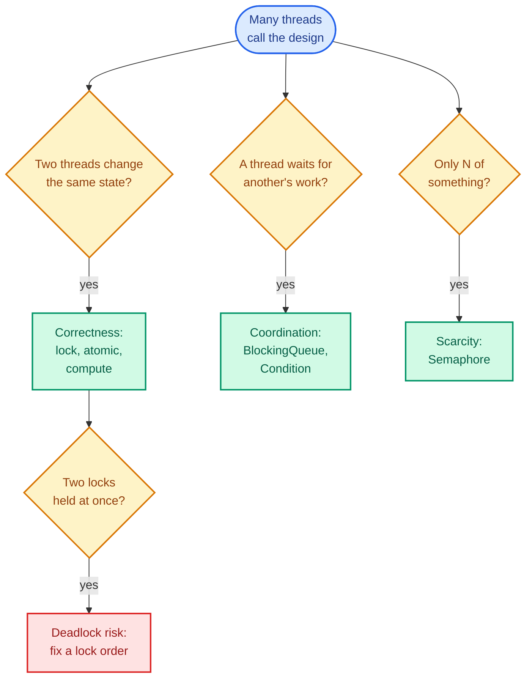
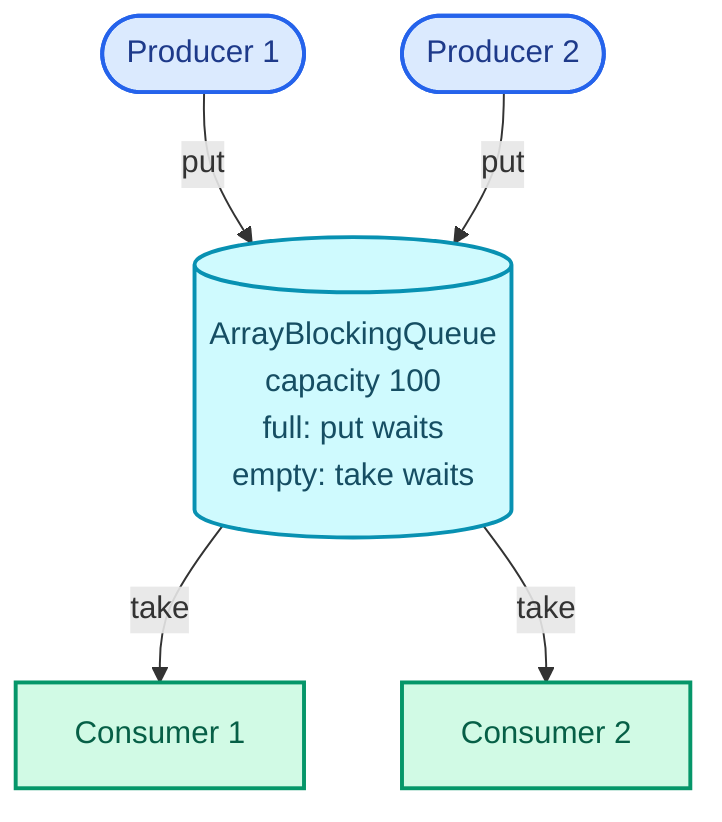
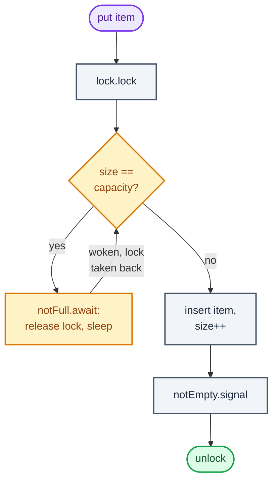

Sooner or later in a low-level design round the interviewer says "now two users do this at the same moment". Two cars reach the last parking spot. Two people click the same cinema seat. Two requests hit the rate limiter for the same key in the same millisecond. The design that was correct a minute ago now has to stay correct when its methods run on several **threads** (independent sequences of execution inside one program, sharing its memory) at once.

Nobody expects you to recite the Java Memory Model. What gets tested is whether you can spot the one place in your design where threads share **mutable state** (fields that change after construction), name what can go wrong there, and pick a tool that fixes it without serialising the whole system. That fits into three problems, and this post is organised around them: **correctness** (shared state stays right), **coordination** (threads wait for each other's work), and **scarcity** (only N of something exists). Deadlock gets its own section, because it is what you buy when you fix correctness carelessly.

This is the third toolkit part. [Part 1](/blogs/lld-the-method/) is the delivery method every question post follows; [Part 2](/blogs/lld-oop-and-patterns/) is the object-oriented toolkit. From [Part 4, Connect Four](/blogs/lld-connect-four/) on, every question post has a concurrency follow-up, and each one points back here. All code is Java 21, compiled and run in Docker on an 8-core machine. Races don't fail the same way twice, so every demo ran in three separate runs, and the numbers below are what they printed, not what they should have printed.

## Three problems, three first tools

Before reaching for any API, ask three questions about the design. Each yes adds one kind of tool; a design can need all three. The diagram reads top to bottom: the three questions in the second row, the first tool for each yes below them, and the trap that fixing correctness opens up at the bottom.



If all three answers are no, the design needs no concurrency work at all, and saying so out loud with the reason ("each game is owned by one thread") is a better answer than sprinkling `synchronized` everywhere.

## Correctness: two threads, one value

### The race inside count++

A **race condition** is a bug whose outcome depends on how threads happen to interleave. The smallest one in Java is a counter (`Counter` is a two-method interface, `increment()` and `get()`, so the demo can swap implementations):

```java
class UnsafeCounter implements Counter {
    private int count = 0;

    // count++ is three steps: read count, add 1, write count.
    // Another thread can read the same old value between our read and our write.
    public void increment() { count++; }
    public int get() { return count; }
}
```

`count++` looks like one operation, and it is three: read the field into a register, add one, write the register back. This pattern is called **read-modify-write**, and it breaks whenever a second thread reads between the first thread's read and its write. The figure below shows two threads, A in blue and B in violet, each running `count++` once, with time going left to right. Watch the bottom row, which is the value actually in memory.

<figure class="sketch"></figure>

Both threads read 41 before either wrote, so both computed 42, and B's write (red) lands on top of A's. Two increments ran and the counter moved by one. This is a **lost update**, and nothing crashed or logged anything.

The demo runs four threads, each calling `increment()` a million times, so the right answer is 4,000,000. The four threads are released together by a `CountDownLatch` (a counter that threads can wait on until it reaches zero, covered under Coordination below), so they really overlap instead of each finishing before the next one starts:

```java
    static void race(int threads, Runnable work) throws InterruptedException {
        CountDownLatch start = new CountDownLatch(1);
        List<Thread> all = new ArrayList<>();
        for (int i = 0; i < threads; i++) {
            Thread t = new Thread(() -> {
                try { start.await(); } catch (InterruptedException e) { return; }
                work.run();
            });
            t.start();
            all.add(t);
        }
        start.countDown();
        for (Thread t : all) t.join();
    }
```

Across nine trials in three runs, the unsafe counter lost between 411,436 and 2,989,453 of the 4,000,000 increments. Two things about that spread matter more than the numbers.

First, in an earlier batch of three runs of the same counter demo, one trial lost nothing and printed exactly 4,000,000. A test that runs this once can pass. That is the worst property a bug can have, and it is why "I tested it and it worked" is not an answer about thread safety.

Second, some trials lost more than half the increments, which a simple interleaving like the figure can't explain. The likely cause is the JIT compiler keeping `count` in a register for long stretches of the loop and writing it back later, which the Java Memory Model allows for a plain field that no lock or `volatile` protects. One thread then writes back a total that ignores another thread's whole stretch of work. Either way, the program is wrong, and the fix is the same.

### Check-then-act: the double-booked seat

The second shape is **check-then-act**: test a condition, then act on it, assuming it still holds. It is the shape of every booking question (`Seat` is an interface with one method, `boolean book(String who)`):

```java
class UnsafeSeat implements Seat {
    private String holder;

    public boolean book(String who) {
        if (holder == null) {   // check
            holder = who;       // act: a second thread may have passed the check too
            return true;
        }
        return false;
    }
}
```

Two threads can both see `holder == null`, both go on to the assignment, and both return `true`. Two customers now hold a confirmation for one seat. In the demo, four threads spin (busy-wait in a loop) on a shared round number, and in each round all four try to book one fresh seat within nanoseconds of each other; there are 100,000 rounds, so the right answer is 100,000 bookings. Across nine trials, the unsafe seat produced between 144,273 and 265,995 bookings, and between 18,614 and 69,143 of the 100,000 seats were booked by more than one thread.

The gap between check and act in this demo is a handful of machine instructions. In a real system it's a database read and a database write, milliseconds apart, which is thousands of times wider. If a few nanoseconds lose this often, a design that checks in one call and writes in another loses all the time.

### The fixes, and when each one fits

Every fix does the same thing: it makes the read and the write one **atomic** step, meaning no other thread can observe or act in between. The section of code that must run as one step is the **critical section**.

**`synchronized`.** Every Java object carries a built-in lock (its **monitor**). A `synchronized` method takes the monitor of `this` on entry and releases it on exit, even if an exception is thrown, so only one thread at a time runs any `synchronized` method of that object. It also solves **visibility**, the less famous half of the problem: without it, one thread's write may sit in a register or cache and never be seen by another. Releasing a lock publishes every write made under it to the next thread that takes the same lock (the Java Memory Model calls this a **happens-before** edge).

```java
class SynchronizedCounter implements Counter {
    private int count = 0;

    // One thread at a time inside any synchronized method of this object.
    // Leaving the method also publishes the write to the next thread that enters.
    public synchronized void increment() { count++; }
    public synchronized int get() { return count; }
}
```

Note that `get()` is synchronized too. A reader that skips the lock has no visibility guarantee and can see a stale value.

The same keyword fixes the seat, because the check and the act now sit inside one critical section:

```java
class LockedSeat implements Seat {
    private String holder;

    // The check and the act happen under one lock, so they are one step to everyone else.
    public synchronized boolean book(String who) {
        if (holder == null) {
            holder = who;
            return true;
        }
        return false;
    }
}
```

**`ReentrantLock`.** The same mutual exclusion as an object you hold in a field. "Reentrant" means the thread holding it can take it again without deadlocking itself (`synchronized` is reentrant too). Reach for it over `synchronized` when you need one of four things the keyword can't do: give up after a timeout (`tryLock(time, unit)`), try without waiting (`tryLock()`), be interruptible while waiting (`lockInterruptibly()`), or have several wait conditions on one lock (`newCondition()`, used below). The price is that unlocking is your job, so it always goes in `finally`:

```java
class LockCounter implements Counter {
    private final ReentrantLock lock = new ReentrantLock();
    private int count = 0;

    public void increment() {
        lock.lock();
        try {
            count++;
        } finally {
            lock.unlock();   // in finally, or one exception leaves the lock held forever
        }
    }

    public int get() {
        lock.lock();
        try { return count; } finally { lock.unlock(); }
    }
}
```

**Atomics and compare-and-set.** For a single variable, `java.util.concurrent.atomic` makes the read-modify-write one hardware operation, with no lock at all:

```java
class AtomicCounter implements Counter {
    private final AtomicInteger count = new AtomicInteger();

    // One atomic hardware instruction (recalled: lock xadd on x86), no lock taken.
    public void increment() { count.incrementAndGet(); }
    public int get() { return count.get(); }
}
```

The general tool underneath is **compare-and-set (CAS)**: "set the value to `new`, but only if it is still `expected`; tell me whether it worked." It never blocks; a thread that loses learns it lost and retries. Written out, a lock-free increment is a retry loop:

```java
class CasCounter implements Counter {
    private final AtomicInteger count = new AtomicInteger();
    final LongAdder retries = new LongAdder();

    // The compare-and-set loop that lock-free code is built from, written out:
    // read, compute, write only if nobody changed the value since we read it.
    public void increment() {
        while (true) {
            int seen = count.get();
            if (count.compareAndSet(seen, seen + 1)) return;
            retries.increment();
        }
    }

    public int get() { return count.get(); }
}
```

For the seat, CAS reads exactly like the requirement: "make me the holder only if there is no holder yet."

```java
class CasSeat implements Seat {
    private final AtomicReference<String> holder = new AtomicReference<>();

    // "Set it to me only if it is still empty", as one atomic step.
    public boolean book(String who) { return holder.compareAndSet(null, who); }
}
```

CAS has a cost under heavy contention: the four threads hammering one counter failed and retried 1.1 to 1.5 million times per four million increments (and up to 4.7 million in the earlier batch). For a counter that many threads bump constantly, `LongAdder` (used above to count the retries) is the better tool: it spreads the count over several cells and sums them on read, so threads rarely collide. For a seat, contention is a handful of threads at most, and CAS is ideal.

**`ConcurrentHashMap` and `compute`.** The trap here catches strong candidates. `ConcurrentHashMap` is thread-safe *per call*. A sequence of calls is not:

```java
class Tally {
    final ConcurrentHashMap<String, Integer> counts = new ConcurrentHashMap<>();

    // Each call is thread-safe; the sequence get-then-put is not.
    void addBroken(String key) {
        counts.put(key, counts.getOrDefault(key, 0) + 1);
    }

    // compute runs the function atomically for that key (recalled from the
    // ConcurrentHashMap javadoc: other updates to the same key wait).
    void addRight(String key) {
        counts.compute(key, (k, v) -> v == null ? 1 : v + 1);
    }

    int total() { return counts.values().stream().mapToInt(Integer::intValue).sum(); }
}
```

`addBroken` is `count++` again, with a map in the middle: read with `getOrDefault`, add one, write with `put`. Four threads making 250,000 adds each across four keys lost between 235,519 and 273,154 of the 1,000,000 adds per trial, while using a "thread-safe" map. `compute` (and its relatives `merge`, `computeIfAbsent`, `putIfAbsent`) runs the whole read-modify-write for one key as one step. Keep the function short and free of side effects, because other writers to that key wait while it runs.

**Immutability.** The cheapest lock is the one you never need. An object whose state can't change after construction (final fields, no setters, no leaked mutable internals) can be read by any number of threads with no lock. A Java `record` gets you most of the way; the defensive `Map.copyOf` closes the last hole, a caller mutating the map it passed in:

```java
// Immutable: final fields, no setters, an unmodifiable copy of the map. Any
// number of threads can read one with no lock. A change builds a new PriceList.
record PriceList(Map<String, Integer> prices) {
    PriceList { prices = Map.copyOf(prices); }

    PriceList with(String item, int price) {
        Map<String, Integer> next = new HashMap<>(prices);
        next.put(item, price);
        return new PriceList(next);
    }
}

class Catalogue {
    private final AtomicReference<PriceList> current = new AtomicReference<>(new PriceList(Map.of()));

    PriceList read() { return current.get(); }   // readers never lock

    // updateAndGet retries the function if another writer swapped first, so
    // the function must have no side effects; PriceList.with has none.
    void setPrice(String item, int price) { current.updateAndGet(p -> p.with(item, price)); }
}
```

A change builds a new `PriceList` and swaps the one shared reference with CAS. Readers always see a complete list, old or new, never half of an update. Four threads each setting 1,000 prices ended with all 4,000 in every run. Copying on every write costs O(n), so this suits data that is read constantly and changed rarely: configuration, price lists, routing tables.

One more keyword belongs here. **`volatile`** on a field guarantees visibility (every read sees the latest write) but not atomicity, so a `volatile int` incremented with `++` still loses updates. It is the right tool for a flag one thread sets and others read, like a `running` switch, and the wrong tool for anything that reads and then writes.

### What the demos printed

Every safe version gave the exact answer in every trial. The unsafe versions, across three runs of three trials each:

| Demo (expected) | Unsafe version | Safe versions |
| --- | --- | --- |
| Counter, 4 threads x 1,000,000 (4,000,000) | lost 411,436 to 2,989,453 | `synchronized`, `ReentrantLock`, `AtomicInteger`, CAS loop: 4,000,000 every time |
| One seat per round, 4 threads, 100,000 rounds (100,000 bookings) | 144,273 to 265,995 bookings | `synchronized`, CAS: 100,000 every time |
| `ConcurrentHashMap`, 4 threads x 250,000 (1,000,000) | get + put lost 235,519 to 273,154 | `compute`: 1,000,000 every time |

## Coordination: making threads wait for each other

Correctness stops threads from trampling each other. Coordination is the opposite need: one thread *should* stop and wait until another has done something.

### Producer-consumer with a BlockingQueue

The pattern you'll use most is **producer-consumer**: some threads produce work, others consume it, and a queue between them decouples their speeds. The diagram shows two producers putting into one bounded queue and two consumers taking from it; the queue's label carries the two rules that make it safe.



A `BlockingQueue` does all the waiting for you: `put` blocks while the queue is full, `take` blocks while it is empty. The bound is the important part. An unbounded queue lets a fast producer fill memory until the process dies; a bounded one pushes the slowness back to the producer, which is **back-pressure**. To stop the consumers cleanly, the main thread puts one **poison pill** per consumer, a sentinel value (here `-1`) that means "no more work". With two producers putting 1 to 50,000 each and two consumers, every run consumed exactly 100,000 items summing to 2,500,050,000, which is 2 x (50,000 x 50,001 / 2).

### Condition: wait and notify done right

Interviewers sometimes ask you to build the blocking queue yourself, to see whether you know how waiting works under the hood. The tool is a `Condition`, a named waiting room attached to a `ReentrantLock`. Its `await()` releases the lock and goes to sleep in one step, so no `signal()` can slip in between, and it takes the lock back before returning. (`Object.wait()` and `notify()` are the same idea on a `synchronized` monitor, with only one waiting room per object, which is why `Condition` is easier to get right.)

Here is the flow of `put`. The loop back from the waiting box to the decision is the part people get wrong.



```java
class BoundedBuffer<T> {
    private final Object[] items;
    private int head, tail, size;
    private final ReentrantLock lock = new ReentrantLock();
    private final Condition notFull = lock.newCondition();
    private final Condition notEmpty = lock.newCondition();

    BoundedBuffer(int capacity) { items = new Object[capacity]; }

    void put(T item) throws InterruptedException {
        lock.lock();
        try {
            // while, not if: a woken thread must re-check, because another
            // producer may have filled the slot first (or the wake-up was spurious).
            while (size == items.length) notFull.await();
            items[tail] = item;
            tail = (tail + 1) % items.length;
            size++;
            notEmpty.signal();   // a consumer waiting on an empty buffer can go
        } finally {
            lock.unlock();
        }
    }

    @SuppressWarnings("unchecked")
    T take() throws InterruptedException {
        lock.lock();
        try {
            while (size == 0) notEmpty.await();
            T item = (T) items[head];
            items[head] = null;
            head = (head + 1) % items.length;
            size--;
            notFull.signal();    // a producer waiting on a full buffer can go
            return item;
        } finally {
            lock.unlock();
        }
    }
}
```

Three details carry the marks. The wait is in a `while`, not an `if`: by the time a woken producer gets the lock back, another producer may have taken the free slot, and the `Condition` docs also allow a **spurious wakeup** (returning from `await` with no signal at all). There are two conditions, so a `put` wakes only a consumer and a `take` wakes only a producer; with one shared waiting room you would need `signalAll` and wake everyone. And the item array is a ring (head and tail wrap with `%`), so nothing shifts. The same pipeline run through this buffer consumed 100,000 items summing to 2,500,050,000, identical to `ArrayBlockingQueue`.

### CountDownLatch and CompletableFuture

Two lighter coordination tools come up often enough to name. A **`CountDownLatch`** is a one-shot gate: threads call `await()` and block until other threads have called `countDown()` enough times to reach zero. The `race` helper above uses one with a count of 1 as a starting gun. It can't be reset; for a gate that repeats every round, `CyclicBarrier` exists.

A **`CompletableFuture`** is a result that will arrive later, which you can chain and combine without blocking a thread while you wait. The classic interview use is fanning out independent lookups and joining them (`slowLookup(ms, value)` sleeps for `ms` and returns `value`, standing in for a remote call):

```java
        try (ExecutorService io = Executors.newVirtualThreadPerTaskExecutor()) {
            long t0 = System.nanoTime();
            CompletableFuture<Integer> price = CompletableFuture.supplyAsync(() -> slowLookup(80, 499), io);
            CompletableFuture<Integer> stock = CompletableFuture.supplyAsync(() -> slowLookup(80, 12), io);
            String page = price.thenCombine(stock, (p, s) -> "price " + p + ", stock " + s).join();
            System.out.printf("CompletableFuture, two 80 ms lookups: \"%s\" in %d ms%n", page, (System.nanoTime() - t0) / 1_000_000);
        }
```

Two 80 ms lookups finished in 89 to 93 ms, not 160, because they ran at the same time. Always pass an executor to `supplyAsync`; without one it uses the shared common pool, which blocking calls can starve.

### Thread pools with ExecutorService

Creating a thread per task in a server is a mistake an interviewer will flag: platform threads (the ones backed one-to-one by an operating-system thread) cost memory for their stacks and time to create. An **`ExecutorService`** keeps a pool of worker threads and a queue of tasks, so you `submit` work and get a `Future` back instead of managing threads. `Executors.newFixedThreadPool(n)` is the default answer. Since Java 19 an `ExecutorService` is `AutoCloseable`, and `close()` waits for every submitted task, so try-with-resources replaces the old `shutdown()` plus `awaitTermination()` pair:

```java
    static long timeSleepers(ExecutorService pool, int tasks, int sleepMs) {
        long t0 = System.nanoTime();
        try (pool) {   // close() waits for every submitted task (ExecutorService is AutoCloseable since Java 19)
            for (int i = 0; i < tasks; i++) {
                pool.submit(() -> { Thread.sleep(sleepMs); return null; });
            }
        }
        return (System.nanoTime() - t0) / 1_000_000;
    }
```

Pool size follows the work. For CPU-bound work, about one thread per core; more threads only add switching. For work that mostly waits on I/O, many more, because a waiting thread uses no CPU. The demo submits 10,000 tasks that each block for 10 ms. A fixed pool of 100 threads can't beat 10,000 x 10 ms / 100 = 1,000 ms, and it took 1,068 to 1,205 ms.

### Virtual threads in Java 21

Java 21 made **virtual threads** final (JEP 444): threads managed by the JVM rather than the operating system, cheap enough to create one per task by the million. When a virtual thread blocks on I/O or `sleep`, the JVM unmounts it from its **carrier** (the platform thread running it) and runs another virtual thread there instead. The same 10,000 blocking tasks on `Executors.newVirtualThreadPerTaskExecutor()` took 234 to 358 ms, against at least 1,000 ms for the pool of 100. They help with waiting, not computing: CPU-bound work still gets only as many cores as the machine has. And in Java 21, a virtual thread that blocks while inside a `synchronized` block **pins** its carrier (can't be unmounted), so code meant for virtual threads should prefer `ReentrantLock` around blocking calls; JDK 24 removed that limitation (JEP 491). In an interview, one sentence is enough: "for I/O-bound request handling I'd use a virtual-thread-per-task executor; the locking design doesn't change."

## Scarcity: rationing a fixed number of things

### Semaphore

Some resources exist in a fixed number: database connections, parking spots, printer slots, concurrent calls a downstream service tolerates. A **`Semaphore`** holds that number as **permits**. `acquire()` takes one, blocking while none are left; `release()` gives one back. Unlike a lock, a semaphore doesn't track which thread holds a permit, so any thread can release, and N threads can be inside at once instead of one.

```java
class ConnectionPool {
    private final Semaphore permits;
    private final ConcurrentLinkedQueue<String> idle = new ConcurrentLinkedQueue<>();

    ConnectionPool(int size) {
        permits = new Semaphore(size, true);   // fair: waiting threads get permits in arrival order
        for (int i = 1; i <= size; i++) idle.add("conn-" + i);
    }

    String acquire() throws InterruptedException {
        permits.acquire();      // blocks while all connections are out
        return idle.poll();     // never null: holding a permit means one is idle
    }

    Optional<String> tryAcquire(long timeoutMs) throws InterruptedException {
        if (!permits.tryAcquire(timeoutMs, TimeUnit.MILLISECONDS)) return Optional.empty();
        return Optional.of(idle.poll());
    }

    void release(String conn) {
        idle.add(conn);         // put it back before handing out the permit
        permits.release();
    }
}
```

The semaphore decides *whether* you may take a connection; the lock-free queue holds *which* ones are free. The order in `release` matters: the connection goes back into the queue before the permit is released, so a thread woken by that permit is guaranteed to find a connection waiting.

The figure shows the demo: a pool of three connections and ten threads, each holding a connection for 50 ms. Each row is one thread in arrival order; the green bar is time holding a connection, the dashed line is time blocked in `acquire()`.

<figure class="sketch"></figure>

The threads go through in waves of three, and the bottom row counts how many connections are in use in each 50 ms slot. The demo tracks that count with an `AtomicInteger`, and the highest value it saw was 3 in every run. The whole batch took 206 to 207 ms, four waves of 50 ms plus scheduling.

### Fairness and timeouts

`new Semaphore(size, true)` makes the semaphore **fair**: permits go to waiting threads in arrival order. An unfair semaphore (the default) lets a newly arriving thread grab a freshly released permit ahead of the queue, which gives more throughput but lets an unlucky thread wait indefinitely. Pick fair when "first come, first served" is a requirement (a parking queue), unfair when only throughput matters. One recalled catch: the untimed `tryAcquire()` barges even on a fair semaphore; the timed version respects the order.

The timeout is the other half of rationing well. A caller blocked forever on a pool is an outage; a caller told "no connection within 100 ms" can return an error, retry, or degrade. With all three connections checked out, `tryAcquire(100)` returned empty after 100 ms in every run. In an interview, a scarce-resource design without a timeout story is incomplete.

## Deadlock

### The four conditions

Fixing correctness with locks creates a new failure. A **deadlock** is a set of threads each waiting for a lock another one holds, so none of them ever moves. The classic case is a bank transfer that locks the source account, then the destination. Each `Account` has an `id`, a `ReentrantLock` named `lock`, and an `add(amount)` that the caller must hold the lock for:

```java
    // Locks "from" then "to". Two opposite transfers can each hold one lock
    // and wait forever for the other.
    static void transferUnordered(Account from, Account to, int amount) {
        from.lock.lock();
        try {
            to.lock.lock();
            try {
                from.add(-amount);
                to.add(amount);
            } finally { to.lock.unlock(); }
        } finally { from.lock.unlock(); }
    }
```

A transfer from account 1 to 2 and one from 2 to 1 running together can each take their first lock, then wait forever for the second. Deadlock needs all four of these at once (the Coffman conditions):

1. **Mutual exclusion**: a lock is held by one thread at a time.
2. **Hold and wait**: a thread holds one lock while waiting for another.
3. **No preemption**: nobody can take a lock away from its holder.
4. **Circular wait**: a cycle of threads, each waiting for the next one's lock.

Break any one and deadlock is impossible. The left half of the figure is the cycle the code above creates: each thread holds one lock (green) and waits for the other (red, dashed). The right half is the fix in the next section.

<figure class="sketch"></figure>

The demo ran one thread doing a million transfers from account 1 to account 2 (the thread is named `A-to-B`) and another doing a million from 2 to 1 (`B-to-A`). In every run, both were still stuck after 2 seconds, and the JVM's own `ThreadMXBean.findDeadlockedThreads()` reported the cycle: `A-to-B waits for B-to-A, B-to-A waits for A-to-B`. (A thread dump from `jstack` reports the same thing as "Found one Java-level deadlock", which is the first thing to look for when a service stops responding.)

### Lock ordering

The standard fix breaks condition 4. Give every lock a global order, here the account id, and always take locks in that order:

```java
    // Always lock the lower id first. Every thread takes locks in the same
    // global order, so no cycle of waiting threads can form.
    static void transferOrdered(Account from, Account to, int amount) {
        Account first = from.id < to.id ? from : to;
        Account second = first == from ? to : from;
        first.lock.lock();
        try {
            second.lock.lock();
            try {
                from.add(-amount);
                to.add(amount);
            } finally { second.lock.unlock(); }
        } finally { first.lock.unlock(); }
    }
```

Now both transfers go for lock 1 first. Whichever loses waits for lock 1 *while holding nothing*, which is the right half of the figure, and a thread holding nothing can't be part of a cycle. The same two million opposite transfers finished in 236 to 572 ms, and the balances summed to 2,000 every time, the 1,000 each account started with.

### tryLock with backoff

The alternative breaks condition 2: never wait while holding a lock. Take the first lock, *try* the second, and if it's busy, let go of both and retry after a short random pause:

```java
    // Never wait while holding a lock: if the second lock is busy, let go of
    // the first and retry after a short random pause (the randomness stops two
    // threads retrying in lockstep, which would be a livelock).
    static int transferWithTryLock(Account from, Account to, int amount) {
        int retries = 0;
        while (true) {
            if (from.lock.tryLock()) {
                try {
                    if (to.lock.tryLock()) {
                        try {
                            from.add(-amount);
                            to.add(amount);
                            return retries;
                        } finally { to.lock.unlock(); }
                    }
                } finally { from.lock.unlock(); }
            }
            retries++;
            LockSupport.parkNanos(ThreadLocalRandom.current().nextLong(1_000, 50_000));
        }
    }
```

A hundred thousand transfers each way finished in 23 to 71 ms with 247 to 394 retries in total. Lock ordering is the better default because it never retries; `tryLock` earns its place when there's no natural order to sort by, or when giving up after a timeout is itself a requirement.

### Livelock and starvation

Two cousins, one line each. **Livelock**: threads keep reacting to each other and retrying without progress, like two people stepping aside in a corridor in the same direction forever; the random pause in `transferWithTryLock` is there to prevent it. **Starvation**: one thread never gets a lock or permit because others keep beating it to it; fair locks and fair semaphores are the fix, at some cost in throughput.

## How much concurrency does the interviewer want?

### Scope it in requirements

Concurrency is a scope decision, and the cheapest place to make it is the requirements stage of [the method](/blogs/lld-the-method/). Ask one question: "Will this be called from several threads at once, or should I assume a single thread and discuss concurrency at the end?" Three answers come back, and each changes the design differently:

- **Single-threaded** (common for game questions like Connect Four). Design without locks, then say in one line where the lock would go if that changed.
- **Thread-safe, discussed at the end.** Design for correctness first, then add a short pass: which state is shared, what the critical sections are, which tool guards each.
- **Concurrency is the question** (booking, rate limiter, a blocking queue). Then the lock design *is* the class design, and you should spend real time on granularity.

### The lock-granularity ladder

**Lock granularity** is how much state one lock protects. The ladder has three rungs, and the figure shows them on a row of six seats with three threads: T1 and T3 both want seat 1, T2 wants seat 4.

<figure class="sketch"></figure>

1. **One lock for everything.** One `synchronized` on the whole show (or one `ReentrantLock` in the orchestrator). Trivially correct, and every booking waits for every other booking, even for unrelated seats: T2 waits though seat 4 is free. Fine for low traffic and for a first version in the interview.
2. **A lock per entity.** Each seat (or parking spot, or account) guards its own state, like `LockedSeat` above. Unrelated operations run in parallel and only real conflicts wait. This is where most interview answers should land, and it is where deadlock appears the moment one operation needs two entities, which is why lock ordering comes with it.
3. **Lock-free.** CAS on each entity's state (`CasSeat`) or atomic map operations (`compute`). Nobody blocks; a loser finds out at once and can pick another seat. Best under contention for small state; harder to extend when an operation must change several things together, because CAS covers one reference at a time.

Start one rung lower than you think you need and move up when the interviewer pushes. Being able to name the next rung and what it costs is what gets marked, more than starting at the top.

## Which later parts use which tool

| Tool | Where it comes back |
| --- | --- |
| One lock per object (`synchronized`) | [Connect Four](/blogs/lld-connect-four/) (one lock per game), [Vending machine](/blogs/lld-vending-machine/), [Elevator](/blogs/lld-elevator/), [Amazon Locker](/blogs/lld-amazon-locker/) (one lock per station), [Splitwise](/blogs/lld-splitwise/) (one lock per group) |
| CAS (`AtomicReference`, `ConcurrentHashMap.replace`) | [Parking lot](/blogs/lld-parking-lot/) (two cars, one spot), [Movie ticket booking](/blogs/lld-movie-ticket-booking/) (seat holds, per seat), [Inventory management](/blogs/lld-inventory-management/) (a reservation ends exactly once) |
| `ConcurrentHashMap.computeIfAbsent` | [Rate limiter](/blogs/lld-rate-limiter/) (per-key limiters), [Inventory management](/blogs/lld-inventory-management/) (one stock level per warehouse and SKU), [Connect Four](/blogs/lld-connect-four/) (many games) |
| One lock vs striped locks | [LRU cache](/blogs/lld-lru-cache/) |
| `BlockingQueue` | [Logging framework](/blogs/lld-logging-service/) (async appender); [Pub-sub queue](/blogs/lld-pub-sub-queue/) weighs it and replaces it with a log |
| `ReentrantLock` + `Condition` | [Pub-sub queue](/blogs/lld-pub-sub-queue/) (consumers waiting for messages) |
| `Semaphore` | [Rate limiter](/blogs/lld-rate-limiter/)'s variants (a limit on requests in flight, per key) |
| Lock ordering | [Movie ticket booking](/blogs/lld-movie-ticket-booking/) (seats claimed in sorted order), [Inventory management](/blogs/lld-inventory-management/) (an order split across warehouses), [File system](/blogs/lld-file-system/) (why `mv` takes one tree lock instead) |
| Immutability | [Splitwise](/blogs/lld-splitwise/) (expenses as values), [Amazon Locker](/blogs/lld-amazon-locker/) (pickup codes as values) |

## The one-page version

- A race is a read and a write another thread can get between: read-modify-write (`count++`) or check-then-act (`if free, book`).
- Fix it by making the pair one atomic step: `synchronized`, `ReentrantLock`, an atomic with CAS, `ConcurrentHashMap.compute`, or no mutation at all (immutable objects swapped by reference).
- A thread-safe collection makes each call atomic, never a sequence of calls.
- Locks also give visibility; `volatile` gives visibility only.
- Coordination: `BlockingQueue` for producer-consumer with a bound, `Condition.await` in a `while` loop, `CountDownLatch` as a gate, `CompletableFuture` to combine results, an `ExecutorService` instead of raw threads, virtual threads for blocking I/O.
- Scarcity: a `Semaphore` with N permits, released in `finally`, with a timeout on acquire and a deliberate fairness choice.
- Deadlock needs mutual exclusion, hold and wait, no preemption and circular wait; a global lock order breaks the cycle, `tryLock` with random backoff breaks hold and wait.
- Scope concurrency in requirements, then climb the ladder: one lock, a lock per entity, lock-free.
- A race test that passes once proves nothing: one unsafe counter trial here printed exactly the right answer.

**Find the one place two threads read and then write the same state, make that pair atomic at the smallest scope that is still correct, and take every second lock in a fixed order.**


You are a senior engineer interviewing me on Java concurrency for a low-level design round. Ask me the questions below one at a time and wait for my answer each time. Do not reveal the expected points before I answer. Judge my answer against them: say what I got right, what I missed, and correct anything wrong in two or three sentences. If I'm stuck, give a small hint first, then a bigger one, and only then the answer. At the end, tell me which two topics to revisit.
1. A counter field is incremented with count++ from four threads and the total comes out low. Explain exactly why, and give two different fixes. Expected: count++ is read, add, write (read-modify-write); two threads read the same value and one write overwrites the other (lost update). Fixes: synchronized or ReentrantLock around it, or AtomicInteger.incrementAndGet; LongAdder for a very hot counter. Bonus: one passing run proves nothing, races are nondeterministic.
2. A seat class has: if (holder == null) { holder = who; return true; }. What is the bug, and how would you fix it without a lock? Expected: check-then-act; two threads can both pass the check and both book. Lock-free fix: AtomicReference.compareAndSet(null, who), which sets only if still empty and returns whether it won. Locked fix: synchronized method so check and act are one critical section.
3. A colleague says "I used ConcurrentHashMap, so map.put(k, map.get(k) + 1) is thread-safe." Respond. Expected: each call is atomic, the sequence is not; it is still read-modify-write and loses updates. Use compute or merge, which run the update atomically per key; keep the function short and side-effect free.
4. When would you pick ReentrantLock over synchronized? Expected: when you need tryLock (with or without a timeout), lockInterruptibly, a fairness policy, or several Conditions on one lock; the cost is unlocking manually in finally. Also: in Java 21, blocking inside synchronized pins a virtual thread's carrier.
5. Implement put for a bounded buffer using a lock and conditions, and explain why the wait is in a while loop. Expected: lock; while size == capacity, notFull.await(); insert; notEmpty.signal(); unlock in finally. await releases the lock and re-acquires it before returning. While, not if, because another thread may have taken the slot first and spurious wakeups are allowed. Two conditions so put wakes only consumers.
6. Design a connection pool of 10 connections that callers must not wait on forever. Expected: Semaphore with 10 permits; acquire or tryAcquire with a timeout returning empty or an error; release in finally; return the connection to the idle collection before releasing the permit; choose fairness deliberately (fair = arrival order, unfair = throughput, risk of starvation).
7. Two transfers between accounts A and B in opposite directions hang forever. Why, and give two fixes. Expected: deadlock; all four Coffman conditions hold (mutual exclusion, hold and wait, no preemption, circular wait). Fix 1: lock ordering by a global key such as account id, which removes the cycle. Fix 2: tryLock the second lock, release both and retry after a random backoff, which removes hold and wait; randomness avoids livelock. Detect with a thread dump or ThreadMXBean.findDeadlockedThreads.
8. The interviewer says "make the booking system thread-safe." Walk through how you choose the lock granularity. Expected: ask first whether concurrency is in scope; ladder: one global lock (simple, serialises unrelated bookings), a lock per entity such as per seat (parallel unrelated work, needs lock ordering when two entities are involved), lock-free CAS per entity (no blocking, best for small state, harder for multi-entity updates). Start low, name the next rung and its cost.
9. When do virtual threads help, and when do they not? Expected: they help with many tasks that block on I/O, since a blocked virtual thread unmounts from its carrier; they do not speed up CPU-bound work; in Java 21 blocking inside synchronized pins the carrier (fixed in JDK 24), so prefer ReentrantLock around blocking calls.



Next: [Design Connect Four](/blogs/lld-connect-four/), the first full question post: a game with an orchestrator, a board that owns gravity, and a win check that only ever looks at the last disc.
