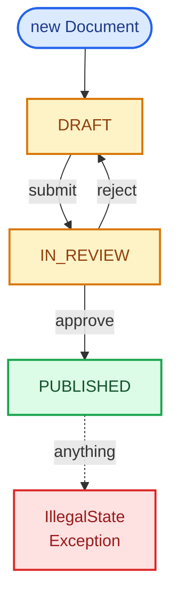
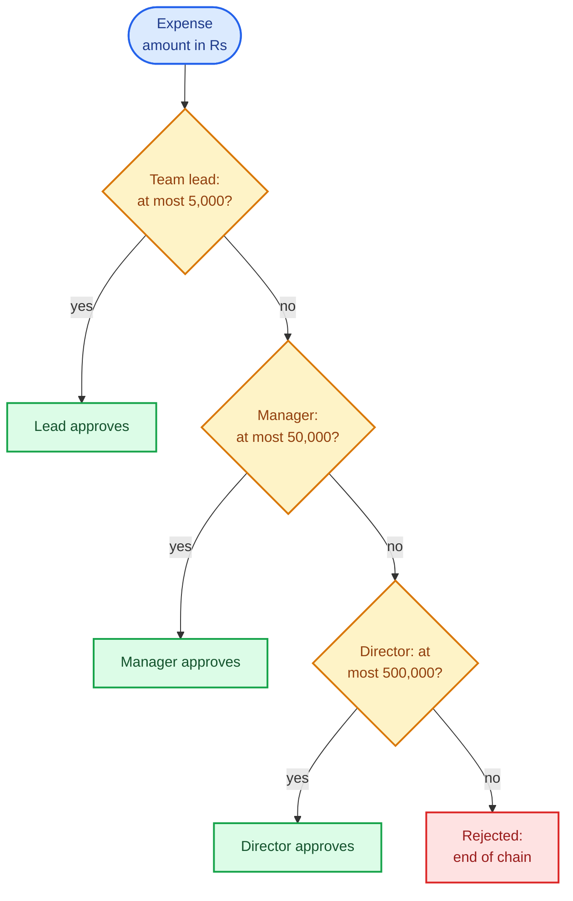
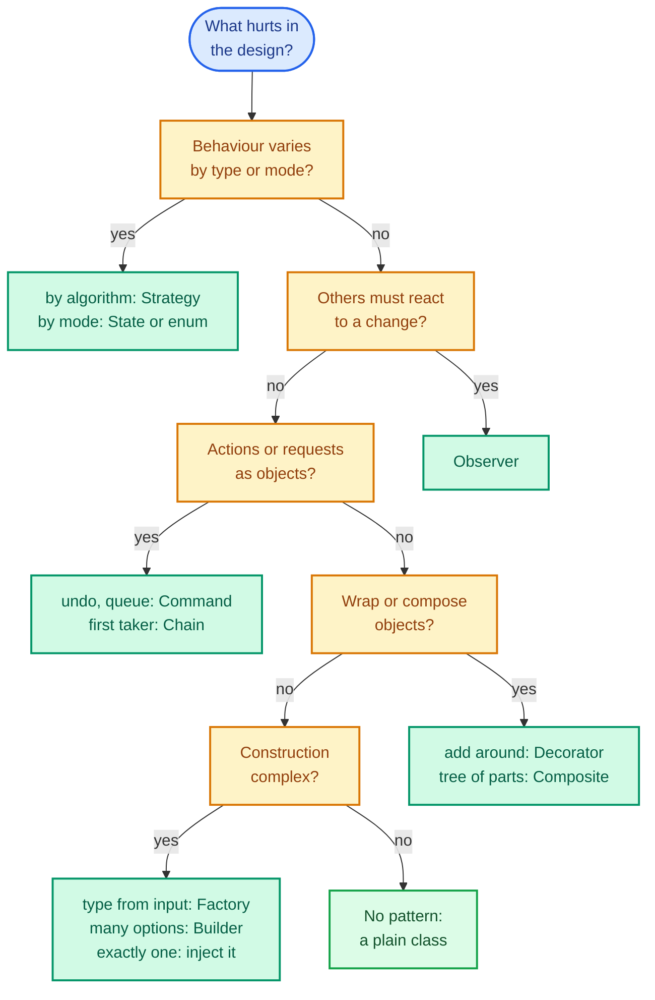

An interviewer in a low-level design round doesn't score the number of patterns you name. They watch whether your design survives a change: a new vehicle type, a second pricing scheme, an undo button. Patterns are how experienced engineers describe the designs that survive those changes, which is why they come up, and why naming one before you have described the problem it solves sounds like reciting.

So this post is a toolkit, not an encyclopaedia. Four OOP ideas, the five SOLID principles, three brakes on over-engineering, and ten patterns, each included because a later question in the series needs it. Every one is shown the same way: the *smell* (a sign in the code that something is about to hurt), the fix, a small Java example, and the point where the fix becomes overkill.

It follows [the method](/blogs/lld-the-method/), which gives the stages of the round and the tell-don't-ask rule that most of this post elaborates. [Part 3](/blogs/lld-concurrency/) is the other half of the toolkit, concurrency.

All the Java below is one file that compiled and ran on Java 21; the outputs quoted are what it printed. Money is held as a `long` count of paise (1 rupee = 100 paise), because binary floating point can't represent most decimal fractions exactly: `0.1 + 0.2` is `0.30000000000000004` in Java, as in most languages (recalled).

## Four OOP ideas, each against the smell it prevents

OOP (object-oriented programming) is usually taught as four nouns. In an interview each one is worth exactly the bug it stops.

### Encapsulation: tell, don't ask

*Encapsulation* means an object's fields are private and its rules are enforced by its own methods, so no outside code can put it into an invalid state.

**The smell:** getters and setters for every field, with the logic in the callers.

```java
// The smell: every caller does the arithmetic, so the "no overdraft" rule
// lives in all of them, and one of them will forget it.
final class LeakyWallet {
    private long balancePaise;
    long getBalancePaise() { return balancePaise; }
    void setBalancePaise(long balancePaise) { this.balancePaise = balancePaise; }
}
```

The rule "you can't spend more than you have" now lives in every caller. One careless caller wrote `setBalancePaise(getBalancePaise() - 15_000)` against a balance of 10,000 paise (Rs 100), and the program printed `leaky wallet balance: -5000`: minus Rs 50, and nothing complained.

**The fix:** the object that owns the balance owns the rule. Callers *tell* it what they want.

```java
final class Wallet {
    private long balancePaise;

    Wallet(long openingPaise) {
        if (openingPaise < 0) throw new IllegalArgumentException("opening balance cannot be negative");
        this.balancePaise = openingPaise;
    }

    // The rule lives here, once. Callers say what they want; the wallet decides.
    boolean withdraw(long amountPaise) {
        if (amountPaise <= 0) throw new IllegalArgumentException("amount must be positive: " + amountPaise);
        if (amountPaise > balancePaise) return false;
        balancePaise -= amountPaise;
        return true;
    }

    long balancePaise() { return balancePaise; }
}
```

The same overdraft attempt now prints `withdraw 150.00 from 100.00: false, balance Rs 100.00`. The interview version of this is the question "who owns this rule?", asked about every rule in your spec. The answer is always the class holding the state the rule reads.

### Abstraction: interfaces at the seams

*Abstraction* means depending on what something does, not how it does it. In Java that usually means an interface at a *seam*: a boundary where the implementation might be swapped, for production against tests, or for one variant against another.

**The smell:** a class that reaches for a concrete global, like `System.currentTimeMillis()`, inside its logic. A seat hold that expires after two minutes then needs a test that sleeps for two minutes.

**The fix:** an interface for the thing that varies, passed in.

```java
interface TimeSource {
    long nowMillis();
}

record SeatHold(String seatId, long expiresAtMillis) {
    // Asks a TimeSource instead of calling System.currentTimeMillis(), so a test
    // can move time forward two minutes without sleeping for two minutes.
    boolean isExpired(TimeSource time) {
        return time.nowMillis() >= expiresAtMillis;
    }
}
```

In the test, time is a variable: `long[] now = {1_000}; TimeSource testClock = () -> now[0];`. The hold printed `t=1000 expired? false`, then after `now[0] += 120_000` it printed `t=121000 expired? true`, with no waiting. Production passes `System::currentTimeMillis`. The JDK has `java.time.Clock` for the same job; a one-method interface of your own is easier to write on a whiteboard. The [rate limiter](/blogs/lld-rate-limiter/) depends on exactly this seam.

Abstraction is not "interfaces everywhere". An interface with one implementation and no reason to have a second is a file you have to keep in sync for nothing.

### Polymorphism: replace the type switch

*Polymorphism* means one call, `discount.apply(price)`, runs different code depending on the object's actual class. It replaces branching on a type code.

**The smell:** an `if` or `switch` on a type string, repeated in several methods.

```java
final class DiscountSwitch {
    // The smell: a new discount type means editing this method, and every other
    // method that switches on the same string.
    static long applyDiscount(String type, long value, long pricePaise) {
        if (type.equals("PERCENT")) return pricePaise - pricePaise * value / 100;
        else if (type.equals("FLAT")) return Math.max(0, pricePaise - value);
        throw new IllegalArgumentException("unknown discount type " + type);
    }
}
```

Adding a "buy one get one" discount means editing this method, and every other method that switches on the same string (the one that formats the discount for a receipt, the one that validates it). Miss one and the new type silently breaks.

**The fix:** an interface, and one class per type that carries its own behaviour.

```java
interface Discount {
    long apply(long pricePaise);
}

record PercentOff(int percent) implements Discount {
    public long apply(long pricePaise) { return pricePaise - pricePaise * percent / 100; }
}

record FlatOff(long paise) implements Discount {
    public long apply(long pricePaise) { return Math.max(0, pricePaise - paise); }   // never below zero
}
```

`new PercentOff(10).apply(50_000)` printed `Rs 450.00` and `new FlatOff(7_500)` printed `Rs 425.00`. A new discount type is a new class, and no existing code changes.

One honest caveat for modern Java. A single `switch` over a closed set of types, in one place, is fine, and Java 21's exhaustive switches over enums and sealed interfaces (a `sealed` interface lists every class allowed to implement it) make the compiler catch a missing case. The smell is the *same* switch repeated across methods, not the keyword.

### Composition over inheritance

*Inheritance* (`class B extends A`) makes B an A: it gets every method A has, forever. *Composition* means B *has* an A in a private field and exposes only what it chooses.

**The smell:** extending a class to reuse its code, when the subclass doesn't want all of its behaviour. The JDK has the canonical example: `java.util.Stack` extends `Vector` (recalled from the JDK source), so every `Vector` method is part of the stack's API, including insertion at any index.

```java
Stack<String> stack = new Stack<>();
stack.push("first");
stack.push("second");
stack.add(0, "sneaked in");                              // compiles: Stack is a Vector
System.out.println("java.util.Stack: " + stack + ", pop -> " + stack.pop());
```

It compiled, and printed `java.util.Stack: [sneaked in, first, second], pop -> second`. Something was inserted at the bottom of a stack, which no stack should allow.

**The fix:** hold the collection, don't be it.

```java
// Has a deque instead of being one, so push, pop and size are the whole API.
final class History<T> {
    private final Deque<T> items = new ArrayDeque<>();

    void push(T item) { items.push(item); }                          // adds at the head
    Optional<T> pop() { return Optional.ofNullable(items.poll()); }  // removes from the head: LIFO
    int size() { return items.size(); }
}
```

`History` pops `second`, then `first`, then nothing (an empty `Optional`), and there is no method that could insert anywhere else. Reach for inheritance only when the subclass really is a substitutable kind of the parent; the Liskov principle below makes "really" precise.

## SOLID, as smell and fix

SOLID is five principles named by their initials. Each is easiest to remember as the smell it removes.

### Single responsibility

*A class should have one reason to change.* "Reason" means one stakeholder or one kind of requirement.

**The smell:** a `ReportService` that queries the orders, computes the totals, formats a PDF and emails it. A change to the PDF layout and a change to the tax rule now edit the same class, and a bug in one can break the other.

**The fix:** split along the reasons. On the board:

```text
class ReportCalculator   + totalsFor(orders) -> Totals        // changes with business rules
class PdfReportFormatter + format(totals) -> byte[]           // changes with layout
class ReportMailer       + send(to, pdf)                      // changes with delivery
class ReportService      + run(period)                        // orchestrates the three
```

In an LLD round this is the orchestrator-plus-entities split from Part 1, applied inside one feature.

### Open/closed

*Open for extension, closed for modification:* adding a new variant should mean adding code, not editing working code.

**The smell:** the discount `switch` above. Every new discount type edits it.

**The fix:** the `Discount` interface above. A `BuyOneGetOne` class is new code; nothing that already works is touched. The seam goes where the requirements already show variation. In the [Splitwise](/blogs/lld-splitwise/) question the prompt itself lists three split types (equal, exact amounts, percentages), so a split interface is earned from minute one.

### Liskov substitution

*Any subclass must be usable wherever its parent is expected, without the caller noticing.* Named after Barbara Liskov.

**The smell:** a subclass that throws on, or ignores, a method its parent promises.

```java
class Account {
    protected long balancePaise;
    Account(long balancePaise) { this.balancePaise = balancePaise; }

    void withdraw(long paise) {
        if (paise > balancePaise) throw new IllegalStateException("insufficient funds");
        balancePaise -= paise;
    }
}

// The smell: a subclass that cannot do what its parent promises. Any code
// written against Account now breaks when handed a FixedDeposit.
class FixedDeposit extends Account {
    FixedDeposit(long balancePaise) { super(balancePaise); }

    @Override
    void withdraw(long paise) { throw new UnsupportedOperationException("locked until maturity"); }
}
```

A loop over `List<Account>` that withdraws Rs 10 from each printed `Account: withdrew 10.00`, then `FixedDeposit: locked until maturity`. Any code written against `Account` now has to know about `FixedDeposit`, which is exactly what subclassing was supposed to avoid.

**The fix:** model the capability, not the family tree. Only things you can withdraw from are `Withdrawable`.

```java
interface Withdrawable {
    void withdraw(long paise);
}

final class Savings implements Withdrawable {
    private long balancePaise;
    Savings(long balancePaise) { this.balancePaise = balancePaise; }

    public void withdraw(long paise) {
        if (paise > balancePaise) throw new IllegalStateException("insufficient funds");
        balancePaise -= paise;
    }
    long balancePaise() { return balancePaise; }
}

// Not Withdrawable, so no caller can even try.
final class Deposit {
    private final long principalPaise;
    private final int ratePercent;
    Deposit(long principalPaise, int ratePercent) { this.principalPaise = principalPaise; this.ratePercent = ratePercent; }
    long maturityPaise() { return principalPaise + principalPaise * ratePercent / 100; }   // one year, simple interest
}
```

Now no caller can even try to withdraw from a `Deposit`: the compiler refuses. The test for an `extends` is "can every caller of the parent use this without a special case?" If not, it is a different type that happens to share some fields.

### Interface segregation

*Callers shouldn't depend on methods they don't use.*

**The smell:** one fat interface for every client.

```text
interface ParkingLotOps
  + park(vehicle) -> Ticket
  + unpark(ticket) -> Receipt
  + addFloor(floor)
  + setRates(rates)
```

The entry gate needs `park`; it shouldn't be able to call `setRates`, and a test double for the gate shouldn't have to implement `addFloor`.

**The fix:** split by client.

```text
interface EntryGateOps   + park(vehicle) -> Ticket
interface ExitGateOps    + unpark(ticket) -> Receipt
interface AdminOps       + addFloor(floor)
                         + setRates(rates)
class ParkingLot implements EntryGateOps, ExitGateOps, AdminOps
```

One class can still implement all three. In a 35-minute round you rarely need this; it is the answer when an interviewer asks "who is allowed to call what?"

### Dependency inversion

*High-level policy depends on abstractions; the concrete details are plugged in from outside.* In practice: take dependencies as constructor parameters typed by interfaces, and build the real objects in one place, usually `main`. That is *dependency injection* (DI), done by hand, with no framework.

**The smell:** `private final MySqlBookingRepository repo = new MySqlBookingRepository();` inside `BookingService`. The service can't be tested without MySQL, and can't move to anything else without editing it.

**The fix:**

```java
interface BookingRepository {
    void save(String bookingId, String seatId);
    Optional<String> seatFor(String bookingId);
}

final class InMemoryBookingRepository implements BookingRepository {
    private final Map<String, String> rows = new HashMap<>();
    public void save(String bookingId, String seatId) { rows.put(bookingId, seatId); }
    public Optional<String> seatFor(String bookingId) { return Optional.ofNullable(rows.get(bookingId)); }
}

final class BookingService {
    private final BookingRepository repo;   // an abstraction, handed in by whoever builds the service
    private int next = 1;

    BookingService(BookingRepository repo) { this.repo = repo; }

    String book(String seatId) {
        String id = "B" + next++;
        repo.save(id, seatId);
        return id;
    }
    Optional<String> seatFor(String bookingId) { return repo.seatFor(bookingId); }
}
```

`new BookingService(new InMemoryBookingRepository())` booked seat C7 as `B1`. In an LLD round the in-memory repository is usually the only one you write, and the interface is your answer to "how would this use a real database?": write a second implementation, change one line in `main`.

### DRY, KISS and YAGNI: the brakes

SOLID pushes towards more seams. These three push back, and an interviewer listens for both.

- **DRY** (don't repeat yourself) is about knowledge, not lines. Two methods that both compute "hours charged, rounded up" will drift apart when the rule changes; put the rule in one place. Two lines that look alike but encode different rules should stay separate.
- **KISS** (keep it simple) means the simplest design that meets the spec. An enum with a `switch` for three states that never grow beats the State pattern.
- **YAGNI** (you aren't gonna need it) means you don't build for a requirement nobody stated. A plugin system for discount types the interviewer never mentioned costs minutes and buys nothing. Say "if we needed X, the seam would be here" instead of building it.

The line between open/closed and YAGNI is evidence. Variation that is in the spec, or that the interviewer has hinted at, earns a seam. Variation you imagine earns a sentence.

## Ten patterns that earn their place

The names come from the 1994 book *Design Patterns* by Gamma, Helm, Johnson and Vlissides, the "Gang of Four" (recalled). It describes 23 patterns. These ten are the ones the questions in this series reach for, ordered roughly by how often.

### Strategy

**The shape:** one job, several ways to do it, chosen at runtime or by configuration. Pricing a parking stay hourly, flat or by a weekend rate; splitting an expense equally or by percentage; picking which elevator answers a call.

**The pattern:** an interface for the job, one class per way, and the user of the job holds one through the interface.

```java
interface PricingStrategy {
    long feePaise(Duration parked);
}

final class HourlyPricing implements PricingStrategy {
    private final long perHourPaise;
    HourlyPricing(long perHourPaise) { this.perHourPaise = perHourPaise; }

    public long feePaise(Duration parked) {
        // Every started hour is charged, minimum one: 130 min -> 3 hours, 5 min -> 1 hour.
        long hours = Math.max(1, (parked.toMinutes() + 59) / 60);
        return hours * perHourPaise;
    }
}

final class FlatPricing implements PricingStrategy {
    private final long flatPaise;
    FlatPricing(long flatPaise) { this.flatPaise = flatPaise; }
    public long feePaise(Duration parked) { return flatPaise; }
}

final class ExitGate {
    private final PricingStrategy pricing;   // chosen when the gate is built, not inside charge()
    ExitGate(PricingStrategy pricing) { this.pricing = pricing; }
    long charge(Duration parked) { return pricing.feePaise(parked); }
}
```

```java
Duration parked = Duration.ofMinutes(130);
ExitGate hourly = new ExitGate(new HourlyPricing(4_000));
ExitGate flat = new ExitGate(new FlatPricing(10_000));
ExitGate weekend = new ExitGate(d -> 5_000);            // a strategy can be a lambda
System.out.println("2h10m hourly at 40.00: " + rupees(hourly.charge(parked)));
System.out.println("2h10m flat 100.00:     " + rupees(flat.charge(parked)));
System.out.println("2h10m weekend lambda:  " + rupees(weekend.charge(parked)));
System.out.println("5 minutes hourly:      " + rupees(hourly.charge(Duration.ofMinutes(5))));
```

(`rupees` is the driver's helper that formats paise for printing.) 130 minutes at Rs 40 an hour is three started hours, Rs 120.00; the flat gate charged Rs 100.00, and the weekend lambda Rs 50.00. A five-minute stay still pays one hour, Rs 40.00. Because `PricingStrategy` has one method, a lambda is a strategy, which is often all a small variant needs.

**Later in the series:** [Parking lot](/blogs/lld-parking-lot/) (spot assignment and pricing), [Elevator](/blogs/lld-elevator/) (dispatch), [Rate limiter](/blogs/lld-rate-limiter/) (the algorithm), [LRU cache](/blogs/lld-lru-cache/) (the eviction policy), [Splitwise](/blogs/lld-splitwise/) (split types).

**Overkill when** there is one algorithm and no hint of a second. Write the method; extract the interface the day a second variant arrives.

### State

**The shape:** an object whose allowed operations depend on which mode it is in, with rules like "you can approve a document only while it is in review". The smell is a pile of boolean flags (`isSubmitted`, `isApproved`) and an `if` ladder at the top of every method.

The machine below is the one the code implements: three states, and the transitions each allows. Anything not drawn is illegal.



**The pattern:** one class per state, each implementing the operations it allows and returning the next state. The context object (`Document`) delegates to its current state.

```java
interface DocState {
    String name();
    // Defaults reject everything; each state overrides only what it allows.
    default DocState submit()  { throw new IllegalStateException(name() + " cannot be submitted"); }
    default DocState approve() { throw new IllegalStateException(name() + " cannot be approved"); }
    default DocState reject()  { throw new IllegalStateException(name() + " cannot be rejected"); }
}

final class Draft implements DocState {
    public String name() { return "DRAFT"; }
    public DocState submit() { return new InReview(); }
}

final class InReview implements DocState {
    public String name() { return "IN_REVIEW"; }
    public DocState approve() { return new Published(); }
    public DocState reject() { return new Draft(); }
}

final class Published implements DocState {
    public String name() { return "PUBLISHED"; }
}

final class Document {
    private DocState state = new Draft();
    void submit()  { state = state.submit(); }
    void approve() { state = state.approve(); }
    void reject()  { state = state.reject(); }
    String state() { return state.name(); }
}
```

The default methods reject everything, so each state lists only what it permits. The run printed `DRAFT`, `submit -> IN_REVIEW`, `reject -> DRAFT`, `submit -> IN_REVIEW`, `approve -> PUBLISHED`, then `submit -> PUBLISHED cannot be submitted`.

**The alternative I'd usually write first** is an enum, because these states carry no data of their own:

```java
// The same machine as an enum: shorter while the states carry no data of their own.
enum DocEvent { SUBMIT, APPROVE, REJECT }

enum DocStatus {
    DRAFT, IN_REVIEW, PUBLISHED;

    DocStatus on(DocEvent event) {
        return switch (this) {   // exhaustive over DocStatus: a new status without a case won't compile
            case DRAFT -> switch (event) {
                case SUBMIT -> IN_REVIEW;
                default -> illegal(event);
            };
            case IN_REVIEW -> switch (event) {
                case APPROVE -> PUBLISHED;
                case REJECT -> DRAFT;
                default -> illegal(event);
            };
            case PUBLISHED -> illegal(event);
        };
    }

    private DocStatus illegal(DocEvent event) {
        throw new IllegalStateException(this + " cannot handle " + event);
    }
}
```

Same transitions, one type, and the outer `switch` is exhaustive, so a new status without a case won't compile. The State pattern wins once states carry their own data or behaviour (a vending machine's "has money" state knows how much), or once each state's logic is long enough that one `switch` becomes a wall. [Vending machine](/blogs/lld-vending-machine/) puts both versions side by side; [Connect Four](/blogs/lld-connect-four/), [Elevator](/blogs/lld-elevator/) and [Amazon Locker](/blogs/lld-amazon-locker/) use the enum form, and [Movie ticket booking](/blogs/lld-movie-ticket-booking/) uses its cousin, a sealed interface of records, because a held seat carries data.

**Overkill when** there are two or three states with no state-specific data.

### Observer

**The shape:** when something changes, other parts of the system must react, and the thing that changes shouldn't know who they are. Stock drops below a threshold, and an alert, a reorder and a dashboard all need to know.

**The pattern:** the subject keeps a list of listeners behind an interface and calls each one on the event.

```java
interface StockListener {
    void onLowStock(String sku, int remaining);
}

final class StockLevel {
    private final String sku;
    private final int threshold;
    private int quantity;
    private final List<StockListener> listeners = new ArrayList<>();

    StockLevel(String sku, int quantity, int threshold) {
        this.sku = sku; this.quantity = quantity; this.threshold = threshold;
    }

    void subscribe(StockListener listener) { listeners.add(listener); }

    boolean remove(int units) {
        if (units > quantity) return false;              // never oversell
        int before = quantity;
        quantity -= units;
        // Fire on the crossing only (8 -> 6 -> 4 alerts once at 4, not again at 3).
        if (before >= threshold && quantity < threshold)
            for (StockListener l : listeners) l.onLowStock(sku, quantity);
        return true;
    }

    int quantity() { return quantity; }
}
```

```java
StockLevel stock = new StockLevel("SKU-42", 8, 5);
stock.subscribe((sku, left) -> System.out.println("  ALERT " + sku + " down to " + left));
stock.subscribe((sku, left) -> System.out.println("  reorder queued for " + sku));
```

Starting from 8 units with a threshold of 5, the run removed 2, 2, 1 and 9 units:

| Call | Quantity after | Listeners fired? |
| --- | --- | --- |
| `remove(2)` | 6 | no, still at or above 5 |
| `remove(2)` | 4 | yes, both: crossed from 6 to 4 |
| `remove(1)` | 3 | no, already below |
| `remove(9)` | 3 | no, refused (`false`): only 3 left |

Firing on the *crossing*, not on every sale below the threshold, is the detail interviewers probe: otherwise the warehouse gets an alert per sale.

**Later in the series:** [Inventory management](/blogs/lld-inventory-management/) for low-stock alerts; the [pub-sub queue](/blogs/lld-pub-sub-queue/) is the same idea with a queue between publisher and subscribers, so a slow subscriber can't stall the publisher.

**Overkill when** there is one reaction, known at compile time: call it directly. **Watch for:** a listener that throws (should it stop the others?), and listeners called while holding a lock: a listener that takes a second lock sets up the two-lock deadlock [Part 3](/blogs/lld-concurrency/) shows.

### Factory

**The shape:** which concrete class to create depends on input, and callers shouldn't know the concrete classes. A notification channel arrives as `SMS` in a request, and something must turn it into an `SmsNotifier`.

**The pattern (simple factory):** one method that maps the input to an object, behind the interface.

```java
enum Channel { EMAIL, SMS, PUSH }

interface Notifier {
    boolean send(String to, String message);   // true if delivered
}

final class EmailNotifier implements Notifier { public boolean send(String to, String message) { return true; } }
final class SmsNotifier implements Notifier { public boolean send(String to, String message) { return true; } }
final class PushNotifier implements Notifier { public boolean send(String to, String message) { return true; } }

final class Notifiers {
    private Notifiers() {}

    // The one place that knows the concrete classes. The switch is exhaustive, so
    // adding a Channel constant without a case here is a compile error.
    static Notifier forChannel(Channel channel) {
        return switch (channel) {
            case EMAIL -> new EmailNotifier();
            case SMS -> new SmsNotifier();
            case PUSH -> new PushNotifier();
        };
    }
}
```

Each channel printed its class: `EMAIL -> EmailNotifier`, `SMS -> SmsNotifier`, `PUSH -> PushNotifier`. The switch expression has no `default`, so adding `WHATSAPP` to `Channel` makes this method fail to compile until it handles the new constant (recalled: a switch expression must be exhaustive, and over an enum the compiler checks every constant).

The *factory method* variant moves the choice into a method a subclass overrides, for example an abstract `createBoard()` in a base `Game` that each game type implements. In modern Java a `Supplier<Board>` passed to the constructor does the same job with less ceremony.

**Later in the series:** wherever a type arrives as data, such as building the right algorithm's state from a configured policy in the [rate limiter](/blogs/lld-rate-limiter/).

**Overkill when** there is one implementation. `new` is fine.

### Builder

**The shape:** an object with several optional fields, some defaults, and rules that span fields, which you want immutable once built. A constructor with seven parameters, four of them optional, is unreadable at the call site: `new Notification("a@x.com", "hi", null, 1, 2)`.

**The pattern:** a mutable builder collects values by name and validates once in `build()`, which returns the immutable object.

```java
record Notification(String to, String body, Channel channel, int priority, int maxRetries) {

    static Builder to(String to) { return new Builder(to); }

    static final class Builder {
        private final String to;              // required, so it is the entry point
        private String body = "";
        private Channel channel = Channel.EMAIL;
        private int priority = 3;             // 1 = most urgent, 5 = least
        private int maxRetries = 2;

        private Builder(String to) { this.to = to; }

        Builder body(String body) { this.body = body; return this; }
        Builder channel(Channel channel) { this.channel = channel; return this; }
        Builder priority(int priority) { this.priority = priority; return this; }
        Builder maxRetries(int maxRetries) { this.maxRetries = maxRetries; return this; }

        // Validation runs once, on the finished set of values.
        Notification build() {
            if (body.isBlank()) throw new IllegalStateException("body is required");
            if (priority < 1 || priority > 5) throw new IllegalStateException("priority must be 1-5, got " + priority);
            return new Notification(to, body, channel, priority, maxRetries);
        }
    }
}
```

```java
Notification n = Notification.to("asha@example.com")
        .body("Your order has shipped")
        .channel(Channel.SMS)
        .priority(1)
        .build();
```

That printed `Notification[to=asha@example.com, body=Your order has shipped, channel=SMS, priority=1, maxRetries=2]`, with `maxRetries` left at its default. A builder with `priority(9)` failed at `build()` with `priority must be 1-5, got 9`, so an invalid `Notification` never exists. The JDK uses this shape for `java.net.http.HttpRequest.newBuilder()` (recalled).

**Overkill when** a record has two or three required fields. The record's constructor, with validation in a compact constructor, is enough.

### Command

**The shape:** actions that must be undone, redone, queued, logged or replayed. The trick is to turn each action into an object that knows how to do itself and how to undo itself.

**The pattern:**

```java
interface EditCommand {
    void execute(StringBuilder doc);
    void undo(StringBuilder doc);
}

record Append(String text) implements EditCommand {
    public void execute(StringBuilder doc) { doc.append(text); }
    public void undo(StringBuilder doc) { doc.setLength(doc.length() - text.length()); }
}

final class DeleteLast implements EditCommand {
    private final int count;
    private String removed = "";   // remembered by execute() so undo() can put it back

    DeleteLast(int count) { this.count = count; }

    public void execute(StringBuilder doc) {
        int from = Math.max(0, doc.length() - count);
        removed = doc.substring(from);
        doc.setLength(from);
    }
    public void undo(StringBuilder doc) { doc.append(removed); }
}

final class Editor {
    private final StringBuilder doc = new StringBuilder();
    private final Deque<EditCommand> undoStack = new ArrayDeque<>();
    private final Deque<EditCommand> redoStack = new ArrayDeque<>();

    void run(EditCommand command) {
        command.execute(doc);
        undoStack.push(command);
        redoStack.clear();          // a new edit makes the old "future" unreachable
    }

    boolean undo() {
        EditCommand c = undoStack.poll();
        if (c == null) return false;
        c.undo(doc);
        redoStack.push(c);
        return true;
    }

    boolean redo() {
        EditCommand c = redoStack.poll();
        if (c == null) return false;
        c.execute(doc);
        undoStack.push(c);
        return true;
    }

    String text() { return doc.toString(); }
}
```

`DeleteLast` shows the part people forget: undo needs information that only exists at execution time (the text that was deleted), so the command stores it. The figure follows the editor through the run, one action per row, with both stacks after each step.

<figure class="sketch"></figure>

Each undo moves the top command from the undo stack to the redo stack and reverses it; redo moves it back. The last row is the rule worth saying aloud: a new edit clears the redo stack, because the "future" it held branched from a state that no longer exists. The run printed `redo after a new edit? false`.

**Later in the series:** the "add undo" follow-up on any game, [Connect Four](/blogs/lld-connect-four/) included; the moves of [Part 1](/blogs/lld-the-method/)'s Tic Tac Toe become `Move` records the moment undo is in scope.

**Overkill when** nothing needs undoing, queueing or logging. A method call is already a command.

### Composite

**The shape:** a tree of parts and wholes where callers want to treat a single part and a group the same way. A file and a directory both have a size; an item and a bundle both have a price.

**The pattern:** one interface for both; the group holds a list of the interface and implements each operation by asking its children.

```java
interface Priced {
    String name();
    long pricePaise();
}

record Item(String name, long pricePaise) implements Priced {}

final class Bundle implements Priced {
    private final String name;
    private final int discountPercent;
    private final List<Priced> parts = new ArrayList<>();   // items or other bundles

    Bundle(String name, int discountPercent) { this.name = name; this.discountPercent = discountPercent; }

    Bundle add(Priced part) { parts.add(part); return this; }

    public String name() { return name; }

    // The same call on a leaf or a subtree: the recursion is in the data, not in the caller.
    public long pricePaise() {
        long sum = 0;
        for (Priced p : parts) sum += p.pricePaise();
        return sum - sum * discountPercent / 100;
    }

    List<Priced> parts() { return List.copyOf(parts); }
}
```

```java
Bundle desk = new Bundle("Desk setup", 10)
        .add(new Item("Monitor", 1_200_000))
        .add(new Bundle("Keyboard kit", 0)
                .add(new Item("Keyboard", 250_000))
                .add(new Item("Mouse", 100_000)))
        .add(new Item("Lamp", 150_000));
```

The tree it builds is drawn below, with each box's price worked out the way `pricePaise()` computes it: leaves report their own price, bundles add their children's and apply their discount.

<figure class="sketch"></figure>

The run printed `Keyboard kit: Rs 3,500.00` and `Desk setup (10% off 17,000.00): Rs 15,300.00`. No caller ever checks whether it holds an item or a bundle; the recursion is in the data.

**Later in the series:** [File system](/blogs/lld-file-system/) is this pattern as the whole question: files and directories share a node type, and a directory's size is the sum of its children.

**Overkill when** the structure is flat. A list of items with a total is a loop.

### Chain of Responsibility

**The shape:** a request should go to the first handler that can deal with it, and the set or order of handlers may change. An expense goes to the team lead if it is small, the manager if it is larger, the director if larger still, and is rejected above that.

The flowchart is the chain the code builds: each approver either approves or passes the expense to the next.



**The pattern:** each handler holds a reference to the next and decides whether to handle or pass on.

```java
abstract class Approver {
    private Approver next;

    // Returns the approver it was given, so a chain reads lead.then(m).then(d).
    Approver then(Approver next) { this.next = next; return next; }

    final String handle(long amountRupees) {
        if (canApprove(amountRupees)) return title() + " approves";
        if (next == null) return "rejected: nobody can approve " + amountRupees;
        return next.handle(amountRupees);
    }

    abstract boolean canApprove(long amountRupees);
    abstract String title();
}

final class LimitApprover extends Approver {
    private final String title;
    private final long limitRupees;
    LimitApprover(String title, long limitRupees) { this.title = title; this.limitRupees = limitRupees; }
    boolean canApprove(long amountRupees) { return amountRupees <= limitRupees; }
    String title() { return title; }
}
```

```java
Approver lead = new LimitApprover("Team lead", 5_000);
lead.then(new LimitApprover("Manager", 50_000))
    .then(new LimitApprover("Director", 500_000));
```

Three expenses printed `3200 -> Team lead approves`, `42000 -> Manager approves`, and `900000 -> rejected: nobody can approve 900000`. The caller only ever talks to `lead`. Adding a CFO level is one more `.then(...)`, and no approver changes.

In modern Java a `List<Approver>` and a loop that stops at the first one that accepts is the same chain without the links, and it is easier to build from configuration. Either is fine to write in an interview.

**Later in the series:** [Logging framework](/blogs/lld-logging-service/), where the chain is the logger hierarchy: a log event goes to its logger's appenders, then up to each ancestor's, and the textbook chain of per-level handlers is rejected.

**Overkill when** every handler always runs. That is a pipeline (a list of steps), not a chain. And three fixed rules that never change are an `if` ladder.

### Decorator

**The shape:** add behaviour around an object (retries, logging, caching, metrics) without editing it and without a subclass per combination. The smell it prevents is a class explosion: `EmailNotifierWithRetry`, `SmsNotifierWithRetry`, `SmsNotifierWithRetryAndLogging`.

**The pattern:** a class that implements the same interface as the object it wraps, does its extra work, and delegates.

```java
// A fake for the demo: fails the first `failures` sends, then succeeds.
final class FlakyNotifier implements Notifier {
    private int failuresLeft;
    FlakyNotifier(int failures) { this.failuresLeft = failures; }
    public boolean send(String to, String message) {
        if (failuresLeft > 0) { failuresLeft--; return false; }
        return true;
    }
}

final class RetryingNotifier implements Notifier {
    private final Notifier inner;
    private final int maxAttempts;
    RetryingNotifier(Notifier inner, int maxAttempts) { this.inner = inner; this.maxAttempts = maxAttempts; }

    public boolean send(String to, String message) {
        for (int attempt = 1; attempt <= maxAttempts; attempt++)
            if (inner.send(to, message)) return true;
        return false;
    }
}

final class CountingNotifier implements Notifier {
    private final Notifier inner;
    private int calls = 0;
    CountingNotifier(Notifier inner) { this.inner = inner; }

    public boolean send(String to, String message) {
        calls++;
        return inner.send(to, message);
    }
    int calls() { return calls; }
}
```

```java
CountingNotifier outerCount = new CountingNotifier(new RetryingNotifier(new FlakyNotifier(2), 3));
System.out.println("count(retry(flaky)) sent: " + outerCount.send("98450 00000", "OTP 4821") + ", calls seen by counter: " + outerCount.calls());
FlakyNotifier flaky = new FlakyNotifier(2);
CountingNotifier innerCount = new CountingNotifier(flaky);
Notifier retried = new RetryingNotifier(innerCount, 3);
System.out.println("retry(count(flaky)) sent: " + retried.send("98450 00000", "OTP 4821") + ", calls seen by counter: " + innerCount.calls());
```

Wrappers compose, and their order changes what each one sees. The figure shows the same three wrappers both ways round, around a fake notifier that fails twice and then succeeds.

<figure class="sketch"></figure>

With the counter outside the retry, it saw the caller's single `send` and printed `calls seen by counter: 1`; with the counter inside, it saw every attempt and printed `3`. Both delivered. Counting outside measures what callers asked for; counting inside measures load on the provider. Which one you want is a requirement, and it is the decorator question interviewers like. With only two attempts allowed, the same fake was never reached a third time and `send` returned `false`.

The JDK's I/O classes are decorators: `new BufferedReader(new InputStreamReader(System.in))` wraps a reader in a buffering reader of the same type (recalled).

**Later in the series:** wrapping a log appender so it writes asynchronously, or only for some records, in the [logging framework](/blogs/lld-logging-service/).

**Overkill when** there is one fixed combination. Put the retry loop in the one class that needs it.

### Singleton, and why dependency injection usually wins

**The shape:** exactly one instance of something must exist, such as an id generator whose ids must never repeat, or a connection pool.

**The pattern:** the class guarantees there is one. In Java the shortest correct version is an enum with one constant, which the JVM creates once, thread-safely, when the enum class is initialised (recalled; *Effective Java* recommends it).

```java
// One instance per JVM, created when the enum class is initialised.
enum IdGenerator {
    INSTANCE;
    private final AtomicLong next = new AtomicLong(1);
    long nextId() { return next.getAndIncrement(); }
}

final class OrderService {
    private final LongSupplier ids;   // any id source: the singleton in production, a fresh one in a test
    OrderService(LongSupplier ids) { this.ids = ids; }
    String placeOrder(String item) { return "order-" + ids.getAsLong() + ":" + item; }
}
```

```java
OrderService prod = new OrderService(IdGenerator.INSTANCE::nextId);
System.out.println(prod.placeOrder("tea") + ", " + prod.placeOrder("coffee"));
AtomicLong testIds = new AtomicLong(100);
OrderService test = new OrderService(testIds::getAndIncrement);   // a test owns its own sequence
System.out.println(test.placeOrder("tea"));
```

Production printed `order-1:tea, order-2:coffee`; the test, with its own sequence, printed `order-100:tea`.

The trouble with a singleton is not that there is one instance; it is that every class can reach it through `IdGenerator.INSTANCE` without saying so. That hidden dependency makes tests share state (the second test sees ids the first one used), makes the order tests run in matter, and makes it impossible to give one service a different instance. Notice that `OrderService` never mentions `IdGenerator`: it takes "something that produces longs" in its constructor. That is the better answer most of the time: **create one instance in `main` and pass it to whoever needs it**. You still have exactly one, and every dependency is visible in a constructor.

**Later in the series:** the [logging framework](/blogs/lld-logging-service/), where "should the logger factory be a singleton?" is the follow-up.

**Overkill when** almost always. Say "one instance, created at startup and injected", and keep the enum for when the interviewer asks how you'd enforce it.

## Which pattern?

Patterns are answers to symptoms, so the useful question is "what hurts?". The flowchart groups the ten by the question that picks them: read it top to bottom, stop at the first question your design answers yes to, and the box beside it names the pattern. If none match, you need no pattern, which is the most common correct answer.



The same map as a table, with where each pattern carries a design later in the series:

| Pattern | The problem shape | Where it appears |
| --- | --- | --- |
| Strategy | one job, several algorithms | [Parking lot](/blogs/lld-parking-lot/), [Elevator](/blogs/lld-elevator/), [Rate limiter](/blogs/lld-rate-limiter/), [LRU cache](/blogs/lld-lru-cache/), [Splitwise](/blogs/lld-splitwise/) |
| State (or enum) | actions depend on mode | [Vending machine](/blogs/lld-vending-machine/); enum form in [Connect Four](/blogs/lld-connect-four/), [Elevator](/blogs/lld-elevator/), [Amazon Locker](/blogs/lld-amazon-locker/); sealed interface in [Movie tickets](/blogs/lld-movie-ticket-booking/) |
| Observer | react to a change | [Inventory](/blogs/lld-inventory-management/), [Pub-sub queue](/blogs/lld-pub-sub-queue/) |
| Command | undo, redo, queue | the undo follow-up in [Connect Four](/blogs/lld-connect-four/) |
| Chain of Responsibility | first handler that can | [Logging framework](/blogs/lld-logging-service/) |
| Decorator | behaviour around an object | [Logging framework](/blogs/lld-logging-service/) (async and filtering appenders) |
| Composite | tree of parts and wholes | [File system](/blogs/lld-file-system/) |
| Factory | type chosen from input | [Rate limiter](/blogs/lld-rate-limiter/), anywhere a type arrives as data |
| Builder | many optional fields | configuration objects in any part |
| Singleton, injected | exactly one instance | [Logging framework](/blogs/lld-logging-service/) |

In the room, the sentence that earns credit names the symptom first and the pattern second: "pricing varies by lot, and the prompt already lists two schemes, so pricing is an interface, a Strategy, and the gate holds one." The reverse order, "I'll use the Strategy pattern here", tells the interviewer you have memorised a name.

## Spot the smell

The coach below describes code smells in words, one at a time, and asks you to name the problem, the principle or pattern that fixes it, and whether the fix would be overkill. Answer before it tells you.


You are my low-level design interview coach. I have studied OOP (encapsulation as tell-don't-ask, abstraction as interfaces at seams, polymorphism replacing type switches, composition over inheritance), SOLID, DRY/KISS/YAGNI, and ten patterns: Strategy, State, Observer, Factory, Builder, Command, Composite, Chain of Responsibility, Decorator, Singleton (and why dependency injection is usually better).
Describe each scenario below in your own words, one at a time, and ask me: what is the smell, which principle or pattern fixes it, what the fix looks like in Java in a sentence or two, and whether the fix could be overkill. Wait for my answer each time. Do not reveal the expected points before I answer. If I'm stuck, give one small hint, then a bigger one, before explaining. After each answer, say what I got right and what I missed, then move on.
1. A ParkingLot class has calculateFee with a switch on vehicle type, and findSpot has the same switch. Expected: repeated type switch; polymorphism or Strategy; open/closed; a new vehicle type should be a new class, not edits in two switches; a single exhaustive switch in one place would be acceptable.
2. Callers write: if (account.getBalance() >= amount) account.setBalance(account.getBalance() - amount). Expected: tell, don't ask; the rule lives in every caller; move it into account.withdraw(amount) returning a result.
3. An Order constructor takes 11 parameters, 6 of them optional and often null. Expected: Builder with defaults and validation in build(), producing an immutable object; overkill for 2 or 3 required fields, where a record is enough.
4. An Elevator class has booleans isMoving, isDoorOpen, isInMaintenance and an if-ladder at the top of every method. Expected: a state machine; start with an enum and an exhaustive switch; the State pattern (a class per state) only if states carry their own data or long logic.
5. The team has EmailNotifierWithRetry, SmsNotifierWithRetry and SmsNotifierWithRetryAndLogging. Expected: class explosion from inheritance; Decorator (RetryingNotifier and LoggingNotifier wrapping any Notifier); composition over inheritance; order of wrapping matters (a counter outside the retry sees 1 call, inside it sees every attempt).
6. A RefundOnlyAccount extends Account and throws UnsupportedOperationException from deposit. Expected: Liskov violation; callers of Account now need special cases; model the capability with separate interfaces instead of inheritance.
7. Every service calls Logger.getInstance(), and tests interfere with each other. Expected: Singleton's hidden global dependency; create one instance in main and inject it through constructors; you still have exactly one, and each test can pass its own.
8. A drawing app needs undo and redo for move, resize and delete. Expected: Command objects with execute and undo, an undo stack and a redo stack; commands store what they need to undo (like the old position); a new action clears the redo stack.
9. A candidate adds an Observer interface and listener list to a class that has exactly one reaction, known at compile time. Expected: overkill, YAGNI; call the one reaction directly; add Observer when a second, independent reaction appears.
10. A ReportService queries orders, computes totals, renders a PDF and emails it. Expected: single responsibility; split calculator, formatter and mailer behind a small orchestrator, because each changes for a different reason.



Next: [Concurrency for LLD interviews](/blogs/lld-concurrency/), the other half of the toolkit: race conditions and the locks, atomics and queues that fix them, to the depth a design round asks for.
