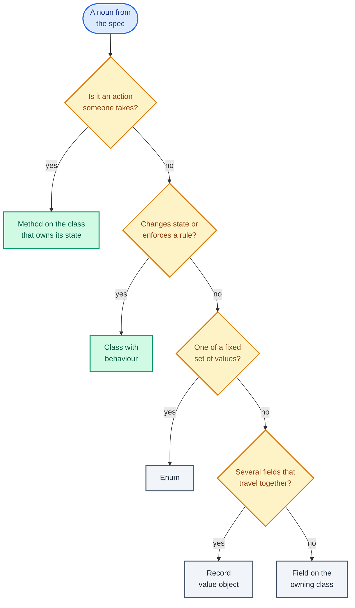
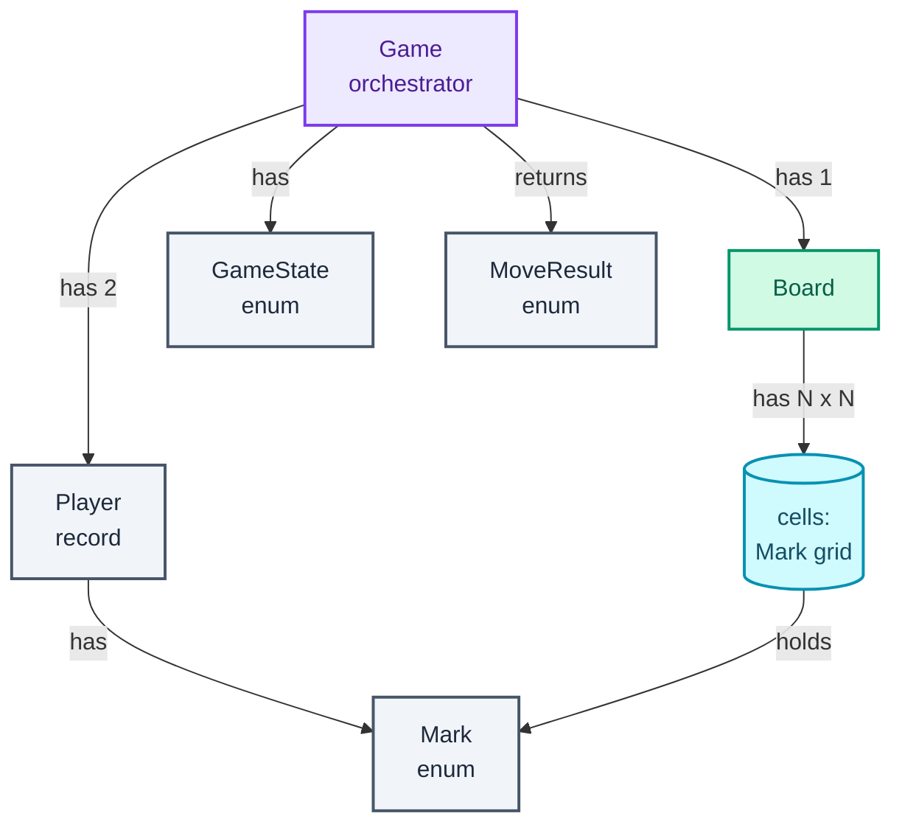
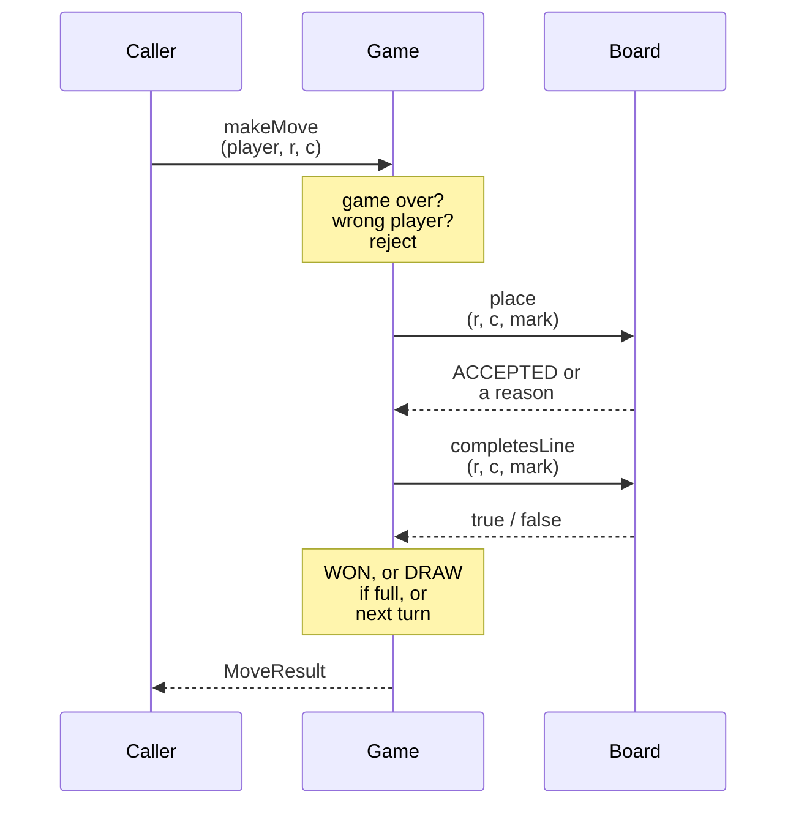
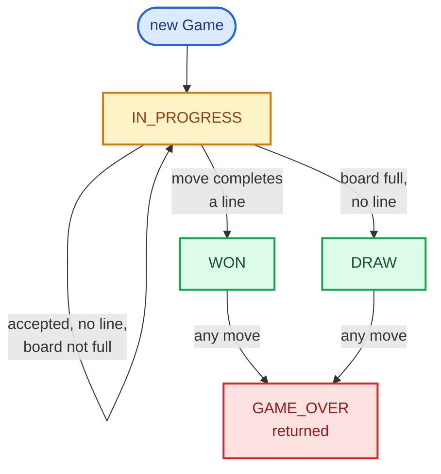

A low-level design round (LLD: designing the classes, their state and their methods for one program, then writing the code) opens with a prompt as short as "Design a parking lot" and thirty-five minutes on the clock. Most candidates who fail it know enough Java. They fail because they started typing a `ParkingLot` class in minute two, or because they drew twelve boxes and never wrote a method that ran.

The goal of this series is one sentence: **given a design question you haven't rehearsed, deliver a working, defensible design inside the time box.** Working means the code compiles and a scenario traces through it correctly. Defensible means every class, field and rule is there because a requirement put it there, and you can say which one.

If you came here from the [High-Level Design series](/blogs/hld-the-method/), which ended with [Google Docs](/blogs/hld-google-docs/), the shift is in what the boxes are. In HLD a box is a machine or a managed service, an arrow is a network call, and the question is where data lives and how it survives load and failure. In LLD everything runs in one process. A box is a class, an arrow is ownership or a method call, and the question is which object owns which state and which rule. Scale is rarely in scope; correctness and how easily the design absorbs a change are.

This post is the method, worked once end to end on Tic Tac Toe, then the map of the fifteen parts after it. [Part 2](/blogs/lld-oop-and-patterns/) is the toolkit: OOP, SOLID and the ten design patterns the questions actually use.

## Why LLD rounds go wrong

There are two failure modes, and they are mirror images.

**Code before structure.** The candidate hears "Tic Tac Toe", opens an editor and writes a `char[][]` and a `while` loop. Ten minutes later the win check is tangled into the input handling, the interviewer asks "what if the board is 4x4?", and the answer is a rewrite. Nothing on screen says which rule belongs where, so nothing can change in one place.

**Structure with no running code.** The opposite candidate spends twenty minutes on a class diagram with an `AbstractPlayerFactory`, a `MoveValidatorChain` and a `BoardObserver`, and reaches the implementation with eight minutes left. The interviewer never sees a method that does anything, so there is no evidence the design works. Patterns nobody asked for are a cost, not a credit.

Both come from the same place: no plan for the 35 minutes. The remedy is a fixed sequence of stages, each producing something the next stage consumes, with a time box on each.

## The delivery framework

The stages are Hello Interview's [LLD delivery framework](https://www.hellointerview.com/learn/low-level-design/in-a-hurry/delivery), the clearest statement of it I know, and I credit it here for the whole series. The worked examples, the code and the opinions in this series are mine.

The clock below is the 35 minutes as I spend them. Class design and implementation get two thirds of it, because that is where the interviewer learns the most.

<figure class="sketch"></figure>

Each stage produces an artefact. Requirements produce a numbered spec. Entities produce a list of classes and a picture of who owns whom. Class design produces each class's fields and method signatures. Implementation produces the methods that carry the behaviour, and a trace of one scenario proves them. Extensibility is the conversation that tests whether the design bends or breaks.

### Requirements (about 5 minutes)

LLD prompts are deliberately vague. "Design a vending machine" doesn't say whether it gives change, takes cards or has a maintenance mode. Your first job is to turn the prompt into a spec small enough to build in 30 minutes. Ask questions in four themes, in this order:

- **Primary capabilities.** What operations must the system support? Who calls them? For a parking lot: park a vehicle, unpark it, pay.
- **Rules and completion.** What makes an operation legal, and when is something finished? Which spot can a motorbike take? When is a ticket closed?
- **Error handling.** What happens on bad input or an impossible request: lot full, unknown ticket, paying twice? Reject with a reason, throw, or ignore?
- **Scope boundaries.** What is explicitly out? Payment gateways, a UI, persistence, multiple threads. Saying "out of scope" out loud is a decision the interviewer can agree with; leaving it unsaid is a gap they will probe.

Propose an answer with each question ("I'll assume X moves first; fine?") rather than asking open questions. It is faster and it shows judgement. Then write the spec on the board as a numbered list with an "Out of scope" line. Every later decision points back at a number on that list.

**What good looks like:** five to eight numbered requirements, each testable, plus an out-of-scope line. **The common mistake:** skipping error handling. The edge cases are where LLD designs differ, and an interviewer who hears none will assume you don't think about them.

### Entities and relationships (about 3 minutes)

Underline the nouns in your spec and run each through one filter:

> **Does it change state over time, or enforce a rule? Then it is a class. Otherwise it is a field, an enum or a small value object.**

A *value object* is a small immutable bundle of fields compared by value, like a `Position(row, col)` or a `Money(amountPaise)`; in Java 21 it is a `record`. The flowchart is the filter as I run it, top to bottom: actions become methods, things with behaviour become classes, fixed vocabularies become enums, and bundles of data become records.



Then name the relationships: who *has* whom (ownership, and how many), and who only *uses* whom (takes it as a parameter). Draw it as boxes and arrows, one arrow per relationship.

**What good looks like:** three to six classes, each one justified by a requirement in a sentence. **The common mistake:** a class per noun. `Cell`, `Move` and `Turn` are nouns in "players take turns placing marks in cells", and none of them needs to be a class.

### Class design (about 12 minutes)

Now give each class its state and its behaviour, top-down, starting with the orchestrator. The *orchestrator* is the class the outside world calls: `Game`, `ParkingLot`, `VendingMachine`. It sequences the steps of an operation and enforces the rules that span several entities. The *entities* below it each enforce the rules about their own state.

Derive both from the spec, not from imagination. For each requirement, ask what the class must remember to honour it (that becomes a field) and what operation changes it (that becomes a method). A small table makes this mechanical:

| Requirement | What it must track |
| --- | --- |
| Players alternate | whose turn it is |
| The game ends on a win or a draw | the current state, and the winner |

Write each class in a plain text notation, fields with `-` and methods with `+`:

```text
class Game
  - board: Board
  - state: GameState
  + makeMove(player, row, col) -> MoveResult
```

One principle carries most of this stage: **tell, don't ask.** Put each rule in the class that owns the state the rule reads, and have callers *tell* that class what to do instead of *asking* for its data and deciding for it. If `Game` reads `board.getCells()[r][c]` to decide whether a cell is free, the rule "a cell holds one mark" now lives outside the class that holds the cells, and the next caller will forget it. `board.place(r, c, mark)` returning "taken" keeps the rule in one place.

**What good looks like:** every method traces to a numbered requirement, and no class reaches into another's fields. **The common mistake:** a "god" orchestrator that does everything while the entities are bags of getters and setters (an *anaemic* model), or the reverse, entities that call back up into the orchestrator.

### Implementation (about 10 minutes, ending in a trace)

First ask: "Do you want real code or pseudo-code, and which methods matter most?" Interviewers differ, and the answer decides how you spend ten minutes. Then write the methods that carry behaviour. Skip getters, constructors that only assign fields, and `toString`; say you're skipping them.

Write the **happy path first**, the sequence where everything is valid, so there is a working spine. Then add the edge cases from your error-handling requirements, one guard at a time, saying each out loud as you add it. A half-finished method with every edge case is worth less than a complete happy path with the edge cases listed beside it.

**What good looks like:** code that would compile, in the language you named, with names from your class design. **The common mistake:** silently changing the design while coding. If the code needs a field the design lacked, say so and add it to the design.

### Verification (the last 2 minutes of implementation)

Pick one scenario with at least one rejected or edge transition, and trace it through your code call by call, saying the state after each. This finds bugs while the interviewer is still watching you, which is far better than them finding the bugs. It takes two minutes, and most candidates skip it.

**What good looks like:** a short table or a spoken list, one row per call, with the state after it. **The common mistake:** tracing only the happy path, which is the one path you already know works.

### Extensibility (about 5 minutes)

The interviewer now asks "what if": a bigger board, a new vehicle type, undo, a second thread. A strong answer points at the *seam*, the one place in the design that changes, and says what the change is. "The size is a constructor parameter, and the win check loops to `size`, so 4x4 is no code change" is a strong answer. "I'd refactor" is a weak one.

You don't need to have predicted the question. You need a design where rules have one owner, because then every change has one place to go.

### Why there is no UML here

This series never draws a UML class diagram. UML (the Unified Modeling Language) has a precise notation for relationships, and in an interview the precision costs minutes the interviewer rarely grades: arrowhead styles, multiplicities, aggregation versus composition. The text notation above carries the same information (names, fields, types, signatures) and turns straight into code, and a box-and-arrow ownership picture with "has" and "uses" labels shows the relationships.

If an interviewer asks for UML, draw each class as a box with three compartments (name, fields, methods) and know four arrows, recalled from the UML spec: a hollow triangle arrowhead for inheritance, a dashed line with a hollow triangle for implementing an interface, a filled diamond at the owner for composition (the part dies with the whole, like a `Board` inside a `Game`), and a hollow diamond for aggregation (the part outlives the whole, like a `Player` in a tournament). That covers what anyone asks for in 35 minutes.

## Tic Tac Toe, worked end to end

Tic Tac Toe is here because everybody knows the rules, so the method is the only new thing. Every stage below is what I'd say and write in the room, compressed. All the Java compiled and ran on Java 21 before it went into the post.

Try it yourself first. The coach below runs the round as a 35-minute mock interview.


You are a senior engineer interviewing me for a low-level design round. The question is: "Design Tic Tac Toe." Run it as a realistic 35-minute interview following this structure: requirements (5 min), entities and relationships (3 min), class design (10-15 min), implementation of the key methods in Java (10 min), extensibility (5 min).
Rules: state the question in one sentence and stop. Answer my clarifying questions the way a real interviewer would, briefly, and only what I ask. Never propose designs, components or classes yourself. If I skip a stage or run long on one, say so in one line and keep time. When I finish a stage, write one line of the note you would put on the scorecard, then move on.
Once my design is in place, probe it with these, one at a time, waiting for my answer each time: Which class decides that a move wins, and why that class? Your win check after a move: how many cells does it read on a 3x3 board, and could it read fewer? The ninth move fills the board and completes a line at the same time: what does your code report? How would you support an N by N board where K in a row wins? How would you add undo? Two players on two threads call makeMove at the same moment: what breaks, and what is the smallest fix?
At the end, grade me as hire / lean hire / lean no hire / no hire for a mid-level engineer, with the two strongest and two weakest moments, and the one thing to fix first.



### Requirements

The questions I'd ask, each with the answer I'd propose:

- **Primary capabilities.** Two human players on one device, taking turns? (Yes.) Do we need to report whose turn it is and who won? (Yes.)
- **Rules and completion.** 3x3 board, X first? (Yes, but I'll keep the size a parameter.) A win is a full row, column or diagonal of one mark; a full board with no win is a draw? (Yes.)
- **Error handling.** What happens on a move to an occupied cell, off the board, out of turn, or after the game ended? (Reject it with a reason and change nothing. These are things a real player does by mistake, so they are results, not crashes.)
- **Scope boundaries.** A UI, a computer opponent, networking, saving games, undo? (All out. Undo and a computer player are likely follow-ups, so I'll keep them in mind.)

On the board:

```text
1. Two players, each with a distinct mark (X or O), on an N x N board (N = 3 by default).
2. The player passed in first moves first (X by default); turns then alternate.
3. A move places the mover's mark on an empty cell.
4. A move that completes a full row, column or diagonal wins the game for the mover.
5. If the board fills with no winner, the game is a draw.
6. Rejected, with no state change and a reason: out of turn, cell taken,
   off the board, game already over.
7. Callers can read the game state, the winner and whose turn is next.

Out of scope: UI, computer player, networking, persistence, undo, multiple threads.
```

### Entities and relationships

The nouns, through the filter:

- **Game** changes state (whose turn, finished or not) and enforces turn order and "no moves after the end". A class, and the orchestrator.
- **Board** changes state (which cells are filled) and enforces bounds, occupancy and what counts as a line. A class.
- **Player** has a name and a mark and neither changes during a game. No behaviour for human players, so a `record`.
- **Mark** is one of a fixed set, X or O. An enum.
- **Cell** is a slot in the board's grid, a field inside `Board`, not a class.
- **Move** is an action, so it is the method `makeMove`. It would become a record only if we kept a history (for undo).
- **Turn** is a field on `Game`. **Win** and **draw** are values of a `GameState` enum.

`MoveResult` comes from requirement 6: a rejected move needs a reason, and an enum names every reason.

The ownership picture reads top-down: the orchestrator `Game` owns one `Board` and two `Player`s, and the board owns the grid of cells. The grey boxes are plain values.



### Class design

Start with `Game`, the orchestrator, and derive its state from the spec:

| Requirement | What `Game` must track |
| --- | --- |
| 1, 2: two players, alternate | the two players in order, and whose turn it is |
| 4, 5: win or draw ends it | the game state, and the winner once there is one |
| 6: reject after the end | the state again, checked first on every move |

```text
class Game
  - board: Board
  - players: List<Player>          // index 0 moves first
  - turn: int                      // index of whoever moves next
  - state: GameState               // IN_PROGRESS, WON, DRAW
  - winner: Player                 // set once, when state becomes WON
  + makeMove(player, row, col) -> MoveResult
  + state() -> GameState
  + winner() -> Optional<Player>
  + nextPlayer() -> Player
```

`Board` owns everything about geometry:

| Requirement | What `Board` must track |
| --- | --- |
| 1: N x N | the size |
| 3: empty cells only | which mark, if any, is in each cell |
| 5: full board | how many cells are filled |

```text
class Board
  - size: int
  - cells: Mark[size][size]        // null = empty
  - filled: int
  + place(row, col, mark) -> MoveResult      // ACCEPTED, OUT_OF_BOUNDS or CELL_TAKEN
  + completesLine(row, col, mark) -> boolean
  + isFull() -> boolean

record Player(name: String, mark: Mark)
enum Mark       { X, O }
enum GameState  { IN_PROGRESS, WON, DRAW }
enum MoveResult { ACCEPTED, GAME_OVER, NOT_YOUR_TURN, OUT_OF_BOUNDS, CELL_TAKEN }
```

The split between them is the tell-don't-ask rule from the method. `Game` owns the rules that need game-level state: whose turn it is and whether the game is over. `Board` owns the rules that need the cells: bounds, occupancy, and whether a line is complete. `Game` never reads a cell; it tells the board to place a mark and acts on the answer. The sequence below is one `makeMove` call, showing which class makes which decision, in order.



Two choices worth saying out loud in the room:

- **Results, not exceptions, for rejected moves.** An occupied cell is something a player does by mistake every game, so it is an expected outcome, and `makeMove` returns it as a `MoveResult`. Exceptions are kept for programmer errors, like constructing a game with two players who both have mark X.
- **No pattern yet.** I considered a `Player` interface with a `HumanPlayer` and an `AiPlayer`, and rejected it: the spec has only human players, and a record is enough. Players get behaviour, through a move strategy each one holds, the day a computer player is in scope (see Extensibility).

The game's lifecycle is small enough to draw. Every move either keeps the game in progress or ends it, and once it ends, every further move gets `GAME_OVER`.



### Implementation

The happy path of `makeMove`: the right player picks an empty cell, the mark goes down, and if no line is complete and the board isn't full, the turn passes. Then the edge cases, each a guard:

- The game is already over: reject with `GAME_OVER` before anything else, so a finished game never changes.
- The wrong player moves: `NOT_YOUR_TURN`.
- The cell is off the board or taken: the board says so, and the game passes the reason back.
- The ninth move completes a line *and* fills the board: check for the win first, or a won game is reported as a draw.
- A rejected move must change nothing, including whose turn it is.

The win check has one idea in it. **A move can only complete a line that passes through the cell it was played in.** So after a move at `(row, col)` there is no need to scan all eight lines of a 3x3 board: check that row, that column, and each diagonal only if the cell is on it. The figure shows the check after X plays `(2, 0)` in the game traced below.

<figure class="sketch"></figure>

Row 2 and column 0 fail and the anti-diagonal (top-right to bottom-left) is all X, so X wins. The main diagonal can't count, because `(2, 0)` isn't on it. Only three of the eight lines were candidates, and in general at most four lines of N cells are: O(N) per move, instead of checking all 2N + 2 lines of the board.

The values first, then `Board`, then `Game`. One file, one `Main.java`; only the test driver is left out of the post.

```java
enum Mark { X, O }

record Player(String name, Mark mark) {}

enum GameState { IN_PROGRESS, WON, DRAW }

enum MoveResult { ACCEPTED, GAME_OVER, NOT_YOUR_TURN, OUT_OF_BOUNDS, CELL_TAKEN }
```

```java
final class Board {
    private final int size;
    private final Mark[][] cells;   // null means empty; only Board reads or writes this array
    private int filled = 0;         // counted on every placement, so isFull() never scans

    Board(int size) {
        if (size < 3) throw new IllegalArgumentException("size must be at least 3, got " + size);
        this.size = size;
        this.cells = new Mark[size][size];
    }

    // The board owns its geometry: bounds and occupancy are its rules, not the game's.
    MoveResult place(int row, int col, Mark mark) {
        if (row < 0 || row >= size || col < 0 || col >= size) return MoveResult.OUT_OF_BOUNDS;
        if (cells[row][col] != null) return MoveResult.CELL_TAKEN;
        cells[row][col] = mark;
        filled++;
        return MoveResult.ACCEPTED;
    }

    boolean isFull() {
        return filled == size * size;
    }

    // Only a line through the last move can have been completed by it, so only its
    // row, its column and a diagonal it lies on can count. One pass of `size` steps,
    // 4 reads per step (12 on 3x3): O(size) per move, not a scan of the whole board.
    boolean completesLine(int row, int col, Mark mark) {
        boolean rowFull = true, colFull = true;
        boolean diagFull = row == col;               // (0,0), (1,1), (2,2) on 3x3
        boolean antiFull = row + col == size - 1;    // (0,2), (1,1), (2,0) on 3x3
        for (int i = 0; i < size; i++) {
            rowFull &= cells[row][i] == mark;
            colFull &= cells[i][col] == mark;
            diagFull &= cells[i][i] == mark;
            antiFull &= cells[i][size - 1 - i] == mark;
        }
        return rowFull || colFull || diagFull || antiFull;
    }

    String render() {
        StringBuilder sb = new StringBuilder();
        for (Mark[] r : cells) {
            for (Mark m : r) sb.append(m == null ? '.' : m.name().charAt(0));
            sb.append('\n');
        }
        return sb.toString();
    }
}
```

A detail in `completesLine`: `diagFull` starts as `row == col`, so for a cell off the main diagonal the flag is false from the start and `&=` keeps it false. The loop still reads those cells, but they can't produce a win. One loop with four flags is shorter to write and to explain than four loops, each behind its own `if`.

```java
final class Game {
    private final Board board;
    private final List<Player> players;   // index 0 moves first
    private int turn = 0;                  // index into players of whoever moves next
    private GameState state = GameState.IN_PROGRESS;
    private Player winner;                 // set once, when state becomes WON

    Game(Player first, Player second, int size) {
        if (first.mark() == second.mark())
            throw new IllegalArgumentException("players need different marks, both have " + first.mark());
        this.board = new Board(size);
        this.players = List.of(first, second);
    }

    // Order matters: a finished game rejects everything, then turn order, then the
    // board's own checks. A rejected move changes nothing.
    MoveResult makeMove(Player player, int row, int col) {
        if (state != GameState.IN_PROGRESS) return MoveResult.GAME_OVER;
        if (!player.equals(players.get(turn))) return MoveResult.NOT_YOUR_TURN;

        MoveResult placed = board.place(row, col, player.mark());
        if (placed != MoveResult.ACCEPTED) return placed;

        // Win before draw: the ninth move can complete a line and fill the board at once.
        if (board.completesLine(row, col, player.mark())) {
            state = GameState.WON;
            winner = player;
        } else if (board.isFull()) {
            state = GameState.DRAW;
        } else {
            turn = 1 - turn;
        }
        return MoveResult.ACCEPTED;
    }

    GameState state() { return state; }
    Optional<Player> winner() { return Optional.ofNullable(winner); }
    Player nextPlayer() { return players.get(turn); }
    String render() { return board.render(); }
}
```

`winner()` returns an `Optional` because "no winner yet" is a normal answer the caller must handle, and `Optional` makes that impossible to forget. `players.get(turn)` with `turn = 1 - turn` is the whole turn-order rule: 0, 1, 0, 1. Comparing players with `equals` works because records get value equality for free (recalled: a record's `equals` compares every component).

### Verification

The scenario has an accepted move, every kind of rejection, and a win on the anti-diagonal. X and O are `Player("X", X)` and `Player("O", O)` on a 3x3 board. Each row is one `makeMove` call and what the program printed after it.

| # | Call | Result | After the call |
| --- | --- | --- | --- |
| 1 | X plays (0,2) | ACCEPTED | X at (0,2); O to move |
| 2 | O plays (0,2) | CELL_TAKEN | nothing changed; still O to move |
| 3 | O plays (0,0) | ACCEPTED | O at (0,0); X to move |
| 4 | O plays (1,1) | NOT_YOUR_TURN | nothing changed; still X to move |
| 5 | X plays (1,1) | ACCEPTED | X at (1,1); O to move |
| 6 | O plays (3,0) | OUT_OF_BOUNDS | row 3 doesn't exist on 3x3; still O to move |
| 7 | O plays (1,0) | ACCEPTED | O at (1,0); X to move |
| 8 | X plays (2,0) | ACCEPTED | anti-diagonal (0,2) (1,1) (2,0) is all X: WON, winner X |
| 9 | O plays (2,2) | GAME_OVER | nothing changed |

The final board (`.` is empty):

```text
O.X
OX.
X..
```

The driver also played three more games: a full-board draw; a game where the ninth move both fills the board and completes the main diagonal, which must report `WON` and not `DRAW`; and a 4x4 game won down column 3. The last lines it printed:

```text
== ninth move wins and fills the board ==
...
8. O plays (1,2) -> ACCEPTED      next=X
9. X plays (2,2) -> ACCEPTED      WON winner=X
XOX
OXO
OXX
== 4x4 board, column win ==
...
7. X plays (3,3) -> ACCEPTED      WON winner=X
all checks passed
```

### Extensibility

The follow-ups I'd expect, each answered by pointing at one seam:

- **"N x N."** Already absorbed: `size` is a constructor parameter and both `place` and `completesLine` loop to `size`. The 4x4 game above ran with no code change.
- **"K in a row on a big board (Gomoku: 15x15, five wins)."** Only `completesLine` changes. Instead of "is the whole line full", walk outwards from `(row, col)` in each of the four directions (horizontal, vertical, two diagonals) and count consecutive marks in both senses; a win is a count of at least K. Still O(K) per move. [Connect Four](/blogs/lld-connect-four/) is exactly this, plus gravity.
- **"Undo."** Keep a `Deque<Move>` of accepted moves in `Game`, where `record Move(Player player, int row, int col)`. Undo pops the last move, clears that cell through a new `Board.clear(row, col)`, restores the turn, clears the winner, and sets the state back to `IN_PROGRESS`. Move finally earns its record. This is the Command pattern in its smallest form; [Part 2](/blogs/lld-oop-and-patterns/) covers when a full Command class is worth it.
- **"A computer player."** Now `Player` needs behaviour: choosing a move. Make a `MoveStrategy` interface with `chooseMove(boardView)` and give each player one; a human's strategy reads input, a computer's searches. `Game` doesn't change, because it already takes moves from outside. That is the Strategy pattern, introduced in Part 2.
- **"Two threads call `makeMove` at once."** Without protection, both can pass the turn check before either flips `turn`, and both place a mark. The smallest fix is to make `makeMove` `synchronized`: one lock, and every read and write of game state happens under it. [Part 3](/blogs/lld-concurrency/) is about choosing that lock's size.

### The one-page version

- **`Game`**, the orchestrator: the two players, whose turn it is, the state and the winner. `makeMove` rejects a finished game, then a wrong player, then tells the board to place.
- **`Board`**: the N x N cells and a filled count. `place` answers `ACCEPTED`, `OUT_OF_BOUNDS` or `CELL_TAKEN`; `completesLine` checks only the lines through the move; `isFull` is a counter comparison.
- **`Player`** is a record; **`Mark`**, **`GameState`** and **`MoveResult`** are enums.

**Key sentence: `Game` owns turns and the end of the game, `Board` owns cells and lines; after each placement, check only the lines through that cell, and check the win before the draw.**

Answer the questions below before reading on; the coach checks your answers against the reasoning above.


You are my low-level design interview coach. I designed Tic Tac Toe in Java 21 like this. Game is the orchestrator: it holds a Board, a List of two Player records (index 0 moves first), an int turn index, a GameState enum (IN_PROGRESS, WON, DRAW) and a winner. makeMove(player, row, col) returns a MoveResult enum (ACCEPTED, GAME_OVER, NOT_YOUR_TURN, OUT_OF_BOUNDS, CELL_TAKEN). It checks, in order: game over, wrong player, then calls board.place(row, col, mark), which returns ACCEPTED, OUT_OF_BOUNDS or CELL_TAKEN. If accepted it calls board.completesLine(row, col, mark): if true the state becomes WON, else if board.isFull() the state becomes DRAW, else turn = 1 - turn. completesLine checks only the row and column of the last move, plus the main diagonal if row == col and the anti-diagonal if row + col == size - 1.
Ask me these questions one at a time. Wait for my answer each time. Do not reveal the expected points before I answer. If I'm stuck, give one small hint, then a bigger one, before explaining. After each answer, say what I got right, what I missed, and move on.
1. Why does the occupancy rule live in Board and the turn rule in Game? Expected: each rule lives with the state it reads (tell, don't ask); Board holds the cells, Game holds the turn and state; Game never reads cells, it tells the board to place and acts on the result; if Game read cells, the rule would be duplicated in every caller.
2. Why is it enough to check only lines through the last move? Expected: before the move no line was complete (or the game would have ended), and the move changed exactly one cell, so only lines containing that cell can have become complete; at most 4 lines of N cells, O(N), instead of 2N + 2 lines.
3. Why must the win check come before the draw check? Expected: the move that fills the board can also complete a line; checking full first would report a won game as a draw.
4. Why return MoveResult instead of throwing exceptions for an occupied cell? Expected: it's an expected, frequent outcome of normal use, not a programmer error; a result forces the caller to handle it and carries the reason; exceptions are kept for broken invariants such as two players with the same mark.
5. How would you add undo, and what changes? Expected: a Deque of Move records (player, row, col) in Game; undo pops the last move, clears the cell through a new Board method, restores the turn and sets the state back to IN_PROGRESS; Move becomes a record only now because history is now a requirement; this is the Command idea.
6. Two threads call makeMove at once. What breaks and what is the smallest fix? Expected: both can pass the turn check before either updates turn, so both place marks or one overwrites state; make makeMove synchronized so the check and the update happen under one lock, and make the getters synchronized too, or read state only from the game thread.



## Machine-coding rounds: same stages, a different clock

Many Indian product companies (Flipkart is the best-known example) run a *machine-coding round* instead of, or as well as, a whiteboard LLD. You get a written problem statement, 90 minutes or so, and your own IDE, and the deliverable is a program that runs: in-memory storage, a driver that demos the main flows, sensible errors. An evaluator then reads the code and usually asks for one change live.

The stages are the same. What moves is where the minutes go. The figure puts both rounds on one minute scale.

<figure class="sketch"></figure>

What changes in practice:

- **Requirements are written down for you,** so the questions are about gaps in the statement, and you write your assumptions at the top of the code (a comment block or a README) so the evaluator reads them.
- **Code is half the round,** so get the happy path running end to end by about minute 50, through the driver, before adding any edge case. A program that runs with three flows beats one that would have run with five.
- **The code is read, not heard.** Package or file layout, names, small methods and clear errors are graded. A `Main` that reads like the spec's scenarios is the best demo you can give.
- **Over-engineering costs more,** because every interface you add is code you must write and wire. Add a seam where the statement already shows variation (three pricing schemes), not where you imagine some.
- **The live change is the extensibility stage,** done for real. If your rules have one owner each, it is a ten-minute change. If they don't, it is where the round is lost.

In a whiteboard round the interviewer hears your reasoning as you go; in machine coding they mostly see the result. Narrate less, write it down more.

## The map: which part teaches what

The thirteen question posts are not a list of thirteen things to memorise. Each one is chosen because it trains a principle or a pattern that later questions reuse. The table is that map; the full parts list with links is at the end of the post.

| Principle or pattern | Where it carries the design |
| --- | --- |
| Orchestrator plus entities, tell don't ask | every part; first in [Connect Four](/blogs/lld-connect-four/) |
| State machine as an enum (or a sealed interface) | [Connect Four](/blogs/lld-connect-four/), [Elevator](/blogs/lld-elevator/), [Amazon Locker](/blogs/lld-amazon-locker/), [Movie tickets](/blogs/lld-movie-ticket-booking/) |
| State pattern (a class per state) | [Vending machine](/blogs/lld-vending-machine/) |
| Strategy (swappable algorithm) | [Parking lot](/blogs/lld-parking-lot/), [Elevator](/blogs/lld-elevator/), [Rate limiter](/blogs/lld-rate-limiter/), [LRU cache](/blogs/lld-lru-cache/), [Splitwise](/blogs/lld-splitwise/) |
| Observer (notify on change) | [Inventory](/blogs/lld-inventory-management/) |
| Composite (tree of parts treated as one) | [File system](/blogs/lld-file-system/) |
| Chain of Responsibility, singleton versus dependency injection | [Logging framework](/blogs/lld-logging-service/) |
| Value objects and expiry | [Amazon Locker](/blogs/lld-amazon-locker/), [Movie tickets](/blogs/lld-movie-ticket-booking/) |
| Locks, atomics, `ConcurrentHashMap` | [Parking lot](/blogs/lld-parking-lot/), [Movie tickets](/blogs/lld-movie-ticket-booking/), [Rate limiter](/blogs/lld-rate-limiter/), [LRU cache](/blogs/lld-lru-cache/), [Inventory](/blogs/lld-inventory-management/) |
| `BlockingQueue` and `Condition` | [Logging framework](/blogs/lld-logging-service/), [Pub-sub queue](/blogs/lld-pub-sub-queue/) |
| An injectable clock for testable time | [Rate limiter](/blogs/lld-rate-limiter/) |

Parts 2 and 3 are the toolkit the rest draw on: [OOP, principles and patterns](/blogs/lld-oop-and-patterns/), and [concurrency](/blogs/lld-concurrency/) to the depth an LLD round needs.

Every question post ends with a **Variants this unlocks** table: other interview questions that reuse its design with a named change. Connect Four unlocks Tic Tac Toe on N x N, Snake and Ladder and the skeleton of Chess; the parking lot unlocks EV charging and valet parking. Thirteen questions with five or six variants each come to more than sixty prompts you can answer from a design you have already built once.

## How each post is built

Every question post (Parts 4 to 16) follows the delivery framework as its skeleton, so reading a post is rehearsing the round:

1. **The prompt** as the interviewer says it, what it really tests, and a mock-interview coach to try it cold.
2. **Requirements:** the clarifying questions in the four themes, each with the answer I'd assume, then the spec as written on the board.
3. **Entities and relationships:** the noun filter applied, and an ownership diagram.
4. **Class design:** top-down from the orchestrator, in the text notation, naming any pattern used and any considered and rejected.
5. **Implementation:** Java 21, happy path then edge cases. The listing in the post is the program that compiled and ran.
6. **Verification:** one scenario traced call by call, matching what the program printed.
7. **Extensibility:** the likely follow-ups, each answered by the seam that absorbs it.
8. **What each level is expected to show:** junior or mid, senior, staff and above.
9. **Variants this unlocks.**
10. **The one-page version:** every class in a line, and a **key sentence**, one line from which you could rebuild the design.
11. **A defend-it coach:** the follow-ups, asked one at a time and checked against the post's reasoning.

The level table matters more than it looks. At mid level the interviewer drives and checks that you reach a correct, running design. At senior level you drive: you raise the edge cases and the trade-offs before you're asked. At staff level you also say what you'd do differently in a real codebase (testing seams, concurrency, what to leave out), and the follow-ups are yours to anticipate.

## How to study with it

The same loop as the [DSA series' method](/blogs/dsa-the-method/), adapted to design:

1. **Cold first.** Open the post's mock-interview coach and do the round before reading anything. Thirty-five minutes, timed, out loud. The struggle is what makes the reading stick.
2. **Read the post.** Compare your requirements, your classes and where you put each rule. The differences are the lesson.
3. **Re-implement from the one-page version the next day.** Cover the post, read only the class list and the key sentence, and write the Java from scratch. Run it. If you can't get from the key sentence to running code, the gap is the part you didn't own yet.
4. **Space it out.** Repeat the one-page rebuild after 1, 3, 7 and 14 days. Most reviews take five minutes: say the requirements, the classes and the key sentence aloud, and only re-code if that wobbles.
5. **Say the design aloud.** Interviews are spoken. Explaining why `Board`, not `Game`, owns the win check is a different skill from knowing it, and practising it is the only way to get it.

## The method on one page

1. **Requirements, 5 minutes.** Questions in four themes (capabilities, rules and completion, errors, scope), each with a proposed answer; a numbered spec and an out-of-scope line on the board.
2. **Entities, 3 minutes.** The noun filter: changes state or enforces a rule, a class; a fixed set, an enum; a bundle of values, a record; otherwise a field. Draw who has whom.
3. **Class design, 12 minutes.** Fields from what each requirement must track, methods from what changes them, top-down from the orchestrator, every rule beside the state it reads.
4. **Implementation, 10 minutes.** Ask code or pseudo-code; happy path, then one guard per edge case; finish by tracing one scenario with a rejection in it.
5. **Extensibility, 5 minutes.** Answer every "what if" by naming the one seam that changes.

**Key sentence: write the spec, let only nouns with state or rules become classes, keep every rule beside the state it reads, and prove the code with one traced scenario.**

## The parts

| Part | Question | What it trains |
| --- | --- | --- |
| 1 | [The method](/blogs/lld-the-method/) | the delivery framework, Tic Tac Toe end to end |
| 2 | [OOP, principles and patterns](/blogs/lld-oop-and-patterns/) | the toolkit: OOP, SOLID, the ten patterns that earn their place |
| 3 | [Concurrency](/blogs/lld-concurrency/) | races, locks, atomics, queues, semaphores, deadlock |
| 4 | [Connect Four](/blogs/lld-connect-four/) | game modelling, the win check from the last move |
| 5 | [Parking lot](/blogs/lld-parking-lot/) | Strategy for assignment and pricing, two cars and one spot |
| 6 | [Vending machine](/blogs/lld-vending-machine/) | the State pattern against an enum, making change |
| 7 | [Elevator](/blogs/lld-elevator/) | a state machine and dispatch strategies, a tick simulation |
| 8 | [Amazon Locker](/blogs/lld-amazon-locker/) | best-fit allocation, pickup codes, expiry |
| 9 | [Movie ticket booking](/blogs/lld-movie-ticket-booking/) | seat holds with expiry under concurrency |
| 10 | [Rate limiter](/blogs/lld-rate-limiter/) | Strategy over algorithms, per-key limiters, an injectable clock |
| 11 | [LRU cache](/blogs/lld-lru-cache/) | map plus linked list, eviction policies, TTL, locking |
| 12 | [Logging framework](/blogs/lld-logging-service/) | Chain of Responsibility, appenders, an async queue |
| 13 | [File system](/blogs/lld-file-system/) | Composite, path resolution, recursive sizes |
| 14 | [Splitwise](/blogs/lld-splitwise/) | Strategy for split types, a balance ledger, debt simplification |
| 15 | [Inventory management](/blogs/lld-inventory-management/) | reservations, Observer, no overselling |
| 16 | [Pub-sub queue](/blogs/lld-pub-sub-queue/) | offsets, consumer groups, back-pressure, acks |

## A mock interview for any question

The same mock-interview coach every post opens with, with the question left blank. Paste any LLD prompt over the placeholder after it opens: one from the variants tables, or one you were asked last week.


You are a senior engineer interviewing me for a low-level design round. The question is: "REPLACE THIS WITH THE QUESTION, for example: Design a library management system." Run it as a realistic 35-minute interview following this structure: requirements (5 min), entities and relationships (3 min), class design (10-15 min), implementation of the key methods in Java (10 min), extensibility (5 min).
Rules: state the question in one sentence and stop. Answer my clarifying questions the way a real interviewer would, briefly, and only what I ask. Never propose designs, components or classes yourself. If I skip a stage or run long on one, say so in one line and keep time. When I finish a stage, write one line of the note you would put on the scorecard, then move on.
Once my design is in place, probe it with four to six follow-ups a strong interviewer would ask for this question, one at a time, waiting for my answer each time: at least one about where a specific rule lives, one edge case I didn't handle, one new requirement that tests whether the design bends, and one about two threads using it at once.
At the end, grade me as hire / lean hire / lean no hire / no hire for a senior engineer, with the two strongest and two weakest moments, and the one thing to fix first.



Next: [OOP, principles and the patterns that earn their place](/blogs/lld-oop-and-patterns/), the toolkit every later part reaches into, each pattern shown with the problem shape that calls for it and the point where it becomes overkill.
