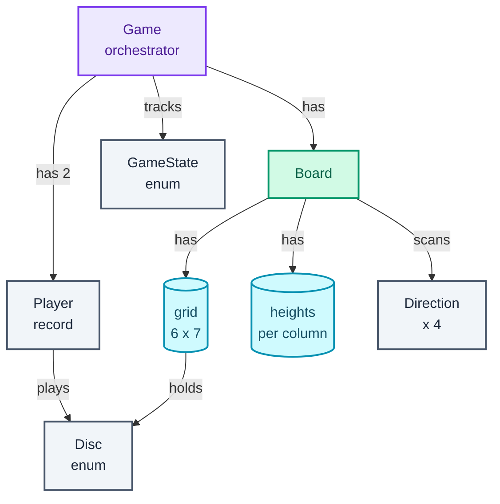
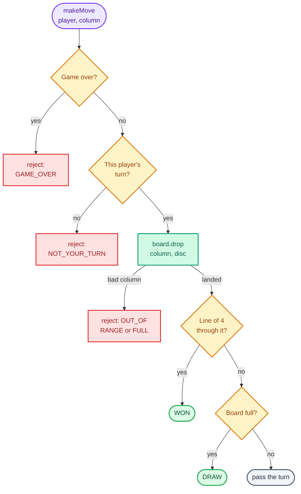

"Design Connect Four. Two players take turns dropping discs into a seven-column, six-row grid; a disc falls to the lowest free spot, and the first player to line up four wins."

Everyone knows the game, which is the point. With no domain to learn, the round tests the two things that sink most low-level design answers: **where each rule lives**, and whether you can find the one insight that makes the code run on every move cheap. Here that insight is the win check. A new line of four can only pass through the disc this move dropped, so after each move you look outward from one cell in four directions, not across all 42.

The principle it trains is **tell, don't ask**: keep each rule in the class that owns the state it reads. The `Game` owns turns and the game's outcome; the `Board` owns the grid, gravity and lines. Every game question in this post's variants table (Tic Tac Toe at any size, Gomoku, Othello, Snake and Ladder) reuses this split. The post leans on the method from [Part 1](/blogs/lld-the-method/), which ran Tic Tac Toe through the same stages, on [Part 2](/blogs/lld-oop-and-patterns/) for why no pattern is used here, and on [Part 3](/blogs/lld-concurrency/) for the follow-up where the game moves to a server.

How to use this post: [the method](/blogs/lld-the-method/). Try the question cold first, then read.


You are a senior engineer interviewing me for a low-level design round. The question is: "Design Connect Four: two players take turns dropping discs into a 7-column, 6-row grid; a disc falls to the lowest free spot; the first to line up four in a row wins." Run it as a realistic 35-minute interview following this structure: requirements (5 min), entities and relationships (3 min), class design (10-15 min), implementation of the key methods in Java (10 min), extensibility (5 min).
Rules: state the question in one sentence and stop. Answer my clarifying questions the way a real interviewer would, briefly, and only what I ask. Never propose designs, components or classes yourself. If I skip a stage or run long on one, say so in one line and keep time. When I finish a stage, write one line of the note you would put on the scorecard, then move on.
Once my design is in place, probe it with these, one at a time, waiting for my answer each time: How does your win check work, and what does it cost per move compared with scanning the board? A player drops into a full column, or moves out of turn: what happens, and how do I know the game state is unchanged? How do you detect a draw, and what if the last disc both fills the board and makes a line? Make it Connect 5 on a 9 by 8 board: what changes in your code? Add undo. Now the game runs on a server and both players' requests can arrive at the same moment: what breaks and how do you fix it?
At the end, grade me as hire / lean hire / lean no hire / no hire for a senior engineer, with the two strongest and two weakest moments, and the one thing to fix first.



## Requirements

Five minutes of questions saves fifteen of rework. Group them by the four themes from [the method](/blogs/lld-the-method/), and say the answer you'd assume out loud so the interviewer can correct it.

**Primary capabilities.**

- *Who plays: two people on one device, or against the computer?* Assume two humans taking turns on one device ("hot seat"). A computer player is a good extension, not the core.
- *Standard board, 7 columns by 6 rows, four to win?* Yes, but I'll take the sizes and the line length as parameters, because it costs nothing now and Connect N is a common follow-up.
- *Do we need a UI?* No. A text rendering of the board is enough to test with.

**Rules and completion.**

- *Who moves first?* Whoever is passed in first; call them Red.
- *Which lines count?* Horizontal, vertical and both diagonals.
- *How does it end?* A win, or a draw when the board is full with no line.

**Error handling.**

- *A column that doesn't exist, or one that's full?* Reject the move with a reason, change nothing, and the same player moves again.
- *A move out of turn, or after the game has ended?* Same: reject with a reason, change nothing.

**Scope boundaries.**

- *Undo, timers, saving games, network play, many games at once?* All out for now; undo and many games are the likely extensions.
- *Will moves arrive from several threads?* Assume one game is driven by one thread. I'll show where the lock goes if that changes.

The spec, as I'd write it on the board:

```text
1. Two players alternate dropping a disc into one of 7 columns.
2. A disc falls to the lowest empty row of its column (6 rows).
3. A player wins with 4 of their discs in a line: horizontal,
   vertical or either diagonal.
4. The game is a draw when the board is full with no winner.
5. An invalid move is rejected with a reason and changes nothing:
   column out of range, column full, not your turn, game over.
6. Rows, columns and line length are parameters (default 6, 7, 4).

Out of scope: UI, computer player, undo, timers, persistence,
networking, more than two players, concurrent moves.
```

## Entities and relationships

Run the noun filter from [the method](/blogs/lld-the-method/) over the spec: a noun earns a class only if it has state that changes or rules to enforce; otherwise it is a field, a value or an enum.

- **Game**: a class. It owns whose turn it is and whether the game is over, and it enforces turn order. This is the orchestrator, the one entry point callers use.
- **Board**: a class. It owns the grid, enforces gravity and the column rules, and answers "is there a line through this cell?"
- **Player**: a record (an immutable value class) of a name and a disc colour. It has no state that changes and no rules, so it is a value, not an entity.
- **Disc**: an enum, Red or Yellow.
- **Game state**: an enum, in progress, won or draw.
- **Direction**: an enum of the four line directions, each a (row step, column step) pair.
- **Move result**: a record of where the disc landed and the state after it, returned to the caller.
- **Column, row**: plain `int`s. **Cell**: a slot in the grid array, not a class. **Turn** and **winner**: fields of `Game`. **Line**: never stored; it is what the board finds when it scans.

The diagram shows who owns what. The orchestrator is at the top; the board's two arrays are the stores; the enums and records are values.



Two entities with behaviour, and everything else a value. A first-time answer often has a `Cell` class, a `Column` class and a `Move` class with nothing inside them; each one is a place a rule could end up in the wrong spot.

## Class design

Top down, starting from the orchestrator. Each class gets only the state its requirements force on it.

### Game

| Requirement | What Game must track |
| --- | --- |
| Players alternate | the two players, and whose turn it is |
| A win or a draw ends the game | the state, and the winner if there is one |
| Reject moves out of turn or after the end | the same two fields, checked before anything else |
| Board size and line length are parameters | the line length, passed to the board's check |

```text
class Game
  - board: Board
  - players: List<Player>        exactly two, in turn order
  - connect: int                 line length that wins (4)
  - turn: int                    index of the player to move
  - state: GameState
  - winner: Player               set only when state == WON
  + makeMove(player, column) -> MoveResult
  + state() -> GameState
  + winner() -> Optional<Player>
  + currentPlayer() -> Player
```

`makeMove` is the only method that changes anything. It checks the two game-level rules (is the game still on, is it this player's turn), tells the board to drop the disc, asks the board one question about the result, and updates the state.

### Board

| Requirement | What Board must track |
| --- | --- |
| Discs fall to the lowest free row | the grid, and how many discs each column holds |
| Reject a column out of range or full | the grid's size and the column counts |
| Four in a line wins | the grid, to scan from the last disc |
| A full board is a draw | the total number of discs |

```text
class Board
  - rows, cols: int
  - grid: Disc[rows][cols]       row 0 is the bottom
  - heights: int[cols]           discs in each column = next landing row
  - discs: int                   total on the board
  + drop(col, disc) -> int       the row it landed in
  + hasLineThrough(row, col, length) -> boolean
  + lineLength(row, col, direction) -> int
  + isFull() -> boolean
```

`heights` is the one non-obvious field. Without it, `drop` has to walk down the column looking for the first empty cell; with it, the landing row is already known. `discs` does the same job for the draw check, so `isFull` never scans.

### Values

```text
enum Disc        RED, YELLOW
enum GameState   IN_PROGRESS, WON, DRAW
enum Direction   HORIZONTAL(0, 1), VERTICAL(1, 0), DIAGONAL(1, 1), ANTI_DIAGONAL(1, -1)
record Player(name, disc)
record MoveResult(row, column, state)
class InvalidMoveException(reason, message)
  enum Reason    GAME_OVER, NOT_YOUR_TURN, COLUMN_OUT_OF_RANGE, COLUMN_FULL
```

### Where the rules live, and what was left out

The split follows the state. "Is it your turn?" reads `turn`, which `Game` owns, so `Game` checks it. "Is column 7 valid?" and "is column 3 full?" read the grid's size and `heights`, which `Board` owns, so `Board` checks them inside `drop`. `Game` never reaches into the grid to scan for lines itself; it tells the board to drop and asks it one yes-or-no question. That is tell, don't ask, and it is what keeps `Game` short enough to read in one glance.

Invalid moves throw an `InvalidMoveException` carrying a `Reason`. A `boolean` return would lose the reason a UI needs to show; an exception with an enum keeps the happy path's return type clean (`MoveResult`) and lets a caller `switch` on what went wrong. A sealed result type (`Accepted` or `Rejected(reason)`) is an equally good answer; pick one and say why.

Three patterns were considered and rejected, and saying so earns more than using them:

- **State pattern** for the game's phases, from [Part 2](/blogs/lld-oop-and-patterns/). Only one of the three states accepts moves and the others reject everything the same way, so one guard on an enum is clearer than three state classes. State earns its place when behaviour differs per state across several methods, as in the [vending machine](/blogs/lld-vending-machine/).
- **Strategy** for the win rule. There is one rule today. The seam already exists (`hasLineThrough`), so if a variant needs a different rule, such as Gomoku's "exactly five", that method becomes an interface then, not now.
- **Player as an interface.** Only needed when a computer player is in scope; see Extensibility.

## Implementation

The happy path of `makeMove`: the game is on, it's this player's turn, the column is valid and not full; the disc lands at the column's height; if there is a line through the new disc the game is won, else if the board is full it's a draw, else the turn passes. The diagram is that path with every way off it. The checks run in this order so that every rejection happens before anything changes.



The edge cases, each handled by a specific line below:

- **Column out of range** (`-1`, `7`): `Board.drop` rejects with `COLUMN_OUT_OF_RANGE` before touching the grid.
- **Column full**: `heights[col] == rows`, rejected with `COLUMN_FULL`.
- **Wrong player**: `Game` compares the caller with `players.get(turn)`.
- **Move after a win or draw**: `Game` rejects with `GAME_OVER` before anything else.
- **The last disc both fills the board and makes a line**: it's a win, so the line check runs before the full check.
- **The new disc lands in the middle of a line**: count both ways from it, not only forward.
- **A line longer than four** (filling the gap in `R R _ R R` makes five): the check is `>= length`, not `==`.
- **Lines that reach the edge**: the scan stops at the board's boundary.
- **A rejected move changes nothing**: every check runs before the first write, so the turn doesn't pass and no counter moves.
- **Bad configuration**: two players with the same disc, or a line length that can't fit on the board, are rejected in the constructor.

The values first. `Direction` is what turns "check the four lines" into a loop instead of four copies of the same code:

```java
enum Disc {
    RED('R'), YELLOW('Y');

    final char symbol;

    Disc(char symbol) { this.symbol = symbol; }
}

record Player(String name, Disc disc) {}

enum GameState { IN_PROGRESS, WON, DRAW }

// The four lines a disc can be part of. Each is scanned both ways from the
// last disc, so four directions cover all eight neighbours.
enum Direction {
    HORIZONTAL(0, 1), VERTICAL(1, 0), DIAGONAL(1, 1), ANTI_DIAGONAL(1, -1);

    final int dRow, dCol;

    Direction(int dRow, int dCol) { this.dRow = dRow; this.dCol = dCol; }
}

record MoveResult(int row, int column, GameState state) {}
```

```java
final class InvalidMoveException extends RuntimeException {
    enum Reason { GAME_OVER, NOT_YOUR_TURN, COLUMN_OUT_OF_RANGE, COLUMN_FULL }

    final Reason reason;

    InvalidMoveException(Reason reason, String message) {
        super(message);
        this.reason = reason;
    }
}
```

### Gravity without a scan

Before the board's code, the figure shows what `heights` buys. It is the board one move before the win of the trace below: the array under the grid says how many discs each column holds, which is also the row the next disc lands in.

<figure class="sketch"></figure>

A drop into column 2 reads `heights[2] = 2`, writes the disc at row 2 and bumps the count to 3. No loop, and "is this column full?" is the same array compared with 6.

### The win check from the last disc

A line of four that didn't exist before this move must include the disc this move placed, because every other cell is unchanged. So the board only looks at lines through that one cell. There are four such lines (horizontal, vertical and the two diagonals), and the new disc can sit anywhere along each, so each line is scanned both ways. The figure shows the four scans for the winning move of the trace, the Red disc at row 2, column 2: green arrows are cells counted, crosses are where a scan stopped.

<figure class="sketch"></figure>

Only the diagonal reaches four, and it does so as 1 (the disc itself) + 2 down-left + 1 up-right. A check that only scanned forward from the new disc would count 2 and miss the win. The cost per move is at most 4 directions x 2 ways x 3 steps = 24 cells counted for a line of 4 (plus the one cell where each scan stops), whatever the board size, against 42 cells x 4 directions for a full scan of the standard board.

```java
final class Board {
    private final int rows, cols;
    private final Disc[][] grid;   // grid[row][col]; row 0 is the bottom, so gravity is "lowest free row"
    private final int[] heights;   // discs in each column, which is also the row the next disc lands in
    private int discs;             // total on the board; the board is full when this is rows * cols

    Board(int rows, int cols) {
        this.rows = rows;
        this.cols = cols;
        this.grid = new Disc[rows][cols];
        this.heights = new int[cols];
    }

    // Gravity in O(1): the landing row is already known, no scan down the column.
    int drop(int col, Disc disc) {
        if (col < 0 || col >= cols)
            throw new InvalidMoveException(InvalidMoveException.Reason.COLUMN_OUT_OF_RANGE, "columns are 0.." + (cols - 1));
        if (heights[col] == rows)
            throw new InvalidMoveException(InvalidMoveException.Reason.COLUMN_FULL, "column " + col + " has " + rows + " discs");
        int row = heights[col]++;
        grid[row][col] = disc;
        discs++;
        return row;
    }

    boolean isFull() { return discs == rows * cols; }

    // A new line of `length` can only pass through the disc dropped last,
    // so checking that one cell is enough. At most 4 directions x 2 ways x 3 steps.
    boolean hasLineThrough(int row, int col, int length) {
        for (Direction d : Direction.values()) {
            if (lineLength(row, col, d) >= length) return true;
        }
        return false;
    }

    // Same-coloured run through (row, col) along d: the disc itself plus
    // what lies on each side of it, so a disc dropped into the middle counts.
    int lineLength(int row, int col, Direction d) {
        Disc disc = grid[row][col];
        return 1 + countFrom(row, col, d.dRow, d.dCol, disc) + countFrom(row, col, -d.dRow, -d.dCol, disc);
    }

    private int countFrom(int row, int col, int dRow, int dCol, Disc disc) {
        int n = 0;
        for (int r = row + dRow, c = col + dCol; inside(r, c) && grid[r][c] == disc; r += dRow, c += dCol) n++;
        return n;
    }

    private boolean inside(int r, int c) { return r >= 0 && r < rows && c >= 0 && c < cols; }

    Optional<Disc> at(int row, int col) { return inside(row, col) ? Optional.ofNullable(grid[row][col]) : Optional.empty(); }

    int height(int col) { return heights[col]; }
    int rows() { return rows; }
    int cols() { return cols; }

    String render() {
        StringBuilder sb = new StringBuilder();
        for (int r = rows - 1; r >= 0; r--) {          // top row first, the way the board stands
            sb.append(r).append(" |");
            for (int c = 0; c < cols; c++) sb.append(grid[r][c] == null ? '.' : grid[r][c].symbol).append(c < cols - 1 ? " " : "");
            sb.append("|\n");
        }
        sb.append("   ");
        for (int c = 0; c < cols; c++) sb.append(c).append(' ');
        return sb.toString();
    }
}
```

### The orchestrator

```java
final class Game {
    private final Board board;
    private final List<Player> players;
    private final int connect;
    private int turn = 0;                              // index into players of whoever moves next
    private GameState state = GameState.IN_PROGRESS;
    private Player winner;                             // set only when state == WON

    Game(Player first, Player second) { this(first, second, 6, 7, 4); }

    Game(Player first, Player second, int rows, int cols, int connect) {
        if (first.disc() == second.disc()) throw new IllegalArgumentException("players need different discs");
        if (connect < 2 || connect > Math.max(rows, cols)) throw new IllegalArgumentException("a line of " + connect + " cannot fit");
        this.board = new Board(rows, cols);
        this.players = List.of(first, second);
        this.connect = connect;
    }

    MoveResult makeMove(Player player, int column) {
        if (state != GameState.IN_PROGRESS)
            throw new InvalidMoveException(InvalidMoveException.Reason.GAME_OVER, "the game is already " + state);
        if (!player.equals(players.get(turn)))
            throw new InvalidMoveException(InvalidMoveException.Reason.NOT_YOUR_TURN, "it is " + players.get(turn).name() + "'s turn");

        int row = board.drop(column, player.disc());   // Board owns the column rules
        if (board.hasLineThrough(row, column, connect)) {
            state = GameState.WON;
            winner = player;
        } else if (board.isFull()) {
            state = GameState.DRAW;                    // checked after the win: the last disc can win on a full board
        } else {
            turn = (turn + 1) % players.size();        // the turn passes only when the game goes on
        }
        return new MoveResult(row, column, state);
    }

    GameState state() { return state; }
    Optional<Player> winner() { return Optional.ofNullable(winner); }
    Player currentPlayer() { return players.get(turn); }
    String render() { return board.render(); }
    Board board() { return board; }
}
```

`makeMove` reads top to bottom as the flowchart above: two guards, one call that can still reject, one question, one state change. The turn passes only when the game goes on, so after a win `currentPlayer()` is still the winner.

## Verification

The harness drives one game that exercises every branch: ten ordinary moves, two rejections in the middle, the winning move, and a move after the end. Cells are written (row, column) with row 0 at the bottom, and the board prints top row first. This is what it printed:

```text
 1  Red    col 0 -> row 0   IN_PROGRESS
 2  Yellow col 1 -> row 0   IN_PROGRESS
 3  Red    col 2 -> row 0   IN_PROGRESS
 4  Yellow col 3 -> row 0   IN_PROGRESS
 5  Red    col 3 -> row 1   IN_PROGRESS
 6  Yellow col 3 -> row 2   IN_PROGRESS
 7  Red    col 3 -> row 3   IN_PROGRESS
 8  Yellow col 2 -> row 1   IN_PROGRESS
 9  Red    col 1 -> row 1   IN_PROGRESS
10  Red    col 4 -> rejected NOT_YOUR_TURN (it is Yellow's turn)
11  Yellow col 7 -> rejected COLUMN_OUT_OF_RANGE (columns are 0..6)
12  Yellow col 6 -> row 0   IN_PROGRESS
13  Red    col 2 -> row 2   WON
14  Yellow col 4 -> rejected GAME_OVER (the game is already WON)
5 |. . . . . . .|
4 |. . . . . . .|
3 |. . . R . . .|
2 |. . R Y . . .|
1 |. R Y R . . .|
0 |R Y R Y . . Y|
   0 1 2 3 4 5 6 
winner: Red
  HORIZONTAL    through (2,2): 1
  VERTICAL      through (2,2): 1
  DIAGONAL      through (2,2): 4
  ANTI_DIAGONAL through (2,2): 2
```

The same trace as a table, with what each step tests:

| # | Call | Result | What it shows |
| --- | --- | --- | --- |
| 1 to 4 | Red 0, Yellow 1, Red 2, Yellow 3 | rows 0, 0, 0, 0 | empty columns land on row 0 |
| 5 to 7 | Red 3, Yellow 3, Red 3 | rows 1, 2, 3 | gravity stacks one column; `heights[3]` goes 1, 2, 3, 4 |
| 8, 9 | Yellow 2, Red 1 | rows 1, 1 | turns alternate |
| 10 | Red 4 | rejected, `NOT_YOUR_TURN` | Red moved last; nothing changes |
| 11 | Yellow 7 | rejected, `COLUMN_OUT_OF_RANGE` | columns are 0 to 6; still Yellow's turn |
| 12 | Yellow 6 | row 0 | Yellow's turn was kept through the rejection (it also misses the block at column 2) |
| 13 | Red 2 | row 2, `WON` | diagonal (0,0) (1,1) (2,2) (3,3), last disc in the middle |
| 14 | Yellow 4 | rejected, `GAME_OVER` | no moves after a win |

The final board, with the four discs of the line ringed:

<figure class="sketch"></figure>

The per-direction counts in the printout (1, 1, 4, 2) are the four panels of the scan figure. Moves 10, 11 and 14 are the edge transitions: each rejection left the board, the counts and the turn as they were, which is visible in step 12 landing exactly where it would have without them.

Two more checks ran in the same harness. Filling column 0 with six discs and dropping a seventh was rejected with `COLUMN_FULL`, and asking for Connect 8 on a 6 x 7 board was rejected by the constructor. Then 10,000 random games (seeded, so repeatable) compared the last-move check against a brute-force scan of the whole board after every one of 213,413 moves: 0 mismatches, with Red winning 5,613 games, Yellow 4,357, and 30 draws. The draws matter: they exercise the full-board path that the scripted game never reaches.

## Extensibility

### Connect N on any board

Already absorbed: rows, columns and line length are constructor parameters, `Direction` doesn't care about the board size, and the scan's cost depends on the line length, not the board. The one rule that needed adding was the constructor guard that rejects a line that can't fit. Connect 5 on a 9 x 8 board is `new Game(red, yellow, 8, 9, 5)`, with no other change.

### Undo

The seam is that every move is fully described by its `MoveResult` (row, column, state). Keep a stack of them in `Game`; to undo, pop the last one and reverse it:

```text
class Game
  - history: Deque<MoveResult>
  + undo() -> boolean             false when there is nothing to undo
class Board
  + remove(col)                   grid[--heights[col]][col] = null; discs--
```

`Game.undo` calls `board.remove(column)`, sets the state back to `IN_PROGRESS`, clears the winner, and moves the turn back one player. Because the disc removed is always the top of its column, `heights` makes this O(1) as well. This is the Command pattern from [Part 2](/blogs/lld-oop-and-patterns/) in its smallest form; a full `Command` interface with `execute` and `undo` only earns its place once there are several kinds of action to reverse.

### A computer player

`makeMove` takes a player and a column, and doesn't care how the column was chosen. So the computer player sits outside the game: a strategy that looks at the board and returns a column.

```text
interface MoveChooser
  + chooseColumn(view: BoardView, me: Disc) -> int
class RandomChooser implements MoveChooser
class MinimaxChooser implements MoveChooser   depth-limited search
```

Give it a read-only `BoardView` (the `at` and `height` queries), never the `Board` itself, so a buggy AI can't drop discs out of turn. The game loop asks the current player's chooser for a column and calls `makeMove` with it, so humans and AIs go through the same validation.

### Many games on a server

Now two players' requests can arrive on different threads at the same moment, and `makeMove` is a textbook check-then-act ([Part 3](/blogs/lld-concurrency/)): two threads can both pass the turn check before either passes the turn. The fix is a lock per game, the middle rung of Part 3's granularity ladder: mark `makeMove` (and the getters) `synchronized`. Moves within one game are serialised, which they must be anyway since turns alternate; moves in different games never contend. A `GameManager` holds the games in a `ConcurrentHashMap<String, Game>` and creates them with `computeIfAbsent`, so two requests can't create the same game twice. If clients retry over a flaky network, add a move number to each request and reject a stale one, so a retried move isn't applied twice.

### More than two players

`turn = (turn + 1) % players.size()` already handles any number of players. `Disc` gains colours, the constructor checks that discs are distinct, and the board's check doesn't change because it only compares a cell with its neighbours.

## What each level is expected to show

| Level | What a strong answer shows |
| --- | --- |
| Junior / Mid | A working `Game` and `Board` with correct gravity, turn order, all four line directions and the draw; invalid moves rejected; can trace a game by hand. A full-board win scan is acceptable if it's correct. |
| Senior | Checks only from the last disc and explains why that is sufficient; counts both ways; puts each rule with the state it reads; parameterises the size and line length; makes rejected moves change nothing; names the patterns it chose not to use and why. |
| Staff+ | Drives the scope: settles concurrency and extensions in requirements, shows the seams for undo, AI and multi-game hosting before being asked, and tests beyond the one trace (a randomised cross-check against a brute-force scan) without being told to. |

## Variants this unlocks

| Question | What changes |
| --- | --- |
| Tic Tac Toe, N x N | No gravity: `place(row, col)` replaces `drop`, and "cell taken" replaces "column full". The last-move line check works unchanged with length N; per-row, per-column and per-diagonal counters make it O(1). |
| Gomoku (five in a row) | A 15 x 15 board and length 5. Some rule sets forbid six or more, which is where the win rule becomes a Strategy. |
| Othello / Reversi | The same eight-direction scan from the placed disc, but it flips opponents' discs it brackets; a move is legal only if it flips at least one. |
| Snake and Ladder | No grid scan at all: a board of 100 squares with a jump map, a dice roll behind an interface so tests can fix it, and turn order as here. |
| Chess | The same Game and Board split, but each piece type has its own move rules (polymorphism over a type switch), plus check detection and special moves; a much bigger class design. |

## The one-page version

- `Game`: the orchestrator. Owns the two players, whose turn it is, the state and the winner; `makeMove` checks game-over and turn, tells the board to drop, asks for a line, then sets WON, DRAW or passes the turn.
- `Board`: owns the grid (row 0 at the bottom), `heights` per column and a disc count. `drop` validates the column and lands the disc in O(1); `hasLineThrough` scans four directions both ways from one cell; `isFull` compares a count.
- `Direction`: the four (row step, column step) pairs, so the line check is one loop.
- `Player`, `MoveResult`: records. `Disc`, `GameState`: enums.
- `InvalidMoveException` with a `Reason`: every rejection happens before any write, so a rejected move changes nothing.
- Check the line before the full board, count both ways, compare with `>=`.

**Only the disc dropped last can complete a line, so check four directions both ways from that one cell, and keep each rule in the class that owns the state it reads.**


You are a senior engineer checking my low-level design of Connect Four (two players, 7 columns by 6 rows, discs fall to the lowest free row, four in a row wins, draw on a full board). My design: a Game orchestrator holding two players, a turn index, a state enum (IN_PROGRESS, WON, DRAW) and the winner; a Board holding a Disc grid with row 0 at the bottom, a heights array per column and a disc count; a Direction enum of four (row step, column step) pairs; invalid moves throw an exception with a reason.
Ask me the questions below one at a time and wait for my answer each time. Do not reveal the expected points before I answer. Judge my answer against them: say what I got right, what I missed, and correct anything wrong briefly. If I'm stuck, give a small hint, then a bigger one, and only then the answer. At the end, name the one area I should practise again.
1. Why is it enough to check for a win only around the last disc, and what does that check cost per move? Expected: any new line must include the disc this move placed, since nothing else changed. Check four directions, both ways, plus the disc itself; at most 4 x 2 x 3 = 24 cell reads for a line of 4, independent of board size, versus scanning all 42 cells in 4 directions.
2. Why count in both directions along each line instead of scanning forward from the new disc? Expected: the new disc can land in the middle of a line (for example 1 + 2 one way + 1 the other way = 4); a forward-only scan misses it. Compare with >= length, because filling a gap can make five.
3. Where does each validation live, and why? Expected: Game checks game over and whose turn, because it owns state and turn; Board checks column range and column full inside drop, because it owns the grid and heights. Tell, don't ask: Game never scans the grid itself, it asks the board one question.
4. A player drops into a full column. Walk through what happens and prove the game state is unchanged. Expected: drop sees heights[col] == rows and throws COLUMN_FULL before any write; Game passes the turn only after a successful drop, so the same player moves again; no counters change.
5. How is a draw detected, and what if the last disc fills the board and also makes four? Expected: a disc count compared with rows x cols, O(1); the line check runs before the full check, so that move is a win, not a draw.
6. How does gravity work without scanning down the column? Expected: heights[col] holds the number of discs in the column, which is the landing row; drop writes there and increments it; full when heights[col] == rows.
7. Add undo. Expected: keep a stack of move results; undo pops, removes the top disc of that column (decrement heights, clear the cell, decrement the count), sets state back to IN_PROGRESS, clears the winner, moves the turn back. Command pattern in its smallest form.
8. The game now runs on a server and both players' requests can arrive at the same time. What breaks and how do you fix it? Expected: makeMove is check-then-act; two threads can both pass the turn check. Make makeMove synchronized (one lock per game, so different games never contend); hold games in a ConcurrentHashMap and create them with computeIfAbsent; reject stale or retried moves with a move number.
9. Would you use the State pattern for the game's phases? Expected: no; only IN_PROGRESS accepts moves and the other states reject everything the same way, so an enum with one guard is clearer. State earns its place when behaviour differs per state across several methods, as in a vending machine.



Next: [Design a parking lot](/blogs/lld-parking-lot/), where the rules stop being one game's and become policies (Strategy for spot assignment and pricing), and two cars racing for one spot bring Part 3 back in.
