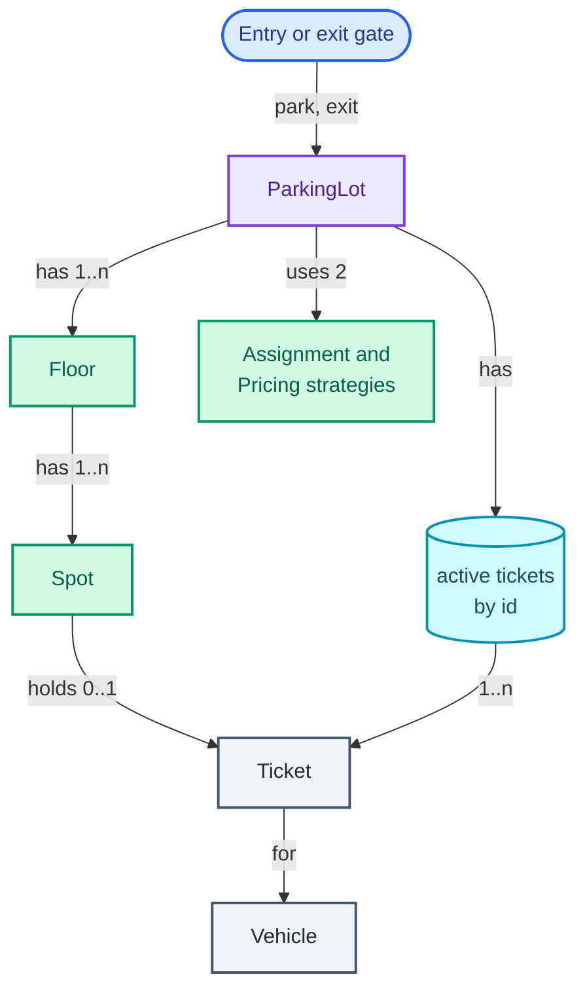
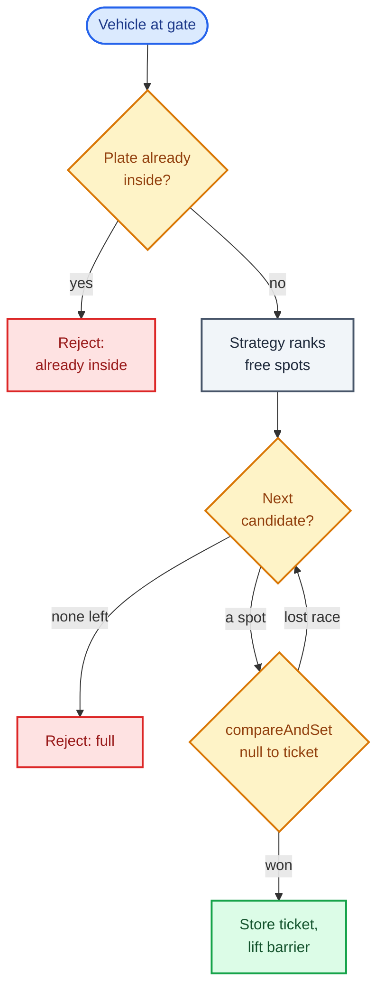

"Design a parking lot." It is probably the most-asked low-level design question there is, and for that reason the bar is higher than it looks: the interviewer has heard the class list (`ParkingLot`, `Floor`, `Spot`, `Vehicle`, `Ticket`) many times, and the list alone earns little.

What the question really tests is whether you can separate **policy** from **mechanism**. Which spot a car gets, and what it pays on the way out, are business rules that change (a mall wants best fit on weekdays and a flat fee on event days). Taking a spot is a mechanism that must never change and never fail: two entry gates working at the same moment must not hand out the same spot. A good design puts the two policies behind interfaces and makes the claim one atomic step.

It trains the **Strategy pattern** (an interface for a family of interchangeable rules, picked at construction time, so the class that uses the rule never branches on which one it has) and the first real use of **compare-and-set**, the atomic "change this value only if it still holds what I saw" that the [concurrency toolkit](/blogs/lld-concurrency/) introduces. It leans on [the patterns toolkit](/blogs/lld-oop-and-patterns/) for Strategy and on [Connect Four](/blogs/lld-connect-four/) for the habit of keeping a rule with the class that owns the state.

How to use this post: [the method](/blogs/lld-the-method/). Try the question cold first, then read.


You are a senior engineer interviewing me for a low-level design round. The question is: "Design a parking lot." Run it as a realistic 35-minute interview following this structure: requirements (5 min), entities and relationships (3 min), class design (10-15 min), implementation of the key methods in Java (10 min), extensibility (5 min).
Rules: state the question in one sentence and stop. Answer my clarifying questions the way a real interviewer would, briefly, and only what I ask. Assume a multi-floor lot with motorcycle, compact and large spots, motorcycles, cars and trucks, several entry and exit gates, hourly pricing by vehicle type, and payment handled elsewhere, but only reveal each of these if I ask. Never propose designs, components or classes yourself. If I skip a stage or run long on one, say so in one line and keep time. When I finish a stage, write one line of the note you would put on the scorecard, then move on.
Once my design is in place, probe it with these, one at a time, waiting for my answer each time: 1. Two cars arrive at two different entry gates at the same instant and there is one compact spot left. Walk me through exactly what your code does. 2. The mall wants to switch from "nearest spot" to "fill the top floor first" on weekends. What changes in your code? 3. Pricing changes from hourly to a flat event-day fee while cars are inside. Which tariff does a car that entered before the change pay, and where is that decided? 4. A car presents a ticket that was already used to exit. What happens? 5. The lot grows to 50,000 spots across 12 floors. Which method becomes slow and how would you fix it? 6. Add EV charging spots. Which classes change?
At the end, grade me as hire / lean hire / lean no hire / no hire for a senior engineer, with the two strongest and two weakest moments, and the one thing to fix first.



## Requirements

The prompt is four words long on purpose. Five minutes of questions turn it into something you can build in thirty. Here are the questions I would ask, grouped by the four themes from [the method](/blogs/lld-the-method/), each with the answer I would assume if the interviewer says "your call".

**Primary capabilities**

- *What kinds of vehicles and spots?* Motorcycles, cars and trucks; motorcycle, compact and large spots. A motorcycle fits any spot, a car fits compact or large, a truck fits only large.
- *One floor or several?* Several floors, each with a mix of spot types.
- *Is the spot assigned at the gate, or does the driver choose?* Assigned at the entry gate and printed on the ticket. That makes "which spot" a decision the system owns, which is the interesting version.
- *How is the fee worked out?* Hourly, by vehicle type, every started hour billed in full, with a short grace period for someone who drives in and straight out.

**Rules and completion**

- *Which spot does a car get when several are free?* The smallest spot type that fits, then the lowest floor. A car takes a compact before a large, so large spots stay free for trucks. The interviewer should expect this rule to change, which is the hint to make it pluggable.
- *When is a spot free again?* When the ticket is presented at an exit gate.
- *What does a "full" lot mean?* Full for that vehicle type. A lot with only motorcycle spots left is full for a car and open for a motorcycle.

**Error handling**

- *No spot fits?* Reject at the gate with a reason; the barrier stays down.
- *A ticket presented twice, or one that does not exist?* Reject the second exit. A ticket is used exactly once.
- *The same plate entering twice* (a cloned plate, or a gate camera glitch)? Reject the second entry.
- *Several gates at once?* Yes, gates run concurrently. Two gates must never assign the same spot. This is the one requirement that shapes the code most, so I would state it out loud even if the interviewer does not raise it.

**Scope boundaries**

- *Payment?* Out of scope: the exit returns the fee, a payment service collects it.
- *Reservations, valet, display boards, persistence?* Out of scope for the core design, kept as extensions.

What goes on the board:

```text
Parking lot
1. Vehicles: motorcycle, car, truck. Spots: motorcycle, compact, large.
   Fit: motorcycle -> any; car -> compact or large; truck -> large.
2. Several floors, several entry and exit gates, all working concurrently.
3. Entry: assign a spot (pluggable rule; default smallest fitting type,
   then lowest floor), issue a ticket. Reject if nothing fits or the
   plate is already inside.
4. Exit: compute the fee (pluggable rule; default hourly by vehicle type,
   every started hour, 10-minute grace), free the spot. Reject unknown
   or already-used tickets.
5. Two gates never assign the same spot.

Out of scope: payment collection, reservations, valet, display boards,
persistence, lost tickets.
```

## Entities and relationships

The **noun filter** from [the method](/blogs/lld-the-method/) decides what earns a class: a noun becomes a class if it holds state that changes or enforces a rule; otherwise it is a field or a value. Running the nouns in the spec through it:

- **ParkingLot** is the orchestrator: the entry point the gates call, which owns the floors, the two policies and the set of active tickets.
- **Floor** groups spots and answers "how many compact spots are free on floor 2". It is a thin class, kept because the multi-floor requirement and every follow-up (display boards, closing a floor) talk about floors.
- **Spot** changes state (free, then taken, then free) and owns the one rule that must be atomic, so it is an entity.
- **Vehicle** never changes after it arrives: a value (a Java `record`, an immutable class whose fields, `equals` and `hashCode` the compiler writes).
- **Ticket** is also a value: who parked, where, and when. It never changes after it is printed.
- **VehicleType** and **SpotType** are enums. The fit rule ("does a car fit a compact spot?") lives on `SpotType`, since it is a fact about spot sizes.
- **SpotAssignmentStrategy** and **PricingStrategy** are the two policies, as interfaces.
- **Gate** fails the filter. An entry gate has no state of its own that the lot cares about; it is a caller of `ParkingLot.park`, the way a REST client is a caller of an API. Modelling it as a class adds a layer that forwards every call.
- **Payment** is out of scope, so it does not appear.

The diagram shows ownership: read it top-down from the gate that calls in. Purple is the orchestrator, green the entities and policies with behaviour (the two strategy interfaces share one node), teal the collection the lot keeps, grey the values.



A ticket is referenced from two places, the spot it occupies and the lot's map of active tickets. That double reference is deliberate: the spot needs it to know who holds it, the lot needs it to find a ticket by its id at the exit.

## Class design

Top-down, starting with the class the gates call.

### ParkingLot

| Requirement | What it must track |
| --- | --- |
| Assign a spot, issue a ticket | the floors, the assignment strategy, a ticket counter |
| Fee on exit | the pricing strategy, a clock |
| Reject unknown or used tickets | active tickets by id |
| Reject a plate already inside | the plates currently inside |

```text
class ParkingLot
  - floors: List<Floor>
  - assignment: SpotAssignmentStrategy
  - pricing: PricingStrategy
  - clock: Clock
  - active: Map<ticketId, Ticket>         concurrent
  - platesInside: Set<plate>              concurrent
  + park(vehicle) -> EntryResult          Parked(ticket) | Rejected(reason)
  + exit(ticketId) -> Optional<Receipt>
  + freeSummary() -> String               for display boards
```

The clock is injected (a `java.time.Clock`) rather than read with `Instant.now()` inside the method. Pricing depends on time, and a test that has to wait two and a half real hours to check a fee is not a test. Injecting the clock costs one constructor argument.

`park` returns an `EntryResult`, a **sealed interface** (Java 17+: an interface that lists every class allowed to implement it) with two record implementations, `Parked` and `Rejected`. The caller then writes a `switch` over the result that the compiler checks covers both cases, which is clearer than `null`, a boolean, or an exception for something as ordinary as a full lot.

### Spot

```text
class Spot
  - id, floor, type: SpotType
  - occupant: AtomicReference<Ticket>     null = free
  + isFree() -> boolean
  + tryOccupy(ticket) -> boolean          atomic: of two callers, one wins
  + release(ticket)
```

The rule "a spot holds at most one ticket" lives here, with the state it protects. That is **tell, don't ask** (tell an object to do something with its state rather than reading the state out and deciding for it): the lot does not check `isFree()` and then set a flag, it tells the spot "take this ticket" and gets back whether it worked. Splitting the check from the act across two classes is exactly what breaks under concurrency, as the implementation will show.

### Floor, the values and the enums

```text
class Floor
  - number: int
  - spots: List<Spot>
  + freeCount(type) -> long

enum SpotType { MOTORCYCLE, COMPACT, LARGE }      declared smallest first
  + fits(vehicleType) -> boolean
enum VehicleType { MOTORCYCLE, CAR, TRUCK }

record Vehicle(plate, type)
record Ticket(id, vehicle, spot, entryTime)
record Receipt(ticket, exitTime, fee)
```

### The two strategies

```text
interface SpotAssignmentStrategy
  + rank(floors, vehicleType) -> Stream<Spot>     free spots that fit, best first

interface PricingStrategy
  + fee(ticket, exitTime) -> long
```

Strategy earns its place twice here, and it is worth saying why in the interview rather than reciting the pattern's name. Both rules are named in the requirements as likely to change, both have more than one sane version today (best fit vs fill-the-top-floor; hourly vs flat), and neither needs to know anything about the lot beyond its arguments. Without the interface, `park` grows an `if (mode == WEEKEND)` branch, and every new rule edits the class that also holds the concurrency logic.

One choice in the assignment interface matters more than it looks: the strategy **ranks** candidates; it does not **take** one. If the strategy returned a single spot, a gate that lost the race for that spot would have to call the strategy again and hope. Returning an ordered list of candidates means the lot can try them in turn, so the strategy stays a pure ranking rule and the claim stays in one place, on the spot.

Considered and rejected:

- **A `Vehicle` class hierarchy** (`Car extends Vehicle`, `Truck extends Vehicle`). The subclasses would differ only in one fact, their size, and an enum carries that. Inheritance earns its place when subclasses behave differently; here they do not.
- **A spot subclass per type** (`CompactSpot`, `LargeSpot`). Same reason. One `Spot` class with a `SpotType` field is simpler and makes "convert a compact spot to an EV spot" a field change rather than a new object.
- **A Singleton `ParkingLot`**. A real company runs many lots, and a test wants a fresh one per case. Construct it once and pass it to the gates (dependency injection) instead.
- **A Factory for vehicles**. There is nothing to choose between at construction time; `new Vehicle(plate, type)` is the whole job.

## Implementation

The happy path: a car arrives, the strategy ranks the free spots that fit, the lot claims the first one, stores the ticket and returns it. At the exit, the lot removes the ticket from the active map, prices the stay, releases the spot.

The edge cases, each handled in the code below:

- nothing fits the vehicle type: reject, and undo the plate registration;
- the plate is already inside: reject before looking for a spot;
- another gate claims the ranked spot first: try the next candidate;
- an exit with an unknown or already-used ticket: reject;
- a stay inside the grace period: fee 0;
- a stay of 2 h 30 min: three started hours.

### The values and the fit rule

```java
enum VehicleType { MOTORCYCLE, CAR, TRUCK }

enum SpotType {
    // Declared smallest first, so the natural order of the enum is the size order.
    MOTORCYCLE, COMPACT, LARGE;

    boolean fits(VehicleType v) {
        return switch (v) {
            case MOTORCYCLE -> true;               // a bike fits in any spot
            case CAR -> this != MOTORCYCLE;
            case TRUCK -> this == LARGE;
        };
    }
}

record Vehicle(String plate, VehicleType type) {}

record Ticket(String id, Vehicle vehicle, Spot spot, Instant entryTime) {}

record Receipt(Ticket ticket, Instant exitTime, long fee) {}

sealed interface EntryResult permits Parked, Rejected {}
record Parked(Ticket ticket) implements EntryResult {}
record Rejected(String reason) implements EntryResult {}
```

The `switch` in `fits` is a switch *expression* (it returns a value), and Java requires a switch expression over an enum to cover every constant. Add a `BUS` vehicle type and this line stops compiling until you decide where a bus fits, which is the behaviour you want from a rule this central.

### Spot: the claim

```java
final class Spot {
    private final String id;
    private final int floor;
    private final SpotType type;
    // null = free. The only write that matters is null -> ticket, and it must be atomic.
    private final AtomicReference<Ticket> occupant = new AtomicReference<>();

    Spot(String id, int floor, SpotType type) { this.id = id; this.floor = floor; this.type = type; }

    String id() { return id; }
    int floor() { return floor; }
    SpotType type() { return type; }
    boolean isFree() { return occupant.get() == null; }

    /** Claim the spot for this ticket. Of two gates racing for it, exactly one gets true. */
    boolean tryOccupy(Ticket t) { return occupant.compareAndSet(null, t); }

    void release(Ticket t) {
        if (!occupant.compareAndSet(t, null))
            throw new IllegalStateException(id + " is not held by " + t.id());
    }
}
```

`AtomicReference.compareAndSet(expected, new)` sets the value to `new` only if it currently equals `expected`, and does the comparison and the write as one indivisible step (recalled from the `java.util.concurrent.atomic` docs: it compares by identity, `==`, not `equals`). So `compareAndSet(null, t)` reads as "if nobody holds this spot, it is mine", and when eight threads run it at the same instant, exactly one sees `true`. `release` uses the same call in reverse, which also catches a bug where the wrong ticket tries to free a spot.

### Floor

```java
final class Floor {
    private final int number;
    private final List<Spot> spots;

    Floor(int number, List<Spot> spots) { this.number = number; this.spots = List.copyOf(spots); }

    int number() { return number; }
    List<Spot> spots() { return spots; }

    long freeCount(SpotType type) {
        return spots.stream().filter(s -> s.type() == type && s.isFree()).count();
    }
}
```

### The assignment strategy

This sketch shows the default rule at work on the lot used in the verification below, at the moment the second car arrives. Look at the numbered badges: rank 1 is a compact spot on the *upper* floor, ahead of a large spot on the ground floor.

<figure class="sketch"></figure>

Nearest-first would have put the car in `0-L1`, and the next truck would have been turned away from a lot with a free compact spot it could not use. Best fit trades a slightly longer walk for keeping the scarce spots for the vehicles that need them.

```java
interface SpotAssignmentStrategy {
    /** Free spots this vehicle fits, best first. A hint: the claim on the spot decides. */
    Stream<Spot> rank(List<Floor> floors, VehicleType type);
}

/** Smallest spot type that fits, then lowest floor, then spot order on the floor. */
final class BestFitNearest implements SpotAssignmentStrategy {
    public Stream<Spot> rank(List<Floor> floors, VehicleType type) {
        return floors.stream()
                .flatMap(f -> f.spots().stream())
                .filter(s -> s.type().fits(type) && s.isFree())
                // sorted() is stable on an ordered stream (recalled from the Stream docs),
                // so spots of the same type and floor keep their order on the floor.
                .sorted(Comparator.comparing(Spot::type).thenComparingInt(Spot::floor));
    }
}
```

The `isFree()` filter is a hint, not a promise: a spot can be taken between the moment the strategy looks at it and the moment the lot tries to claim it. The comment on the interface says so, because a future implementer who assumes the ranking is authoritative will write the bug the next section is about.

This ranking scans every spot, O(n) per entry. For a few thousand spots that is microseconds and the simplest correct thing; the extensibility section covers 50,000.

### The pricing strategies

The fee rule is the other half of the policy. The sketch shows the two stays the verification bills: one long enough to touch three hours, one short enough to be free.

<figure class="sketch"></figure>

```java
interface PricingStrategy {
    long fee(Ticket ticket, Instant exitTime);
}

/** Every started hour is billed at the vehicle's rate; a short grace period is free. */
final class HourlyPricing implements PricingStrategy {
    private final Map<VehicleType, Long> ratePerHour;
    private final Duration grace;

    HourlyPricing(Map<VehicleType, Long> ratePerHour, Duration grace) {
        this.ratePerHour = new EnumMap<>(ratePerHour);
        this.grace = grace;
    }

    public long fee(Ticket t, Instant exitTime) {
        Duration stay = Duration.between(t.entryTime(), exitTime);
        if (stay.compareTo(grace) <= 0) return 0;          // drove in, found no spot they liked, left
        long minutes = stay.toMinutes();
        long hours = (minutes + 59) / 60;                   // ceiling: 2 h 30 min bills 3 hours
        return hours * ratePerHour.get(t.vehicle().type());
    }
}

/** Event-day tariff: one price whatever the stay. */
final class FlatPricing implements PricingStrategy {
    private final long amount;
    FlatPricing(long amount) { this.amount = amount; }
    public long fee(Ticket t, Instant exitTime) { return amount; }
}
```

The fee is a `long` in whole rupees. A real system would keep paise (minor units) in a `long` and never use `double` for money, since binary floating point cannot represent 0.1 exactly. Price by *vehicle* type, not spot type, is a decision worth saying aloud: a motorcycle that landed in a large spot because the small ones were full should not pay the truck rate.

`(minutes + 59) / 60` is integer ceiling division: 150 minutes gives 209 / 60 = 3. Run against the same 2 h 30 min stay, the hourly tariff returns 120 and `FlatPricing(150)` returns 150; nothing else in the lot knows which one it holds.

### ParkingLot: entry and exit

The flow of `park`, decisions in amber: the loop between "next candidate" and the claim is what absorbs a lost race.



```java
final class ParkingLot {
    private final List<Floor> floors;
    private final SpotAssignmentStrategy assignment;
    private final PricingStrategy pricing;
    private final Clock clock;
    private final Map<String, Ticket> active = new ConcurrentHashMap<>();
    private final Set<String> platesInside = ConcurrentHashMap.newKeySet();
    private final AtomicLong ticketSeq = new AtomicLong();

    ParkingLot(List<Floor> floors, SpotAssignmentStrategy assignment, PricingStrategy pricing, Clock clock) {
        this.floors = List.copyOf(floors);
        this.assignment = assignment;
        this.pricing = pricing;
        this.clock = clock;
    }

    /** Called by any entry gate, from any thread. */
    EntryResult park(Vehicle v) {
        if (!platesInside.add(v.plate()))                   // add() is atomic: one entry per plate
            return new Rejected(v.plate() + " is already inside");
        Instant now = clock.instant();
        Iterator<Spot> candidates = assignment.rank(floors, v.type()).iterator();
        while (candidates.hasNext()) {
            Spot spot = candidates.next();
            Ticket t = new Ticket("T" + ticketSeq.incrementAndGet(), v, spot, now);
            if (spot.tryOccupy(t)) {
                active.put(t.id(), t);
                return new Parked(t);
            }
            // Another gate claimed this spot between rank() and here: try the next one.
        }
        platesInside.remove(v.plate());
        return new Rejected("no free spot for a " + v.type());
    }

    /** Called by any exit gate. Empty if the ticket is unknown or already used. */
    Optional<Receipt> exit(String ticketId) {
        Ticket t = active.remove(ticketId);                 // atomic: two exits, one ticket, one winner
        if (t == null) return Optional.empty();
        Instant now = clock.instant();
        long fee = pricing.fee(t, now);
        t.spot().release(t);
        platesInside.remove(t.vehicle().plate());
        return Optional.of(new Receipt(t, now, fee));
    }

    /** Free spots per floor and type, e.g. "F0 M1 C0 L1", for the display boards. */
    String freeSummary() {
        return floors.stream()
                .map(f -> "F" + f.number() + " M" + f.freeCount(SpotType.MOTORCYCLE)
                        + " C" + f.freeCount(SpotType.COMPACT) + " L" + f.freeCount(SpotType.LARGE))
                .collect(Collectors.joining(" | "));
    }
}
```

Three details carry the correctness, and each is one call:

- `platesInside.add(plate)` returns `false` if the plate is already there, and does the check and the insert atomically. `ConcurrentHashMap.newKeySet()` is a thread-safe `Set` backed by a `ConcurrentHashMap`.
- `spot.tryOccupy(t)` is the compare-and-set from above. A lost race costs one wasted ticket number (`T` ids can have gaps), never a double booking.
- `active.remove(ticketId)` returns the ticket to exactly one caller. Two exit gates scanning the same ticket in the same millisecond (a photocopied ticket) get one receipt and one rejection, with no lock.

There is no `synchronized` anywhere in the class, and no lock is needed: every piece of shared state is changed by a single atomic call.

### Two gates, one spot

This is the part of the question that separates answers, so it is worth drawing. The timeline shows the same race twice: two gates, one free spot, time running left to right. In the top half each gate checks and then acts as two steps; in the bottom half the check and the act are one step.

<figure class="sketch"></figure>

The top half is **check-then-act**: read a condition, then act on it as if it still held, with a gap between the two in which another thread can change it. Both gates read "free" before either writes, so both write, and two drivers are sent to one spot. The options form a short ladder.

**Bad:** a `boolean occupied` field with `if (!occupied) { occupied = true; }`. Correct with one gate, wrong with two. This is the version I ran it against:

```java
/** The broken version: check, then act, with a gap between them. */
final class NaiveSpot {
    private boolean occupied;
    private final boolean slowGap;
    NaiveSpot(boolean slowGap) { this.slowGap = slowGap; }

    boolean tryOccupy() {
        if (!occupied) {                        // check
            pause();                            // whatever the gate does in between
            occupied = true;                    // act
            return true;
        }
        return false;
    }

    private void pause() {
        if (!slowGap) { Thread.yield(); return; }               // a log line
        try { Thread.sleep(1); } catch (InterruptedException e) { Thread.currentThread().interrupt(); } // a 1 ms DB call
    }
}
```

The test releases 8 threads at once (a `CountDownLatch` they all wait on), each trying to claim the same single free spot, and repeats that 2,000 times on an 8-CPU Docker container. With only a `Thread.yield()` between check and act, between 5 and 95 of the 2,000 rounds produced two or more winners, depending on the run: the dangerous kind of bug, rare enough to pass every manual test. With a 1 ms pause, the length of a database round trip, all 2,000 rounds double-booked.

**Good:** make `park` `synchronized`, one lock for the whole lot. Check and act happen inside the lock, so they cannot interleave. With a handful of gates and a car every few seconds, the lock is never contended and this is a perfectly defensible answer. Its cost shows up only at scale, or if someone later puts a slow call (a payment pre-authorisation, a camera lookup) inside the locked region, at which point every gate waits for it.

**Great:** compare-and-set on the spot, as in the code above. The atomic step is exactly as big as the state that needs protecting, one reference, and a gate that loses moves on to the next candidate without waiting for anyone. Same 2,000 rounds of 8 threads: 0 rounds with two winners on the bare `Spot`, and through the whole `ParkingLot.park`, 0 rounds with two tickets and 0 rounds with no ticket (the second count matters: a fix that sometimes refuses everyone would also "prevent" double booking). The lock-granularity ladder behind this choice, one global lock, then a lock per entity, then lock-free, is laid out in [the concurrency toolkit](/blogs/lld-concurrency/).

## Verification

A small lot: floor 0 has a motorcycle spot, a compact and a large; floor 1 has a compact and a large. The clock is moved by hand. The `free` column counts free motorcycle (M), compact (C) and large (L) spots per floor. This is what the program printed, with the columns trimmed:

| Time | Event | Result | Free after: floor 0, floor 1 |
| --- | --- | --- | --- |
| 09:00 | start | | M1 C1 L1, C1 L1 |
| 09:00 | car KA01 enters | T1, spot 0-C1 | M1 C0 L1, C1 L1 |
| 09:05 | car KA02 enters | T2, spot 1-C1 (best fit, upper floor) | M1 C0 L1, C0 L1 |
| 09:10 | car KA03 enters | T3, spot 0-L1 (no compact left) | M1 C0 L0, C0 L1 |
| 09:12 | truck TRK1 enters | T4, spot 1-L1 | M1 C0 L0, C0 L0 |
| 09:15 | truck TRK2 enters | rejected: no free spot for a TRUCK | unchanged |
| 09:20 | motorcycle BIKE1 enters | T5, spot 0-M1 | M0 C0 L0, C0 L0 |
| 09:25 | car KA02 enters again | rejected: KA02 is already inside | unchanged |
| 09:28 | BIKE1 exits | T5 pays 0 (8 min, inside grace) | M1 C0 L0, C0 L0 |
| 11:30 | KA01 exits | T1 pays 120 (3 started hours at 40) | M1 C1 L0, C0 L0 |
| 11:31 | truck TRK2 enters | rejected: no free spot for a TRUCK (the free compact does not fit) | unchanged |
| 11:32 | car KA04 enters | T6, spot 0-C1 | M1 C0 L0, C0 L0 |
| 11:40 | KA01's ticket T1 presented again | rejected: unknown or already used | unchanged |

The edge transitions are the ones to point at in the interview. At 09:15 and again at 11:31 the lot is "full" for a truck while a motorcycle or compact spot is free, which is the per-type definition of full from the requirements. At 09:20 the motorcycle takes the motorcycle spot rather than a larger one, because the smallest fitting type ranks first. At 11:40 the second exit with T1 fails because `active.remove` already handed T1 out once.

The concurrency claim is verified separately, by the race test described above: 0 double bookings in 2,000 rounds of 8 gates through `ParkingLot.park`.

## Extensibility

### "Add EV charging spots"

Add `EV` to `SpotType` and decide its `fits` rule: EV spots for electric cars only, or for any car when nothing else is free? If electric cars also become their own `VehicleType`, the switch expression in `fits` refuses to compile until you say where they fit. If charging is billed, it is a second `PricingStrategy` composed with the parking one (`fee = parking.fee(t, exit) + charging.fee(t, exit)`), a small decorator (a class that wraps another strategy and adds to its result) rather than a branch in `HourlyPricing`. If a spot can be both compact and EV, a single enum stops being enough and `Spot` gets a set of capabilities (`EnumSet<Feature>`) with `fits` checking it.

### "Fill the top floor first at weekends" or "nearest the lifts"

A new `SpotAssignmentStrategy` with a different comparator, chosen when the lot is built. `ParkingLot`, `Spot` and the concurrency story do not change, because the strategy only ranks. To switch at runtime, hold the strategy in a `volatile` field (or an `AtomicReference`) so a gate thread always sees the latest one.

### "The tariff changes while cars are inside"

Which price does a car that entered before the change pay? Most operators honour the tariff at entry. The seam is the ticket: store the `PricingStrategy` (or a tariff id) on the `Ticket` when it is issued, and have `exit` use `t.tariff()` instead of the lot's current one. Nothing else changes, and the answer becomes explicit instead of an accident of when the field was swapped.

### "50,000 spots across 12 floors"

The O(n) scan in `BestFitNearest` is now 50,000 checks per car. Keep a free-spot index instead: one concurrent queue per (spot type, floor), such as a `ConcurrentLinkedDeque<Spot>`, polled on entry and offered back on exit. `poll()` hands each spot to exactly one caller, so the queue does the claim and the strategy becomes "which queue to poll first", which is a handful of candidate queues instead of 50,000 spots. Keep the compare-and-set on the spot as a second line of defence against a bug that puts a spot in two queues.

### "Show free counts on a board at each floor"

Recounting on every refresh is O(spots per floor), fine for a board that refreshes every few seconds. For a live board, give `Floor` an `AtomicInteger` per type, decremented on a successful claim and incremented on release, or publish claim and release events to listeners (the Observer pattern from [the patterns toolkit](/blogs/lld-oop-and-patterns/)) so boards, apps and analytics subscribe without the lot knowing about any of them.

## What each level is expected to show

| Level | What a strong answer shows |
| --- | --- |
| Junior / Mid | A clean class list with the fit rule on the spot type, a working `park` and `exit`, a pricing calculation with ceiling hours, and the obvious error cases (full, bad ticket). Strategy is named for at least one of the two policies. |
| Senior | Both policies behind interfaces, with a reason for each; the race between two gates raised unprompted and fixed with a lock or compare-and-set, with the trade-off stated; an injected clock; per-type "full"; the duplicate-plate and reused-ticket cases. |
| Staff+ | Drives the conversation to the seams: ranking vs claiming as separate jobs, tariff snapshot on the ticket, a free-spot index for scale, and where this design stops (persistence and multiple lots turn the in-memory compare-and-set into a conditional database update, the same claim one level down). |

## Variants this unlocks

| Question | What changes |
| --- | --- |
| Design an EV charging station | Spots become chargers with a power rating; pricing adds energy (kWh) to time; a charger can be faulted, a third state beside free and taken. |
| Design valet parking | The driver never sees the spot: a `ValetTicket` maps to a spot chosen by staff, and a retrieval queue orders pickups. The claim is the same. |
| Design a parking lot with reservations | A spot can be *held* for a time window before the car arrives: the occupant becomes a hold with an expiry, the same pattern as seat holds in [movie ticket booking](/blogs/lld-movie-ticket-booking/). |
| Design Amazon Locker | Spots become compartments, vehicles become packages, best-fit allocation is the same ranking. [Amazon Locker](/blogs/lld-amazon-locker/) is this design with pickup codes. |
| Design a bike-share dock station | Docks are spots with one type; the interesting part moves to payment holds and returning to a different station. |

## The one-page version

- `ParkingLot`: the orchestrator; `park(vehicle)` and `exit(ticketId)`; owns floors, both strategies, an injected clock, the active tickets and the plates inside.
- `Floor`: a list of spots and free counts per type.
- `Spot`: id, floor, type, and an `AtomicReference<Ticket>`; `tryOccupy` is `compareAndSet(null, ticket)`.
- `SpotType` (with `fits`) and `VehicleType`: enums; size order is declaration order.
- `Vehicle`, `Ticket`, `Receipt`: records.
- `EntryResult`: sealed, `Parked(ticket)` or `Rejected(reason)`.
- `SpotAssignmentStrategy`: ranks free fitting spots; default `BestFitNearest` (smallest type, then lowest floor).
- `PricingStrategy`: `HourlyPricing` (started hours, by vehicle type, 10-minute grace) or `FlatPricing`.
- Concurrency: one atomic call per shared change (`Set.add` for plates, `compareAndSet` for spots, `Map.remove` for tickets), no locks.

**The strategy ranks the spots, the spot's compare-and-set decides who gets one, and the pricing strategy turns two timestamps into a fee; everything else is bookkeeping.**


You are my low-level design interview coach. I designed a parking lot and need to defend it. Ask me the questions below one at a time. After each, wait for my answer, then judge it against the key points listed for that question. If I am right, confirm briefly and add anything I missed. If I am wrong or incomplete, give me one hint and let me try again; after a second miss, explain the answer. Never reveal the key points before I have answered.
1. Two cars arrive at two entry gates at the same instant and one compact spot is left. What does your code do, step by step? Key points: the strategy may rank the same spot first for both; the claim is compareAndSet(null, ticket) on the spot's AtomicReference, so exactly one gate wins; the loser moves to its next ranked candidate or rejects as full; check-then-act with a boolean double-books (in a test with 8 threads and a 1 ms gap, every round double-booked); a synchronized park() is also correct and fine at low volume.
2. Why does the assignment strategy return a ranked list of candidates instead of one spot? Key points: the ranking is only a hint because a spot can be taken between ranking and claiming; with a list the lot can retry the next candidate without calling the strategy again; it keeps the strategy a pure rule and the claim in one place.
3. Why is pricing a strategy, and why by vehicle type rather than spot type? Key points: the requirements say the tariff changes (hourly vs flat event day); a new tariff becomes a new class with no edit to ParkingLot; a motorcycle placed in a large spot because small ones were full should not pay the truck rate.
4. The tariff changes while cars are inside. Which one does a car pay? Key points: decide explicitly; usually the tariff at entry; store the tariff on the ticket when issued and use it at exit.
5. A ticket is presented twice at two exit gates. What happens? Key points: active.remove(ticketId) on a ConcurrentHashMap returns the ticket to exactly one caller; the second gets empty and is rejected; no lock needed.
6. The lot grows to 50,000 spots. What is slow and how do you fix it? Key points: rank() scans every spot, O(n) per entry; keep a concurrent queue of free spots per type and floor, poll on entry and offer on release; poll hands a spot to one caller; keep the spot's compareAndSet as a safety net.
7. Why no Vehicle subclass hierarchy and no Singleton ParkingLot? Key points: subclasses would differ only in size, which an enum carries; a company runs many lots and tests need fresh instances, so construct once and inject.



Next: [Design a vending machine](/blogs/lld-vending-machine/), where the hard part moves from two threads racing to one machine whose correct response to every button depends on the state it is in.
