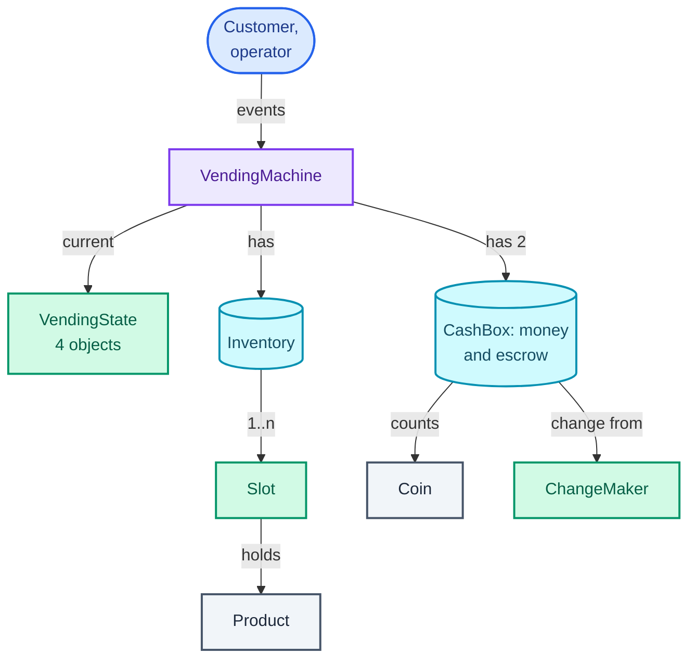
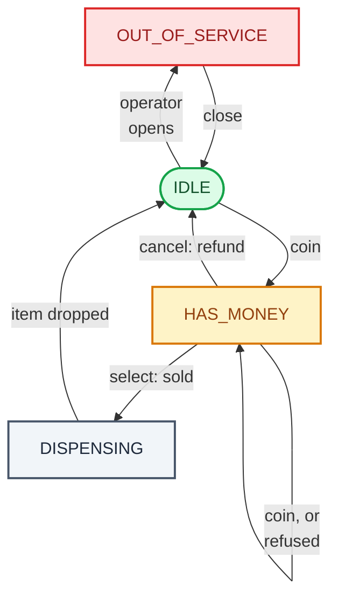

"Design a vending machine." The first answer most people give is a product catalogue with a `buy(code, money)` method. It is wrong in an instructive way: a real machine never sees a purchase as one call. It sees a coin, then another coin, then a button, then a sensor reporting that the item fell, and between any two of those a customer can press cancel or push in another coin.

What the question really tests is whether you model **state**: the same input (a coin, the "A1" button, cancel) has to do different things depending on what has happened so far. A coin in an idle machine starts a sale; a coin while an item is dropping must come straight back. Every bug a vending machine can have is a button that does something in a state where it should not.

It trains the **State pattern** (one object per state, each deciding what every event means while the machine is in that state, so the machine itself holds no `if (state == ...)` branches) and the trade-off against a plain enum with a `switch`. It also has a small algorithm inside: **making change** from a limited supply of coins, where the obvious greedy method gives wrong answers. It leans on [the patterns toolkit](/blogs/lld-oop-and-patterns/) for State and on [the method](/blogs/lld-the-method/) for keeping rules with the class that owns the state.

How to use this post: [the method](/blogs/lld-the-method/). Try the question cold first, then read.


You are a senior engineer interviewing me for a low-level design round. The question is: "Design a vending machine." Run it as a realistic 35-minute interview following this structure: requirements (5 min), entities and relationships (3 min), class design (10-15 min), implementation of the key methods in Java (10 min), extensibility (5 min).
Rules: state the question in one sentence and stop. Answer my clarifying questions the way a real interviewer would, briefly, and only what I ask. Assume a coin machine (1, 2, 5, 10 and 20 rupee coins), products in coded slots with a price and a count, one product per sale, change returned, cancel refunds, an operator who restocks, and no card payments, but only reveal each of these if I ask. Never propose designs, components or classes yourself. If I skip a stage or run long on one, say so in one line and keep time. When I finish a stage, write one line of the note you would put on the scorecard, then move on.
Once my design is in place, probe it with these, one at a time, waiting for my answer each time: 1. A customer pushes a coin in while the item is still dropping. What happens? 2. The customer pays 20 for a 14 item and the machine holds one 5 coin and three 2 coins. Walk me through your change-making. 3. The machine cannot make change at all. What does the customer see, and what happens to their money? 4. Why did you choose the State pattern (or an enum and switch)? What would make you choose the other? 5. Add card payments. Which classes change? 6. The coin acceptor and the keypad report events on different threads. Is your machine safe?
At the end, grade me as hire / lean hire / lean no hire / no hire for a senior engineer, with the two strongest and two weakest moments, and the one thing to fix first.



## Requirements

The questions, by the four themes from [the method](/blogs/lld-the-method/), with the answer I would assume.

**Primary capabilities**

- *How does the customer pay?* Coins of ₹1, ₹2, ₹5, ₹10 and ₹20, one at a time. Cards and UPI are out of scope, and a good extension question.
- *How are products chosen?* Each slot has a code ("A1"), a product with a price, and a count.
- *How many items per sale?* One. Leftover money comes back as change.
- *Who restocks?* An operator, who opens the machine, restocks, and closes it.

**Rules and completion**

- *When does the sale happen?* When enough money is in and the customer presses a code. The machine dispenses the item and the change, and waits for the drop sensor before accepting the next customer.
- *Can the customer change their mind?* Yes, cancel at any time before the sale returns the money.
- *What exactly comes back on cancel?* The same coins that went in. A real machine keeps inserted coins in a separate holder, an **escrow** (money held aside until a deal completes, the same word as in a property sale), and drops them back on cancel. This matters later: refunding never needs change-making.

**Error handling**

- *Unknown code, sold-out slot, not enough money?* Show a message and stay in the same state with the money still in.
- *Cannot make change?* Refuse the sale before anything moves, keep the money in, and let the customer cancel or pay exactly.
- *Coin inserted while dispensing or while the operator has the door open?* Return it.
- *Button pressed while dispensing?* Ignore it; the sale is already committed.

**Scope boundaries**

- *Card payments, several items per sale, telemetry, prices that change?* Out of scope.
- *Several customers at once?* No: one machine, one customer. But the coin acceptor and keypad may report events on different threads, so events must not interleave.

On the board:

```text
Vending machine
1. Accept coins 1, 2, 5, 10, 20 into escrow; show the balance.
2. Select a slot code: if known, in stock, paid enough and change can be
   made, dispense one item and the change; otherwise say why and keep
   the money in.
3. Cancel before the sale returns the inserted coins themselves.
4. While dispensing: return coins, ignore buttons, wait for the drop
   sensor, then accept the next customer.
5. Operator: open (only when idle), restock, close. No sales while open.
6. Events may arrive on different threads; they must not interleave.

Out of scope: cards and UPI, several items per sale, price changes,
telemetry, jams and refunds after a failed drop.
```

## Entities and relationships

The noun filter (a noun becomes a class if it holds changing state or enforces a rule):

- **VendingMachine** is the orchestrator: every event (coin, select, cancel, item dropped, operator) enters through it. It owns the inventory, the money and the current state.
- **VendingState** and its four implementations (**Idle**, **HasMoney**, **Dispensing**, **OutOfService**) hold the rule "what does this event mean right now". They have behaviour and no data of their own.
- **Inventory** and **Slot**: a slot's count changes on every sale and restock, so it is an entity; the inventory is the map from code to slot.
- **CashBox** counts coins by denomination. The same class serves for the machine's money and for the escrow, because both are "a bag of coins".
- **ChangeMaker** holds the one algorithm, change-making, as a static function: it has no state.
- **Product** (name and price) and **Coin** are values: a record and an enum.
- **Sale** is a value too: the outcome of "sell me slot A1", with one record per outcome.
- **Customer**, **display** and **keypad** fail the filter: they are where events come from and messages go to, not state the machine owns. The display is a list of messages in the code.

The ownership graph, read from the people who press buttons downwards. Purple is the orchestrator, green the behaviour, teal the stores of things that change, grey the values. The machine holds two `CashBox` instances, its money and the escrow, hence the "has 2":



## Class design

Before any class, the states. Writing the state machine down first is the single most useful thing to do in this interview, because the classes fall out of it and the interviewer can check your rules at a glance.

The diagram is the machine's life: green is the resting state, amber the state where the customer's money is at stake, grey the short committed state, red the one where nothing sells. Start at IDLE in the middle; the operator opens and closes the machine. The loop on HAS_MONEY is the events that are handled without leaving it: another coin, or a selection refused for being short, sold out or impossible to change.



The diagram leaves out every event that is refused. The complete rule set is a table of every state against every event, and it is worth writing out because the refusals are where bugs live:

| State | coin | select | cancel | item dropped | operator |
| --- | --- | --- | --- | --- | --- |
| IDLE | escrow it, go to HAS_MONEY | "insert money first" | nothing | nothing | open: go to OUT_OF_SERVICE |
| HAS_MONEY | escrow it | sell, or say why not | refund escrow, go to IDLE | nothing | "finish the current sale first" |
| DISPENSING | return it | "please wait" | nothing (committed) | go to IDLE | "finish the current sale first" |
| OUT_OF_SERVICE | return it | "out of service" | nothing | nothing | restock; close: go to IDLE |

Twenty cells, and each is a decision. "Cancel while dispensing does nothing" is a business rule: the item is already falling, and refunding as well would give it away free.

### VendingMachine

| Requirement | What it must track |
| --- | --- |
| Accept coins, refund the same coins | an escrow of inserted coins |
| Make change | the cash box, by denomination |
| Sell from a slot | the inventory |
| Event rules per state | the current state |
| Show messages | a display |

```text
class VendingMachine
  - inventory: Inventory
  - box: CashBox
  - escrow: CashBox
  - state: VendingState
  - display: List<String>
  events (all synchronized)
  + insertCoin(coin), select(code), cancel(), itemDropped()
  + enterService(), exitService(), restock(code, n)
  mechanics, called by the states
  ~ acceptCoin(coin), returnCoin(coin), refundEscrow()
  ~ sell(code) -> Sale
  ~ startDispensing(product, change), addStock(code, n)
  ~ transitionTo(state), say(message)
```

The split of jobs is the design: **the states decide when; the machine knows how**. A state says "a coin in HAS_MONEY goes into escrow"; the machine knows what escrow is. A state never touches a map of coins, and the machine never asks which state it is in. (`~` marks package-private methods, meant for the state classes, not for callers.)

### VendingState and its four implementations

```text
interface VendingState
  + name() -> String
  + insertCoin(m, coin)        default: return the coin
  + select(m, code)            default: "please wait"
  + cancel(m)                  default: nothing
  + itemDropped(m)             default: nothing
  + enterService(m)            default: "finish the current sale first"
  + exitService(m)             default: nothing
  + restock(m, code, n)        default: "open the machine first"

class Idle, HasMoney, Dispensing, OutOfService implements VendingState
```

The defaults are the refusals. Each state overrides only the events it accepts, so `Dispensing` is three lines: everything is refused except the drop sensor. The machine is passed in as an argument, so the state objects hold no data and one shared instance of each is enough.

### Why the State pattern here, and when a switch is better

The alternative is one `enum State` field and a `switch (state)` in each event method. Both are legitimate; the sketch shows the difference as a choice of how to slice the same 4 by 5 table. Look at which cells are coloured: a row in the first grid, a column in the second.

<figure class="sketch"></figure>

With the State pattern, everything the machine does while it has money is in `HasMoney`. Adding a state (say, `AwaitingCard`) is one new class, and nothing else is edited. Adding an event (say, `coinJammed`) touches the interface, and a default method keeps the other states compiling.

With the enum and switch, everything a coin can do is in `insertCoin`. Adding an event is one new method. Adding a state means a new case in every method, and Java helps: a switch *expression* over an enum must cover every constant, so the compiler lists every method you forgot.

My rule: four states and seven events with real per-state behaviour is past the point where a reader can hold the switch version in their head, so State earns its place. Two or three states with one or two events each (a traffic light, a door) is a switch. Say both in the interview; naming the trade-off is worth more than the pattern.

Considered and rejected:

- **A separate `buy(code, coins)` method.** It hides the states instead of removing them: cancel and coins-during-dispensing become impossible to express.
- **States as records carrying the balance** (`HasMoney(int balance)`). Elegant, since an idle machine cannot have a balance by construction, but the escrow has to hold the actual coins for refunds, not a number, so the machine keeps it either way.
- **A Singleton machine.** One physical machine is not one instance in a test suite. Construct and inject.

### Inventory, money and change

```text
class Slot       - product, count       + isEmpty(), takeOne(), restock(n)
class Inventory  - slots: Map<code, Slot> + slot(code) -> Optional<Slot>
class CashBox    - coins: EnumMap<Coin, count>
                 + add, addAll, removeAll, clear, total, snapshot
class ChangeMaker
                 + make(amount, available) -> Optional<Map<Coin, count>>
record Product(name, price)
enum Coin { ONE, TWO, FIVE, TEN, TWENTY }  each with its value
sealed interface Sale: Sold | UnknownCode | SoldOut | NeedMore | NoChange
```

`Sale` is a **sealed interface** (one that names every class allowed to implement it) with five record outcomes. `HasMoney` then handles a sale attempt with one `switch` that the compiler checks is exhaustive, and every refusal carries the data its message needs, such as how much more to insert.

## Implementation

Happy path: coins go into escrow; on select, the machine checks the slot, the balance and that change can be made, then commits the sale (escrow into the box, change out of the box, one item out of the slot) and moves to DISPENSING; the drop sensor moves it back to IDLE.

Edge cases, each handled below:

- select before any coin: "insert money first";
- not enough money: say how much more, keep the balance;
- sold out or unknown code: say so, keep the balance;
- change impossible from the coins on hand: refuse before anything moves;
- coin during dispensing or service: return it;
- cancel: return the exact inserted coins;
- operator opens the machine during a sale: refused.

### Coins, products and sale outcomes

```java
enum Coin {
    ONE(1), TWO(2), FIVE(5), TEN(10), TWENTY(20);
    final int value;
    Coin(int value) { this.value = value; }
}

record Product(String name, int price) {}

/** The answer to "sell me what is in this slot", decided before anything moves. */
sealed interface Sale permits Sold, UnknownCode, SoldOut, NeedMore, NoChange {}
record Sold(Product product, Map<Coin, Integer> change) implements Sale {}
record UnknownCode(String code) implements Sale {}
record SoldOut(Product product) implements Sale {}
record NeedMore(int amount) implements Sale {}
record NoChange(int amount) implements Sale {}
```

Prices are whole rupees in an `int`. Money is never a `double`: binary floating point cannot hold 0.1 exactly, and a machine that sells at ₹14.50 should store 1450 paise.

### Slots and inventory

```java
final class Slot {
    private final Product product;
    private int count;
    Slot(Product product, int count) { this.product = product; this.count = count; }
    Product product() { return product; }
    boolean isEmpty() { return count == 0; }
    void takeOne() { if (count == 0) throw new IllegalStateException("empty slot"); count--; }
    void restock(int n) { count += n; }
    int count() { return count; }
}

final class Inventory {
    private final Map<String, Slot> slots = new LinkedHashMap<>();
    void add(String code, Product p, int count) { slots.put(code, new Slot(p, count)); }
    Optional<Slot> slot(String code) { return Optional.ofNullable(slots.get(code)); }
    @Override public String toString() {
        StringJoiner j = new StringJoiner(" ");
        slots.forEach((code, s) -> j.add(code + "x" + s.count()));
        return j.toString();
    }
}
```

### The cash box, used twice

```java
/** Coins held by denomination. Used for the cash box and for the escrow of inserted coins. */
final class CashBox {
    private final EnumMap<Coin, Integer> coins = new EnumMap<>(Coin.class);
    CashBox(Map<Coin, Integer> initial) { initial.forEach(this::add); }

    void add(Coin c, int n) { if (n > 0) coins.merge(c, n, Integer::sum); }
    void addAll(CashBox other) { other.coins.forEach(this::add); }
    void removeAll(Map<Coin, Integer> take) {
        take.forEach((c, n) -> {
            int left = coins.getOrDefault(c, 0) - n;
            if (left < 0) throw new IllegalStateException("short of " + c);
            if (left == 0) coins.remove(c); else coins.put(c, left);
        });
    }
    void clear() { coins.clear(); }
    int total() { return coins.entrySet().stream().mapToInt(e -> e.getKey().value * e.getValue()).sum(); }
    Map<Coin, Integer> snapshot() { return new EnumMap<>(coins); }
    @Override public String toString() {
        StringJoiner j = new StringJoiner(" ", "box{", "}");
        coins.forEach((c, n) -> j.add(c.value + "x" + n));
        return j.toString();
    }
}
```

An `EnumMap` is a map whose keys are one enum's constants, stored as an array indexed by the constant's position: fast, and it iterates in declaration order, smallest coin first.

The machine keeps two of these, and the sketch shows why, using the sale from the verification below: chips at ₹14, paid with a ₹20 coin. Follow the three arrows out of the two top boxes: a sale moves coins along the solid ones, a cancel along the dashed one.

<figure class="sketch"></figure>

Inserted coins stay in escrow until the sale commits. On cancel, the dashed arrow: the same coins go back, so a refund can never fail for lack of change. On a sale, the escrow empties into the box first, so the customer's own coin can be paid out as someone's change, and the change leaves the box.

### Making change

The obvious method is **greedy**: take as many of the largest coin as fit, then the next, and so on. With unlimited coins of 1, 2, 5, 10 and 20, greedy is always optimal (this coin system is what is called *canonical*). A vending machine does not have unlimited coins. The sketch is the case from the verification: ₹6 in change, from a box with one ₹5 and three ₹2.

<figure class="sketch"></figure>

Greedy takes the 5, is left needing 1, has no ₹1 coins, and gives up, refusing a sale it could have made. The fix is to keep greedy's order but let it back up: try the most of the largest coin first, and if the rest cannot be paid, try one fewer.

```java
final class ChangeMaker {
    private static final Coin[] LARGEST_FIRST = { Coin.TWENTY, Coin.TEN, Coin.FIVE, Coin.TWO, Coin.ONE };
    static long calls;   // test instrumentation: how many search() calls one make() took

    /**
     * Pay out exactly `amount` from `available`, largest coins first, backing up when stuck.
     * Plain greedy fails with a limited tray: 6 from {5 x1, 2 x3} takes the 5 and is stuck at 1.
     */
    static Optional<Map<Coin, Integer>> make(int amount, Map<Coin, Integer> available) {
        EnumMap<Coin, Integer> pick = new EnumMap<>(Coin.class);
        return search(amount, 0, available, pick) ? Optional.of(pick) : Optional.empty();
    }

    private static boolean search(int left, int i, Map<Coin, Integer> available, EnumMap<Coin, Integer> pick) {
        calls++;
        if (left == 0) return true;
        if (i == LARGEST_FIRST.length) return false;
        Coin c = LARGEST_FIRST[i];
        int most = Math.min(left / c.value, available.getOrDefault(c, 0));
        for (int n = most; n >= 0; n--) {               // as many of this coin as fit first: greedy
            if (n > 0) pick.put(c, n); else pick.remove(c);
            if (search(left - n * c.value, i + 1, available, pick)) return true;
        }
        return false;                                   // pick no longer holds c: n ended at 0
    }

    /** Plain greedy, for comparison only. */
    static Optional<Map<Coin, Integer>> greedy(int amount, Map<Coin, Integer> available) {
        EnumMap<Coin, Integer> pick = new EnumMap<>(Coin.class);
        for (Coin c : LARGEST_FIRST) {
            int n = Math.min(amount / c.value, available.getOrDefault(c, 0));
            if (n > 0) { pick.put(c, n); amount -= n * c.value; }
        }
        return amount == 0 ? Optional.of(pick) : Optional.empty();
    }
}
```

On the tray from the sketch, the program printed `greedy: Optional.empty   search: Optional[{TWO=3}]`.

How expensive is the backing up? In theory the search can try every combination of counts, which grows as the product of the coin counts. In practice the amounts are small: for every change amount from ₹1 to ₹100, with a box of five ₹20, ten ₹10, twenty ₹5 and fifty ₹2 and no ₹1 coins (so odd amounts need an odd number of fives and some searches fail), the most `search` calls any one amount took was 23. If amounts were in the thousands (an ATM paying out notes), a bounded-coin dynamic programme (a table of which amounts can be paid, filled in from 0 upwards, one denomination at a time) would be the safer choice; here the search is shorter to write and to explain.

The first path the search explores is exactly greedy's, so whenever greedy has an answer the search returns that same answer. When greedy fails, the first answer found is not guaranteed to use the fewest coins. For a vending machine that does not matter: any exact payout beats refusing the sale.

### The states

```java
/** One object per state. Each overrides only the events that do something in that state. */
interface VendingState {
    String name();
    default void insertCoin(VendingMachine m, Coin c) { m.returnCoin(c); }
    default void select(VendingMachine m, String code) { m.say("please wait"); }
    default void cancel(VendingMachine m) {}
    default void itemDropped(VendingMachine m) {}
    default void enterService(VendingMachine m) { m.say("finish the current sale first"); }
    default void exitService(VendingMachine m) {}
    default void restock(VendingMachine m, String code, int n) { m.say("open the machine first"); }
}

final class Idle implements VendingState {
    public String name() { return "IDLE"; }
    public void insertCoin(VendingMachine m, Coin c) { m.acceptCoin(c); m.transitionTo(VendingMachine.HAS_MONEY); }
    public void select(VendingMachine m, String code) { m.say("insert money first"); }
    public void enterService(VendingMachine m) { m.transitionTo(VendingMachine.OUT_OF_SERVICE); }
}

final class HasMoney implements VendingState {
    public String name() { return "HAS_MONEY"; }
    public void insertCoin(VendingMachine m, Coin c) { m.acceptCoin(c); }
    public void select(VendingMachine m, String code) {
        switch (m.sell(code)) {
            case Sold(Product p, Map<Coin, Integer> change) -> {
                m.startDispensing(p, change);
                m.transitionTo(VendingMachine.DISPENSING);
            }
            case UnknownCode(String c) -> m.say("no slot " + c);
            case SoldOut(Product p) -> m.say(p.name() + " sold out, pick another");
            case NeedMore(int amount) -> m.say("insert " + amount + " more");
            case NoChange(int amount) -> m.say("cannot return " + amount + ": exact money only, or cancel");
        }
    }
    public void cancel(VendingMachine m) { m.refundEscrow(); m.transitionTo(VendingMachine.IDLE); }
}

final class Dispensing implements VendingState {
    public String name() { return "DISPENSING"; }
    // insertCoin: default, the coin goes straight back. select: default, "please wait".
    // cancel: default, ignored. The sale is committed; the item is already falling.
    public void itemDropped(VendingMachine m) { m.transitionTo(VendingMachine.IDLE); }
}

final class OutOfService implements VendingState {
    public String name() { return "OUT_OF_SERVICE"; }
    public void select(VendingMachine m, String code) { m.say("out of service"); }
    public void enterService(VendingMachine m) {}
    public void exitService(VendingMachine m) { m.transitionTo(VendingMachine.IDLE); }
    public void restock(VendingMachine m, String code, int n) { m.addStock(code, n); }
}
```

`HasMoney.select` uses two Java 21 features together. **Pattern matching for switch** lets a `case` match on a type (`case Sold ...`), and **record patterns** take the record apart in the same line (`Sold(Product p, Map<Coin, Integer> change)` binds both components). Because `Sale` is sealed, the compiler knows the five cases are all of them, so no `default` is needed, and adding a sixth outcome is a compile error here until it is handled.

### The machine

```java
final class VendingMachine {
    // States hold no data of their own, so one instance of each is shared.
    static final VendingState IDLE = new Idle(), HAS_MONEY = new HasMoney(),
            DISPENSING = new Dispensing(), OUT_OF_SERVICE = new OutOfService();

    private final Inventory inventory;
    private final CashBox box;
    private final CashBox escrow = new CashBox(Map.of());   // inserted, not yet spent
    private final List<String> display = new ArrayList<>();
    private VendingState state = IDLE;

    VendingMachine(Inventory inventory, CashBox box) { this.inventory = inventory; this.box = box; }

    // Events. One lock: the coin acceptor and the keypad may call in on different threads,
    // and a machine serves one customer at a time, so nothing is lost by serialising.
    synchronized void insertCoin(Coin c) { state.insertCoin(this, c); }
    synchronized void select(String code) { state.select(this, code); }
    synchronized void cancel() { state.cancel(this); }
    synchronized void itemDropped() { state.itemDropped(this); }
    synchronized void enterService() { state.enterService(this); }
    synchronized void exitService() { state.exitService(this); }
    synchronized void restock(String code, int n) { state.restock(this, code, n); }

    synchronized int balance() { return escrow.total(); }
    synchronized String stateName() { return state.name(); }

    // Mechanics the states call. They change data; the states decide when.
    void transitionTo(VendingState next) { state = next; }
    void acceptCoin(Coin c) { escrow.add(c, 1); }
    void returnCoin(Coin c) { say("returned " + c.value); }
    void say(String msg) { display.add(msg); }

    void refundEscrow() {
        say("refund " + describe(escrow.snapshot()));   // the same coins that went in
        escrow.clear();
    }

    /** Decide the sale and, if it can go ahead, commit it: money and stock move together. */
    Sale sell(String code) {
        Optional<Slot> found = inventory.slot(code);
        if (found.isEmpty()) return new UnknownCode(code);
        Slot slot = found.get();
        if (slot.isEmpty()) return new SoldOut(slot.product());
        int price = slot.product().price();
        int paid = escrow.total();
        if (paid < price) return new NeedMore(price - paid);

        // Inserted coins drop into the box on a sale, so they can be paid out as change too.
        CashBox pool = new CashBox(box.snapshot());
        pool.addAll(escrow);
        Optional<Map<Coin, Integer>> change = ChangeMaker.make(paid - price, pool.snapshot());
        if (change.isEmpty()) return new NoChange(paid - price);

        box.addAll(escrow);
        escrow.clear();
        box.removeAll(change.get());
        slot.takeOne();
        return new Sold(slot.product(), change.get());
    }

    void startDispensing(Product p, Map<Coin, Integer> change) {
        say("dispense " + p.name() + (change.isEmpty() ? "" : ", change " + describe(change)));
    }

    void addStock(String code, int n) {
        inventory.slot(code).ifPresentOrElse(s -> s.restock(n), () -> say("no slot " + code));
    }

    synchronized List<String> drainDisplay() {
        List<String> out = List.copyOf(display);
        display.clear();
        return out;
    }

    private static String describe(Map<Coin, Integer> coins) {
        StringJoiner j = new StringJoiner("+");
        new TreeMap<>(coins).descendingMap().forEach((c, n) -> { for (int k = 0; k < n; k++) j.add(String.valueOf(c.value)); });
        return j.toString();
    }
}
```

`sell` is ordered so that every refusal happens before anything moves: four checks, then the commit of the money, then the stock. A sale is either entirely done or not started, which is the property that makes "cannot make change" safe to refuse.

**One lock for every event.** If the coin acceptor's driver and the keypad call in on different threads, two events must not run at once: `escrow.add` is a read-modify-write (read the count, add one, write it back), and two threads doing it together lose coins. Every public event method is `synchronized`, which makes the machine object a single lock. Finer locking would buy nothing, because a machine handles one customer's events in order anyway. I checked the claim: two threads each inserting 5,000 ₹1 coins as fast as they can ended with a balance of exactly 10,000 in three runs out of three. With `synchronized` removed from `insertCoin` alone, the same test ended at 6,811, 6,466 and 8,149: in the worst run over a third of the coins vanished. The [concurrency toolkit](/blogs/lld-concurrency/) covers why read-modify-write loses updates.

### The same machine as an enum and a switch

For comparison, the `insertCoin` column of the table written the other way. It compiled with the rest of the program:

```java
final class SwitchStyleMachine {
    enum State { IDLE, HAS_MONEY, DISPENSING, OUT_OF_SERVICE }
    private State state = State.IDLE;
    private final CashBox escrow = new CashBox(Map.of());
    private final List<String> display = new ArrayList<>();

    synchronized void insertCoin(Coin c) {
        // A switch expression must cover every constant, so a new state that nobody
        // handled here is a compile error, not a silent fall-through.
        state = switch (state) {
            case IDLE, HAS_MONEY -> { escrow.add(c, 1); yield State.HAS_MONEY; }
            case DISPENSING, OUT_OF_SERVICE -> { display.add("returned " + c.value); yield state; }
        };
    }
}
```

Shorter for this one event, and the next state is visible right where it is decided. Multiply by seven events and the machine class is now the whole table, which is the point at which I would switch to State.

## Verification

The machine starts with water (A1, ₹20) ×2, chips (B1, ₹14) ×2, juice (C1, ₹35) ×0, and a cash box holding one ₹5 and three ₹2. Each row is one event, the state after it, the balance in escrow, and what the display said. This is the program's output:

| # | Event | State after | Balance | Display |
| --- | --- | --- | --- | --- |
| 1 | select A1 | IDLE | 0 | insert money first |
| 2 | insert 10 | HAS_MONEY | 10 | |
| 3 | select A1 | HAS_MONEY | 10 | insert 10 more |
| 4 | cancel | IDLE | 0 | refund 10 |
| 5 | insert 20 | HAS_MONEY | 20 | |
| 6 | select C1 | HAS_MONEY | 20 | Juice sold out, pick another |
| 7 | select B1 | DISPENSING | 0 | dispense Chips, change 2+2+2 |
| 8 | insert 5 | DISPENSING | 0 | returned 5 |
| 9 | item dropped | IDLE | 0 | |
| | *box now holds one 20 and one 5; stock A1 ×2, B1 ×1, C1 ×0* | | | |
| 10 | insert 20 | HAS_MONEY | 20 | |
| 11 | select B1 | HAS_MONEY | 20 | cannot return 6: exact money only, or cancel |
| 12 | cancel | IDLE | 0 | refund 20 |
| 13 | operator opens | OUT_OF_SERVICE | 0 | |
| 14 | insert 10 | OUT_OF_SERVICE | 0 | returned 10 |
| 15 | restock C1 ×5 | OUT_OF_SERVICE | 0 | |
| 16 | operator closes | IDLE | 0 | |

The edge transitions worth pointing at: row 7 is the change case greedy gets wrong (6 from a 5 and three 2s), and it works. Row 8 is a coin during dispensing, returned without touching the balance. Row 11 is the same purchase a minute later: the 2s are gone, the box holds a 20 and a 5, so ₹6 cannot be made, and the sale is refused *before* the chips or the money move. Row 12 returns the customer's own ₹20 coin from escrow, which is why the refund cannot fail. At the end the box still holds one 20 and one 5, and C1 has 5.

## Extensibility

### "Add card or UPI payments"

A new state, `AwaitingPayment`, entered from `Idle` or `HasMoney` when the customer picks a product and taps a card; it calls a payment gateway and moves to `Dispensing` on approval or back on decline. Payment methods behind a small interface (`PaymentMethod.authorise(amount)`) let coins, cards and UPI sit side by side. With the State pattern this is one new class and one new event (`paymentResult`), and no edit to `Dispensing` or `OutOfService`.

### "The item gets stuck and never drops"

`Dispensing` waits for `itemDropped` forever. Add a timer event `dropTimeout`: in `Dispensing` it moves to a new `Jammed` state that refunds the price (the sale was committed, so this is a reversal: money back out of the box, stock count corrected) and alerts the operator. The machine model does not change; the state machine gains one state and one transition, and that is exactly the change the State pattern makes cheap.

### "Exact change only" mode

When the box runs low on small coins, real machines light an "exact change only" sign up front instead of refusing after the customer has paid. The machine can check after each sale whether it could still make change for the most likely amounts (say, every price in the inventory paid with a ₹20) and show the sign if not. It is a query on `CashBox` and `ChangeMaker`, no new state.

### "Buy several items in one session"

After a sale, if the balance left is enough for another item, keep the remainder in escrow instead of paying it out, and let `Dispensing.itemDropped` go to `HasMoney` rather than `Idle` when the escrow is not empty. Change is paid only on cancel or when the balance is below the cheapest item. One transition changes.

### "What if the power fails mid-sale?"

A staff-level probe. Everything here is in memory, so a power cut loses the escrow count while the coins physically sit in the escrow holder. The answer is to persist each event before acting on it (an append-only event log on flash storage) and on boot replay it to recover the state; until the log says the sale committed, the escrow coins are returned. The state machine is what makes this tractable: replaying events through the same states reproduces the same state.

## What each level is expected to show

| Level | What a strong answer shows |
| --- | --- |
| Junior / Mid | The states named and drawn before classes, coins and products modelled, select checking stock and balance, cancel refunding. Either State or enum+switch, applied consistently. |
| Senior | The full state × event table with the refusals explicit; escrow kept separate from the cash box; change-making that handles limited coins (greedy's failure spotted and fixed); a sale that is refused before anything moves; State vs switch argued as a trade-off; events serialised with a lock. |
| Staff+ | Turns the follow-ups into state-machine edits (jam, card payment, power loss with an event log and replay), knows when the search should become dynamic programming, and treats the machine as hardware: sensors, timeouts and what the customer physically gets back. |

## Variants this unlocks

| Question | What changes |
| --- | --- |
| Design an ATM | States become Idle, CardInserted, PinVerified, Transaction; dispensing notes is the same bounded change-making with ₹100, ₹200 and ₹500 notes; a timeout returns or retains the card. |
| Design a coffee machine | Products become recipes drawing on ingredient inventory (water, milk, beans); a Builder assembles custom drinks; brewing is a timed Dispensing state. |
| Design a ticket kiosk (metro, parking pay station) | Same coin and change flow; the "product" is printed on demand, so stock is paper and ink, and payment by card is the main path. |
| Design a traffic light or a washing machine | Pure state machines driven by timers instead of coins; small enough that an enum and switch may be the better choice. |
| Design a parking lot exit pay station | The fee comes from the [parking lot](/blogs/lld-parking-lot/)'s pricing strategy; the payment and change flow is this machine. |

## The one-page version

- `VendingMachine`: the orchestrator; seven `synchronized` events delegate to the current state; owns inventory, cash box, escrow, display.
- `VendingState`: an interface whose default methods are the refusals.
- `Idle`: a coin goes to escrow and moves to HAS_MONEY; the operator can open.
- `HasMoney`: coins add up; select runs `sell` and switches over the sealed `Sale`; cancel refunds the escrow.
- `Dispensing`: refuses everything until the drop sensor, then IDLE.
- `OutOfService`: returns coins, allows restock, closes to IDLE.
- `Sale`: sealed, `Sold`, `UnknownCode`, `SoldOut`, `NeedMore`, `NoChange`; decided before anything moves.
- `CashBox`: coins by denomination, used for the money and for the escrow.
- `ChangeMaker`: largest coins first, backing up when stuck; greedy alone fails with a limited box.
- `Inventory`, `Slot`, `Product`, `Coin`: the catalogue.

**Write the state × event table first: each state is a class that decides what every button means right now, the machine only knows how to move coins and stock, and a sale is refused before anything moves.**


You are my low-level design interview coach. I designed a vending machine and need to defend it. Ask me the questions below one at a time. After each, wait for my answer, then judge it against the key points listed for that question. If I am right, confirm briefly and add anything I missed. If I am wrong or incomplete, give me one hint and let me try again; after a second miss, explain the answer. Never reveal the key points before I have answered.
1. A customer inserts a coin while the item is dropping. What happens and where is that decided? Key points: the Dispensing state's insertCoin returns the coin (the interface default); the balance does not change; the machine itself has no if-statement for it.
2. Change of 6 is needed and the box holds one 5 and three 2s. What does greedy do and what does your code do? Key points: greedy takes the 5, needs 1, has no 1s, and wrongly refuses; the search tries most of the largest coin first and backs up to no 5s, then pays 2+2+2; greedy is only safe with unlimited coins of a canonical system.
3. The machine cannot make change at all. What does the customer see and what happens to the money? Key points: sell refuses with NoChange before anything moves; the state stays HAS_MONEY; the customer can pay exactly or cancel; cancel returns the same coins from escrow, so the refund cannot fail.
4. Why keep inserted coins in escrow, apart from the cash box? Key points: refunds return the exact coins without change-making; on a sale the escrow drops into the box first so the customer's own coin can be paid out as change.
5. Why the State pattern instead of an enum and a switch? Key points: the State pattern groups by state (one class per row of the state x event table), switch groups by event (one method per column); adding a state is one class with State and a case in every method with switch; with 4 states and 7 events State earns its place; for 2-3 states and few events a switch expression is simpler, and the compiler checks it covers every constant.
6. Two hardware threads, the coin acceptor and the keypad, call the machine at the same time. Is it safe? Key points: every event method is synchronized so the machine is one lock; escrow add is read-modify-write and loses coins without it (a test with two threads and 10,000 coins lost over a third of them without the lock); finer locking buys nothing for one customer.
7. The item jams and never drops. Extend the design. Key points: a timeout event; a new Jammed state from Dispensing that reverses the sale and alerts the operator; no change to the other states.



Next: [Design an elevator system](/blogs/lld-elevator/), where the state machine lives in each car and a strategy in the controller decides which car answers each call.
