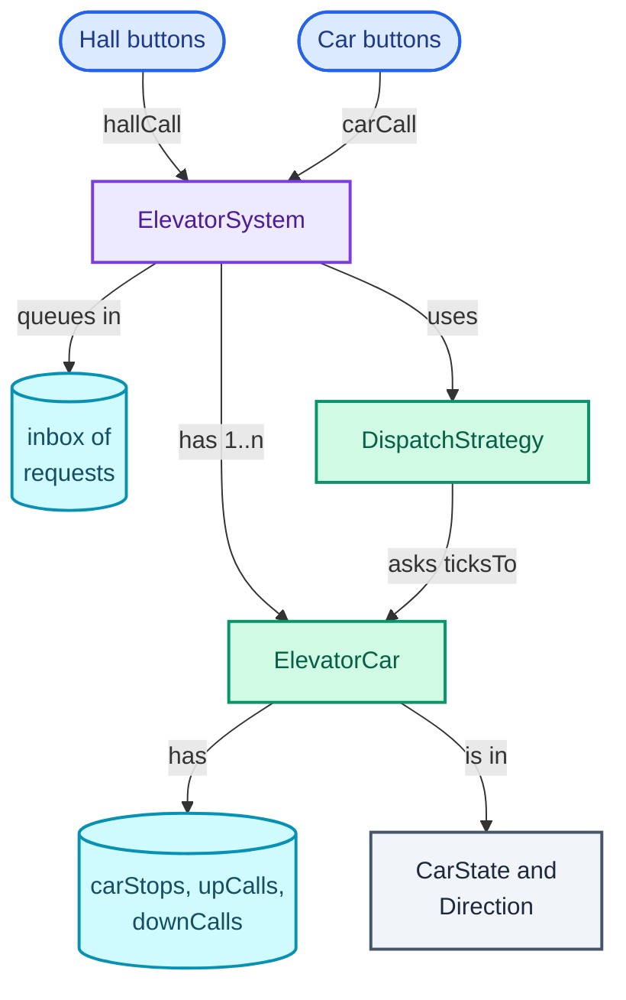
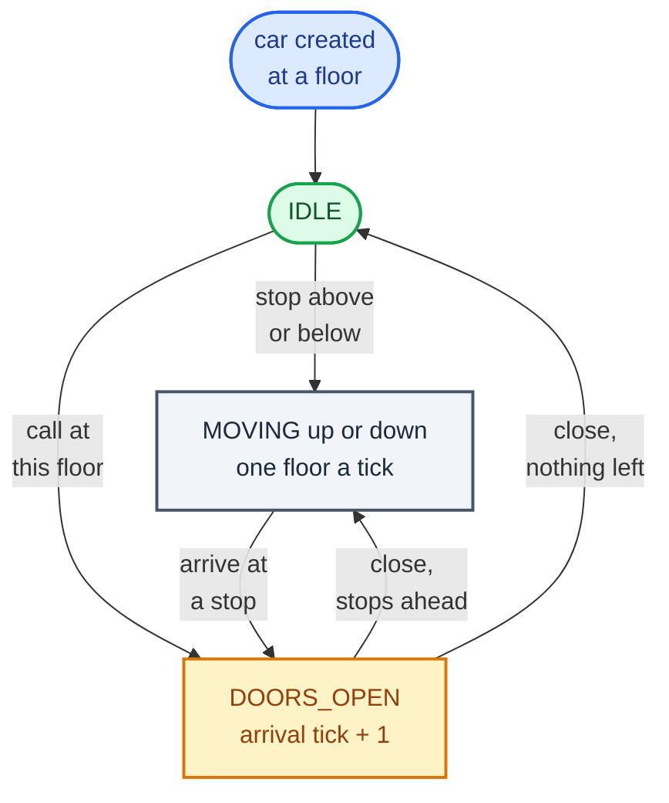
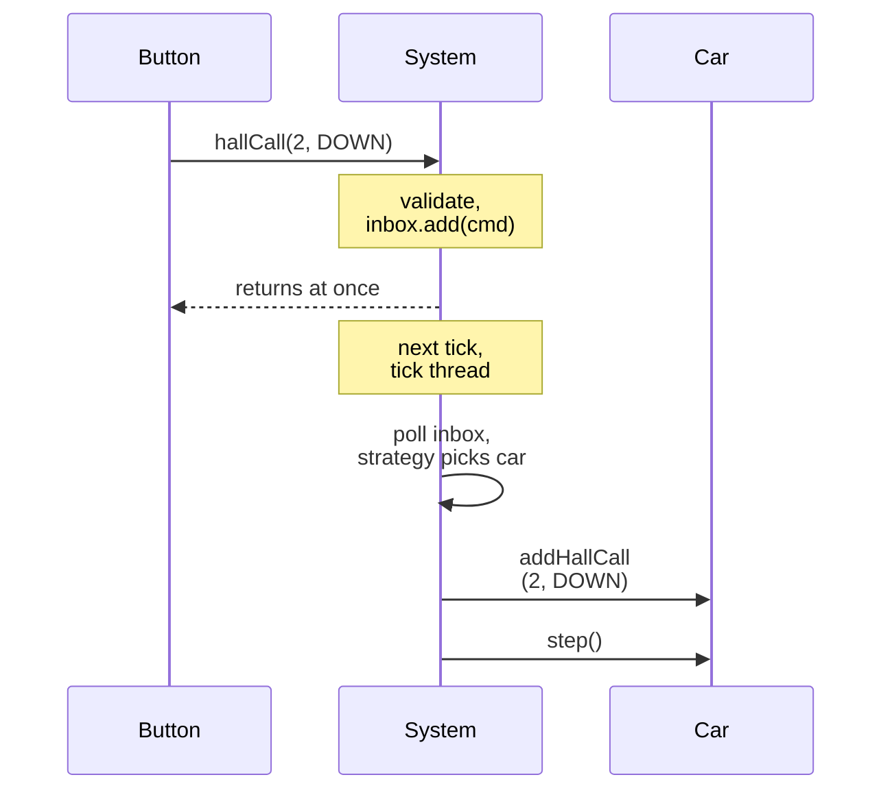

"Design an elevator system for a building." It sounds like hardware, and candidates often spend the first ten minutes on motors, door sensors and weight limits. The interviewer wants software: what the cars know, what the controller decides, and in what order a car serves the floors people ask for.

What the question really tests is **splitting responsibility between the controller and the cars**. There are two separate decisions. Which floor does this car go to next? That depends only on the car's own position, direction and stops, so the car owns it. Which car answers the person waiting on floor 2? That needs every car's situation, so the controller owns it. Candidates who mix the two end up with a controller that micro-manages every car's movement, which is hard to reason about and impossible to test.

It trains two things the series reuses. The car is a **state machine** (idle, moving, doors open), like the [vending machine](/blogs/lld-vending-machine/) but driven by a clock instead of buttons. The controller's choice of car is a **Strategy** (an interface for interchangeable rules, as in the [parking lot](/blogs/lld-parking-lot/)), and the obvious strategy, nearest car, is wrong in a way worth seeing. The post also shows a technique that makes any time-based design checkable: a **tick-based simulation**, where time advances in fixed steps and every step's state can be printed and compared. It leans on [the patterns toolkit](/blogs/lld-oop-and-patterns/) and, briefly, on [the concurrency toolkit](/blogs/lld-concurrency/).

How to use this post: [the method](/blogs/lld-the-method/). Try the question cold first, then read.


You are a senior engineer interviewing me for a low-level design round. The question is: "Design an elevator system for a building." Run it as a realistic 35-minute interview following this structure: requirements (5 min), entities and relationships (3 min), class design (10-15 min), implementation of the key methods in Java (10 min), extensibility (5 min).
Rules: state the question in one sentence and stop. Answer my clarifying questions the way a real interviewer would, briefly, and only what I ask. Assume one building with 10 floors and 2 cars, up and down buttons on each floor (hall calls), floor buttons inside each car (car calls), no weight limits, no express zones, and a simulation in which time advances in ticks of one floor of travel, but only reveal each of these if I ask. Never propose designs, components or classes yourself. If I skip a stage or run long on one, say so in one line and keep time. When I finish a stage, write one line of the note you would put on the scorecard, then move on.
Once my design is in place, probe it with these, one at a time, waiting for my answer each time: 1. Which class decides where a car goes next, and which decides which car answers a hall call? Why that split? 2. Car A is at floor 3 heading up to 7, car B is idle at 9, and floor 2 presses down. Which car does your design send, and how long does the passenger wait? 3. A car going up passes floor 6 where someone pressed down. Does it stop? 4. In what order does one car serve its stops, and why not first come, first served? 5. Buttons are pressed on other threads while the simulation ticks. How do you keep the cars consistent? 6. Add a peak-hour mode where cars return to the lobby when idle. Which classes change?
At the end, grade me as hire / lean hire / lean no hire / no hire for a senior engineer, with the two strongest and two weakest moments, and the one thing to fix first.



## Requirements

Two words of vocabulary first, because every elevator conversation uses them. A **hall call** is a button pressed on a floor, outside the cars: "I am on floor 2 and want to go down". It has a floor and a direction, and it names no car. A **car call** is a button pressed inside a car: "take this car to 7". It has a floor and belongs to one car.

The questions, by the four themes from [the method](/blogs/lld-the-method/), with the answer I would assume.

**Primary capabilities**

- *How many floors and cars?* 10 floors (0 to 9) and 2 cars, but the code takes both as parameters.
- *What can people press?* Up and down on each floor (no up on the top floor, no down on the ground floor), and floor buttons inside each car.
- *What do we build: a controller for real hardware, or a simulation?* A simulation, with time in **ticks**: one tick is the time to travel one floor (a couple of seconds in a real building). That turns "does it work?" into "print every tick and check".

**Rules and completion**

- *In what order does a car serve its stops?* It keeps moving in its current direction while it has any stop ahead, and reverses only when it has none. This rule is called **LOOK**, and the post shows why it beats the alternatives.
- *Does a car going up stop for someone who wants to go down?* No, it picks them up on the way back, unless that floor is the last stop in its current direction, in which case it turns round there.
- *How long do doors stay open?* One extra tick after arrival, so each stop costs a tick.
- *When is a request done?* When a car opens its doors at that floor in the right direction.

**Error handling**

- *A floor that does not exist, or "up" on the top floor?* Reject at the button.
- *The same hall button pressed twice?* Do not send a second car.
- *A car call for the floor the car is at, doors open?* Keep the doors open another tick.

**Scope boundaries**

- *Weight limits, emergency stop, fire mode, express zones, energy saving?* Out of scope, some kept as extensions.
- *Concurrency?* Buttons may be pressed on other threads while the simulation runs, so requests must reach the cars safely.

On the board:

```text
Elevator system
1. N floors, K cars. Hall calls: (floor, UP|DOWN), from every floor
   except UP at the top and DOWN at the bottom. Car calls: (car, floor).
2. Controller assigns each hall call to one car via a pluggable
   strategy; a call already assigned is not assigned twice.
3. Each car serves its stops with LOOK: keep direction while any stop
   is ahead; stop for car calls and hall calls in its direction; take an
   opposite-direction call only at its last stop, then reverse.
4. Time in ticks: a car moves one floor per tick; doors stay open one
   extra tick after arriving.
5. Requests can come from other threads; cars stay consistent.

Out of scope: weight, emergencies, fire mode, zoning, energy, real
motor and door hardware.
```

## Entities and relationships

The noun filter (a noun becomes a class if it holds changing state or enforces a rule):

- **ElevatorSystem** is the orchestrator: buttons call it, it assigns hall calls and advances time.
- **ElevatorCar** changes state every tick (floor, direction, doors) and owns the rule for the order of its stops, so it is the main entity.
- **DispatchStrategy** is the rule for which car answers a hall call, as an interface with two implementations.
- **HallCall** is a value: a floor and a direction (a Java `record`, an immutable class whose fields, `equals` and `hashCode` the compiler writes).
- A **car call** is only a floor number added to one car's stops, so it is not a class.
- **Direction** and **CarState** are enums.
- **Floor** fails the filter. It has no state the system needs beyond its number; the buttons on it are hall calls. A `Floor` class would hold an `int`.
- **Button**, **Door**, **Motor** and **Display** fail too: in this simulation the door is the `DOORS_OPEN` state and the motor is `floor += 1`. Model them only if the interviewer brings in hardware faults.

Ownership, read top-down from the buttons. Blue is where requests come from, purple the orchestrator, green the behaviour, teal the collections that hold pending work, grey the values:



Note the edge from the strategy to the car: the strategy asks each car for an estimate rather than reading its stops and doing the arithmetic itself. The car knows its own plan best, so the estimate lives with the car.

## Class design

### The split of responsibility

| Decision | Who owns it | What it needs |
| --- | --- | --- |
| Which car answers a hall call | `ElevatorSystem`, through `DispatchStrategy` | every car's position, direction and pending stops |
| Which floor this car goes to next | `ElevatorCar` | only its own position, direction and stops |
| When a car's doors open and close | `ElevatorCar` | its state and the tick |
| What a tick means for the whole building | `ElevatorSystem` | the cars and the queued requests |

This table is the answer to the first probe the interviewer will ask, and it is worth drawing before any class. The controller never tells a car "go to floor 5 now"; it gives the car a stop and lets the car's own rule fit it into the journey. That is **tell, don't ask** (hand an object the job and let it use its own state, instead of reading the state out and deciding for it) at the scale of a whole subsystem.

### ElevatorCar

| Requirement | What it must track |
| --- | --- |
| Move one floor per tick | current floor |
| LOOK ordering | committed direction, all pending stops |
| Stop only for calls in its direction | hall calls split by direction |
| Doors open one extra tick | state, dwell ticks left |
| Report an arrival estimate | all of the above |

```text
class ElevatorCar
  - id, floor
  - direction: Direction          UP, DOWN, or NONE when it has nowhere to go
  - state: CarState               IDLE, MOVING, DOORS_OPEN
  - dwell: int                    ticks the doors stay open
  - carStops: TreeSet<floor>      buttons pressed inside
  - upCalls, downCalls: TreeSet<floor>   hall calls assigned to this car
  + addCarStop(floor), addHallCall(call), hasHallCall(call)
  + step()                        one tick
  + ticksTo(call) -> int          estimated travel ticks to pick the call up
```

The stops are three `TreeSet`s, sorted sets that answer "the next stop above floor 4" with `higher(4)` in O(log n) (recalled: `TreeSet` is a red-black tree; `higher` and `lower` return the nearest element strictly above or below, or `null`). Keeping up and down hall calls apart is what lets the car stop for someone going its way and drive past someone going the other way.

The car's state machine is small, and drawing it is the fastest way to check the rules. Start at IDLE. A moving car stays MOVING tick after tick until it reaches a stop, and the doors stay open for the arrival tick plus one more:



Unlike the vending machine, the State pattern does not earn its place here. There are three states, one event (the tick) and the behaviour is a dozen lines, so an enum and a `switch` read better than three classes. The interesting logic is not "what does a tick mean in each state" but "which floor next", and that is the same in every state.

### DispatchStrategy

```text
interface DispatchStrategy
  + choose(cars, hallCall) -> ElevatorCar

class NearestCar   implements DispatchStrategy    smallest |car.floor - call.floor|
class EtaDispatch  implements DispatchStrategy    smallest car.ticksTo(call)
```

Strategy earns its place because buildings genuinely switch rules: morning peak (send idle cars to the lobby), lunchtime, night (park most cars, save energy), and the interviewer will ask for one of them. Each is a new class; `ElevatorSystem` is not edited.

### ElevatorSystem

```text
class ElevatorSystem
  - floors: int
  - cars: List<ElevatorCar>
  - strategy: DispatchStrategy
  - inbox: Queue<Runnable>        concurrent; button presses waiting for the next tick
  + hallCall(floor, direction)    validates, enqueues
  + carCall(carId, floor)         validates, enqueues
  + step()                        apply queued presses, then step every car
```

Button presses do not touch the cars directly. They are validated on the caller's thread and put in a queue as small commands (a `Runnable`, Java's interface for "a piece of code to run later"), and `step()` applies them at the start of the next tick. This is a light form of the **Command** pattern, and its purpose here is threading, covered in the implementation.

Considered and rejected:

- **A `Floor` class with button objects.** It would hold a number and forward presses.
- **Movement order as a second Strategy on the car** (FCFS vs SCAN vs LOOK as pluggable classes). Possible, but the ordering rule needs intimate access to the car's three stop sets, so the interface would expose them all and buy little. LOOK is the right answer for passengers, so I keep it inside the car and say that it could be extracted if a second ordering is ever needed.
- **The controller computing each car's path.** It would have to know the car's stops, doors and direction rules, duplicating the car.

## Implementation

Happy path: a button press is enqueued; at the next tick the system assigns hall calls through the strategy and adds car calls to their car; then every car steps once. A car that has stops ahead moves one floor; on arrival at a stop it opens its doors for the arrival tick and one more, then continues or goes idle.

Edge cases, each handled below:

- a call for the floor an idle car is already on: open without moving;
- a car going up reaches a floor with only a down call: drive past, unless nothing is above, then stop and turn round;
- the top stop reached with nothing beyond: reverse if there are stops below, otherwise idle;
- a hall button pressed twice: assigned once;
- a car call for the current floor while the doors are open: the doors stay open another tick;
- invalid floors and directions: rejected at the button.

### The values

```java
enum Direction {
    UP, DOWN, NONE;
    Direction opposite() { return this == UP ? DOWN : this == DOWN ? UP : NONE; }
}

enum CarState { IDLE, MOVING, DOORS_OPEN }

record HallCall(int floor, Direction direction) {}
```

### The car: fields and requests

```java
final class ElevatorCar {
    private static final int DWELL_TICKS = 1;      // ticks the doors stay open after the arrival tick
    private final String id;
    private int floor;
    private int dwell;
    private Direction direction = Direction.NONE;   // the way it is committed to travel
    private CarState state = CarState.IDLE;
    private final TreeSet<Integer> carStops = new TreeSet<>();   // buttons inside the car
    private final TreeSet<Integer> upCalls = new TreeSet<>();    // hall calls assigned to this car
    private final TreeSet<Integer> downCalls = new TreeSet<>();

    ElevatorCar(String id, int floor) { this.id = id; this.floor = floor; }

    String id() { return id; }
    int floor() { return floor; }
    Direction direction() { return direction; }
    CarState state() { return state; }

    void addCarStop(int f) { carStops.add(f); }

    void addHallCall(HallCall c) { (c.direction() == Direction.UP ? upCalls : downCalls).add(c.floor()); }

    boolean hasHallCall(HallCall c) { return (c.direction() == Direction.UP ? upCalls : downCalls).contains(c.floor()); }
```

### One tick

```java
    /** One tick: move one floor, or stand with the doors open. */
    void step() {
        if (state == CarState.DOORS_OPEN) {
            if (dwell > 0) { dwell--; return; }                              // doors stay open
            state = CarState.IDLE;                                           // doors close; may move now
        }
        if (shouldStopAt(floor)) { openDoors(); return; }                    // someone wants this floor
        direction = nextDirection();
        if (direction == Direction.NONE) { state = CarState.IDLE; return; }
        floor += direction == Direction.UP ? 1 : -1;
        state = CarState.MOVING;
        if (shouldStopAt(floor)) openDoors();
    }
```

The order inside `step` is the state machine above, line for line. The check of the current floor before moving is what makes "pressed the floor I am on" and "idle car, call at its floor" work without special cases.

### Which way, and whether to stop: the LOOK rule

There are three common orders for one car's stops, and the sketch runs all three on the same requests: a car at floor 4 going up, with requests for 8, 2 and 6 pressed in that order. Across is floors travelled, so the length of each line is its cost.

<figure class="sketch"></figure>

**First come, first served** (FCFS) serves requests in the order they were pressed: 4 to 8, back down to 2, back up to 6, 14 floors, passing 6 twice without stopping. It is fair in the order people pressed, and under load the car spends most of its time crossing the building. **SCAN** (the name comes from disk-arm scheduling, where the read head sweeps the platter) sweeps in one direction to the end of the building, then sweeps back: 12 floors, but it rides from 8 to 9 and back for nobody. **LOOK** sweeps the same way but turns at the last request instead of the last floor: 10 floors. LOOK still bounds every wait: a request is reached at the latest after the car finishes its current sweep and the sweep back, so nobody waits forever.

```java
    /** LOOK: keep going while anything is ahead; turn round only when nothing is. */
    private Direction nextDirection() {
        if (direction == Direction.UP && hasStopsAbove(floor)) return Direction.UP;
        if (direction == Direction.DOWN && hasStopsBelow(floor)) return Direction.DOWN;
        if (hasStopsAbove(floor)) return Direction.UP;
        if (hasStopsBelow(floor)) return Direction.DOWN;
        return Direction.NONE;
    }

    /** Stop for a car button, a hall call going our way, or a call the other way at our last stop. */
    private boolean shouldStopAt(int f) {
        if (carStops.contains(f)) return true;
        return switch (direction) {
            case UP -> upCalls.contains(f) || (downCalls.contains(f) && !hasStopsAbove(f));
            case DOWN -> downCalls.contains(f) || (upCalls.contains(f) && !hasStopsBelow(f));
            case NONE -> upCalls.contains(f) || downCalls.contains(f);
        };
    }

    private void openDoors() {
        state = CarState.DOORS_OPEN;
        dwell = DWELL_TICKS;
        carStops.remove(floor);
        if (direction == Direction.NONE) {                // idle car answering a call at its floor
            if (upCalls.remove(floor)) direction = Direction.UP;
            else if (downCalls.remove(floor)) direction = Direction.DOWN;
            return;
        }
        TreeSet<Integer> same = direction == Direction.UP ? upCalls : downCalls;
        TreeSet<Integer> other = direction == Direction.UP ? downCalls : upCalls;
        same.remove(floor);
        boolean nothingBeyond = direction == Direction.UP ? !hasStopsAbove(floor) : !hasStopsBelow(floor);
        if (nothingBeyond && other.remove(floor)) direction = direction.opposite();   // turn round here
    }

    private boolean hasStopsAbove(int f) {
        return carStops.higher(f) != null || upCalls.higher(f) != null || downCalls.higher(f) != null;
    }

    private boolean hasStopsBelow(int f) {
        return carStops.lower(f) != null || upCalls.lower(f) != null || downCalls.lower(f) != null;
    }
```

The rule for opposite-direction calls is the subtle line. A car going up with a stop at 9 drives past a down call at 8: the person at 8 wants to go down, and letting them in would carry them up first. On the way back it stops at 8. But if 8 were the car's highest stop, it would stop there on the way up and turn round, because there is no point going higher. `openDoors` clears only the call matching the direction the car will leave in, so the other passenger's call stays pending.

### The car's arrival estimate

A dispatch strategy needs a number per car: how long until this car could pick up this call? Under LOOK there are three cases, depending on where the call sits relative to the car's sweep:

```java
    /** Furthest stop in direction d, or the current floor if there is none. */
    private int furthest(Direction d) {
        int best = floor;
        for (TreeSet<Integer> s : List.of(carStops, upCalls, downCalls)) {
            if (s.isEmpty()) continue;
            best = d == Direction.UP ? Math.max(best, s.last()) : Math.min(best, s.first());
        }
        return best;
    }

    /** Estimated ticks of travel until this car would pick the call up under LOOK (door stops ignored). */
    int ticksTo(HallCall call) {
        int f = call.floor();
        if (direction == Direction.NONE) return Math.abs(f - floor);
        // At a tick boundary the car is level with `floor` and checks it before moving on,
        // so its own floor still counts as ahead.
        boolean ahead = direction == Direction.UP ? f >= floor : f <= floor;
        if (ahead && call.direction() == direction) return Math.abs(f - floor);       // on the way
        int turn = furthest(direction);
        if (call.direction() != direction)                                              // after it turns
            return Math.abs(turn - floor) + Math.abs(turn - f);
        int end = direction == Direction.UP ? Math.min(furthest(Direction.DOWN), f)     // after it turns twice
                                            : Math.max(furthest(Direction.UP), f);
        return Math.abs(turn - floor) + Math.abs(turn - end) + Math.abs(f - end);
    }
}
```

The three cases, for a car going up: a call ahead going up is on the way, so the cost is the distance. A call going down is picked up after the car reaches its highest stop (`turn`) and comes back. A call behind going up is the worst: up to the turn, down to the lowest point of the down sweep, and up again. The estimate counts travel only, not door stops, so it ranks cars rather than predicting the second; adding a tick per intermediate stop is the first refinement (see Extensibility).

### The two dispatch strategies

```java
interface DispatchStrategy {
    ElevatorCar choose(List<ElevatorCar> cars, HallCall call);
}

/** Closest car by floors, whatever it is doing. The tempting first answer. */
final class NearestCar implements DispatchStrategy {
    public ElevatorCar choose(List<ElevatorCar> cars, HallCall call) {
        return cars.stream().min(Comparator.comparingInt(c -> Math.abs(c.floor() - call.floor()))).orElseThrow();
    }
}

/** The car that would arrive first given where it is already going. Ties go to the first car. */
final class EtaDispatch implements DispatchStrategy {
    public ElevatorCar choose(List<ElevatorCar> cars, HallCall call) {
        return cars.stream().min(Comparator.comparingInt(c -> c.ticksTo(call))).orElseThrow();
    }
}
```

"Ties go to the first car" holds because `Stream.min` keeps the earlier of two equal elements (recalled: it reduces with `BinaryOperator.minBy`, which returns the first argument when the comparator says equal).

The sketch is the moment from the verification where the two strategies disagree. Car A is one floor from the caller; follow its arrows to see the trip it would actually make.

<figure class="sketch"></figure>

`NearestCar` sends A because it is one floor away, ignoring that A is heading up to 7 with a passenger inside. `EtaDispatch` asks each car and sends B. I ran the whole scenario both ways: with `EtaDispatch` the floor-2 passenger is picked up 7 ticks after pressing; with `NearestCar`, 16 ticks. Nearest car is the Bad rung of this ladder; arrival estimate is the Good one; the Great one adds door stops and current load to the estimate and re-assigns a call if another car becomes clearly better before the first arrives.

### The controller, and who touches the cars

Buttons are pressed by people, which in the program means other threads, while one thread runs the clock and calls `step()`. If a button thread called `car.addCarStop` directly while the tick thread was inside `car.step()`, the two would read and write the same `TreeSet` at once, and `TreeSet` is not thread-safe: it can lose the element or corrupt its tree.

There are two clean fixes. **Good:** one lock around everything (`synchronized` on every public method of the system and `step`). Simple and correct; a tick holds the lock for microseconds. **Great:** the **single-writer** rule, only one thread ever modifies the cars. Button threads put a command on a thread-safe queue and return immediately; the tick thread drains the queue at the start of each tick. No lock is held by anyone, the cars need no synchronisation of their own, and the order in which requests take effect is well defined: at tick boundaries. This sequence shows one hall call taking that path (Button is a button thread, System the `ElevatorSystem` on the tick thread, Car the chosen `ElevatorCar`):



```java
final class ElevatorSystem {
    private final int floors;
    private final List<ElevatorCar> cars;
    private final DispatchStrategy strategy;
    // Buttons are pressed on other threads. They only enqueue; the tick thread is the only
    // thread that ever touches a car, so the cars need no locks of their own.
    private final Queue<Runnable> inbox = new ConcurrentLinkedQueue<>();
    private final List<String> log = new ArrayList<>();
    private long applied;

    ElevatorSystem(int floors, List<ElevatorCar> cars, DispatchStrategy strategy) {
        this.floors = floors;
        this.cars = List.copyOf(cars);
        this.strategy = strategy;
    }

    void hallCall(int floor, Direction d) {
        checkFloor(floor);
        if (d == Direction.NONE || (d == Direction.UP && floor == floors - 1) || (d == Direction.DOWN && floor == 0))
            throw new IllegalArgumentException("no " + d + " button on floor " + floor);
        inbox.add(() -> assign(new HallCall(floor, d)));
    }

    void carCall(String carId, int floor) {
        checkFloor(floor);
        ElevatorCar car = car(carId);
        inbox.add(() -> { car.addCarStop(floor); log.add(carId + " button " + floor); });
    }

    /** One tick of the whole building: apply queued presses, then move every car once. */
    void step() {
        for (Runnable r; (r = inbox.poll()) != null; ) { r.run(); applied++; }
        cars.forEach(ElevatorCar::step);
    }

    private void assign(HallCall call) {
        String label = "hall " + call.floor() + (call.direction() == Direction.UP ? " UP" : " DOWN");
        if (cars.stream().anyMatch(c -> c.hasHallCall(call))) { log.add(label + " already assigned"); return; }
        StringJoiner eta = new StringJoiner(" ");
        cars.forEach(c -> eta.add(c.id() + "=" + c.ticksTo(call)));
        ElevatorCar chosen = strategy.choose(cars, call);
        chosen.addHallCall(call);
        log.add(label + " -> " + chosen.id() + " (eta " + eta + ")");
    }

    ElevatorCar car(String id) {
        return cars.stream().filter(c -> c.id().equals(id)).findFirst()
                .orElseThrow(() -> new IllegalArgumentException("no car " + id));
    }

    private void checkFloor(int f) {
        if (f < 0 || f >= floors) throw new IllegalArgumentException("no floor " + f);
    }

    List<String> drainLog() { List<String> out = List.copyOf(log); log.clear(); return out; }
    long applied() { return applied; }
}
```

`ConcurrentLinkedQueue` is a lock-free queue whose `add` and `poll` are safe from any number of threads (recalled from its docs). Validation runs on the button thread, so a bad floor fails at the button, where the caller can be told, not later inside a tick. The `log` is only touched by the tick thread (inside commands and `assign`), so it needs no protection either.

The test: four threads each pressed 10,000 car buttons as fast as they could while the main thread kept calling `step()`. All 40,000 requests were applied. The same producer-consumer race with a plain `ArrayDeque` in place of the concurrent queue never received all 40,000: across five runs it received between 0 and 19,373, and in two of them the deque was corrupted so badly that `poll` threw millions of exceptions. The [concurrency toolkit](/blogs/lld-concurrency/) covers producer-consumer queues in depth.

## Verification

Ten floors, car A idle at 0, car B idle at 9, `EtaDispatch`. Presses happen immediately before the tick they are listed in. Each row is the state after the tick: floor, then what the car is doing (`OPEN ^` means doors open, committed upward). This is the program's output, with ticks 16 to 20 merged into one row:

| Tick | A | B | Events |
| --- | --- | --- | --- |
| 1 | 1 up | 9 idle | A button 7 (someone in A at the ground floor) |
| 2 | 2 up | 9 idle | |
| 3 | 3 up | 9 idle | hall 5 UP: A (eta A=3, B=4) |
| 4 | 4 up | 8 down | hall 2 DOWN: B (eta A=9, B=7); pressed again: already assigned |
| 5 | 5 OPEN ^ | 7 down | |
| 6 | 5 OPEN ^ | 6 down | A button 9 (the floor-5 passenger) |
| 7 | 6 up | 5 down | |
| 8 | 7 OPEN ^ | 4 down | hall 8 DOWN: A (eta A=4, B=9) |
| 9 | 7 OPEN ^ | 3 down | |
| 10 | 8 up | 2 OPEN v | |
| 11 | 9 OPEN ^ | 2 OPEN v | B button 0 (the floor-2 passenger) |
| 12 | 9 OPEN ^ | 1 down | |
| 13 | 8 OPEN v | 0 OPEN v | |
| 14 | 8 OPEN v | 0 OPEN v | A button 1 (the floor-8 passenger) |
| 15 | 7 down | 0 idle | |
| 16 to 20 | 6, 5, 4, 3, 2 down | 0 idle | |
| 21 | 1 OPEN v | 0 idle | |
| 22 | 1 OPEN v | 0 idle | |
| 23 | 1 idle | 0 idle | |

The same run as a picture, floor against tick: blue for A, violet for B, thick dots for ticks with the doors open, red flags where hall calls were pressed.

<figure class="sketch"></figure>

What to point at:

- **Tick 4, dispatch.** The floor-2 call goes to B although A is closer. A's estimate is (7 − 3) + (7 − 2) = 9: up to its last stop and back. B's is 9 − 2 = 7. B opens at 2 on tick 10, 7 ticks after the press, exactly its estimate, because it made no stops on the way. The second press of the same button is caught by `hasHallCall`.
- **Tick 3, on the way.** The floor-5 UP call is ahead of A in A's direction, estimate 3, and A stops there on tick 5 without changing its plan.
- **Tick 10, the edge transition.** A reaches 8 going up, with a DOWN call at 8 and a stop at 9 above it. `shouldStopAt(8)` is false: the call is the other way and there is a stop beyond. A drives past, stops at 9 (ticks 11 and 12), then `nextDirection` finds nothing above and stops below, reverses, and opens at 8 on tick 13 for the waiting passenger. The trace chart shows this as the blue line peaking at 9 and coming back to 8.
- **Tick 8, the estimate vs reality.** A's estimate for the floor-8 call was 4 ticks of travel; it arrived on tick 13, 6 ticks later, because two door stops (7 and 9) cost a tick each. That gap is the refinement mentioned below.

Under `NearestCar`, the same presses (with the floor-2 passenger boarding whichever car comes) leave that passenger waiting until tick 19.

## Extensibility

### "Make the estimate count door stops and load"

Add one tick for every pending stop between the car and the pickup point, which `TreeSet.subSet(from, to)` counts directly. For load, a car with a weight sensor reporting "full" can return `Integer.MAX_VALUE` for hall calls so it is never chosen. Both changes are inside `ticksTo`; no strategy changes.

### "Peak hours: send idle cars to the lobby in the morning"

A new `DispatchStrategy` handles which car answers; parking idle cars is a second, separate policy, an `IdlePolicy` that the system consults each tick for cars in `IDLE` ("go to 0 between 08:00 and 10:00"). It gives the car an ordinary car stop, so the car's rules stay untouched. Keeping "who answers" and "where to wait" as two interfaces stops one strategy class from growing every building's special case.

### "Destination dispatch: people type their floor in the lobby"

Modern towers have a keypad in the lobby instead of up and down buttons. The hall call then carries both floors, `HallCall(from, to)`, and the strategy can group passengers going to nearby floors into the same car. The car is unchanged: it receives a hall stop at `from` and a car stop at `to`, which is exactly what a passenger pressing the button inside would have produced.

### "Express zones: car A serves floors 0 and 20 to 40 only"

Each car gets a set of floors it serves, and `EtaDispatch` skips cars that do not serve the call's floor (cost infinite). Car calls to unserved floors are rejected at the button. One field on the car, one check in the strategy.

### "Emergency or fire mode"

A system-wide mode in which every car cancels its stops, goes to the lobby, opens and stays there. This one is a real state of the whole system, so `ElevatorSystem` gets a mode field and `step()` checks it first. If modes multiply (fire, maintenance, VIP), the system's own behaviour becomes a State pattern, the same move as the vending machine.

## What each level is expected to show

| Level | What a strong answer shows |
| --- | --- |
| Junior / Mid | Hall calls vs car calls distinguished, a car that moves floor by floor with a direction and a set of stops, a reasonable ordering (SCAN or LOOK named), and a controller that assigns calls to cars. |
| Senior | The controller and car responsibilities split and justified; LOOK explained against FCFS and SCAN; the opposite-direction rule handled; dispatch as a strategy, with nearest car shown to fail and replaced by an arrival estimate; a tick simulation used to verify; thread safety addressed. |
| Staff+ | Treats it as a scheduling system: estimate refinements (dwell, load), re-assignment, idle parking as a separate policy, destination dispatch, single-writer threading with a command queue, and an honest statement of what the estimate ignores and why a ranking does not need to be exact. |

## Variants this unlocks

| Question | What changes |
| --- | --- |
| Design a car-park ramp or a goods lift | One car, larger capacity, often no hall-call direction; LOOK still orders the stops. |
| Design a disk scheduler | The same ordering problem with cylinders instead of floors: FCFS, SCAN, LOOK and C-SCAN (sweep one way only, jump back) are the textbook answers. |
| Design a ride-hailing dispatcher (in-process) | Cars become drivers on a map, `ticksTo` becomes an ETA from a routing service, and "already heading this way" becomes en-route pooling. The strategy seam is the same. |
| Design a printer or job queue with priorities | One worker serving requests in an order chosen by a policy; starvation and fairness are the same discussion as FCFS vs SCAN. |
| Design a traffic-light controller | A tick-driven state machine per junction with a coordinator, the same split of local rule and global policy. |

## The one-page version

- `ElevatorSystem`: the orchestrator; validates presses on the caller's thread, queues them, and on each `step()` applies them and steps every car.
- `ElevatorCar`: floor, direction, state, dwell, and three `TreeSet`s of stops; owns LOOK and its own arrival estimate.
- `step()`: doors finish their dwell; stop here if asked; else choose direction by LOOK, move one floor, open on arrival if it is a stop.
- `shouldStopAt`: car calls always; hall calls in the car's direction; opposite-direction calls only at the last stop, then turn.
- `ticksTo(call)`: on the way, after one turn, or after two turns.
- `DispatchStrategy`: `NearestCar` (distance, wrong) and `EtaDispatch` (smallest `ticksTo`).
- `HallCall` record; `Direction` and `CarState` enums.
- Threading: single writer; button threads only add commands to a `ConcurrentLinkedQueue`.

**Each car keeps going while anything is ahead and turns only when nothing is; the controller never moves a car, it only picks which car gets a call, by asking each one how soon it could arrive.**


You are my low-level design interview coach. I designed an elevator system and need to defend it. Ask me the questions below one at a time. After each, wait for my answer, then judge it against the key points listed for that question. If I am right, confirm briefly and add anything I missed. If I am wrong or incomplete, give me one hint and let me try again; after a second miss, explain the answer. Never reveal the key points before I have answered.
1. Which class decides the next floor of a car, and which decides which car answers a hall call? Why? Key points: the car decides its next floor because that needs only its own floor, direction and stops; the controller decides which car via a DispatchStrategy because that needs every car; the controller gives a car a stop rather than steering it (tell, don't ask).
2. Car A is at 3 heading up to 7, car B is idle at 9, floor 2 presses down. Which car and why? Key points: nearest car picks A (1 floor) but A must go to 7 and back, 4 + 5 = 9 floors; B comes straight down, 7 floors; an arrival estimate per car picks B; in the simulation the passenger waited 7 ticks with the estimate and 16 with nearest car.
3. Compare FCFS, SCAN and LOOK for a car at 4 going up with requests 8, 2, 6 pressed in that order. Key points: FCFS 4-8-2-6 is 14 floors; SCAN goes to the top floor 9 then down to 2, 12 floors; LOOK turns at 8, 10 floors; LOOK still bounds every wait (at worst the rest of the current sweep plus the sweep back), so nobody waits forever.
4. A car going up reaches floor 8 where someone pressed down, and it has a stop at 9. What happens? Key points: it does not stop, because the passenger would ride up first; it stops at 9, reverses, and opens at 8 on the way down; if 8 were its highest stop it would stop there and turn round.
5. What does the arrival estimate ignore, and does that matter? Key points: it counts travel only, not door stops or load; it ranks cars rather than predicting time, so it is good enough; refine by adding a tick per intermediate stop and excluding full cars.
6. Buttons are pressed on other threads while the tick thread runs. How do the cars stay consistent? Key points: TreeSet is not thread-safe; either one lock around everything, or single writer: button threads enqueue commands on a ConcurrentLinkedQueue and only the tick thread touches cars; a test with 4 threads and 40,000 presses applied all of them, while an ArrayDeque lost most or threw.
7. Add a morning-peak mode that parks idle cars at the lobby. Key points: a separate idle policy consulted each tick for idle cars, giving them an ordinary stop; dispatch strategy and car rules unchanged.



Next: [Design Amazon Locker](/blogs/lld-amazon-locker/), where the allocation problem comes back as compartments of different sizes, with pickup codes that expire.
