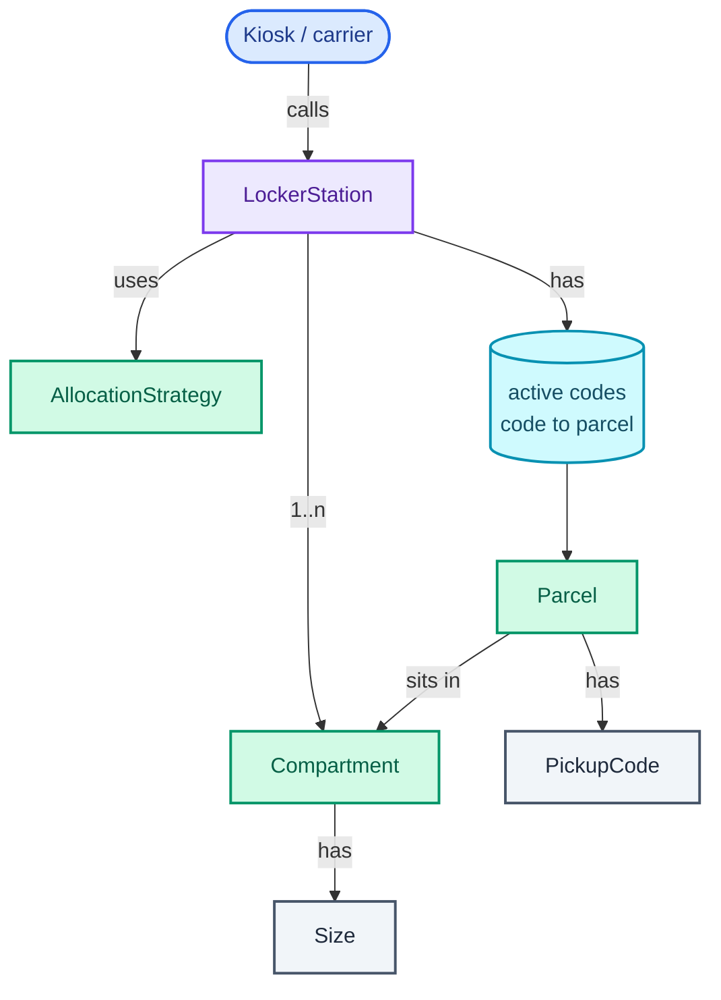
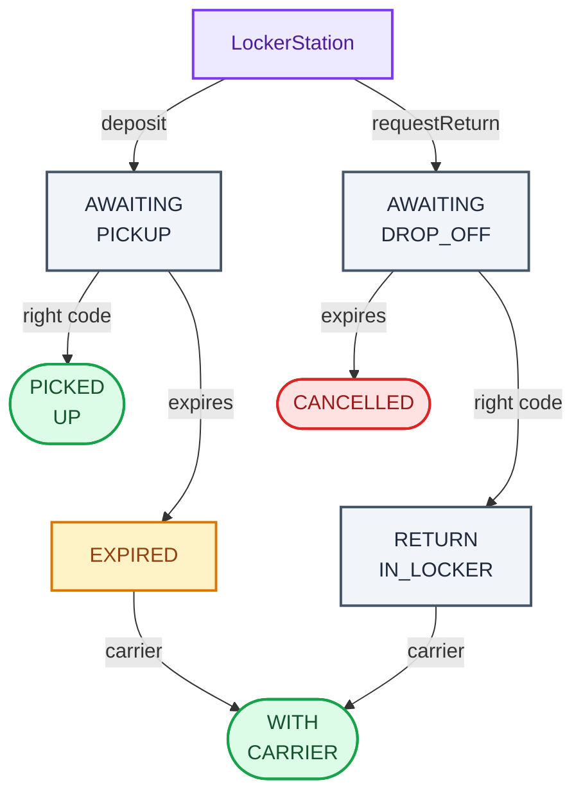

"Design Amazon Locker. Carriers drop parcels into a bank of lockers; customers collect them by typing a code."

It sounds like a CRUD app with a door on it. It is really two questions. The first is **allocation**: three compartment sizes, parcels of every shape, and a choice of box that decides whether the next parcel fits at all. The second is **time**: a code that works today must stop working in three days, and a parcel nobody collected must end up back with the carrier, even though nobody pressed a button when its deadline passed. The hard part the interviewer is watching for is that second one: state that changes *because the clock moved*, and a design that stays correct whether or not the clean-up job has run yet.

It trains three habits that come back later in the series. **Strategy** for the allocation rule, the same seam as spot assignment in the [parking lot](/blogs/lld-parking-lot/). **Value objects** (small immutable types compared by value, like `PickupCode` and `Dimensions`) so a bad input is rejected once, at the edge. And an explicit **lifecycle** as an enum with guarded transitions, the shape [Part 2](/blogs/lld-oop-and-patterns/) argues for before reaching for the State pattern. The expiry idea (check lazily on use, sweep periodically) returns in [movie ticket holds](/blogs/lld-movie-ticket-booking/) and the [LRU cache's TTL](/blogs/lld-lru-cache/).

How to use this post: [the method](/blogs/lld-the-method/). Try the question cold first, then read.


You are a senior engineer interviewing me for a low-level design round. The question is: "Design Amazon Locker. Carriers drop parcels into a bank of lockers; customers collect them by typing a code." Run it as a realistic 35-minute interview following this structure: requirements (5 min), entities and relationships (3 min), class design (10-15 min), implementation of the key methods in Java (10 min), extensibility (5 min).
Rules: state the question in one sentence and stop. Answer my clarifying questions the way a real interviewer would, briefly, and only what I ask. Never propose designs, components or classes yourself. If I skip a stage or run long on one, say so in one line and keep time. When I finish a stage, write one line of the note you would put on the scorecard, then move on.
Once my design is in place, probe it with these, one at a time, waiting for my answer each time: 1. A small parcel arrives and every small compartment is taken. What happens, and what does that cost the next medium parcel? 2. How do you decide whether a 20 x 40 x 30 parcel fits a 45 x 35 x 20 compartment? 3. A code's three days ran out at 09:05 and your clean-up job runs hourly. The customer types the code at 09:30. What happens? 4. When a delivery expires, is its compartment free? And when an unused return reservation expires? 5. How do you stop someone at the kiosk guessing codes, and how good is your defence in numbers? 6. Where would you change the code if the business says "never put a small parcel in a large compartment"?
At the end, grade me as hire / lean hire / lean no hire / no hire for a senior engineer, with the two strongest and two weakest moments, and the one thing to fix first.



## Requirements

Five minutes of questions, grouped by the four themes from [the method](/blogs/lld-the-method/). Each comes with the answer I'd assume if the interviewer leaves it to me.

**Primary capabilities**

- *Who uses it?* Carriers deposit parcels. Customers collect them with a code. Customers can also drop off a return. The carrier takes away expired parcels and returns on their next visit.
- *One locker station or the whole network?* One station: a kiosk with a keypad and a wall of compartments. Choosing *which* station a parcel goes to is the network's problem, and an extension below.
- *How do we know a parcel's size?* The carrier's scanner reports outer dimensions in centimetres. Compartments come in three sizes: small, medium and large.

**Rules and completion**

- *Which compartment does a parcel get?* The smallest size it fits. If none of that size is free, the next size up.
- *What is a code?* Six digits, single use, unique among the station's live codes. A pickup code lasts three days; a return drop-off code lasts one day.
- *What happens when a code runs out?* The code stops working. An uncollected parcel stays in its compartment until the carrier takes it away. An unused return reservation frees its compartment at once, because nothing is inside.
- *When is a parcel "done"?* When the customer has it, or when the carrier has taken it back.

**Error handling**

- *Parcel bigger than every compartment?* Refuse, with a reason that differs from "station full". Full means "try another station"; too big means "no station will take this".
- *Wrong code?* Refuse. Five wrong codes in a row lock the keypad for 15 minutes.
- *Expired code?* Refuse with "expired", not "unknown": the customer's next step (ask for redelivery) is different.
- *Door jammed, power cut?* Out of scope; mentioned as an extension.

**Scope boundaries**

- *Notifications, payments, carrier login, the door hardware?* Out. The station says which door to open and returns the code; the backend that called it sends the SMS.
- *Concurrency?* The kiosk, the carrier's tablet and a periodic clean-up job all touch one station. Light traffic, so one lock per station.
- *Persistence?* In memory for the interview.

On the board:

```text
1. deposit(parcel, dims): put it in the smallest free compartment it fits (else next size up);
   return the compartment to open and a 6-digit pickup code valid for 3 days.
2. enterCode(code): if live and unexpired, open its compartment. Pickup frees it;
   a return drop-off fills the compartment reserved for it. Codes are single use.
3. requestReturn(parcel, dims): reserve a compartment, issue a drop-off code valid 1 day.
4. Expiry: an expired code never opens a door. Expired deliveries wait for the carrier;
   expired return reservations free their compartment. A periodic sweep records expiries.
5. collectForCarrier(): empty every compartment holding an expired delivery or a return.
6. Errors: too big for any size, no free compartment, unknown code, expired code,
   keypad locked (5 wrong codes in a row, 15 minutes).

Out of scope: notifications, payments, carrier auth, hardware faults, multiple stations.
```

## Entities and relationships

The noun filter from [the method](/blogs/lld-the-method/): a noun earns a class when it has state that changes or rules of its own; otherwise it is a field.

- **Locker station**: the orchestrator. Owns the compartments, the live codes, the keypad lockout and the clock. A class, `LockerStation`.
- **Compartment**: changes state (free, reserved, occupied) and has a size. A class.
- **Parcel**: has a lifecycle with seven states and rules about which move is legal from where. A class.
- **Size**: a fixed set of three, with one rule ("does this parcel fit?"). An enum.
- **Dimensions** and **pickup code**: no identity, never change, compared by value. Records, which Java gives `equals` and `hashCode` for free, so a code can be a map key.
- **Allocation rule**: the part the interviewer will ask to change. An interface, `AllocationStrategy`.
- **Code generation**: random in production, predictable in tests. An interface, `CodeGenerator`.
- **Customer and carrier**: actors, not classes. The code *is* the customer's credential at the kiosk; who the customer is lives upstream.
- **Door, keypad, SMS**: hardware and integrations. A method returns "open S1"; something else drives the latch.

The graph below shows ownership, read top-down: the station holds its compartments and its live codes, each code leads to one parcel, and each parcel points at the compartment it sits in.



One thing the graph leaves out on purpose: there is no customer table. A station knows *codes*, not *people*, which is why a code has to be unguessable and short-lived.

## Class design

Top-down, from the orchestrator.

### LockerStation

| Requirement | What LockerStation must track |
| --- | --- |
| allocate the smallest box that fits | the list of compartments, and an `AllocationStrategy` to choose among them |
| a code opens one compartment | `activeCodes: Map<PickupCode, Parcel>`, only live codes |
| codes expire | a `Clock` (`java.time.Clock`, injected so tests move time by hand), plus the two windows |
| carrier takes back what's left | `forCarrier: List<Parcel>`, expired deliveries and dropped-off returns |
| lock the keypad after 5 misses | `failedAttempts` and `lockedUntil` |

```text
class LockerStation
  - compartments: List<Compartment>
  - allocation: AllocationStrategy
  - codes: CodeGenerator
  - clock: Clock
  - pickupWindow, dropOffWindow: Duration
  - activeCodes: Map<PickupCode, Parcel>
  - forCarrier: List<Parcel>
  - failedAttempts: int
  - lockedUntil: Instant
  + deposit(parcelId, dims) -> Receipt
  + requestReturn(parcelId, dims) -> Receipt
  + enterCode(code) -> Compartment          // the door that opens
  + expireOverdue() -> int                   // the periodic sweep
  + collectForCarrier() -> List<String>
```

The station keeps **only live state**. A delivered parcel's history (when it arrived, when it left) belongs in an event log upstream, not in the station's memory; otherwise a station that handles 100 parcels a day holds 36,500 dead objects after a year.

A station is small. Assume 60 compartments and a handful of operations a minute. That number decides two things: a linear scan over compartments is fine (60 checks take microseconds, so no free-list index is needed), and one lock per station costs nothing.

### Compartment and Parcel

```text
class Compartment
  - id: String
  - size: Size
  - state: CompartmentState          // FREE, RESERVED, OCCUPIED
  + reserve()                        // FREE -> RESERVED
  + occupy()                         // FREE or RESERVED -> OCCUPIED
  + release()                        // -> FREE

class Parcel
  - id: String
  - kind: Kind                       // DELIVERY or RETURN
  - compartment: Compartment
  - code: PickupCode
  - expiresAt: Instant
  - state: ParcelState
  + isOverdue(now) -> boolean
  + pickUp() / dropOff() / expire() / collect()
```

Each class guards its own transitions ("tell, don't ask"): the station says `parcel.pickUp()`, and the parcel refuses if it isn't `AWAITING_PICKUP`. The station never reads `state` and decides for it. That keeps an illegal move (picking up a parcel that already went back to the carrier) impossible from any caller, not only from the methods that happen to check today.

The parcel's lifecycle, as a state machine. The station's two entry calls start it at the top; waiting states are grey, the expiry outcomes amber and red, the two good endings green. Each arrow label is the event that causes the move, and "carrier" means `collectForCarrier()`:



The asymmetry between the two "expires" arrows is the requirement that matters most: an expired delivery is still a physical object in a box, so its compartment stays occupied; an expired return reservation is an empty box, so it frees at once.

### Value objects and seams

```text
record Dimensions(length, width, height)   + sortedDesc() -> int[]
record PickupCode(value: String)           // exactly 6 digits, validated on construction
record Receipt(compartmentId, code)        // what deposit and requestReturn hand back
enum Size { SMALL, MEDIUM, LARGE }         + fits(dims) -> boolean

interface AllocationStrategy  + choose(compartments, dims) -> Optional<Compartment>
class BestFitAllocation implements AllocationStrategy
interface CodeGenerator       + next() -> PickupCode
class RandomCodeGenerator implements CodeGenerator
```

**Patterns, used and rejected:**

- **Strategy** for allocation earns its place. "What if large compartments run out?", "reserve some for oversized parcels", "prefer the compartment nearest the floor for heavy ones": every one of those follow-ups is a new `AllocationStrategy`, and the station doesn't change.
- **The State pattern for `Parcel`** (one class per state, each implementing every event) was considered and rejected. Seven states, but each transition is a one-line guard. Seven classes with one meaningful method each would spread a rule you can read in ten lines across seven files. An enum plus guarded methods is the [Part 2](/blogs/lld-oop-and-patterns/) default until transitions carry real behaviour; the [vending machine](/blogs/lld-vending-machine/) is where that line is crossed.
- **Singleton station**: rejected. There are thousands of stations; each is an instance.
- **Observer for "parcel deposited, tell the customer"**: rejected for now. There is one consumer (the backend that called `deposit`), and it already gets the code as a return value. Add listeners when a second consumer appears.

A naming trap worth a sentence in the interview: the obvious class name, `Package`, collides with `java.lang.Package`, which every Java file imports implicitly. `Parcel` avoids the confusion.

## Implementation

Java 21. The happy path first: `deposit` asks the strategy for a compartment, marks it occupied, draws a code that no live parcel holds, and returns the door and the code. `enterCode` finds the parcel by code, checks the clock, and moves both the parcel and the compartment to their next states.

The edge cases, each handled in the code below:

- **Parcel too big for every size**: a distinct error from "no free compartment", checked first.
- **Smallest fitting size is full**: try the next size up (the cascade the Verification trace shows).
- **Code collision**: draw again until the code is not live at this station. With 60 live codes out of 1,000,000, a retry happens about 6 times in 100,000 draws.
- **Code expired, sweep not run yet**: `enterCode` compares with the clock itself and refuses. This is **lazy expiry**: the check happens at the moment of use, so correctness never depends on the clean-up job.
- **Nobody types the code**: the periodic sweep, `expireOverdue()`, records the expiry so the carrier knows to take the parcel. This is **periodic expiry**: bookkeeping, not correctness.
- **Five wrong codes in a row**: lock the keypad for 15 minutes; any correct code resets the count.
- **Return reservation never used**: the sweep cancels it and frees the compartment.

### Value objects

`sortedDesc` is the whole fit test in miniature. A parcel can be turned, so compare sides after sorting both longest first. The figure below shows why the order matters, using the medium compartment (45 x 35 x 20):

<figure class="sketch"></figure>

Compared in the order the scanner reported (20, 40, 30), the 30 cm side meets the compartment's 20 cm side and the parcel looks too big. Sorted, it lies flat and fits. Matching the longest side to the longest side, and so on down, is the best axis-aligned orientation; tilting a box diagonally can squeeze in a little more, which a locker should not rely on.

```java
/** Outer size of a parcel in centimetres. Immutable, validated once. */
record Dimensions(int length, int width, int height) {
    Dimensions {
        if (length <= 0 || width <= 0 || height <= 0)
            throw new IllegalArgumentException("dimensions must be positive");
    }

    /** Longest side first, so a parcel can be compared with a compartment in any orientation. */
    int[] sortedDesc() {
        int[] d = {length, width, height};
        Arrays.sort(d);
        return new int[] {d[2], d[1], d[0]};
    }

    @Override public String toString() { return length + "x" + width + "x" + height; }
}

/** A six-digit code typed on the keypad. Equal by value, so it works as a map key. */
record PickupCode(String value) {
    PickupCode {
        // A malformed code is rejected here, before it reaches any lookup.
        if (value == null || !value.matches("\\d{6}"))
            throw new IllegalArgumentException("a pickup code is exactly 6 digits");
    }

    @Override public String toString() { return value; }
}
```

### Sizes, states and errors

```java
/** Compartment sizes, smallest first. Inner dimensions in cm (assumed for this design). */
enum Size {
    SMALL(30, 20, 10), MEDIUM(45, 35, 20), LARGE(60, 50, 40);

    private final Dimensions inner;

    Size(int l, int w, int h) { this.inner = new Dimensions(l, w, h); }

    /**
     * Fits if, with both sides sorted longest first, each parcel side is no longer than
     * the matching compartment side. Sorting both is the best axis-aligned orientation.
     */
    boolean fits(Dimensions parcel) {
        int[] p = parcel.sortedDesc(), c = inner.sortedDesc();
        return p[0] <= c[0] && p[1] <= c[1] && p[2] <= c[2];
    }
}

enum CompartmentState { FREE, RESERVED, OCCUPIED }

enum ParcelState {
    AWAITING_PICKUP, PICKED_UP, EXPIRED,          // delivery path
    AWAITING_DROP_OFF, RETURN_IN_LOCKER, CANCELLED, // return path
    WITH_CARRIER                                   // both paths end here
}

enum Kind { DELIVERY, RETURN }

/** What the kiosk needs after a deposit: which door to open, and the code to send the customer. */
record Receipt(String compartmentId, PickupCode code) {}

final class LockerException extends RuntimeException {
    enum Reason { TOO_BIG_FOR_ANY_SIZE, NO_FREE_COMPARTMENT, UNKNOWN_CODE, CODE_EXPIRED, KEYPAD_LOCKED }

    final Reason reason;

    LockerException(Reason reason, String detail) {
        super(reason + ": " + detail);
        this.reason = reason;
    }
}
```

Two error reasons are worth separating in the enum because the caller does different things with them: `TOO_BIG_FOR_ANY_SIZE` means "no station will take this, return to depot", while `NO_FREE_COMPARTMENT` means "try the next station".

### Compartment

```java
/** One door in the wall. Owns its own occupancy rules. */
final class Compartment {
    private final String id;
    private final Size size;
    private CompartmentState state = CompartmentState.FREE;

    Compartment(String id, Size size) { this.id = id; this.size = size; }

    String id() { return id; }
    Size size() { return size; }
    boolean isFree() { return state == CompartmentState.FREE; }

    void reserve() { move(CompartmentState.FREE, CompartmentState.RESERVED); }
    void occupy() {
        // A delivery occupies a free compartment; a return occupies the one reserved for it.
        if (state == CompartmentState.OCCUPIED) throw new IllegalStateException(id + " already occupied");
        state = CompartmentState.OCCUPIED;
    }
    void release() { state = CompartmentState.FREE; }

    private void move(CompartmentState from, CompartmentState to) {
        if (state != from) throw new IllegalStateException(id + " is " + state + ", expected " + from);
        state = to;
    }

    @Override public String toString() { return id + "(" + size + "," + state + ")"; }
}
```

### Parcel

```java
/** A parcel and its lifecycle. Every transition checks the state it starts from. */
final class Parcel {
    private final String id;
    private final Kind kind;
    private final Compartment compartment;
    private final PickupCode code;
    private final Instant expiresAt;
    private ParcelState state;

    Parcel(String id, Kind kind, Compartment compartment, PickupCode code, Instant expiresAt) {
        this.id = id;
        this.kind = kind;
        this.compartment = compartment;
        this.code = code;
        this.expiresAt = expiresAt;
        this.state = kind == Kind.DELIVERY ? ParcelState.AWAITING_PICKUP : ParcelState.AWAITING_DROP_OFF;
    }

    String id() { return id; }
    Kind kind() { return kind; }
    Compartment compartment() { return compartment; }
    PickupCode code() { return code; }
    ParcelState state() { return state; }

    /** Expiry is inclusive: at exactly expiresAt the code no longer works. */
    boolean isOverdue(Instant now) { return !now.isBefore(expiresAt); }

    boolean waitingForCarrier() {
        return state == ParcelState.EXPIRED || state == ParcelState.RETURN_IN_LOCKER;
    }

    void pickUp()  { move(ParcelState.AWAITING_PICKUP, ParcelState.PICKED_UP); }
    void dropOff() { move(ParcelState.AWAITING_DROP_OFF, ParcelState.RETURN_IN_LOCKER); }

    void collect() {
        if (!waitingForCarrier()) throw new IllegalStateException(id + " is " + state);
        state = ParcelState.WITH_CARRIER;
    }

    /** Overdue: a delivery stays in the box for the carrier; an unused return slot is cancelled. */
    void expire() {
        state = switch (state) {
            case AWAITING_PICKUP -> ParcelState.EXPIRED;
            case AWAITING_DROP_OFF -> ParcelState.CANCELLED;
            default -> throw new IllegalStateException(id + " is " + state + ", nothing to expire");
        };
    }

    private void move(ParcelState from, ParcelState to) {
        if (state != from) throw new IllegalStateException(id + " is " + state + ", expected " + from);
        state = to;
    }
}
```

`isOverdue` uses `!now.isBefore(expiresAt)`, so at exactly `expiresAt` the code is already dead. Pick one boundary and write it down; "valid for 3 days" with an off-by-one at the edge is the kind of bug that shows up as a customer complaint at 09:05 on day 3.

### Allocation and codes

```java
/** Which free compartment a parcel goes into. The seam for every allocation follow-up. */
interface AllocationStrategy {
    Optional<Compartment> choose(List<Compartment> compartments, Dimensions parcel);
}

/** Smallest size that fits, first free compartment of that size; else the next size up. */
final class BestFitAllocation implements AllocationStrategy {
    @Override
    public Optional<Compartment> choose(List<Compartment> compartments, Dimensions parcel) {
        for (Size size : Size.values()) {                 // SMALL, MEDIUM, LARGE: enum order is size order
            if (!size.fits(parcel)) continue;
            for (Compartment c : compartments)
                if (c.size() == size && c.isFree()) return Optional.of(c);
        }
        return Optional.empty();
    }
}
```

The strategy walks sizes in enum order, which is size order, and within a size takes the first free compartment. With 60 compartments that loop is the right data structure. A station with 10,000 compartments (a warehouse, not a locker) would keep a free list per size instead; say so if asked, don't build it.

```java
interface CodeGenerator { PickupCode next(); }

/** Production passes a SecureRandom; the test passes a seeded Random so the trace is repeatable. */
final class RandomCodeGenerator implements CodeGenerator {
    private final RandomGenerator rng;

    RandomCodeGenerator(RandomGenerator rng) { this.rng = rng; }

    @Override public PickupCode next() { return new PickupCode("%06d".formatted(rng.nextInt(1_000_000))); }
}
```

Production passes a `SecureRandom`, so the next code can't be predicted from previous ones; `java.util.Random` is a linear congruential generator whose future output can be recovered from a few observed values (recalled). The test passes a seeded `Random` so the trace prints the same codes on every run.

### LockerStation

```java

/**
 * One locker station: one kiosk, one carrier tablet and one sweep job share it, so every
 * public method takes the station's lock. A station sees a few operations a minute, so a
 * single lock costs nothing.
 */
final class LockerStation {
    static final int MAX_FAILED_ATTEMPTS = 5;
    static final Duration LOCKOUT = Duration.ofMinutes(15);

    private final List<Compartment> compartments;
    private final AllocationStrategy allocation;
    private final CodeGenerator codes;
    private final Clock clock;
    private final Duration pickupWindow;
    private final Duration dropOffWindow;

    // Only live state: history belongs in an event log upstream, not in the station's memory.
    private final Map<PickupCode, Parcel> activeCodes = new HashMap<>();
    private final List<Parcel> forCarrier = new ArrayList<>();   // expired deliveries, dropped-off returns
    private int failedAttempts = 0;
    private Instant lockedUntil = Instant.MIN;

    LockerStation(List<Compartment> compartments, AllocationStrategy allocation, CodeGenerator codes,
                  Clock clock, Duration pickupWindow, Duration dropOffWindow) {
        this.compartments = List.copyOf(compartments);
        this.allocation = allocation;
        this.codes = codes;
        this.clock = clock;
        this.pickupWindow = pickupWindow;
        this.dropOffWindow = dropOffWindow;
    }

    /** Carrier puts a parcel in. The door in the receipt opens; the code goes to the customer. */
    synchronized Receipt deposit(String parcelId, Dimensions dims) {
        Compartment c = allocate(dims);
        c.occupy();
        return register(new Parcel(parcelId, Kind.DELIVERY, c, uniqueCode(), clock.instant().plus(pickupWindow)));
    }

    /** Customer starts a return online: a compartment is held and a drop-off code issued. */
    synchronized Receipt requestReturn(String parcelId, Dimensions dims) {
        Compartment c = allocate(dims);
        c.reserve();
        return register(new Parcel(parcelId, Kind.RETURN, c, uniqueCode(), clock.instant().plus(dropOffWindow)));
    }

    /** Customer types a code at the kiosk. Returns the compartment whose door opens. */
    synchronized Compartment enterCode(PickupCode code) {
        Instant now = clock.instant();
        if (now.isBefore(lockedUntil))
            throw new LockerException(LockerException.Reason.KEYPAD_LOCKED, "until " + lockedUntil);

        Parcel p = activeCodes.get(code);
        if (p == null) {
            if (++failedAttempts >= MAX_FAILED_ATTEMPTS) {
                lockedUntil = now.plus(LOCKOUT);
                failedAttempts = 0;
            }
            throw new LockerException(LockerException.Reason.UNKNOWN_CODE, code.value());
        }
        failedAttempts = 0;

        if (p.isOverdue(now)) {             // lazy expiry: the sweep may not have run yet
            expire(p);
            throw new LockerException(LockerException.Reason.CODE_EXPIRED, code.value());
        }

        activeCodes.remove(code);           // every code is single use
        switch (p.kind()) {
            case DELIVERY -> { p.pickUp(); p.compartment().release(); }
            case RETURN -> { p.dropOff(); p.compartment().occupy(); forCarrier.add(p); }
        }
        return p.compartment();
    }

    /** Periodic sweep. Returns how many codes it expired. */
    synchronized int expireOverdue() {
        Instant now = clock.instant();
        List<Parcel> overdue = activeCodes.values().stream().filter(p -> p.isOverdue(now)).toList();
        overdue.forEach(this::expire);
        return overdue.size();
    }

    /** Carrier empties every compartment holding an expired delivery or a dropped-off return. */
    synchronized List<String> collectForCarrier() {
        List<String> taken = new ArrayList<>();
        for (Parcel p : forCarrier) {
            p.collect();
            p.compartment().release();
            taken.add(p.id() + "<-" + p.compartment().id());
        }
        forCarrier.clear();
        return taken;
    }

    /** For the kiosk's status screen (and the test's printout). */
    synchronized List<Compartment> compartments() { return compartments; }

    // ---- helpers: the rules live here, not in the callers ----

    private Compartment allocate(Dimensions dims) {
        boolean fitsSomeSize = Arrays.stream(Size.values()).anyMatch(s -> s.fits(dims));
        if (!fitsSomeSize)
            throw new LockerException(LockerException.Reason.TOO_BIG_FOR_ANY_SIZE, dims.toString());
        return allocation.choose(compartments, dims).orElseThrow(() ->
            new LockerException(LockerException.Reason.NO_FREE_COMPARTMENT, dims.toString()));
    }

    /** Unique among this station's live codes. With ~60 live codes in 10^6, a retry is rare. */
    private PickupCode uniqueCode() {
        PickupCode c;
        do { c = codes.next(); } while (activeCodes.containsKey(c));
        return c;
    }

    private Receipt register(Parcel p) {
        activeCodes.put(p.code(), p);
        return new Receipt(p.compartment().id(), p.code());
    }

    private void expire(Parcel p) {
        activeCodes.remove(p.code());
        p.expire();
        // An expired delivery is still physically in the box: the compartment stays OCCUPIED
        // until the carrier collects it. An unused return reservation frees the box now.
        switch (p.state()) {
            case EXPIRED -> forCarrier.add(p);
            case CANCELLED -> p.compartment().release();
            default -> throw new IllegalStateException("expire() left " + p.id() + " " + p.state());
        }
    }
}
```

Every public method is `synchronized` on the station. The race it prevents is real even at low traffic: the sweep job expiring a parcel while the customer's correct code is being processed would otherwise let both run, leaving a parcel `EXPIRED` in a compartment the customer had emptied. One lock per station means stations never wait on each other, and [Part 3](/blogs/lld-concurrency/) explains why that is the right first rung of the lock-granularity ladder.

## Verification

The test builds a station with four compartments (S1 and S2 small, M1 medium, L1 large), a three-day pickup window and a one-day drop-off window, and moves a hand-driven clock. Day 0 is D0. Each row is one call; the result column is what the program printed.

| Time | Call | Result | Compartments after |
| --- | --- | --- | --- |
| D0 09:00 | deposit P1 25x15x8 | S1, code 164236 | S1 occupied |
| D0 09:05 | deposit P2 28x18x9 | S2, code 249164 | S1, S2 occupied |
| D0 09:10 | deposit P3 20x10x5 | M1, code 829485 | smalls full, so one size up |
| D0 09:15 | deposit P4 40x30x20 | L1, code 678044 | fits medium, M1 taken, so L1 |
| D0 09:20 | deposit P5 70x20x20 | TOO_BIG_FOR_ANY_SIZE | unchanged |
| D0 09:25 | deposit P6 10x10x10 | NO_FREE_COMPARTMENT | all four occupied |
| D0 18:00 | P1 code 164236 | opens S1 | S1 free |
| D0 18:00 | wrong code 111111, five times | UNKNOWN_CODE x5; the fifth locks the keypad until 18:15 | unchanged |
| D0 18:01 | P2 code 249164 | KEYPAD_LOCKED | unchanged |
| D1 10:01 | requestReturn R1 30x20x10 | S1 reserved, code 989380 | S1 reserved |
| D1 11:01 | R1 code 989380 | opens S1 | S1 occupied by the return |
| D3 11:01 | P2 code 249164 | CODE_EXPIRED (P2 recorded as expired) | unchanged |
| D3 11:01 | sweep | 2 expired (P3, P4) | all four occupied |
| D3 11:01 | carrier collects | R1 from S1, P2 from S2, P3 from M1, P4 from L1 | all four free |
| D3 11:01 | requestReturn R2 20x20x20 | M1 reserved, code 566254 (20 cm is too tall for small) | M1 reserved |
| D4 11:01 | sweep | 1 expired (R2 cancelled) | all four free |

The first six rows are where best fit earns its keep, and where it hurts. The figure shows the wall after them:

<figure class="sketch"></figure>

P3 is small, but both smalls were taken, so it took the medium. That pushed P4, a genuine medium, into the large. Nothing was refused for that reason here, but on a busier day the next large parcel would have been. That is the trade-off behind the first extension below.

The D3 rows are the edge transition: three codes that died at 09:05, 09:10 and 09:15, with nobody noticing until 11:01. The timeline shows what "overdue, not yet recorded" means:

<figure class="sketch"></figure>

During the amber stretch, the parcels' state still says `AWAITING_PICKUP`, but no code would have opened a door, because `enterCode` asks `isOverdue(now)` itself. When the customer typed P2's code at 11:01, that check fired and recorded the expiry on the spot (lazy). The sweep then recorded P3 and P4 (periodic). The sweep's job is to tell the carrier what to take; the code check's job is to stay correct without it.

The program's last lines, as printed:

```text
D3 11:01  P2 code 249164                     -> CODE_EXPIRED
D3 11:01  sweep                              -> 2 expired
         compartments: [S1(SMALL,OCCUPIED), S2(SMALL,OCCUPIED), M1(MEDIUM,OCCUPIED), L1(LARGE,OCCUPIED)]
D3 11:01  carrier collects                   -> [R1<-S1, P2<-S2, P3<-M1, P4<-L1]
         compartments: [S1(SMALL,FREE), S2(SMALL,FREE), M1(MEDIUM,FREE), L1(LARGE,FREE)]
D3 11:01  requestReturn R2 20x20x20          -> M1 reserved, code 566254
D4 11:01  sweep                              -> 1 expired
         compartments: [S1(SMALL,FREE), S2(SMALL,FREE), M1(MEDIUM,FREE), L1(LARGE,FREE)]
```

## Extensibility

### "Don't let small parcels eat the large compartments"

The seam is `AllocationStrategy`. A strategy that allows at most one size of upgrade, or keeps the last large compartment for parcels that need it, is a new class; the station is untouched:

```text
class CappedUpgradeAllocation implements AllocationStrategy
  choose(compartments, dims):
    smallest = first Size that fits dims
    try smallest, then smallest + 1          // never two sizes up
    if the candidate is LARGE and it is the last free LARGE
       and smallest != LARGE: refuse          // keep it for a parcel only it can take
```

The trade-off to say out loud: refusing a small parcel today (it goes to another station or back to the depot) to avoid refusing a large one later. Which is right depends on the parcel mix at that station, which is why it is a policy behind an interface and not an `if` in `deposit`.

### "Pick the station, not only the compartment"

Add a `LockerNetwork` that holds stations and chooses one near the delivery address with a free compartment that fits. The interesting part is timing: if the network allocates when the order is placed, the compartment must be held until the van arrives. That is the `RESERVED` state already in `Compartment`, used by returns today, with a delivery window instead of a drop-off window.

### "Someone is guessing codes at the kiosk"

Do the arithmetic. With 60 live codes out of 1,000,000, one guess hits some live code with probability 60 / 1,000,000 = 0.006%. The lockout allows 5 guesses per 15 minutes, which is 480 a day, so a day of guessing succeeds with probability about 1 - (1 - 0.00006)^480, roughly 2.8%. That is not good enough for a determined attacker. The fixes, each at a known seam: double the lockout after each one (in `enterCode`), alert the backend after the second lockout in a day, or lengthen the code to 8 digits (`PickupCode` validation plus `RandomCodeGenerator`), which cuts the daily figure to about 0.03%. Note the cost of lockouts: an attacker can also lock real customers out, so escalation should be per station and visible to support.

### "Let the customer extend the pickup window"

`expiresAt` becomes mutable through one method on `Parcel`, `extend(Duration)`, which refuses unless the state is `AWAITING_PICKUP` and caps the total. Because both expiry paths read `expiresAt` at the moment they run, nothing else changes.

### "A door jams"

Add `OUT_OF_SERVICE` to `CompartmentState` and have `isFree()` return false for it. Allocation skips it automatically. A parcel already inside a jammed compartment is the carrier's problem, so `collectForCarrier` should report it rather than release it.

## What each level is expected to show

| Level | What it looks like on this question |
| --- | --- |
| Junior / Mid | Station, compartment and parcel classes, a size enum, allocation that picks a fitting free compartment, a code map, pickup that frees the compartment, and expired codes refused. A trace that walks a deposit and a pickup. |
| Senior | Best fit with the upgrade cascade named as a trade-off; the fit test by sorted sides; codes as validated value objects; the lifecycle as an enum with guarded transitions; lazy plus periodic expiry with a clear reason for each; the delivery versus return asymmetry at expiry; distinct "too big" and "full" errors; one lock per station justified by the numbers. |
| Staff+ | Drives the follow-ups: the brute-force arithmetic and what fixes it, allocation as a policy that depends on parcel mix, reservations at order time for a network of stations, what the station must not remember (history), and how hardware faults enter the state machine without breaking it. |

## Variants this unlocks

| Question | What changes |
| --- | --- |
| Design luggage lockers at a station | No carrier: the customer deposits and collects. Pricing per hour (a pricing strategy on checkout), and the code is issued at deposit to the same person. Expiry becomes "overstay", charged rather than returned. |
| Design gym lockers | One size, no allocation strategy needed; the user picks a free locker and sets a PIN. A sweep at closing time opens everything still locked. |
| Design apartment parcel rooms | Codes tied to a resident, several parcels per code, notification to the resident. Same compartment and expiry model. |
| Design a library's holds shelf | Slots instead of compartments, a hold that expires after N days and goes back to circulation: the delivery path without the code. |
| Design a parking lot | Allocation by size (spot types) with the same upgrade question; see [the parking lot](/blogs/lld-parking-lot/). |

## The one-page version

- `LockerStation`: the orchestrator. Compartments, `activeCodes` (code to parcel, live only), `forCarrier`, keypad lockout, an injected `Clock`. Every public method synchronized.
- `Compartment`: size plus `FREE`, `RESERVED`, `OCCUPIED`, with guarded moves.
- `Parcel`: kind, compartment, code, `expiresAt`, and a seven-state lifecycle; delivery `AWAITING_PICKUP` to `PICKED_UP` or `EXPIRED`, return `AWAITING_DROP_OFF` to `RETURN_IN_LOCKER` or `CANCELLED`, both ending `WITH_CARRIER`.
- `Size`: three sizes with inner dimensions; `fits` compares sorted sides.
- `Dimensions`, `PickupCode`, `Receipt`: records, validated once, equal by value.
- `AllocationStrategy` / `BestFitAllocation`: smallest size that fits, next size up if full (Strategy).
- `CodeGenerator` / `RandomCodeGenerator`: `SecureRandom` in production, seeded in tests; redraw on collision with a live code.
- Expiry: `enterCode` checks the clock itself (lazy, for correctness); `expireOverdue` records what's overdue (periodic, for the carrier). Expired delivery keeps its box; expired return frees it.
- Errors: too big for any size, no free compartment, unknown code, expired code, keypad locked.

**Give each parcel the smallest box it fits, and make the code check read the clock itself, so a code is dead at its deadline whether or not anything has cleaned up yet.**


You are a senior engineer checking my understanding of a low-level design for Amazon Locker, in Java. The design: LockerStation is the orchestrator with a list of Compartments (SMALL, MEDIUM, LARGE; states FREE, RESERVED, OCCUPIED), a map of live PickupCode to Parcel, a list of parcels for the carrier, a keypad lockout (5 wrong codes, 15 minutes) and an injected Clock. Parcel has a kind (DELIVERY or RETURN), its compartment, its code, expiresAt and a lifecycle: AWAITING_PICKUP to PICKED_UP or EXPIRED; AWAITING_DROP_OFF to RETURN_IN_LOCKER or CANCELLED; EXPIRED and RETURN_IN_LOCKER end WITH_CARRIER. Allocation is a Strategy, BestFitAllocation: smallest size that fits, else the next size up. Codes are six-digit records, unique among live codes, pickup valid 3 days, drop-off 1 day.
Ask me the questions below one at a time. Wait for my answer each time. Judge it against the expected points, which you must not reveal before I answer. If I'm stuck, give one hint, then a stronger hint, then the answer. After each, tell me what I got right and what I missed in two or three lines.
1. How do you decide whether a parcel fits a compartment? Expected: sort both sets of sides longest first and compare pairwise; that is the best axis-aligned orientation; comparing in the given order wrongly rejects 20x40x30 for 45x35x20.
2. Every small compartment is full and a small parcel arrives. What happens and what does it cost? Expected: it goes one size up; this can push a later medium into a large and refuse a later large; the policy lives in the AllocationStrategy so it can cap upgrades or keep the last large free.
3. A code expired at 09:05; the sweep runs hourly; the customer types it at 09:30. What happens? Expected: refused, because enterCode compares with the clock itself (lazy expiry), and it records the expiry then; the sweep only records expiries for the carrier and is not needed for correctness.
4. A delivery expires; a return reservation expires. What happens to each compartment? Expected: the delivery is still physically there, so its compartment stays OCCUPIED and the parcel goes on the carrier's list; the unused reservation is empty, so it is CANCELLED and the compartment is FREE at once.
5. Why distinguish TOO_BIG_FOR_ANY_SIZE from NO_FREE_COMPARTMENT? Expected: different next action for the caller: full means try another station; too big means no station can take it.
6. Someone guesses codes at the kiosk. How good is a 5-tries-per-15-minutes lockout? Expected: 60 live codes in 10^6, about 480 guesses a day, roughly 2.8% chance per day; fixes: escalating lockouts, alerting, 8-digit codes (about 0.03%); lockouts can also deny real customers.
7. Why is Parcel an enum-driven class rather than the State pattern, and why one lock per station? Expected: transitions are one-line guards, so seven state classes would scatter a ten-line rule; switch to State when states carry real behaviour; a station sees a few operations a minute, so one lock costs nothing, but the kiosk, carrier tablet and sweep can still race without it.
At the end, list which answers were solid and the one concept to revisit.



Next: [Design a movie ticket booking system](/blogs/lld-movie-ticket-booking/), where a hold that expires meets two hundred people clicking the same seat at once.
