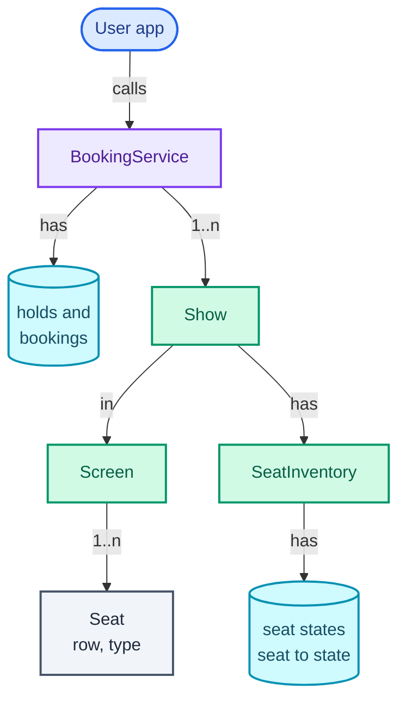
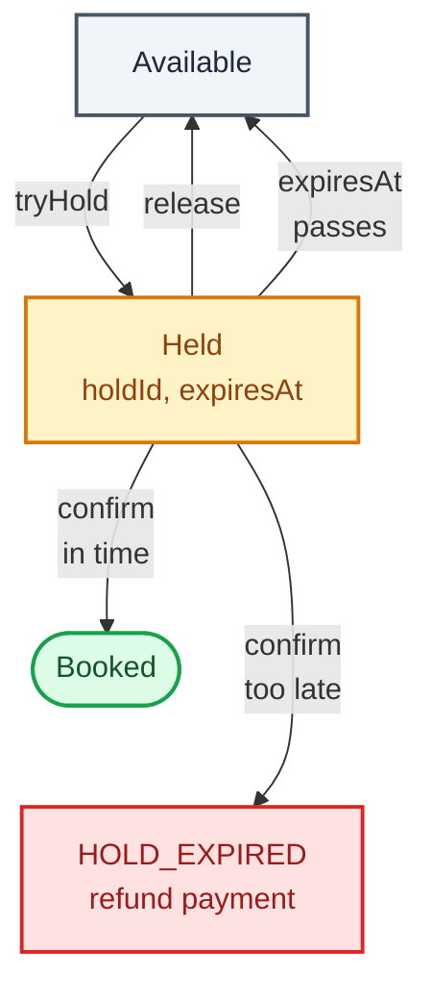
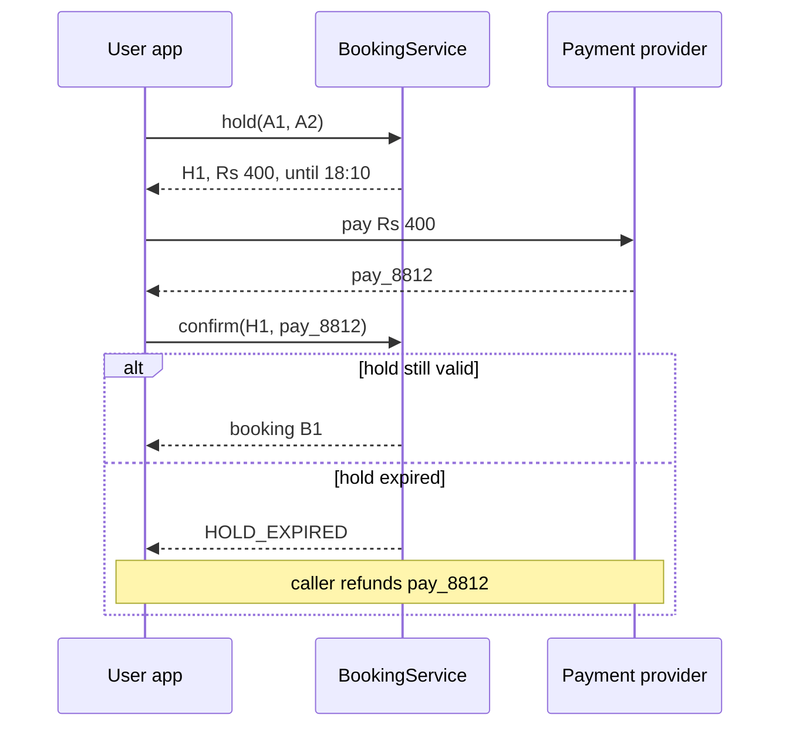

"Design a movie ticket booking system like BookMyShow. Users pick a show, choose seats on a seat map, pay, and get tickets."

Most of it models itself: movies, screens, shows, seats. The question the interviewer is really asking sits in one method: **what happens when two people press "book" on the same seat in the same millisecond?** A design that checks whether a seat is free and *then* marks it taken has a gap between the two steps, and under load another thread walks through that gap. The other half of the hard part is time: a seat someone is paying for must be held for them, and the hold must end by itself if they walk away.

It trains the core concurrency move of the series: making a check and the action that depends on it **one atomic step** (atomic meaning no other thread can see or act on the state in between). It uses the lock-granularity ladder from [Part 3](/blogs/lld-concurrency/) (one global lock, then one lock per show, then lock-free compare-and-set per seat), a **sealed interface** for seat state so the compiler checks every case, and the lazy-expiry idea from [Amazon Locker](/blogs/lld-amazon-locker/). The distributed version of this question, where the seats live in a database and the traffic is a million fans, is [Ticketmaster](/blogs/hld-ticketmaster/).

How to use this post: [the method](/blogs/lld-the-method/). Try the question cold first, then read.


You are a senior engineer interviewing me for a low-level design round. The question is: "Design a movie ticket booking system like BookMyShow. Users pick a show, choose seats on a seat map, pay, and get tickets." Run it as a realistic 35-minute interview following this structure: requirements (5 min), entities and relationships (3 min), class design (10-15 min), implementation of the key methods in Java (10 min), extensibility (5 min).
Rules: state the question in one sentence and stop. Answer my clarifying questions the way a real interviewer would, briefly, and only what I ask. Never propose designs, components or classes yourself. If I skip a stage or run long on one, say so in one line and keep time. When I finish a stage, write one line of the note you would put on the scorecard, then move on.
Once my design is in place, probe it with these, one at a time, waiting for my answer each time: 1. Two users press book on seat B2 at the same moment. Walk me through exactly what your code does for each. 2. You used a ConcurrentHashMap for seat states. Why isn't that enough on its own? 3. A user holds seats, goes to pay, and never comes back. When do the seats become available again, and what code runs to make that happen? 4. The payment succeeds one second after the hold expired. What do you do? 5. Why one lock per show and not one lock for the whole system, or one per seat? What would make you move to lock-free compare-and-set? 6. A user wants four seats and one of them was taken a moment ago. What state are the other three in?
At the end, grade me as hire / lean hire / lean no hire / no hire for a senior engineer, with the two strongest and two weakest moments, and the one thing to fix first.



## Requirements

Five minutes of questions, grouped by the four themes from [the method](/blogs/lld-the-method/), each with the answer I'd assume.

**Primary capabilities**

- *What does a user do?* See a show's seat map, pick seats, hold them while paying, confirm after payment, or release them.
- *Search and browse (cities, movies, showtimes)?* A lookup by show ID is enough here; search is a read-heavy listing problem, not the interesting part. Out of scope.
- *What's on the seat map?* Every seat with its row, number, type and whether it is available, held or booked.

**Rules and completion**

- *How long does a hold last?* Ten minutes. After that the seats are free to anyone, even if no clean-up has run.
- *Several seats at once?* Yes, up to 10, and **all or nothing**: if any one is taken, the user gets none of them, and none stay held by mistake.
- *How is price decided?* By seat type: regular, premium, recliner, set per show. The price is fixed when the hold is made, so it can't change while the user is paying.
- *When is a booking done?* When the user confirms with a payment reference while the hold is still valid.

**Error handling**

- *A seat is taken?* Refuse the hold with "seats unavailable"; the user picks again.
- *Payment completes after the hold expired?* Refuse the confirm; the caller refunds the payment. Never book seats someone else may now hold.
- *Someone confirms another user's hold?* Refuse. The user comes from the auth token, never from the request body.
- *Unknown seat, empty selection, 11 seats?* Refuse as invalid.

**Scope boundaries**

- *Concurrency?* In scope, and the centre of the question: many users hit one show at once.
- *Payments?* An external provider. We receive a payment reference after it says yes.
- *Cancellations and refunds of confirmed bookings?* An extension.
- *More than one server, a database?* Out for the LLD round; that is the [HLD version](/blogs/hld-ticketmaster/).

On the board:

```text
1. seatMap(show): every seat as available, held or booked; an expired hold shows available.
2. hold(user, show, seats): all or nothing, 1 to 10 seats, for 10 minutes;
   price fixed now from the show's per-type prices. Returns a hold ID and amount.
3. confirm(user, hold, paymentRef): if the hold is the user's and unexpired, its seats
   become booked and a booking is returned; otherwise refuse (caller refunds).
4. release(user, hold): the user gives the seats back.
5. Two concurrent holds can never both get the same seat.
6. Errors: unknown show, invalid seats, seats unavailable, unknown hold,
   not your hold, hold expired.

Out of scope: search, payment processing, cancellations, persistence, multiple servers.
```

## Entities and relationships

The noun filter from [the method](/blogs/lld-the-method/): a noun earns a class when it has state that changes or rules of its own.

- **Movie**: a title and an ID, no rules. A record.
- **Screen**: the physical room, its layout of seats and their types. Shared by every show in that room. A class.
- **Seat**: a position and a type; it never changes. A record. Its *availability* is not a property of the seat, because the same seat is free at 18:00 and booked at 21:00.
- **Show**: one screening, a movie in a screen at a time, with its own prices and its own seat states. A class: this is where the per-show state lives.
- **Seat state** (available, held, booked): changes all the time, and is the thing every thread fights over. A sealed interface with three records, owned by a **SeatInventory**, one per show.
- **Hold**: a user's temporary claim, with seats, amount and expiry. A record.
- **Booking**: the confirmed result. A record.
- **BookingService**: the orchestrator. Validates, prices, delegates the atomic part to the show's inventory, and keeps holds and bookings.
- **Theatre, city, user**: fields or upstream. A theatre is a group of screens with an address; nothing in this question changes its state.

The ownership graph, read top-down. The fact to take away is the bottom-right box: seat states belong to one show's inventory, which is why the lock can be per show.



## Class design

Top-down, from the orchestrator.

### BookingService

| Requirement | What BookingService must track |
| --- | --- |
| find a show | `shows: Map<String, Show>` |
| holds expire after 10 minutes | an injected `Clock` and `holdFor` |
| confirm checks owner and hold | `holds: Map<String, Hold>` |
| bookings are returned and kept | `bookings: Map<String, Booking>` |
| at most 10 seats | a constant, checked before touching any seat |

```text
class BookingService
  - shows: Map<String, Show>
  - holds: Map<String, Hold>
  - bookings: Map<String, Booking>
  - clock: Clock
  - holdFor: Duration
  + seatMap(showId) -> String
  + hold(userId, showId, seats) -> Hold
  + confirm(userId, holdId, paymentRef) -> Booking
  + release(userId, holdId)
```

The service never loops over seats itself to decide availability. It asks the show's inventory to do the whole all-or-nothing step and takes yes or no. Keeping that step in one place is what makes it possible to make it atomic at all.

### Show, Screen and the seat types

```text
class Screen
  - id: String
  - seats: Map<SeatId, Seat>          // the layout, never changes
  + seat(id) -> Seat
  + hasAll(ids) -> boolean

class Show
  - id, movie, screen, startsAt
  - prices: Map<SeatType, Money>
  - inventory: SeatInventory          // this show's seat states
  + priceOf(seats) -> Money

record SeatId(row: char, number: int)     // Comparable: row, then number
record Seat(id: SeatId, type: SeatType)
enum SeatType { REGULAR, PREMIUM, RECLINER }
record Money(paise: long)
```

`Screen` and `Show` are split because their lifetimes differ: the room's layout outlives every screening in it, while seat states are born and die with one show. Putting availability on `Seat` would force a copy of every seat per show anyway.

### SeatState and SeatInventory

```text
sealed interface SeatState = Available | Held(holdId, expiresAt) | Booked(bookingId)
  + isFree(state, now) -> boolean      // Available, or Held with expiresAt <= now

interface SeatInventory
  + tryHold(seats, held, now) -> boolean          // all or nothing
  + confirm(seats, holdId, booked, now) -> boolean
  + release(seats, holdId)
  + stateOf(seat) -> SeatState

class LockedInventory implements SeatInventory   // Good: one lock per show
class CasInventory implements SeatInventory      // Great for hot shows: compare-and-set per seat
```

A **sealed interface** lists every type allowed to implement it, so a `switch` over `SeatState` that forgets `Booked` doesn't compile. That turns "did we handle every state?" from a code-review question into a compiler error.

The seat states form a small state machine. Read it from the top; amber is the state with a clock on it, and the red box is the one outcome the user must be told about:



The "expiresAt passes" arrow has no code behind it. Nothing rewrites the seat to `Available`; `isFree` treats a `Held` whose `expiresAt` has passed as free. That is **lazy expiry**: correctness never waits for a timer.

**Patterns, used and rejected:**

- **Strategy** for `SeatInventory`. It earns its place twice: it is the seam where the concurrency approach can change (lock today, compare-and-set for a blockbuster's first-day show), and it let the race test run the same scenario against three implementations.
- **A `PricingStrategy` interface**: considered and deferred. Today's rule is a lookup table per show. When weekend surcharges or demand pricing arrive, `Show.priceOf` becomes a call to a strategy; until then an interface with one implementation is ceremony (YAGNI, "you aren't going to need it", from [Part 2](/blogs/lld-oop-and-patterns/)).
- **The State pattern for seats**: rejected. Three states, each a record with no behaviour of its own; a sealed interface plus one `switch` is clearer.
- **A scheduled job that frees expired holds**: rejected as the mechanism for correctness. It is fine as a memory clean-up (see Extensibility), but if a seat's availability depended on it, a delayed job would mean unsellable seats.

## Implementation

Java 21. The happy path: `hold` validates the selection, draws a hold ID, and asks the show's inventory to turn every wanted seat into `Held` in one atomic step. `confirm`, called after the payment provider says yes, asks the inventory to turn those seats from this exact hold to `Booked`, again in one step, and only if the hold hasn't expired.

The sequence across the three parties, with the payment in the middle where it belongs, outside any lock:



The edge cases, each handled in the code below:

- **Some wanted seats taken**: nothing changes, not even the free ones (all or nothing).
- **Overlapping requests at the same instant**: exactly one wins each seat (the race test proves it).
- **Hold expired, nobody cleaned up**: the seat counts as free to the next `tryHold` and to the seat map.
- **Confirm after expiry**: refused, even if no one took the seats yet. The rule is "a hold is valid for 10 minutes", not "until someone notices"; a predictable rule beats a lucky one.
- **Confirm or release someone else's hold**: refused with `NOT_YOUR_HOLD`.
- **Release twice, or release an expired hold another user has since replaced**: only seats still carrying *this* hold ID are touched.

### The value types

```java
/** Row letter + seat number, e.g. B4. Ordered row first, so a TreeSet of seats is a stable lock order. */
record SeatId(char row, int number) implements Comparable<SeatId> {
    static SeatId parse(String s) { return new SeatId(s.charAt(0), Integer.parseInt(s.substring(1))); }

    @Override public int compareTo(SeatId o) {
        return row != o.row ? Character.compare(row, o.row) : Integer.compare(number, o.number);
    }

    @Override public String toString() { return "" + row + number; }
}

enum SeatType { REGULAR, PREMIUM, RECLINER }

record Seat(SeatId id, SeatType type) {}

/** Money in paise, a whole number, so no floating-point rounding ever reaches a ticket price. */
record Money(long paise) {
    static Money rupees(long r) { return new Money(r * 100); }
    Money plus(Money o) { return new Money(paise + o.paise); }
    @Override public String toString() { return "Rs %d.%02d".formatted(paise / 100, paise % 100); }
}

record Movie(String id, String title) {}
```

### Seat state, holds and bookings

```java
/** A seat's state for one show. Sealed, so a switch over it must handle all three. */
sealed interface SeatState permits Available, Held, Booked {
    Available AVAILABLE = new Available();

    /** Free if nobody has it, or if the hold on it has run out (lazy expiry: no sweeper needed). */
    static boolean isFree(SeatState s, Instant now) {
        return switch (s) {
            case Available a -> true;
            case Held h -> !now.isBefore(h.expiresAt());
            case Booked b -> false;
        };
    }
}
record Available() implements SeatState {}
record Held(String holdId, Instant expiresAt) implements SeatState {}
record Booked(String bookingId) implements SeatState {}

/** A user's temporary claim on seats: price fixed now, valid until expiresAt. */
record Hold(String id, String userId, String showId, Set<SeatId> seats, Money amount, Instant expiresAt) {}

record Booking(String id, String userId, String showId, Set<SeatId> seats, Money amount, String paymentRef) {}

final class BookingException extends RuntimeException {
    enum Reason { UNKNOWN_SHOW, INVALID_SEATS, SEATS_UNAVAILABLE, UNKNOWN_HOLD, NOT_YOUR_HOLD, HOLD_EXPIRED }

    final Reason reason;

    BookingException(Reason reason) { super(reason.toString()); this.reason = reason; }
}
```

`AVAILABLE` is a single shared instance. Records compare by value, so any two `Available()` are equal anyway; the constant only saves allocations.

### Screen

```java
/** The physical room: which seats exist and what type each is. Shared by every show in it. */
final class Screen {
    private final String id;
    private final Map<SeatId, Seat> seats = new LinkedHashMap<>();

    Screen(String id, List<Seat> layout) {
        this.id = id;
        layout.forEach(s -> seats.put(s.id(), s));
    }

    Seat seat(SeatId id) { return seats.get(id); }
    boolean hasAll(Set<SeatId> ids) { return seats.keySet().containsAll(ids); }
    List<SeatId> seatIds() { return List.copyOf(seats.keySet()); }
}
```

### SeatInventory: the seam

```java
/** The concurrency seam: how one show's seat states change atomically. */
interface SeatInventory {
    /** All or nothing: either every wanted seat becomes this hold, or none changes. */
    boolean tryHold(Set<SeatId> wanted, Held hold, Instant now);

    /** All or nothing: every seat must still carry this unexpired hold. */
    boolean confirm(Set<SeatId> wanted, String holdId, Booked booked, Instant now);

    /** Give back seats still carrying this hold. Safe to call twice. */
    void release(Set<SeatId> wanted, String holdId);

    SeatState stateOf(SeatId seat);
}
```

### Bad: check, then act

This is the version most people write first. It uses a `ConcurrentHashMap`, which makes each `get` and each `put` safe on its own. It does nothing for the *pair*: between the loop that checks and the loop that writes, another thread can run both of its loops.

```java
/** The naive inventory, kept only to show what the race does. A thread-safe map, an unsafe action. */
final class UnsafeInventory implements SeatInventory {
    private final Map<SeatId, SeatState> seats = new ConcurrentHashMap<>();

    UnsafeInventory(Collection<SeatId> ids) { ids.forEach(id -> seats.put(id, SeatState.AVAILABLE)); }

    @Override public boolean tryHold(Set<SeatId> wanted, Held hold, Instant now) {
        for (SeatId s : wanted)
            if (!SeatState.isFree(seats.get(s), now)) return false;   // check ...
        for (SeatId s : wanted) seats.put(s, hold);                    // ... then act: another thread got in between
        return true;
    }

    @Override public boolean confirm(Set<SeatId> wanted, String holdId, Booked booked, Instant now) { throw new UnsupportedOperationException(); }
    @Override public void release(Set<SeatId> wanted, String holdId) { throw new UnsupportedOperationException(); }
    @Override public SeatState stateOf(SeatId seat) { return seats.get(seat); }
}
```

The figure shows the interleaving that breaks it, and the same two threads with the show's lock:

<figure class="sketch"></figure>

On the left, both threads saw B2 free, both wrote their hold, and both users were told "held". Bob's write silently replaced Alice's, so Alice will reach the payment page for a seat the system now says is Bob's. On the right, Bob's thread waits for the lock, and by the time it checks, the answer is an honest "taken".

### Good: one lock per show

```java
/** Good: one lock per show. Every check and every write happen under it. */
final class LockedInventory implements SeatInventory {
    private final Map<SeatId, SeatState> seats = new HashMap<>();

    LockedInventory(Collection<SeatId> ids) { ids.forEach(id -> seats.put(id, SeatState.AVAILABLE)); }

    @Override public synchronized boolean tryHold(Set<SeatId> wanted, Held hold, Instant now) {
        for (SeatId s : wanted)
            if (!SeatState.isFree(seats.get(s), now)) return false;
        for (SeatId s : wanted) seats.put(s, hold);
        return true;
    }

    @Override public synchronized boolean confirm(Set<SeatId> wanted, String holdId, Booked booked, Instant now) {
        for (SeatId s : wanted)
            if (!(seats.get(s) instanceof Held h && h.holdId().equals(holdId) && now.isBefore(h.expiresAt())))
                return false;
        for (SeatId s : wanted) seats.put(s, booked);
        return true;
    }

    @Override public synchronized void release(Set<SeatId> wanted, String holdId) {
        for (SeatId s : wanted)
            if (seats.get(s) instanceof Held h && h.holdId().equals(holdId)) seats.put(s, SeatState.AVAILABLE);
    }

    @Override public synchronized SeatState stateOf(SeatId seat) { return seats.get(seat); }
}
```

`synchronized` on the inventory object means one lock per show: two users on different shows never wait for each other, and within a show the check and the write are one step. Every method takes the lock, including `stateOf`, so each seat read sees a finished write. The seat map reads seat by seat, so it can show A3 before a hold and A4 after it; that is fine, because the map is only a picture, and `tryHold` is what decides.

Is one lock per show fast enough? I measured it rather than guessed: 8 threads doing hold-then-release on random pairs of seats in one 300-seat show completed between 1.5 and 4.5 million hold attempts a second across three runs (Docker on an 8-core laptop shared with other work, hence the spread). A single show is sold out long before it sees a thousandth of that. The lock is held for microseconds, and the slow parts of booking (the network, the payment) happen outside it.

### Great for a hot show: compare-and-set per seat

**Compare-and-set** (CAS) means "change this value to X, but only if it is still Y", done atomically by the hardware or the library. `ConcurrentHashMap.replace(key, expected, next)` is exactly that for one key.

```java
/** Great (for very hot shows): no show-wide lock. Each seat changes by compare-and-set,
 * ConcurrentHashMap.replace(key, expected, next), which is atomic per key (recalled from
 * the ConcurrentMap contract). Seats are taken in sorted order and rolled back on failure.
 */
final class CasInventory implements SeatInventory {
    private final ConcurrentHashMap<SeatId, SeatState> seats = new ConcurrentHashMap<>();

    CasInventory(Collection<SeatId> ids) { ids.forEach(id -> seats.put(id, SeatState.AVAILABLE)); }

    @Override public boolean tryHold(Set<SeatId> wanted, Held hold, Instant now) {
        Map<SeatId, SeatState> taken = new LinkedHashMap<>();       // seat -> what it was before we took it
        for (SeatId s : new TreeSet<>(wanted)) {                    // one global order: no two holds each half-win
            SeatState current = seats.get(s);
            if (!SeatState.isFree(current, now) || !seats.replace(s, current, hold)) {
                taken.forEach((seat, before) -> seats.replace(seat, hold, before));   // undo only what we did
                return false;
            }
            taken.put(s, current);
        }
        return true;
    }

    @Override public boolean confirm(Set<SeatId> wanted, String holdId, Booked booked, Instant now) {
        List<Map.Entry<SeatId, Held>> done = new ArrayList<>();
        for (SeatId s : new TreeSet<>(wanted)) {
            if (!(seats.get(s) instanceof Held h && h.holdId().equals(holdId) && now.isBefore(h.expiresAt()))
                    || !seats.replace(s, h, booked)) {
                done.forEach(e -> seats.replace(e.getKey(), booked, e.getValue()));
                return false;
            }
            done.add(Map.entry(s, h));
        }
        return true;
    }

    @Override public void release(Set<SeatId> wanted, String holdId) {
        for (SeatId s : wanted)
            if (seats.get(s) instanceof Held h && h.holdId().equals(holdId)) seats.replace(s, h, SeatState.AVAILABLE);
    }

    @Override public SeatState stateOf(SeatId seat) { return seats.get(seat); }
}
```

Three details make it correct, and each is a follow-up question in its own right:

- **Sorted order.** Every thread takes seats in the same order (row, then number). Without it, Alice could take B2 while Bob takes B3, and each then fail on the other's seat: two holds both rolled back, nobody served. With a global order, whoever wins the lowest contested seat proceeds.
- **Rollback replaces only its own hold.** `replace(seat, hold, before)` succeeds only if the seat still carries *our* hold, so undoing can never clobber another thread's newer write.
- **ABA is harmless here.** ABA is the CAS hazard where a value changes from A to B and back to A, and a CAS expecting A succeeds without noticing. A seat that went `Available`, `Held`, `Available` really is available, because the state record carries everything that matters. If the state were a bare flag with meaning stored elsewhere, this would not hold.

The cost: more code, rollbacks that briefly show a seat as taken to a third user, and no single place where a multi-seat change is invisible until complete. In the same runs, CAS held steady at 4.2 to 4.4 million a second: anywhere from level with the lock to about three times faster, depending on how much the lock threads collided. The gain is real but modest, and it is worth having only for a blockbuster's first show in a big city. For most shows the lock is the better trade, which is why the seam exists.

### Show

```java
/** One screening: a movie in a screen at a time, with its own prices and its own seat states. */
final class Show {
    private final String id;
    private final Movie movie;
    private final Screen screen;
    private final Instant startsAt;
    private final Map<SeatType, Money> prices;
    private final SeatInventory inventory;

    Show(String id, Movie movie, Screen screen, Instant startsAt, Map<SeatType, Money> prices, SeatInventory inventory) {
        this.id = id;
        this.movie = movie;
        this.screen = screen;
        this.startsAt = startsAt;
        this.prices = Map.copyOf(prices);
        this.inventory = inventory;
    }

    String id() { return id; }
    Screen screen() { return screen; }
    SeatInventory inventory() { return inventory; }

    Money priceOf(Set<SeatId> seats) {
        return seats.stream().map(s -> prices.get(screen.seat(s).type())).reduce(new Money(0), Money::plus);
    }
}
```

### BookingService

```java

/** The orchestrator: validates requests, prices them, and lets each show's inventory decide. */
final class BookingService {
    static final int MAX_SEATS_PER_BOOKING = 10;

    private final Map<String, Show> shows = new ConcurrentHashMap<>();
    private final Map<String, Hold> holds = new ConcurrentHashMap<>();
    private final Map<String, Booking> bookings = new ConcurrentHashMap<>();
    private final AtomicLong holdIds = new AtomicLong();      // drawn before each attempt, never reused
    private final AtomicLong bookingIds = new AtomicLong();
    private final Clock clock;
    private final Duration holdFor;

    BookingService(List<Show> shows, Clock clock, Duration holdFor) {
        shows.forEach(s -> this.shows.put(s.id(), s));
        this.clock = clock;
        this.holdFor = holdFor;
    }

    /** Seat map for the picker, row by row: "." available, "h" held, "X" booked. An expired hold shows as ".". */
    String seatMap(String showId) {
        Show show = show(showId);
        Instant now = clock.instant();
        return show.screen().seatIds().stream()
            .collect(Collectors.groupingBy(SeatId::row, java.util.TreeMap::new, Collectors.mapping(s -> {
                SeatState st = show.inventory().stateOf(s);
                return SeatState.isFree(st, now) ? "." : st instanceof Booked ? "X" : "h";
            }, Collectors.joining(""))))
            .entrySet().stream().map(e -> e.getKey() + " " + e.getValue()).collect(Collectors.joining("  "));
    }

    Hold hold(String userId, String showId, Set<SeatId> wanted) {
        Show show = show(showId);
        if (wanted.isEmpty() || wanted.size() > MAX_SEATS_PER_BOOKING || !show.screen().hasAll(wanted))
            throw new BookingException(BookingException.Reason.INVALID_SEATS);

        Instant now = clock.instant();
        String holdId = "H" + holdIds.incrementAndGet();
        Held marker = new Held(holdId, now.plus(holdFor));
        if (!show.inventory().tryHold(wanted, marker, now))
            throw new BookingException(BookingException.Reason.SEATS_UNAVAILABLE);

        Hold hold = new Hold(holdId, userId, showId, Collections.unmodifiableSet(new TreeSet<>(wanted)),
                             show.priceOf(wanted), marker.expiresAt());
        holds.put(holdId, hold);
        return hold;
    }

    /** Called after the payment provider says yes. If this fails, the caller refunds paymentRef. */
    Booking confirm(String userId, String holdId, String paymentRef) {
        Hold hold = ownHold(userId, holdId);
        String bookingId = "B" + bookingIds.incrementAndGet();
        if (!show(hold.showId()).inventory().confirm(hold.seats(), holdId, new Booked(bookingId), clock.instant()))
            throw new BookingException(BookingException.Reason.HOLD_EXPIRED);

        holds.remove(holdId);
        Booking b = new Booking(bookingId, userId, hold.showId(), hold.seats(), hold.amount(), paymentRef);
        bookings.put(bookingId, b);
        return b;
    }

    void release(String userId, String holdId) {
        Hold hold = ownHold(userId, holdId);
        show(hold.showId()).inventory().release(hold.seats(), holdId);
        holds.remove(holdId);
    }

    private Hold ownHold(String userId, String holdId) {
        Hold hold = holds.get(holdId);
        if (hold == null) throw new BookingException(BookingException.Reason.UNKNOWN_HOLD);
        if (!hold.userId().equals(userId)) throw new BookingException(BookingException.Reason.NOT_YOUR_HOLD);
        return hold;
    }

    private Show show(String showId) {
        Show s = shows.get(showId);
        if (s == null) throw new BookingException(BookingException.Reason.UNKNOWN_SHOW);
        return s;
    }
}
```

The hold ID is drawn *before* the attempt, because the `Held` marker written into the seats must carry it. A failed attempt therefore uses up an ID. IDs are cheap; reusing one would be the bug.

### The race test

The test runs 2,000 rounds. In each, 8 threads are released at once by a latch (`CountDownLatch`, a gate that opens for every waiting thread at the same moment), each trying to hold an overlapping pair of seats from B1 to B4. A round is broken if any seat ends up promised to two holds.

```java
    /** Race: each round, 8 threads released together each try to hold two of B1..B4
     *  (thread i wants seats i%3+1 and i%3+2, so the sets overlap). A round is broken
     *  if any seat ends up promised to two holds. */
    static void race() throws Exception {
        int rounds = 2_000, threads = 8;
        ExecutorService pool = Executors.newFixedThreadPool(threads);
        Instant now = START;
        Map<String, Function<Collection<SeatId>, SeatInventory>> impls = new LinkedHashMap<>();
        impls.put("unsafe (check, then act)", UnsafeInventory::new);
        impls.put("per-show lock", LockedInventory::new);
        impls.put("per-seat CAS", CasInventory::new);
        System.out.println();
        System.out.printf("race: %d rounds x %d threads, %d cores%n", rounds, threads, Runtime.getRuntime().availableProcessors());
        for (var e : impls.entrySet()) {
            int broken = 0, holds = 0;
            for (int r = 0; r < rounds; r++) {
                SeatInventory inv = e.getValue().apply(seats("B1", "B2", "B3", "B4"));
                CountDownLatch go = new CountDownLatch(1);
                List<Future<Set<SeatId>>> fs = new ArrayList<>();
                for (int i = 0; i < threads; i++) {
                    int k = i % 3 + 1;
                    Set<SeatId> want = seats("B" + k, "B" + (k + 1));
                    Held hold = new Held("r" + r + "t" + i, now.plusSeconds(600));
                    fs.add(pool.submit(() -> { go.await(); return inv.tryHold(want, hold, now) ? want : Set.<SeatId>of(); }));
                }
                go.countDown();
                Map<SeatId, Integer> promised = new HashMap<>();
                int won = 0;
                for (Future<Set<SeatId>> f : fs) {
                    Set<SeatId> got = f.get();
                    if (!got.isEmpty()) won++;
                    for (SeatId s : got) promised.merge(s, 1, Integer::sum);
                }
                holds += won;
                if (promised.values().stream().anyMatch(c -> c > 1)) broken++;
            }
            System.out.printf("  %-26s a seat promised twice in %3d of %d rounds (%d holds granted)%n",
                              e.getKey(), broken, rounds, holds);
        }
        pool.shutdown();
    }
```

## Verification

A show in a two-row screen: row A regular at Rs 200, row B premium at Rs 350. The clock starts at 18:00 and the hold lasts 10 minutes. The seat map prints each row as four characters, "." available, "h" held, "X" booked.

| Time | Call | Result | Row A after |
| --- | --- | --- | --- |
| 18:00 | alice holds A1, A2 | H1, Rs 400.00, until 18:10 | h h . . |
| 18:01 | bob holds A2, A3 | SEATS_UNAVAILABLE (A2 is alice's; A3 untouched) | h h . . |
| 18:01 | bob holds A3, A4 | H3, Rs 400.00, until 18:11 (H2 went to the failed attempt) | h h h h |
| 18:04 | alice confirms H1 | booking B1, Rs 400.00, seats A1, A2 | X X h h |
| 18:11 | seat map | bob's hold ended at 18:11, nothing ran | X X . . |
| 18:11 | carol holds A3, B1 | H4, Rs 550.00 (200 regular + 350 premium) | X X h . |
| 18:12 | bob confirms H3 | HOLD_EXPIRED: refund pay_8813 | X X h . |
| 18:12 | bob confirms H4 | NOT_YOUR_HOLD | X X h . |
| 18:12 | carol releases H4 | released | X X . . |
| 18:12 | dave holds A3, Z9 | INVALID_SEATS (there is no Z9) | X X . . |

Row 2 is the all-or-nothing rule: A3 was free, but Bob didn't get it alone. The map at 18:04 looks like this:

<figure class="sketch"></figure>

Rows 5 to 7 are the edge transition, the hold that ran out:

<figure class="sketch"></figure>

At 18:11 exactly, Bob's hold is over (expiry is inclusive: `now` is not before `expiresAt`), so Carol gets A3. A minute later Bob's payment arrives and his confirm is refused, though one of his two seats (A4) was still untaken: a hold is ten minutes, not "ten minutes unless you're lucky".

The program's output, as printed, with the race test and the measurement after the trace:

```text
       seat map: A ....  B ....
18:00  alice holds A1,A2              -> H1, Rs 400.00, until 18:10
18:01  bob holds A2,A3                -> SEATS_UNAVAILABLE
18:01  bob holds A3,A4                -> H3, Rs 400.00, until 18:11
       seat map: A hhhh  B ....
18:04  alice confirms H1              -> B1, Rs 400.00, seats [A1, A2]
       seat map: A XX..  B ....
18:11  carol holds A3,B1              -> H4, Rs 550.00
18:12  bob confirms H3                -> HOLD_EXPIRED
18:12  bob confirms H4                -> NOT_YOUR_HOLD
18:12  carol releases H4              -> released
18:12  dave holds A3,Z9               -> INVALID_SEATS
       seat map: A XX..  B ....

race: 2000 rounds x 8 threads, 8 cores
  unsafe (check, then act)   a seat promised twice in  57 of 2000 rounds (3930 holds granted)
  per-show lock              a seat promised twice in   0 of 2000 rounds (3874 holds granted)
  per-seat CAS               a seat promised twice in   0 of 2000 rounds (3874 holds granted)

throughput, per-show lock: 1,600,000 hold attempts in 944 ms = 1,694,484 per second
throughput, per-seat CAS: 1,600,000 hold attempts in 381 ms = 4,191,901 per second
```

The unprotected inventory promised a seat twice in about 1 round in 40 (47 to 64 rounds out of 2,000 across six runs of this program). The per-show lock and CAS never did, in any run. The number that matters is not the rate but that it isn't zero: at a few thousand bookings a minute on a release day, 1 in 40 contested rounds is a steady stream of angry customers.

## Extensibility

### "Clean up abandoned holds"

Seats don't need it (lazy expiry), but the `holds` map does: every abandoned hold stays in it forever. A scheduled task every minute removes holds whose `expiresAt` has passed. It touches only `holds`, never seat states, so it can run late or not at all without selling a seat twice; the worst case is memory, not correctness.

### "Weekend and recliner surcharges, dynamic pricing"

`Show.priceOf` becomes a call to a `PricingStrategy(show, seat, now)`. Surcharges compose naturally as decorators (each wraps another strategy and adds its rule). The price is still fixed into the `Hold` at hold time, so a price change mid-payment can't affect a user who is already paying.

### "Cancel a confirmed booking"

Add `Booked -> Available` to the inventory as `cancel(seats, bookingId)`, with the same guard as `release`: only seats still carrying this booking ID change. The refund is a call to the payment provider after the seats are released, outside the lock.

### "Run it on ten servers with a database"

The inventory moves into the database, and each atomic step becomes one conditional statement: `UPDATE show_seat SET state = 'HELD', hold_id = ?, expires_at = ? WHERE show_id = ? AND seat_id IN (...) AND (state = 'AVAILABLE' OR (state = 'HELD' AND expires_at <= now()))`, then check that the row count equals the number of seats wanted, and roll back the transaction if not. That is the CAS design with the database as the arbiter. The traffic side (virtual waiting rooms, caching seat maps) is [the HLD post](/blogs/hld-ticketmaster/).

### "Suggest the best available seats together"

A read over one show's states, so it takes the lock (or reads a snapshot) and scans rows for runs of N free seats closest to the centre. Suggestions are only suggestions: the user's `hold` on them can still fail, and the UI handles that like any other conflict.

## What each level is expected to show

| Level | What it looks like on this question |
| --- | --- |
| Junior / Mid | Show, Screen, Seat and a per-show seat state map; hold and confirm that work in a single thread; an expiry check; all-or-nothing multi-seat holds. Names the double-booking risk and puts a lock around the hold. |
| Senior | Seat state separate from seat; lazy expiry with the reason; the check-then-act race explained precisely, including why a `ConcurrentHashMap` alone doesn't fix it; per-show lock justified by contention scope; confirm refused after expiry with refund; payment outside the lock; a test that shows the race. |
| Staff+ | Drives the lock-granularity trade-off with numbers, gets the CAS version right (ordering, rollback, ABA), knows where the design moves when it becomes a database (a conditional `UPDATE` as the CAS), and separates correctness mechanisms from clean-up mechanisms throughout. |

## Variants this unlocks

| Question | What changes |
| --- | --- |
| Design a concert or flight booking system | Same inventory. Flights add fare classes (pricing) and overbooking policy; general-admission concerts replace seats with a counter per zone, so the CAS is on a number, not a seat. |
| Design a hotel booking system | The unit is a room-night, not a seat: a hold covers a set of (room type, date) counters, and availability is a count per type, not specific rooms until check-in. |
| Design a meeting room booking system | Seats become time intervals on a room; "is it free?" is an interval-overlap check, and the atomic step is "no overlapping booking exists, then insert". |
| Design a restaurant table reservation system | Tables of different sizes (best fit, as in [Amazon Locker](/blogs/lld-amazon-locker/)) over time slots, with holds while the guest confirms. |
| Design a flash sale | Seats become units of stock with one counter; see [inventory management](/blogs/lld-inventory-management/) for reserve, commit and release. |

## The one-page version

- `BookingService`: the orchestrator. Shows, holds, bookings, an injected `Clock`, a 10-minute hold, at most 10 seats.
- `Screen`: the room's layout, shared by all its shows. `Seat(id, type)` never changes.
- `Show`: movie, screen, start, per-type prices, and its own `SeatInventory`.
- `SeatState`: sealed, `Available | Held(holdId, expiresAt) | Booked(bookingId)`; `isFree` treats an expired hold as free (lazy expiry).
- `SeatInventory`: `tryHold`, `confirm`, `release`, all or nothing (Strategy).
- `LockedInventory`: `synchronized`, one lock per show; 1.5 to 4.5 million attempts a second measured, far beyond one show's demand.
- `CasInventory`: `ConcurrentHashMap.replace` per seat, sorted order, rollback of only its own writes; up to 3 times faster under heavy collision, more subtle.
- Confirm after expiry is refused and refunded; payment always happens outside the lock.
- Race test: unsafe check-then-act double-promised seats in about 1 round in 40; both safe versions in none.

**A seat is sold by one atomic step that checks and claims together, under a lock no wider than one show, and a hold ends when the clock says so, not when a job notices.**


You are a senior engineer checking my understanding of a low-level design for a movie ticket booking system like BookMyShow, in Java. The design: BookingService is the orchestrator with shows, holds and bookings maps, an injected Clock and a 10-minute hold. Screen holds the seat layout; Show has a movie, screen, start time, prices per SeatType and its own SeatInventory. SeatState is a sealed interface: Available, Held(holdId, expiresAt), Booked(bookingId); a Held seat whose expiresAt has passed counts as free (lazy expiry). SeatInventory has tryHold (all or nothing), confirm (only if every seat still carries this unexpired hold), release. LockedInventory uses one synchronized lock per show; CasInventory uses ConcurrentHashMap.replace per seat in sorted order with rollback. Price is fixed at hold time. A race test showed the unprotected check-then-act version double-promising seats in about 1 round in 40, and the locked and CAS versions never.
Ask me the questions below one at a time. Wait for my answer each time. Judge it against the expected points, which you must not reveal before I answer. If I'm stuck, give one hint, then a stronger hint, then the answer. After each, tell me what I got right and what I missed in two or three lines.
1. Two users hold seat B2 at the same instant with a check-then-act implementation. What can happen, step by step? Expected: both check B2 free, both write their hold, both are told held, the second write overwrites the first; the fix is to make check and write one atomic step.
2. The seat states are in a ConcurrentHashMap. Why isn't that enough? Expected: it makes each get and put atomic on its own, not the compound check-all-then-write-all; another thread can act between them.
3. Why one lock per show, rather than one global lock or one lock per seat? Expected: contention is per show, so shows never wait on each other; global lock serialises everything; per-seat locks need ordered acquisition for multi-seat holds and more code; a per-show lock measured 1.5 to 4.5 million attempts a second, far above one show's demand.
4. What three things make the CAS version correct? Expected: acquire seats in one global sorted order so two holds do not each half-win; roll back with replace(seat, ourHold, previous) so only our own writes are undone; ABA is harmless because the state record carries everything that matters.
5. A user abandons a hold. When are the seats free again and what code frees them? Expected: at expiresAt, with no code running; isFree treats an expired Held as free; a clean-up job may remove old holds from the holds map for memory but correctness does not depend on it.
6. Payment succeeds one second after the hold expired, and nobody else took the seats. Book or refuse? Expected: refuse with HOLD_EXPIRED and refund; the rule must be predictable, and the seats could be held by someone else; payment happens outside the lock.
7. How does this become a database design across many servers? Expected: one conditional UPDATE per hold that matches only available or expired-held rows, check the affected row count equals the seats wanted, roll back otherwise; the database is the CAS arbiter.
At the end, list which answers were solid and the one concept to revisit.



Next: [Design an in-process rate limiter](/blogs/lld-rate-limiter/), where the shared state is a counter per user and the question is how to keep it right with hundreds of threads and no database.
