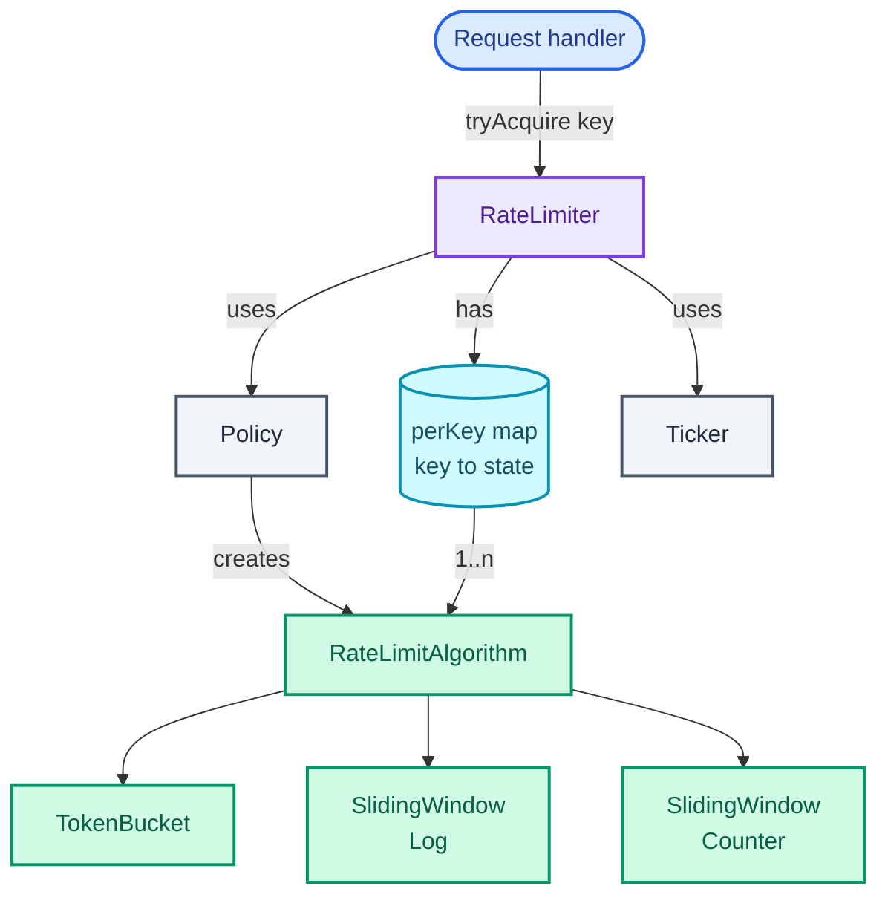
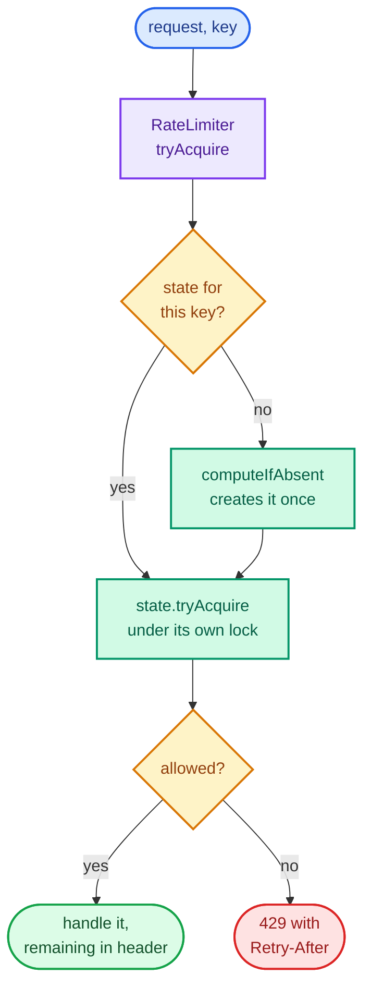

"Design a rate limiter library. A service calls it before handling each request, and it says yes or no: at most N requests per user per time window."

The algorithms are well known and most candidates can name them. What the interviewer is really testing is the shape around them: **one small piece of state per key** (a key is whatever you limit by: a user ID, an API key, an IP address), read and updated by many request threads at once, with time as an input you can control in a test. Get that shape right and the algorithm is a plug-in; get it wrong and a correct token bucket still lets through more than its limit.

It trains the **Strategy** pattern from [Part 2](/blogs/lld-oop-and-patterns/) (three algorithms behind one interface), the per-key locking and `ConcurrentHashMap` tools from [Part 3](/blogs/lld-concurrency/), and the **injectable clock**: time passed in as a dependency so a test can set it by hand instead of sleeping. Where a limiter sits in a system, and why the edge is the usual place, is in [System Design: the edge](/blogs/system-design-the-edge/). The version shared by many servers, with Redis and multi-region questions, is the [distributed rate limiter](/blogs/hld-rate-limiter/); this post is the code that runs inside one process.

How to use this post: [the method](/blogs/lld-the-method/). Try the question cold first, then read.


You are a senior engineer interviewing me for a low-level design round. The question is: "Design a rate limiter library. A service calls it before handling each request, and it says yes or no: at most N requests per user per time window." Run it as a realistic 35-minute interview following this structure: requirements (5 min), entities and relationships (3 min), class design (10-15 min), implementation of the key methods in Java (10 min), extensibility (5 min).
Rules: state the question in one sentence and stop. Answer my clarifying questions the way a real interviewer would, briefly, and only what I ask. Never propose designs, components or classes yourself. If I skip a stage or run long on one, say so in one line and keep time. When I finish a stage, write one line of the note you would put on the scorecard, then move on.
Once my design is in place, probe it with these, one at a time, waiting for my answer each time: 1. Why might a fixed window counter let through twice the limit? 2. Compare the memory of a sliding window log and a sliding window counter for a million users at 100 requests a minute. 3. Sixteen threads call your token bucket for the same user at once. What could go wrong without a lock, and how would you prove your fix in a test? 4. Two first requests for a brand-new user arrive at the same moment. How many buckets get created? 5. How do you test that a bucket refills correctly without sleeping in the test? 6. Your map of per-user state grows forever. How do you clean it up without letting extra requests through?
At the end, grade me as hire / lean hire / lean no hire / no hire for a senior engineer, with the two strongest and two weakest moments, and the one thing to fix first.



## Requirements

Five minutes of questions, grouped by the four themes from [the method](/blogs/lld-the-method/), each with the answer I'd assume.

**Primary capabilities**

- *What does the caller get back?* More than a boolean: allowed or not, how many requests remain, and how long to wait if denied. That maps straight onto an HTTP 429 response (Too Many Requests) with a `Retry-After` header.
- *What is the key?* Any string the caller chooses: user ID, API key, IP. The library doesn't care.
- *Which algorithm?* Configurable: token bucket, sliding window log or sliding window counter. The interviewer will ask for at least two; I'd offer token bucket as the default.

**Rules and completion**

- *What does "N per window" mean exactly?* For the windowed algorithms, at most N requests in any window of that length. For the token bucket, a burst of up to N and a steady N per window after that.
- *Same limit for every key?* Yes for now, one policy per limiter. Per-tier limits are an extension.
- *Does a denied request count?* No. It takes nothing, so a client hammering a closed door doesn't push its own reopening further away.

**Error handling**

- *Invalid policy (zero permits, zero window)?* Rejected at construction, before any request.
- *Clock oddities?* Use a monotonic clock (`System.nanoTime`, which only moves forward; the wall clock can jump back when the machine syncs its time). Treat any negative elapsed time as zero.

**Scope boundaries**

- *Many threads?* Yes, hundreds of request threads, and the same key can arrive on several at once. This is the centre of the question.
- *Many servers?* No, one process. Shared limits across servers are the [HLD version](/blogs/hld-rate-limiter/).
- *Blocking until allowed?* No, answer immediately. A waiting variant is an extension.
- *Memory?* Keys come and go, so per-key state must be reclaimable.

On the board:

```text
1. tryAcquire(key) -> Decision(allowed, remaining, retryAfter). Never blocks.
2. Policy(algorithm, permits, window), validated at construction; one policy per limiter.
3. Algorithms: token bucket (default), sliding window log, sliding window counter.
4. Each key has independent state; keys never wait on each other's locks.
5. Exact under concurrency: with no refill, a capacity of N admits exactly N, however
   many threads race; two first requests for a new key create one state, not two.
6. Time comes from an injected monotonic ticker, so tests set it by hand.
7. Idle keys can be evicted without changing any future decision.

Out of scope: multiple servers, blocking acquire, per-key policies (extension).
```

## Entities and relationships

The noun filter from [the method](/blogs/lld-the-method/): a noun earns a class when it has state that changes or rules of its own.

- **RateLimiter**: the orchestrator and the only class callers touch. Owns the map from key to state.
- **Per-key state plus its rule**: one object per key whose fields change on every request. An interface, `RateLimitAlgorithm`, with one class per algorithm, because the rule and the state it reads are inseparable (a token bucket's fields mean nothing to a sliding log).
- **Policy**: algorithm, permits, window. No changing state, validated once. A record, which also knows how to build a fresh per-key state.
- **Decision**: the answer. A record.
- **Ticker**: where time comes from. An interface with one method, so production passes `System::nanoTime` and tests pass a fake.
- **Key, request, window**: fields and parameters, not classes. A request is a call; a key is a string.

The ownership graph, read top-down. The map in the middle is the whole concurrency story: one entry per key, and each entry protects itself.



## Class design

Top-down, from the orchestrator.

### RateLimiter

| Requirement | What RateLimiter must track |
| --- | --- |
| independent state per key | `perKey: ConcurrentHashMap<String, RateLimitAlgorithm>` |
| one state per new key, even under a race | creation through `computeIfAbsent` |
| which algorithm and limit | a `Policy` |
| testable time | a `Ticker`, handed to every state it creates |
| reclaim idle keys | `evictIdle()`, asking each state whether it is "at rest" |

```text
class RateLimiter
  - policy: Policy
  - ticker: Ticker
  - perKey: ConcurrentHashMap<String, RateLimitAlgorithm>
  + tryAcquire(key) -> Decision
  + evictIdle() -> int
```

The limiter decides nothing about rates. It finds the key's state and tells it "a request arrived"; the state answers. That is tell-don't-ask applied to concurrency as well: because each state owns its fields and its lock, the limiter needs no lock of its own.

### RateLimitAlgorithm and its three implementations

```text
interface RateLimitAlgorithm
  + tryAcquire() -> Decision
  + isAtRest() -> boolean          // identical to a fresh state, so safe to drop

class TokenBucket           - capacity, nanosPerToken, tokens: double, lastRefill: long
class SlidingWindowLog      - limit, windowNanos, log: ArrayDeque<Long>
class SlidingWindowCounter  - limit, windowNanos, windowStart, previous, current

record Policy(algorithm, permits, window)   + newState(ticker) -> RateLimitAlgorithm
record Decision(allowed, remaining, retryAfter)
interface Ticker                             + nanos() -> long
```

This is **Strategy**: the limiter holds an interface, and which algorithm runs is a construction-time choice. It earns its place because the follow-up "now do it with a sliding window" comes in nearly every run of this question, and with the seam it is a new class and one enum constant. `Policy.newState` is a **simple factory**: a `switch` expression over the enum that builds the right class. A separate factory class hierarchy was considered and rejected; one `switch` with three cases is easier to read than three factory classes.

**Considered and rejected:**

- **A separate `Clock` per algorithm, or `Instant.now()` inside them.** Both make tests sleep. The `Ticker` is shared and injected once.
- **Algorithms as stateless functions over a shared state record.** It looks cleaner, but the three algorithms keep different state, so a shared record would be a union of fields that each algorithm half-uses. The state belongs with its rule.
- **One `synchronized` method on `RateLimiter`.** Correct, and every key would wait on one lock. More on this in the implementation.

## Implementation

Java 21. The happy path: `tryAcquire(key)` gets or creates the key's state in one atomic map operation, then calls `tryAcquire()` on the state, which takes the state's own lock, reads the ticker, updates its fields and returns a `Decision`.

The request path, before the code. The diamonds are the two questions asked per request; the creation step on the left runs once per key:



The edge cases, each handled in the code below:

- **A brand-new key, first request on two threads at once**: `computeIfAbsent` creates exactly one state.
- **Many threads on one key**: each state's methods are `synchronized`, so read, update and write happen as one step.
- **A thread that read the time, then waited for the lock**: it would bring a stale timestamp in and compute negative elapsed time. The fix is to read the ticker *inside* the lock, and to clamp elapsed time at zero anyway.
- **A key idle for a day**: the token bucket caps at capacity, the counter forgets windows two or more back, the log evicts old entries; nothing overflows.
- **A denied request**: changes nothing (except the bucket's refill bookkeeping, which is the same refill it would do anyway).

### The small types

```java
/** A monotonic time source in nanoseconds. System::nanoTime in production, a fake in tests. */
@FunctionalInterface
interface Ticker {
    long nanos();

    static Ticker system() { return System::nanoTime; }
}

/** What the caller needs to answer the request: go ahead, or 429 with a Retry-After. */
record Decision(boolean allowed, long remaining, Duration retryAfter) {
    static Decision allow(long remaining) { return new Decision(true, remaining, Duration.ZERO); }
    static Decision deny(Duration retryAfter) { return new Decision(false, 0, retryAfter); }
}
```

### The strategy interface and the policy

```java
/** One key's limiter: state plus the algorithm that reads it. Strategy: RateLimiter never
 * knows which algorithm it is calling. Implementations are shared by every request thread
 * for that key, so they must be thread-safe.
 */
interface RateLimitAlgorithm {
    Decision tryAcquire();

    /** True if this state is indistinguishable from a fresh one, so dropping it loses nothing. */
    boolean isAtRest();
}

enum Algorithm { TOKEN_BUCKET, SLIDING_LOG, SLIDING_COUNTER }

/** "permits per window", e.g. 100 per minute. Also a simple factory for the per-key state. */
record Policy(Algorithm algorithm, int permits, Duration window) {
    Policy {
        if (permits <= 0 || window.isNegative() || window.isZero())
            throw new IllegalArgumentException("need permits > 0 and a positive window");
    }

    RateLimitAlgorithm newState(Ticker ticker) {
        return switch (algorithm) {
            case TOKEN_BUCKET -> new TokenBucket(permits, window, ticker);
            case SLIDING_LOG -> new SlidingWindowLog(permits, window, ticker);
            case SLIDING_COUNTER -> new SlidingWindowCounter(permits, window, ticker);
        };
    }
}
```

### Token bucket

A **token bucket** holds up to `capacity` tokens and gains one every `window / capacity`. Each request takes one token or is denied. It allows a burst (a full bucket's worth at once) and then a steady rate, which is usually what an API wants: a client that was quiet for a minute can send a quick burst, but can't sustain more than the rate.

The figure is the Verification trace below, drawn: the blue line is the bucket's level for one key over 1.5 seconds, with each request marked under the time axis.

<figure class="sketch"></figure>

Read it left to right. Five requests at 0 ms empty the bucket and the sixth is refused. The level climbs one token per 200 ms, so at 100 ms there is half a token (refused, retry in 100 ms) and at 300 ms one and a half (one request passes, the next is refused). By 1,200 ms the bucket is full again, and it stays capped at 5 however long the key is idle.

```java
/** Holds up to `capacity` tokens and refills one every window/capacity. A request takes a
 * token or is denied. Allows a burst of `capacity`, then a steady `capacity` per window.
 */
final class TokenBucket implements RateLimitAlgorithm {
    private final int capacity;
    private final double nanosPerToken;   // 1 s / 5 = 200,000,000 ns: exact in a double
    private final Ticker ticker;
    private double tokens;
    private long lastRefill;

    TokenBucket(int capacity, Duration per, Ticker ticker) {
        this.capacity = capacity;
        this.nanosPerToken = per.toNanos() / (double) capacity;
        this.ticker = ticker;
        this.tokens = capacity;            // a new key starts full: its first burst is allowed
        this.lastRefill = ticker.nanos();
    }

    @Override public synchronized Decision tryAcquire() {
        long now = ticker.nanos();         // read inside the lock, so time never runs backwards here
        tokens = Math.min(capacity, tokens + Math.max(0, now - lastRefill) / nanosPerToken);
        lastRefill = now;
        if (tokens >= 1) {
            tokens -= 1;
            return Decision.allow((long) tokens);
        }
        return Decision.deny(Duration.ofNanos((long) Math.ceil((1 - tokens) * nanosPerToken)));
    }

    @Override public synchronized boolean isAtRest() {
        return tokens + Math.max(0, ticker.nanos() - lastRefill) / nanosPerToken >= capacity;
    }
}
```

There is no background thread topping buckets up. Refill is computed when a request arrives, from the time since the last one. That is what makes a million idle keys cost nothing but memory.

Tokens are a `double`, and the refill divides by `nanosPerToken`, which for 5 per second is exactly 200,000,000. Halves and whole tokens are exact in binary floating point, which is why the trace prints clean numbers; with awkward rates the error is around one part in 10^16, far below one request. If an interviewer wants exact integer arithmetic, store tokens scaled by the window length in a `long` and say how you'd avoid overflow (cap elapsed time at one window).

### Sliding window log

The **sliding window log** remembers the time of every allowed request in the last window and allows a new one if fewer than `limit` remain. It is exact: at no moment are there more than `limit` requests in any window-length span.

```java
/** Remembers the time of every allowed request in the last window. Exact, but O(limit) memory per key. */
final class SlidingWindowLog implements RateLimitAlgorithm {
    private final int limit;
    private final long windowNanos;
    private final Ticker ticker;
    private final ArrayDeque<Long> log = new ArrayDeque<>();   // oldest first; never more than `limit`

    SlidingWindowLog(int limit, Duration window, Ticker ticker) {
        this.limit = limit;
        this.windowNanos = window.toNanos();
        this.ticker = ticker;
    }

    @Override public synchronized Decision tryAcquire() {
        long now = ticker.nanos();
        while (!log.isEmpty() && log.peekFirst() <= now - windowNanos) log.pollFirst();   // fell out of the window
        if (log.size() < limit) {
            log.addLast(now);
            return Decision.allow(limit - log.size());
        }
        return Decision.deny(Duration.ofNanos(log.peekFirst() + windowNanos - now));     // when the oldest leaves
    }

    @Override public synchronized boolean isAtRest() {
        long now = ticker.nanos();
        return log.isEmpty() || log.peekLast() <= now - windowNanos;
    }
}
```

Its weakness is memory, and the arithmetic decides whether it is usable. Each entry is a boxed `Long` (24 bytes: a 12-byte header and the 8-byte value, padded to a multiple of 8) plus a 4-byte reference in the deque, about 28 bytes (recalled sizes for a 64-bit JVM with compressed references). At 100 requests a minute for 1,000,000 active keys, that is 100,000,000 entries, about 2.8 GB. The two algorithms with a fixed handful of fields per key need tens of bytes each, plus the map entry and the key string, so roughly 0.1 to 0.15 GB for the same million keys. The log is the right answer when limits are small (5 login attempts per 15 minutes) and exactness matters; it is the wrong default.

### Why not a fixed window

The simplest windowed algorithm, a **fixed window counter**, resets a count at the start of each second (or minute). It needs one number per key, and it has a hole at the boundary:

<figure class="sketch"></figure>

Five requests in the last 0.2 s before the 1-second mark fill window one; five in the first 0.2 s after it fill window two. Each window is within its limit, and ten requests passed in 0.4 seconds, twice the limit. For most APIs that is tolerable; for "5 password attempts per minute" it doubles an attacker's guesses. The sliding counter below fixes it for the same memory.

### Sliding window counter

The **sliding window counter** keeps two fixed-window counts, the previous window's and the current one's, and estimates how many requests fall in the sliding window ending now. It assumes the previous window's requests were spread evenly, so it counts the fraction of the previous window that still overlaps:

<figure class="sketch"></figure>

At 69 s, with a 60-second window, the sliding minute runs from 9 s to 69 s. It covers 51 of the previous window's 60 seconds, a weight of 0.85. Eight requests there count as 6.8; add the current window's 4 and the estimate is 10.8, which is not below the limit of 10, so the request is refused. The retry time solves the same formula for when the estimate drops below 10: the weight must fall below (10 - 4) / 8 = 0.75, which happens 15 s into the window, 6 s from now.

```java
/** Two counters, this window and the last. Estimates the sliding count as
 * previous x (share of the previous window still inside the sliding window) + current.
 * O(1) memory per key; assumes the previous window's requests were spread evenly.
 */
final class SlidingWindowCounter implements RateLimitAlgorithm {
    private final int limit;
    private final long windowNanos;
    private final Ticker ticker;
    private long windowStart;
    private int previous, current;

    SlidingWindowCounter(int limit, Duration window, Ticker ticker) {
        this.limit = limit;
        this.windowNanos = window.toNanos();
        this.ticker = ticker;
        long now = ticker.nanos();
        this.windowStart = now - Math.floorMod(now, windowNanos);   // windows aligned to multiples of the length
    }

    @Override public synchronized Decision tryAcquire() {
        long now = ticker.nanos();
        roll(now);
        double previousWeight = 1 - (now - windowStart) / (double) windowNanos;
        double estimate = previous * previousWeight + current;
        if (estimate < limit) {
            current++;
            return Decision.allow((long) Math.max(0, Math.ceil(limit - estimate - 1)));
        }
        return Decision.deny(Duration.ofNanos(waitNanos(now)));
    }

    /** Time until previous x weight + current drops below the limit. */
    private long waitNanos(long now) {
        if (current < limit && previous > 0) {
            // previous x (1 - (t - windowStart) / W) + current < limit, solved for t
            double t = windowStart + windowNanos * (1 - (limit - current) / (double) previous);
            return Math.max(1, (long) Math.ceil(t - now) + 1);
        }
        // This window alone is full: wait into the next one until `current` (then previous) has decayed enough.
        double t = windowStart + windowNanos + windowNanos * (1 - limit / (double) current);
        return Math.max(1, (long) Math.ceil(t - now) + 1);
    }

    private void roll(long now) {
        long passed = (now - windowStart) / windowNanos;
        if (passed == 0) return;
        previous = passed == 1 ? current : 0;   // two or more windows ago counts for nothing
        current = 0;
        windowStart += passed * windowNanos;
    }

    @Override public synchronized boolean isAtRest() {
        roll(ticker.nanos());
        return previous == 0 && current == 0;
    }
}
```

The trade-off to say out loud: it is an estimate. If all eight previous requests arrived in the window's last second, the true sliding count could be higher than the estimate for a moment. In exchange it needs four numbers per key and never has the fixed window's double burst.

### RateLimiter

```java

/** The facade callers use: one call per request. Finds or creates the key's state
 * atomically (computeIfAbsent), then lets that state decide. No lock is shared
 * between keys, so alice's traffic never waits on bob's.
 */
final class RateLimiter {
    private final Policy policy;
    private final Ticker ticker;
    private final ConcurrentHashMap<String, RateLimitAlgorithm> perKey = new ConcurrentHashMap<>();

    RateLimiter(Policy policy, Ticker ticker) {
        this.policy = policy;
        this.ticker = ticker;
    }

    Decision tryAcquire(String key) {
        // recalled: ConcurrentHashMap.computeIfAbsent runs the function at most once per absent key,
        // atomically, so two first requests for a key cannot create two buckets.
        return perKey.computeIfAbsent(key, k -> policy.newState(ticker)).tryAcquire();
    }

    /** Run every few minutes: drop state that a fresh limiter would reproduce exactly. */
    int evictIdle() {
        int before = perKey.size();
        perKey.forEach((key, state) -> perKey.computeIfPresent(key, (k, s) -> s.isAtRest() ? null : s));
        return before - perKey.size();
    }

    int trackedKeys() { return perKey.size(); }
}
```

### Thread safety: the ladder, and the tests that prove it

Three rungs, from [Part 3](/blogs/lld-concurrency/)'s lock-granularity ladder:

**Bad:** a plain `HashMap` and one `synchronized tryAcquire` on the limiter. Correct, and every request for every key queues on one lock. Worse, the common half-fix (a `ConcurrentHashMap` with `get`, then `put` if missing, and no lock) is not correct at all: two threads both see "missing" and each install a fresh bucket.

**Good:** what the code above does. `computeIfAbsent` makes creation atomic per key (recalled from its Javadoc: the whole call is atomic, and the function runs at most once per absent key), and each state is `synchronized` on itself, so a key's lock is held only for a handful of arithmetic operations and different keys never contend.

**Great, when one key is extremely hot:** a lock-free bucket. Pack the state into one `long` held in an `AtomicLong` and update it with compare-and-set (change the value only if it still holds what you read, else retry). A neat way to make the state one number is GCRA, the generic cell rate algorithm: store only the "theoretical arrival time" of the next allowed request, and a request is allowed if now is past that time minus the burst allowance. Worth naming; rarely worth writing in the round, because a per-key lock around a handful of arithmetic operations is only a bottleneck when a single key sees millions of requests a second.

Two claims in the Good rung need proof, so the harness tests both. `UnsafeTokenBucket` in the test is `TokenBucket` with the `synchronized` keywords removed and nothing else changed; the second test swaps `computeIfAbsent` for the get-then-put version. The tests start every thread together with a `CountDownLatch` (a gate that releases all waiting threads at once) so they collide as much as possible:

```java
    /** 16 threads hammer one key whose bucket holds 1,000 tokens and never refills. Exactly 1,000 may pass. */
    static void bucketRace() throws Exception {
        FakeTicker frozen = new FakeTicker();
        int threads = 16, perThread = 2_000, capacity = 1_000, trials = 20;
        ExecutorService pool = Executors.newFixedThreadPool(threads);
        Map<String, Supplier<RateLimitAlgorithm>> impls = Map.of(
            "token bucket, no lock ", () -> new UnsafeTokenBucket(capacity, Duration.ofHours(1), frozen),
            "token bucket, locked  ", () -> new TokenBucket(capacity, Duration.ofHours(1), frozen));
        System.out.printf("bucket race: %d threads x %d tries, capacity %d, no refill, %d trials, %d cores%n",
                          threads, perThread, capacity, trials, Runtime.getRuntime().availableProcessors());
        for (String name : List.of("token bucket, no lock ", "token bucket, locked  ")) {
            long min = Long.MAX_VALUE, max = 0;
            for (int trial = 0; trial < trials; trial++) {
                RateLimitAlgorithm bucket = impls.get(name).get();
                CountDownLatch go = new CountDownLatch(1);
                List<Future<Integer>> fs = new ArrayList<>();
                for (int i = 0; i < threads; i++)
                    fs.add(pool.submit(() -> {
                        go.await();
                        int ok = 0;
                        for (int k = 0; k < perThread; k++) if (bucket.tryAcquire().allowed()) ok++;
                        return ok;
                    }));
                go.countDown();
                long granted = 0;
                for (Future<Integer> f : fs) granted += f.get();
                min = Math.min(min, granted);
                max = Math.max(max, granted);
            }
            System.out.printf("  %s granted %d..%d (must be exactly %d)%n", name, min, max, capacity);
        }
        pool.shutdown();
    }

    /** Each round a brand-new key; 8 threads send its first request together. Capacity 1, so 1 may pass. */
    static void registryRace() throws Exception {
        FakeTicker frozen = new FakeTicker();
        int threads = 8, rounds = 5_000;
        Policy one = new Policy(Algorithm.TOKEN_BUCKET, 1, Duration.ofHours(1));
        ExecutorService pool = Executors.newFixedThreadPool(threads);
        System.out.printf("registry race: %d rounds, %d threads send a new key's first request together, capacity 1%n", rounds, threads);
        for (String name : List.of("get, then put     ", "computeIfAbsent   ")) {
            Map<String, RateLimitAlgorithm> perKey = new ConcurrentHashMap<>();
            Function<String, RateLimitAlgorithm> lookup = name.startsWith("get")
                ? k -> { RateLimitAlgorithm a = perKey.get(k);                     // check ...
                         if (a == null) { a = one.newState(frozen); perKey.put(k, a); }   // ... then act
                         return a; }
                : k -> perKey.computeIfAbsent(k, x -> one.newState(frozen));
            int broken = 0;
            for (int r = 0; r < rounds; r++) {
                String key = "user-" + r;
                CountDownLatch go = new CountDownLatch(1);
                List<Future<Boolean>> fs = new ArrayList<>();
                for (int i = 0; i < threads; i++)
                    fs.add(pool.submit(() -> { go.await(); return lookup.apply(key).tryAcquire().allowed(); }));
                go.countDown();
                int ok = 0;
                for (Future<Boolean> f : fs) if (f.get()) ok++;
                if (ok > 1) broken++;
            }
            System.out.printf("  %s more than 1 request let through in %d of %d rounds%n", name, broken, rounds);
        }
        pool.shutdown();
    }
```

The results are in the Verification output below: without the lock, the bucket that may admit exactly 1,000 requests admitted up to 3,266 in its worst trial; get-then-put let a second request through in 12 to 48 of 5,000 rounds. With the protections, zero in every run.

## Verification

The test drives a `FakeTicker` by hand. Token bucket first: 5 per second, so capacity 5 and one token every 200 ms.

| t (ms) | Key | Request | Tokens before | Result |
| --- | --- | --- | --- | --- |
| 0 | alice | #1 to #5 | 5, 4, 3, 2, 1 | allowed, remaining 4, 3, 2, 1, 0 |
| 0 | alice | #6 | 0 | denied, retry after 200 ms |
| 100 | alice | #7 | 0.5 | denied, retry after 100 ms |
| 300 | alice | #8 | 1.5 | allowed, remaining 0 (0.5 left) |
| 300 | alice | #9 | 0.5 | denied, retry after 100 ms |
| 300 | bob | #1 | 5 (new key, starts full) | allowed, remaining 4 |
| 1300 | alice | #10 | 5 (capped; 0.5 + 5.0 earned) | allowed, remaining 4 |
| 1300 | | evictIdle | bob 4 + 5.0 earned, at rest; alice 4, not | removed bob, 1 key left |
| 1500 | | evictIdle | alice 4 + 1.0 earned = 5, at rest | removed alice, 0 keys left |

Then the sliding window log at 3 per second: requests at 0, 400 and 800 ms pass; at 900 ms the oldest (0 ms) is still inside the window, so the wait is until 1,000 ms; at 1,000 ms the 0 ms entry has left (the window is half-open, so an entry exactly one window old is out) and the request passes; at 1,050 ms the oldest live entry is 400 ms, so the wait is 350 ms.

Then the sliding window counter from the figure: 10 per minute, 8 requests at 50 s, then requests at 69 s. Four pass (estimates 6.8, 7.8, 8.8, 9.8), the fifth sees 10.8 and is told 6 s. At 75.001 s the weight has dropped a hair below 0.75, the estimate is a hair under 10, and a request passes. That is the edge transition: the same key, with no new requests, turning from refused to allowed purely because the clock moved.

The program's output, as printed:

```text
token bucket, 5 per second (capacity 5, one token every 200 ms)
  t=    0 ms  alice  #1    allowed, remaining 4
  t=    0 ms  alice  #2    allowed, remaining 3
  t=    0 ms  alice  #3    allowed, remaining 2
  t=    0 ms  alice  #4    allowed, remaining 1
  t=    0 ms  alice  #5    allowed, remaining 0
  t=    0 ms  alice  #6    denied, retry after 200 ms
  t=  100 ms  alice  #7    denied, retry after 100 ms
  t=  300 ms  alice  #8    allowed, remaining 0
  t=  300 ms  alice  #9    denied, retry after 100 ms
  t=  300 ms  bob    #1    allowed, remaining 4
  t= 1300 ms  alice  #10   allowed, remaining 4
  t= 1300 ms  evictIdle removed 1, 1 key(s) left
  t= 1500 ms  evictIdle removed 1, 0 key(s) left
sliding window log, 3 per second
  t=    0 ms  alice        allowed, remaining 2
  t=  400 ms  alice        allowed, remaining 1
  t=  800 ms  alice        allowed, remaining 0
  t=  900 ms  alice        denied, retry after 100 ms
  t= 1000 ms  alice        allowed, remaining 0
  t= 1050 ms  alice        denied, retry after 350 ms
sliding window counter, 10 per minute
  8 requests at t=50 s, in window [0 s, 60 s)
  t=69000 ms  alice        allowed, remaining 3
  t=69000 ms  alice        allowed, remaining 2
  t=69000 ms  alice        allowed, remaining 1
  t=69000 ms  alice        allowed, remaining 0
  t=69000 ms  alice        denied, retry after 6000 ms
  t=75001 ms  alice        allowed, remaining 0

bucket race: 16 threads x 2000 tries, capacity 1000, no refill, 20 trials, 8 cores
  token bucket, no lock  granted 1000..3052 (must be exactly 1000)
  token bucket, locked   granted 1000..1000 (must be exactly 1000)
registry race: 5000 rounds, 8 threads send a new key's first request together, capacity 1
  get, then put      more than 1 request let through in 12 of 5000 rounds
  computeIfAbsent    more than 1 request let through in 0 of 5000 rounds
```

That is one run. Across five runs, the unprotected bucket's worst trial admitted 1,117, 1,684, 2,708, 3,052 and 3,266 requests where exactly 1,000 were allowed, while some trials in every run came out at exactly 1,000: a race is luck, which is why the test repeats 20 trials and why "it passed once" proves nothing. Overshoots of three times are lost updates (two threads subtract from the same stale count) plus stale reads, since without the lock nothing forces one thread's write to be visible to another. Get-then-put double-admitted in 12 to 48 of 5,000 rounds. The protected versions were exact in every trial of every run.

## Extensibility

### "Free users get 100 a minute, paid users 1,000"

Replace the single `Policy` with a resolver, `Function<String, Policy>`, consulted inside `computeIfAbsent` when a key's state is created. Nothing else changes, because each state already carries its own limit. If a user's tier changes, evict their state (the next request rebuilds it from the new policy).

### "Enforce 10 per second and 1,000 per day"

A `CompositeLimiter` holding two limiters, allowed only if both allow. The subtlety: if the per-second bucket takes a token and the per-day one refuses, the first must give it back, or a refused request still costs the caller. Add `refund()` to the algorithm interface (a token bucket adds one token; a log removes its last entry), or check both under both keys' locks in a fixed order.

### "Some requests cost more than others"

`tryAcquire(int permits)`: a bulk export costs 10 tokens, a read costs 1. The token bucket takes `permits` instead of 1; the windowed algorithms add `permits` to their count. The retry time becomes "until `permits` tokens are available", which can be longer than the window if `permits` exceeds capacity, so reject that case at the call.

### "Clean up idle keys, and don't let extra requests through"

`evictIdle()` removes only states that are **at rest**, meaning identical to a fresh one (a full bucket, an empty log, two zero counters). Dropping such a state changes no future decision, because the next request rebuilds exactly what was there. One race remains, and it is worth naming: a thread that fetched a bucket from the map a moment before eviction still uses that orphaned object, while the next request creates a new one. Since the orphan was full, the worst case is one extra request admitted per collision. If that matters, do the acquire inside `perKey.compute(key, ...)`, so lookup, decision and eviction are serialised per key by the map itself.

### "Use it across ten servers"

Each server now enforces its own limit, so the real limit is ten times higher. The state has to move to a shared store, and the read-modify-write has to stay atomic there: a Redis script that refills and takes in one step, which is the [distributed rate limiter](/blogs/hld-rate-limiter/). The `RateLimitAlgorithm` seam is where a `RedisTokenBucket` would plug in, with this in-process limiter kept in front as a cheap first filter.

## What each level is expected to show

| Level | What it looks like on this question |
| --- | --- |
| Junior / Mid | A working token bucket or fixed window per key in a map, a clear allow or deny, and the fixed window's boundary burst once prompted. Locks the bucket when asked about threads. |
| Senior | Strategy over at least two algorithms, `computeIfAbsent` for creation and per-key locks with the reason, time from an injected monotonic ticker, read inside the lock; `Decision` with `Retry-After`; the log's memory compared with the counter's using real numbers; a race test that fails without the lock. |
| Staff+ | Drives the trade-offs: exact versus estimated windows and when each is acceptable, lock-free GCRA for hot keys, eviction that is provably safe (at-rest states) and its one remaining race, composite limits with refunds, and where the in-process limiter stops and a shared store has to start. |

## Variants this unlocks

| Question | What changes |
| --- | --- |
| Design an API throttling middleware | The same limiter, called by a filter that maps `Decision` to 429, `Retry-After` and remaining-quota headers; the key comes from the auth token. |
| Design a login attempt limiter | Sliding window log with a small limit (5 per 15 minutes), keyed by account and by IP, with lockout after repeated windows. |
| Design a client-side request throttler (an SDK that must not exceed a provider's quota) | Blocking acquire: wait `retryAfter`, then retry, like Guava's `RateLimiter.acquire` (recalled). |
| Design a job scheduler's concurrency limit | Not a rate but a count of things in flight: a `Semaphore` per key instead of a bucket (see [Part 3](/blogs/lld-concurrency/)). |
| Design a distributed rate limiter | The same algorithms with state in Redis; the [HLD post](/blogs/hld-rate-limiter/). |

## The one-page version

- `RateLimiter`: the orchestrator. `ConcurrentHashMap<String, RateLimitAlgorithm>`, a `Policy`, a `Ticker`; `tryAcquire(key)` is `computeIfAbsent(...).tryAcquire()`; `evictIdle()` drops at-rest states.
- `RateLimitAlgorithm`: `tryAcquire()`, `isAtRest()`; state and rule together, thread-safe (Strategy).
- `TokenBucket`: capacity, tokens, last refill; refill on demand, take one or deny with the time until one token.
- `SlidingWindowLog`: timestamps of allowed requests; exact, about 28 bytes per entry, so for small limits only.
- `SlidingWindowCounter`: previous and current counts; estimate previous x overlap + current; four numbers per key.
- `Policy(algorithm, permits, window)`: validated record, simple factory for per-key state.
- `Decision(allowed, remaining, retryAfter)`: maps to 429 and `Retry-After`.
- `Ticker`: monotonic nanoseconds, injected; read inside the state's lock.
- Fixed window rejected: twice the limit across a boundary.
- Race tests: no lock admitted up to 3,266 where 1,000 were allowed; get-then-put created duplicate buckets; protected versions exact.

**Give each key one small state that guards itself, create it with computeIfAbsent, and let a plug-in algorithm read an injected clock inside that state's lock.**


You are a senior engineer checking my understanding of a low-level design for an in-process rate limiter in Java. The design: RateLimiter holds a ConcurrentHashMap from key to RateLimitAlgorithm, a Policy (algorithm, permits, window) and an injected Ticker of monotonic nanoseconds. tryAcquire(key) calls computeIfAbsent to get or create the key's state, then state.tryAcquire(), which is synchronized on the state and reads the ticker inside the lock; it returns Decision(allowed, remaining, retryAfter). Algorithms: TokenBucket (capacity, refill one token every window/capacity, computed on demand), SlidingWindowLog (deque of timestamps, exact), SlidingWindowCounter (previous and current window counts, estimate previous x overlap fraction + current). evictIdle removes only states that are at rest, identical to fresh ones. Race tests: a token bucket without its lock admitted up to 3,266 requests where exactly 1,000 were allowed; get-then-put created duplicate buckets for a new key in 12 to 48 of 5,000 rounds; protected versions were exact.
Ask me the questions below one at a time. Wait for my answer each time. Judge it against the expected points, which you must not reveal before I answer. If I'm stuck, give one hint, then a stronger hint, then the answer. After each, tell me what I got right and what I missed in two or three lines.
1. Why does a fixed window counter allow twice the limit, and which algorithm fixes it for the same memory? Expected: requests at the end of one window and the start of the next are counted in different windows, so up to 2N pass in a short span; the sliding window counter weights the previous window by its overlap, with O(1) state.
2. Compare sliding window log and sliding window counter memory for 1,000,000 keys at 100 requests per minute. Expected: the log stores one timestamp per allowed request, about 28 bytes each boxed, so about 100 million entries, roughly 2.8 GB; the counter stores a few numbers per key, roughly 0.1 GB including map overhead; use the log only for small limits where exactness matters.
3. What goes wrong in a token bucket without a lock, and how did the test prove it? Expected: the read-refill-subtract-write is a read-modify-write; two threads read the same token count and both subtract, so lost updates admit extra requests; the test froze time with capacity 1,000 and 16 threads, saw up to 3,266 admitted without the lock and exactly 1,000 with it.
4. Two first requests for a new key arrive together. What does get-then-put do, and what fixes it? Expected: both see no state, both create and put a fresh full bucket, so the key gets double capacity; computeIfAbsent creates the state atomically once.
5. Why read the ticker inside the lock, and why an injected ticker at all? Expected: a thread that reads time and then waits for the lock arrives with a stale timestamp, giving negative elapsed time; inside the lock time is monotonic per state; injection lets tests set time by hand instead of sleeping, and System.nanoTime is monotonic where wall-clock time can jump.
6. How do you evict idle keys safely, and what race remains? Expected: remove only states at rest (full bucket, empty log, zero counters) because a fresh state behaves identically; a thread holding a reference fetched a moment before eviction can use the orphan, allowing at most one extra request; doing the acquire inside ConcurrentHashMap.compute closes it.
7. When would you go lock-free, and how? Expected: only when a single key is so hot that its lock is contended; pack state into one long in an AtomicLong and use compare-and-set, for example GCRA storing the theoretical arrival time.
At the end, list which answers were solid and the one concept to revisit.



Next: [Design an LRU cache](/blogs/lld-lru-cache/), where per-key state meets a fixed capacity, and deciding which key to forget becomes the plug-in.
