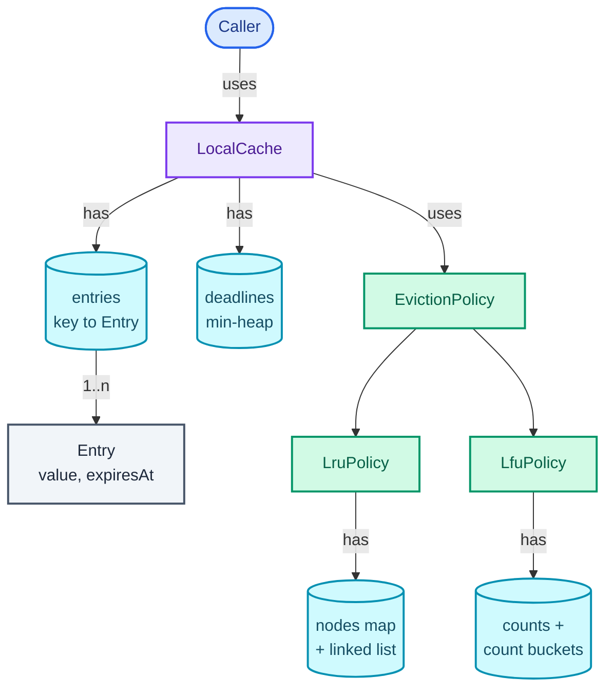
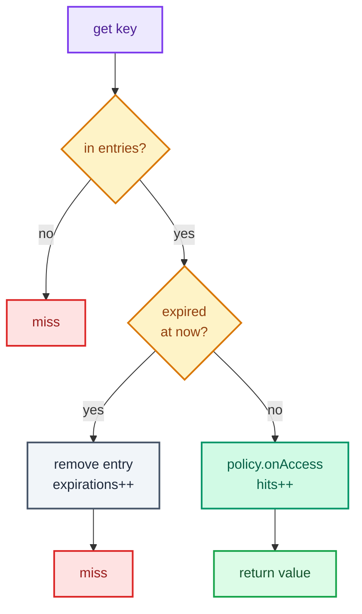

"Design an in-memory cache with a fixed capacity. When it's full, evict the least recently used entry. Entries can have a time-to-live. Many threads will use it."

That is the whole prompt, and it hides two questions. The first is the one everyone has rehearsed: how do you find an entry in O(1) *and* know which entry was used longest ago in O(1)? The answer is a hash map plus a doubly linked list, and the DSA series' [Linked List part](/blogs/dsa-linked-list/) builds exactly that list, with sentinels, and names LeetCode's LRU Cache (146) as the problem it is for. The second question is the one the LLD round is really testing: **where does each rule live?** The eviction rule, the expiry rule and the locking rule are three different reasons for the class to change, and a design that keeps them apart is one an interviewer can extend for ten minutes without you rewriting anything.

So this post goes past LeetCode 146 in four directions: generics (`Cache<K, V>`), a pluggable **eviction policy** (LRU today, LFU tomorrow, behind one interface), **TTL** (time-to-live: an entry dies a fixed time after it was written) with lazy and periodic expiry, and **thread safety** with an argument for one lock and a measured case for striping. It trains the Strategy pattern and "one reason to change" from [Part 2](/blogs/lld-oop-and-patterns/), and the lock-granularity ladder from [Part 3](/blogs/lld-concurrency/). For what a cache is *for* in a real system (cache-aside, write-through, invalidation), [System Design: Caching](/blogs/system-design-caching/) is the background.

How to use this post: [the method](/blogs/lld-the-method/). Try the question cold first, then read.


You are a senior engineer interviewing me for a low-level design round. The question is: "Design an in-memory cache with a fixed capacity. When it is full, evict the least recently used entry. Entries can have a time-to-live. Many threads will use it." Run it as a realistic 35-minute interview following this structure: requirements (5 min), entities and relationships (3 min), class design (10-15 min), implementation of the key methods in Java (10 min), extensibility (5 min).
Rules: state the question in one sentence and stop. Answer my clarifying questions the way a real interviewer would, briefly, and only what I ask. Never propose designs, components or classes yourself. If I skip a stage or run long on one, say so in one line and keep time. When I finish a stage, write one line of the note you would put on the scorecard, then move on.
Once my design is in place, probe it with these, one at a time, waiting for my answer each time: 1. Why a hash map plus a doubly linked list, and what does each one give you that the other cannot? 2. Tomorrow product wants LFU instead of LRU for one caller. What changes in your code? 3. An entry expired an hour ago and nobody has read it since. Is it still in memory, and what removes it? 4. The cache is full and one entry has already expired. A new put arrives. Which entry leaves? 5. Many threads call get. Why does or doesn't a read-write lock help, and what do you do when one lock becomes the bottleneck? 6. Why not extend java.util.LinkedHashMap and be done?
At the end, grade me as hire / lean hire / lean no hire / no hire for a senior engineer, with the two strongest and two weakest moments, and the one thing to fix first.



## Requirements

Five minutes of questions, grouped by the four themes from [the method](/blogs/lld-the-method/). Each has the answer I'd assume if the interviewer shrugs.

**Primary capabilities**

- *What operations?* `get(key)`, `put(key, value)`, `put(key, value, ttl)`, `remove(key)`. A `size()` for tests.
- *What types are keys and values?* Any. So the cache is generic, `Cache<K, V>`, and keys need sensible `equals` and `hashCode` because they go into a hash map.
- *Is capacity a count of entries or a number of bytes?* Count. Bytes are an extension (a "weigher"), covered at the end.

**Rules and completion**

- *What counts as "used"?* A successful `get`, and a `put` that overwrites an existing key. A miss doesn't touch anything.
- *Does overwriting a key reset its TTL?* Yes: the new write carries its own TTL, or none.
- *When an entry's TTL runs out, must its memory be freed at that instant?* No. It must never be *returned* after its deadline; it may sit in memory a little longer. This one answer decides the whole expiry design.
- *If the cache is full and one entry is already expired, who goes?* The expired one. Evicting a live entry while a dead one holds a slot would be wasteful.

**Error handling**

- *Null keys or values?* Rejected. If `null` were a legal value, an empty result couldn't distinguish "cached null" from "not cached".
- *Capacity of zero, negative TTL?* Rejected at the call, with the bad value in the message.

**Scope boundaries**

- *Many threads?* Yes, so the cache must be thread-safe.
- *Distributed, or loading from a database on a miss?* Neither for now. Loading on a miss ("read-through") is an extension.
- *Statistics?* Hit, miss, eviction and expiration counts are cheap and make the trace checkable, so yes.

On the board:

```text
1. get(key) returns the value if present and not expired; a hit marks it most recently used.
2. put(key, value[, ttl]) inserts or overwrites; an overwrite marks it used and replaces its TTL.
3. When full, a new key first frees expired entries, then evicts by policy (LRU by default).
4. The eviction policy is pluggable: LRU or LFU, chosen at construction.
5. An entry is never returned after its deadline; dead entries are removed lazily on access
   and by a periodic sweep.
6. Safe for concurrent use. Null keys/values, capacity < 1 and ttl <= 0 are rejected.
7. Stats: hits, misses, evictions, expirations.

Out of scope: distribution, persistence, loading on miss, size in bytes.
```

## Entities and relationships

The noun filter from [the method](/blogs/lld-the-method/): a noun earns a class when it has state that changes or rules of its own; otherwise it's a field.

- **Cache** (the thing callers hold): earns an interface, `Cache<K, V>`, because there will be more than one implementation (a single-lock one and a striped one).
- **LocalCache**: the orchestrator. Owns the entries, the capacity rule, the expiry rule and the lock.
- **Entry**: value plus deadline. No behaviour beyond "am I expired at time t?", so a record.
- **Eviction policy**: earns an interface, `EvictionPolicy<K>`, because the interviewer will ask to swap it. **LruPolicy** and **LfuPolicy** are its two implementations, each owning its own ordering structure.
- **Deadline**: a (time, key) pair in a min-heap, so the sweep finds expired entries without scanning. A record.
- **Ticker** (the clock): an interface with one method, so tests can move time by hand instead of sleeping.
- **Stats**: four numbers. A record, returned as a snapshot.
- **Capacity, TTL**: fields, not classes. They are numbers with no rules of their own.

The ownership graph below reads top-down: the caller holds a `LocalCache`, which owns two stores and uses a policy; each policy owns its own structure.



The split worth noticing: **values live in the cache, order lives in the policy**. The policy never sees a value. That is what makes it swappable, and it's the main difference from the LeetCode solution, where one map points straight at list nodes that also carry the value.

## Class design

Top-down, from the orchestrator.

### Cache and LocalCache

| Requirement | What LocalCache must track |
| --- | --- |
| get/put in O(1) | a `HashMap<K, Entry<V>>` |
| capacity | `capacity`, compared with `entries.size()` |
| TTL, never returned dead | each entry's `expiresAt`, and the current time from a `Ticker` |
| sweep without a full scan | a min-heap of `Deadline(at, key)` |
| policy is pluggable | an `EvictionPolicy<K>` it notifies and asks for victims |
| thread safety | one `Lock` around every public method |
| stats | four counters, guarded by the same lock |

```text
interface Cache<K, V>
  + get(key) -> Optional<V>
  + put(key, value)
  + put(key, value, ttl: Duration)
  + remove(key) -> boolean
  + size() -> int

class LocalCache<K, V> implements Cache<K, V>
  - capacity: int
  - entries: Map<K, Entry<V>>
  - deadlines: PriorityQueue<Deadline<K>>
  - policy: EvictionPolicy<K>
  - ticker: Ticker
  - lock: Lock
  - hits, misses, evictions, expirations: long
  + sweep() -> int            // periodic expiry, returns how many it removed
  + stats() -> CacheStats
  - purgeExpired(now) -> int
  - evictOne()
```

Every rule about *whether* an entry exists sits here: capacity, expiry, overwrite. The cache tells the policy what happened (`onInsert`, `onAccess`, `onRemove`) and asks it one question (`evict()`). It never asks the policy for its list and walks it itself; that would be the "ask" half of tell-don't-ask, and it would weld the cache to LRU.

### EvictionPolicy, LruPolicy, LfuPolicy

```text
interface EvictionPolicy<K>
  + onInsert(key)       // a new key entered the cache
  + onAccess(key)       // an existing key was read or overwritten
  + onRemove(key)       // the cache dropped a key itself (remove, expiry)
  + evict() -> K        // choose a victim, forget it, return it
  + size() -> int

class LruPolicy<K> implements EvictionPolicy<K>
  - nodes: Map<K, Node<K>>
  - head, tail: Node<K>      // sentinels; head side is most recent

class LfuPolicy<K> implements EvictionPolicy<K>
  - counts: Map<K, Integer>
  - buckets: TreeMap<Integer, LinkedHashSet<K>>   // count -> keys, oldest first
```

This is the **Strategy** pattern ([Part 2](/blogs/lld-oop-and-patterns/)): one decision ("who leaves?") behind an interface, chosen by whoever constructs the cache. It earns its place here because the interviewer asks for the second policy in almost every run of this question, and because the policy is the part with the fiddliest pointer code: keeping it in its own class means the cache's logic reads in a few lines.

**Considered and rejected:**

- **One map whose values are list nodes** (the LeetCode shape). It saves one hash lookup per call. It also makes the node type carry the value, the deadline and the LRU links, so swapping in LFU means rewriting the cache. Two maps cost an extra O(1) lookup and buy the seam. In an interview I say this trade-off out loud.
- **Extending `LinkedHashMap`.** `new LinkedHashMap<>(capacity, 0.75f, true)` keeps entries in access order, and overriding `removeEldestEntry` to return `size() > capacity` gives a working LRU cache in about six lines (recalled from the `LinkedHashMap` Javadoc). Say it first: it shows you know the library. Then expect "now build it yourself", because it isn't thread-safe, can't do LFU, and has no notion of TTL.
- **A `ReadWriteLock`.** It looks right ("reads are concurrent") and is wrong here: an LRU `get` *moves a node* to the head of the list, so every read is a write to the policy. More on this in the implementation.

### The small types

```text
record Entry<V>(value: V, expiresAt: long)      + expiredAt(now) -> boolean
record Deadline<K>(at: long, key: K)
record CacheStats(hits, misses, evictions, expirations)
interface Ticker                                 + millis() -> long
```

`Ticker` returns milliseconds from a monotonic source (one that never goes backwards). Production uses `System.nanoTime() / 1_000_000`; the test harness uses a fake whose time I set by hand.

## Implementation

Java 21. The happy path first: `get` finds the entry, checks its deadline, tells the policy, returns the value. `put` inserts, and if the cache is full it frees expired entries before evicting a live one.

The `get` flow, before the code. Read the diamonds as the questions it asks, in order; red is a miss, green the value coming back. `put` has one decision worth drawing in words: on a full cache with a new key, purge expired entries first, and evict by policy only if that freed nothing.



The edge cases, each handled in the code below:

- **Overwrite of an existing key**: new value and new deadline (or none), counts as a use, never evicts.
- **Full cache with a dead entry in it**: purge expired entries first; evict a live one only if that freed nothing.
- **`get` on an expired entry**: remove it there and then, count an expiration and a miss. This is *lazy* expiry.
- **Expired entries nobody reads**: `sweep()`, called on a timer, pops the deadline heap. This is *periodic* expiry.
- **Stale deadlines in the heap**: a key overwritten or removed since its deadline was pushed. The sweep ignores any deadline that doesn't equal the live entry's own `expiresAt`.
- **Nulls, capacity below 1, TTL of zero or less**: rejected with the bad value in the message.

### The interfaces and small types

```java
/** What callers see. Null keys and values are rejected, so an empty Optional always means "not cached". */
interface Cache<K, V> {
    Optional<V> get(K key);
    void put(K key, V value);                 // lives until evicted or removed
    void put(K key, V value, Duration ttl);   // also dies ttl after this put
    boolean remove(K key);
    int size();
}

/** Milliseconds from a monotonic source. Injected so tests can move time by hand. */
@FunctionalInterface
interface Ticker {
    long millis();

    // Recalled: System.nanoTime is monotonic; currentTimeMillis can jump when NTP adjusts the clock,
    // which would expire (or resurrect) entries early.
    static Ticker system() { return () -> System.nanoTime() / 1_000_000; }
}

/** Decides who leaves when the cache is full. Owns only keys and an ordering, never values. */
interface EvictionPolicy<K> {
    void onInsert(K key);   // a new key entered the cache
    void onAccess(K key);   // an existing key was read or overwritten
    void onRemove(K key);   // the cache dropped a key for its own reasons (remove, expiry)
    K evict();              // choose a victim, forget it, return it; called only when non-empty
    int size();
}

record CacheStats(long hits, long misses, long evictions, long expirations) {}
```

### LocalCache

The fields and constructors first. The lock is a constructor parameter only so the concurrency test can run this exact class with a lock that does nothing and show what breaks.

```java
final class LocalCache<K, V> implements Cache<K, V> {
    private static final long NEVER = Long.MAX_VALUE;

    private record Entry<V>(V value, long expiresAt) {
        boolean expiredAt(long now) { return now >= expiresAt; }
    }

    private record Deadline<K>(long at, K key) {}

    private final int capacity;
    private final EvictionPolicy<K> policy;
    private final Ticker ticker;
    private final Lock lock;
    private final Map<K, Entry<V>> entries = new HashMap<>();
    // Min-heap of expiry times, so finding what has expired costs O(expired x log n), not a full scan.
    private final PriorityQueue<Deadline<K>> deadlines = new PriorityQueue<>(Comparator.comparingLong(Deadline::at));
    private long hits, misses, evictions, expirations;   // all guarded by lock

    LocalCache(int capacity, EvictionPolicy<K> policy, Ticker ticker) {
        this(capacity, policy, ticker, new ReentrantLock());
    }

    // The lock is a parameter only so a test can run this exact code without one.
    LocalCache(int capacity, EvictionPolicy<K> policy, Ticker ticker, Lock lock) {
        if (capacity < 1) throw new IllegalArgumentException("capacity must be at least 1, got " + capacity);
        this.capacity = capacity;
        this.policy = Objects.requireNonNull(policy);
        this.ticker = Objects.requireNonNull(ticker);
        this.lock = Objects.requireNonNull(lock);
    }
```

`get` is the lazy half of expiry. Note the comment on the first line: this is why a read-write lock wouldn't help.

```java
    @Override
    public Optional<V> get(K key) {
        lock.lock();   // even a read reorders the policy's list, so reads need the same lock as writes
        try {
            Entry<V> e = entries.get(key);
            if (e == null) {
                misses++;
                return Optional.empty();
            }
            if (e.expiredAt(ticker.millis())) {   // lazy expiry: the reader that finds it dead removes it
                removeEntry(key);
                expirations++;
                misses++;
                return Optional.empty();
            }
            policy.onAccess(key);
            hits++;
            return Optional.of(e.value());
        } finally {
            lock.unlock();
        }
    }
```

Both `put` overloads funnel into one method. The deadline is computed from the ticker before taking the lock; it's a pure read.

```java
    @Override
    public void put(K key, V value) {
        putEntry(key, value, NEVER);
    }

    @Override
    public void put(K key, V value, Duration ttl) {
        if (ttl.isNegative() || ttl.isZero()) throw new IllegalArgumentException("ttl must be positive, got " + ttl);
        putEntry(key, value, ticker.millis() + ttl.toMillis());
    }

    private void putEntry(K key, V value, long expiresAt) {
        Objects.requireNonNull(key, "key");
        Objects.requireNonNull(value, "value");
        lock.lock();
        try {
            if (entries.containsKey(key)) {
                // Overwrite: new value, new deadline (or none), and it counts as a use. No eviction.
                entries.put(key, new Entry<>(value, expiresAt));
                policy.onAccess(key);
            } else {
                if (entries.size() == capacity) {
                    // Free a dead slot before evicting a live entry.
                    purgeExpired(ticker.millis());
                    if (entries.size() == capacity) evictOne();
                }
                entries.put(key, new Entry<>(value, expiresAt));
                policy.onInsert(key);
            }
            if (expiresAt != NEVER) deadlines.add(new Deadline<>(expiresAt, key));
        } finally {
            lock.unlock();
        }
    }
```

`remove`, the periodic `sweep`, and the two read-only methods:

```java
    @Override
    public boolean remove(K key) {
        lock.lock();
        try {
            if (!entries.containsKey(key)) return false;
            removeEntry(key);
            return true;
        } finally {
            lock.unlock();
        }
    }

    /** Periodic expiry. Production calls this from a ScheduledExecutorService every second or so. */
    public int sweep() {
        lock.lock();
        try {
            return purgeExpired(ticker.millis());
        } finally {
            lock.unlock();
        }
    }

    /** Counts entries not yet removed, including expired ones nobody has touched since. */
    @Override
    public int size() {
        lock.lock();
        try {
            return entries.size();
        } finally {
            lock.unlock();
        }
    }

    public CacheStats stats() {
        lock.lock();
        try {
            return new CacheStats(hits, misses, evictions, expirations);
        } finally {
            lock.unlock();
        }
    }
```

And the private helpers, all called with the lock already held. `purgeExpired` is where the stale-deadline rule lives.

```java
    private int purgeExpired(long now) {
        int removed = 0;
        while (!deadlines.isEmpty() && deadlines.peek().at() <= now) {
            Deadline<K> d = deadlines.poll();
            Entry<V> e = entries.get(d.key());
            // The heap can hold stale deadlines: the key was overwritten, removed or evicted since.
            // Only a deadline equal to the live entry's own expiresAt still means something.
            if (e != null && e.expiresAt() == d.at()) {
                removeEntry(d.key());
                expirations++;
                removed++;
            }
        }
        return removed;
    }

    private void evictOne() {
        K victim = policy.evict();
        entries.remove(victim);
        evictions++;
    }

    private void removeEntry(K key) {
        entries.remove(key);
        policy.onRemove(key);
    }
}
```

The heap does have a cost worth naming: a stale deadline stays in it until its time comes, so a key overwritten a thousand times with a one-hour TTL leaves a thousand heap entries for an hour. Bounded, but real. If that pattern is expected, the fix is to store the deadline's heap position in the entry and remove it on overwrite, or to accept a sampling sweep like Redis's (recalled: Redis samples a handful of keys with TTLs several times a second rather than tracking them all in order).

### LruPolicy

The doubly linked list with two **sentinels** (dummy head and tail nodes that hold no key, so no operation ever checks for null), exactly as [the DSA Linked List part](/blogs/dsa-linked-list/) builds it. Most recent sits right after `head`; the next victim right before `tail`. The picture shows the state the trace below reaches at t=60: the cache's map holds values and deadlines, the policy's own map points at list nodes, and the list order is the recency order.

<figure class="sketch"></figure>

```java
/** Least recently used: a doubly linked list of keys, most recent at the head. */
final class LruPolicy<K> implements EvictionPolicy<K> {
    private static final class Node<K> {
        final K key;
        Node<K> prev, next;
        Node(K key) { this.key = key; }
    }

    private final Map<K, Node<K>> nodes = new HashMap<>();
    private final Node<K> head = new Node<>(null);   // sentinel on the most recently used side
    private final Node<K> tail = new Node<>(null);   // sentinel on the least recently used side

    LruPolicy() {
        head.next = tail;
        tail.prev = head;
    }

    @Override public void onInsert(K key) {
        Node<K> n = new Node<>(key);
        nodes.put(key, n);
        linkAfterHead(n);
    }

    @Override public void onAccess(K key) {
        Node<K> n = nodes.get(key);
        unlink(n);
        linkAfterHead(n);
    }

    @Override public void onRemove(K key) {
        Node<K> n = nodes.remove(key);
        if (n != null) unlink(n);
    }

    @Override public K evict() {
        Node<K> lru = tail.prev;
        if (lru == head) throw new IllegalStateException("evict() on an empty policy");
        unlink(lru);
        nodes.remove(lru.key);
        return lru.key;
    }

    @Override public int size() { return nodes.size(); }

    /** Most recent first; the last element is the next victim. */
    List<K> keysByRecency() {
        List<K> out = new ArrayList<>();
        for (Node<K> n = head.next; n != tail; n = n.next) out.add(n.key);
        return out;
    }

    private void linkAfterHead(Node<K> n) {
        n.prev = head;
        n.next = head.next;
        head.next.prev = n;
        head.next = n;
    }

    private void unlink(Node<K> n) {
        n.prev.next = n.next;
        n.next.prev = n.prev;
    }
}
```

### LfuPolicy: the second strategy, to prove the seam

LFU (least frequently used) evicts the key with the fewest accesses, and among equals the one that reached that count first. Keys are grouped into buckets by count; the lowest bucket's oldest key is the victim. The well-known O(1) LFU keeps a `minCount` integer instead of a sorted map, and it relies on the fact that a new key always has count 1. That trick quietly breaks here, because keys also leave by expiry and `remove()`, which can empty the lowest bucket without anyone noticing. A `TreeMap` costs O(log d), where d is the number of *distinct* counts (small in practice), and stays correct.

```java
/** Least frequently used; ties go to the key that reached that count first. */
final class LfuPolicy<K> implements EvictionPolicy<K> {
    private final Map<K, Integer> counts = new HashMap<>();
    // count -> keys with that count, in the order they reached it. TreeMap gives the smallest count in
    // O(log d), d = distinct counts. The O(1) "minCount" trick breaks once keys can leave by expiry.
    private final TreeMap<Integer, LinkedHashSet<K>> buckets = new TreeMap<>();

    @Override public void onInsert(K key) {
        counts.put(key, 1);
        buckets.computeIfAbsent(1, c -> new LinkedHashSet<>()).add(key);
    }

    @Override public void onAccess(K key) {
        int c = counts.merge(key, 1, Integer::sum);
        leave(c - 1, key);
        buckets.computeIfAbsent(c, x -> new LinkedHashSet<>()).add(key);
    }

    @Override public void onRemove(K key) {
        Integer c = counts.remove(key);
        if (c != null) leave(c, key);
    }

    @Override public K evict() {
        if (buckets.isEmpty()) throw new IllegalStateException("evict() on an empty policy");
        Map.Entry<Integer, LinkedHashSet<K>> lowest = buckets.firstEntry();
        K victim = lowest.getValue().iterator().next();
        counts.remove(victim);
        leave(lowest.getKey(), victim);
        return victim;
    }

    @Override public int size() { return counts.size(); }

    private void leave(int count, K key) {
        LinkedHashSet<K> b = buckets.get(count);
        b.remove(key);
        if (b.isEmpty()) buckets.remove(count);
    }
}
```

`LocalCache` didn't change by a character to support this. That sentence is the answer to "how would you add LFU?"

### Thread safety: one lock, then stripes

Two facts decide the locking.

First, the cache's state is *two structures that must agree*: the entries map and the policy's list must hold the same keys at every moment another thread can see. A `ConcurrentHashMap` for the entries makes each map operation atomic, but "remove from the map *and* unlink from the list" is a compound action, and another thread can run between the two halves. So one lock must cover both. ([Part 3](/blogs/lld-concurrency/) shows the same trap on a single `ConcurrentHashMap`: each call is atomic, a sequence of calls is not.)

Second, as noted, an LRU `get` writes: it moves a node. So a `ReadWriteLock` would put every `get` on the write side anyway. A plain `ReentrantLock` is the honest choice, and every public method takes it.

To show the lock is doing real work, the test harness runs 8 threads, each doing 200,000 random `get` or `put` calls on keys 0 to 999 against a capacity-100 cache, first with a no-op `Lock` and then with the real one:

```text
== 8 threads x 200,000 random get/put, capacity 100 ==
no lock      : exceptions 197371, map size 1035, list size 1009, within capacity false
ReentrantLock: exceptions 0, map size 100, list size 100, within capacity true
striped x8   : exceptions 0, size 800 (at most 8 x 100)
```

Without the lock, the cache held 1,035 entries against a capacity of 100, the map and the list disagreed about how many keys existed, and almost 200,000 calls threw (null pointers from half-linked nodes). An earlier run threw 22,523 times; the exact number varies, the corruption doesn't. With the lock: zero exceptions, exactly 100 entries, map and list in agreement.

One lock serialises every call. At a few hundred thousand operations per second that's usually fine, because each call holds the lock for well under a microsecond. When it isn't, the next rung of the lock-granularity ladder is **striping**: split the cache into N independent `LocalCache`s, each with its own lock and list, and pick one by the key's hash. The figure shows four stripes: two threads whose keys hash to the same stripe wait for each other, and nobody else waits at all.

<figure class="sketch"></figure>

```java
/** N independent caches, each with its own lock and list. Threads on different stripes never wait for each other. */
final class StripedCache<K, V> implements Cache<K, V> {
    private final List<LocalCache<K, V>> stripes = new ArrayList<>();

    StripedCache(int stripeCount, int capacityPerStripe, Supplier<EvictionPolicy<K>> policies, Ticker ticker) {
        for (int i = 0; i < stripeCount; i++) stripes.add(new LocalCache<>(capacityPerStripe, policies.get(), ticker));
    }

    private LocalCache<K, V> stripeFor(K key) {
        int h = key.hashCode();
        h ^= (h >>> 16);   // mix high bits in, the same spreading HashMap does (recalled)
        return stripes.get(Math.floorMod(h, stripes.size()));
    }

    @Override public Optional<V> get(K key) { return stripeFor(key).get(key); }
    @Override public void put(K key, V value) { stripeFor(key).put(key, value); }
    @Override public void put(K key, V value, Duration ttl) { stripeFor(key).put(key, value, ttl); }
    @Override public boolean remove(K key) { return stripeFor(key).remove(key); }
    @Override public int size() { return stripes.stream().mapToInt(LocalCache::size).sum(); }
}
```

Striping costs precision, and that's the trade-off to say aloud: LRU becomes *per stripe*. The globally least recently used key may survive while a busier stripe evicts a fresher one, and a stripe full of hot keys evicts while another has free slots. For a cache, approximate recency is almost always acceptable. The rung above is what Caffeine, the standard Java caching library, does: record reads into small buffers and replay them against the policy in batches under the lock, so a `get` rarely contends (recalled from Caffeine's design notes). Naming it is a Staff-level answer; building it isn't expected in 35 minutes.

## Verification

One scenario that exercises every rule: capacity 3, LRU, a fake ticker set by hand. The "order" column is the policy's list, most recent first, so the last key is the next victim. This is the harness's actual output, row for row.

| t (ms) | Call | Result | Order after | What happened |
| --- | --- | --- | --- | --- |
| 0 | put a=1 | | a | insert |
| 0 | put b=2 | | b, a | insert |
| 0 | put c=3 | | c, b, a | insert; now full |
| 10 | get a | 1 | a, c, b | hit moves a to the front |
| 20 | put d=4 | | d, a, c | full, nothing expired, evicts **b** |
| 30 | get b | miss | d, a, c | b is gone |
| 30 | put e=5 ttl 50 | | e, d, a | evicts **c**; e's deadline is 80 |
| 60 | get e | 5 | e, d, a | alive (60 < 80) |
| 70 | put d=40 | | d, e, a | overwrite: no eviction, d moves up |
| 90 | put f=6 | | f, d, a | full, but e died at 80: purged instead of evicting a |
| 90 | get e | miss | f, d, a | confirms e left |
| 100 | put g=7 ttl 10 | | g, f, d | nothing expired, evicts **a** |
| 115 | get g | miss | f, d | lazy expiry: the read finds g dead (deadline 110) |
| 120 | put h=8 ttl 30 | | h, f, d | room, no eviction |
| 200 | sweep() | 1 removed | f, d | periodic expiry: h died at 150, nobody read it |
| 200 | get d | 40 | d, f | the overwritten value |

Final stats: `CacheStats[hits=3, misses=3, evictions=3, expirations=3]`. Three hits (a, e, d), three misses (b, e, g), three evictions (b, c, a) and three expirations (e, g, h), one per expiry path.

The edge transition to look at is t=90. The cache is full and a new key arrives. A naive design evicts `a`, a live entry, while `e` sits dead in a slot. This one purges `e`. The timeline below shows all three expired entries: green while alive, amber while dead but still stored, and the cross where something finally removed them.

<figure class="sketch"></figure>

`e` spent 10 ms dead in memory, `g` 5 ms, `h` 50 ms. None of them was ever *returned* after its deadline, which is the requirement; how long they linger depends only on how often the sweep runs.

The same harness also runs one sequence through both policies at capacity 2: put a, get a, get a, put b, get b, put c.

```text
== same calls, LRU vs LFU, capacity 2 ==
LRU: a=evicted b=kept c=kept
LFU: a=kept b=evicted c=kept
```

LRU evicts `a` because `b` was touched more recently. LFU evicts `b` because `a` was used three times and `b` twice. Same calls, same `LocalCache`, different victim.

## Extensibility

### "Load from the database on a miss"

That's **read-through**: `getOrLoad(key, loader)`. The seam is a new method on `Cache`, built from `get` and `put`. The trap is calling the loader while holding the cache lock: a 50 ms database query would stall every other thread for 50 ms. Load outside the lock, and to stop ten threads missing on the same key from all querying the database at once (a "cache stampede"), keep a `ConcurrentHashMap<K, CompletableFuture<V>>` of loads in flight: the first thread puts a future and runs the query, the rest wait on that future. Recalled: `ConcurrentHashMap.computeIfAbsent` runs its function at most once per key, atomically, which makes it the natural way to install the future.

### "Write-through, or tell me when something is evicted"

Add a removal listener, `BiConsumer<K, V>` with a reason (evicted, expired, removed), passed at construction. `evictOne`, `purgeExpired` and `removeEntry` are the only three places entries leave, so the listener is three calls. Collect the removed pairs under the lock and call the listener *after* unlocking, so slow listener code can't stall the cache. A write-behind cache (writes queue to the database later) is this listener feeding a queue; [System Design: Caching](/blogs/system-design-caching/) covers when that's safe.

### "Capacity in megabytes, not entries"

Add a `Weigher<K, V>` (`int weigh(K, V)`) and track `totalWeight`. The capacity check becomes `while (totalWeight + w > maxWeight) evict`, a loop instead of an `if`, because one large entry may need several small ones to leave. Reject a single entry heavier than the whole cache up front, or the loop empties the cache and still fails.

### "Expire after last access instead of after write"

An idle session should die 30 minutes after its last use. `get` then writes a new `Entry` with `now + ttl` and pushes a new deadline; the stale-deadline check already makes the old heap entry harmless.

### "Use it across ten servers"

Then it isn't this class any more: it's Redis or Memcached, and the questions become invalidation and consistency. This class still appears as the *near cache* in front of the remote one. [System Design: Caching](/blogs/system-design-caching/) is the place for that conversation.

## What each level is expected to show

| Level | What it looks like on this question |
| --- | --- |
| Junior / Mid | A working map plus doubly linked list with O(1) `get` and `put`, sentinels, correct eviction on a full cache, and a trace that proves it. TTL checked lazily on `get` is enough. |
| Senior | Generics, the eviction policy behind an interface with LFU as the proof, both lazy and periodic expiry with a reason for each, the "full cache with a dead entry" case, and a lock argued from the fact that `get` writes. Mentions `LinkedHashMap` and why it isn't the answer. |
| Staff+ | Drives the trade-offs: two maps versus one, the stale-deadline cost and its fixes, striping and what it does to LRU's precision, stampede protection on read-through, and where this design stops (a near cache in front of a distributed one, buffered reads as Caffeine does). |

## Variants this unlocks

| Question | What changes |
| --- | --- |
| Design an LFU cache (LeetCode 460) | Only the policy: `LfuPolicy` above. Without TTL or `remove`, the O(1) `minCount` trick becomes safe again. |
| Design a read-through / write-through cache in front of a database | `getOrLoad` with in-flight futures, plus a removal or write listener. |
| Design an in-memory key-value store with EXPIRE (a mini Redis) | No capacity or a large one, TTL becomes the main rule, `sweep` on a schedule, plus commands like `TTL key` that read the deadline. |
| Design a "recently viewed items" list | The LRU list alone, per user, capacity 10 to 50, no values beyond the item ID. |
| Design an image cache bounded by memory | A weigher and `totalWeight`; evict in a loop. |
| Design a session store with idle timeout | Expire-after-access, and a sweep frequent enough that dead sessions don't hold memory for long. |

## The one-page version

- `Cache<K, V>`: the interface callers hold; two implementations.
- `LocalCache`: the orchestrator. `HashMap<K, Entry>` for values, a min-heap of deadlines for expiry, one `ReentrantLock` over everything, four counters.
- `Entry(value, expiresAt)`: a record; dead when `now >= expiresAt`.
- `EvictionPolicy<K>`: `onInsert`, `onAccess`, `onRemove`, `evict()`. Owns keys and order, never values (Strategy).
- `LruPolicy`: its own key-to-node map plus a doubly linked list with sentinels; most recent after head, victim before tail.
- `LfuPolicy`: counts plus a `TreeMap` of count buckets, oldest first within a bucket.
- `Ticker`: injected monotonic milliseconds, so tests set time by hand.
- `put` on a full cache purges expired entries before evicting a live one; an overwrite never evicts.
- Expiry three ways: on a full `put`, lazily on `get`, periodically by `sweep()`; stale heap deadlines are skipped by comparing with the live entry's `expiresAt`.
- `get` writes the list, so no read-write lock; when one lock is too slow, stripe it and accept per-stripe LRU.

**A map finds the value, the policy's list decides who leaves, and the cache only ever tells the policy what happened.**


You are a senior engineer checking my understanding of a low-level design for an in-memory LRU cache with TTL, in Java. The design: an interface Cache<K, V> with get, put, put with ttl, remove, size. LocalCache is the orchestrator: a HashMap from key to Entry(value, expiresAt), a min-heap of Deadline(at, key), an EvictionPolicy it notifies (onInsert, onAccess, onRemove) and asks for a victim (evict), an injected Ticker for time, one ReentrantLock over every public method, and counters for hits, misses, evictions and expirations. LruPolicy keeps its own key-to-node map and a doubly linked list with head and tail sentinels; LfuPolicy keeps counts and a TreeMap of count buckets. StripedCache splits keys across N LocalCaches by hash.
Ask me the questions below one at a time. Wait for my answer each time. Judge it against the expected points, which you must not reveal before I answer. If I'm stuck, give one hint, then a stronger hint, then the answer. After each, tell me what I got right and what I missed in two or three lines.
1. Why does the policy keep its own map instead of the cache's map pointing straight at list nodes? Expected: values live in the cache and order in the policy, so the policy never sees values and can be swapped (LRU to LFU) without changing LocalCache; the cost is one extra O(1) hash lookup per call; the LeetCode version fuses them.
2. The cache is full and one entry expired 10 ms ago. A put for a new key arrives. What happens and why? Expected: purge expired entries first using the deadline heap, which frees the dead slot, so no live entry is evicted; evict by policy only if the cache is still full.
3. An entry expired an hour ago and nobody read it. Is it in memory? What removes it? Expected: yes until something looks; lazy expiry only removes entries that are read; the periodic sweep pops the deadline heap; requirement is only that a dead entry is never returned.
4. A key is overwritten many times with long TTLs. What happens in the deadline heap, and how does the sweep avoid removing the live entry? Expected: each put pushes a deadline, so stale ones accumulate until their time; the sweep removes only when the deadline equals the live entry's expiresAt; fixes: track heap position and remove on overwrite, or a sampling sweep like Redis.
5. Why is a ReadWriteLock no help, and why isn't a ConcurrentHashMap alone enough? Expected: an LRU get moves a node, so every read writes the list; the map and the list must change together, a compound action that per-call atomicity in ConcurrentHashMap cannot protect.
6. What does striping buy, and what does it cost? Expected: threads on different stripes never contend; LRU becomes per stripe, so the globally oldest key can survive while a hot stripe evicts fresher keys, and capacity is split so one stripe can be full while others have room.
7. Add read-through loading. What must you avoid and how? Expected: never call the loader while holding the cache lock; load outside it; prevent a stampede with a map of in-flight CompletableFutures installed via ConcurrentHashMap.computeIfAbsent so only one thread loads each key.
At the end, list which answers were solid and the one concept to revisit.



Next: [Design a logging framework](/blogs/lld-logging-service/), where the hard part moves from keeping two structures in agreement to making a call that costs nothing when it's switched off and never blocks the caller when it's on.
