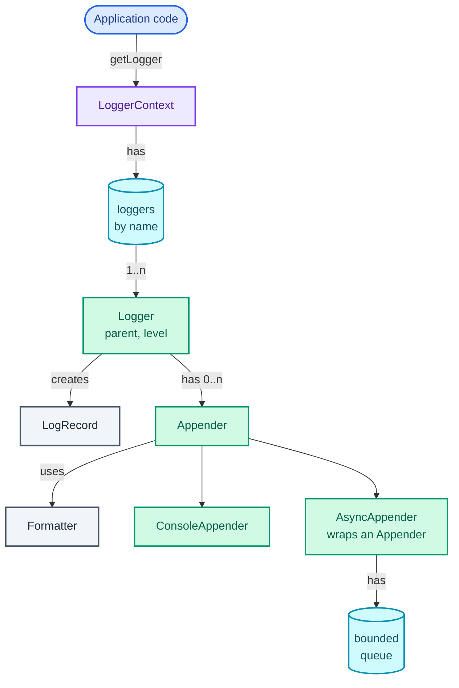
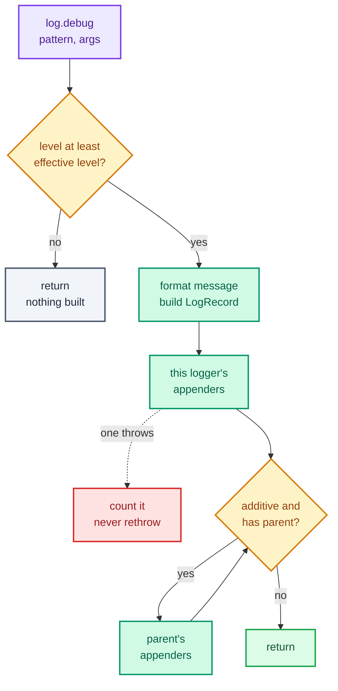

"Design a logging framework, something like log4j. Code logs messages at levels like DEBUG and ERROR. Output can go to the console, a file, or both, in different formats. Levels should be configurable per package. Many threads log at once."

Everyone has *used* a logger, which makes this question deceptively easy to start and easy to get wrong. What it really tests is **separation along three axes**: *whether* to log (levels, decided by the logger), *where* it goes (appenders, the destinations), and *what it looks like* (formatters). Mix any two and the first follow-up ("add JSON output to the file but not the console") forces a rewrite. Underneath sits a cost model that a strong candidate states out loud: a disabled `debug` call runs millions of times a second in production, so it must cost about one comparison, and an enabled call must never make the caller wait on a slow disk.

It trains three patterns from [Part 2](/blogs/lld-oop-and-patterns/): **Chain of Responsibility** (in the one place it actually fits, which isn't the place most answers put it), **Decorator** (the async appender wraps any other appender), and **Strategy** (formatters). It closes with the **Singleton versus dependency injection** argument every logging design runs into. The async appender is the producer-consumer queue from [Part 3](/blogs/lld-concurrency/), and the previous part, [the LRU cache](/blogs/lld-lru-cache/), is where "one lock over two structures" was argued; here the answer is different because the hot path is mostly reads.

How to use this post: [the method](/blogs/lld-the-method/). Try the question cold first, then read.


You are a senior engineer interviewing me for a low-level design round. The question is: "Design a logging framework like log4j. Code logs messages at levels such as DEBUG and ERROR, output can go to the console, a file or both in different formats, levels are configurable per package, and many threads log at once." Run it as a realistic 35-minute interview following this structure: requirements (5 min), entities and relationships (3 min), class design (10-15 min), implementation of the key methods in Java (10 min), extensibility (5 min).
Rules: state the question in one sentence and stop. Answer my clarifying questions the way a real interviewer would, briefly, and only what I ask. Never propose designs, components or classes yourself. If I skip a stage or run long on one, say so in one line and keep time. When I finish a stage, write one line of the note you would put on the scorecard, then move on.
Once my design is in place, probe it with these, one at a time, waiting for my answer each time: 1. What does a disabled debug call cost in your design, step by step? 2. Logger com.shop.payments is set to DEBUG and the root to INFO. A debug message from com.shop.payments.refunds: where does it go, and is the root's level checked again? 3. The file appender's disk stalls for two seconds. What happens to the threads that are logging? 4. One appender throws an exception. What do the caller and the other appenders see? 5. Is your logger factory a singleton? Defend it, and tell me how a unit test gets a fresh one. 6. Where would Chain of Responsibility fit in this design, if anywhere?
At the end, grade me as hire / lean hire / lean no hire / no hire for a senior engineer, with the two strongest and two weakest moments, and the one thing to fix first.



## Requirements

Clarifying questions by the four themes of [the method](/blogs/lld-the-method/), with the answer I'd assume.

**Primary capabilities**

- *What levels?* TRACE, DEBUG, INFO, WARN, ERROR, in that order of severity. A logger at INFO prints INFO, WARN and ERROR. OFF exists only as a setting that silences a logger.
- *What does a log call look like?* `log.info("order {} placed in {} ms", id, ms)`, with `{}` placeholders filled in only if the call is enabled, and an optional exception as the last argument.
- *Destinations?* Console to begin with, plus an in-memory appender so tests can read what was logged. A file or network sink must be a new class, not an edit (a rolling file appender is worked through under Extensibility).
- *Formats?* Plain text with timestamp, level, thread, logger name and message; JSON as the second format.

**Rules and completion**

- *How is "per package" configured?* Loggers are named by dots like Java packages (`app.payments.refunds`). A logger without its own level inherits the nearest ancestor's. The root logger always has a level.
- *Does a message logged to a child also reach the parent's destinations?* Yes by default ("additivity"), switchable per logger. This is how log4j and Logback behave, and I'd confirm it rather than assume.
- *Can configuration change while the app runs?* Yes: raising a package to DEBUG during an incident without a restart is a real use.

**Error handling**

- *If writing to a destination fails?* The caller must never see an exception from logging, and the other destinations still get the record. Report the failure once somewhere (standard error), count the rest.
- *If the destination is slow?* Callers must not wait on it. When the backlog is full, either drop and count (the default for application logs) or block (for logs that must not be lost). The choice is per appender.

**Scope boundaries**

- *Many threads?* Yes. Lines from two threads must not interleave mid-line.
- *Log shipping, rotation, config files?* Out of scope for the core; rotation and file-based config are extensions.

On the board:

```text
1. Levels TRACE < DEBUG < INFO < WARN < ERROR; OFF only as a setting.
2. Loggers are named a.b.c and form a tree; an unset level inherits the nearest ancestor's;
   root always has one.
3. A call below the logger's effective level costs one level check and nothing else.
4. An enabled call becomes an immutable LogRecord, delivered to the logger's appenders
   and, if additive, to every ancestor's appenders. Ancestors' levels are not rechecked.
5. Appenders own a Formatter (text, JSON). Console and in-memory appenders to start.
6. Any appender can be made asynchronous: bounded queue, one writer thread, DROP or BLOCK
   when full, flush on close.
7. Logging never throws into the caller; appender failures are reported once and counted.
8. Levels, additivity and appenders can change at runtime, safely across threads.

Out of scope: config files, rotation, remote shipping, structured context (MDC).
```

## Entities and relationships

The noun filter: what has changing state or rules of its own earns a class.

- **Level**: a fixed, ordered set with one rule ("is this at least that?"). An enum.
- **LogRecord**: timestamp, level, logger name, thread, message, error. Created once, never changed, passed across threads. A record.
- **Logger**: a name, a parent, an optional level, an additivity flag, a list of appenders. It owns the "is this enabled?" decision and the walk up the tree. A class with real behaviour.
- **LoggerContext**: the registry of loggers by name, the root, the clock and the failure counter. The orchestrator.
- **Appender**: an interface with one method. Console, in-memory (for tests) and async implementations.
- **Formatter**: an interface with one method, `LogRecord -> String`. Two constants, TEXT and JSON. Strategy.
- **Message formatting** (`{}` substitution): a pure function with no state. A static helper, not an entity.
- **Timestamp, thread name, logger name**: fields of the record.

The ownership graph: application code asks the context for a logger by name; each logger points at its parent and owns its appenders; appenders use a formatter; the async appender owns a queue.



## Class design

Top-down from the orchestrator, but the interesting rules are in `Logger`, so most of the section is there.

### LoggerContext, and the singleton question

| Requirement | What LoggerContext must track |
| --- | --- |
| loggers by name, one instance per name | `ConcurrentHashMap<String, Logger>` |
| the tree has a root with a level | `root: Logger`, level INFO by default |
| timestamps testable | an injected clock, `LongSupplier` |
| appender failures reported once | `appenderFailures: AtomicLong` |
| flush at shutdown | `close()` over every appender once |

```text
class LoggerContext
  - loggers: ConcurrentHashMap<String, Logger>
  - root: Logger
  - clock: LongSupplier
  - appenderFailures: AtomicLong
  + getLogger(name) -> Logger     // creates "a" and "a.b" before "a.b.c"
  + root() -> Logger
  + close()                       // flush and close each appender once
  ~ deliver(appender, record)     // the one place appender exceptions are caught

class Log                          // static facade over one default LoggerContext
  + get(Class) -> Logger
  + use(LoggerContext)            // tests swap the context
```

Is it a singleton? This is where the interviewer is fishing for an opinion, so give one. Every class in a codebase needs a logger, usually in a `private static final` field, and threading a logger factory through every constructor is noise nobody accepts. So the *entry point* is static: `Log.get(MyClass.class)`, the shape of SLF4J's `LoggerFactory.getLogger`. But the *state* lives in an ordinary `LoggerContext` instance that the static facade happens to hold. Tests construct their own context with a fake clock and in-memory appenders and never touch the global one. That keeps [Part 2](/blogs/lld-oop-and-patterns/)'s answer (one instance, created and injected, so a test can pass its own) and bends it only as far as loggers need: a singleton is acceptable as a thin global access point over an injectable object, never as the place the logic lives.

### Logger

| Requirement | What Logger must track |
| --- | --- |
| tree by dotted name | `name`, `parent` (null only for root) |
| inherit level if unset | `level`, nullable; `effectiveLevel()` walks up |
| deliver to ancestors unless told not to | `additive` |
| several destinations | `appenders` |
| change at runtime from another thread | `volatile` level and flag, a copy-on-write list |

```text
class Logger
  - name: String
  - parent: Logger
  - level: Level?            // null = inherit
  - additive: boolean
  - appenders: List<Appender>
  + isEnabled(level) -> boolean
  + effectiveLevel() -> Level
  + debug/info/warn/error(pattern, args...)
  + debug(Supplier<String>)   // for messages expensive to build
  + log(level, pattern, args...)
  - emit(level, message, error)
```

The level decision belongs to the logger because the logger owns the state it depends on (its own level and its parent chain). Callers ask `isEnabled` only when building the arguments is itself expensive; otherwise they call `debug` and the logger tells itself.

**Chain of Responsibility, where it fits and where it doesn't.** The textbook answer to this question builds a chain of level handlers: a DebugHandler passes to an InfoHandler, which passes to an ErrorHandler, each printing if the level matches. I'd reject it out loud. Levels are totally ordered, so one integer comparison already answers "should this print?", and a chain adds an object per level and a walk for every call, for nothing. The real chain in a logger is the **hierarchy**: a record goes to `app.payments.refunds`'s appenders, then (if additive) to `app.payments`'s, then up to the root's. Each link handles the record and decides whether to pass it on. That is Chain of Responsibility used where the problem actually has a chain, in the variant where a link can handle *and* pass on: [Part 2](/blogs/lld-oop-and-patterns/)'s approval chain stops at the first approver that accepts, while here the additivity flag is each link's "stop here".

### Appender and Formatter

```text
interface Appender extends AutoCloseable
  + append(record)
  + close()                    // default: nothing to flush

interface Formatter
  + format(record) -> String

class ConsoleAppender implements Appender    - out: PrintStream, - formatter: Formatter
class MemoryAppender  implements Appender    - formatter, - lines: List<String>
class AsyncAppender   implements Appender    - target: Appender, - queue: BlockingQueue,
                                             - overflow: DROP | BLOCK, - worker: Thread
```

`Formatter` is a Strategy: the appender doesn't care how a line looks. `AsyncAppender` is a **Decorator**: it is an `Appender` that wraps an `Appender`, adding one behaviour (moving work off the caller's thread) without the wrapped class knowing. That's why it can sit in front of the console, a file or a network sink unchanged. Considered and rejected: an `async: boolean` flag on every appender, which would copy the queue and the worker into each appender class.

## Implementation

Java 21. The happy path: check the level, format the message, build the record, walk the chain of loggers calling each appender. The flow below is one call: the first diamond is the only work a disabled call does, and the loop on the right is the hierarchy walk.



Edge cases, each handled below:

- **Disabled call**: returns after the level check, before formatting or allocating a record. (Java still allocates the varargs array and boxes primitive arguments at the call site; SLF4J adds one- and two-argument overloads for exactly that reason, recalled from its API.)
- **Expensive message**: a `Supplier<String>` overload runs the supplier only if enabled.
- **Exception as the last argument**: if it isn't consumed by a `{}`, it becomes the record's error.
- **More `{}` than arguments**: the extra `{}` stay literal. More arguments than `{}`: the extras are ignored.
- **Logging at OFF**: never enabled.
- **An appender throws**: caught in one place, reported once to standard error, counted; the caller and the other appenders carry on.
- **Async queue full**: DROP counts the record and returns at once; BLOCK waits for space.
- **Shutdown**: `close()` flushes everything queued, closes each appender once even if two loggers share it.
- **`getLogger("a.b.c")` before `"a.b"` exists**: parents are created first, so a logger's parent never changes and can be `final`.

### Level and LogRecord

```java
enum Level {
    TRACE, DEBUG, INFO, WARN, ERROR,
    OFF;   // a threshold only: nothing is logged at OFF, so setting OFF silences a logger

    boolean atLeast(Level threshold) { return compareTo(threshold) >= 0; }
}

/** One log event, built only after the level check passed. Immutable, so it can cross threads safely. */
record LogRecord(long timeMillis, Level level, String logger, String thread, String message, Throwable error) {}
```

The thread name is captured *in the record*, on the caller's thread. That matters the moment the record is written by an async worker: `Thread.currentThread()` there would name the worker.

### Logger

```java
final class Logger {
    private final String name;
    private final Logger parent;                 // null only for the root
    private final LoggerContext context;
    private volatile Level level;                // null means "inherit from parent"
    private volatile boolean additive = true;    // also hand records to the parent's appenders
    private final List<Appender> appenders = new CopyOnWriteArrayList<>();   // read on every call, changed rarely

    Logger(String name, Logger parent, LoggerContext context) {
        this.name = name;
        this.parent = parent;
        this.context = context;
    }

    public void setLevel(Level level) { this.level = level; }
    public void setAdditive(boolean additive) { this.additive = additive; }
    public void addAppender(Appender a) { appenders.add(Objects.requireNonNull(a)); }
    List<Appender> appenders() { return appenders; }
    public String name() { return name; }

    /** The nearest level set on this logger or an ancestor. The root always has one. */
    public Level effectiveLevel() {
        for (Logger l = this; l != null; l = l.parent) {
            Level lv = l.level;
            if (lv != null) return lv;
        }
        throw new IllegalStateException("root logger has no level");
    }

    public boolean isEnabled(Level l) { return l != Level.OFF && l.atLeast(effectiveLevel()); }

    public void trace(String pattern, Object... args) { log(Level.TRACE, pattern, args); }
    public void debug(String pattern, Object... args) { log(Level.DEBUG, pattern, args); }
    public void info(String pattern, Object... args)  { log(Level.INFO, pattern, args); }
    public void warn(String pattern, Object... args)  { log(Level.WARN, pattern, args); }
    public void error(String pattern, Object... args) { log(Level.ERROR, pattern, args); }

    /** For messages that are expensive to build: the supplier runs only if the level is enabled. */
    public void debug(Supplier<String> message) {
        if (isEnabled(Level.DEBUG)) emit(Level.DEBUG, message.get(), null);
    }

    public void log(Level l, String pattern, Object... args) {
        if (!isEnabled(l)) return;   // the whole cost of a disabled call: walk to the nearest level, compare
        Throwable error = Messages.trailingThrowable(pattern, args);
        emit(l, Messages.format(pattern, args), error);
    }

    private void emit(Level l, String message, Throwable error) {
        LogRecord r = new LogRecord(context.now(), l, name, Thread.currentThread().getName(), message, error);
        // Walk up the hierarchy. Ancestors' levels are NOT checked again: the decision was made here.
        for (Logger x = this; x != null; x = x.additive ? x.parent : null) {
            for (Appender a : x.appenders) context.deliver(a, r);
        }
    }
}
```

Three thread-safety choices, each from the access pattern ([Part 3](/blogs/lld-concurrency/) has the tools):

- `level` and `additive` are `volatile`: written rarely by a config change, read on every call. `volatile` makes a change visible to other threads without a lock, and each is a single field, so there's no compound action to protect.
- `appenders` is a `CopyOnWriteArrayList`: every log call iterates it, almost nothing modifies it. Adding an appender copies the array; iterating never locks and never throws `ConcurrentModificationException` (recalled: copy-on-write iterators work on a snapshot).
- The tree itself never changes shape, because `parent` is `final`.

Contrast this with [the LRU cache](/blogs/lld-lru-cache/), where every `get` *wrote* the list and one lock was the honest answer. Here the hot path only reads shared state, so it needs no lock at all.

`effectiveLevel()` walks up to the nearest set level, which is a few pointer hops for typical names three or four segments deep. If profiling ever shows it, cache the effective level in each logger and bump a context-wide version number on every config change; a logger recomputes only when its cached version is stale.

### Message formatting

```java
/** SLF4J-style "{}" placeholders. A Throwable left over after the placeholders is the record's error. */
final class Messages {
    private Messages() {}

    static String format(String pattern, Object[] args) {
        StringBuilder sb = new StringBuilder(pattern.length() + 16);
        int argIdx = 0, from = 0, at;
        while ((at = pattern.indexOf("{}", from)) >= 0 && argIdx < args.length) {
            sb.append(pattern, from, at).append(args[argIdx++]);
            from = at + 2;
        }
        return sb.append(pattern, from, pattern.length()).toString();
    }

    static Throwable trailingThrowable(String pattern, Object[] args) {
        if (args.length == 0 || !(args[args.length - 1] instanceof Throwable t)) return null;
        return countPlaceholders(pattern) < args.length ? t : null;
    }

    private static int countPlaceholders(String p) {
        int n = 0;
        for (int i = p.indexOf("{}"); i >= 0; i = p.indexOf("{}", i + 2)) n++;
        return n;
    }
}
```

Why placeholders rather than `"order " + id`: string concatenation runs *before* the call, so a disabled `debug("order " + id)` still builds the string. With `debug("order {}", id)` the string is built only inside `log`, after the level check.

### Formatters and the simple appenders

```java
@FunctionalInterface
interface Formatter {
    String format(LogRecord r);
}

final class Formatters {
    private Formatters() {}

    static final Formatter TEXT = r -> {
        String line = "%d %-5s [%s] %s - %s".formatted(r.timeMillis(), r.level(), r.thread(), r.logger(), r.message());
        return r.error() == null ? line : line + " | " + r.error();
    };

    static final Formatter JSON = r -> "{\"ts\":%d,\"level\":\"%s\",\"logger\":\"%s\",\"msg\":\"%s\"}"
        .formatted(r.timeMillis(), r.level(), r.logger(), r.message().replace("\\", "\\\\").replace("\"", "\\\""));
}

/** A destination. Implementations decide whether they need a lock; AsyncAppender gives them one thread. */
@FunctionalInterface
interface Appender extends AutoCloseable {
    void append(LogRecord r);

    @Override default void close() {}
}

final class ConsoleAppender implements Appender {
    private final PrintStream out;
    private final Formatter formatter;

    ConsoleAppender(PrintStream out, Formatter formatter) { this.out = out; this.formatter = formatter; }

    // synchronized so a record and its stack trace come out as one block, not interleaved with another thread's
    @Override public synchronized void append(LogRecord r) {
        out.println(formatter.format(r));
        if (r.error() != null) r.error().printStackTrace(out);
    }
}

/** Keeps formatted lines; the tests read them back. */
final class MemoryAppender implements Appender {
    private final Formatter formatter;
    private final List<String> lines = new ArrayList<>();

    MemoryAppender(Formatter formatter) { this.formatter = formatter; }

    @Override public synchronized void append(LogRecord r) { lines.add(formatter.format(r)); }

    synchronized List<String> lines() { return List.copyOf(lines); }
}
```

The JSON formatter escapes backslashes and quotes in the message, which is the minimum to keep a line parseable; a production one would also escape control characters.

### AsyncAppender

The caller's thread puts a record on an `ArrayBlockingQueue` and returns. One worker thread takes records off and calls the wrapped appender. The figure shows the moment the queue is full: the worker is stuck inside a slow target holding `r1`, the queue holds `r2` and `r3`, and `r4` and `r5` arrive with nowhere to go.

<figure class="sketch"></figure>

Two decisions make this correct rather than merely fast. The queue is **bounded**: an unbounded queue in front of a stalled disk grows until the process dies of `OutOfMemoryError`, turning a logging problem into an outage. And what happens when it's full is an explicit **policy**: DROP (`offer`, which returns `false` instead of waiting) for application logs, where losing some DEBUG lines beats stalling checkout, or BLOCK (`put`, which waits) for audit logs, where every record must land.

```java
enum Overflow { DROP, BLOCK }

/**
 * Decorator: any appender, moved off the caller's thread. Callers put records on a bounded queue;
 * one worker thread drains it into the target, so the target is only ever touched by that thread.
 */
final class AsyncAppender implements Appender {
    private static final LogRecord POISON = new LogRecord(0, Level.OFF, "", "", "", null);

    private final Appender target;
    private final BlockingQueue<LogRecord> queue;
    private final Overflow overflow;
    private final AtomicLong dropped = new AtomicLong();
    private final AtomicBoolean closed = new AtomicBoolean();
    private final Thread worker;

    AsyncAppender(Appender target, int capacity, Overflow overflow) {
        this.target = Objects.requireNonNull(target);
        this.queue = new ArrayBlockingQueue<>(capacity);   // bounded: a slow disk must not become an OutOfMemoryError
        this.overflow = overflow;
        this.worker = Thread.ofPlatform().name("log-writer").daemon().start(this::drain);
    }

    @Override public void append(LogRecord r) {
        if (closed.get()) { dropped.incrementAndGet(); return; }
        switch (overflow) {
            case DROP -> { if (!queue.offer(r)) dropped.incrementAndGet(); }   // never blocks the caller
            case BLOCK -> {
                try { queue.put(r); }                                          // never loses a record
                catch (InterruptedException e) { Thread.currentThread().interrupt(); dropped.incrementAndGet(); }
            }
        }
    }

    private void drain() {
        try {
            while (true) {
                LogRecord r = queue.take();
                if (r == POISON) return;
                try { target.append(r); }
                catch (RuntimeException e) { dropped.incrementAndGet(); }   // a bad record must not kill the worker
            }
        } catch (InterruptedException e) {
            Thread.currentThread().interrupt();
        }
    }

    /** Flushes: everything queued before close() is written, then the target is closed. */
    @Override public void close() {
        if (!closed.compareAndSet(false, true)) return;   // idempotent: one appender may hang off two loggers
        try {
            queue.put(POISON);   // FIFO, so the worker writes everything ahead of it first
            worker.join();
        } catch (InterruptedException e) {
            Thread.currentThread().interrupt();
        }
        try { target.close(); } catch (Exception e) { /* nothing left to report it to */ }
    }

    long dropped() { return dropped.get(); }

    int queued() { return queue.size(); }
}
```

A **poison pill** is a sentinel record that means "stop": because the queue is first-in first-out, everything enqueued before it gets written before the worker sees it and exits. That's how `close()` flushes without a second signalling mechanism. The worker is a daemon thread (it doesn't keep the JVM alive on its own), which is why the context's `close()` must run at shutdown, typically from a shutdown hook, or the tail of the queue is lost. One honest gap: a record from another thread that passed the `closed` check just before `close()` set it can land behind the poison and is then lost without being counted. At shutdown that's acceptable; say so if asked.

The quiet win in that class comment: **the target is only ever touched by the worker thread**. An appender behind `AsyncAppender` needs no lock of its own, because it has exactly one caller.

### LoggerContext and the facade

```java
/** Owns the logger tree, the clock and the failure count. An instance, not a singleton: tests make their own. */
final class LoggerContext implements AutoCloseable {
    private final ConcurrentHashMap<String, Logger> loggers = new ConcurrentHashMap<>();
    private final Logger root;
    private final LongSupplier clock;
    private final AtomicLong appenderFailures = new AtomicLong();

    LoggerContext(LongSupplier clock) {
        this.clock = clock;
        this.root = new Logger("root", null, this);
        root.setLevel(Level.INFO);
    }

    public Logger root() { return root; }

    /** "a.b.c" has parent "a.b", then "a", then root. Parents are created first, so parent can be final. */
    public Logger getLogger(String name) {
        if (name.isEmpty()) return root;
        Logger existing = loggers.get(name);
        if (existing != null) return existing;
        int dot = name.lastIndexOf('.');
        Logger parent = dot < 0 ? root : getLogger(name.substring(0, dot));
        return loggers.computeIfAbsent(name, n -> new Logger(n, parent, this));
    }

    long now() { return clock.getAsLong(); }

    /** A failing appender must never throw into the caller, nor stop the other appenders. */
    void deliver(Appender a, LogRecord r) {
        try {
            a.append(r);
        } catch (RuntimeException e) {
            if (appenderFailures.getAndIncrement() == 0) System.err.println("logging: appender failed, further failures counted only: " + e);
        }
    }

    long appenderFailures() { return appenderFailures.get(); }

    /** Flush and close every appender once, at shutdown. */
    @Override public void close() {
        Set<Appender> seen = Collections.newSetFromMap(new IdentityHashMap<>());
        List<Logger> all = new ArrayList<>(loggers.values());
        all.add(root);
        for (Logger l : all) for (Appender a : l.appenders()) {
            if (seen.add(a)) {
                try { a.close(); } catch (Exception e) { System.err.println("logging: close failed: " + e); }
            }
        }
    }
}

/** The static entry point application code uses. One default context, replaceable in tests. */
final class Log {
    private static volatile LoggerContext context = new LoggerContext(System::currentTimeMillis);

    private Log() {}

    static Logger get(Class<?> owner) { return context.getLogger(owner.getName()); }
    static Logger get(String name) { return context.getLogger(name); }
    static void use(LoggerContext replacement) { context = Objects.requireNonNull(replacement); }
}
```

`getLogger` resolves the parent *before* calling `computeIfAbsent`, on purpose: a `ConcurrentHashMap` mapping function must not modify the same map (recalled: doing so can throw `IllegalStateException("Recursive update")`), and recursion for the parent would do exactly that. Two threads racing on the same new name still get one `Logger`, because `computeIfAbsent` installs at most one value per key.

## Verification

The hierarchy first. The figure is the setup and the path of the most surprising call: root at INFO with appender `root-out`, `app.payments` at DEBUG with `payments-out`, and two loggers with no level of their own, `app.payments.refunds` (effective DEBUG) and `app.web` (effective INFO). The blue arrows follow a DEBUG record from `refunds`.

<figure class="sketch"></figure>

The harness runs seven calls with a fake clock that ticks once per call, from 1001, and counts what each appender received. This is the program's output, call by call:

| # | Call | root-out | payments-out | Why |
| --- | --- | --- | --- | --- |
| 1 | `web.debug("cache warm {}", 3)` | +0 | +0 | web's effective level is INFO; returns after one check |
| 2 | `web.info("GET /cart {} ms", 42)` | +1 | +0 | enabled; web has no appenders, additivity reaches root |
| 3 | `refunds.debug("refund {} started", "R-7")` | +1 | +1 | enabled at refunds (DEBUG); delivered to payments, then root. **Root's INFO is not rechecked** |
| 4 | payments additive off; `refunds.error(..., ex)` | +0 | +1 | the chain stops at payments |
| 5 | root set to WARN; `web.info("GET /cart")` | +0 | +0 | web now inherits WARN |
| 6 | `payments.info("settled {}", 9)` | +0 | +1 | payments' own DEBUG wins over the root's WARN |
| 7 | broken appender added to web; `web.warn("slow")` | +1 | +0 | the broken one throws; root-out still gets it, the caller sees nothing |

Call 3 is the edge transition people get wrong: a DEBUG line appears in an appender attached to an INFO logger. That is log4j's documented behaviour, and the reason is in the design: the decision is made once, where the call happens, so the root's level only governs calls made *on the root* (or on loggers that inherit it). If you want "root-out only takes INFO and above", that's a threshold on the appender, a filter (see Extensibility), not the root's level.

The lines each appender ended up with, the one standard-error report from call 7, and the JSON formatter applied to a hand-built record with quotes in its message:

```text
logging: appender failed, further failures counted only: java.lang.IllegalStateException: disk full
appender failures: 1
root-out:
  1002 INFO  [main] app.web - GET /cart 42 ms
  1003 DEBUG [main] app.payments.refunds - refund R-7 started
  1007 WARN  [main] app.web - slow
payments-out:
  1003 DEBUG [main] app.payments.refunds - refund R-7 started
  1004 ERROR [main] app.payments.refunds - refund R-7 failed | java.lang.IllegalStateException: card expired
  1006 INFO  [main] app.payments - settled 9
json: {"ts":1000,"level":"INFO","logger":"app.web","msg":"GET \"/cart\""}
```

Next, the async appender at the moment the figure above showed: capacity 2, DROP, and a target that blocks until the test releases it. The harness waits until the worker has taken `r1` and is stuck, then appends four more:

```text
append r2 -> queued 1, dropped 0
append r3 -> queued 2, dropped 0
append r4 -> queued 2, dropped 1
append r5 -> queued 2, dropped 2
after close: target got [r1, r2, r3], dropped 2
```

`close()` released nothing it shouldn't have: the three records accepted were all written, in order, and the two refused were counted.

What the queue buys the caller, measured: 100 `info` calls into an appender that sleeps 1 ms per record, once directly and once behind an `AsyncAppender` with room for 1,024.

```text
sync : caller 116 ms, until all written 116 ms
async: caller 1 ms, until all written 116 ms
```

The total work is identical; who waits for it isn't. The timeline draws those two runs to scale.

<figure class="sketch"></figure>

Last, the concurrency claim: an appender behind `AsyncAppender` needs no lock. The test appender appends to a plain `ArrayList` with no synchronisation at all. Eight threads each log 10,000 numbered messages, once with that appender attached directly and once behind an `AsyncAppender` with BLOCK:

```text
direct, 8 threads   : records 55897 of 80000, appender failures 0, per-thread order kept false
behind AsyncAppender: records 80000 of 80000, appender failures 0, per-thread order kept true
```

Directly, 24,103 records vanished: concurrent `ArrayList.add` calls overwrote each other's slots. Behind the queue, all 80,000 arrived, and each thread's messages arrived in the order it sent them, because a single queue with a single consumer preserves each producer's order.

## Extensibility

### "Configure it from a file, and change levels without a restart"

A `configure(Properties)` method on the context, reading lines like `logger.app.payments.level=DEBUG` and `logger.app.payments.additive=false`, calling the same `setLevel` and `addAppender` the code uses. Because `level` is `volatile` and appenders sit in a copy-on-write list, a reload on a file-watcher thread is safe while other threads log. A reload that *replaces* appenders must close the old ones after swapping, so the async ones flush.

### "Write to a file that rotates daily or at 100 MB"

A new `RollingFileAppender`: before each write, check size or date; if over, close the file, rename it with a suffix, open a new one. All of that happens inside the appender, under its own lock or, better, behind an `AsyncAppender`, where the single worker thread means rotation can't race with a write. No other class changes.

### "Only send ERROR to the pager channel" or "only log for user 42"

A filter is another Decorator: `FilteringAppender(Predicate<LogRecord> keep, Appender target)` calls the target only when the predicate holds. An appender threshold is the special case `r -> r.level().atLeast(WARN)`. Stacking decorators gives `Async(Filter(PagerAppender))`, each doing one thing.

### "Every line should carry the request ID"

That's a mapped diagnostic context (MDC): a per-thread map of key-value pairs, set at the start of a request. Add a `Map<String, String> context` to `LogRecord` and copy the thread's map into it in `emit`, **on the caller's thread**. Reading it later in a formatter would read the async worker's map, which is empty. The same reason the thread name is captured in the record. With virtual threads, `ThreadLocal` still works per virtual thread; Java 21's `ScopedValue` (a preview API in 21, recalled) is the newer fit.

### "Ship logs to a central store"

A `NetworkAppender` that batches records and sends them, always behind an `AsyncAppender`. It must decide what to do when the remote side is down for minutes: buffer to local disk, or drop and count. That's the at-least-once versus best-effort choice from [System Design: Async](/blogs/system-design-async/), and the rest of the pipeline (Kafka, indexing) is a high-level design question, not this class.

## What each level is expected to show

| Level | What it looks like on this question |
| --- | --- |
| Junior / Mid | Level enum with an ordering check, Logger with appenders, Appender and Formatter as interfaces, console output that works, levels inherited from a parent. Knows an appender failure mustn't crash the caller. |
| Senior | States the cost model (disabled call = one check, placeholders not concatenation), the hierarchy with additivity and the "root's level isn't rechecked" behaviour, an async appender as a Decorator on a *bounded* queue with an explicit overflow policy and flush on close, and the thread-safety choice per field. Rejects the per-level chain with a reason. |
| Staff+ | Drives the operational trade-offs: drop versus block per log type, what happens at shutdown, MDC captured on the caller's thread, singleton as a facade over an injectable context, cached effective levels with a version counter, and where the framework's job ends and a log pipeline's begins. |

## Variants this unlocks

| Question | What changes |
| --- | --- |
| Design an audit log | BLOCK, never DROP; the appender writes durably (flush and fsync) before returning; records gain a sequence number so gaps are detectable. |
| Logger rate limiter (LeetCode 359) | A filter decorator holding `message -> last printed time`, printing only if 10 seconds have passed. |
| Design a metrics / telemetry client | Same async shape; records become counters and timings, aggregated in the worker and flushed on a timer instead of per record. |
| Design an event bus with topic hierarchy | Logger names become topics, appenders become subscribers, additivity becomes "deliver to parent topics". The [pub-sub part](/blogs/lld-pub-sub-queue/) builds the queue side. |
| Design a distributed logging system (HLD) | This framework is the agent on each host; the question moves to shipping, Kafka, indexing and retention. |

## The one-page version

- `Level`: ordered enum, `atLeast(threshold)`; OFF only as a setting.
- `LogRecord`: immutable; timestamp, level, logger, **caller's** thread, message, error.
- `Logger`: name, final parent, nullable volatile level, additivity, copy-on-write appenders. `isEnabled` walks to the nearest set level and compares.
- `log()`: check level, then format `{}` placeholders, then build the record, then deliver up the chain while additive. Ancestors' levels are not rechecked.
- The hierarchy walk is the Chain of Responsibility; a chain of per-level handlers is rejected because levels are ordered.
- `Appender` and `Formatter`: one-method interfaces (Strategy for formatting).
- `AsyncAppender`: Decorator; bounded `ArrayBlockingQueue`, one worker, DROP or BLOCK, poison pill to flush on close; the wrapped appender needs no lock.
- `LoggerContext`: registry, root at INFO, clock, the one `try/catch` around appenders, `close()` flushes each appender once.
- `Log`: static facade over a replaceable context; the state isn't a singleton.

**Decide once at the logger with one comparison, build the record only if that passed, and let a bounded queue carry it to appenders that can fail without the caller ever knowing.**


You are a senior engineer checking my understanding of a low-level design for a logging framework in Java, like log4j. The design: an ordered Level enum (TRACE, DEBUG, INFO, WARN, ERROR, plus OFF as a setting). Loggers are named a.b.c and form a tree; a logger has a final parent, a nullable volatile level (null means inherit the nearest ancestor's), an additivity flag and a CopyOnWriteArrayList of appenders. log(level, pattern, args) checks the effective level first, then fills {} placeholders, builds an immutable LogRecord (including the caller's thread name), and delivers it to this logger's appenders and, while additive, each ancestor's, without rechecking ancestors' levels. Appender and Formatter are one-method interfaces. AsyncAppender is a decorator: a bounded ArrayBlockingQueue, one worker thread, DROP (offer, count) or BLOCK (put) when full, and a poison pill so close() flushes. LoggerContext holds loggers in a ConcurrentHashMap, catches appender exceptions in one place, and closes each appender once; a static Log facade holds a replaceable context.
Ask me the questions below one at a time. Wait for my answer each time. Judge it against the expected points, which you must not reveal before I answer. If I'm stuck, give one hint, then a stronger hint, then the answer. After each, tell me what I got right and what I missed in two or three lines.
1. What does a disabled debug call cost, and why use "order {}" placeholders rather than string concatenation? Expected: a walk to the nearest set level and one comparison, then return; no record, no formatting; concatenation builds the string before the call even when disabled; varargs array and boxing still happen at the call site, which is why SLF4J has 1- and 2-arg overloads; Supplier overload for expensive messages.
2. payments is DEBUG, root is INFO, root has appender root-out. refunds (unset) logs at DEBUG. Where does the record go? Expected: refunds inherits DEBUG so it is enabled; it goes to payments' appenders and then root-out via additivity; root's INFO is not rechecked because the decision is made once where the call happens; to keep DEBUG out of root-out use an appender threshold or filter, or turn additivity off.
3. Someone proposes a chain of DebugHandler, InfoHandler, ErrorHandler. Your view? Expected: reject; levels are totally ordered so one comparison decides; the real chain of responsibility is the logger hierarchy with additivity.
4. The disk behind the file appender stalls for two seconds. What happens to callers with and without the async appender, and why must the queue be bounded? Expected: without it callers block for the stall; with it they enqueue and return; unbounded queue grows until OutOfMemoryError; when full, DROP counts and returns, BLOCK waits; choose per log type, e.g. DROP for app logs and BLOCK for audit.
5. Why does an appender behind AsyncAppender need no lock, and how does close() avoid losing queued records? Expected: only the single worker thread calls it; close puts a poison pill on the FIFO queue and joins the worker, so everything ahead of it is written; must run at shutdown since the worker is a daemon.
6. Is the logger factory a singleton? Expected: a static facade for convenience over an ordinary LoggerContext instance; tests build their own context with a fake clock and memory appenders; the logic and state are not in the singleton.
7. Add a request ID to every line. Where is it captured and why there? Expected: copy the thread's context map (MDC) into the LogRecord on the caller's thread in emit; the async worker runs on another thread so reading it at format time gives the wrong or empty map; same reason the thread name is captured in the record.
At the end, list which answers were solid and the one concept to revisit.



Next: [Design an in-memory file system](/blogs/lld-file-system/), where Composite earns its place: a file and a directory answer the same questions, and every command is one path walk followed by a few lines of work.
