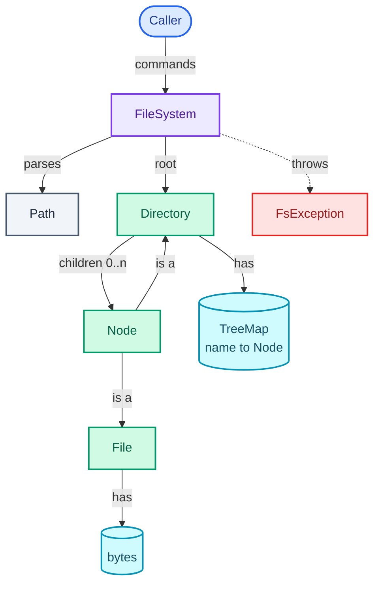
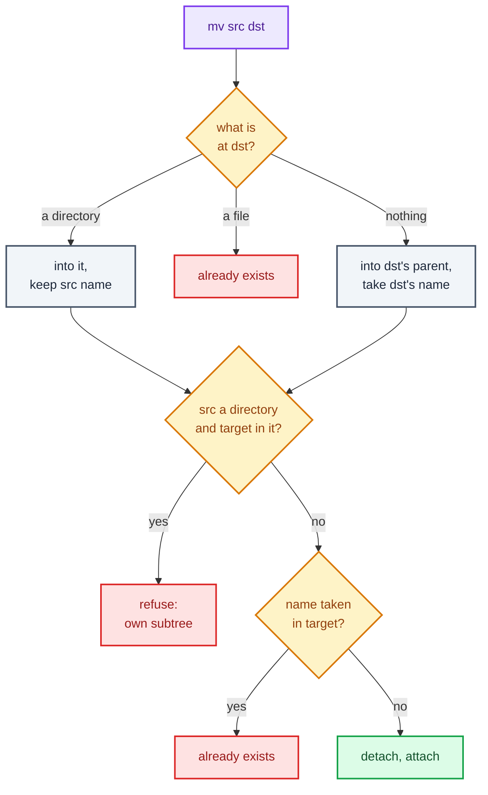

"Design an in-memory file system. It should support `mkdir`, including creating missing parents, `ls`, creating, reading and writing files, moving and renaming, deleting, and reporting the size of any file or directory."

The commands are familiar from any shell, which makes the question look like a list of features. It isn't. What it tests is whether you see that **every command is the same two steps**: turn a path string into a node by walking the tree one segment at a time, then do a few lines of work on that node. Get the walk right once and nine commands fall out. Get it wrong and each command grows its own half-correct walk. The second thing it tests is the **Composite** pattern from [Part 2](/blogs/lld-oop-and-patterns/), in its natural habitat: a file and a directory answer the same questions ("what's your name, your parent, your size?"), and a directory's answer is built from its children's.

The tree itself is a [trie](/blogs/dsa-tries/) keyed by path segment instead of by character, and size is a post-order [tree](/blogs/dsa-trees/) traversal. The thread-safety discussion leans on [Part 3](/blogs/lld-concurrency/), and it lands differently from [the LRU cache](/blogs/lld-lru-cache/) and [the logger](/blogs/lld-logging-service/) because here most operations really are reads.

How to use this post: [the method](/blogs/lld-the-method/). Try the question cold first, then read.


You are a senior engineer interviewing me for a low-level design round. The question is: "Design an in-memory file system supporting mkdir (including creating missing parents), ls, creating, reading and writing files, moving and renaming, deleting, and the size of any file or directory." Run it as a realistic 35-minute interview following this structure: requirements (5 min), entities and relationships (3 min), class design (10-15 min), implementation of the key methods in Java (10 min), extensibility (5 min).
Rules: state the question in one sentence and stop. Answer my clarifying questions the way a real interviewer would, briefly, and only what I ask. Never propose designs, components or classes yourself. If I skip a stage or run long on one, say so in one line and keep time. When I finish a stage, write one line of the note you would put on the scorecard, then move on.
Once my design is in place, probe it with these, one at a time, waiting for my answer each time: 1. Why a tree of nodes instead of one hash map from full path to file? What does each make cheap and expensive? 2. What happens if I run mv /a /a/b/c in your design? 3. How is the size of a directory computed, what does it cost, and how would you make it O(1)? 4. Two threads: one runs ls on a big directory while another moves a file into it. What protects them, and why that lock and not another? 5. Add Unix-style permissions. Where do the checks go? 6. Add symbolic links. What breaks and how do you stop a loop?
At the end, grade me as hire / lean hire / lean no hire / no hire for a senior engineer, with the two strongest and two weakest moments, and the one thing to fix first.



## Requirements

Clarifying questions by the four themes from [the method](/blogs/lld-the-method/), each with the answer I'd assume.

**Primary capabilities**

- *Which commands?* `mkdir` and `mkdir -p`, `ls`, `write` (create or replace), `append`, `read`, `mv` (move and rename), `rm` and `rm -r`, `size`.
- *What does `ls` return?* For a directory, its children's names sorted alphabetically, with directories marked by a trailing `/`. For a file, the file's own name, as Unix `ls` does.
- *What is "size"?* Bytes of content for a file, the sum over everything below for a directory. Directories themselves weigh nothing.

**Rules and completion**

- *Absolute paths only, or a current directory too?* Absolute only. `.` and `..` are allowed inside a path and normalised away; `..` at the root stays at the root.
- *`mv` onto an existing directory?* Moves the source *into* it, keeping its name, like Unix. Onto a path that doesn't exist: moves and renames to that last segment. Onto an existing file: refused (no silent overwrite).
- *Moving a directory into its own subtree?* Refused. This is the rule interviewers wait for.
- *`write` to a missing file?* Creates it, provided the parent directory exists. It doesn't create parents; `mkdir -p` does.

**Error handling**

- *What errors, and how are they reported?* The shell's five: no such file or directory, not a directory, is a directory, already exists, directory not empty, plus one for invalid operations (removing `/`, a relative path). One exception type carrying an error kind and the offending path.

**Scope boundaries**

- *Concurrent use?* Yes, assume several threads.
- *Permissions, links, persistence, a current directory?* Out of scope; permissions and links are the likely follow-ups.

On the board:

```text
1. Absolute paths; "", "." and ".." normalised at parse time.
2. mkdir path (parent must exist) and mkdir -p path (creates missing parents; existing dir is fine).
3. write/append path text: creates the file if the parent exists; read path returns text.
4. ls path: sorted children, directories end in "/"; on a file, the file's name.
5. mv src dst: into dst if dst is a directory; else rename to dst's last segment under its
   parent. Refuse: dst is an existing file, a directory into its own subtree, moving /.
6. rm path; rm -r for non-empty directories; never /.
7. size path: bytes for a file, the recursive total for a directory.
8. Errors: no such path, not a directory, is a directory, already exists, not empty, invalid.
9. Safe for concurrent use.

Out of scope: permissions, links, current directory, persistence.
```

## Entities and relationships

The noun filter: what has state or rules of its own earns a class.

- **FileSystem**: the orchestrator. Owns the root, the lock and every rule that spans more than one node (the walk, `mv`'s cases, `rm`'s non-empty check).
- **Node**: what a file and a directory have in common: a name, a parent, a size. An abstract class, sealed to exactly two kinds.
- **File**: a Node with bytes. Knows how to read, replace and append its content.
- **Directory**: a Node with children, kept sorted by name. Knows how to add, find and remove a child, and how to add up its size.
- **Path**: the parsed, normalised list of segments. A value object (equal when its segments are equal, never changed after creation), so a record. Parsing once at the edge means no command ever sees `..`.
- **FsError / FsException**: the error kinds and the one exception that carries them.
- **Name, content, size**: fields. Size isn't even stored for a directory; it's computed.

The graph below shows ownership. The loop is the point: a Directory holds Nodes, and a Node may itself be a Directory. That recursion is the Composite pattern.



## Class design

### FileSystem

| Requirement | What FileSystem must track |
| --- | --- |
| every path starts at the top | `root: Directory` |
| one way to turn a path into a node | `resolve(path)`, used by every command |
| `mv`, `rm`, `mkdir -p` rules | nothing extra: they read the tree |
| concurrent use | `lock: ReadWriteLock` |

```text
class FileSystem
  - root: Directory
  - lock: ReadWriteLock
  + mkdir(path, parents: boolean)
  + write(path, text)
  + append(path, text)
  + read(path) -> String
  + ls(path) -> List<String>
  + size(path) -> long
  + rm(path, recursive: boolean)
  + mv(src, dst)
  + tree() -> String
  - resolve(path) -> Node              // the one walk
  - resolveDir(path) -> Directory      // walk, then insist on a directory
  - resolveFile(path) -> File          // walk, then insist on a file
  - fileForWriting(path) -> File       // walk to the parent, find or create the file
```

### Node, File, Directory: the Composite

```text
abstract sealed class Node permits File, Directory
  - name: String
  - parent: Directory          // null only for the root
  + size() -> long             // abstract: each kind answers for itself
  + path() -> String           // rebuilt by walking up
  + isWithin(dir) -> boolean   // am I dir, or below it?

class File extends Node
  - data: byte[]
  + read() -> String
  + write(text)
  + append(text)

class Directory extends Node
  - children: TreeMap<String, Node>
  + child(name) -> Node
  + add(name, node)            // the only place a parent pointer is set
  + remove(node)               // the only place one is cleared
```

**Composite** earns its place on `size()`: the caller asks any node, a file answers with its byte count, a directory asks its children and adds the answers, and nobody needs an `if (isDirectory)`. The same shape serves `path()`, which climbs parent pointers, and `isWithin`, which climbs until it finds the directory or runs out.

Two rules keep the tree a tree. A node's parent pointer and its parent's child map must always agree, so only `Directory.add` and `Directory.remove` change either one. And a directory may never become its own descendant, so `mv` checks `isWithin` before relinking.

`Node` is **sealed** (Java 17+: the compiler knows the full list of subclasses). That lets `FileSystem` use `switch` over node kinds where the *orchestrator's* behaviour differs by kind (`ls` on a file lists the file; `write` to a directory is an error), and the compiler checks every such switch handles both. Add a third kind later, a symbolic link, and every switch that forgot it stops compiling. That's the division of labour: behaviour a node owns goes in the node (polymorphism); a rule about what a *command* does with each kind stays in the command (an exhaustive switch).

**Considered and rejected:**

- **One `Node` class with an `isDirectory` flag**, content and children both present. Every method starts with a flag check and half the fields are dead on any given instance. This is the type switch [Part 2](/blogs/lld-oop-and-patterns/) warns about.
- **A flat `HashMap<String, Node>` from full path to node.** Lookup is O(1) instead of a walk, which sounds better. But `mv /projects /archive/projects` must rewrite the key of every descendant (O(subtree), possibly millions), `ls` becomes a scan for keys with a given prefix, and `rm -r` the same. In the tree, a move is two pointer changes however big the subtree. Say this trade-off; it's often the probe.
- **Storing each node's full path as a field.** The same problem in a smaller form: a directory rename leaves every descendant's stored path stale. `path()` is rebuilt on demand by walking up instead.
- **Visitor** (a pattern that puts each whole-tree operation in its own class, with one method per node kind) for operations like `tree()` or a future `find`. With two node kinds and one or two such operations, a recursive method with a sealed switch is shorter. Visitor starts paying when there are many such operations and the node types rarely change.

### Path

```text
record Path(segments: List<String>)
  + parse(raw) -> Path      // rejects relative paths; drops "" and "."; ".." pops
  + isRoot() -> boolean
  + name() -> String        // last segment
  + parent() -> Path        // all but the last
```

It's named `Path` to match the domain; it isn't `java.nio.file.Path`, which this program never imports.

## Implementation

Java 21. The happy path for every command is: parse the path, take the lock, walk to the node (or to its parent), do the work. The path walk is drawn first: four segments, four child lookups, each in a sorted map.

<figure class="sketch"></figure>

`mv` is the one command with real branching. The flowchart reads top-down in the order the code checks things: what is at the destination, then the subtree rule, then a name clash.



Edge cases, all handled in the code below:

- **A file in the middle of a path** (`/home/alice/todo.md/x`): the walk stops with "not a directory", naming the file.
- **`mkdir` on something that exists**: "already exists". `mkdir -p` on an existing directory: fine; on a path through a file: "not a directory".
- **`read` or `write` on a directory**: "is a directory".
- **`rm` on a non-empty directory without `-r`**: "directory not empty". **`rm /`** and **`mv /`**: refused.
- **`mv` a directory into its own subtree**: refused by walking up from the target.
- **`mv` onto an existing file**: "already exists". **`mv a a`**, or a file into the directory it's already in: nothing to do.
- **`..` above the root, `//`, `/./`**: normalised at parse time, so no command sees them.
- **Content sizes in bytes, not characters**: stored as UTF-8 bytes, so "é" counts 2.

### Errors and Path

```java
/** Unix-flavoured error kinds, so a message reads like the shell's. */
enum FsError {
    NO_SUCH_PATH("no such file or directory"),
    NOT_A_DIRECTORY("not a directory"),
    IS_A_DIRECTORY("is a directory"),
    ALREADY_EXISTS("already exists"),
    NOT_EMPTY("directory not empty"),
    INVALID("invalid operation");

    final String text;
    FsError(String text) { this.text = text; }
}

final class FsException extends RuntimeException {
    final FsError error;

    FsException(FsError error, String detail) {
        super(detail + ": " + error.text);
        this.error = error;
    }
}

/** An absolute path, already normalised: no "", ".", or "..". The root is the empty list. */
record Path(List<String> segments) {
    Path {
        segments = List.copyOf(segments);
    }

    static Path parse(String raw) {
        if (raw == null || !raw.startsWith("/")) throw new FsException(FsError.INVALID, "path must be absolute: " + raw);
        Deque<String> out = new ArrayDeque<>();
        for (String s : raw.split("/")) {
            switch (s) {
                case "", "." -> { }                                  // "//" and "/./" change nothing
                case ".." -> { if (!out.isEmpty()) out.removeLast(); } // ".." at the root stays at the root, like Unix
                default -> out.addLast(s);
            }
        }
        return new Path(new ArrayList<>(out));
    }

    boolean isRoot() { return segments.isEmpty(); }
    String name() { return segments.get(segments.size() - 1); }
    Path parent() { return new Path(segments.subList(0, segments.size() - 1)); }

    @Override public String toString() { return "/" + String.join("/", segments); }
}
```

The compact constructor copies the list, so a `Path` can't be changed through the list it was built from. That's what makes it safe to treat as a value.

### Node, File and Directory

```java
/** Composite: a File and a Directory answer the same questions, so callers rarely need to know which. */
sealed abstract class Node permits File, Directory {
    private String name;
    private Directory parent;   // null only for the root

    Node(String name) { this.name = name; }

    String name() { return name; }
    Directory parent() { return parent; }

    abstract long size();

    /** Rebuilt by walking up, so a move or rename never leaves a stale stored path behind. */
    String path() {
        if (parent == null) return "/";
        String up = parent.path();
        return (up.equals("/") ? "" : up) + "/" + name;
    }

    // Only Directory calls these, so the parent pointer and the parent's map can never disagree.
    void attachTo(Directory parent, String name) { this.parent = parent; this.name = name; }
    void detach() { this.parent = null; }

    /** True if this node is `other` or sits somewhere below it. Walks up, O(depth). */
    boolean isWithin(Directory other) {
        for (Node n = this; n != null; n = n.parent) if (n == other) return true;
        return false;
    }
}

final class File extends Node {
    private byte[] data = new byte[0];

    File(String name) { super(name); }

    @Override long size() { return data.length; }

    String read() { return new String(data, StandardCharsets.UTF_8); }

    void write(String text) { data = text.getBytes(StandardCharsets.UTF_8); }

    void append(String text) {
        byte[] more = text.getBytes(StandardCharsets.UTF_8);
        byte[] next = Arrays.copyOf(data, data.length + more.length);
        System.arraycopy(more, 0, next, data.length, more.length);
        data = next;
    }
}

final class Directory extends Node {
    private final TreeMap<String, Node> children = new TreeMap<>();   // sorted, so ls needs no sort

    Directory(String name) { super(name); }

    /** The recursive half of Composite: a directory's size is its children's sizes. O(subtree). */
    @Override long size() {
        long total = 0;
        for (Node c : children.values()) total += c.size();
        return total;
    }

    Node child(String name) { return children.get(name); }
    boolean isEmpty() { return children.isEmpty(); }
    Collection<Node> children() { return Collections.unmodifiableCollection(children.values()); }

    void add(String name, Node n) {
        if (children.containsKey(name)) throw new FsException(FsError.ALREADY_EXISTS, childPath(name));
        children.put(name, n);
        n.attachTo(this, name);
    }

    void remove(Node n) {
        children.remove(n.name());
        n.detach();
    }

    String childPath(String name) { return (parent() == null ? "" : path()) + "/" + name; }
}
```

Why a `TreeMap` for children: `ls` must come back sorted, and a `TreeMap` keeps keys in order, so each child lookup is O(log k) for k children and `ls` is a straight iteration. A `HashMap` gives O(1) lookups and an O(k log k) sort on every `ls`. For directories of tens or hundreds of entries either is fine; I pick the one that makes the common command trivial. `append` copies the array, O(file size) per call; a file that grows by many small appends would want a growable buffer or a list of chunks, which is how real file systems store content anyway (blocks).

Size, drawn on the tree as it stands at step 9 of the trace below: each file knows its own bytes, each directory adds up its children.

<figure class="sketch"></figure>

### FileSystem: the walk

```java
/** The orchestrator: parses paths, walks the tree, enforces the rules, holds the lock. */
final class FileSystem {
    private final Directory root = new Directory("");
    private final ReadWriteLock lock;

    FileSystem() { this(new ReentrantReadWriteLock()); }

    // The lock is a parameter only so a test can run this exact code without one.
    FileSystem(ReadWriteLock lock) { this.lock = lock; }

    // ── the one walk every command starts with ──────────────────────────────

    private Node resolve(Path p) {
        Node cur = root;
        List<String> seen = new ArrayList<>();
        for (String seg : p.segments()) {
            if (!(cur instanceof Directory d)) throw new FsException(FsError.NOT_A_DIRECTORY, "/" + String.join("/", seen));
            seen.add(seg);
            cur = d.child(seg);
            if (cur == null) throw new FsException(FsError.NO_SUCH_PATH, "/" + String.join("/", seen));
        }
        return cur;
    }

    private Directory resolveDir(Path p) {
        if (resolve(p) instanceof Directory d) return d;
        throw new FsException(FsError.NOT_A_DIRECTORY, p.toString());
    }

    private File resolveFile(Path p) {
        return switch (resolve(p)) {
            case File f -> f;
            case Directory d -> throw new FsException(FsError.IS_A_DIRECTORY, p.toString());
        };
    }
```

The walk carries `seen`, the segments resolved so far, only so an error names the exact point where it failed: `/home/alice/todo.md: not a directory` tells the caller which component was a file.

### FileSystem: the commands

`mkdir` has two modes. Plain `mkdir` walks to the parent and adds; `-p` walks from the root, creating what's missing, and the `switch` over the child (`null`, a directory, a file) is the whole rule.

```java
    // ── commands ────────────────────────────────────────────────────────────

    /** mkdir, or mkdir -p when parents is true (then an existing directory is fine). */
    public void mkdir(String raw, boolean parents) {
        Path p = Path.parse(raw);
        lock.writeLock().lock();
        try {
            if (!parents) {
                if (p.isRoot()) throw new FsException(FsError.ALREADY_EXISTS, "/");
                resolveDir(p.parent()).add(p.name(), new Directory(p.name()));
                return;
            }
            Directory cur = root;
            for (String seg : p.segments()) {
                cur = switch (cur.child(seg)) {
                    case null -> { Directory d = new Directory(seg); cur.add(seg, d); yield d; }
                    case Directory d -> d;
                    case File f -> throw new FsException(FsError.NOT_A_DIRECTORY, raw);
                };
            }
        } finally {
            lock.writeLock().unlock();
        }
    }
```

`case null` in a pattern `switch` is Java 21; before it, `null` threw a `NullPointerException` from the switch itself (recalled from JEP 441).

Writing, appending and reading share `fileForWriting`, which walks to the parent and finds or creates the file:

```java
    /** Creates the file if it doesn't exist (the parent must), then replaces its content. */
    public void write(String raw, String text) {
        Path p = Path.parse(raw);
        lock.writeLock().lock();
        try {
            fileForWriting(p).write(text);
        } finally {
            lock.writeLock().unlock();
        }
    }

    public void append(String raw, String text) {
        Path p = Path.parse(raw);
        lock.writeLock().lock();
        try {
            fileForWriting(p).append(text);
        } finally {
            lock.writeLock().unlock();
        }
    }

    private File fileForWriting(Path p) {
        if (p.isRoot()) throw new FsException(FsError.IS_A_DIRECTORY, "/");
        Directory parent = resolveDir(p.parent());
        return switch (parent.child(p.name())) {
            case null -> { File f = new File(p.name()); parent.add(p.name(), f); yield f; }
            case File f -> f;
            case Directory d -> throw new FsException(FsError.IS_A_DIRECTORY, p.toString());
        };
    }

    public String read(String raw) {
        Path p = Path.parse(raw);
        lock.readLock().lock();
        try {
            return resolveFile(p).read();
        } finally {
            lock.readLock().unlock();
        }
    }
```

`ls` and `size` are reads, under the read lock. `size` is one line because the Composite does the work:

```java
    /** A directory lists its children (directories end in "/"); a file lists itself, as Unix ls does. */
    public List<String> ls(String raw) {
        Path p = Path.parse(raw);
        lock.readLock().lock();
        try {
            return switch (resolve(p)) {
                case File f -> List.of(f.name());
                case Directory d -> d.children().stream()
                    .map(c -> c instanceof Directory ? c.name() + "/" : c.name())
                    .toList();
            };
        } finally {
            lock.readLock().unlock();
        }
    }

    public long size(String raw) {
        Path p = Path.parse(raw);
        lock.readLock().lock();
        try {
            return resolve(p).size();
        } finally {
            lock.readLock().unlock();
        }
    }
```

`rm` detaches one node; the whole subtree goes with it, because nothing else points into it and the garbage collector reclaims it.

```java
    /** rm, or rm -r when recursive is true. */
    public void rm(String raw, boolean recursive) {
        Path p = Path.parse(raw);
        lock.writeLock().lock();
        try {
            if (p.isRoot()) throw new FsException(FsError.INVALID, "cannot remove /");
            Node n = resolve(p);
            if (n instanceof Directory d && !d.isEmpty() && !recursive) throw new FsException(FsError.NOT_EMPTY, p.toString());
            n.parent().remove(n);   // dropping the reference drops the whole subtree
        } finally {
            lock.writeLock().unlock();
        }
    }
```

And `mv`, following the flowchart above. The subtree check is the line to point at in an interview.

```java
    /**
     * mv src dst. If dst is an existing directory, src moves into it under its own name.
     * Otherwise dst's parent must exist, and src moves there under dst's last segment (a rename).
     */
    public void mv(String rawSrc, String rawDst) {
        Path src = Path.parse(rawSrc), dst = Path.parse(rawDst);
        lock.writeLock().lock();
        try {
            if (src.isRoot()) throw new FsException(FsError.INVALID, "cannot move /");
            Node n = resolve(src);

            Directory targetDir;
            String targetName;
            Node existing = dst.isRoot() ? root : resolveOrNull(dst);
            if (existing == n) return;   // mv a a: nothing to do
            if (existing instanceof Directory d) {
                targetDir = d;
                targetName = n.name();
            } else if (existing != null) {
                throw new FsException(FsError.ALREADY_EXISTS, dst.toString());
            } else {
                targetDir = resolveDir(dst.parent());
                targetName = dst.name();
            }

            // A directory can't go inside itself: walk up from the target and look for src.
            if (n instanceof Directory moving && targetDir.isWithin(moving))
                throw new FsException(FsError.INVALID, "cannot move " + src + " into its own subtree " + dst);
            if (targetDir.child(targetName) == n) return;   // mv a/x a: already there
            if (targetDir.child(targetName) != null) throw new FsException(FsError.ALREADY_EXISTS, targetDir.childPath(targetName));

            n.parent().remove(n);
            targetDir.add(targetName, n);
        } finally {
            lock.writeLock().unlock();
        }
    }

    private Node resolveOrNull(Path p) {
        try {
            return resolve(p);
        } catch (FsException e) {
            if (e.error == FsError.NO_SUCH_PATH) return null;
            throw e;
        }
    }
```

Every check runs *before* `remove`, so a refused move leaves the tree exactly as it was. Reversing that order (detach first, then discover the name is taken) would lose the subtree.

The tree printer, for the trace:

```java
    /** An indented listing with sizes, for tests and the trace. */
    public String tree() {
        lock.readLock().lock();
        try {
            StringBuilder sb = new StringBuilder();
            print(root, 0, sb);
            return sb.toString();
        } finally {
            lock.readLock().unlock();
        }
    }

    private void print(Node n, int depth, StringBuilder sb) {
        String label = n == root ? "/" : n.name() + (n instanceof Directory ? "/" : "");
        sb.append("  ".repeat(depth)).append(label).append("  (").append(n.size()).append(" B)\n");
        if (n instanceof Directory d) for (Node c : d.children()) print(c, depth + 1, sb);
    }
}
```

### Thread safety: a read-write lock, for once

The whole tree sits behind one `ReentrantReadWriteLock`. `read`, `ls`, `size` and `tree` take the read lock and run in parallel with each other; anything that changes the tree takes the write lock and runs alone. Unlike [the LRU cache](/blogs/lld-lru-cache/), where a `get` secretly wrote the recency list, a read here really doesn't change anything, so the read side earns its keep. A file system is read far more than it's written, which is the case a read-write lock is built for. (Recalled: `ReentrantReadWriteLock` is non-fair by default, so a steady stream of readers can delay a writer; the constructor takes `true` for a fair lock at some throughput cost.)

Why one lock for the whole tree rather than one per directory: `mv` touches two directories and must check the subtree rule and relink atomically. With per-directory locks, `mv /a/x /b` and `mv /b/y /a` each lock their source's parent and then wait for the other's, which is the textbook deadlock from [Part 3](/blogs/lld-concurrency/). The fix there is a global lock order (always lock the directory with the smaller ID first), plus holding locks along the path while walking ("lock coupling": take the child's lock before releasing the parent's). That's the Staff-level answer, and the one-lock design is the right place to start because its correctness takes one sentence to argue.

The test runs 8 threads, each doing 500 rounds of `mkdir -p /data/t<i>`, writing a one-byte file `/data/t<i>/f<k>`, and appending one byte to a shared `/data/log`. First with a lock that does nothing, then with the real one:

```text
== 8 threads: mkdir -p /data/t<i>, 500 files each, all appending to /data/log ==
no lock               : errors 299, dirs 8 of 8, files 3995 of 4000, log bytes 3502 of 4000, size /data 7497 of 8000
ReentrantReadWriteLock: errors 0, dirs 8 of 8, files 4000 of 4000, log bytes 4000 of 4000, size /data 8000 of 8000
```

Without the lock, 498 appends vanished (two threads read the same old array, each wrote back its own longer copy, and one copy was lost), 5 of the 4,000 files are missing, and 299 rounds threw partway through, mostly from `TreeMap` inserts racing on the same directory. Other runs gave 330 and 279 errors; the losses are real every time. With the lock, every count is exact.

## Verification

One session through every rule, run by the harness. The tree at step 9 is the one the path-walk and size sketches drew.

| # | Command | Result |
| --- | --- | --- |
| 1 | `mkdir -p /home/alice/docs` | ok: creates home, alice, docs |
| 2 | `write /home/alice/docs/notes.txt "buy milk"` | ok, 8 bytes |
| 3 | `append notes.txt "\nbook flights"` | ok, now 21 bytes |
| 4 | `write /home/alice/todo.md "- ship part 13"` | ok, 14 bytes |
| 5 | `mkdir /home/bob` | ok |
| 6 | `mkdir /home/alice` | `/home/alice: already exists` |
| 7 | `ls /home` | `[alice/, bob/]` |
| 8 | `ls /home/alice` | `[docs/, todo.md]` |
| 9 | `size /home` | 35 (21 + 14 + 0) |
| 10 | `mv /home/alice/docs /home/bob` | ok: bob is a directory, so docs moves into it |
| 11 | `read /home/bob/docs/notes.txt` | `buy milk\nbook flights`: content moved with it |
| 12 | `mv /home/bob /home/bob/docs/archive` | `cannot move /home/bob into its own subtree /home/bob/docs/archive` |
| 13 | `mkdir /home/alice/todo.md/x` | `/home/alice/todo.md: not a directory` |
| 14 | `read /home/bob` | `/home/bob: is a directory` |
| 15 | `rm /home/bob` | `/home/bob: directory not empty` |
| 16 | `rm -r /home/bob` | ok: bob, docs and notes.txt gone |
| 17 | `write /home/alice/old.md "x"` | ok |
| 18 | `mv /home/alice/todo.md /home/alice/old.md` | `/home/alice/old.md: already exists` |
| 19 | `mv /home/alice/todo.md /home/alice` | ok: already there, nothing to do |
| 20 | `mv /home/alice/todo.md /home/alice/done.md` | ok: a rename |
| 21 | `read /home/alice/../alice/./done.md` | `- ship part 13` |
| 22 | `rm /` | `cannot remove /: invalid operation` |
| 23 | `size /` | 15 (14 + 1) |

The trees the harness printed at step 9 and at the end:

```text
/  (35 B)
  home/  (35 B)
    alice/  (35 B)
      docs/  (21 B)
        notes.txt  (21 B)
      todo.md  (14 B)
    bob/  (0 B)

/  (15 B)
  home/  (15 B)
    alice/  (15 B)
      done.md  (14 B)
      old.md  (1 B)
```

The edge transition is step 12. The destination `/home/bob/docs/archive` doesn't exist, so the move would be a rename into `/home/bob/docs`. Walking up from `docs` reaches `bob`, the directory being moved. Allowed, `bob` would become a child of its own child: `home` would lose it, and `bob`, `docs` and `notes.txt` would form a loop with no path back to `/`: unreachable, so the garbage collector reclaims them and the files are silently gone. The check costs O(depth) and is the only thing standing between `mv` and a corrupted tree.

<figure class="sketch"></figure>

## Extensibility

### "Add Unix permissions"

Give `Node` an owner and a mode (read, write, execute bits for owner and others), and pass the calling `User` into each command. The seam is `resolve`, the one walk: checking "execute" (search) permission on every directory it passes through puts traversal control in one place. Each command then checks its own bit on the final node: read for `read` and `ls`, write on the *parent* directory for `write`-create, `rm` and both ends of `mv`. Add one error kind, `PERMISSION_DENIED`.

```text
in resolve(), before descending into each directory d:
  if not d.mode.allows(user, EXECUTE): throw PERMISSION_DENIED(d.path())
```

### "size() is too slow on a big tree"

Cache it. Each `Directory` stores its total, and every change walks up the parent chain adjusting the totals: `write` adds the byte difference to each ancestor, `rm` subtracts the removed subtree's total, `mv` subtracts from the old ancestors and adds to the new. Each update is O(depth), and `size` becomes O(1). The cost is that every writer now touches every ancestor, which matters once there are per-directory locks.

### "Support cd and relative paths"

The current directory belongs to a user's session, not to the file system. A `Session` holds `cwd: Path`; a relative path is resolved by joining it to `cwd` and calling `Path.parse` on the result, which already handles `..`. `FileSystem` doesn't change.

### "Add symbolic links"

A third kind, `Symlink`, holding a target path: add it to `permits` and the compiler lists every switch that must now handle it. `resolve` follows a link by restarting the walk at the target with the remaining segments appended. Links can form loops (`a -> b`, `b -> a`), so the walk counts hops and gives up after a limit; Linux uses 40 (recalled: `ELOOP` after 40 links). Hard links are harder: the same `File` in two directories breaks "one parent", so `parent` becomes a set and `rm` only frees content when the last link goes.

### "find all files named *.md"

A recursive walk over `Directory.children()` with a predicate, under the read lock. If there will be several such whole-tree operations (find, du, tree, export), that's the point where Visitor starts earning its place. If `find` by name must be fast, keep an index `name -> set of nodes`, updated in `Directory.add` and `remove`, the two places the tree changes.

## What each level is expected to show

| Level | What it looks like on this question |
| --- | --- |
| Junior / Mid | File and Directory sharing a base class, a children map, a working path walk, `mkdir -p`, `ls` sorted, `read`/`write`, recursive size. Handles "no such path" and "not a directory". |
| Senior | One `resolve` shared by every command, Path parsed and normalised once, `mv` with its three destination cases and the own-subtree check, every check before any mutation, tree versus flat map argued with the `mv` cost, a read-write lock justified by the read-heavy pattern. |
| Staff+ | Drives the follow-ups: cached sizes and what they cost writers, per-directory locking with a lock order and lock coupling, permissions placed in the walk, symlink loops and hard-link parent sets, and where an in-memory tree stops (persistence, content in blocks, the metadata service in [Dropbox](/blogs/hld-dropbox/)). |

## Variants this unlocks

| Question | What changes |
| --- | --- |
| Design In-Memory File System (LeetCode 588) | A subset: `ls`, `mkdir`, `addContentToFile`, `readContentFromFile` (recalled from the problem). No `mv`, no errors to model. |
| Design a hierarchical key-value store (ZooKeeper znodes, etcd keys) | Every node can hold data *and* children, so File and Directory merge; add versions per node and watches (Observer) on a path. |
| Design an org chart with headcount and cost roll-ups | Composite again: employee is the leaf, manager the composite, headcount and salary totals are `size()`. "Move a team under another manager" is `mv` with the same cycle check. |
| Design a product category tree for an e-commerce site | Categories are directories, products are files; "count of products under Electronics" is recursive size, cached if the page is hot. |
| Design a URL router with path parameters | The path trie with a wildcard child per directory (`/users/{id}/orders`); resolution tries the exact child before the wildcard. |
| Design Dropbox's metadata service (HLD) | This tree stored in a database (a parent ID per row), `mv` as one row update, content in blocks in object storage: [Design Dropbox](/blogs/hld-dropbox/). |

## The one-page version

- `FileSystem`: the orchestrator; root directory, one `ReadWriteLock`, every command = parse, lock, `resolve`, a few lines.
- `resolve(path)`: one child lookup per segment from the root; "not a directory" if it hits a file midway, "no such path" if a child is missing.
- `Path`: a record of normalised segments; `""`, `.` and `..` handled once at parse.
- `Node` (sealed): name, parent, `size()`, `path()` rebuilt by walking up, `isWithin(dir)`.
- `File`: UTF-8 bytes; read, write, append.
- `Directory`: `TreeMap` of children, so `ls` is sorted for free; `add` and `remove` are the only places parent pointers change.
- Composite: a directory's size is the sum of its children's, so `size` is one line in `FileSystem`.
- `mv`: into an existing directory, or rename under the destination's parent; refuse an existing file, a name clash, and a directory into its own subtree (walk up from the target); all checks before the relink.
- `rm`: refuse `/` and non-empty without `-r`; detaching one node drops the subtree.
- Reads under the read lock in parallel; a tree, not a path map, so `mv` of any subtree is two pointer changes.

**Parse the path once, walk it one child at a time, and let files and directories answer the same questions, so every command is the walk plus a few lines.**


You are a senior engineer checking my understanding of a low-level design for an in-memory file system in Java. The design: FileSystem is the orchestrator with a root Directory and one ReentrantReadWriteLock; every command parses an absolute path into a Path record (normalising "", "." and ".."), takes the lock, and calls one resolve() that walks from the root one child lookup per segment. Node is a sealed abstract class (File, Directory) with name, parent, size(), path() rebuilt by walking up, and isWithin(dir). File holds UTF-8 bytes. Directory holds a TreeMap of children; only Directory.add and remove change parent pointers. Directory.size() sums its children (Composite). mv moves into an existing directory or renames under the destination's parent, refuses an existing file, a name clash and a directory into its own subtree, and does all checks before detaching. rm refuses / and non-empty directories without -r.
Ask me the questions below one at a time. Wait for my answer each time. Judge it against the expected points, which you must not reveal before I answer. If I'm stuck, give one hint, then a stronger hint, then the answer. After each, tell me what I got right and what I missed in two or three lines.
1. Why a tree of nodes rather than a HashMap from full path to node? Expected: the map gives O(1) lookup but mv of a directory must rewrite every descendant key, O(subtree), and ls or rm -r need prefix scans; in the tree a move is detach plus attach regardless of subtree size, and a walk costs one lookup per path segment.
2. Walk me through mv /home/bob /home/bob/docs/archive. Expected: archive doesn't exist so it is a rename into /home/bob/docs; src is a directory; walking up from the target docs reaches bob, the source, so refuse; otherwise bob would become its own descendant and the subtree would be cut off from the root.
3. Why must every mv check run before the detach? Expected: a refused move must leave the tree unchanged; detaching first and then finding a name clash or cycle would lose the subtree or leave a half-done move.
4. How is directory size computed, what does it cost, and how do you make it O(1)? Expected: Composite recursion summing children, O(subtree) per call; cache totals in each directory and adjust every ancestor on write, rm and mv (subtract from old ancestors, add to new), O(depth) per change, so writers pay.
5. Why a read-write lock here when the LRU cache used a plain lock? Expected: here reads (ls, read, size) change nothing so they can run in parallel; LRU get moves a node so every read writes; file systems are read-heavy; non-fair default can delay writers.
6. What goes wrong with per-directory locks for mv, and how do you fix it? Expected: two moves in opposite directions each hold one parent and wait for the other, a deadlock; acquire locks in a global order such as by node id, lock coupling while walking, and do the subtree check while holding them.
7. Add symbolic links. What changes and what new failure appears? Expected: a third sealed subtype, so the compiler flags every switch to update; resolve follows the target by restarting the walk with remaining segments; links can loop so cap the hops (Linux returns ELOOP after 40); hard links break the single-parent rule.
At the end, list which answers were solid and the one concept to revisit.



Next: [Design Splitwise](/blogs/lld-splitwise/), where the hard part moves from structure to arithmetic: split rules as strategies, a balance ledger, and the paise that won't divide evenly.
