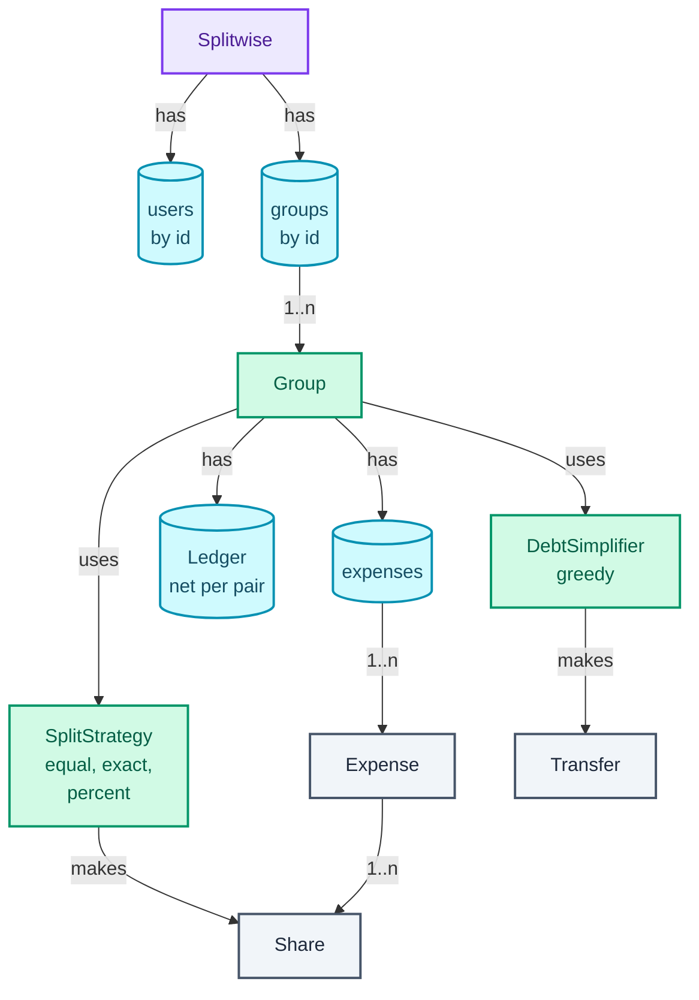
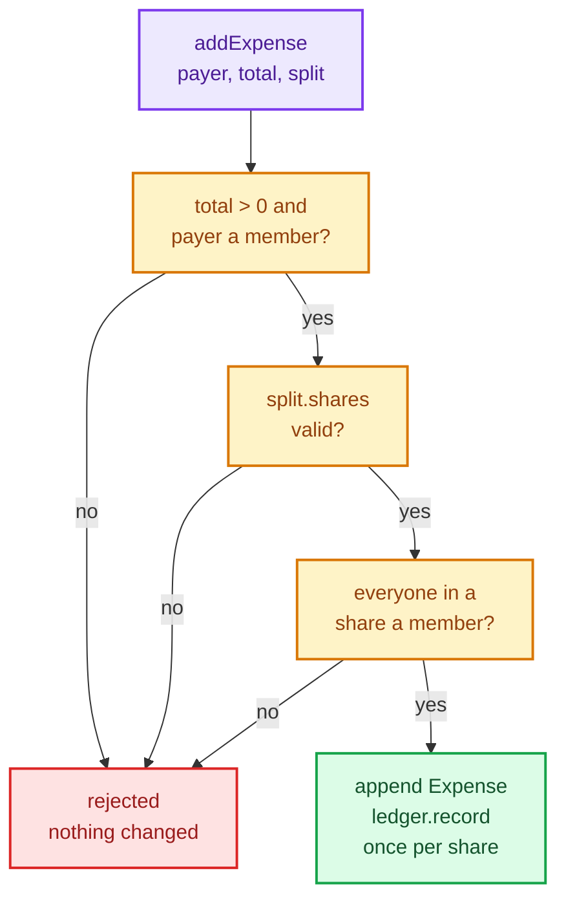

"Design Splitwise. People in a group add expenses, split them different ways, and the app tells everyone who owes whom."

It sounds like a CRUD app with arithmetic, and that is the trap. What the question really tests is **money correctness**: every split must add up to exactly the total, down to the paisa (one hundredth of a rupee), and the balances must never drift by a single paisa however many expenses pile up. Rs 1000 split three ways is not Rs 333.33 three times; that loses a paisa, and a ledger that loses a paisa per expense is wrong by Rs 10 after a thousand dinners. The second test is the follow-up every interviewer asks: "simplify the debts", and whether you know the textbook greedy answer is not always the minimum.

The pattern it trains is **Strategy** (one interface, several interchangeable algorithms, chosen by the caller), used twice: once for split types and once for debt simplification. It leans on the Strategy section of [OOP and the patterns that earn their place](/blogs/lld-oop-and-patterns/), and on [the greedy lesson](/blogs/dsa-greedy/) and [heaps](/blogs/dsa-heaps/) from the DSA series for the simplifier.

How to use this post: [the method](/blogs/lld-the-method/). Try the question cold first, then read.


You are a senior engineer interviewing me for a low-level design round. The question is: "Design Splitwise. People in a group add expenses, split them different ways, and the app tells everyone who owes whom." Run it as a realistic 35-minute interview following this structure: requirements (5 min), entities and relationships (3 min), class design (10-15 min), implementation of the key methods in Java (10 min), extensibility (5 min).
Rules: state the question in one sentence and stop. Answer my clarifying questions the way a real interviewer would, briefly, and only what I ask. Never propose designs, components or classes yourself. If I skip a stage or run long on one, say so in one line and keep time. When I finish a stage, write one line of the note you would put on the scorecard, then move on.
Once my design is in place, probe it with these, one at a time, waiting for my answer each time: 1. Split Rs 1000 equally between three people. What exactly does each person owe, and where does the leftover paisa go? 2. Why not store amounts as double? 3. Someone adds a percent split that adds up to 90%. What state has changed in your system when the error comes back? 4. How do you store balances so that "how much does Asha owe Bala" is a constant-time lookup, and how do you get one person's overall balance? 5. Simplify the debts of a group. What algorithm, how many transfers at most, and is it always the minimum? 6. Add a new split type, by shares (2:1:1). What changes in your code?
At the end, grade me as hire / lean hire / lean no hire / no hire for a senior engineer, with the two strongest and two weakest moments, and the one thing to fix first.



## Requirements

The clarifying questions, grouped by the four themes from [the method](/blogs/lld-the-method/), with the answer I'd assume if the interviewer said "you decide".

**Primary capabilities**

- *Who are the actors?* Users, and groups of users (a trip, a flat). Every expense belongs to one group. Assume a one-to-one expense between two friends is a group of two.
- *What can a user do?* Add an expense (who paid, how much, how it is split), see balances, record a payment that settles a debt, and ask the group to simplify its debts.
- *Which split types?* Equal, exact amounts, and percentages. Those three are the classic set, and they are different enough to justify an interface.
- *One payer or several?* One payer per expense. Several payers is a good extension (it's covered below), not a first-pass requirement.

**Rules and completion**

- *What unit is money in?* Integer paise in a `long`. Never `double`: 0.1 + 0.2 is not 0.3 in binary floating point, and a ledger built on doubles accumulates error that nobody can explain to a user. One currency, INR.
- *What happens to paise that don't divide evenly?* A deterministic rounding rule (the same input always produces the same shares). Equal split: the first people listed each pay one paisa more. Percent split: the leftover paise go to whoever lost the largest fraction to rounding. Either way the shares add up to the total exactly.
- *How precise are percentages?* Two decimal places, like 33.33%. Store them as **basis points** (hundredths of a percent, so 33.33% is the integer 3333) and the arithmetic stays in integers.
- *What does "simplify debts" mean?* Replace the group's tangle of pairwise debts with fewer transfers, without changing what anyone is owed or owes in total.

**Error handling**

- *An exact split that doesn't add up, or percentages that don't make 100%?* Reject the whole expense with a reason, and change nothing.
- *A participant who isn't in the group?* Reject.
- *A settlement larger than the debt?* Reject. A settlement clears an existing debt; it doesn't create a new one in the other direction.

**Scope boundaries**

- Single process, in memory, single-threaded. Concurrency is a follow-up (Extensibility), because every expense touches one group and the fix is a lock per group.
- No currency conversion, no notifications, no persistence, no editing of past expenses in the first pass.

What goes on the board:

```text
1. Users belong to groups; an expense belongs to one group.
2. Add an expense: payer, total in paise, split EQUAL | EXACT | PERCENT.
3. Shares always add up to the total exactly:
   - EQUAL: first people listed pay 1 paisa more for the remainder
   - PERCENT: basis points must sum to 10000; leftover paise go to
     the largest remainders, ties to the first listed
   - EXACT: amounts must sum to the total
4. Any invalid expense is rejected and changes nothing.
5. Show debts per pair, and each member's net position.
6. Settle: record a payment of at most what is owed.
7. Simplify: replace pairwise debts with fewer transfers,
   every member's net position unchanged.

Out of scope: multiple payers, currencies, editing expenses,
concurrency, persistence, notifications.
```

## Entities and relationships

The noun filter from [the method](/blogs/lld-the-method/): a noun earns a class when it owns changing state or enforces a rule. Otherwise it is a field or a value.

- **Splitwise**: earns a class as the orchestrator. It owns the user and group registries and resolves ids.
- **User**: a value (id and name). Users don't change and enforce no rules, so a record.
- **Group**: earns a class. It owns members, its expenses and its ledger, and enforces "everyone in an expense is a member".
- **Expense**: a value. Once added it never changes, and its one rule (shares add up to the total) is checked in its constructor.
- **Share**: a value: one person's part of one expense, in paise.
- **SplitStrategy**: earns an interface. Each split type is a different rule for turning a total into shares, with its own validation.
- **Ledger**: earns a class. It owns the net debt per pair and keeps the invariant that the books balance.
- **DebtSimplifier**: earns an interface. There's more than one way to simplify, with different costs.
- **Transfer**: a value: "from pays to this many paise", used both for a debt and for a step in a settlement plan.
- *Money*: considered and rejected as a class for now. With one currency, a `long` named in paise is enough; a `Money` record earns its place the day a second currency arrives (see Extensibility).

The ownership graph below reads top-down from the orchestrator. Purple is the entry point, green are classes with behaviour, teal are the collections that hold state, and grey are values.



Notice what isn't there: users don't hold balances. A balance is a fact about a *pair* of people inside a *group*, so it lives in the group's ledger. Putting a `balance` field on `User` is the most common mistake in this question, and it breaks the moment one person is in two groups.

## Class design

Top-down, starting from the orchestrator.

### Splitwise

```text
class Splitwise
  - users: Map<String, User>
  - groups: Map<String, Group>
  + addUser(id, name) -> User
  + createGroup(id, name, memberIds) -> Group
  + group(id) -> Group
```

Deliberately thin. It resolves ids and checks that users exist; every rule about money lives lower down, in the class that owns the state it is about.

### Group

| Requirement | What it must track |
| --- | --- |
| Expenses only among members | the member set |
| Show debts, settle, simplify | the ledger |
| History (and later, edits) | the list of expenses |

```text
class Group
  - members: Set<String>
  - expenses: List<Expense>
  - ledger: Ledger
  + addExpense(description, payerId, totalPaise, split: SplitStrategy) -> Expense
  + settle(fromId, toId, paise)
  + simplify(simplifier: DebtSimplifier) -> List<Transfer>
  + netPositions() -> Map<String, Long>
  + debts() -> List<Transfer>
```

`addExpense` is where atomicity lives: compute and validate everything first, then touch state. The flow below is the whole method: the three amber boxes are checks (the middle one is the strategy validating its own split), and only the green box changes anything.



### SplitStrategy: the Strategy pattern, earning its place

```text
interface SplitStrategy            (sealed: EqualSplit, ExactSplit, PercentSplit)
  + shares(totalPaise) -> List<Share>     throws if the split is invalid

record EqualSplit(participants: List<String>)
record ExactSplit(amounts: List<Share>)
record PercentSplit(percents: List<Percent(userId, basisPoints)>)
```

Each strategy is a small value object that carries its own inputs (who is in it, the amounts, the percentages) and knows one rule: how to turn a total into shares that add up to it. The group doesn't know or care which one it got.

Why Strategy and not the alternatives:

- **Considered: an enum `SplitType` and a `switch` inside `Group`.** Every split type has different inputs (a list of names, a list of amounts, a list of percentages), so the method signature would have to carry all of them, most of them null on any call. And every new type edits `Group`. Rejected.
- **Considered: subclasses of `Expense` (`EqualExpense`, `PercentExpense`).** That ties *how it was split* to *what the expense is*, forever. Once the shares are computed, an expense is a list of shares; how they were computed is history. Rejected.
- **Considered: a Factory to build strategies.** The caller already knows which split the user picked in the UI, so a factory adds a layer and removes nothing. Rejected until splits come from config.

The interface is `sealed` (Java 17+): the compiler knows the full list of implementations, so a `switch` over a `SplitStrategy` elsewhere (say, rendering "split equally" in the UI) is checked for exhaustiveness.

### Expense and Share

```text
record Expense(id, description, payerId, totalPaise, shares: List<Share>)
  invariant: sum(shares.paise) == totalPaise
record Share(userId, paise)
```

The invariant is checked a second time in the `Expense` constructor, even though every strategy already guarantees it. That second check is not for users; it catches a bug in a future strategy before it reaches the ledger.

### Ledger

| Requirement | What it must track |
| --- | --- |
| "How much does A owe B?" in O(1) | net amount per ordered pair |
| Each person's overall position | derivable: sum of their row |
| Books always balance | antisymmetry: owes(a, b) == -owes(b, a) |

```text
class Ledger
  - net: Map<String, Map<String, Long>>     net[a][b] > 0 means a owes b
  + record(debtor, creditor, paise)
  + owes(debtor, creditor) -> long
  + netPosition(user) -> long               positive: the group owes this user
  + debts() -> List<Transfer>
  + replaceWith(plan: List<Transfer>)
```

The ledger stores the **net** debt per pair, not a list of every debt. If Asha owes Bala 300 and Bala owes Asha 333.33, the ledger holds one number: Bala owes Asha 33.33. `record` writes both directions (`+x` on one side, `-x` on the other), so the table is antisymmetric by construction and the sum of all net positions is always exactly zero. That zero is the property to check after every operation; the verification run below prints it each time.

A person's **net position** is what the group owes them overall: positive if they're owed, negative if they owe. It is the one number debt simplification must preserve.

### DebtSimplifier

```text
interface DebtSimplifier
  + simplify(netPositions: Map<String, Long>) -> List<Transfer>

class GreedySimplifier implements DebtSimplifier
```

Strategy again, for a different reason: the obvious algorithm (greedy) is fast but not always optimal, and the optimal one is exponential. Making it an interface keeps that choice out of `Group`, and lets a test compare the two.

## Implementation

The happy path: compute shares, validate them, append the expense, and record one debt per share from the participant to the payer (the payer's own share is not a debt and `record` skips it). A payment is the same `record` call in the opposite direction. Simplify reads every member's net position, asks the simplifier for a plan, and replaces the pairwise debts with it.

The edge cases the code handles:

- A total that doesn't divide evenly: the rounding rules, in the strategies.
- A percentage like 33.33%: basis points, integer arithmetic with `Math.multiplyExact` so an absurd total overflows loudly instead of silently.
- The same person listed twice in a split, an empty split, negative shares or percentages: rejected.
- An expense with a non-member, or a payer who isn't a member: rejected before any state changes.
- A settlement of zero, a negative amount, or more than is owed: rejected.
- A pair whose debt nets to zero: removed from the ledger, so `debts()` never lists "pays Rs 0.00".

This is the program that ran (Java 21, `java Main.java` in Docker); only the `main` method that drives the verification run is left out.

### Values

```java
record User(String id, String name) {}

/** One person's part of one expense, in paise. */
record Share(String userId, long paise) {
    @Override public String toString() { return userId + " " + Rupees.fmt(paise); }
}

/** "from pays to this many paise": a debt in the ledger, or a step in a settlement plan. */
record Transfer(String from, String to, long paise) {
    @Override public String toString() { return from + " pays " + to + " " + Rupees.fmt(paise); }
}

/** Money is a long count of paise everywhere. This is the only place a decimal point appears. */
final class Rupees {
    static String fmt(long paise) {
        String sign = paise < 0 ? "-" : "";
        long p = Math.abs(paise);
        return "%sRs %d.%02d".formatted(sign, p / 100, p % 100);
    }
}
```

### The split strategies

The rounding rules are the part interviewers push on, so here they are drawn before the code. The top row is the equal split: 100000 paise over three people is 33333 each with one paisa left, and the rule gives it to whoever is listed first. The bottom row is the percent split, where flooring every share leaves one paisa that goes to the person who lost the most to the floor.

<figure class="sketch"></figure>

Both rows end on the same promise: the shares add up to the total, to the paisa. The equal rule is "first listed" rather than "largest remainder" because in an equal split every remainder is the same, so any tie-break is as fair as any other; it only has to be deterministic.

```java
/** Turns a total into shares that add up to exactly that total, or refuses. */
sealed interface SplitStrategy permits EqualSplit, ExactSplit, PercentSplit {
    List<Share> shares(long totalPaise);

    static void requireDistinct(List<String> userIds) {
        if (userIds.isEmpty()) throw new IllegalArgumentException("a split needs at least one person");
        if (new HashSet<>(userIds).size() != userIds.size())
            throw new IllegalArgumentException("someone is listed twice in the split");
    }
}

record EqualSplit(List<String> participants) implements SplitStrategy {
    public List<Share> shares(long totalPaise) {
        SplitStrategy.requireDistinct(participants);
        int n = participants.size();
        long base = totalPaise / n;
        long extra = totalPaise % n;               // 0..n-1 paise that don't divide evenly
        List<Share> out = new ArrayList<>();
        for (int i = 0; i < n; i++)                // rounding rule: the first `extra` people listed pay 1 paisa more
            out.add(new Share(participants.get(i), base + (i < extra ? 1 : 0)));
        return out;
    }
}

record ExactSplit(List<Share> amounts) implements SplitStrategy {
    public List<Share> shares(long totalPaise) {
        SplitStrategy.requireDistinct(amounts.stream().map(Share::userId).toList());
        if (amounts.stream().anyMatch(s -> s.paise() < 0))
            throw new IllegalArgumentException("a share cannot be negative");
        long sum = amounts.stream().mapToLong(Share::paise).sum();
        if (sum != totalPaise)
            throw new IllegalArgumentException("exact amounts add up to %s, not %s"
                    .formatted(Rupees.fmt(sum), Rupees.fmt(totalPaise)));
        return List.copyOf(amounts);
    }
}
```

The percent split uses the **largest remainder method**: floor every share, then hand the leftover paise one at a time to the people whose exact share had the biggest fractional part. The leftover is always fewer than the number of people, because each floor drops less than one paisa.

```java
record PercentSplit(List<Percent> percents) implements SplitStrategy {
    /** 1% = 100 basis points, so 33.33% is exactly 3333 and no double is ever involved. */
    record Percent(String userId, int basisPoints) {}

    public List<Share> shares(long totalPaise) {
        SplitStrategy.requireDistinct(percents.stream().map(Percent::userId).toList());
        if (percents.stream().anyMatch(p -> p.basisPoints() < 0))
            throw new IllegalArgumentException("a percentage cannot be negative");
        int sumBp = percents.stream().mapToInt(Percent::basisPoints).sum();
        if (sumBp != 10_000)
            throw new IllegalArgumentException("percentages add up to %d.%02d%%, not 100%%"
                    .formatted(sumBp / 100, sumBp % 100));
        int n = percents.size();
        long[] paise = new long[n];
        long[] remainder = new long[n];            // the fraction of a paisa each person lost to flooring, in 1/10000ths
        long given = 0;
        for (int i = 0; i < n; i++) {
            long exact = Math.multiplyExact(totalPaise, percents.get(i).basisPoints());
            paise[i] = exact / 10_000;
            remainder[i] = exact % 10_000;
            given += paise[i];
        }
        long leftover = totalPaise - given;        // < n, since each floor drops less than 1 paisa
        // Largest remainder first; sorted() on an ordered stream is stable, so ties go to whoever is listed first.
        List<Integer> byRemainder = IntStream.range(0, n).boxed()
                .sorted(Comparator.comparingLong((Integer i) -> remainder[i]).reversed())
                .toList();
        for (int k = 0; k < leftover; k++) paise[byRemainder.get(k)]++;
        List<Share> out = new ArrayList<>();
        for (int i = 0; i < n; i++) out.add(new Share(percents.get(i).userId(), paise[i]));
        return out;
    }
}
```

### Expense and the ledger

```java
record Expense(int id, String description, String payerId, long totalPaise, List<Share> shares) {
    Expense {
        long sum = shares.stream().mapToLong(Share::paise).sum();
        if (sum != totalPaise)                      // a strategy bug, never a user error: fail loudly
            throw new IllegalStateException("shares add up to " + sum + " paise, total is " + totalPaise);
        shares = List.copyOf(shares);
    }
}

/** Net debt per pair. owes(a, b) > 0 means a owes b. Kept antisymmetric: owes(a, b) == -owes(b, a). */
final class Ledger {
    private final Map<String, Map<String, Long>> net = new TreeMap<>();   // TreeMap: stable print order

    void record(String debtor, String creditor, long paise) {
        if (debtor.equals(creditor) || paise == 0) return;               // your own share is not a debt
        add(debtor, creditor, paise);
        add(creditor, debtor, -paise);
    }

    private void add(String a, String b, long delta) {
        Map<String, Long> row = net.computeIfAbsent(a, k -> new TreeMap<>());
        long v = row.getOrDefault(b, 0L) + delta;
        if (v == 0) row.remove(b); else row.put(b, v);                   // a settled pair disappears
    }

    long owes(String debtor, String creditor) {
        return net.getOrDefault(debtor, Map.of()).getOrDefault(creditor, 0L);
    }

    /** Positive: the group owes this user. Negative: this user owes the group. */
    long netPosition(String user) {
        return -net.getOrDefault(user, Map.of()).values().stream().mapToLong(Long::longValue).sum();
    }

    List<Transfer> debts() {
        List<Transfer> out = new ArrayList<>();
        net.forEach((a, row) -> row.forEach((b, v) -> { if (v > 0) out.add(new Transfer(a, b, v)); }));
        return out;
    }

    void replaceWith(List<Transfer> plan) {
        net.clear();
        plan.forEach(t -> record(t.from(), t.to(), t.paise()));
    }
}
```

`netPosition` is O(group size). For a trip of eight people that's eight additions; a cached per-user total would be one more thing to keep consistent for no measurable gain.

### Debt simplification

Here is what simplification does to the Goa trip in the verification run below. On the left are the five pairwise debts after three expenses; on the right, the three transfers greedy simplification replaces them with. Each person's net position, printed beside their name, is identical on both sides. That's the invariant, and it's the one thing simplification must keep.

<figure class="sketch"></figure>

The cost is visible on the right: dev now pays asha, though dev never owed asha anything directly. Some groups dislike that, which is why the real app makes simplification a per-group setting.

The **greedy** algorithm: keep creditors and debtors in two max-heaps by amount (a max-heap hands back its biggest item first in O(log n); see [heaps](/blogs/dsa-heaps/)). Repeatedly take the biggest creditor and the biggest debtor, transfer the smaller of the two amounts, and push back whoever still has a balance. Each step zeroes at least one person and the last step zeroes two, so it needs at most n − 1 transfers for n people with non-zero positions, in O(n log n) time.

```java
interface DebtSimplifier {
    /** Given each user's net position (summing to zero), a list of transfers that clears them all. */
    List<Transfer> simplify(Map<String, Long> netPositions);
}

/** Largest creditor takes from largest debtor until both lists are empty. At most n - 1 transfers. */
final class GreedySimplifier implements DebtSimplifier {
    private record Party(String id, long paise) {}

    public List<Transfer> simplify(Map<String, Long> netPositions) {
        // Max-heaps by amount; ties by name so the plan is the same on every run.
        Comparator<Party> biggestFirst = Comparator.comparingLong(Party::paise).reversed()
                .thenComparing(Party::id);
        PriorityQueue<Party> creditors = new PriorityQueue<>(biggestFirst);
        PriorityQueue<Party> debtors = new PriorityQueue<>(biggestFirst);
        netPositions.forEach((id, v) -> {
            if (v > 0) creditors.add(new Party(id, v));
            if (v < 0) debtors.add(new Party(id, -v));
        });
        List<Transfer> plan = new ArrayList<>();
        while (!creditors.isEmpty()) {             // sums match, so debtors empty at the same moment
            Party c = creditors.poll(), d = debtors.poll();
            long x = Math.min(c.paise(), d.paise());
            plan.add(new Transfer(d.id(), c.id(), x));
            if (c.paise() > x) creditors.add(new Party(c.id(), c.paise() - x));
            if (d.paise() > x) debtors.add(new Party(d.id(), d.paise() - x));
        }
        return plan;
    }
}
```

**The caveat.** "At most n − 1" is not "the minimum". The minimum number of transfers is n minus the largest number of **zero-sum groups** the people can be split into (a zero-sum group is a subset whose net positions add up to zero, so it can settle among itself). Each such group of k people needs exactly k − 1 transfers. Greedy doesn't look for these groups, and can break one apart. In the example below, p and t form one zero-sum group (+400 and −400) and q, r and s form another (+300, +300, −600). Greedy pairs the two biggest first, s with p, and that one move breaks both groups.

<figure class="sketch"></figure>

Finding the most zero-sum groups is NP-hard in general (recalled: it contains subset sum, deciding whether some subset of numbers adds to a target), so no known algorithm is polynomial. For a group the size of a trip, though, exact is affordable: a dynamic programme over subsets (a bitmask, one bit per person) is O(2^n · n), about 20 million steps for 20 people. It counts the minimum; that is enough to tell whether greedy was optimal.

```java
/** The true minimum number of transfers: n minus the most zero-sum groups the people split into. O(2^n * n). */
final class MinTransfers {
    static int count(Collection<Long> netPositions) {
        long[] v = netPositions.stream().filter(x -> x != 0).mapToLong(Long::longValue).toArray();
        int n = v.length, full = (1 << n) - 1;
        long[] sum = new long[1 << n];
        int[] groups = new int[1 << n];            // groups[m]: most zero-sum groups the people in m split into
        for (int m = 1; m <= full; m++) {
            sum[m] = sum[m & (m - 1)] + v[Integer.numberOfTrailingZeros(m)];
            int best = 0;
            for (int i = 0; i < n; i++)
                if ((m >> i & 1) == 1) best = Math.max(best, groups[m ^ (1 << i)]);
            groups[m] = best + (sum[m] == 0 ? 1 : 0);
        }
        return n - groups[full];                    // each zero-sum group of k people needs k - 1 transfers
    }
}
```

In an interview, greedy with the caveat stated is the expected answer. The DP is the Staff+ follow-up, and saying "it's exponential, fine for 20 people, and I'd cap group size before I'd ship it" is the senior way to close it.

### Group and the orchestrator

```java
final class Group {
    final String id, name;
    private final Set<String> members;
    private final List<Expense> expenses = new ArrayList<>();
    private final Ledger ledger = new Ledger();

    Group(String id, String name, List<String> memberIds) {
        this.id = id; this.name = name; this.members = new LinkedHashSet<>(memberIds);
    }

    Expense addExpense(String description, String payerId, long totalPaise, SplitStrategy split) {
        if (totalPaise <= 0) throw new IllegalArgumentException("an expense must be positive");
        requireMember(payerId);
        List<Share> shares = split.shares(totalPaise);         // validates; throws before any state changes
        shares.forEach(s -> requireMember(s.userId()));
        Expense e = new Expense(expenses.size() + 1, description, payerId, totalPaise, shares);
        expenses.add(e);
        for (Share s : shares) ledger.record(s.userId(), payerId, s.paise());
        return e;
    }

    void settle(String fromId, String toId, long paise) {
        requireMember(fromId); requireMember(toId);
        long owed = ledger.owes(fromId, toId);
        if (paise <= 0 || paise > owed)
            throw new IllegalArgumentException("%s owes %s %s, cannot settle %s"
                    .formatted(fromId, toId, Rupees.fmt(Math.max(owed, 0)), Rupees.fmt(paise)));
        ledger.record(toId, fromId, paise);                    // a payment is a debt in the other direction
    }

    List<Transfer> simplify(DebtSimplifier simplifier) {
        List<Transfer> plan = simplifier.simplify(netPositions());
        ledger.replaceWith(plan);                              // net positions unchanged; only the edges move
        return plan;
    }

    Map<String, Long> netPositions() {
        Map<String, Long> out = new LinkedHashMap<>();
        members.forEach(m -> out.put(m, ledger.netPosition(m)));
        return out;
    }

    List<Transfer> debts() { return ledger.debts(); }

    private void requireMember(String userId) {
        if (!members.contains(userId)) throw new IllegalArgumentException(userId + " is not in " + name);
    }
}

final class Splitwise {
    private final Map<String, User> users = new LinkedHashMap<>();
    private final Map<String, Group> groups = new LinkedHashMap<>();

    User addUser(String id, String name) {
        if (users.containsKey(id)) throw new IllegalArgumentException(id + " already exists");
        User u = new User(id, name);
        users.put(id, u);
        return u;
    }

    Group createGroup(String id, String name, List<String> memberIds) {
        memberIds.forEach(m -> { if (!users.containsKey(m)) throw new IllegalArgumentException("no user " + m); });
        Group g = new Group(id, name, memberIds);
        groups.put(id, g);
        return g;
    }

    Group group(String id) {
        Group g = groups.get(id);
        if (g == null) throw new IllegalArgumentException("no group " + id);
        return g;
    }
}
```

Settlement after simplification works because `simplify` rewrites the ledger's edges: once the plan says dev pays asha, the ledger says dev owes asha, so `settle("dev", "asha", ...)` is accepted. If `simplify` only returned a plan without rewriting, that settlement would be rejected as "dev owes asha Rs 0.00". This is a real design choice; Extensibility comes back to it.

## Verification

The scenario: a Goa trip with asha, bala, chetan and dev. Three expenses, one of each split type, chosen so both rounding rules fire. Two invalid expenses that must change nothing. Then simplify, a settlement, an overpayment, and the greedy caveat. Every row is copied from the program's output; "sum" is the sum of all four net positions, which must be zero after every step.

| # | Call | Result | Debts after (who pays whom) | Sum |
| --- | --- | --- | --- | --- |
| 1 | asha pays Rs 1000.00, equal over asha, bala, chetan | shares asha 333.34, bala 333.33, chetan 333.33 | bala → asha 333.33, chetan → asha 333.33 | 0 |
| 2 | bala pays Rs 900.00, exact asha 300, bala 200, chetan 200, dev 200 | accepted | bala → asha 33.33, chetan → asha 333.33, chetan → bala 200.00, dev → bala 200.00 | 0 |
| 3 | chetan pays Rs 10.00, percent bala 33.33, dev 33.33, asha 33.34 | shares bala 3.33, dev 3.33, asha 3.34 | bala → asha 33.33, chetan → asha 329.99, chetan → bala 196.67, dev → bala 200.00, dev → chetan 3.33 | 0 |
| 4 | dev pays Rs 50.00, percent asha 50, bala 40 | rejected: percentages add up to 90.00%, not 100% | unchanged | 0 |
| 5 | dev pays Rs 50.00, equal over dev, esha | rejected: esha is not in Goa trip | unchanged | 0 |
| 6 | simplify (greedy) | plan: chetan → bala 363.34, dev → asha 203.33, chetan → asha 159.99 | the three transfers of the plan; net positions unchanged: true | 0 |
| 7 | dev settles Rs 203.33 with asha | accepted | chetan → asha 159.99, chetan → bala 363.34 | 0 |
| 8 | chetan settles Rs 400.00 with bala | rejected: chetan owes bala Rs 363.34, cannot settle Rs 400.00 | unchanged | 0 |
| 9 | greedy on p +400, q +300, r +300, s −600, t −400 | 4 transfers; minimum possible 3 | (net positions only, no group) | |

Three transitions worth tracing by hand:

- **Step 2 nets a pair.** After step 1, bala owes asha 333.33. Step 2 adds "asha owes bala 300.00". The ledger doesn't hold both; `record` adds −300.00 to bala's row for asha, leaving bala → asha 33.33.
- **Step 3 is the largest-remainder rule.** 1000 paise × 33.33% is 333.3 paise, floored to 333; asha's 33.34% is 333.4, also floored to 333. That's 999 paise, one short. asha's lost fraction (0.4) is the largest, so she pays 334. The shares print as Rs 3.33, 3.33, 3.34, and they add up to Rs 10.00.
- **Step 4 is the edge transition.** The percent check throws inside `split.shares`, before `expenses.add` or any `ledger.record`, so the debts printed after step 5 are identical to step 3's. That is the "rejected means nothing changed" requirement, checked rather than assumed.

The net positions at step 3 are asha +363.32, bala +363.34, chetan −523.33, dev −203.33. They add up to zero, and they're the four numbers on the debt sketch above. Here are the last lines of the run as printed:

```text
7. dev settles Rs 203.33 with asha
   settle -> accepted
   debts: [chetan pays asha Rs 159.99, chetan pays bala Rs 363.34]
   net:   asha Rs 159.99  bala Rs 363.34  chetan -Rs 523.33  dev Rs 0.00  (sum 0 paise)
8. chetan tries to settle Rs 400.00 with bala
   settle -> rejected: chetan owes bala Rs 363.34, cannot settle Rs 400.00
9. greedy is not always minimal: p +400, q +300, r +300, s -600, t -400
   greedy: [s pays p Rs 400.00, t pays q Rs 300.00, s pays r Rs 200.00, t pays r Rs 100.00]  (4 transfers)
   minimum possible: 3 transfers
   trip from step 3, minimum possible: 3 transfers
```

The last line matters too: on the trip itself, greedy's three transfers *were* the minimum. Greedy is usually right on real groups, which is exactly why the counterexample is worth having in your pocket.

## Extensibility

### "Add a split by shares: 2 : 1 : 1"

A new record implementing `SplitStrategy`, added to the `permits` list. Shares are percentages with a different denominator, so it reuses the largest-remainder idea: each person's exact amount is total × theirShares ÷ sumOfShares, floored, with the leftover handed out by largest remainder. `Group`, `Expense` and `Ledger` don't change. That's the seam Strategy bought.

```text
record ShareSplit(parts: List<Parts(userId, count)>) implements SplitStrategy
  + shares(totalPaise) -> List<Share>
      the PercentSplit loop, with 10_000 replaced by the sum of all counts
```

### "Several people paid for one expense"

Add a second list to `Expense`: who paid how much, which must also sum to the total (it's an `ExactSplit` on the paying side). Each person's net for that one expense is paid minus owed. To turn those nets into pairwise debts, run the same `GreedySimplifier` over that one expense's nets and `record` the transfers it returns. The ledger stays a ledger of pairs, and the simplifier earns a second job.

### "Two people add expenses to the same group at the same moment"

Every operation touches exactly one group's ledger, so the lock belongs on the group: make `addExpense`, `settle` and `simplify` `synchronized` on the `Group` instance (or hold a `ReentrantLock` per group). Two different groups never contend. A user's total across groups is a read across several groups; it can be slightly stale without breaking any invariant, because each group's books balance on their own. In a database-backed service, the same idea is one transaction per expense with a row lock (or a version number) on the group. The lock-granularity ladder is in [the concurrency toolkit](/blogs/lld-concurrency/).

### "Edit or delete an expense"

Keep expenses immutable and record a **reversal**: replay the old expense's shares with the sign flipped (`record(payer, participant, paise)`), then add the edited expense as new. Because `record` is additive and net positions are sums, a reversal is correct even on a ledger that has been simplified since: the net positions come out right, and the pairwise edges can be tidied by simplifying again. This is also the argument for the alternative design of `simplify`: keep the raw pairwise ledger untouched and compute the simplified plan on every read when the group has the setting on. Nothing is ever overwritten, at the cost of recomputing a plan per view (cheap for small groups).

### "Multiple currencies"

Now `Money` earns its class: `record Money(long minorUnits, Currency currency)`, with `plus` refusing to add rupees to dollars. The ledger keys by currency as well as by pair, and settlement is per currency. Conversion happens only when a user asks to settle in another currency, at a rate recorded on that settlement, never inside the ledger.

## What each level is expected to show

| Level | What good looks like on this question |
| --- | --- |
| Junior / Mid | Integer paise (not double), the three split types behind one interface, a pairwise balance map that answers "who owes whom", and a working equal split with a stated rounding rule. |
| Senior | Validation that rejects bad splits before touching state, the antisymmetric ledger and its zero-sum invariant, largest-remainder rounding for percentages, and greedy simplification with its n − 1 bound. Brings up the per-group lock unprompted. |
| Staff+ | Knows greedy isn't minimal and why (zero-sum subgroups, NP-hard in general), offers the exponential exact method with a group-size cap, and argues "simplify as a view" versus "simplify rewrites the ledger" in terms of edits, audit and user trust. |

## Variants this unlocks

| Question | What changes |
| --- | --- |
| Uber "split fare" | One expense type (equal split over riders), one payer (the card on file); the rounding rule and the "shares sum to the total" invariant are the whole problem. |
| Restaurant bill with tax and tip | Items are exact splits; tax and tip are split in proportion to each person's subtotal, which is the largest-remainder code with subtotals as weights. |
| Digital wallet (Paytm, GPay balance) | The ledger becomes accounts and double-entry postings, transfers replace expenses, and idempotency keys matter. The HLD version is [the payment system](/blogs/hld-payment-system/). |
| Office expense reimbursement | Splitting mostly disappears; an expense gets an approval lifecycle (submitted, approved, paid), which is the State pattern from [the vending machine](/blogs/lld-vending-machine/). |
| Flatmates' recurring bills | Recurring expense templates that generate an `Expense` on a schedule; the split strategy is stored on the template and reused every month. |

## The one-page version

- **Splitwise**: orchestrator; user and group registries, resolves ids.
- **User**: record; id and name, no balance.
- **Group**: members, expenses, ledger; `addExpense` validates everything, then writes.
- **SplitStrategy** (sealed): `EqualSplit`, `ExactSplit`, `PercentSplit`; each turns a total into shares that sum to it, or throws.
- **Rounding**: equal gives remainder paise to the first listed; percent (in basis points) gives them to the largest remainders.
- **Expense**, **Share**: immutable values; the constructor re-checks the sum.
- **Ledger**: net debt per pair, antisymmetric, so all net positions sum to zero.
- **Settle**: a `record` in the opposite direction, at most what is owed.
- **DebtSimplifier**: greedy, biggest creditor with biggest debtor via two heaps, at most n − 1 transfers.
- **Caveat**: minimum is n minus the most zero-sum groups; NP-hard in general, a bitmask DP for small groups.

**An expense is a set of shares that must add up to the total in integer paise; the ledger keeps net debt per pair so the whole group always sums to zero, and simplification may move the edges but never a single net position.**


You are my low-level design interview coach. I have studied a design for Splitwise and want to defend it. Ask me the questions below one at a time. Wait for my answer each time. Judge my answer against the key points listed under each question, which come from the design I studied. Do not reveal the key points before I answer. If I'm stuck, give one hint at a time, from vague to specific. After each answer, tell me what I got right, what I missed, and move on. At the end, summarise my two weakest areas.
1. Split Rs 1000.00 equally among three people. What does each owe, and why? Key points: money is integer paise in a long; 100000 / 3 = 33333 with remainder 1; a deterministic rule gives the 1 leftover paisa to the first person listed, so shares are 33334, 33333, 33333 and sum to exactly 100000; three times 333.33 would lose a paisa.
2. Why not double, and how do you represent 33.33%? Key points: binary floating point cannot represent most decimal fractions exactly (0.1 + 0.2 != 0.3) and errors accumulate across a ledger; percentages as basis points (33.33% = 3333 of 10000) keep all arithmetic in integers; use Math.multiplyExact so overflow fails loudly.
3. Rs 10.00 split 33.33% / 33.33% / 33.34%. What are the shares? Key points: exact shares are 333.3, 333.3, 333.4 paise; floor each to 333, total 999, 1 paisa left; largest remainder method gives it to the 0.4 person, so 333, 333, 334; ties go to the first listed (stable sort).
4. A user submits a percent split adding to 90%. What has changed in the system when the error returns? Key points: nothing; the strategy validates and throws inside shares() before the expense is appended or any ledger entry recorded; validate everything first, then mutate; the Expense constructor re-checks that shares sum to the total as a guard against strategy bugs.
5. How do you store balances, and how do you get one person's overall position? Key points: net debt per ordered pair in a map of maps, antisymmetric (owes(a,b) = -owes(b,a)), so "how much does A owe B" is O(1); record writes both directions; a pair that nets to zero is removed; a person's net position is minus the sum of their row; all net positions sum to zero, which is the invariant to check; balances never live on User, because one user is in many groups.
6. Why is SplitStrategy an interface, and what alternatives did you reject? Key points: each split type has different inputs and a different validation rule; strategies are value objects carrying their inputs; an enum plus switch would force every input into one signature and edit Group for every new type; Expense subclasses tie how it was split to what it is; a factory adds nothing when the caller already knows the type; sealed lets switches be exhaustive.
7. Simplify a group's debts. Algorithm, bound, and is it optimal? Key points: compute each member's net position; two max-heaps of creditors and debtors; repeatedly transfer min(biggest credit, biggest debt) and push back the remainder; each step zeroes at least one person, so at most n - 1 transfers, O(n log n); not always minimal, e.g. +400, +300, +300, -600, -400 takes 4 with greedy but 3 by settling the zero-sum groups {+400, -400} and {+300, +300, -600}; the minimum is n minus the maximum number of zero-sum subgroups, NP-hard in general, an O(2^n * n) bitmask DP is fine for small groups.
8. After simplification, dev pays asha though dev never owed asha. Is that a problem, and what are your design options? Key points: simplification preserves net positions, not pairwise relationships; some users dislike it, so make it a per-group setting; option A rewrite the ledger to the simplified edges (settlements along new edges validate); option B keep raw pairwise debts and compute the plan as a view on read (nothing overwritten, edits stay simple).
9. Two members add expenses to the same group concurrently. What do you do? Key points: every operation touches one group's ledger, so one lock per group (synchronized methods or a ReentrantLock per group); different groups never contend; a cross-group total may be slightly stale but each group balances on its own; in a database, one transaction per expense with a row lock or version on the group.
10. How do you support editing an expense? Key points: keep expenses immutable; record a reversal (the old shares with the sign flipped) and then the new expense; record is additive, so this is correct even on a simplified ledger; it also keeps an audit trail.



Next: [Design an inventory management system](/blogs/lld-inventory-management/), where the shared state is stock that many orders want at once, and the answer is reserve, commit and release instead of decrementing a counter.
