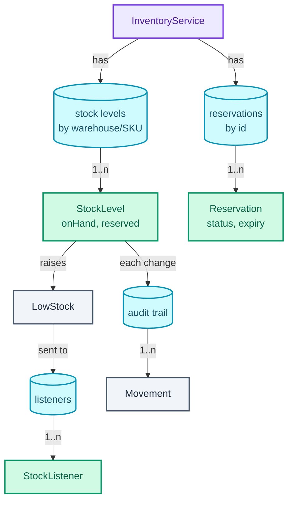
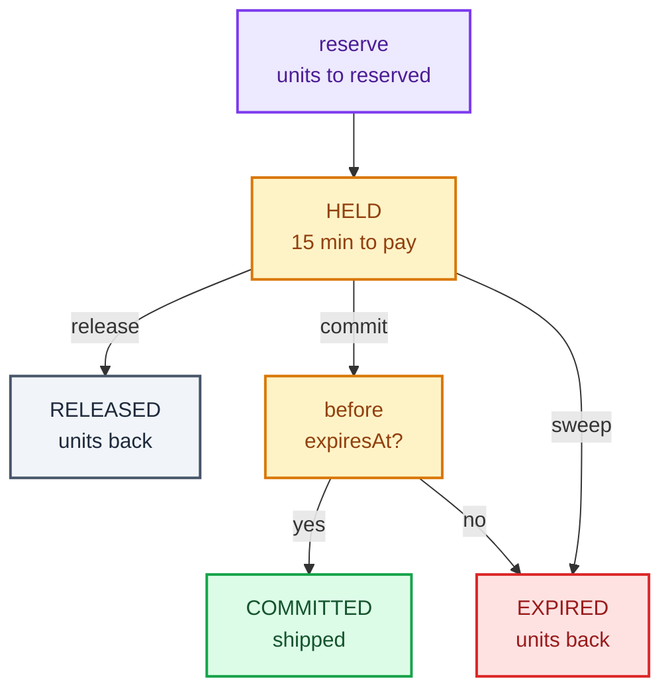

"Design an inventory management system. We sell products from several warehouses; track stock, take orders, and tell us when we're running low."

The naive answer is a `quantity` field per product and `quantity--` when someone buys. What the question really tests is **two things that naive answer gets wrong**. First, an order is not a sale until it is paid, so stock needs a state between "on the shelf" and "gone": a **reservation**, a hold placed on units for one order that is later **committed** (paid, the units ship) or **released** (cancelled or timed out, the units go back). Second, two orders can ask for the last unit in the same millisecond, and "check there's enough, then subtract" run by two threads at once sells it twice.

The patterns it trains are **Observer** (objects that want to hear about an event register a listener, and the subject calls them without knowing who they are), used for low-stock alerts, and the **atomic check-and-act**, the concurrency move from [the concurrency toolkit](/blogs/lld-concurrency/). It leans on [OOP and the patterns that earn their place](/blogs/lld-oop-and-patterns/) for Observer, and the reservation-with-expiry idea is the same one [movie ticket booking](/blogs/lld-movie-ticket-booking/) uses for seat holds.

How to use this post: [the method](/blogs/lld-the-method/). Try the question cold first, then read.


You are a senior engineer interviewing me for a low-level design round. The question is: "Design an inventory management system. We sell products from several warehouses; track stock, take orders, and tell us when we're running low." Run it as a realistic 35-minute interview following this structure: requirements (5 min), entities and relationships (3 min), class design (10-15 min), implementation of the key methods in Java (10 min), extensibility (5 min).
Rules: state the question in one sentence and stop. Answer my clarifying questions the way a real interviewer would, briefly, and only what I ask. Never propose designs, components or classes yourself. If I skip a stage or run long on one, say so in one line and keep time. When I finish a stage, write one line of the note you would put on the scorecard, then move on.
Once my design is in place, probe it with these, one at a time, waiting for my answer each time: 1. A customer adds the item to the cart and takes ten minutes to pay. Is that unit still for sale meanwhile? 2. Two threads try to buy the last unit at the same moment. Walk me through what your code does. 3. A payment succeeds at the same instant the customer clicks cancel. What happens to the stock? 4. How do low-stock alerts work, and how do you stop them firing on every single sale once stock is low? 5. How would you prove that the stock numbers are right after a week of traffic? 6. A flash sale: 100 units, 50,000 people in the first second. What changes?
At the end, grade me as hire / lean hire / lean no hire / no hire for a senior engineer, with the two strongest and two weakest moments, and the one thing to fix first.



## Requirements

The clarifying questions, grouped by the four themes from [the method](/blogs/lld-the-method/), each with the answer I'd assume.

**Primary capabilities**

- *What is tracked?* Products, identified by **SKU** (stock-keeping unit, the code for one sellable variant: "red mug, 350 ml"), stocked in several warehouses. Stock is per SKU per warehouse.
- *What operations?* Receive stock (a delivery arrives), reserve units for an order, commit a reservation when the order is paid, release it when the order is cancelled, and alert when stock runs low.
- *Which warehouse serves an order?* The first one, in a fixed priority order, that has the whole quantity. No splitting one order line across warehouses in the first pass.

**Rules and completion**

- *When does stock leave?* On commit, not on reserve. A reservation makes units unavailable to others but they're still on the shelf.
- *How long does a hold last?* 15 minutes, the length of a checkout. After that it **expires** and the units return, so abandoned carts don't lock stock forever.
- *When is stock "low"?* Below a threshold set per SKU per warehouse. The alert fires once, when stock **crosses** below the line, not on every sale after; it re-arms once stock is back at or above the line.
- *Do we need history?* Yes: an **audit trail**, an append-only log of every stock movement, from which the current numbers can be rebuilt.

**Error handling**

- *Not enough stock anywhere?* Reject the reservation; nothing changes.
- *Paying after the hold expired?* Reject the commit. The units went back to stock and may already be someone else's.
- *Commit and cancel arrive together, or a double cancel?* Exactly one of them wins; the other is rejected.
- *Zero or negative quantities?* Rejected.

**Scope boundaries**

- Concurrency **is** in scope: many orders at once is the point of the question.
- In memory, one process. No pricing, no returns, no inbound purchase orders beyond "receive", no physical locations inside a warehouse (bins, shelves).

What goes on the board:

```text
1. Stock per (warehouse, SKU): onHand, reserved; available = onHand - reserved.
2. receive(warehouse, sku, qty): onHand += qty.
3. reserve(order, sku, qty): first warehouse with available >= qty;
   reserved += qty; returns a Reservation that expires in 15 min.
4. commit(reservation): reserved -= qty, onHand -= qty. Rejected if expired.
5. release(reservation): reserved -= qty.
6. Expired holds are released by a periodic sweep, and lazily on commit.
7. A reservation leaves HELD exactly once: COMMITTED, RELEASED or EXPIRED.
8. Low-stock alert when available crosses below the threshold;
   re-arms at or above it. Many listeners.
9. Every movement is appended to an audit trail; onHand can be replayed.
10. Never oversell, under any interleaving of threads.

Out of scope: splitting orders across warehouses, pricing, returns,
bin locations, persistence.
```

## Entities and relationships

The noun filter: a noun earns a class when it owns changing state or enforces a rule.

- **InventoryService**: the orchestrator. Owns the registries and is the only entry point.
- **Product**: a value (SKU and name). It doesn't change and enforces nothing, so a record.
- **Warehouse**: a field, not a class. It has an id and a priority order, and owns no rules of its own in this scope. (It earns a class the day it has an address used for routing, see Extensibility.)
- **StockLevel**: earns a class, and it's the most important one. It owns the numbers for one SKU in one warehouse and enforces "never reserve more than is available".
- **Reservation**: earns a class. It has a lifecycle (held, then committed, released or expired), an expiry time, and enforces "finish exactly once".
- **StockListener**: earns an interface, the Observer seam for alerts.
- **LowStock**, **Movement**, **StockChange**: values. An alert, one audit line, and the outcome of one stock change.
- *Order*: considered and rejected. Orders live in another system; inventory only needs the order id on a reservation.

The ownership graph, from the orchestrator down. Purple is the entry point, green classes with behaviour, teal the collections, grey values. The service owns all four collections; the listeners and the audit trail are drawn where their contents come from (a stock change), to keep the picture narrow.



The thing to notice: there is no `quantity` field anywhere. The product doesn't know how many exist; the stock level for (BLR, MUG) does, and the stock level for (DEL, MUG) is a different object with a different lock.

## Class design

### StockLevel: three numbers that move together

| Requirement | What it must track |
| --- | --- |
| Units on the shelf | `onHand` |
| Units promised to unpaid orders | `reserved` |
| What can still be sold | `available = onHand - reserved` (derived, never stored) |
| Alert once per crossing | `lowBelow` threshold and a `low` flag |

```text
class StockLevel                     one per (warehouse, SKU); every method holds its lock
  - onHand: int
  - reserved: int
  - lowBelow: int
  - low: boolean
  + receive(qty) -> StockChange
  + tryReserve(qty) -> StockChange           all or nothing
  + commit(qty)
  + release(qty) -> StockChange
  + available() -> int
```

Every operation is one of four moves between the numbers. The sketch follows one SKU at BLR through the verification run below: each row is ten mugs after one call, coloured by which bucket each unit is in.

<figure class="sketch"></figure>

Reserve turns green cells amber. Commit turns amber cells red (they leave on-hand). Expiry or release turns amber back to green. Receive adds green cells. No operation ever changes a single number on its own, which is why the numbers live in one object behind one lock.

`available` is derived rather than stored. Storing it would give three numbers that must agree, and a bug that updates two of them; deriving it makes "available = onHand − reserved" true by construction.

**Tell, don't ask.** The caller never reads `available()` and then decides to reserve. That's the race. It calls `tryReserve(qty)` and the stock level, holding its own lock, checks and acts in one step. The check lives with the state it checks.

### Reservation: a small state machine

```text
class Reservation
  - id, orderId, warehouseId, sku: String
  - qty: int
  - expiresAt: Instant
  - status: AtomicReference<ReservationStatus>
  + finish(to: ReservationStatus) -> boolean     HELD -> to, exactly once

enum ReservationStatus { HELD, COMMITTED, RELEASED, EXPIRED }
```

A reservation starts HELD and leaves it exactly once, to one of three ends. HELD is the only state where stock is tied up. A commit first checks the clock (the second amber box): in time, the hold becomes COMMITTED (green, the paid end); too late, it becomes EXPIRED (red), the same end the periodic sweep reaches. A release goes to RELEASED (grey, the cancelled end).



"Exactly once" is the dangerous part. A payment callback (commit), a user's cancel click (release) and the expiry sweep can all reach the same reservation at once, on three threads. If two of them both see HELD and both move stock, reserved goes negative. The fix is a **compare-and-set** (CAS: "set the status to X only if it is still HELD", done as one indivisible hardware instruction) on an `AtomicReference`. Whoever's CAS succeeds owns the stock movement; everyone else is told the reservation is already finished.

Considered and rejected: the full **State pattern** (a class per state with `commit()` and `release()` methods on each, as in [the vending machine](/blogs/lld-vending-machine/)). There's no behaviour that differs per state beyond "allowed or not from HELD", so four classes would hold one `if` between them. An enum plus one CAS says the same thing in two lines.

### StockListener: Observer for alerts

```text
interface StockListener
  + onLowStock(event: LowStock)

record LowStock(warehouseId, sku, available, threshold)
```

**Observer earns its place** because the people who care about low stock keep changing: an ops dashboard, an automatic re-order job, an email to the category manager, a metric. The stock level shouldn't know any of them. It detects the crossing and returns an event; the service hands the event to every registered listener.

Three details that separate a senior answer from a textbook one:

- **Edge-triggered, not level-triggered.** A level-triggered alert fires whenever stock *is* low, so every sale below the line pages someone again. Edge-triggered fires when stock *crosses* the line. The `low` flag remembers that the alert already fired, and resets when stock climbs back. The sketch below shows BLR's available stock across the whole verification run, with the threshold at 5.

<figure class="sketch"></figure>

  Two alerts, both at a crossing. The drops to 1 and the expiry back up to 4 stay quiet because stock never went back above the line in between; the restock to 14 re-arms it, and the next drop alerts again.

- **Notify outside the lock.** The stock level computes the event under its lock but doesn't call listeners. The service calls them after the lock is released. A listener that sends an email takes hundreds of milliseconds; holding the stock lock that long would stall every other order for that SKU.
- **One failing listener can't stop the rest.** Each call is wrapped in its own `try`. The listener list is a `CopyOnWriteArrayList` (recalled: iteration works on a snapshot, so registering a listener mid-notification is safe), which suits a list that's read on every alert and written almost never.

Considered: a nightly "low stock report" query. Fine for planning re-orders, too slow for "the flash sale is about to sell out".

### InventoryService: the orchestrator

```text
class InventoryService
  - clock: InstantSource
  - holdFor: Duration
  - warehouses: List<String>                    priority order for reserve
  - stock: Map<String, StockLevel>              key "warehouse/sku"
  - reservations: Map<String, Reservation>
  - listeners: List<StockListener>
  - audit: Queue<Movement>
  + receive(warehouseId, sku, qty, ref)
  + reserve(orderId, sku, qty) -> Reservation
  + commit(reservationId)
  + release(reservationId)
  + sweepExpired() -> int
  + addListener(listener)
  + replayOnHand(warehouseId, sku) -> int
```

The clock is injected as an `InstantSource` (Java 17+, the interface behind `Clock`, whose one abstract method is `instant()`), so the test can move time forward by 16 minutes without sleeping. Production passes `InstantSource.system()`.

**Where the locks are, and why there are so few.** The lock-granularity ladder from [the concurrency toolkit](/blogs/lld-concurrency/):

- **Bad: one lock around the whole service.** Correct, and every order for every SKU in every warehouse waits in one line.
- **Good: one lock per StockLevel.** Orders for different SKUs, or the same SKU in different warehouses, never contend. Two orders for the same mug in the same warehouse do, and they must, because they're competing for the same units. This design uses `synchronized` on `StockLevel`.
- **Great (in a database): the check in the write.** `UPDATE stock SET reserved = reserved + :q WHERE sku = :s AND warehouse = :w AND on_hand - reserved >= :q`, then check the affected-row count. The database's row lock makes the check and the change one step, and no application lock is needed at all.

The maps are `ConcurrentHashMap`s, and `stock()` uses `computeIfAbsent` (recalled: atomic per key, so two threads asking for a new (warehouse, SKU) at once get the same `StockLevel`, never two).

## Implementation

The happy path: `reserve` walks the warehouses in priority order and calls `tryReserve` on each until one says yes. That one call is the atomic check-and-act. On success it records a reservation with an expiry, appends to the audit trail, and notifies listeners if the reserve crossed the threshold. `commit` checks the expiry, wins the CAS, then moves the units out of on-hand. `release` and the expiry sweep win the CAS and move units back.

Edge cases:

- No warehouse has the full quantity: `reserve` throws, nothing changed (each `tryReserve` that said no changed nothing).
- A commit after the hold expired: expire the hold lazily, right there, and reject the commit.
- Commit and release at once: one CAS wins; the loser gets "already COMMITTED" or "already RELEASED".
- A double release: the second CAS fails, rejected.
- The sweep and a commit racing at the expiry instant: same CAS, one winner.
- Zero or negative quantity: rejected before any lock is taken.

The program that ran (Java 21, `java Main.java` in Docker), minus the `main` that drives the verification run.

### Values and the Observer interface

```java
record Product(String sku, String name) {}

record LowStock(String warehouseId, String sku, int available, int threshold) {
    @Override public String toString() {
        return "%s %s available %d, below %d".formatted(warehouseId, sku, available, threshold);
    }
}

enum MovementType { RECEIVE, RESERVE, COMMIT, RELEASE, EXPIRE }

/** One line of the audit trail. Append-only: nothing is ever edited or removed. */
record Movement(long seq, Instant at, MovementType type, String warehouseId, String sku, int qty, String ref) {
    @Override public String toString() {
        return "#%d %s %-7s %s %s %d (%s)".formatted(seq, at.toString().substring(11, 16), type, warehouseId, sku, qty, ref);
    }
}

/** What a stock change did: whether it happened, and the low-stock alert it triggered, if any. */
record StockChange(boolean done, Optional<LowStock> alert) {
    static final StockChange REFUSED = new StockChange(false, Optional.empty());
}

/** Observer: anyone who wants to hear about low stock. */
interface StockListener {
    void onLowStock(LowStock event);
}
```

### StockLevel

```java
/** Stock of one SKU in one warehouse. Every method holds this object's lock, so the numbers move together. */
final class StockLevel {
    final String warehouseId, sku;
    private int onHand;          // physically on the shelf
    private int reserved;        // promised to orders that haven't paid yet
    private int lowBelow;        // alert when available drops below this
    private boolean low;         // already alerted; re-arms when available climbs back

    StockLevel(String warehouseId, String sku) { this.warehouseId = warehouseId; this.sku = sku; }

    synchronized int available() { return onHand - reserved; }
    synchronized int onHand() { return onHand; }

    synchronized void setLowBelow(int threshold) { lowBelow = threshold; }

    synchronized StockChange receive(int qty) {
        onHand += qty;
        return new StockChange(true, checkLow());
    }

    /** The atomic check-and-act: either all qty units move to reserved, or nothing changes. */
    synchronized StockChange tryReserve(int qty) {
        if (onHand - reserved < qty) return StockChange.REFUSED;
        reserved += qty;
        return new StockChange(true, checkLow());
    }

    /** Paid: the units leave the building. Available is unchanged, so no alert can fire here. */
    synchronized void commit(int qty) {
        reserved -= qty;
        onHand -= qty;
    }

    synchronized StockChange release(int qty) {
        reserved -= qty;
        return new StockChange(true, checkLow());
    }

    /** An alert only on the change that crosses the threshold, never on the ones after it. */
    private Optional<LowStock> checkLow() {        // caller holds the lock
        int avail = onHand - reserved;
        if (!low && avail < lowBelow) { low = true; return Optional.of(new LowStock(warehouseId, sku, avail, lowBelow)); }
        if (low && avail >= lowBelow) low = false;  // back above the line: the next drop alerts again
        return Optional.empty();
    }

    @Override public synchronized String toString() {
        return "%s %s on-hand %d, reserved %d, available %d".formatted(warehouseId, sku, onHand, reserved, onHand - reserved);
    }
}
```

`commit` can't change `available`: it takes the same number off `onHand` and off `reserved`. That's why it has no alert; the alert for those units already fired, if it was going to, when they were reserved.

### Reservation

```java
enum ReservationStatus { HELD, COMMITTED, RELEASED, EXPIRED }

final class Reservation {
    final String id, orderId, warehouseId, sku;
    final int qty;
    final Instant expiresAt;
    private final AtomicReference<ReservationStatus> status = new AtomicReference<>(ReservationStatus.HELD);

    Reservation(String id, String orderId, String warehouseId, String sku, int qty, Instant expiresAt) {
        this.id = id; this.orderId = orderId; this.warehouseId = warehouseId; this.sku = sku; this.qty = qty; this.expiresAt = expiresAt;
    }

    /** Only one caller can move a hold out of HELD; that caller, and only that caller, moves the stock. */
    boolean finish(ReservationStatus to) { return status.compareAndSet(ReservationStatus.HELD, to); }

    ReservationStatus status() { return status.get(); }

    @Override public String toString() {
        return "%s %s: %d x %s at %s, %s, expires %s".formatted(id, orderId, qty, sku, warehouseId, status(), expiresAt.toString().substring(11, 16));
    }
}
```

### InventoryService

```java
final class InventoryService {
    private final InstantSource clock;
    private final Duration holdFor;
    private final Map<String, Product> products = new ConcurrentHashMap<>();
    private final List<String> warehouses = new CopyOnWriteArrayList<>();          // the order reserve() tries them in
    private final Map<String, StockLevel> stock = new ConcurrentHashMap<>();        // key "warehouse/sku"
    private final Map<String, Reservation> reservations = new ConcurrentHashMap<>();
    private final List<StockListener> listeners = new CopyOnWriteArrayList<>();
    private final Queue<Movement> audit = new ConcurrentLinkedQueue<>();
    private final AtomicLong seq = new AtomicLong(), ids = new AtomicLong();

    InventoryService(InstantSource clock, Duration holdFor) { this.clock = clock; this.holdFor = holdFor; }

    void addWarehouse(String id) { warehouses.add(id); }
    void addProduct(Product p) { products.put(p.sku(), p); }
    void addListener(StockListener l) { listeners.add(l); }

    StockLevel stock(String warehouseId, String sku) {
        if (!warehouses.contains(warehouseId)) throw new IllegalArgumentException("no warehouse " + warehouseId);
        if (!products.containsKey(sku)) throw new IllegalArgumentException("no product " + sku);
        return stock.computeIfAbsent(warehouseId + "/" + sku, k -> new StockLevel(warehouseId, sku));
    }

    void setLowStockThreshold(String warehouseId, String sku, int threshold) { stock(warehouseId, sku).setLowBelow(threshold); }

    void receive(String warehouseId, String sku, int qty, String ref) {
        requirePositive(qty);
        StockChange c = stock(warehouseId, sku).receive(qty);
        log(MovementType.RECEIVE, warehouseId, sku, qty, ref);
        c.alert().ifPresent(this::notifyLow);
    }

    /** Holds qty units in the first warehouse that has them all, or throws. No stock moves on failure. */
    Reservation reserve(String orderId, String sku, int qty) {
        requirePositive(qty);
        for (String wh : warehouses) {
            StockChange c = stock(wh, sku).tryReserve(qty);
            if (!c.done()) continue;                              // not enough here; try the next warehouse
            Reservation r = new Reservation("r" + ids.incrementAndGet(), orderId, wh, sku, qty, clock.instant().plus(holdFor));
            reservations.put(r.id, r);
            log(MovementType.RESERVE, wh, sku, qty, r.id + " " + orderId);
            c.alert().ifPresent(this::notifyLow);                 // outside the stock lock: a slow listener can't block sales
            return r;
        }
        throw new IllegalStateException("no warehouse has " + qty + " x " + sku + " available");
    }

    void commit(String reservationId) {
        Reservation r = reservation(reservationId);
        if (!clock.instant().isBefore(r.expiresAt)) {             // lazy expiry: a late payment finds the hold gone
            expire(r);
            throw new IllegalStateException(r.id + " expired at " + r.expiresAt.toString().substring(11, 16));
        }
        if (!r.finish(ReservationStatus.COMMITTED)) throw new IllegalStateException(r.id + " is already " + r.status());
        stock(r.warehouseId, r.sku).commit(r.qty);
        log(MovementType.COMMIT, r.warehouseId, r.sku, r.qty, r.id + " " + r.orderId);
    }

    void release(String reservationId) {
        Reservation r = reservation(reservationId);
        if (!r.finish(ReservationStatus.RELEASED)) throw new IllegalStateException(r.id + " is already " + r.status());
        StockChange c = stock(r.warehouseId, r.sku).release(r.qty);
        log(MovementType.RELEASE, r.warehouseId, r.sku, r.qty, r.id + " " + r.orderId);
        c.alert().ifPresent(this::notifyLow);
    }

    /** Called on a schedule (every 30 s, say). Returns how many holds it released. */
    int sweepExpired() {
        Instant now = clock.instant();
        int n = 0;
        for (Reservation r : reservations.values())
            if (r.status() == ReservationStatus.HELD && !now.isBefore(r.expiresAt) && expire(r)) n++;
        return n;
    }

    private boolean expire(Reservation r) {
        if (!r.finish(ReservationStatus.EXPIRED)) return false;  // someone committed or released it first
        StockChange c = stock(r.warehouseId, r.sku).release(r.qty);
        log(MovementType.EXPIRE, r.warehouseId, r.sku, r.qty, r.id + " " + r.orderId);
        c.alert().ifPresent(this::notifyLow);
        return true;
    }

    List<Movement> audit() {
        List<Movement> out = new ArrayList<>(audit);
        out.sort(Comparator.comparingLong(Movement::seq));
        return out;
    }

    /** On-hand rebuilt from the audit trail alone: everything received minus everything committed. */
    int replayOnHand(String warehouseId, String sku) {
        int n = 0;
        for (Movement m : audit)
            if (m.warehouseId().equals(warehouseId) && m.sku().equals(sku))
                n += switch (m.type()) { case RECEIVE -> m.qty(); case COMMIT -> -m.qty(); case RESERVE, RELEASE, EXPIRE -> 0; };
        return n;
    }

    private Reservation reservation(String id) {
        Reservation r = reservations.get(id);
        if (r == null) throw new IllegalArgumentException("no reservation " + id);
        return r;
    }

    private void log(MovementType type, String wh, String sku, int qty, String ref) {
        audit.add(new Movement(seq.incrementAndGet(), clock.instant(), type, wh, sku, qty, ref));
    }

    private void notifyLow(LowStock e) {
        for (StockListener l : listeners) {
            try { l.onLowStock(e); }
            catch (RuntimeException ex) { System.err.println("listener failed: " + ex); }  // one bad listener can't stop the rest
        }
    }

    private static void requirePositive(int qty) {
        if (qty <= 0) throw new IllegalArgumentException("quantity must be positive, got " + qty);
    }
}
```

One honest limitation of the audit trail: the sequence number is taken after the stock lock is released, so two concurrent movements on the same SKU can be numbered in either order. Replay still reconciles, because it only adds and subtracts, and addition doesn't care about order. If an auditor needs the exact order, append inside the `StockLevel` lock (a database does this for free: the movement row is inserted in the same transaction as the stock update).

And a clock you can move by hand, used by the test:

```java
/** A clock the test moves by hand. Production code gets InstantSource.system(). */
final class TestClock implements InstantSource {
    private Instant now;
    TestClock(Instant start) { now = start; }
    public Instant instant() { return now; }
    void advance(Duration d) { now = now.plus(d); }
}
```

## Verification

The scenario: one SKU, MUG. BLR receives 10 and alerts below 5; DEL receives 5 and alerts below 3. Holds last 15 minutes. Two listeners are registered, an ops dashboard and an auto-reorder job, so each alert prints twice. Every row is from the program's output.

| # | Time | Call | Result | BLR on-hand / reserved / avail | DEL on-hand / reserved / avail |
| --- | --- | --- | --- | --- | --- |
| 1 | 10:00 | receive 10 BLR, 5 DEL | | 10 / 0 / 10 | 5 / 0 / 5 |
| 2 | 10:00 | o1 reserves 6 | r1 at BLR, expires 10:15; **alert BLR, available 4, below 5** | 10 / 6 / 4 | 5 / 0 / 5 |
| 3 | 10:00 | o2 reserves 3 | r2 at BLR, expires 10:15; no alert (already low) | 10 / 9 / 1 | 5 / 0 / 5 |
| 4 | 10:05 | o3 reserves 3 | BLR has 1, so r3 at DEL, expires 10:20; **alert DEL, available 2, below 3** | 10 / 9 / 1 | 5 / 3 / 2 |
| 5 | 10:05 | commit r1 | COMMITTED | 4 / 3 / 1 | 5 / 3 / 2 |
| 6 | 10:16 | commit r2 | rejected: r2 expired at 10:15; r2 is now EXPIRED | 4 / 0 / 4 | 5 / 3 / 2 |
| 6 | 10:16 | sweep, then commit r3 | sweep released 0 more; r3 COMMITTED | 4 / 0 / 4 | 2 / 0 / 2 |
| 7 | 10:16 | receive 10 BLR | re-armed (quiet) | 14 / 0 / 14 | 2 / 0 / 2 |
| 7 | 10:16 | o4 reserves 10 | r4 at BLR; **alert BLR, available 4, below 5** | 14 / 10 / 4 | 2 / 0 / 2 |
| 8 | 10:16 | o5 reserves 20 | rejected: no warehouse has 20 x MUG available | unchanged | unchanged |
| 9 | 10:16 | release r4, then release r4 again | RELEASED; second one rejected: r4 is already RELEASED | 14 / 0 / 14 | 2 / 0 / 2 |

Three transitions worth tracing:

- **Step 4 falls through a warehouse.** `tryReserve(3)` on BLR returns `REFUSED` (available 1) and changes nothing; the loop moves on to DEL, which says yes. Nothing was ever "partly reserved" at BLR.
- **Step 6 is the edge transition.** At 10:16 the commit for r2 sees `expiresAt` 10:15 is not after now, expires the hold on the spot (its 3 units go back: BLR available 1 → 4), and rejects. The sweep then finds nothing more, because r3 expires at 10:20 and r2 is already EXPIRED. Note BLR is at 4, still below 5, so no new alert: it never climbed back above the line.
- **Step 7 shows the re-arm.** The restock takes BLR to 14, at or above 5, so `low` resets silently. The next reserve drops it to 4 and the alert fires again.

The audit trail and the replay check, as printed:

```text
10. audit trail
   #1 10:00 RECEIVE BLR MUG 10 (PO-1)
   #2 10:00 RECEIVE DEL MUG 5 (PO-2)
   #3 10:00 RESERVE BLR MUG 6 (r1 o1)
   #4 10:00 RESERVE BLR MUG 3 (r2 o2)
   #5 10:05 RESERVE DEL MUG 3 (r3 o3)
   #6 10:05 COMMIT  BLR MUG 6 (r1 o1)
   #7 10:16 EXPIRE  BLR MUG 3 (r2 o2)
   #8 10:16 COMMIT  DEL MUG 3 (r3 o3)
   #9 10:16 RECEIVE BLR MUG 10 (PO-3)
   #10 10:16 RESERVE BLR MUG 10 (r4 o4)
   #11 10:16 RELEASE BLR MUG 10 (r4 o4)
   replayed on-hand BLR = 14, stock says 14
   replayed on-hand DEL = 2, stock says 2
```

BLR: received 10 + 10, committed 6, so 14. DEL: received 5, committed 3, so 2. The log alone rebuilds the numbers.

### The race, run for real

Now the concurrency claim. Two buyers, one mug: without a lock, both threads can read "1 available" before either writes, and both sell. With the lock, the second thread waits until the first has finished checking *and* writing, then reads 0.

<figure class="sketch"></figure>

The test: 100 mugs and 200 buyers, run as tasks on a pool of 16 threads that a `CountDownLatch` (a one-shot gate: every thread waits on it, and one `countDown()` lets them all through together) holds until all 200 are queued, so 16 buyers race at any moment. Each tries to buy one. First against a naive stock object that checks then acts with no lock:

```java
// The broken version: check-then-act with no lock.
static final class NaiveStock {
    int available = 100;
    boolean tryTake() throws InterruptedException {
        if (available >= 1) {
            Thread.sleep(1);            // widens the check-to-act gap so the race shows on every run;
            available -= 1;             // without it the race is still there, it just shows up less often
            return true;
        }
        return false;
    }
}
```

Then against `InventoryService.reserve`. A second test reserves 1000 single units, then fires a `commit` and a `release` at every one of them at the same moment, on 8 threads. One run's output:

```text
11. race: 200 buyers, 1 unit each, 100 in stock
   no lock:   sold 128, available -10
   with lock: sold 100, refused 100, BLR MUG on-hand 100, reserved 100, available 0
12. race: commit and release fired together on 1000 holds
   committed 931 + released 69 = 1000, refused 1000; BLR MUG on-hand 69, reserved 0, available 69
```

The unlocked numbers change from run to run, and they're wrong in two ways at once. It sold 128 of 100 mugs (check-then-act), and 128 sales from 100 should leave −28, not −10: eighteen of the `available -= 1` writes were themselves lost, because `-=` is a read, a subtract and a write, and two threads interleaved inside it. With the lock it's exactly 100 every time.

In the second test the split between commits and releases also varies by run, but the invariants hold every time: each reservation finished exactly once (1000 winners, 1000 refused), nothing is left reserved, and on-hand equals the number released, since everything else shipped.

## Extensibility

### "Flash sale: 100 units, 50,000 buyers in the first second"

The per-StockLevel lock is correct, but now every buyer queues on the same lock, and 49,900 of them queue only to be told no. Two cheap moves, in order. First, a lock-free fast path: an `AtomicInteger` of remaining units that each buyer decrements with `getAndDecrement()`; anyone who gets a value ≤ 0 is refused without touching the lock or creating a reservation. Second, put a queue in front (admit buyers in order, see [the pub-sub queue](/blogs/lld-pub-sub-queue/)) so the system serves 100 and politely turns away the rest. In a distributed setup the counter lives in Redis (`DECR` is atomic) and the HLD view is the waiting room in [Ticketmaster](/blogs/hld-ticketmaster/).

### "Split one order line across warehouses"

The seam is the loop in `reserve`. Pull it out as a `FulfilmentPolicy` Strategy (first-that-fits, nearest-to-customer, cheapest shipping). A splitting policy reserves from several stock levels and must undo the ones it took if it can't get the full quantity: reserve BLR 3, try DEL 4, fail, release BLR 3. Taking the locks one warehouse at a time in a fixed order keeps it deadlock-free (lock ordering, from [the concurrency toolkit](/blogs/lld-concurrency/)).

### "Asynchronous alerts"

Today `notifyLow` runs listeners on the thread that made the reservation, so a slow listener slows that one order (though never anyone else, since the lock is already released). To decouple fully, hand events to an `ExecutorService` or a `BlockingQueue` drained by a notifier thread. The cost is ordering and delivery guarantees, which is exactly what [the next part](/blogs/lld-pub-sub-queue/) builds.

### "Stock adjustments, damage and cycle counts"

Add `ADJUST` to `MovementType` and an `adjust(warehouse, sku, delta, reason)` that changes `onHand` under the same lock, refusing to take on-hand below `reserved` (you can't lose units you've promised without first cancelling the reservations). Replay gains one case in its `switch`, and because the switch has no `default`, the compiler points at the exact line to update.

### "Persist it"

The audit trail becomes the source of truth: a `stock_movement` table appended to in the same transaction as the `stock` row update, with the conditional `UPDATE` above replacing the Java lock. Reservations become rows with a status and an `expires_at` index the sweep scans. The class design doesn't change; the locks move into the database.

## What each level is expected to show

| Level | What good looks like on this question |
| --- | --- |
| Junior / Mid | Stock per SKU per warehouse, a separate reserved count, reserve / commit / release as methods, and an Observer interface for alerts. Spots that two threads can oversell when prompted. |
| Senior | Derives available instead of storing it, puts the check-and-act inside `StockLevel` under its lock, uses a CAS so a reservation finishes exactly once, expires holds lazily and by sweep, makes alerts edge-triggered and fires them outside the lock, and can rebuild stock from the audit trail. |
| Staff+ | Walks the lock ladder to the conditional SQL update, designs the flash-sale fast path and admission queue, handles split fulfilment with compensating releases and lock ordering, and says what the audit order guarantee is and isn't. |

## Variants this unlocks

| Question | What changes |
| --- | --- |
| Flash sale / limited drop | Add the atomic fast-path counter and an admission queue; per-user purchase limits become a second check inside the same atomic step. |
| Restaurant table or hotel room inventory | Units are dated: stock is per (room type, night), and a reservation spans several nights, so it must reserve several stock levels all-or-nothing. |
| Coupon or voucher codes with a usage cap | Same three numbers (issued, held at checkout, redeemed); the SKU is the coupon, the warehouse disappears. |
| Cloud resource quotas (vCPUs per account) | Reserve on launch, commit on start, release on terminate; the low-stock alert becomes "you're at 80% of quota". |
| Blood bank or pharmacy stock | Units expire on the shelf, so stock is per batch with an expiry date, and reserve picks the batch that expires first (FEFO, first expired first out). |

## The one-page version

- **InventoryService**: orchestrator; warehouses in priority order, stock levels, reservations, listeners, audit trail, injected clock.
- **StockLevel** (one per warehouse and SKU, one lock): `onHand`, `reserved`; `available` derived.
- **tryReserve**: check and act under one lock, all or nothing.
- **commit**: units leave on-hand and reserved together; available unchanged.
- **release / expire**: reserved units back to available.
- **Reservation**: HELD, then exactly one of COMMITTED, RELEASED, EXPIRED, enforced by a CAS on its status.
- **Expiry**: lazy on commit, plus a periodic sweep.
- **StockListener** (Observer): edge-triggered low-stock events, notified outside the lock, each listener isolated.
- **Audit trail**: append-only movements; on-hand replays as received minus committed.
- **Lock ladder**: global, then per stock level, then a conditional update in the database.

**Stock is three numbers that only move together: reserve moves available to reserved, commit removes reserved from on-hand, release moves it back; each move is one check-and-act under the stock level's own lock, and each reservation can finish exactly once.**


You are my low-level design interview coach. I have studied a design for an inventory management system and want to defend it. Ask me the questions below one at a time. Wait for my answer each time. Judge my answer against the key points listed under each question, which come from the design I studied. Do not reveal the key points before I answer. If I'm stuck, give one hint at a time, from vague to specific. After each answer, tell me what I got right, what I missed, and move on. At the end, summarise my two weakest areas.
1. Why not a single quantity field per product that you decrement at checkout? Key points: stock is per SKU per warehouse; an order is not a sale until paid, so units need a reserved state; track onHand and reserved, derive available = onHand - reserved instead of storing it so the three can't disagree; reserve, commit, release move units between them.
2. Two threads try to reserve the last unit at the same time. What does your code do, and what would naive code do? Key points: naive check-then-act lets both read available 1 and both sell; also available -= 1 is read-modify-write and can lose updates; tryReserve does the check and the change inside one synchronized method on the StockLevel, tell-don't-ask; the second thread waits, reads 0, is refused; in a test 200 buyers on 100 units sold exactly 100 with the lock and oversold without it.
3. Payment success (commit) and a cancel click (release) hit the same reservation at once. What happens? Key points: reservation status is an AtomicReference; finish does compareAndSet(HELD, target); only the winner moves stock; the loser is told it's already COMMITTED or RELEASED; the expiry sweep goes through the same CAS; a test firing both on 1000 holds left reserved at 0 with every hold finished exactly once.
4. How do holds expire? Key points: each reservation has expiresAt from an injected clock (InstantSource, a test clock in tests); a periodic sweep expires holds past their time; commit also checks lazily and expires on the spot, rejecting the late payment; expiry returns units to available.
5. Explain the low-stock alerts. Key points: Observer, StockListener interface, many listeners registered on the service; edge-triggered, fires only when available crosses below the threshold, a low flag suppresses repeats and resets at or above the threshold; the event is computed under the lock but listeners are called after it is released so a slow listener can't block sales; each listener call is isolated in its own try; CopyOnWriteArrayList for the listener list.
6. Where are the locks, and what's the ladder? Key points: one global lock is correct but serialises everything; one lock per StockLevel means different SKUs and warehouses never contend, while buyers of the same unit must; in a database the check moves into the write: UPDATE ... SET reserved = reserved + q WHERE on_hand - reserved >= q and check the row count; ConcurrentHashMap.computeIfAbsent guarantees one StockLevel per key.
7. How do you prove the numbers are right? Key points: append-only audit trail of every movement (receive, reserve, commit, release, expire); onHand replays as received minus committed; invariants checked in tests: reserved never negative, available never negative; the sequence number is assigned outside the lock, so the order of concurrent movements isn't exact, but replay sums are order-independent; to get exact order, append under the same lock or in the same database transaction.
8. Flash sale: 100 units, 50,000 buyers in a second. What changes? Key points: per-StockLevel lock is correct but everyone queues on it; add an atomic fast-path counter (getAndDecrement, or Redis DECR) that refuses buyers past zero without locking or reserving; admit buyers through a queue or waiting room; per-user limits checked in the same atomic step.
9. An order needs 7 units and no single warehouse has 7. Key points: make fulfilment a Strategy; a splitting policy reserves from several stock levels and releases what it took if it can't complete (compensation); take locks in a fixed order to avoid deadlock.



Next: [Design an in-memory pub-sub message queue](/blogs/lld-pub-sub-queue/), the series finale: producers and consumers that never meet, an append-only log with an offset per consumer, and back-pressure when a consumer falls behind.
