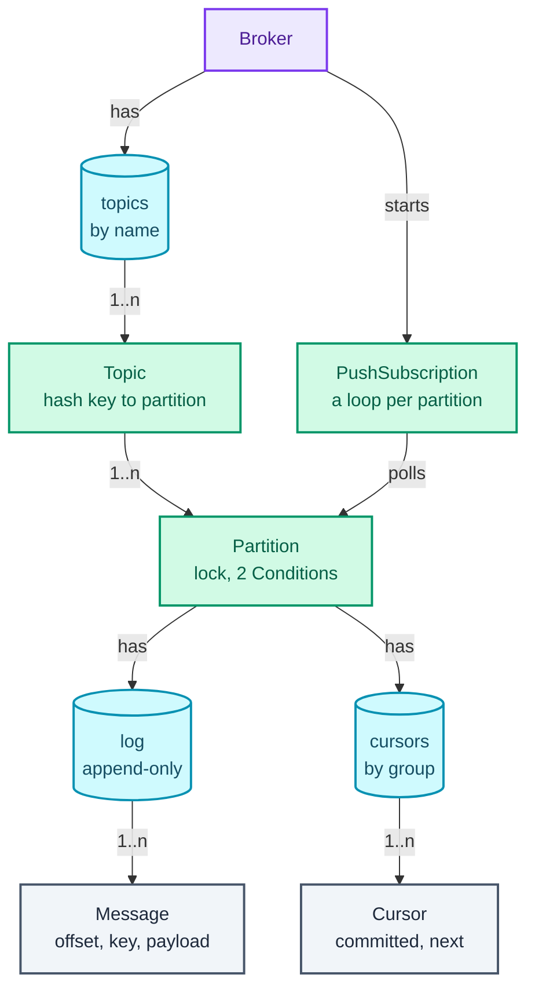
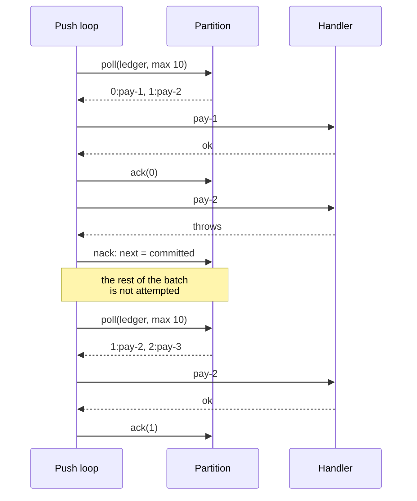

"Design an in-memory publish-subscribe message queue. Publishers send messages to a topic; several subscribers each receive every message. Think of a tiny Kafka inside one process."

**Publish-subscribe** (pub-sub) means publishers and subscribers never know about each other: a publisher writes to a named **topic**, and every subscriber of that topic gets a copy. What the question really tests is **coordination between threads that run at different speeds**: a consumer that waits for messages without burning a CPU, a producer that slows down when a consumer falls behind (**back-pressure**), and a delivery promise that survives a consumer crashing halfway through a message. Each of those is a rule about one number: a consumer's **offset**, its position in the topic's log.

The pattern it trains is the **bounded buffer** built from a lock and two `Condition`s (a `Condition` is a waiting room tied to a lock: a thread `await`s on it, releasing the lock while it sleeps, and another thread `signal`s it awake), the coordination half of [the concurrency toolkit](/blogs/lld-concurrency/). It is also Observer from [OOP and the patterns that earn their place](/blogs/lld-oop-and-patterns/), grown up: listeners that can be slow, crash, or be offline, without losing a message. The HLD view of the same machinery (Kafka, RabbitMQ, partitions across machines) is in [System Design: async](/blogs/system-design-async/).

How to use this post: [the method](/blogs/lld-the-method/). Try the question cold first, then read.


You are a senior engineer interviewing me for a low-level design round. The question is: "Design an in-memory publish-subscribe message queue. Publishers send messages to a topic; several subscribers each receive every message. Think of a tiny Kafka inside one process." Run it as a realistic 35-minute interview following this structure: requirements (5 min), entities and relationships (3 min), class design (10-15 min), implementation of the key methods in Java (10 min), extensibility (5 min).
Rules: state the question in one sentence and stop. Answer my clarifying questions the way a real interviewer would, briefly, and only what I ask. Never propose designs, components or classes yourself. If I skip a stage or run long on one, say so in one line and keep time. When I finish a stage, write one line of the note you would put on the scorecard, then move on.
Once my design is in place, probe it with these, one at a time, waiting for my answer each time: 1. Why not one BlockingQueue per topic? 2. A consumer is waiting and there are no messages. What is its thread doing, and what wakes it up? 3. One subscriber is ten times slower than the publisher. What happens to memory, and what do you do about it? 4. A consumer takes a message and crashes before finishing it. Is the message lost? Can it be processed twice? 5. How do you keep messages for the same user in order while still processing in parallel? 6. Push or pull: which would you expose, and why?
At the end, grade me as hire / lean hire / lean no hire / no hire for a senior engineer, with the two strongest and two weakest moments, and the one thing to fix first.



## Requirements

The clarifying questions, grouped by the four themes from [the method](/blogs/lld-the-method/), with the answer I'd assume.

**Primary capabilities**

- *Who are the actors?* Publishers, which send to a topic, and subscribers. Subscribers belong to **consumer groups**: every group receives every message, and inside one group the work is shared, so each message is handled by one member. "Billing" and "email" are two groups on the `orders` topic; billing may run two instances to go faster.
- *Pull, push, or both?* Both: `poll` for consumers that want control, and a push subscription with a handler for those that don't. Push will be built on top of pull.
- *Ordering?* Per key. Messages with the same key (say, a user id) are delivered in publish order. No global order across keys, because that would forbid any parallelism.

**Rules and completion**

- *Delivery guarantee?* **At-least-once**: a message is redelivered until the consumer **acks** it (acknowledges it as processed). A crash means it comes back; that means a message can arrive twice, so handlers must be idempotent (processing it twice has the same effect as once).
- *When is a message "done"?* When every group has acked it. Then it can be dropped from memory.
- *How long does a consumer have to ack?* An **ack timeout** (a lease): 30 seconds. Unacked messages after that are redelivered.
- *A group that subscribes late?* It starts at the end of the log and sees messages published from then on.

**Error handling**

- *A slow group?* Back-pressure: a partition holds at most `capacity` unacked messages for its slowest group. A publisher then waits, up to a timeout it chooses, and gets a failure if there's still no room.
- *A handler throws?* The message is **nacked** (negatively acknowledged) and redelivered at once.
- *Acking an offset that was never delivered?* Rejected: it's a consumer bug, and silently accepting it would skip messages.

**Scope boundaries**

- Concurrency is the point: many publisher and consumer threads.
- In memory, one process. No persistence, no replication, no dead-letter queue, no consumer-group rebalancing while running (all are in Extensibility).

What goes on the board:

```text
1. Topics have N partitions; partition = hash(key) mod N. Order per partition.
2. A partition is an append-only log; each message gets the next offset.
3. Each consumer group has, per partition: committed (all below acked)
   and next (next to hand out). committed <= next <= end.
4. poll(group, partition, max, wait): blocks up to `wait` for messages.
5. ack(group, partition, offset): cumulative; everything <= offset done.
   nack: hand the in-flight messages out again.
6. Unacked messages are redelivered after the ack timeout (30 s).
7. Back-pressure: publish waits while end - slowest committed >= capacity.
8. Messages every group has acked are trimmed.
9. Push = a broker-run pull loop calling a handler; throw = nack.
10. Within a group, each partition has exactly one consumer.

Out of scope: persistence, replication, dead letters, live rebalancing.
```

## Entities and relationships

The noun filter: a noun earns a class when it owns changing state or enforces a rule.

- **Broker**: the orchestrator and entry point. Owns topics, routes calls.
- **Topic**: earns a class, thinly. It owns its partitions and the rule "same key, same partition".
- **Partition**: earns a class, and it's where every interesting rule lives: the log, the cursors, back-pressure, redelivery, the lock.
- **Cursor**: a group's position in one partition (`committed`, `next`, lease deadline). Mutable, but it has no rules of its own; the partition enforces them under its lock, so it's a private nested class.
- **Message**: a value: offset, key, payload.
- **PushSubscription**: earns a class. It owns the threads that run the pull loop for a push subscriber.
- **ConsumerGroups**: a stateless helper that assigns partitions to group members.
- *Subscriber*: considered and rejected as a class. To the broker a subscriber is a group name; its code lives on the other side of `poll` or in a handler.

The ownership graph. Purple is the entry point, green classes with behaviour, teal the collections, grey values.



The thing to notice: messages and cursors are siblings. A message doesn't know who has read it; a group's cursor says how far it has read. That separation is what lets one message serve any number of groups without being copied.

## Class design

### Why a log, not a queue

The first idea most people have is the right shape for the wrong problem.

- **Bad: one `BlockingQueue` per topic.** `take()` removes the message, so the first subscriber to grab it is the only one who ever sees it. That's a work queue, not pub-sub. And once taken, it can't be redelivered if the consumer crashes.
- **Good: one `BlockingQueue` per group, with publish copying into each.** Every group gets every message, and each queue's capacity gives back-pressure per group. But a message taken and then lost in a crash is still gone, a new group can't replay anything, and memory is one copy per group.
- **Great: one append-only log per partition, one cursor per group.** A message is stored once. Reading doesn't remove it; acking moves the group's cursor. Redelivery is moving the cursor back. A message leaves memory only when the slowest group's cursor has passed it.

### Partition

| Requirement | What it must track |
| --- | --- |
| Order, replay, one copy per message | the log and its offset range `start..end-1` |
| Each group's progress and in-flight messages | a cursor per group: `committed`, `next` |
| Redelivery after a crash | a lease deadline per cursor, and an injected clock |
| Back-pressure | `capacity`, and the slowest group's `committed` |
| Waiting without spinning | one lock, `notEmpty` and `notFull` Conditions |

```text
class Partition
  - log: ArrayDeque<Message>          offsets start..end-1
  - start, end: long
  - cursors: Map<String, Cursor>      Cursor { committed, next, leaseUntil }
  - capacity: int
  - ackTimeout: Duration
  - lock: ReentrantLock
  - notEmpty, notFull: Condition
  + addGroup(group)
  + append(key, payload, wait) -> long          offset, or -1 if still full after wait
  + poll(group, max, wait) -> List<Message>
  + ack(group, offset)
  + nack(group)
```

The sketch shows partition 1 from the verification run, after step 5. Read the cursors above the cells and the backlog below them.

<figure class="sketch"></figure>

Email has acked everything below offset 3. Billing has acked offset 0 only, and offset 1 is **in flight**: handed out, not yet acked. The **backlog** is the distance from the slowest group's committed offset to the end of the log, here 4 − 1 = 3. That's the number back-pressure watches; at capacity 3, the next publish waits. And offset 0 is already trimmed, because both groups committed past it.

Three invariants hold under the lock at all times: `start <= committed <= next <= end` for every cursor, `start` equals the slowest `committed` (trim keeps exactly what someone still needs), and `end - start <= capacity`.

**Two Conditions on one lock** is the bounded-buffer pattern. A consumer with nothing to read `await`s `notEmpty`; `append` signals it. A producer facing a full partition `await`s `notFull`; `ack` signals it, because an ack is the only thing that can shrink the backlog. Two details that interviewers check:

- **Always wait in a `while`, never an `if`.** `await` can return without a signal (a spurious wakeup, recalled from the `Condition` docs), and another thread may have taken the slot between the signal and the wake. Re-check the condition after every wake.
- **`signalAll`, not `signal`.** Consumers from different groups wait on the same `notEmpty`, and an append is news for all of them. `signal` wakes one, and the rest sleep until their timeout.

Why a `ReentrantLock` and not `synchronized`: `synchronized` gives each object exactly one wait set (`wait`/`notify`), so producers and consumers would share one and every `notifyAll` would wake both kinds. Two `Condition`s keep them apart, and `awaitNanos` gives timeouts that return the time left.

### Topic and consumer groups

```text
class Topic
  - partitions: List<Partition>
  + partitionFor(key) -> int                   floorMod(key.hashCode(), n)

class ConsumerGroups
  + assign(members, partitions) -> Map<member, List<partition>>     round-robin
```

**Partitions are how a topic is processed in parallel while keeping per-key order.** Every message with key `user-a` lands in the same partition, and a partition is read by one consumer per group, in offset order, so `user-a`'s messages are handled in the order they were published. Different keys spread across partitions and are processed side by side. The sketch shows four partitions shared by two groups of two consumers each.

<figure class="sketch"></figure>

Within billing, c1 owns p0 and p2 and c2 owns p1 and p3. Email does the same split with its own cursors, so the two groups never interfere. Two consumers in one group on the same partition would race on one cursor and break per-key order, which is why the assignment gives each partition exactly one owner. A group with more members than partitions leaves the extras idle; the partition count is the ceiling on a group's parallelism.

`Math.floorMod` rather than `%`: `hashCode()` can be negative, and `-7 % 4` is `-3` in Java, an invalid partition index.

### Broker and push

```text
class Broker
  + createTopic(name, partitions, capacity, ackTimeout)
  + subscribe(topic, group)
  + subscribe(topic, group, handler) -> PushSubscription
  + publish(topic, key, payload, wait) -> long
  + poll(topic, group, partition, max, wait) -> List<Message>
  + ack(topic, group, partition, offset)

class PushSubscription implements AutoCloseable
  - loops: List<Thread>                one virtual thread per partition
  + close()
```

**Push versus pull.** In pull, the consumer asks when it's ready, so it can never be handed more than it can handle: back-pressure for free. In push, the broker calls the consumer as soon as messages arrive, which is lower latency and simpler for the consumer, but the broker must not flood a slow handler. The design builds push *from* pull: a `PushSubscription` runs `poll → handler → ack` in a loop, one **virtual thread** per partition (Java 21's lightweight threads, cheap enough to have thousands; a blocked one costs almost nothing). The batch size of that poll, 10, is the push consumer's flow control: it never has more than 10 messages in hand. Brokers that push call this a prefetch limit.

The sequence below is the push loop meeting a handler that fails once, which is step 10 of the verification run.



Patterns considered and rejected: **Observer** proper (the broker holding a list of listeners and calling each on publish). That runs the handlers on the publisher's thread, so one slow subscriber slows every publisher, and a crashed subscriber loses everything published while it was down. The log plus cursors is Observer with the coupling cut: the publisher only appends.

## Implementation

The happy path. `append` waits while the backlog is at capacity, then adds the message at offset `end`, bumps `end`, and signals `notEmpty`. `poll` first checks the lease: if messages are in flight and the deadline passed, it rewinds `next` to `committed` so they're delivered again. Then it waits on `notEmpty` while there's nothing at or after `next`, takes up to `max` messages, moves `next` past them and sets a new lease. `ack` moves `committed`, trims what every group has passed, and signals `notFull`.

The edge cases:

- A full partition and a publisher that won't wait: `append` returns −1 immediately.
- A consumer that crashes or hangs: its lease runs out and the next `poll` from that group redelivers from `committed`.
- A handler that throws: `nack` rewinds at once, without waiting for the lease.
- An ack below `committed` (already acked) or at or above `next` (never delivered): rejected.
- No groups at all: the slowest committed offset is `end`, so the backlog is 0 and `trim` drops each message right after it's appended. Classic pub-sub: nobody listening, nothing kept.
- Interrupts: `awaitNanos` throws `InterruptedException`; the broker restores the interrupt flag and returns, which is how `PushSubscription.close` stops its threads.

The program that ran (Java 21, `java Main.java` in Docker), minus the `main` that drives the verification run and the stress test.

### Message and Partition

```java
record Message(long offset, String key, String payload) {}

/**
 * One append-only log plus one cursor per consumer group. Every method takes the same lock;
 * two Conditions let waiting producers and consumers sleep instead of spinning.
 */
final class Partition {
    /** Where one group is in this log. committed <= next <= end. */
    private static final class Cursor {
        long committed;          // everything below this is acked
        long next;               // next offset to hand out; committed..next-1 are in flight
        Instant leaseUntil;      // in-flight messages come back if not acked by then
        Cursor(long at) { committed = at; next = at; }
    }

    private final int capacity;
    private final Duration ackTimeout;
    private final InstantSource clock;
    private final ReentrantLock lock = new ReentrantLock();
    private final Condition notEmpty = lock.newCondition();   // signalled on every append
    private final Condition notFull = lock.newCondition();    // signalled when the slowest group commits
    private final ArrayDeque<Message> log = new ArrayDeque<>();  // retained messages, offsets start..end-1
    private long start = 0, end = 0;
    private final Map<String, Cursor> cursors = new HashMap<>();
    private long producerWaits = 0, maxBacklog = 0;

    Partition(int capacity, Duration ackTimeout, InstantSource clock) {
        this.capacity = capacity; this.ackTimeout = ackTimeout; this.clock = clock;
    }

    /** A new group starts at the end of the log: it sees messages published from now on. */
    void addGroup(String group) {
        lock.lock();
        try { cursors.putIfAbsent(group, new Cursor(end)); }
        finally { lock.unlock(); }
    }

    /** Appends and returns the offset, or -1 if the slowest group stayed `capacity` behind for the whole wait. */
    long append(String key, String payload, Duration wait) throws InterruptedException {
        long nanos = wait.toNanos();
        lock.lock();
        try {
            while (backlog() >= capacity) {                    // back-pressure: the slowest group sets the pace
                if (nanos <= 0) return -1;
                producerWaits++;
                nanos = notFull.awaitNanos(nanos);
            }
            Message m = new Message(end, key, payload);
            log.addLast(m);
            end++;
            maxBacklog = Math.max(maxBacklog, backlog());
            trim();                                            // with no groups, nothing is kept
            notEmpty.signalAll();                              // every group's consumer may be waiting
            return m.offset();
        } finally { lock.unlock(); }
    }

    /** Up to max messages for this group, waiting up to `wait` if there are none. At-least-once. */
    List<Message> poll(String group, int max, Duration wait) throws InterruptedException {
        long nanos = wait.toNanos();
        lock.lock();
        try {
            Cursor c = cursor(group);
            while (true) {
                if (c.next > c.committed && !clock.instant().isBefore(c.leaseUntil))
                    c.next = c.committed;                      // lease ran out without an ack: redeliver
                if (c.next < end) break;
                if (nanos <= 0) return List.of();
                nanos = notEmpty.awaitNanos(nanos);
            }
            List<Message> out = new ArrayList<>();
            for (Message m : log) {                            // the log is short: at most `capacity` retained
                if (m.offset() < c.next) continue;
                if (out.size() == max) break;
                out.add(m);
            }
            c.next += out.size();
            c.leaseUntil = clock.instant().plus(ackTimeout);
            return out;
        } finally { lock.unlock(); }
    }

    /** Cumulative ack: everything up to and including offset is done for this group. */
    void ack(String group, long offset) {
        lock.lock();
        try {
            Cursor c = cursor(group);
            if (offset < c.committed || offset >= c.next)
                throw new IllegalStateException("offset " + offset + " is not in flight for " + group + " ("
                        + (c.next == c.committed ? "nothing is" : c.committed + ".." + (c.next - 1) + " are") + ")");
            c.committed = offset + 1;
            trim();
            notFull.signalAll();                               // the slowest group may have moved
        } finally { lock.unlock(); }
    }

    /** Processing failed: hand the in-flight messages out again on the next poll. */
    void nack(String group) {
        lock.lock();
        try { Cursor c = cursor(group); c.next = c.committed; notEmpty.signalAll(); }
        finally { lock.unlock(); }
    }

    private long slowest() {                                   // caller holds the lock
        long min = end;
        for (Cursor c : cursors.values()) min = Math.min(min, c.committed);
        return min;
    }

    private long backlog() { return end - slowest(); }

    private void trim() {                                      // drop what every group has acked
        long keepFrom = slowest();
        while (start < keepFrom) { log.removeFirst(); start++; }
    }

    private Cursor cursor(String group) {
        Cursor c = cursors.get(group);
        if (c == null) throw new IllegalArgumentException("no group " + group);
        return c;
    }

    String describe() {
        lock.lock();
        try {
            StringBuilder sb = new StringBuilder((start == end ? "log empty, next offset " + end : "log " + start + ".." + (end - 1))
                    + ", backlog " + backlog() + "/" + capacity);
            new TreeMap<>(cursors).forEach((g, c) -> sb.append(", ").append(g).append(" committed ").append(c.committed).append(" next ").append(c.next));
            return sb.toString();
        } finally { lock.unlock(); }
    }

    long[] stats() {
        lock.lock();
        try { return new long[] { producerWaits, maxBacklog }; }
        finally { lock.unlock(); }
    }
}
```

The ack is **cumulative** (acking offset 3 acks 1, 2 and 3), which is what one consumer reading a partition in order needs, and it's what makes the cursor a single number. Acking messages individually and out of order would need a set of acked offsets above `committed`; that's an extension, not the default.

`poll` scans the retained log, which `capacity` keeps short. A ring buffer indexed by `offset - start` would make it O(1) to find `next`; with a capacity in the thousands, the scan isn't worth the extra code in an interview.

### Topic, groups and push

```java
final class Topic {
    final String name;
    final List<Partition> partitions = new ArrayList<>();

    Topic(String name, int n, int capacity, Duration ackTimeout, InstantSource clock) {
        this.name = name;
        for (int i = 0; i < n; i++) partitions.add(new Partition(capacity, ackTimeout, clock));
    }

    /** Same key, same partition: that is the whole ordering guarantee. */
    int partitionFor(String key) { return Math.floorMod(key.hashCode(), partitions.size()); }
}

final class ConsumerGroups {
    /** Round-robin: partition p goes to member p % n. Every partition has exactly one owner in the group. */
    static Map<String, List<Integer>> assign(List<String> members, int partitions) {
        Map<String, List<Integer>> out = new LinkedHashMap<>();
        members.forEach(m -> out.put(m, new ArrayList<>()));
        for (int p = 0; p < partitions; p++) out.get(members.get(p % members.size())).add(p);
        return out;
    }
}

/** Push is a pull loop the broker runs for you: one virtual thread per partition. */
final class PushSubscription implements AutoCloseable {
    private final List<Thread> loops = new ArrayList<>();
    private volatile boolean running = true;

    PushSubscription(Topic topic, String group, Consumer<Message> handler) {
        for (Partition p : topic.partitions)
            loops.add(Thread.ofVirtual().start(() -> {
                while (running) {
                    try {
                        List<Message> batch = p.poll(group, 10, Duration.ofMillis(100));
                        for (Message m : batch) {
                            try { handler.accept(m); }
                            catch (RuntimeException e) { p.nack(group); break; }   // retry from the first unacked message
                            p.ack(group, m.offset());
                        }
                    } catch (InterruptedException e) { return; }
                }
            }));
    }

    public void close() throws InterruptedException {
        running = false;
        for (Thread t : loops) { t.interrupt(); t.join(); }
    }
}
```

The push loop acks each message right after its handler returns. Acking the whole batch at the end would be fewer lock round-trips, at the cost of redelivering the batch's successes when a later message fails. Acking *before* calling the handler would make it **at-most-once**: a crash mid-handler loses the message for good. Where the ack sits relative to the work is the delivery guarantee.

### Broker

```java
final class Broker {
    private final InstantSource clock;
    private final Map<String, Topic> topics = new ConcurrentHashMap<>();

    Broker(InstantSource clock) { this.clock = clock; }

    void createTopic(String name, int partitions, int capacity, Duration ackTimeout) {
        if (partitions < 1 || capacity < 1) throw new IllegalArgumentException("need at least 1 partition and capacity 1");
        if (topics.putIfAbsent(name, new Topic(name, partitions, capacity, ackTimeout, clock)) != null)
            throw new IllegalArgumentException("topic " + name + " exists");
    }

    void subscribe(String topic, String group) { topic(topic).partitions.forEach(p -> p.addGroup(group)); }

    PushSubscription subscribe(String topic, String group, Consumer<Message> handler) {
        subscribe(topic, group);
        return new PushSubscription(topic(topic), group, handler);
    }

    int partitionFor(String topic, String key) { return topic(topic).partitionFor(key); }

    long publish(String topic, String key, String payload, Duration wait) {
        Topic t = topic(topic);
        try { return t.partitions.get(t.partitionFor(key)).append(key, payload, wait); }
        catch (InterruptedException e) { Thread.currentThread().interrupt(); return -1; }
    }

    List<Message> poll(String topic, String group, int partition, int max, Duration wait) {
        try { return topic(topic).partitions.get(partition).poll(group, max, wait); }
        catch (InterruptedException e) { Thread.currentThread().interrupt(); return List.of(); }
    }

    void ack(String topic, String group, int partition, long offset) { topic(topic).partitions.get(partition).ack(group, offset); }

    String describe(String topic, int partition) { return "p" + partition + ": " + topic(topic).partitions.get(partition).describe(); }

    long[] stats(String topic, int partition) { return topic(topic).partitions.get(partition).stats(); }

    private Topic topic(String name) {
        Topic t = topics.get(name);
        if (t == null) throw new IllegalArgumentException("no topic " + name);
        return t;
    }
}
```

The broker has no lock of its own. Topics are created rarely, into a `ConcurrentHashMap` with `putIfAbsent` (atomic, so two threads creating the same topic can't both succeed); everything per message goes straight to one partition's lock. Two partitions never contend, which is the same lock-per-entity argument as [inventory](/blogs/lld-inventory-management/).

The test clock, so the 30-second lease can expire without the test waiting 30 seconds:

```java
/** A clock the test moves by hand. Production code gets InstantSource.system(). */
final class TestClock implements InstantSource {
    private volatile Instant now;
    TestClock(Instant start) { now = start; }
    public Instant instant() { return now; }
    void advance(Duration d) { now = now.plus(d); }
}
```

## Verification

The scenario: topic `orders`, 2 partitions, capacity 3, ack timeout 30 seconds, groups `billing` and `email`. `user-a` hashes to partition 1 and `user-b` to partition 0. Every row traces partition 1 and is copied from the output.

| # | Call | Result | Partition 1 after |
| --- | --- | --- | --- |
| 1 | publish o-1, o-2, o-3 (user-a); o-4 (user-b) | offsets 0, 1, 2 on p1; offset 0 on p0 | log 0..2, backlog 3/3; billing committed 0 next 0; email committed 0 next 0 |
| 2 | publish o-5, wait 0 ms | −1: partition full | unchanged |
| 3 | billing polls 2, acks 0 | got 0:o-1, 1:o-2 | log 0..2, backlog 3/3; billing committed 1 next 2; email committed 0 |
| 4 | email polls 10, acks 2 | got 0:o-1, 1:o-2, 2:o-3 | log 1..2, backlog 2/3; billing committed 1 next 2; email committed 3 next 3 |
| 5 | publish o-5 again | offset 3 | log 1..3, backlog 3/3 |
| 6 | 31 s pass; billing polls 10 | got 1:o-2, 2:o-3, 3:o-5 | billing's lease expired, rewound to 1 |
| 7 | billing acks 3 | | log 3..3, backlog 1/3; billing committed 4 next 4; email committed 3 next 3 |
| 8 | billing acks 7 | rejected: offset 7 is not in flight for billing (nothing is) | unchanged |

Three transitions worth tracing:

- **Step 2 is back-pressure.** Neither group has acked anything, so the backlog is 3 − 0 = 3, equal to capacity. A wait of zero means "don't block", and the publisher gets −1 straight back.
- **Step 4 is trim and the slowest group.** Email acks up to 2, so it's done with 0, 1, 2. But billing's committed is 1, so only offset 0 can go: the log now starts at 1 and the backlog is 3 − 1 = 2. One slot free, which is why step 5 succeeds. Billing, the slower group, decides both what is kept and whether publishers wait.
- **Step 6 is at-least-once.** Billing was handed offset 1 at step 3 and never acked it. 31 seconds later, past its 30-second lease, the next poll rewinds `next` to `committed` and delivers 1 again, along with 2 and 3. The timeline below is the same moment, drawn.

<figure class="sketch"></figure>

The push run, step 10 of the program, matches the sequence diagram earlier: the handler throws on pay-2 the first time, the loop nacks, and pay-2 comes back and succeeds.

```text
10. push: payments, handler fails once on pay-2
   handle 0:pay-1 -> ok, acked
   handle 1:pay-2 -> throws, nacked
   handle 1:pay-2 -> ok, acked
   handle 2:pay-3 -> ok, acked
   p0: log empty, next offset 3, backlog 0/10, ledger committed 3 next 3
```

### Under load

The concurrency claim, run for real. Four producer threads publish 2,500 messages each over 40 keys into 4 partitions with capacity 64. Each key belongs to one producer and carries a sequence number (`user-7#0`, `user-7#1`, …), so the expected order per key is known. Two groups of two consumers read it, assigned by `ConsumerGroups.assign`; the email consumers pause 0.2 ms after every batch, so email is the slow group and back-pressure has to engage.

```text
11. concurrency: 4 producers x 2500, 4 partitions, capacity 64, 2 groups x 2 consumers
   billing: received 10000, every key in publish order with no gaps: true
   email: received 10000, every key in publish order with no gaps: true
   producers blocked 738 times; largest backlog seen 64 (capacity 64)
```

Every message arrived once per group (no failures were injected, so no redeliveries), each key in order with no gaps, producers blocked 738 times on this run (the count varies) and the backlog touched 64 but never passed it. To check that the lock is what makes this work, the same kind of concurrent append against a plain `ArrayList` with no lock, offset taken from the list's size:

```java
List<Long> log = new ArrayList<>();
AtomicInteger crashed = new AtomicInteger();
List<Thread> ts = new ArrayList<>();
for (int t = 0; t < 4; t++)
    ts.add(Thread.ofPlatform().start(() -> {
        for (int i = 0; i < 10_000; i++) {
            try { log.add((long) log.size()); }                // offset = current size: read, then write
            catch (RuntimeException e) { crashed.incrementAndGet(); }
        }
    }));
```

```text
12. the same appends with no lock
   40000 appends -> log size 32081, distinct offsets 31954, appends that threw 0
```

About 7,900 appends vanished (40,000 went in, 32,081 came out), and 127 of the survivors were duplicate offsets or empty slots. The exact numbers change every run; the fact that they're wrong doesn't.

## Extensibility

### "Persist it, so a restart loses nothing"

The log is already the right shape for disk: append-only, read sequentially. Write each partition to a segment file (append, and `fsync`, forcing the bytes onto the disk, on a schedule or per batch, depending on the durability you're paying for), and store each group's `committed` offset in a small file too. On restart, reload cursors and serve reads from the files. Trimming becomes deleting old segments. This is, in miniature, how Kafka works; the [async part of System Design](/blogs/system-design-async/) covers it at scale.

### "A poison message fails forever"

Today a handler that always throws on one message nacks it forever and blocks the partition behind it, since order is per partition. Add a delivery count per in-flight offset; after, say, 5 attempts, append the message to a **dead-letter topic** (a separate topic for messages that couldn't be processed, inspected by a person) and ack it in the original. Same classes, one more counter in `Cursor`.

### "Retention by time, so a slow group can't stop publishers"

The current rule ("keep until every group acks") makes the slowest group throttle everyone, which is right for a payments pipeline and wrong for a metrics pipeline. The alternative is Kafka's default: keep messages for a fixed time or size, trim regardless of cursors, and let a group that falls too far behind skip ahead to `start` (it loses messages, and it's told so). The seam is `trim()` and `backlog()`; make the retention rule a Strategy and both behaviours fit.

### "Consumers join and leave while running"

That's **rebalancing**: when group membership changes, revoke every partition, run `assign` again, and hand partitions out to the new owners. The new owner resumes from the group's `committed` offset, which lives in the partition rather than in the consumer, so nothing is lost; at worst, messages the old owner had in flight are redelivered, which at-least-once already allows. Add a member list and a generation number per group so a consumer from an old generation can't ack.

## What each level is expected to show

| Level | What good looks like on this question |
| --- | --- |
| Junior / Mid | Topics and subscribers, a blocking poll built on a `BlockingQueue` or a `Condition`, and an explanation of why a consumer must ack. Notices that one queue per topic only delivers each message once. |
| Senior | A log with an offset per group, partitions by key for per-key order, cumulative acks with a lease for redelivery, back-pressure from the slowest group, `while`-loop waits with `signalAll`, and push built from pull. States at-least-once and that handlers must be idempotent. |
| Staff+ | Chooses retention policy (block on the slowest vs drop by time) as a product decision per topic, designs dead letters and rebalancing with generations, explains where the ack sits decides at-most-once vs at-least-once, and sketches persistence as segments plus committed offsets. |

## Variants this unlocks

| Question | What changes |
| --- | --- |
| Design a task queue (Celery, SQS-like) | One group only, and messages are acked individually and out of order, so each message has its own lease (SQS calls it a visibility timeout); no per-key order. |
| Design an event bus inside an app | Synchronous Observer is often enough; add the log only when handlers are slow or must not lose events. |
| Design a delayed or scheduled message queue | Messages carry a deliver-at time; a priority queue (a heap, see [heaps](/blogs/dsa-heaps/)) ordered by that time feeds the partition when each is due. |
| Design a bounded blocking queue (the classic concurrency question) | One partition, one group, poll removes: the `append` and `poll` loops here, with the cursors deleted. |
| Design a chat room's message fan-out | Topic per room, a group per connected client; the HLD version with WebSockets is [WhatsApp](/blogs/hld-whatsapp/). |

## The one-page version

- **Broker**: entry point; topics in a `ConcurrentHashMap`; no lock of its own.
- **Topic**: N partitions; `floorMod(key.hashCode(), N)`; same key, same partition, same order.
- **Partition**: append-only log `start..end-1`, one cursor per group, one `ReentrantLock`, `notEmpty` and `notFull`.
- **Cursor**: `committed` (all below acked) and `next` (next to hand out), plus a lease deadline.
- **append**: wait in a `while` while `end − slowest committed >= capacity`; append; `signalAll(notEmpty)`.
- **poll**: lease expired, rewind `next` to `committed`; wait for data; hand out up to max; new lease.
- **ack**: cumulative, must be in flight; trim what every group passed; `signalAll(notFull)`.
- **nack**: rewind now; **push**: a virtual-thread pull loop per partition, throw means nack.
- **Groups**: every group gets everything; in a group, one owner per partition, round-robin.
- **Guarantee**: at-least-once because the ack comes after the work; handlers idempotent.

**A partition is an append-only log and each consumer group is one number into it: publish waits while the slowest number is a capacity behind, poll hands out what's past the number and rewinds it when a lease runs out, and only an ack moves it forward, which is the whole of at-least-once.**


You are my low-level design interview coach. I have studied a design for an in-memory pub-sub message queue in Java and want to defend it. Ask me the questions below one at a time. Wait for my answer each time. Judge my answer against the key points listed under each question, which come from the design I studied. Do not reveal the key points before I answer. If I'm stuck, give one hint at a time, from vague to specific. After each answer, tell me what I got right, what I missed, and move on. At the end, summarise my two weakest areas.
1. Why not a BlockingQueue per topic, or one per subscriber group? Key points: take() removes the message so only one subscriber ever sees it (work queue, not pub-sub); a taken message lost in a crash can't be redelivered; a queue per group with copy-on-publish works for fan-out but still loses in-flight messages on crash, can't replay, and copies per group; an append-only log with one cursor per group stores each message once and redelivery is moving the cursor back.
2. What exactly is in a cursor, and what are the invariants? Key points: committed (everything below is acked) and next (next to hand out), with committed..next-1 in flight, plus a lease deadline; start <= committed <= next <= end; start equals the slowest committed because trim drops what every group passed; end - start <= capacity.
3. A consumer polls an empty partition. What does its thread do and what wakes it? Key points: it awaits the notEmpty Condition, which releases the lock while sleeping; append calls signalAll; the wait is in a while loop because of spurious wakeups and because conditions can change between signal and wake; awaitNanos gives a timeout and returns the time left; signalAll rather than signal because consumers of different groups share notEmpty.
4. One group is ten times slower than the publishers. What happens? Key points: backlog = end minus the slowest group's committed; append waits on notFull while backlog >= capacity and returns -1 after its timeout; ack signals notFull; memory is bounded by capacity per partition; the alternative is time or size retention that trims regardless and lets slow groups skip ahead, a product choice per topic (payments block, metrics drop).
5. A consumer crashes halfway through a message. Lost? Duplicated? Key points: not lost, because committed only moves on ack; the lease (ack timeout) expires and the next poll rewinds next to committed and redelivers; it can be processed twice, so delivery is at-least-once and handlers must be idempotent (dedupe by message id or offset); acking before processing would make it at-most-once.
6. How do you keep per-user order but still process in parallel? Key points: partition = floorMod(key.hashCode(), N) so the same key always goes to the same partition; within a group each partition has exactly one consumer, reading in offset order; different keys spread across partitions run in parallel; the partition count caps a group's parallelism; floorMod because hashCode can be negative.
7. Push or pull, and how did you build push? Key points: pull gives the consumer natural back-pressure; push is lower latency but needs flow control; push here is a broker-run pull loop on one virtual thread per partition: poll a batch of 10 (the prefetch limit), call the handler, ack each; a throw nacks and redelivers from committed; plain Observer on the publisher's thread was rejected because slow subscribers would slow publishers and offline ones would lose messages.
8. Why ReentrantLock with two Conditions instead of synchronized? Key points: synchronized gives one wait set per object, so producers and consumers would share it and notifyAll wakes both kinds; two Conditions separate them; awaitNanos supports timeouts; one lock per partition so partitions never contend.
9. A message makes the handler throw every time. What happens and how do you fix it? Key points: it is nacked forever and blocks its partition, since order is per partition; add a delivery count per in-flight message; after N attempts append it to a dead-letter topic and ack it in the original.
10. A consumer joins the group while it's running. Key points: rebalance: revoke, reassign round-robin, new owner resumes from the group's committed offset stored in the partition; in-flight messages of the old owner may be redelivered, allowed by at-least-once; a generation number stops a stale consumer from acking.



---

## What the series was building toward

Sixteen parts, thirteen questions, and one claim from [the method](/blogs/lld-the-method/): an LLD round is passed by delivering, inside 35 minutes, a design whose rules live with the state they protect, with code that runs and a trace that proves it. The questions were never the point. Each one was chosen because it teaches one move cleanly, and the moves are what transfer to the question you haven't seen.

Here is the map, move by move. The first column is the move; the second is where it was the hard part; the third is where else it showed up, so you can see it's a pattern and not a trick.

| The move | Where it was the crux | Where it came back |
| --- | --- | --- |
| An orchestrator over entities that own their rules (tell, don't ask) | [Tic Tac Toe in the method](/blogs/lld-the-method/), [Connect Four](/blogs/lld-connect-four/) | every part: `Group.addExpense`, `StockLevel.tryReserve`, `Partition.append` |
| Strategy: one interface, interchangeable algorithms | [Parking lot](/blogs/lld-parking-lot/) (spot choice, pricing), [rate limiter](/blogs/lld-rate-limiter/) | [Elevator](/blogs/lld-elevator/) dispatch, [LRU](/blogs/lld-lru-cache/) eviction, [Splitwise](/blogs/lld-splitwise/) splits and simplifier |
| State machines, as the State pattern or an enum | [Vending machine](/blogs/lld-vending-machine/) | [Elevator](/blogs/lld-elevator/), [Amazon Locker](/blogs/lld-amazon-locker/) parcels, [inventory](/blogs/lld-inventory-management/) reservations |
| Observer: publishers that don't know their listeners | [Inventory](/blogs/lld-inventory-management/) low-stock alerts | this part: Observer made durable, with a log between publisher and listener |
| Composite and Chain of Responsibility: structure as the design | [File system](/blogs/lld-file-system/), [logging](/blogs/lld-logging-service/) | path walks, the logger hierarchy, any tree of things that share an interface |
| Holds with expiry, then commit or release | [Amazon Locker](/blogs/lld-amazon-locker/) codes, [movie ticket booking](/blogs/lld-movie-ticket-booking/) seat holds | [LRU](/blogs/lld-lru-cache/) TTL, [inventory](/blogs/lld-inventory-management/) reservations, leases in this part |
| Check-and-act as one step under a lock per entity | [Concurrency toolkit](/blogs/lld-concurrency/), [movie booking](/blogs/lld-movie-ticket-booking/) | [Parking lot](/blogs/lld-parking-lot/), [inventory](/blogs/lld-inventory-management/), [rate limiter](/blogs/lld-rate-limiter/) per key |
| Coordination: threads that wait for each other without spinning | this part (lock and two Conditions) | [Logging](/blogs/lld-logging-service/)'s async appender with a `BlockingQueue` |
| The right data structure decides the design | [LRU cache](/blogs/lld-lru-cache/) (map plus linked list) | [File system](/blogs/lld-file-system/) (tree), [Splitwise](/blogs/lld-splitwise/) (heaps), this part (log plus offsets) |
| Money and other exact quantities as integers, with a rounding rule | [Splitwise](/blogs/lld-splitwise/) | [Vending machine](/blogs/lld-vending-machine/) change-making in coins |

And every part's "Variants this unlocks" table turned one design into four or five more questions, sixty-seven in all. That's the real coverage of the series: not thirteen rehearsed answers, but ten moves that assemble into most of what an LLD round asks.

Three habits matter more than any row of that table:

- **Clarify into a board spec before drawing a single class.** Every post's requirements block was written as you'd write it on the board, with the out-of-scope line. Most designs that fail were designing a different question.
- **Put each rule with the state it protects.** It's what makes the code short, what makes the locks obvious, and what interviewers mean by "good OO" when they can't say it more precisely.
- **Run it, trace it, then extend it.** A trace that matches real output is the difference between a design you believe and one you can defend. Every post here was compiled and run before it was written up.

LLD is one of three legs. The other two:

- **[High-Level Design, Question by Question](/blogs/hld-the-method/)**: the same delivery-framework idea for whole systems: requirements quantified, an API, a design built one requirement at a time, and deep dives laddered from bad to great. Several LLD parts here are the inside of a box there: this queue is the box labelled Kafka, movie booking is the box behind Ticketmaster's seat holds, the rate limiter has its distributed twin.
- **[DSA, Pattern by Pattern](/blogs/dsa-the-method/)**: the coding round. The data structures that decided designs here (heaps in Splitwise, the linked list in LRU, trees in the file system) are taught there from first principles, with the same cold-try, read, re-derive study loop.

Pick the leg that's weakest, start at its method post, and use the mock-interview coach in each part cold before reading. The goal is the same sentence in all three: given a question you haven't rehearsed, deliver a working, defensible answer inside the time box.
