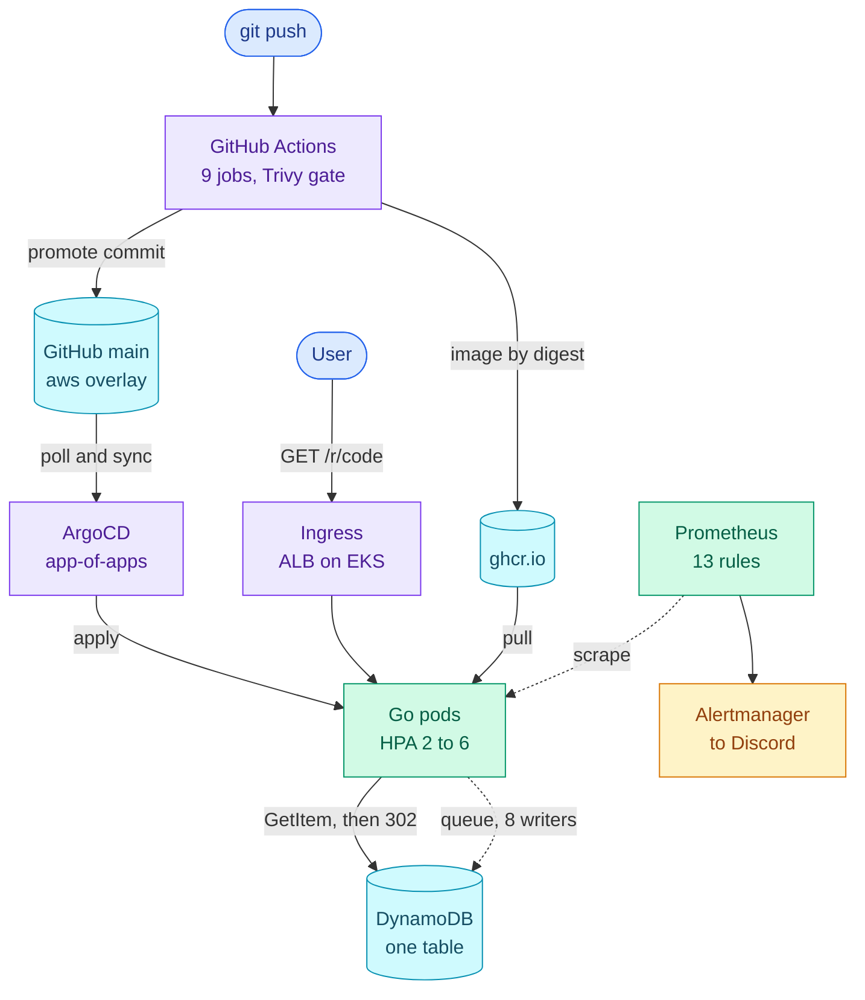

LinkPulse is the project I lead with for DevOps, SRE, platform and cloud roles. The service in the middle is a URL shortener with click analytics, a Go API over one DynamoDB table. The work is everything around it: Terraform for four environments, Kubernetes deployed by ArgoCD, Prometheus, Grafana and Loki watching it, five chaos experiments that cause the failures the alerts claim to catch, and twelve hours on EKS against real DynamoDB for $3.32.

The repo is [github.com/rishabh0111/linkpulse](https://github.com/rishabh0111/linkpulse) and the public write-up is [I built a production-grade DevOps platform end to end, then broke it on purpose on real AWS](/blogs/production-grade-devops-platform/). This page is the private half: what an interviewer will ask, and the answer I can defend line by line.

## How to use this page

Read it in three passes.

1. **Learn the story.** The pitch, the walkthrough and the three paths (a redirect, a click write, a code change). If I can draw the diagram from memory and narrate the deploy path without notes, the rest hangs off it.
2. **Fill the gaps.** The prerequisites section is the theory each decision rests on. If a line there isn't obvious, that's the topic to read up on before the interview, because the probe next to it is the one that comes.
3. **Rehearse out loud.** Cover the model answers and answer each question in under 90 seconds, then compare. The self-test at the end is the 20 hardest; if I can do those cold, I'm ready.

Three rules for every answer:

- **Decision, alternative, trade-off.** "I did X. I considered Y and rejected it because Z. The cost of X is W, and here's when I'd switch."
- **Numbers only from the repo.** Every number on this page is in the repo, the master profile or the write-up. If I don't know a number, I say I didn't measure it.
- **Own what wasn't built.** No SLO document, no canary, no multi-region, no on-call rotation. Saying so plainly, then saying how I'd do it, scores higher than a vague yes.

---

## What to say

### The 30-second pitch

> LinkPulse is a URL shortener I built to practise operating a system, not just building one. The service is small on purpose: a Go API over a single DynamoDB table. Around it I built the platform: Terraform for four environments, Kubernetes deployed through ArgoCD, Prometheus, Grafana and Loki, and five chaos experiments that cause the exact failures my thirteen alert rules claim to catch. Four of them run in CI on every push. Then I ran the whole stack for twelve hours on EKS against real DynamoDB, which found thirteen defects no local run could, for $3.32.

### The 2-minute walkthrough

Follow the diagram in the next section while saying this.

> The product decision that shapes everything is that a redirect never waits for analytics. `GET /r/{code}` does one eventually consistent `GetItem`, answers `302`, and only then puts the click on an in-memory queue that eight workers drain into DynamoDB. So when DynamoDB throttles, users don't see it: clicks get dropped and counted, and the alerting is built around the drop counter, not latency.
>
> The table is a single-table design written before any code: seven access patterns, one sparse GSI, and the daily click counter sharded sixteen ways because every click on a viral link would otherwise hit one key. Capacity sits at exactly the always-free 25/25, enforced by a Terraform validation.
>
> Infrastructure is Terraform: five modules, four environments. LocalStack runs in CI with apply, an empty re-plan, and destroy on every push. The metered EKS environment has its own state file, so `terraform destroy` on it physically can't reach the table.
>
> Delivery is GitOps. CI runs nine jobs: Go tests, Terraform checks, manifest renders, shellcheck, a Trivy gate on HIGH and CRITICAL, a multi-arch image pushed by digest, and a 50-to-56-minute end-to-end job that builds a three-node k3d cluster and runs load, four chaos experiments and a backup restore. A promote job then commits the tested digest into the aws Kustomize overlay, and ArgoCD syncs it from GitHub.
>
> For reliability, every alert has a runbook entry and an experiment. The experiments found two rules that were loaded and "healthy" but mathematically could never fire, which I wrote up as a blameless postmortem.
>
> On real AWS, the headline result: with nothing injected, DynamoDB throttled 6.6 writes a second, both alerts fired 30 seconds after the first drop, and 7,202 requests saw zero failures with redirect p99 at 7 ms against 5 ms before. Two experiments failed on AWS, and I kept them as failures, because they taught me that N+1 on EKS is counted in pod slots and that IAM propagation is eventually consistent per session.

### How to tilt it per audience

| Interviewer | Lead with | Have ready |
| --- | --- | --- |
| DevOps / platform | four Terraform environments, the separate burst state, GitOps promotion by digest | app-of-apps and sync waves, the ArgoCD health Lua, the EndpointSlice exclusion |
| SRE | alerts proven by chaos, the two dead rules and the postmortem, the async click path | runbook per alert, inhibition, liveness vs readiness, the chaos 3 and 5 failures on AWS |
| Cloud / AWS | the $3.32 burst, IRSA, public-subnet nodes without NAT, Budgets with credits excluded | VPC CNI pod cap, the orphaned-ALB teardown, untagged spend |
| Kubernetes | probes split, PDB `maxUnavailable: 1`, HPA owning replicas, no CPU limit | priority classes, taint eviction at 300 s, `preStop` sleep on a distroless image |
| Security | IRSA with a `sub`-scoped trust policy, explicit `Scan` deny, Sealed Secrets, distroless + Trivy | PSA `restricted`, scoped CI permissions, what is missing (auth, image signing) |
| Backend (Go) | non-blocking enqueue with `select`/`default`, graceful shutdown order, 400 vs 500 split | conditional put for code collisions, sharded counters, metric cardinality |
| System design | read path vs write path asymmetry, hot partition and sharding | scaling to 100x, caching, multi-region |
| Engineering manager | scope discipline, runbook written before the metered window, failures recorded as failures | cutting 72 hours to 12, the postmortem's lesson, what I'd do next |

---

## Architecture end to end

Locally the same picture runs on a three-node k3d cluster (one server, two agents, k3s 1.34.5), Traefik is the ingress, DynamoDB is LocalStack 4.14 reached through a selectorless Service, and ArgoCD reads a Gitea container instead of GitHub. The aws overlay differs from the local one in three things: an ALB ingress class, an IRSA annotation on the ServiceAccount, and no Secret.

### Path of one redirect

1. The browser sends `GET /r/aB3xK9q` to the ALB (internet-facing, `target-type: ip`, so it sends straight to pod IPs, and it health-checks `/readyz`).
2. The pod's `ServeMux` routes it through the `instrument` middleware, which records the RED metrics under the fixed label `route="redirect"`, not the path, so random codes can't explode cardinality.
3. `shortid.Valid` rejects anything that isn't 1 to 32 base62 characters with a `404` before it costs a read.
4. One `GetItem` on `PK=LINK#<code>, SK=META`, `ConsistentRead: false`: one round trip, 0.5 RCU, no index.
5. Not found is `404`. A store error is `503` ("temporarily unavailable"). An inactive link is `410`.
6. The click is enqueued with a non-blocking `select`: if the 2,048-slot channel is full, the click is counted as `clicks_dropped_total{reason="queue_full"}` and the redirect carries on.
7. `302 Found` goes back. Not `301`, because a browser caches a permanent redirect and a cached redirect records no click.

The redirect's latency is DynamoDB's read latency plus the ingress. Nothing else is on that path.

### Path of one click write

1. One of eight worker goroutines takes the job off the channel and opens a context with a 5-second timeout. Without it, a throttled call plus SDK backoff could hold a worker long enough to back the queue up on its own.
2. `PutItem` of the CLICK item: `PK=LINK#<code>, SK=CLICK#<RFC3339 nanos>#<4 random bytes hex>`, with `expiresAt` set 30 days out for TTL.
3. Only if that succeeds: `UpdateItem ADD count :one` on `SK=STAT#<YYYY-MM-DD>#<shard>`, where the shard is `crypto/rand` over 16, zero-padded to four digits.
4. The SDK is capped at 2 attempts, so a sustained throttle surfaces to the app instead of hiding behind backoff.
5. The worker classifies the result: success increments `clicks_recorded_total`; a throttle increments `clicks_dropped_total{reason="throttled"}`; anything else is `reason="error"` and a log line.
6. Every DynamoDB call goes through one wrapper that records latency, result and throttles by operation.

Each click costs 2 WCU. Against 20 WCU provisioned, that's a ceiling of about 10 clicks a second, which is why the throttle experiment is reproducible on a free account.

### Path of one code change, from `git push` to a running pod on EKS

1. **Push to `main`.** CI starts. A newer push to the same ref cancels the run in flight (`concurrency`, `cancel-in-progress`).
2. **Cheap checks fan out in parallel:** `app` (gofmt, `go vet`, `go test -race -mod=readonly`), `terraform` (fmt and validate, four environments), `manifests` (render every kustomization, the aws overlay included), `scripts` (shellcheck `-s sh`, Python byte-compile, PowerShell parse), `terraform-apply` (apply, plan with `-detailed-exitcode` that must be empty, destroy, all on LocalStack), and `scan` (build, then Trivy HIGH/CRITICAL with `--ignore-unfixed`, after `app`).
3. **`image`** needs all six. It builds `linux/amd64` and `linux/arm64` with Buildx, pushes to `ghcr.io/rishabh0111/linkpulse` with an SBOM and a provenance attestation, and exports the digest. It is the only job with `packages: write`.
4. **`e2e`** runs beside it (it only needs `app`, `terraform`, `manifests`): reclaims runner disk, starts LocalStack, creates the table with Terraform, builds and side-loads the image into a three-node k3d cluster, installs cert-manager and Sealed Secrets, deploys, asserts the HPA owns two ready replicas, then smoke over verified TLS, the monitoring stack, the 29-assertion observability check, the TLS check, the Sealed Secrets round trip, the k6 baseline, chaos 3, 1, 4 and 5, and a backup that destroys and restores the table.
5. **`promote`** needs `image` and `e2e`, runs only on the default branch, and is the only job with `contents: write`. `scripts/promote-image.sh` rewrites two lines of `k8s/manifests/overlays/aws/kustomization.yaml` (`newName` and `digest`). It commits only if `main` is still the commit it built, and it pushes with `GITHUB_TOKEN`, which by GitHub's rule starts no new workflow run, so promotion can't loop.
6. **ArgoCD** on EKS polls GitHub (`timeout.reconciliation: 60s`). The root Application points at `gitops/argocd/apps/aws`; the `linkpulse` Application points at `k8s/manifests/overlays/aws`, with `prune` and `selfHeal`.
7. **Kustomize renders** the base plus the overlay. The image becomes `ghcr.io/rishabh0111/linkpulse@sha256:...`. The ConfigMap name carries a content hash, so a config change also changes the pod template.
8. **The Deployment rolls**: `maxSurge: 1`, `maxUnavailable: 0`. One new pod is scheduled; the node pulls the image anonymously (the ghcr.io package is public, so there's no pull secret).
9. **The new pod comes up**: the startup probe (`/healthz`, every 2 s, 15 failures allowed), then readiness (`/readyz`, a `DescribeTable` through IRSA credentials, cached 2 s). Once ready, it joins the Service endpoints and the ALB registers its IP.
10. **An old pod leaves**: its endpoint is removed and the `preStop` hook sleeps 5 s while routing catches up; then SIGTERM. The process stops accepting connections, drains the click queue for up to 15 s, and exits, all inside the 40 s grace period.
11. If the new pod never becomes ready, nothing old is removed. After `progressDeadlineSeconds: 120` the Deployment reports `ProgressDeadlineExceeded`, ArgoCD shows Degraded, and `LinkpulseRolloutStalled` fires a minute later. The fix is `git revert`.

### The four Terraform environments

| Environment | State | Holds |
| --- | --- | --- |
| `local` | local, disposable | LocalStack; apply, empty re-plan, destroy in CI on every push |
| `bootstrap` | local, backed up outside the repo | the S3 state bucket: versioned, SSE-S3, TLS-only policy, public access blocked |
| `aws` | S3, `aws/terraform.tfstate` | always free: the table at 20/20 + 5/5, IAM, VPC with no NAT, budgets |
| `aws-burst` | S3, `aws-burst/terraform.tfstate` | EKS, node group, IRSA roles, ALB controller role; reads `aws` through `terraform_remote_state` |

---

## Prerequisites to know cold

Each entry: what it is, why it matters in LinkPulse, and the probe it invites.

### Terraform

**State.** Terraform's record of which real resource each block in the config corresponds to, with every attribute. It's how `plan` computes a diff instead of guessing.
*Here:* state lives in S3 per environment (`aws/terraform.tfstate`, `aws-burst/terraform.tfstate`); `bootstrap` keeps local state because it creates the bucket the others need. The IAM access key is deliberately not a Terraform resource, because `aws_iam_access_key` writes the secret into state in plaintext.
*Probe:* "What's in your state file that you wouldn't want leaked?" Every attribute, including generated secrets. That's why the bucket is encrypted, versioned, TLS-only and blocked from public access.

**Locking.** A lock stops two applies writing the same state at once.
*Here:* S3 native locking (`use_lockfile`), which writes a `.tflock` object with a conditional write. I didn't use a DynamoDB lock table: the backend's `dynamodb_table` argument is deprecated, and a second table would take a slice of the account-wide 25/25 free allowance that the app table and the throttle experiment depend on.
*Probe:* "What happens if an apply dies mid-run?" The lock object stays; `terraform force-unlock` releases it. The bucket's lifecycle rule doesn't release live locks.

**Workspaces vs separate states.** Workspaces are several state files for one configuration and one backend, selected at run time. Separate directories each have their own configuration and their own backend key.
*Here:* separate directories. My environments differ in what they contain, not just in values: `local` has no EKS (LocalStack can't run it), `aws` has budgets and the table, `aws-burst` has the cluster. And the safety property, that destroying the burst can't touch the table, comes from the table not being in the burst's state at all.
*Probe:* "Why not workspaces?" Covered in the question bank.

**Plan, apply, drift, idempotent re-plan.** `plan` diffs config against state and reality; `apply` executes it; drift is reality changed outside Terraform; an idempotent configuration produces an empty plan right after an apply.
*Here:* CI runs `plan -detailed-exitcode` after apply, which exits 2 on any change. That check found the AWS provider 6.13 / LocalStack regression. On the real account every apply ran from a saved plan I read first.
*Probe:* "What does a non-empty plan right after apply mean?" A resource fighting its own definition: a default the provider rewrites, or an attribute the API drops. Every future apply would "change" it forever.

**Modules and remote state.** A module is a reusable unit with inputs and outputs; `terraform_remote_state` reads another state's outputs.
*Here:* five modules (`dynamodb-table`, `iam`, `s3-state`, `vpc`, `eks`). `aws-burst` reads subnet IDs and the table ARN from `aws` instead of hardcoding them, and calls the same `iam` module a second time with the OIDC provider to make an IRSA role.
*Probe:* "Isn't remote state coupling?" Yes, one-way and read-only. The burst depends on the base; the base knows nothing about the burst.

**Validation.** Variable `validation` blocks fail at plan time.
*Here:* the table module refuses any read or write capacity where table plus index exceeds 25, because the free allowance is per account and includes the index.

### AWS networking, compute and identity

**VPC, subnets, route tables.** A VPC is a private network; a subnet is a slice of it in one AZ; a subnet is "public" only because its route table sends `0.0.0.0/0` to an internet gateway.
*Here:* a /16 with /20 subnets in two AZs (EKS requires at least two), public and private tiers, one private route table per AZ, a locked-down default security group with no rules, a stateless NACL on the private tier with ephemeral ports for return traffic, and free gateway endpoints for DynamoDB and S3.
*Probe:* "Why /20s?" The VPC CNI gives every pod a VPC address, so a subnet sized for nodes runs out of IPs with pods stuck in ContainerCreating.

**NAT gateway.** Lets private subnets reach the internet outbound. It bills hourly plus per GB, used or not.
*Here:* off. Private nodes would need it to pull images: about $3.24 over a 72-hour window before data, against about $0.72 for two public IPv4 addresses. The DynamoDB gateway endpoint keeps the data path inside AWS in either tier.
*Probe:* "So your nodes are on the internet?" They have public IPs; the node security group admits nothing inbound except the control plane and the ALB. Full answer in the security questions.

**ALB and the Load Balancer Controller.** An L7 load balancer. On EKS, an in-cluster controller watches Ingress objects and creates ALBs, target groups and listeners through the AWS API.
*Here:* installed with Helm, with its own IRSA role (the vendored upstream policy, the widest grant in the account after the operator's). `target-type: ip`, health check on `/readyz`, one shared ALB via `group.name: linkpulse`, and `group.order: "100"` so the app's catch-all rule sorts after the monitoring host rules.
*Probe:* "Who deletes that ALB?" The controller, when the Ingress goes away. Terraform never knew about it, which is why the teardown script waits for every ALB tagged for the cluster to disappear before `terraform destroy`.

**EKS control plane vs nodes.** AWS runs the API server and etcd (billed $0.10/hour); I run the nodes (EC2 in a managed node group).
*Here:* EKS 1.34, `authentication_mode = "API"` (access entries, not the legacy `aws-auth` ConfigMap), control-plane logs `api` and `authenticator` only (audit is the high-volume stream), four `t3.small` ON_DEMAND nodes, addons `vpc-cni`, `kube-proxy`, `coredns` declared in Terraform.
*Probe:* "Why on-demand, not spot?" Spot would have saved about $2 over the planned window; an interruption mid-experiment costs more than that.

**VPC CNI pod limits.** Each pod gets a real VPC IP from the node's ENIs, so pods per node is `ENIs × (IPs per ENI − 1) + 2`. A `t3.small` has 3 ENIs of 4 IPs: 11 pods.
*Here:* the binding constraint of the whole burst. Two `t3.small` gave 22 slots against about 30 pods; eight monitoring pods sat Pending with "Too many pods" while both nodes were at half their memory. Four nodes fixed it.
*Probe:* "How would you avoid it?" Prefix delegation, a larger instance type, or counting slots in capacity planning. More in the question bank.

**IAM, IRSA and OIDC.** IRSA lets a pod assume an IAM role: EKS publishes an OIDC issuer, IAM trusts it as an identity provider, a webhook injects a projected service-account token, and the SDK exchanges it with `sts:AssumeRoleWithWebIdentity` for short-lived credentials.
*Here:* the trust policy requires both `aud = sts.amazonaws.com` and `sub = system:serviceaccount:linkpulse:linkpulse`. Three roles, one per workload: the app, the CloudWatch exporter, the ALB controller.
*Probe:* "What if you only check `aud`?" Any service account in the cluster can assume the role.

**Least privilege.** Grant only what the code calls.
*Here:* the app policy allows exactly `GetItem`, `PutItem`, `UpdateItem` on the table, `Query` on the table and GSI1, and `DescribeTable` for readiness. It explicitly denies `Scan`, `DeleteItem`, `DeleteTable`, `UpdateTable`, `UpdateTimeToLive` and `CreateTable`. An explicit deny beats any allow from another policy.
*Probe:* "Why deny `Scan` if it's already implicitly denied?" So no later attached policy can add it by accident; one `Scan` would read every click item and exhaust the 25 RCU allowance.

**AWS Budgets and cost tags.** Budgets alert on actual or forecast cost; cost allocation tags group spend once activated (not retroactively).
*Here:* three budgets: `linkpulse-burst-ceiling` ($25, alerts at 50% and 80% actual and 100% forecast), `linkpulse-tripwire` ($1, alerts at 1% actual, which is one cent, and 100% forecast), and a zero-spend budget. All with `include_credit = false`, because on a credit-funded account the default net view reads $0.00 and nothing can ever fire.

### DynamoDB

**Partition key, sort key, item collections.** The partition key (PK) picks the partition by hash; the sort key (SK) orders items within it. Items sharing a PK are read together with `Query`.
*Here:* every item is rooted at `LINK#<code>`: `META` for the link, `CLICK#<ts>#<rand>` for each click, `STAT#<day>#<shard>` for the daily counter. GSI1 is `USER#<owner>` / `CREATED#<ts>`, sparse (only LINK items carry it), projecting just `longUrl` and `active`.
*Probe:* "Why a random suffix on the click SK?" Two clicks in the same nanosecond would otherwise overwrite each other.

**Hot keys and write sharding.** A partition sustains 1,000 WCU and 3,000 RCU regardless of the table's provisioning, so one popular key throttles even if the table has spare capacity. Write sharding spreads one logical key over N physical keys and sums on read.
*Here:* `CLICK_SHARDS=16`, random shard per write, a `BETWEEN STAT#<from>#0000 AND STAT#<to>#~` range query that covers every shard without knowing the count. It's configuration, so the same binary runs at 1 or 16.
*Probe:* "Did sharding make a difference on your table?" Honestly, not at 20 WCU: the table's ceiling binds long before a partition's. See the question bank.

**RCU and WCU.** One RCU is one strongly consistent read per second of up to 4 KB, or two eventually consistent reads. One WCU is one write per second of up to 1 KB.
*Here:* a redirect is 0.5 RCU; a link create is 1 WCU on the table plus 1 on GSI1; a click is 2 WCU.

**Burst credits.** DynamoDB banks up to 300 seconds of unused provisioned capacity and spends it during spikes.
*Here:* on real AWS, 40 WCU/s against a 20 WCU table ran unthrottled for about five minutes, then clamped to exactly 20 in CloudWatch.
*Probe:* "Why didn't it throttle immediately?" That's the answer.

**Throttling.** Over capacity, DynamoDB returns `ProvisionedThroughputExceededException` (or a throttling error code); the SDK retries with backoff by default.
*Here:* `IsThrottle` checks the typed exceptions and four API error codes, because LocalStack and real DynamoDB don't always surface the same one. Max attempts is 2 so the app sees sustained throttling.

**On-demand vs provisioned.** On-demand bills per request and absorbs spikes; provisioned bills per hour of capacity and throttles above it.
*Here:* provisioned, because on-demand has no free tier and provisioned capacity physically can't bill more than I set. The ceiling is also the chaos tool.
*Probe:* "In production?" On-demand for spiky, unknown traffic; provisioned with autoscaling once traffic is predictable. Covered below.

**TTL, conditional writes, consistency.** TTL deletes expired items for free in the background; a `ConditionExpression` makes a write fail atomically if the condition is false; eventually consistent reads cost half.
*Here:* clicks expire after 30 days (the sharded aggregate is the durable record); link creation uses `attribute_not_exists(PK)` and retries a fresh code up to 3 times; redirects read eventually consistent.

### Kubernetes

**Deployments and ReplicaSets.** A Deployment manages ReplicaSets; each pod-template change creates a new ReplicaSet and the rolling update moves pods between them.
*Here:* no `replicas` field in the Deployment, so the HPA is the single owner (otherwise ArgoCD and the HPA fight forever). `revisionHistoryLimit: 3`, `maxSurge: 1`, `maxUnavailable: 0`, `progressDeadlineSeconds: 120`.
*Probe:* "What does `maxUnavailable: 0` buy you?" A bad image stalls instead of replacing healthy pods.

**Services and Ingress.** A Service is a stable virtual IP over ready pods (its endpoints); an Ingress is L7 routing into Services, implemented by a controller.
*Here:* ClusterIP only (a NodePort would be a second, unmonitored way in), a named `targetPort`, and an Ingress with a host rule plus a hostless rule so in-cluster clients and CI can hit it without DNS tricks.

**Probes: startup, liveness, readiness.** Startup gates the other two during boot. Liveness failing restarts the container. Readiness failing removes the pod from endpoints without restarting it.
*Here:* liveness is `/healthz` and checks only the process. Readiness is `/readyz` and calls `DescribeTable`, cached 2 s, bounded by its own 2 s timeout. Pinned by `TestLivenessIgnoresStoreOutage` and `TestReadinessFailsOnStoreOutage`.
*Probe:* "What if liveness checked the database?" A dependency outage becomes a restart loop on every pod at once.

**PodDisruptionBudgets.** Limit voluntary disruptions (drains, evictions), not crashes or node failures.
*Here:* `maxUnavailable: 1`, not `minAvailable: 2`. With the HPA sitting at 2, `minAvailable: 2` allows zero evictions and a drain hangs forever.

**HPA.** Scales replicas on a metric; CPU utilization is measured against the pod's request.
*Here:* 2 to 6 replicas, 70% of a 100m request, scale up immediately (100% per 30 s), scale down slowly (300 s window, one pod a minute). EKS ships no metrics-server; without it the HPA read `cpu: <unknown>`.

**Priority classes, preemption, taints and evictions.** A higher-priority pod can preempt lower ones to schedule. A NotReady node gets a `NoExecute` taint, and pods are evicted after their toleration (300 s by default).
*Here:* Alloy and node-exporter DaemonSets run as `system-node-critical`, added after ordinary pods filled two EKS nodes first and left them with no metrics or logs. Chaos 5 measured the 300 s taint eviction: 285 s below the replica minimum by Prometheus's samples.

**DaemonSets.** One pod per node.
*Here:* node-exporter (host metrics) and Alloy (tails `/var/log/pods` for its own node only, ships to Loki).

**Requests, limits, OOMKilled.** Requests drive scheduling (and the HPA's denominator); a memory limit triggers the OOM killer; a CPU limit triggers CFS throttling.
*Here:* 100m CPU and 48Mi memory requested, 128Mi memory limit, no CPU limit. CPU throttling at a quota boundary causes p99 spikes on an idle node; memory has no throttle, only the kill, so it's capped.

**CrashLoopBackOff.** The kubelet restarts a crashing container with backoff of 10, 20, 40, 80 seconds, capped at 5 minutes.
*Here:* `LinkpulseCrashLooping` has `for: 1m`, so it fires after the fifth kill, the first backoff longer than a minute. The test harness had to watch inside the backoff gap, because the waiting reason clears on restart.

**Pod Security Admission.** Namespace labels enforce `privileged`, `baseline` or `restricted`.
*Here:* `linkpulse` is `restricted` (non-root 65532, no privilege escalation, all capabilities dropped, seccomp RuntimeDefault, read-only root filesystem). `monitoring` is `privileged` because node-exporter and Alloy need host access.

**Graceful shutdown.** Endpoint removal and SIGTERM happen concurrently, so a pod can get traffic after SIGTERM.
*Here:* a native `sleep` `preStop` action of 5 s (the distroless image has no `sleep` binary, so the usual `exec` form would fail), then 15 s to drain clicks, inside a 40 s grace period. Leftovers are counted as `reason="shutdown"`.

### GitOps and delivery

**GitOps and ArgoCD.** The cluster's desired state is git; a controller pulls and reconciles. `prune` deletes what git removed; `selfHeal` reverts manual changes.
*Here:* ArgoCD 3.5, vendored install manifest applied server-side (the ApplicationSet CRD is too big for client-side apply's annotation), `prune` and `selfHeal` everywhere, `dex` and notifications scaled to zero.

**App-of-apps and sync waves.** One root Application whose manifests are other Applications; waves order sync by annotation.
*Here:* waves −3 (platform project), −2 (cert-manager, Sealed Secrets), −1 (linkpulse project, namespace), 0 (app), 1 (monitoring, HPA, PDB, Ingress). Waves only wait if the parent judges a child's health, so a custom Lua health check holds a child at Progressing until its sync has finished and it is Synced.

**AppProjects.** Restrict which repos, namespaces and cluster-scoped kinds an Application may touch.
*Here:* two. `linkpulse` can create only three cluster-scoped kinds: Namespaces, ClusterRoles and ClusterRoleBindings (Prometheus, kube-state-metrics and Alloy read the whole cluster). `platform` can also create CRDs, webhook configurations and ClusterIssuers.

**Kustomize overlays.** A base plus patches per environment, no templating.
*Here:* base is the AWS shape (no `DDB_ENDPOINT`); `local` adds LocalStack, credentials fixtures and the leak flag; `aws` adds the ALB class, IRSA and the digest. `configMapGenerator` hashes config into the name so a value change rolls pods.

**Image digests and promotion.** A tag is a mutable pointer; a digest is the content hash.
*Here:* CI pins the aws overlay to `@sha256:...` only after `e2e` passed, so "which build is running" has one answer.

**cert-manager.** Issues and renews certificates from Issuer resources.
*Here:* a self-signed ClusterIssuer bootstraps an ECDSA CA certificate, which backs a CA ClusterIssuer; every Ingress gets a certificate by annotation. Chosen over mkcert because `mkcert -install` writes to the host trust store.

**Sealed Secrets.** A controller holds a private key; `kubeseal` encrypts with the public certificate offline, and only that cluster can decrypt.
*Here:* the Discord webhook and the Grafana admin password on EKS. The key is backed up outside the repo and restored before the controller starts, so a rebuilt cluster can still decrypt the committed values.

### Observability

**Prometheus data model.** A series is a metric name plus a label set; counters only go up, gauges move, histograms count observations into `le` buckets. `rate()` turns counters into per-second rates; `histogram_quantile` estimates quantiles from buckets.
*Here:* `linkpulse_http_requests_total{route,method,code}`, `linkpulse_http_request_duration_seconds`, `linkpulse_clicks_dropped_total{reason}`, `linkpulse_dynamodb_throttles_total{op}`, `linkpulse_ready`, `linkpulse_click_shards`. Closed label sets are seeded at zero on startup so `rate()` returns 0 instead of no data.

**PromQL vector matching.** A binary operator between two vectors matches series with identical label sets unless you say `on (...)` or `ignoring (...)`; `group_left` allows many-to-one.
*Here:* the root cause of the postmortem. Two rules divided or compared series from different exporters with a bare operator, matched nothing, and could never fire. Fixed with `/ on (namespace, pod, container) group_left` and `< on (namespace)`.

**Alert rules.** An expression plus `for:` (how long it must be true) plus labels and annotations.
*Here:* 13 rules in five experiment groups plus a general group. Every rule has a `runbook` annotation pointing at an anchor in `docs/runbook.md`.

**Alertmanager.** Groups, routes, deduplicates, silences and inhibits.
*Here:* one Discord receiver, URL read from a mounted Secret file, `group_by: [alertname, experiment]`, `group_wait` 10 s. Two inhibitions: `LinkpulseNoReadyPods` suppresses per-pod `LinkpulseNotReady`; `LinkpulseCrashLooping` suppresses the OOM and memory warnings for the same pod.

**Grafana, Loki, Alloy.** Grafana for dashboards; Loki stores logs indexed by labels only; Alloy is the agent that replaced Promtail (end of life in early 2026).
*Here:* three dashboards (41 panels) committed as JSON, an in-cluster image renderer, structured JSON logs from Go's `slog` so Loki can filter by field. Prometheus keeps 2 days, Loki 48 hours.

**SLI, SLO, error budget.** An SLI is a measured ratio (good events over all); an SLO is the target; the error budget is 1 minus the SLO, spent by failures.
*Here:* honestly not formalised. The alert thresholds (5% 5xx, 250 ms redirect p99) and the k6 thresholds play that role. How I'd formalise it is in the question bank.

### Reliability practice, load and cost

**Chaos engineering.** Form a hypothesis about steady state, inject one fault, observe, restore.
*Here:* each experiment is a script with phases (pre, during, post), asserts through Prometheus, Alertmanager and the Kubernetes API only, writes a timeline, renders panels, and ends with the observability check.

**Blameless postmortem.** Focus on why the system let the mistake through, not who made it; action items with owners and status.
*Here:* `docs/postmortem.md`, "two alerts that could never fire".

**CI/CD and supply chain.** Build once, scan, sign or attest, deploy the exact artifact.
*Here:* Trivy gate, distroless static image of about 15 MB, SBOM and provenance from Buildx, digest promotion, scoped `GITHUB_TOKEN` permissions per job. Not built: image signing and admission-time verification.

**k6.** A load generator. Open-model executors (`constant-arrival-rate`) keep sending at a fixed rate whether or not responses return, so a slow server shows up as latency, not as a quietly lower request count.
*Here:* `baseline.js` (20 redirects/s plus 2 GraphQL/s for two minutes, thresholds as the verdict) and `throttle.js` (20 redirects/s on one link).

**Cost controls.** Budgets, tags, audits, teardown order.
*Here:* `metered-resources.py --expect-none` lists everything that bills by the hour and fails if anything exists; `cost-report.py` reads Cost Explorer by service and by tag.

---

## Question bank

Each question has a model answer in my own voice and the follow-ups it tends to trigger.

### DevOps and platform

**Q1. Walk me through your Terraform layout. Why four environments?**

I have five modules and four environments, and each environment exists for a different reason. `local` targets LocalStack and runs in CI on every push: apply, a plan that must be empty, then destroy. `bootstrap` creates the S3 state bucket and keeps its own state locally, because it can't store state in a bucket that doesn't exist yet. `aws` is the always-free baseline: the table, IAM, the VPC without NAT, and the budgets. `aws-burst` is everything that bills by the hour: EKS, the node group, the IRSA roles. The split between the last two is the important one: the burst has its own state file and reads the base through `terraform_remote_state`, so `terraform destroy` on the burst is incapable of deleting the table.

*Follow-ups:*
- *Why does `bootstrap` use local state?* Chicken and egg. I backed that state file up outside the repo, because it's the only one with nowhere else to live.
- *How do the environments share config?* Through modules. The burst calls the same `iam` module as `aws`, with the OIDC provider set, so the pod's permissions on EKS are byte-identical to the local ones.

**Q2. Why not Terraform workspaces?**

Workspaces give you several states for one configuration. My environments aren't the same configuration with different values; they contain different resources. `local` can't contain EKS because LocalStack doesn't implement it; `aws` has the budgets and the table; `aws-burst` has the cluster. More importantly, the safety property I wanted is structural: the table is not in the burst's state at all, so no destroy of the burst can reach it. With workspaces the guard would be "I selected the right workspace", which is exactly the mistake people make under time pressure at the end of a metered window. Separate directories also make the backend key visible in each environment's `versions.tf`.

*Follow-ups:*
- *When would you use workspaces?* Identical stacks that differ only in variables, like per-developer sandboxes.
- *Doesn't that duplicate code?* The duplication is a few lines of module calls; the logic lives in the modules.

**Q3. How is state locked, and why not a DynamoDB lock table?**

The S3 backend with `use_lockfile`, which takes the lock by conditionally writing a `.tflock` object next to the state. S3 conditional writes are strongly consistent, so a second apply fails to create the lock rather than racing. I deviated from the classic S3-plus-DynamoDB pattern for two reasons: the `dynamodb_table` argument is deprecated in current Terraform, and a second DynamoDB table would eat part of the account's 25/25 free capacity, which the app table and the throttle experiment need to themselves.

*Follow-ups:*
- *What protects the state itself?* Versioning (restore a previous version if it's corrupted), SSE-S3 encryption, a bucket policy that denies non-TLS access, a public access block, ACLs disabled with `BucketOwnerEnforced`, and noncurrent versions expiring after 90 days.

**Q4. How do you detect drift and prove idempotency?**

In CI, `terraform-apply` runs apply, then `plan -detailed-exitcode`, which exits 2 if the plan isn't empty, then destroy. A non-empty plan right after an apply means a resource fights its own definition. That check caught a real regression: AWS provider 6.13 and later created the DynamoDB table and then couldn't find it on LocalStack. I bisected it: 6.12.0 last good, 6.13.0 first bad. I first pinned the provider, then found LocalStack 4.14 fixed it, so the real constraint was a floor on LocalStack, not a ceiling on the provider. A provider pin would have broken real AWS while CI stayed green, which is the worst shape of failure.

*Follow-ups:*
- *What about drift on the real account?* I didn't run scheduled drift detection there. Every real apply ran from a saved plan I read first. For a long-lived environment I'd run a scheduled `plan -detailed-exitcode` and alert on exit 2.
- *Why test destroy?* It's the command run under the most pressure, at the end of the metered window, so it's the one that must be known to work.

**Q5. Why Kustomize and not Helm?**

One application, two environments, and about four values that differ. Helm would bring in a templating language to substitute four values, plus a chart version to pin. Kustomize is built into `kubectl apply -k`, ArgoCD renders it natively, and an overlay is plain YAML that reads like the thing it produces. The aws overlay is short enough to read in a minute, which was the point: everything environment-specific in one place. I did use Helm once, for the AWS Load Balancer Controller, because that's how upstream ships it and I'm consuming it, not authoring it.

*Follow-ups:*
- *When would you switch?* When I'm distributing the app to other teams with many configurable knobs, or when the number of environments makes patches harder to read than values.
- *Any Kustomize gotchas you hit?* `includeSelectors: false` on common labels, because a Deployment's selector is immutable and a label change would otherwise break the next apply. And strategic-merge patches replace `envFrom` wholesale, so the local patch restates the ConfigMap reference.

**Q6. Why ArgoCD and not Flux?**

I didn't run a side-by-side comparison, so I won't pretend I did. What made ArgoCD a good fit: the Application health model is something I asserted on directly (chaos 2 waits for the Application to go Degraded); AppProjects gave me a blast-radius boundary between the app and the platform; and the app-of-apps with sync waves expresses install order in git. Flux would do the same job with Kustomization and HelmRelease resources and no UI. If a team already ran Flux, I'd use Flux; the transferable parts (git as truth, prune, self-heal, promotion by commit) are the same.

*Follow-ups:*
- *What surprised you about ArgoCD?* Two things on a from-scratch build: ArgoCD 3 excludes EndpointSlices by default, so my hand-written slice to LocalStack was silently never applied; and sync waves didn't actually wait, because the documented health check for child Applications reports Healthy mid-sync.

**Q7. Explain your app-of-apps and the sync-wave fix.**

One root Application, applied by hand once, points at `gitops/argocd/apps/aws` (or `apps/local`). That directory holds the two AppProjects and four Applications: cert-manager and Sealed Secrets at wave −2, the app at 0, monitoring at 1. Waves only order things if the root can tell when a child is done. ArgoCD removed child Application health from its defaults, and the snippet in its docs reads only the child's reported health, which is Healthy as soon as what's applied so far is healthy. On a fresh cluster the app started syncing 5 seconds into cert-manager's 20-second sync, and the TLS step found no CA. My Lua holds a child at Progressing while its operation is Running and until it's Synced, and only then reports the child's own health.

*Follow-ups:*
- *Why does the root use the `default` project?* It creates the `linkpulse` project, so it can't be a member of it.

**Q8. How does an image get from CI to EKS?**

The `image` job pushes a multi-arch image to ghcr.io and exports the digest. After `e2e` passes on `main`, `promote` runs `promote-image.sh`, which rewrites the two image lines in the aws overlay, commits and pushes. ArgoCD on EKS sees the new commit within its reconciliation interval and rolls the Deployment. Nobody edits a tag.

*Follow-ups:*
- *Why digest and not tag?* Tags are mutable; two clusters can resolve the same tag to different bytes. A digest is the content.
- *Why doesn't the promote commit trigger CI forever?* It's pushed with `GITHUB_TOKEN`, and GitHub doesn't start workflow runs for those pushes. The cost is that the promotion commit gets no run of its own, so the script renders the overlay itself as a stand-in check.
- *What if two pipelines race?* The job fetches `main` and refuses to promote if `main` has moved past the commit it built, so an older build can't overwrite a newer one. A push that loses the remaining race fails non-fast-forward.

**Q9. How do you roll back?**

`git revert` of the bad commit, pushed. ArgoCD syncs the revert, the bad ReplicaSet scales to zero, the Deployment reports `NewReplicaSetAvailable`. In chaos 2 that took 109 seconds from the revert push to fully rolled back, and nobody touched the cluster. I don't use `kubectl rollout undo`, because `selfHeal` reverts a manual change within the reconciliation interval, and a fix nobody wrote down isn't a fix.

*Follow-ups:*
- *What about data?* `scripts/backup.py` exports the table, restores and verifies item by item; CI destroys and recreates the table and restores 9,868 items with 0 missing, changed or extra. Point-in-time recovery is off because it isn't free.
- *Infrastructure?* State is versioned in S3, and the burst environment can be destroyed and re-applied without touching data.
- *Why was the rollback safe?* With `maxUnavailable: 0`, the old pods never left; the bad deploy stalled rather than replaced them.

**Q10. What does your CI pipeline do, and how long does it take?**

Nine jobs. Six cheap ones in parallel: Go fmt, vet and race-enabled tests; Terraform fmt and validate for every environment; render every kustomization; shellcheck and Python byte-compile; Terraform apply, empty re-plan and destroy on LocalStack; and Trivy. Then `image`, gated on all six. In parallel, `e2e` builds a three-node k3d cluster and runs smoke, observability, TLS, Sealed Secrets, k6, chaos 3, 1, 4 and 5, and a backup restore. Finally `promote`. The end-to-end job took 50.3 to 56.2 minutes over the last eight green runs.

*Follow-ups:*
- *That's slow. Would you keep it per push?* On a team I'd split it: the cheap jobs and a short smoke on every PR, the full chaos suite on `main` and nightly. For a one-person repo whose Actions history is part of the evidence, per push was the right call.
- *How do forks behave?* The static jobs run with no credentials, the image builds but doesn't push, and `e2e` builds the image locally instead of pulling, so a fork PR is fully tested without a token that can write.

**Q11. What did running CI on a hosted runner teach you?**

That steps can report success after failing. The first `e2e` run filled the runner's disk: three k3d nodes pull every image separately, kubelet hit its eviction threshold on all three, and the job sat 40 minutes in `rollout status`. Now the job deletes about 25 GB of unused toolchains first and fails loudly under 20 GiB free. `k3d image import` printed success while the import had failed on every node, so the job now uses direct mode and asserts the image is on each node. And my own chaos steps were written `phase || recover`, which is green whenever the recovery succeeds; they now capture the exit code, recover anyway, and fail with it.

**Q12. How do you keep the toolchain reproducible?**

Docker and mise are the only host prerequisites. Go, Terraform, kubectl, k6 and Python all run in pinned containers through Compose services, and every mise task is one tool invocation, so the same `mise.toml` runs under `sh` and under `cmd` on Windows. I verified the full `mise run dev` on Windows and on Fedora with SELinux enforcing, which exposed two fresh-clone defects (SELinux labels on the Docker socket, and a missing `certs/` directory).

*Follow-ups:*
- *What did you change for SELinux?* `label=disable` only on the three services that mount the Docker socket (they already control the daemon), and `:z` on the repo mounts, so everything else stays confined. I backed out a blanket version as a needless weakening.

**Q13. How would you handle multiple teams or services on this platform?**

The structure is ready for it but not exercised. AppProjects already scope what an Application can touch; a new team gets its own project with its own namespaces and repos. I kept one repository with both code and manifests; the trigger to split is a second team needing write access to manifests but not to code, and splitting is a `repoURL` change because the Applications point at paths. Monitoring would move to the Prometheus Operator once there's a second service to scrape, since the pod annotations are already the shape it discovers.

### SRE and observability

**Q14. Why do you alert on dropped clicks and not on latency?**

Because of the async design, saturation shows up as lost analytics, not slow redirects. When DynamoDB throttles, the redirect still answers in milliseconds; what fails is the background write. An alert on latency alone would sleep through the incident. So `LinkpulseClicksDropped` fires on any non-zero drop rate for 30 seconds, labelled by reason: `throttled`, `queue_full`, `error`, `shutdown`. On real AWS it fired 30 seconds after the first drop while redirect p99 went from 5 ms to 7 ms.

*Follow-ups:*
- *Why seed the counter at zero?* A `CounterVec` exports nothing until a label is used, so `rate()` returns no data, not 0. The alert would be blind until the first incident and the panel would read "No data", which looks like a broken scrape.
- *Is "any drop" too sensitive?* For an analytics feature in a real product, yes; I'd alert on a drop ratio over a window. Here every drop is an event the experiment is waiting for.

**Q15. Tell me about the two alerts that could never fire.**

`LinkpulseMemoryNearLimit` divided cAdvisor's working set by kube-state-metrics' memory limit with a bare `/`. PromQL matches vector operands on their full label set; cAdvisor adds `id`, `image`, `instance`, kube-state-metrics adds `node` and `uid`, so no pair ever matched and the expression was always empty. `LinkpulseBelowMinReplicas` compared ready replicas (labelled `deployment`) with the HPA minimum (labelled `horizontalpodautoscaler`) with a bare `<`. Both loaded, both reported `health: ok`, the observability check counted them among thirteen, and the dashboards for the same quantities looked fine because a panel doesn't divide. They were dead from phase 7 to phase 9. Experiment 4 found the first when the harness queried the expression before injecting anything and got zero rows where both inputs had two. Experiment 5 found the second by holding the deployment at one replica for five minutes with no alert. Fixes: `/ on (namespace, pod, container) group_left` and `< on (namespace)`.

*Follow-ups:*
- *How do you stop it recurring?* The experiments that found them run in CI on every push; every vector-to-vector operator in the file was audited; and the rules file header now says to write the `on` clause first and require a row from the expression with its comparison stripped before committing.
- *What's the general lesson?* Rule health means "evaluates without error", and an expression that matches nothing is the healthiest kind. The only test of an alert is the failure it describes.

**Q16. How do you know your alerts work in production?**

Two kinds of evidence. On EKS against real DynamoDB, `LinkpulseClicksDropped{reason="throttled"}` and `LinkpulseDynamoThrottled` fired on real throttling with nothing injected. The rest of the experiment-targeted rules are proven on k3d with the same rules file, and four experiments re-prove them on every push. I want to be precise about coverage: ten of the thirteen rules are asserted firing by an experiment. The three general ones (5xx rate, redirect latency, target down) aren't induced on purpose, because experiments 1 and 3 assert the 5xx ratio stays at zero. The 5xx rule did fire in the phase-7 outage test, wrongly, on probe traffic, which is how it got its probe-route exclusion.

*Follow-ups:*
- *Did you verify Discord delivery on EKS?* The assertions read Alertmanager's `/api/v2/alerts`, not Discord. Discord is for the human; the API is the proof. I wouldn't claim more than that.
- *What would you add?* A Watchdog alert that always fires, routed to a dead-man's-switch service, so a dead alerting pipeline pages someone. I don't have one.

**Q17. What is Alertmanager inhibition and where do you use it?**

Inhibition suppresses target alerts while a source alert is firing, matched on labels you list in `equal`. I use it twice. When `LinkpulseNoReadyPods` fires (a full outage), it suppresses the per-pod `LinkpulseNotReady`, so a human gets one page, not one per replica; in chaos 3 that happened within the same poll. And `LinkpulseCrashLooping` suppresses `LinkpulseOOMKilled` and `LinkpulseMemoryNearLimit` for the same namespace and pod, because the crash loop already implies them.

**Q18. Why both `LinkpulseNotReady` and `LinkpulseNoReadyPods`?**

They're the process's view and the kubelet's view of the same fact. `linkpulse_ready` drops to 0 the moment `/readyz` fails; Kubernetes agrees after the probe's failure threshold, and the endpoint goes after that. The gap between them is part of what chaos 3 shows: the process said not-ready at 17 seconds, the alerts fired at 92. `NoReadyPods` joins `kube_pod_status_ready` with `kube_pod_labels` using `* on (pod) group_left`, which is why that rule was correct from the start.

**Q19. Walk me through the runbook entry for clicks dropped.**

Each entry has meaning, three checks, the action, what not to do, and what the experiment measured. For clicks dropped: the reason label decides. `throttled` means DynamoDB refused for capacity; check the throttle panel and the shard gauge, and if shards are 16 and the table is at its 20 WCU ceiling, the table is simply full and the honest fix is accept the drop rate or pay. `queue_full` means writes are slow but not refused, and the knobs are queue size and workers. `error` is usually IAM or the endpoint. `shutdown` means the drain didn't fit in the grace period. The "do not" is: don't raise capacity above the free total without meaning to pay; the module refuses it anyway.

*Follow-ups:*
- *Why write runbooks for a personal project?* Because the burst runbook said it plainly: it's what gets used when an alert fires at 2 am on day two. And each rule's `runbook` annotation links straight to its anchor, so the page arrives with the instructions.

**Q20. What are your SLIs and SLOs?**

I didn't write formal SLOs, and I'd rather say that than retrofit one. What exists are thresholds that behave like them: the 5xx alert at 5% of non-probe requests over 2 minutes, redirect p99 under 250 ms, and k6 thresholds that mirror those lines. If I formalised it: the SLI for availability is successful redirects over all redirects at the load balancer; for latency, the share of redirects under 250 ms. I'd set something like a 99.9% monthly target, compute the error budget as the remaining 0.1%, and replace the static thresholds with multi-window burn-rate alerts: page on a fast burn over 1 hour and 5 minutes, ticket on a slow burn over 6 hours and 30 minutes. Analytics would get its own, looser SLO on the share of clicks recorded, because it's allowed to degrade.

*Follow-ups:*
- *Why measure at the load balancer?* The app can't count requests it never received.

**Q21. Why plain Prometheus manifests and not the Prometheus Operator or kube-prometheus-stack?**

The operator is the idiomatic answer, and I said so in the tracker. It's also about 40 CRDs, a chart with a thousand values, and an install that has to succeed before the app's manifests can even reference a ServiceMonitor. For one application on a cluster I rebuilt constantly, a scrape config I can read and a rules file the chaos scripts cite by name were worth more. Scraping is by pod annotation, which is the shape the operator would discover anyway. The trigger to switch is a second application to scrape.

**Q22. Why Prometheus and not Datadog or CloudWatch?**

Cost and testability. The whole stack had to run at $0, on a laptop and on a CI runner, so that the chaos experiments could assert against it on every push. Rules and dashboards live in git as code. I haven't used Datadog, so I won't compare it from experience. For CloudWatch, I used it where it's the source of truth: a CloudWatch exporter (YACE) on EKS pulls DynamoDB's own metrics, consumed and provisioned capacity and throttle events, into Prometheus, so one dashboard shows the app's view and DynamoDB's side by side.

*Follow-ups:*
- *What did the exporter teach you?* On its first run it returned NaN for everything: provisioned capacity is published every five minutes, a 60-second window misses it, and idle counters publish nothing. Fixed with `length: 300` and `nilToZero` on the counters only.

**Q23. How do logs work, and why Alloy?**

The Go service logs JSON to stdout with `slog`. Alloy runs as a DaemonSet, discovers pods on its own node only (so three agents don't ship every log three times), tails `/var/log/pods`, attaches Kubernetes labels and pushes to Loki. Grafana queries by label and by JSON field. The plan said Promtail; it reached end of life in early 2026 and Alloy is its replacement from the same team.

*Follow-ups:*
- *Tracing?* None. No OpenTelemetry in this project. With one service and one dependency, metrics plus logs covered it; tracing would matter once a request crosses services.

**Q24. What does the 29-assertion observability check prove, and what doesn't it?**

It proves the stack is observing: every scrape job at its expected target count, all thirteen rules loaded and healthy, twelve named series present with samples, nothing critical firing at rest, Alertmanager answering with the Discord receiver and no URL inlined, dashboards provisioned, datasources reachable, a panel rendered to a PNG (checked by magic bytes), and app logs queryable by label and field. It doesn't prove a rule can fire. Its own docstring says that now, and the experiments are the check for it.

**Q25. Describe how a chaos experiment is structured.**

Each is a Python script with separate phases: `pre` checks steady state (two ready pods, no critical alert firing, Prometheus scraping, the relevant counters at zero); the injection happens between phases using whichever tool owns the fault (`docker compose pause` for LocalStack, `k3d node stop`, a git commit, a port-forward to the leak endpoint); `during` asserts the signature in order with timings; `post` asserts recovery. Every observation goes through Prometheus, Alertmanager or the Kubernetes API, never by poking the app directly, so a real failure the stack doesn't see is a failed experiment. Each writes a timeline and renders Grafana panels, and then the observability check runs, because an experiment that leaves the stack blind has failed.

**Q26. Two of your five experiments are injected. Isn't that cheating?**

They say so. Experiment 1 is injected locally because LocalStack doesn't enforce provisioned capacity at all: I measured 78 writes a second against a 20 WCU table with zero throttles. So locally I set LocalStack's write-error probability to 0.5, which makes half the writes fail with a genuine `ProvisionedThroughputExceededException`; the exception, the SDK path, the drop, the counter, the alert and the panel are real, only DynamoDB's reason isn't. Then on real AWS I ran it with nothing injected, and the signature matched. Experiment 4 injects memory growth through a guarded `/debug/leak` endpoint, because Go's GC keeps this service flat under load and an experiment that only sometimes triggers can't carry a CI assertion. The OOM kill, the backoff and the alerts are genuine. Experiments 2, 3 and 5 inject nothing.

**Q27. Tell me about the experiments that failed on AWS.**

Two failed and I recorded them as failures. Chaos 5's drain half: the PDB allowed one eviction in 7 seconds, and the replacement never scheduled: "0/4 nodes are available: 1 node(s) were unschedulable, 3 Too many pods". The other three nodes were at the VPC CNI's 11-pod cap. The app ran on one replica for about 4 minutes with 0 5xx in about 3,800 requests until I uncordoned. Lesson: the PDB limits how many pods leave; it can't make room for them to land, and N+1 on EKS is counted in pod slots. Chaos 3: I detached the IAM policy from the IRSA role. One pod went NotReady with AccessDenied 80 seconds later, the other never did within two minutes, and after re-attaching, the denied pod stayed denied for 4 minutes 10 seconds. The experiment assumed every pod goes unready together, which holds for a paused LocalStack and not for IAM, whose propagation is eventually consistent per session.

*Follow-ups:*
- *Why not rerun until green?* Then the evidence would be a lie. The failures are the most useful findings of the window.
- *What changed as a result?* The runbook now says that after reverting a bad IAM change, expect minutes more of AccessDenied.

**Q28. Walk me through the postmortem's contributing factors.**

Four. "Loaded and healthy" was read as "works". The one outage test in phase 7 exercised the rules that happened to be right, because their join needed `group_left` and so was explicit. The dashboards plotted the same quantities correctly, which made the alert feel verified by proximity. And the check that would catch it was structurally impossible in phase 7: a rule about an absent condition should return nothing, so the only way to tell "correctly quiet" from "incapable" is to create the condition. The gap was in what phase 7 claimed: it should have said "loaded; not yet proven to fire".

### Cloud and AWS

**Q29. Why EKS and not ECS, Fargate or Lambda?**

The project's purpose was to operate Kubernetes the way the roles I'm targeting do: probes, PDBs, HPA, drains, GitOps, IRSA. ECS on Fargate would have run this service perfectly well with less to manage, and for a single stateless API in a team without Kubernetes, I'd probably pick it. Lambda fits the redirect itself but not my click path: the in-memory queue drained by background goroutines after the response is sent doesn't exist in Lambda's model, where work after the response isn't guaranteed to run. I'd have to move clicks to SQS or Kinesis, which is a fine design but a different one. The honest summary: EKS was chosen for what it let me practise, and its cost ($0.10 an hour for the control plane) is why it only existed for a budgeted window.

*Follow-ups:*
- *What did EKS cost you?* $1.47 of the $3.32, including about $0.28 because my laptop slept during the destroy.

**Q30. Why are your burst nodes in public subnets without a NAT gateway?**

A cost decision for a short window, written down as one. Private nodes are better practice, but they need a NAT gateway to pull images: about $0.045 an hour plus per-GB, about $3.24 over a 72-hour window before data, against about $0.72 for two public IPv4 addresses. The private tier exists, is routed, and is one variable away (`node_subnet_tier`). The data path doesn't cross the internet in either case, because the DynamoDB gateway endpoint routes table traffic inside AWS. The nodes' security group admits nothing inbound but the control plane and the ALB. I wrote in the architecture doc that it would be the wrong call for a cluster that outlived its own billing cycle.

*Follow-ups:*
- *What's the residual risk?* A node with a public IP is one security-group mistake from exposure, and outbound traffic isn't funnelled through one controllable point. For production: private nodes, NAT per AZ (or a single NAT with the cross-AZ trade-off stated), and VPC endpoints for ECR, STS and CloudWatch if NAT cost matters.
- *Why one NAT if enabled?* One per AZ doubles the hourly charge; the module documents the single-AZ trade-off.

**Q31. Explain IRSA end to end.**

Terraform creates the cluster, reads its OIDC issuer URL, and registers it as an IAM OIDC provider. An IAM role trusts that provider with two conditions: audience `sts.amazonaws.com` and subject `system:serviceaccount:linkpulse:linkpulse`. The aws overlay annotates the ServiceAccount with the role ARN. EKS's pod identity webhook sees the annotation and injects `AWS_ROLE_ARN`, `AWS_WEB_IDENTITY_TOKEN_FILE` and a projected token. The Go SDK's default credential chain finds those and calls `AssumeRoleWithWebIdentity`, getting short-lived credentials. The app has no IRSA code at all, and the overlay has no Secret, because there's no long-lived credential to store.

*Follow-ups:*
- *You set `automountServiceAccountToken: false`. Doesn't that break IRSA?* No. The webhook injects its own projected token volume with the STS audience; the setting suppresses the default Kubernetes API token. I'd reasoned that before the burst and confirmed it on EKS.
- *What bug did you catch?* The trust policy named a service account `linkpulse-api` while the manifest always said `linkpulse`. I caught it writing the burst runbook, before it could cost metered time. It would have been AccessDenied inside the pod with nothing wrong on the Terraform side.
- *Why three separate roles?* The app gets DynamoDB items, the exporter gets CloudWatch reads, the ALB controller gets load balancer APIs. A node instance role would give every pod on the node the union.

**Q32. Why IRSA and not EKS Pod Identity?**

The repo uses IRSA and doesn't evaluate Pod Identity, so I'll answer on the merits rather than claim a decision. Pod Identity removes the per-cluster OIDC provider and lets you associate roles with service accounts through an EKS API, which is simpler at scale and across clusters. IRSA works everywhere, including outside EKS-managed agents, and its trust policy is plain IAM I could reason about and test. For a fleet of clusters I'd look at Pod Identity first.

**Q33. How does your IAM policy follow least privilege?**

It's derived from the code. Each action maps to a call in `internal/store/dynamo.go`: `GetItem` for redirects, `PutItem` for link creates and click records, `UpdateItem` for the counter, `Query` for analytics and for GSI1, `DescribeTable` for readiness. Item actions target only the table ARN; `Query` covers the table and the index ARN, because an index is a separate resource and leaving it out makes the owner's-links query fail with AccessDenied only at runtime. Then an explicit deny on `Scan`, `DeleteItem`, `DeleteTable`, `UpdateTable`, `UpdateTimeToLive` and `CreateTable` on the table and its indexes.

**Q34. What does the always-free environment cost, and how do you prove it?**

$0 by design, and proven by a script. `metered-resources.py --expect-none` asks each service for things that bill by existing: EKS clusters, EC2 instances, NAT gateways, Elastic IPs, EBS volumes, ALBs and classic ELBs, DynamoDB tables above the free 25/25, and point-in-time recovery. It exits 1 if any hourly item exists. It caught my own mistake: the first table module set 25/25 on the table and 5/5 on the index, 30/30 in total, which would have billed about $3 a month, because the free allowance is per account and includes indexes. The module now validates the sum.

**Q35. Walk me through the cost of the burst.**

Twelve hours on 24 September 2026, $3.32: EKS $1.47 (control plane, about 14.9 hours including the overrun from my laptop sleeping during destroy), EC2 compute $0.99, VPC $0.34 (the nodes' public IPv4), ELB $0.29, and $0.23 for the rest (EBS $0.12, CloudWatch $0.09, Cost Explorer $0.02). Credits went from $200.00 to $196.67, matching to the cent, and the next day read $0.00. $1.85 of it shows as untagged in the by-environment report: only the EKS control plane carried the `Environment` tag. The node group's instances, volumes and addresses don't inherit provider `default_tags`, and neither does the ALB the controller made. The fix is a launch template with tag specifications and an `alb.ingress.kubernetes.io/tags` annotation. I recorded it rather than hid it.

*Follow-ups:*
- *What was planned?* 72 hours at a $25 ceiling. I cut it to 24 before opening, because the experiments needed three or four hours, then ran 12. The cluster sat idle and healthy for nine of them.
- *Why did the laptop sleeping cost money?* Terraform deletes the node group and only then the cluster. The laptop slept mid-destroy, so `DeleteCluster` went out 2 hours 48 minutes after `DeleteNodegroup`, and the control plane billed meanwhile. The runbook now says to keep the machine awake.

**Q36. How did you make the budgets trustworthy?**

I found before spending anything that they couldn't have fired. AWS Budgets nets out credits by default, and the account was credit-funded, so both budgets would have read $0.00 all window. Both now set `include_credit = false` and `include_refund = false`. The tripwire's limit is $1 with an alert at 1%, one cent, because the always-free account should sit at exactly zero, so any charge means something is running that I didn't intend. Each budget has a forecast notification too, because actual spend is late: a NAT gateway accrues for hours before it crosses a cent.

**Q37. What's the most common way an "all destroyed" AWS account keeps billing, and how did you prevent it?**

An orphaned load balancer. The ALB is created by an in-cluster controller from an Ingress; Terraform never knew it existed. Destroy the cluster first and the controller dies before it can clean up, and the ALB bills forever. `burst-teardown.sh` deletes the ArgoCD root Application (its finalizer cascades to everything), deletes any leftover Ingress, then waits until the account reports no load balancer tagged for the cluster. Only then does `terraform destroy` run, followed by `metered-resources.py --expect-none`. The table is backed up first, paced under the free read capacity: 19,482 items, 389.5 RCU over 54 seconds. One leak I handled by hand: the EKS control-plane log group, which EKS creates with no retention and Terraform doesn't own, and which the audit script doesn't check.

**Q38. Name some of the thirteen defects only real AWS found.**

The ones I'd lead with: the VPC CNI pod cap (11 per `t3.small`, two nodes couldn't hold about 30 pods); DaemonSets without priority, so two nodes silently had no metrics or logs; an ArgoCD deadlock where it wouldn't sync the DaemonSet fix until the DaemonSets were healthy, which I broke once by hand; the monitoring Ingresses still saying `traefik`, which the ALB webhook rejects, so Grafana and Prometheus were unreachable all day while their pods ran; rule ordering on the shared ALB; the ALB controller refusing to build any load balancer for an HTTPS listener with no certificate; no metrics-server on EKS; the CloudWatch exporter returning NaN; and a plan-time unknown where the IRSA resources were counted on an ARN the same apply created, now a `create_irsa` flag. "The same manifests deploy to EKS unchanged" wasn't true on the day: five of the thirteen were manifest changes.

*Follow-ups:*
- *Which one was your mistake?* Trying `t3.medium` on a Free plan account. Terraform destroyed the old node group before the new one failed with "not eligible for Free Tier", and the cluster had no nodes for a few minutes. I should have checked eligibility first; the eligible list is now in the module's variables.

**Q39. What would change for a production AWS account?**

Private nodes behind NAT or VPC endpoints; the EKS public endpoint restricted (it's `0.0.0.0/0` by default here because a home IP changes and a burst is the wrong place to debug a lockout); HTTPS on the ALB with an ACM certificate (the burst served HTTP only); audit logs on; launch templates for tagging; the monitoring stack with persistent storage and more than one replica; separate AWS accounts per environment; and an operator role assumed through SSO instead of an IAM user with `AdministratorAccess`.

### Kubernetes

**Q40. Why does liveness not check DynamoDB?**

Because liveness failing restarts the container, and restarting doesn't fix a database. If liveness checked the store, a DynamoDB outage or a revoked IAM policy would restart every pod in a loop: a dependency outage turned into a self-inflicted CrashLoopBackOff, with cold starts piling onto the recovery. So liveness answers "is this process wedged" and readiness answers "can I serve". Chaos 3 locally: LocalStack paused, the process reported not-ready at 17 seconds, alerts at 92, the ingress answered 503 with no endpoints, the pods stayed Running with 0 restarts, and they were ready again 5 seconds after unpause.

*Follow-ups:*
- *Why cache readiness for 2 seconds?* The kubelet polls it every 5 seconds per pod, the ALB health-checks it too, and without a cache the probe becomes a meaningful share of `DescribeTable` calls.
- *Why `DescribeTable` and not a `GetItem`?* It's the cheapest call that proves reachability and that IAM still permits this table, which is exactly what chaos 3 revokes on AWS.

**Q41. Why `maxUnavailable: 1` on the PDB instead of `minAvailable: 2`?**

A PDB is evaluated against the pods that exist now, not against the HPA's minimum. With `minAvailable: 2` and the HPA at its floor of 2, zero evictions are allowed, so `kubectl drain` blocks forever and node upgrades hang. That's a common production mistake that looks like a hung cluster. `maxUnavailable: 1` lets one pod go at any replica count. Locally the drain evicted the replica in 7 seconds and two were ready again at 8.

*Follow-ups:*
- *Does the PDB protect against node failure?* No, only voluntary disruptions. A crashed node is involuntary; the PDB matters for what happens next.

**Q42. Why no CPU limit?**

A CPU limit is enforced by CFS quota, which throttles the process at the quota boundary even on an idle node. On a latency-sensitive redirect path that shows up as p99 spikes with no load behind them, one of the most misdiagnosed symptoms in Kubernetes. The CPU request already guarantees a share under contention, which is what protects neighbours. Memory is limited at 128Mi, because memory isn't compressible: there's no throttle, only the OOM killer, and without a limit a leak takes the node instead of the pod.

*Follow-ups:*
- *What if a noisy neighbour needs protecting in a multi-tenant cluster?* Then a namespace LimitRange or quota, or CPU limits on the batch workloads rather than the latency-sensitive one.

**Q43. Why does the Deployment have no `replicas` field?**

Two controllers writing the same number. With a committed `replicas` and an HPA, ArgoCD sees the HPA's value as drift, resets it, the HPA scales back, and the Application flaps between Synced and OutOfSync forever. Omitting the field leaves it unmanaged after creation, so the HPA owns it and `minReplicas: 2` is the source of truth. CI asserts two ready replicas, which proves the HPA took ownership. I deliberately didn't add `ignoreDifferences` for replicas, because that would hide the case where someone puts the field back.

**Q44. How does your graceful shutdown work?**

When a pod is told to stop, endpoint removal and the `preStop` hook start together. The hook is a native 5-second `sleep` (the distroless image has no shell and no `sleep` binary, so the `exec` form every tutorial shows would fail on every termination; the native action needs Kubernetes 1.32 or later). During those 5 seconds kube-proxy and the ingress stop routing to the pod while it still serves. Then SIGTERM: the server stops accepting connections first, then the click queue drains for up to `SHUTDOWN_GRACE` (15 seconds), then the process exits. `terminationGracePeriodSeconds` is 40, which covers 5 plus 15 with room. Anything left in the queue is counted as dropped with `reason="shutdown"`, and after a rollout that counter should be zero.

*Follow-ups:*
- *Why stop the server before draining?* Otherwise new redirects keep refilling the queue you're draining.

**Q45. What happens during a node failure on your cluster?**

Locally, measured: I stopped a k3d agent with a replica on it. The node went NotReady 51 seconds later, `KubeNodeNotReady` and `LinkpulseBelowMinReplicas` fired together, and the surviving replica served every check. The stranded pod isn't replaced until the `NoExecute` taint eviction fires at its toleration, 300 seconds by default, so the Deployment sat below its minimum for 285 seconds by Prometheus's 15-second samples. The topology spread constraint and the two-replica minimum are what make one node's loss a capacity event instead of an outage.

*Follow-ups:*
- *Would you shorten the toleration?* For a stateless service, yes, maybe to 30 to 60 seconds, at the cost of evicting on short network blips.
- *Why `ScheduleAnyway` on the spread?* A hard constraint would leave pods unschedulable once replicas exceed nodes, so the HPA's scale to 6 would stop at 3 on a three-node cluster.

**Q46. What are priority classes and why did you need them?**

A PriorityClass gives pods a scheduling priority; when the scheduler can't place a high-priority pod, it can preempt lower-priority ones. On EKS, ordinary pods filled two nodes before the node-exporter and Alloy DaemonSet pods landed there, so those nodes silently had no metrics or logs. Node agents must be able to displace a replaceable pod, so they now run as `system-node-critical`. Fixing it exposed an ArgoCD deadlock: it wouldn't sync the fix until the DaemonSets were healthy, and they couldn't become healthy without it. I broke that once by hand.

**Q47. How do you debug a pod in CrashLoopBackOff?**

The runbook order: `kubectl get pods` for restarts and status; `kubectl describe pod` and read Last State for the termination reason and exit code; `kubectl logs --previous` for the last incarnation's tail. `OOMKilled` points at memory, `Error` with an exit code points at the process. In chaos 4, the leak took the container past its 128Mi limit five times; the backoff grew 10, 20, 40, 80 seconds; the 80-second gap was the first to outlast the alert's one-minute `for`, so it fired after the fifth kill, while the other replica served throughout.

*Follow-ups:*
- *What went wrong with your test for it?* The check looked for the alert right after each restart, when the waiting reason had already cleared. It passed locally and missed the alert on all six kills in CI, where timing differed. It now watches inside the backoff gap, where the condition actually holds.

**Q48. What is the VPC CNI pod limit, and how would you work around it?**

The AWS VPC CNI gives each pod an IP from the node's ENIs, so max pods is `ENIs × (IPs per ENI − 1) + 2`: 11 on a `t3.small`. On the burst that was the binding constraint, not CPU or memory. Options: prefix delegation, which assigns /28 prefixes to ENIs and raises the cap a lot; larger instance types with more ENIs; fewer, bigger pods; or a different CNI. I solved it by going from two nodes to four `t3.small`, because Free plan eligibility limited my instance choices. The bigger lesson was for chaos 5: your spare capacity for a drain is free pod slots on other nodes, not free CPU.

**Q49. Why `ClusterIP` and a hostless Ingress rule?**

The Ingress is the only way in, so a NodePort or LoadBalancer Service would be a second entrance that bypasses every ingress rule and isn't monitored the same way. The hostless rule exists because `localtest.me` resolves to 127.0.0.1, which inside a container is that container's own loopback, so CI's smoke test couldn't reach the ingress by name. A rule matching any Host header lets in-cluster clients hit the real ingress path. On the shared ALB that catch-all had to be ordered last with `group.order: "100"`, or it answered for Grafana's host.

**Q50. What does Pod Security Admission enforce on your namespaces?**

`linkpulse` enforces `restricted`, with `audit` and `warn` at the same level: non-root, no privilege escalation, all capabilities dropped, seccomp RuntimeDefault. The container already meets it, and enforcing it means a future manifest that drops one of those is rejected by the API server instead of relying on review. `monitoring` is `privileged`, set by its most demanding members: node-exporter needs host namespaces and Alloy needs a hostPath and root to read the kubelet's log files.

### Security

**Q51. How do you handle secrets?**

By having as few as possible. On EKS the app has no AWS secret at all: IRSA issues short-lived credentials. The two real secrets, the Discord webhook and the Grafana admin password, are committed as Sealed Secrets, encrypted with the cluster's public certificate and decryptable only by the controller holding the key. That private key is backed up outside the repo and restored before the controller starts, so a rebuilt cluster can decrypt what's in git. Alertmanager reads the webhook from a mounted file, never from config. For the always-free environment's IAM user, the access key isn't a Terraform resource, so it never lands in state. Locally, the only "credentials" are `test`/`test` fixtures for LocalStack.

*Follow-ups:*
- *Rotation?* Not automated. Rotating means generating a new value, re-sealing, committing; rotating the sealing key means re-sealing everything. For production I'd use External Secrets with AWS Secrets Manager, so rotation happens in one place.
- *How do you test it?* `seal-check.sh` seals a value offline and proves it decrypts only in the cluster holding the key; CI runs it.

**Q52. Walk me through your supply chain controls.**

The image is a multi-stage build onto `distroless/static:nonroot`: one static Go binary, no shell, no package manager, no libc, about 15 MB, user 65532. Tests run inside the build, so a broken commit can't produce an image. CI scans with Trivy and fails on any fixable HIGH or CRITICAL, with `--ignore-unfixed` because an unfixable finding can't be solved by a rebuild. Buildx produces an SBOM and a provenance attestation. The image is deployed by digest. `go test -mod=readonly` proves `go.sum` is authoritative. And `GITHUB_TOKEN` is `contents: read` by default, with `packages: write` only on the image job and `contents: write` only on promote. The gate has done its job: the latest commits rebuild with Go 1.27.3 to clear four standard-library CVEs.

*Follow-ups:*
- *What's missing?* Signing and verification. I'd sign with cosign keyless (GitHub OIDC), and enforce signatures and provenance at admission with Kyverno or the Sigstore policy controller, so the cluster refuses an unsigned image. I'd also pin third-party actions by commit SHA instead of tag.

**Q53. Why distroless?**

An image with no OS packages has no OS CVEs, which makes the Trivy gate passable rather than an exception list: the scan found 0 findings across the image's few packages and the binary when I set it up. No shell also means an attacker with code execution can't just `sh`, and with a read-only root filesystem they can't stage a payload on disk. The costs: no `kubectl exec` debugging with a shell (ephemeral debug containers cover that), and things like `exec: sleep` in a `preStop` don't work, which is why I use the native sleep action.

**Q54. Your nodes have public IPs. Defend that to a security reviewer.**

I'd agree it's not the production answer and explain the scope. It was a 12-hour, budgeted evidence run where NAT would have been the largest single line item. The mitigations: the node security group admits nothing inbound but the control plane and the ALB; the default security group is locked empty; the data path to DynamoDB uses the gateway endpoint; pods run as non-root under PSA `restricted`; and the switch to private nodes is one variable. What I'd concede: the EKS API endpoint was open to `0.0.0.0/0`, protected only by IAM authentication, and the ALB served HTTP only. Both are written down as deliberate for the window, and both are first on my production list.

**Q55. What are the weakest points of the app itself, security-wise?**

There's no authentication: `ownerId` is a plain GraphQL argument, so anyone can create links under any owner or list anyone's links. There's no rate limiting on link creation. Those are fine for a platform demo and unacceptable for a product: I'd put an OIDC-backed identity in front, derive the owner from the token, and rate-limit creates per identity. What is handled: `shortenUrl` refuses non-HTTP schemes like `javascript:` and `data:` (an open redirect with a script payload) and URLs over 2,048 characters; request bodies are capped at 64 KB; mutations over GET are refused; and the HTTP server has read, write and idle timeouts so a slow client can't hold connections.

**Q56. How does the CI pipeline protect itself from a malicious pull request?**

Pull requests from forks get no secrets and no write token, so the static jobs run untrusted code with nothing to steal; the image builds but doesn't push; `e2e` builds the image locally instead of pulling from the registry. Write permissions are granted per job, not at the top. The promote job never runs on a pull request or a tag.

### Backend and Go

**Q57. Show me how the redirect avoids waiting on the click write.**

`Enqueue` is a `select` with a `default`: if the buffered channel has room, the job goes in; if it's full, the default branch increments the `queue_full` drop counter and returns. It never blocks, because blocking would turn an analytics backlog into user latency. Eight goroutines `range` over the channel and write. `TestRedirectDoesNotBlockOnClickWrite` pins the property and `TestClickQueueShedsWhenFull` pins the shedding.

*Follow-ups:*
- *Why a bounded queue?* Unbounded means memory grows until the OOM killer decides for you. A bound with a counted drop is a decision I make and can alert on.
- *Why 8 workers and 2,048 slots?* They're configuration (`CLICK_WORKERS`, `CLICK_QUEUE_SIZE`); 8 writers is plenty against a 20 WCU table, and the queue depth is a gauge so I can see how close it runs. I didn't tune them with a sweep, and I'd say so.

**Q58. Clicks are lost on a crash. Is that acceptable?**

For this product, yes, and it's a stated property. Analytics is allowed to degrade; redirects aren't. On a graceful stop the queue drains and anything left is counted as dropped. On a crash or a lost node, the in-memory queue is gone and nothing counts it, so the true loss is unobserved in that case. If clicks were billable, I'd make the write durable before the response or right after: put the click on SQS or Kinesis from the handler (a fast, highly available write), and let consumers write DynamoDB with retries and idempotency keys. That trades a little redirect latency and some cost for at-least-once delivery.

**Q59. Your two writes per click aren't atomic. What's the consequence?**

On real AWS, CloudWatch attributed throttles 1,304 a minute to `PutItem` against 14 a minute to `UpdateItem`. That ratio is the order of the writes: the worker writes the click record first and only increments the aggregate if that succeeded, so when the table is out of capacity, the `PutItem` absorbs the throttle and the counter is never tried. The 14 are clicks whose record landed and whose increment was throttled, so under throttling `totalClicks` can undercount the click feed. `TransactWriteItems` would close the gap at twice the write cost. For analytics that's already allowed to drop, I accept the gap, but it should be a stated property, and now it is. I first misread that ratio as evidence about hot keys, and corrected it in the tracker.

**Q60. How do you prevent short-code collisions without a lock?**

Codes are 7 base62 characters from `crypto/rand`, about 3.5 trillion possibilities. Uniqueness isn't enforced by the generator; it's enforced by the only authoritative place, the store: `PutItem` with `ConditionExpression: attribute_not_exists(PK)`. A collision returns `ConditionalCheckFailedException`, mapped to `ErrCodeTaken`, and the resolver retries with a new code up to 3 times. The DynamoDB wrapper counts a failed condition as `conditional_failed`, not an error, so it doesn't pollute the error panels.

*Follow-ups:*
- *Modulo bias?* Taking a byte modulo 62 biases the first two symbols slightly. Irrelevant, because uniqueness comes from the conditional write, not uniformity.

**Q61. Why does a bad GraphQL query return 400 but a DynamoDB failure 500?**

`graphql.Do()` returns parse errors, validation errors and resolver errors in one slice. I split it into parse, validate and execute. Parse and validation failures are the caller's fault: 400. A resolver error is ours: 500, unless every error is tagged `ErrInvalidInput` (like a `javascript:` URL or an inverted date range), which maps back to 400. One genuine backend failure among them makes the whole response 500, because under-reporting an outage is worse than over-reporting a bad request. Every alert divides by HTTP status; if a store outage came back as a 200 with an `errors` array, nothing would page. I found this as a bug: validation errors originally returned 500.

*Follow-ups:*
- *What was tricky in Go?* graphql-go wraps resolver errors in a type with no `Unwrap`, so `errors.Is` stops at the wrapper; I walk the chain by hand.

**Q62. How do you keep metric cardinality bounded?**

The route label comes from the handler registration (`"redirect"`, `"graphql"`), not from the URL path, so a scanner requesting random codes can't create a series per code. User agents are bucketed into four classes before they're stored. Closed label sets are seeded at zero; open-ended ones like status code and DynamoDB operation aren't, because seeding would invent cardinality.

**Q63. Why `302` and not `301`?**

A `301` is cached by the browser, and a cached redirect never reaches the server, so it records no click. For an analytics product that's the whole product gone. The cost is one round trip on every repeat visit, which a CDN could absorb if I cached at the edge with a short TTL.

**Q64. Read your shutdown code critically. Anything you'd change?**

One edge case I'd fix. If `srv.Shutdown` hits its deadline, handlers still in flight keep running, and `recorder.Close` then closes the channel; a handler that calls `Enqueue` after that would send on a closed channel, which panics even inside a `select`. The process is exiting anyway, but a panic in shutdown is noise in the logs at the worst moment. I'd guard `Enqueue` with an atomic "closed" flag checked before the send, or stop closing the channel and signal the workers with a context instead. I'd also make the retry count and write timeout configuration like everything else.

**Q65. Why Go, and why graphql-go with a hand-built schema?**

Go gives a static binary, which gives a distroless image with no OS packages, which makes the Trivy gate clearable. It's also the language of the Kubernetes ecosystem I'm claiming. For GraphQL, gqlgen would add a `go generate` step that CI must run and verify isn't stale; for a schema of five fields and one mutation, the generator costs more than it returns. No subscriptions: a live feed needs WebSockets through the ingress, connection-aware load balancing and a fan-out layer, for a dashboard that polls `recentClicks` every few seconds and can't tell the difference. To be candid about level: Go is my supporting language here, not my primary one.

**Q66. Why DynamoDB and not Postgres or Redis?**

The access patterns are fixed, few and all rooted at one link, the hot path is a single key lookup, and write volume is the whole problem. That's the case single-table design is for. DynamoDB also has an always-free tier and provisioned capacity that physically can't bill more than I set, which the $0 constraint needed, and its throttling is a real, reproducible failure mode for the chaos work. RDS Postgres would have worked functionally: a `links` table, a `clicks` table, counters via `UPDATE ... SET count = count + 1` (a hot-row lock instead of a hot partition). But it's an always-on instance to pay for and patch, and connection limits become the thing to manage under an autoscaler. I wrote down when single-table is wrong: unknown or churning access patterns, ad hoc queries and joins, strong cross-entity consistency, or a team that can't read the schema. Redis isn't a replacement for the source of truth here; it's a cache I'd add in front of `GetItem` for hot links (not built), or a fast counter store if I accepted its durability model.

*Follow-ups:*
- *Couldn't you use a relational database for analytics?* For real analytics, yes, and I'd feed a warehouse from DynamoDB Streams. DynamoDB has no `GROUP BY`; my daily counts work only because I aggregate on write.

### System design

**Q67. Explain the hot-partition problem and your mitigation.**

Every click on a link writes `PK=LINK#<code>`. A partition sustains 1,000 WCU however large the table, so one viral link throttles at the partition limit even with idle capacity elsewhere. Raising provisioned capacity doesn't help because the limit is per partition, and `BatchWriteItem` can't express counter increments. So the counter's sort key carries a shard: `STAT#<day>#<shard>`, picked randomly from 16, and reads sum a day's shards with one bounded `Query`. Random rather than round-robin, because round-robin needs a counter shared across replicas whose number the HPA changes. The cost moves to reads: up to 16 items per day instead of one, which is the right direction for a very-high-write, medium-read workload.

*Follow-ups:*
- *Wait, all 16 shards share one partition key, `LINK#<code>`. Does that spread anything?* That's the right challenge. Sharding on the sort key spreads load across items, and DynamoDB can split a hot partition by sort-key range under adaptive capacity, so distinct SKs give it room to split. But sharding the partition key itself (`LINK#<code>#<shard>`) is the stronger, documented form, at the cost of 16 queries instead of one. If I were at the partition limit for real, I'd shard the PK for the aggregate.
- *Past what point does it stop working?* My design note says past roughly 50 shards the read amplification stops being free, and the answer becomes DynamoDB Streams to a Lambda that folds CLICK items into aggregates asynchronously, which decouples reads from write volume. I rejected that because Streams plus Lambda is metered and couldn't run in CI.

**Q68. Did sharding actually make a difference in your experiments?**

Not on throughput, and I'd say so first. My table is 20 WCU, which is one partition, so the table's ceiling binds fifty times below a partition's. On real AWS, 40 WCU/s against 20 WCU throttled because the table was full, with sharding on. My burst runbook predicted that flipping to one shard would show the same throttle rate, and that would be the finding to write up, not a failure; I didn't run that comparison on AWS. What I did demonstrate: the config flip works end to end through GitOps (a one-line commit rolls the pods thanks to the hashed ConfigMap), and on LocalStack 16 shards spread 60 clicks over 16 aggregate keys while 1 shard put 120 on one key. The partition-level benefit is reasoned, not measured.

**Q69. What happens if DynamoDB is down?**

Redirects fail, because a redirect needs the lookup: the handler returns 503. Readiness fails within its 2-second cache plus the probe threshold, pods leave the Service, and on k3d the ingress answered 503 with no endpoints. Liveness passes, so nothing restarts, and when the store returns the pods rejoin on their own; locally that was 5 seconds after unpause with 0 restarts. Clicks drop with `reason="error"`. `LinkpulseNoReadyPods` pages once, with the per-pod alert inhibited. What I don't have is a degraded mode. Links are nearly immutable, so an in-process LRU of hot codes (or a shared cache) could keep serving popular redirects through an outage, with the risk that a deactivated link keeps redirecting until its cache entry expires.

**Q70. How would you do blue/green or canary releases?**

I didn't build either. Today it's a rolling update with `maxUnavailable: 0` and readiness as the gate, which protects against a pod that never gets ready but not against a pod that's ready and wrong. For canary I'd use Argo Rollouts, since ArgoCD is already there: a Rollout replacing the Deployment, with ALB weighted target groups for traffic splitting, steps like 10%, 25%, 50%, and an AnalysisTemplate querying Prometheus between steps, failing on the redirect 5xx ratio or p99 above the alert lines, which automatically aborts and shifts traffic back. Blue/green is the same tool with a preview Service and a promotion step. The metrics I'd analyse already exist.

**Q71. How would you go multi-region?**

Not built; here's the design. DynamoDB global tables replicate the table to each region, active-active. Route 53 latency-based routing with health checks sends users to the nearest region's ALB. Each region gets its own EKS cluster, and ArgoCD with an ApplicationSet deploys the same overlay to each. The trap is my counters: global tables resolve concurrent writes to the same item by last writer wins, so two regions incrementing the same `STAT` item would lose increments. The fix is to include the region in the shard key, so each region only ever writes its own items, and sum across them on read. Link creation is low volume and the conditional put makes collisions rare, but a collision across regions within the replication lag is possible, so I'd give each region a code prefix or a disjoint ID space.

**Q72. Why a URL shortener at all?**

Because the product needed to be small enough that all the time went into operating it, and still have a real failure mode. A shortener has a read-heavy hot path that users wait on and a write-heavy side effect nobody waits on, which forces the most important design decision (decouple them). It has a genuine hot-partition problem, which made DynamoDB throttling reproducible on a free account. And every interviewer already knows the domain, so the conversation goes straight to the platform.

### Engineering manager and behavioural

**Q73. Why only 12 hours on AWS? Isn't that a toy run?**

It was scoped to the evidence, not to the clock. The plan said 72 hours and $25. Before opening I cut it to 24, because the experiments needed three or four hours and the rest only proves stability. It ran 12, and the cluster sat idle and healthy for nine of them with no restarts and no evictions. I'd be clear that it isn't a soak test: a multi-day run would surface things 12 hours can't, like memory growth over days, certificate renewals and node replacement. What the window was for, running the same manifests and experiments against real EKS and real DynamoDB, it did, and it found 13 defects for $3.32.

**Q74. Tell me about a time you were wrong.**

Two alert rules I'd marked verified couldn't fire. I'd written them with bare PromQL operators between exporters, and every check I had said "fine". I found them by inducing the failures they described, fixed them, and wrote a blameless postmortem whose real question was why every check said fine. The action that mattered was moving the experiments into CI so the rules are exercised on every push. A smaller one: I read CloudWatch's PutItem-versus-UpdateItem throttle ratio as evidence about hot keys, then realised it was just the order of the writes, and corrected the tracker.

**Q75. How did you plan the metered window?**

I wrote the burst runbook before the window opened, on the principle that metered time is for executing decisions, not making them. It had the budget and abort conditions decided in advance (a forecast at 100% of the ceiling means destroy today; actual at 80% means finish the current experiment and destroy), an eleven-item free checklist including every placeholder substitution by file, the window hour by hour with the check that gates each step, the teardown order, and a section on what the runbook didn't know yet. Then I corrected it as I went and kept the corrections, like keeping the machine awake during destroy.

**Q76. How do you decide what not to build?**

By writing the trigger to revisit next to the decision. No Prometheus Operator until a second app needs scraping. One repo until a second team needs manifest access without code access. No GraphQL subscriptions until a consumer needs sub-second delivery. No gqlgen until the schema is large enough to want generated client types. No DynamoDB Streams aggregation until click rates outgrow sharding's read cost. It keeps scope honest, and it means the "why didn't you" question already has a written answer.

**Q77. What would you do next on this project?**

In order: OpenTelemetry tracing, because SRE and platform roles ask for it and I don't have it; image signing with admission verification; formal SLOs with burn-rate alerts and a Watchdog alert; a `gitops` end-to-end job so experiment 2 runs in CI too; tagging fixed through a launch template and the ALB annotation; and on any longer-lived cluster, the monitoring stack with persistent storage, more than one replica and PDBs, because a drain currently takes it down.

**Q78. How did you keep a one-person project honest?**

Every claim in the README names the test, experiment or check behind it. `tracker.md` records every decision, bug and verification in order, including the wrong turns. Evidence is generated by the scripts, not written by hand, and a failed run is recorded as failed with its reason. And the architecture doc has a "verified on / not yet" table, so a reader can see what's reasoned versus measured.

**Q79. What would you tell a team adopting this setup?**

Three things. Make every alert prove it can fire, because "loaded and healthy" isn't evidence. Count capacity in the unit that binds: pod slots on EKS, account-wide capacity on DynamoDB's free tier, not the number on the dashboard you happen to look at. And put the most dangerous command, `terraform destroy` on anything near data, behind a structural guard like a separate state, not behind care.

**Q80. Have you run this in production with real users or on-call?**

No. It's a personal platform with load generated by k6 and the chaos scripts, and I don't have a production on-call rotation behind it. What I can show is the operating discipline (runbooks, alert inhibition, a postmortem, failures recorded as failures, a cost-controlled real-cloud run) and exactly where it was measured and where it was reasoned.

---

## System design extension: 100x reads

Assume the interviewer says: "Redirects go up 100x and users are global. What breaks first, and what do you change?"

**What breaks first.** At my real setup, the 20 RCU table: a redirect is 0.5 RCU, so the table serves about 40 redirects a second before throttling reads, and read throttling on the redirect path is the serious case (latency, then 503s). Second, the EKS pod slots and nodes behind the HPA's ceiling of 6. Third, a single viral link: 3,000 RCU per partition is about 6,000 eventually consistent reads a second on one key, and the click writes for that link hit the same partition.

**Fix in order.**

1. **Capacity mode.** Move the table to on-demand (or provisioned with autoscaling once traffic is predictable). That removes the configured ceiling; it doesn't remove per-partition limits.
2. **Cache the read path.** Links are written once and read many times, which is the ideal cache. Layers, cheapest first:
   - an in-process LRU of hot codes per pod with a short TTL (seconds), which absorbs a viral link entirely without any network hop;
   - DAX or a shared Redis cluster if the working set is larger than a pod's memory;
   - edge caching at a CDN for the `302` with a short `max-age`, which serves global users close to them. The catch: an edge-cached redirect doesn't reach the origin, so clicks must be logged at the edge (CDN logs or an edge function) instead of in the app.
   Invalidation is the hard part: deactivating a link must purge or wait out the TTL, so the TTL is the product's tolerance for a dead link redirecting.
3. **Decouple clicks durably.** At 100x, in-memory queues per pod lose too much on every deploy and node loss. Put clicks on Kinesis or SQS from the handler and aggregate in consumers that batch increments: one `UpdateItem ADD n` per shard per few seconds instead of one per click. That cuts write cost by orders of magnitude and makes the hot-key problem disappear for the aggregate.
4. **Shard the partition key for counters** (`LINK#<code>#<shard>`) if increments still go direct.
5. **Global latency.** Multi-region as in Q71: global tables, Route 53 latency routing, a cluster per region, ArgoCD ApplicationSets, region in the shard key.
6. **Compute.** Raise `maxReplicas`, use Cluster Autoscaler or Karpenter, size nodes for pod slots (prefix delegation), and give the monitoring stack real persistence and redundancy.

**Cost.** Caching is also the cost lever: every cache hit is a read DynamoDB doesn't bill. The batching consumer turns per-click writes into per-shard-per-interval writes. The NAT question comes back at scale (private nodes, VPC endpoints for ECR and STS to avoid NAT data charges). And tagging has to be right before the bill is large, which is the lesson the $1.85 untagged taught on a small one.

**What I'd measure before building.** The real read:write ratio, the key popularity distribution (how hot is the hottest link), and the cache hit rate an LRU of N entries would get on that distribution. The design changes depending on those numbers.

---

## Honest weak spots

Each with the line I'd use when pushed.

- **One budgeted 12-hour window.** "It was a scoped evidence run, not a soak test. I can tell you exactly what ran on AWS and what only ran on k3d." The architecture doc's table is the map.
- **Chaos failures on real AWS.** Chaos 5's drain and chaos 3's IAM revocation failed. "They're recorded as failures with their causes; they're the most useful results of the window." Chaos 2 and 4 weren't run on EKS, by decision: 2 would have pushed a broken image and a bad commit to the public repo, and 4 needs a debug endpoint that should never face the internet.
- **Untagged spend.** $1.85 of $3.32 couldn't be attributed by tag. "Only the control plane carried the tag; the fix is a launch template and an ALB annotation. I didn't need it to read a one-environment bill, but I'd fix it before a second environment."
- **Public-subnet nodes, open API endpoint, HTTP-only ALB.** "Deliberate for the window, written down, one variable away for the nodes. First items on any production list."
- **Not every alert is induced.** Ten of thirteen rules are asserted firing by experiments; the 5xx, latency and target-down rules aren't induced on purpose. "Experiments 1 and 3 assert the 5xx ratio stays at zero, so inducing that alert would contradict them."
- **Sharding's benefit isn't measured at the partition limit.** My table is one partition. "The mechanism is tested; the partition-level win is reasoned."
- **Click loss on crash is unobserved.** Graceful drops are counted; a crash or lost node loses the queue silently. "Acceptable for analytics; SQS or Kinesis if clicks mattered."
- **Aggregate can undercount under throttling.** Measured from CloudWatch, accepted, stated.
- **Monitoring is single-replica on emptyDir.** A drain or reschedule wipes Prometheus history; experiments render their panels to PNG at the end of each run for exactly that reason.
- **No auth, no rate limiting** on the API.
- **Not built:** formal SLOs and burn-rate alerts, tracing (no OpenTelemetry), image signing, canary or blue/green, multi-region, a Watchdog alert, a production on-call rotation. Don't claim Datadog, Ansible, GKE or AKS.
- **Idempotency on the real account** isn't checked by CI; the empty re-plan runs on LocalStack. Real applies ran from read, saved plans.

When pushed past what I know: "I didn't measure that. Here's how I would, and here's what I'd expect." Never invent a number.

---

## Numbers to know cold

| Number | What it measures | Setup |
| --- | --- | --- |
| 4 / 5 | Terraform environments / modules | local, bootstrap, aws, aws-burst / dynamodb-table, iam, s3-state, vpc, eks |
| 3 nodes | local cluster | k3d, 1 server + 2 agents, k3s 1.34.5 |
| 4 × t3.small | EKS node group | EKS 1.34, ap-south-1, ON_DEMAND |
| 11 | pods per t3.small | VPC CNI cap: 3 ENIs × (4 − 1) + 2 |
| 20/20 + 5/5 | RCU/WCU on table + GSI1 | equals the account's free 25/25 |
| 0.5 RCU / 2 WCU | per redirect / per click | eventually consistent GetItem; PutItem + UpdateItem |
| 10 clicks/s | write ceiling | 2 WCU per click against 20 WCU |
| 1,000 / 3,000 | WCU / RCU per partition | DynamoDB per-partition limit |
| 300 s | burst credit | unused capacity DynamoDB banks |
| 16 / 8 / 2,048 | click shards / workers / queue slots | `CLICK_SHARDS`, `CLICK_WORKERS`, `CLICK_QUEUE_SIZE` |
| 30 days | click TTL | `CLICK_TTL_DAYS`; aggregate is durable |
| 2 s / 5 s | readiness cache / click write timeout | `READY_CACHE_TTL`; per-write context |
| 2 | SDK max attempts | so sustained throttles surface |
| 7 chars | short code | base62, `crypto/rand`, up to 3 create retries |
| 2 to 6 | HPA replicas | 70% of 100m CPU request |
| 300 s | HPA scale-down window | scale-up immediate, 100% per 30 s |
| 48Mi / 128Mi | memory request / limit | no CPU limit |
| 5 s + 15 s / 40 s | preStop + drain / grace period | `SHUTDOWN_GRACE`, `terminationGracePeriodSeconds` |
| 120 s | progress deadline | `progressDeadlineSeconds` |
| 13 / 3 / 41 | alert rules / dashboards / panels | Prometheus rules; Grafana JSON |
| 29 | observability assertions | `observability-check.py` |
| 5 / 4 | chaos experiments / in CI | 1, 3, 4, 5 in CI; 2 needs Gitea + ArgoCD |
| 9 | CI jobs | app, terraform, manifests, scripts, terraform-apply, scan, image, e2e, promote |
| 50.3 to 56.2 min | e2e job | last 8 green runs |
| 9,868 | items restored, 0 missing/changed/extra | CI backup, destroy, restore, verify |
| 2,667 / 0 | k6 requests / failed | baseline, 2 min, 20 redirects/s + 2 GraphQL/s |
| 31.5 / 83 / 155 ms | redirect p50 / p95 / p99 on EKS | through the ALB, real DynamoDB, includes laptop-to-Mumbai round trip |
| 105 / 180 ms | redirect p95 / p99 locally | k3d + LocalStack (measures LocalStack) |
| 6.6/s | real throttles | chaos 1 on AWS, nothing injected, 20 redirects/s = 40 WCU/s vs 20 |
| 7,202 / 0 | requests / failed during real throttling | redirect p99 7 ms vs 5 ms clean |
| 209 s | to first throttled drop | after the clean window, burst credit spent |
| 30 s | first drop to both alerts | `for: 30s` |
| 1,304 vs 14 per min | PutItem vs UpdateItem throttles | CloudWatch, at peak |
| 65 s | chaos 1 local alert | 50% injected write errors, p99 25 ms vs 21 ms |
| 84 / 204 / 285 / 109 s | chaos 2: bad sync / deadline exceeded / alert + Degraded / revert to Healthy | local GitOps on Gitea |
| 17 / 92 / 5 s, 0 restarts | chaos 3 local: not-ready / alerts / recovery | LocalStack paused |
| 80 s; 4 min 10 s | chaos 3 on EKS: one pod denied; still denied after re-attach | IAM policy detached from IRSA role |
| 5 kills; 94 / 107 / 127 s | chaos 4: OOMs; NearLimit / first OOM / OOMKilled alert | 128Mi limit, `/debug/leak` |
| 7 s; 8 s | chaos 5 local: drain; 2 ready again | PDB `maxUnavailable: 1` |
| 285 s | below replica minimum after a node stop | taint eviction at 300 s |
| about 4 min, 0 5xx in about 3,800 requests | chaos 5 on EKS, one replica | replacement unschedulable, pod cap |
| 13 | defects only real AWS found | 5 of them manifest changes |
| 12 h | burst actually run | planned 72, cut to 24, ran 07:37 to about 19:55 IST |
| $3.32 | whole burst | EKS 1.47, EC2 0.99, VPC 0.34, ELB 0.29, rest 0.23 |
| $1.85 | untagged share | only the control plane carried the tag |
| $25 / $1 / zero-spend | budgets | ceiling, tripwire, zero-spend; credits excluded |
| 2 h 48 min | laptop-sleep overrun | DeleteNodegroup to DeleteCluster |
| 19,482 / 389.5 RCU / 54 s | pre-teardown backup | paced inside free read capacity |
| about $3.24 vs about $0.72 | NAT vs two public IPv4 over 72 h | cost case for public nodes |
| 2 d / 48 h / 15 s | Prometheus retention / Loki retention / scrape interval | monitoring config |
| about 15 MB | image size | distroless static, user 65532 |

---

## Self-test

The 20 hardest. Answer each out loud in under two minutes, then check against the sections above.

1. Your sharded counter keeps one partition key per link. Does it actually spread load across partitions, and what would you change at the real limit?
2. Did sharding change the throttle rate on your 20 WCU table? Why not?
3. Why did DynamoDB take about five minutes to start throttling 40 WCU/s against a 20 WCU table?
4. Two of your alerts loaded healthy and could never fire. Explain PromQL vector matching and the exact fix for each.
5. How do you know any of your alerts work in production, and which of the thirteen have never been induced?
6. Why does liveness not check the database, and what did chaos 3 on real AWS show that LocalStack couldn't?
7. Why did chaos 5's drain fail on EKS when the PDB allowed the eviction?
8. Defend public-subnet nodes without NAT to a security reviewer, then say what you'd change for production.
9. Walk a commit from `git push` to a ready pod on EKS, naming every gate.
10. Why can't the promote commit trigger an infinite CI loop, and how does it avoid rolling EKS back?
11. Why separate state files instead of Terraform workspaces?
12. Why not a DynamoDB lock table for Terraform state?
13. What happens to clicks on a graceful shutdown, a crash, and a lost node?
14. CloudWatch showed 1,304 PutItem throttles a minute against 14 UpdateItem. What does that ratio mean, and what's the data consequence?
15. Why is `minAvailable: 2` a trap with an HPA at 2?
16. Why no CPU limit, and why a memory limit?
17. What made the ArgoCD sync waves not wait, and how did you fix it?
18. $1.85 of your $3.32 was untagged. Why, and how do you fix it?
19. Scale redirects 100x globally: what breaks first, and what do you build, in order?
20. How would you add canary releases, and which metrics would decide promotion?
