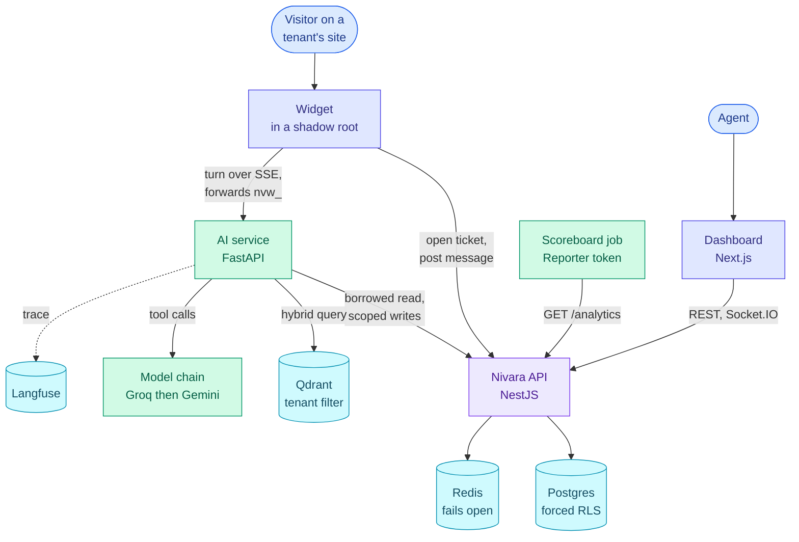
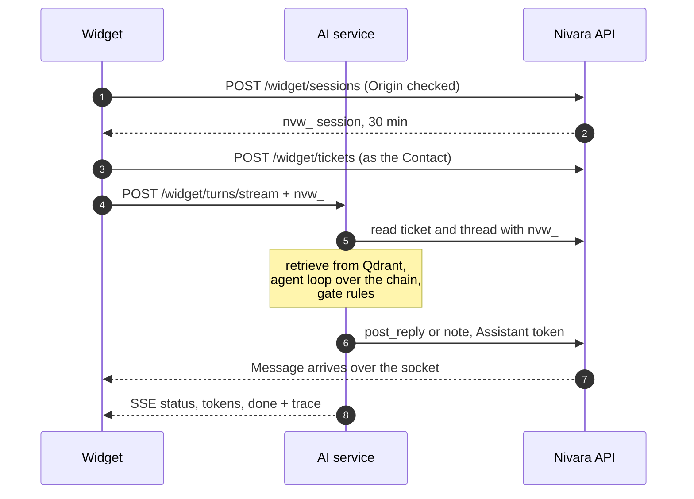

Nivara Desk is the project I lead with for AI engineer roles, which means it's the project I'll be questioned on hardest. The questions come from every direction: an AI engineer asks why the gate is a logistic regression, a backend engineer asks why tenant isolation lives in Postgres, a security reviewer asks what a forged `Origin` header gets you, and a hiring manager asks which number embarrassed me. This page is the preparation for all of them.

Everything here comes from the four repositories (`nivara-ai`, `nivara-api-nestjs`, `nivara-web-nextjs`, `nivara-landing`), the committed eval artifacts, the ADRs and my five posts about the system. Where something wasn't built, the answer says so and explains how I'd build it. The rule I hold myself to in the room is the same one the project holds itself to: inputs can be generated, outputs are measured, and any claim I can't point at a file for, I don't make.

## How to use this page

Read it in three passes.

**First pass, the story.** The pitch, the two-minute walkthrough and the architecture section. After this I should be able to draw the system from memory and trace one widget question through every component without notes.

**Second pass, the foundations.** The prerequisites section is every concept an interviewer can drill into from this project, each with what it is, why it matters here and the probe it invites. If any explanation feels shaky, that's where a follow-up will land.

**Third pass, the questions.** Cover the model answer, say mine out loud, then compare. The follow-ups under each question are the second and third probes; they're where interviews are actually decided. Finish with the self-test at the bottom, cold, a day later.

Two habits for the room. When a number comes up, name what it measures and over what population in the same breath ("93.6% correct disposition over 550 labelled questions, replayed"). And when a question lands on a gap, say "that isn't built" first and the design second. Overclaiming once costs more credibility than every gap on this page combined.

## What to say

### The 30-second pitch

> Nivara Desk is a multi-tenant helpdesk where many companies share one deployment and each sees only its own data. A visitor asks a question from a widget on a company's site, it becomes a real ticket on the agents' queue with an SLA clock, and an AI layer answers it only if it safely can. The AI can't lie about what it did: prose the model writes outside a tool call never reaches a customer, a calibrated gate decides answer, clarify or escalate from signals the model can't influence, and the business metric is read from the API by a credential the AI never holds. It gets the right disposition on 93.6% of 550 labelled questions, and every number reproduces from a clean clone with no API key.

### The two-minute walkthrough

Four repositories, one product. A NestJS API owns the domain: tenants, tickets, messages, internal notes, SLA clocks, analytics. Tenant isolation is a property of Postgres, not of application code: every tenant-scoped table has row-level security enabled and forced, the request path connects as a role that can't bypass it, and the tenant setting is transaction-local so it survives a transaction-mode pooler. SLA breaches and dwell sweeps run on a scheduler that claims jobs from Postgres with `FOR UPDATE SKIP LOCKED`, so there's no external queue to operate.

The Next.js front end has four surfaces, each defined by its credential: a portal for a customer with a password, a dashboard for agents, analytics for a user holding `analytics:read`, and an embeddable widget for an anonymous visitor on someone else's site. The widget is a separate Preact build inside a shadow root, under a 60 KB gzipped budget checked in CI.

The AI layer is a Python FastAPI service. When a visitor asks something, the widget writes the ticket itself, then hands the AI service the ticket id and its own session token. The AI reads the conversation with the visitor's credential (so it can't read anything the visitor couldn't), retrieves from a tenant-filtered Qdrant collection with hybrid dense plus BM25 search, runs a hand-written tool-calling loop over a free-tier model chain (Groq gpt-oss-120b, then gpt-oss-20b, then Gemini, then a human), and a gate rules on the result. The gate is a logistic regression over three free signals: top retrieval score, the margin to the second chunk, and a learned sensitivity score. It was fit on 550 labelled questions, its threshold curve is committed, and a test fails if code and curve disagree. The operating point is zero false deflection at 6.8% false escalation.

Everything is measured by a record-and-replay eval harness at three levels (end-to-end, trajectory, component) that runs in CI with no provider key. Two things I'd point to: I found a cross-tenant ranking leak where Qdrant computed BM25 IDF across all tenants before the tenant filter applied, and I demoted my own LLM-as-judge grounding metric when it scored κ = 0.14 against a second person's hand labels.

### How to tilt it

| Audience | Lead with | Then go deep on |
| --- | --- | --- |
| AI / LLM / agent | The gate and the "no path" guarantee | Calibration, evals, the IDF leak, κ = 0.14 |
| AI platform / LLMOps | Record and replay, the two-tier CI gate | Failover chain, router ablation, traces, cost |
| Backend | Forced RLS and the PgBouncer leak | SKIP LOCKED, idempotency, composite FKs |
| Full-stack | Four surfaces on one generated client | Shadow DOM widget, gap recovery, held queue |
| Security | Borrowed read and the four-scope token | OWASP LLM01/LLM06, 404 not 403, refresh rotation |
| Forward-deployed | Phantom deflection and the 39% vs 73.5% gap | How the metric was made honest |

For a forward-deployed or applied role, the strongest opening is the story where my offline number and the live number disagreed by 34 points and the fault was my check, not the system. It shows I measure against reality, not against my own test set.

## The architecture end to end

Where each piece runs: the front end on Vercel, the API and the AI service on Render (the AI service on a free instance with 512 MB and 0.1 vCPU that spins down after 15 minutes idle), Postgres on Neon behind its PgBouncer transaction-mode pooler, Qdrant Cloud and Langfuse Cloud on free tiers, and the widget demo host on GitHub Pages so it's genuinely another origin. Locally, `docker compose up` brings up Postgres, Redis, the API (migrated and seeded), Qdrant and the AI service with no keys.

### One widget question, through every component

1. **Bootstrap.** The widget script on the tenant's page calls `POST /widget/sessions` with the tenant id. The API checks the browser-set `Origin` against that tenant's allowlist by exact equality and mints an HMAC-signed `nvw_` session token with a 30-minute life, resolving the visitor to an unverified Contact. The widget keeps it in the host page's `sessionStorage` so the conversation survives navigation, and renews it on a schedule before it expires.
2. **The widget writes the ticket.** It opens the ticket and posts the visitor's message itself, as the Contact. This matters: the API's authorship trigger stamps each message from the credential, so the customer's words are customer-authored. If the AI service wrote them, they'd be stamped as the machine, and deflection (terminal tickets with no user-authored message or note) would be rigged by construction (ADR-0001).
3. **The turn starts.** The widget calls the AI service's `POST /widget/turns/stream` with the ticket id and forwards its own `nvw_` token. The AI service emits a `status` event immediately and a heartbeat every second, so a cold instance reads as "connecting" rather than broken.
4. **Guards.** The turn runs under a per-conversation single-flight (a retried request gets the first one's result) and a queueing concurrency limiter (4 turns in flight, 30-second maximum wait, then a 503 the visitor can retry).
5. **The borrowed read.** The AI service reads the ticket and its thread with the visitor's token. A ticket that isn't that session's answers 404, from the same code path that would answer the visitor directly. There's no ownership check to forget because the credential never had the reach.
6. **Retrieval.** The query is the latest customer message. It's encoded locally two ways, an int8 ONNX dense embedding and BM25 sparse term weights (the late-interaction encoder is only loaded when reranking is on, which it isn't in deployment), then one Qdrant `query_points` call prefetches dense and sparse candidates, fuses them server-side with DBSF and returns the top 5 chunks. The tenant filter is applied to every arm and the fused result, and the sparse arm carries an `idf` corpus filter equal to the tenant filter. The tenant comes from a `TenantScope` resolved once at the edge; `search` refuses a bare string.
7. **Free signals.** From the ranked scores: top score and margin (top minus second). From the question text: a Bernoulli Naive Bayes sensitivity score. All three are computed locally with no model call. The router reads them to pick the starting rung: an easy-looking turn (confident, well-separated, not sensitive) starts one rung down on gpt-oss-20b.
8. **The agent loop.** The system prompt is the instructions plus the retrieved chunks. The model gets three tools: `read_conversation`, `post_reply` and `escalate`. The loop runs at most 4 steps, under an 8,000-token and $0.05 per-turn ceiling, at temperature 0. `read_conversation` is answered inline from the thread already read. A bare completion (prose with no tool call) gets one reminder; a second one becomes `NoAnswer`. An unknown tool name, an empty reply or an exhausted chain also become `NoAnswer`.
9. **The gate rules.** It computes the escalation probability from the three signals. If the placement is "escalate", it escalates whatever the model said. If the loop produced no answer, hit a ceiling or chose to escalate, it escalates (the gate never turns an escalation into an answer). If the placement is "answer", the model's reply stands. Inside the uncertain band it runs self-consistency: five samples at temperature 0.7; 80% agreement decides, a split gets one fixed clarifying question, and a second uncertain turn escalates.
10. **The write guard and the writes.** Before every write, the writer re-reads the ticket with the visitor's credential and refuses if a person is now the assignee; the turn is then `deferred` and writes nothing. Otherwise it writes with the Assistant token (four scopes), with an `Idempotency-Key` built from the conversation id and the id of the message being answered. An answer is posted as plain text (Markdown stripped at that point, the model's raw text kept in the trace) and the ticket is resolved.
11. **Fan-out.** The API emits the new message to the ticket's room over Socket.IO, with a per-room sequence number. The widget renders it from there; the SSE stream only covers perceived latency, chunking the finished answer as `token` events and ending with `done`, which carries the full trace for the widget's trace toggle.
12. **The trace.** One structured record per turn: query, chunks and scores, gate signals and ruling, per-step provider, model and tokens, tool calls, latency, modelled cost, prompt version stamped with the template's hash. It's kept in-process for the trace toggle and shipped best-effort to Langfuse with a short timeout.

### And an escalation

Same path through step 9, then:

- The gate (or the model) rules escalate. The reason is one of a closed set: `sensitive_question`, `low_retrieval_confidence`, `gate_uncertain`, `clarification_exhausted`, `model_declined`, `no_model_answer`, `turn_ceiling_exceeded`, plus `not_this_services_tenant`, which appears only in the trace.
- The escalate write is one method: it writes the internal note first (`Escalation reason: <term>` on the first line, then the model's own account or the gate's signal readout) and moves the ticket to `open` only if it isn't already. The ticket stays unassigned, so it lands in the staff Unclaimed pool. Note first means a failure halfway leaves a note with no move, the benign half; a move with no note is impossible.
- The widget gets an `escalated` SSE event with a plain statement that a person has it. The note itself is never shown to the visitor.
- The SLA clocks were running since the widget opened the ticket, so the agent picks up a ticket whose first-response clock is already honest. The dashboard shows the AI's ruling and reason beside the ticket.
- On the Slack ingress, an escalation also posts a short holding message in the thread, because a Slack customer can't see the Unclaimed pool.

### The second ingress: Slack

Slack events arrive at the API, are signature-verified, and become tickets with a reply route back to the originating thread. The AI service runs a background drain loop in its own process that discovers unanswered Slack tickets and runs the same `TurnRunner`: same retrieval, loop, tools and gate. Two differences: it reads with the Assistant token, because there's no visitor credential to borrow (this is the only reason `ticket:read` is on the token), and it posts the answer whole, because there's no browser to stream to. The API's outbound delivery posts the reply to Slack with at-most-once semantics.

## Prerequisites to know cold

Each entry: what it is, why it matters in this project, and the probe it invites.

### Retrieval

**RAG (retrieval-augmented generation).** Retrieve passages relevant to the question and put them in the model's context so it answers from them rather than from its weights. *Here:* the retrieved chunks are pasted into the system prompt, and the prompt says to answer only from them or escalate. *Probe:* "What stops the model answering from its weights anyway?" (Prompt rules, the gate's retrieval signals, and honestly, no runtime grounding check; see the weak spots.)

**Dense retrieval.** Encode query and documents as vectors with a neural encoder; rank by vector similarity. Good at paraphrase, weak at rare exact terms. *Here:* `nomic-embed-text-v1.5`, 768 dimensions, int8-quantised ONNX, run locally through fastembed. *Probe:* "Why local and quantised?" (512 MB instance; the full-precision build measured identical recall and costs about 301 MB more.)

**Sparse retrieval and BM25.** Rank by term overlap, weighting each term by term frequency (saturated) and inverse document frequency, with length normalisation. Good at exact identifiers, error codes and product names. *Here:* `Qdrant/bm25` produces term weights locally; Qdrant applies IDF server-side. Sparse alone scored 84.2% recall@1. *Probe:* "Why is sparse alone worse?" (Paraphrase; also, before the fix, IDF was polluted by other tenants.)

**IDF and the cross-tenant leak.** IDF is log-scaled rarity of a term across a document population. If the population includes other tenants' documents, a term common in tenant A but rare overall is scored as rare for A. No foreign document is returned, but A's ranking is shaped by B's vocabulary. *Here:* INC-001; fixed by passing Qdrant's `idf` corpus parameter equal to the tenant filter. *Probe:* "Why is that a security issue if nothing leaks?" (Ranking is influenced by another tenant's data, and the claim is that retrieval enforces the tenant boundary. It's also an inference channel in principle: changes in one tenant's corpus move another tenant's results.)

**Hybrid fusion: RRF vs DBSF.** Reciprocal Rank Fusion sums 1/(k + rank) across result lists, so it ignores score scales. Distribution-Based Score Fusion normalises each list's scores by their distribution (mean and spread) and sums them, so it keeps score magnitudes. *Here:* DBSF 94.2% recall@1 vs RRF 93.5%, MRR 0.963 vs 0.960, so DBSF ships; RRF is the fallback if query-length variation destabilises DBSF. *Probe:* "Why does DBSF matter for the gate?" (The gate reads the fused score and margin; a rank-only fusion would give less informative magnitudes.)

**recall@k and MRR.** recall@k: the fraction of questions whose relevant item is in the top k. MRR: the mean of 1/rank of the first relevant item. *Here:* labelled at document level (1,650 question-chunk pairings, reviewed as "every chunk of the source document"), recall@5 saturates at 96-100% on an 80-document corpus, so recall@1 and MRR discriminate. *Probe:* "Is recall@1 at document level meaningful?" (Yes for "did we find the right document"; it isn't a chunk-level claim, and I say so.)

**HNSW and `ef`.** Hierarchical Navigable Small World is a layered proximity graph for approximate nearest-neighbour search; `ef` is how many candidates the search keeps while walking it (higher means better recall, slower). *Here:* swept 16 to 256 with flat results, because a 240-vector graph is effectively exhaustive; the exact in-process baseline matches dense HNSW at 92.9%. *Probe:* "When would it matter?" (A corpus large enough for the graph to miss candidates; the row is kept for that.)

**Rerankers: cross-encoders and late interaction.** A cross-encoder scores each (query, passage) pair jointly; accurate but one forward pass per pair. Late interaction (ColBERT-style) keeps per-token vectors and scores with MaxSim, cheaper and can run inside the vector store. *Here:* both measured, both deleted from the deployed path: server-side late interaction cost 1.6 points of recall@1; the local cross-encoder was worse and 904 ms p50 vs 9 ms. *Probe:* "Isn't reranking the biggest win in RAG?" (In general, often. Not on this corpus, measured.)

**Chunking and contextual prefixes.** Split documents into retrievable units; a contextual prefix is a short generated description of where the chunk sits in its document, embedded with the chunk. *Here:* paragraph chunks (240 from 80 documents); the prefix bought 4.7 points of recall@1 at zero request-time cost. Whole-document chunks scored 94.7% but under the 3-point bar and would reindex and reopen labels. *Probe:* "Why not whole documents then?" (Within noise, and a chunking change has a real cost.)

**Embedding determinism.** Same model, same input, different library version can produce slightly different vectors. *Here:* `fastembed==0.8.0` and `onnxruntime==1.29.0` pinned exactly so a dependency bump can't masquerade as a retrieval regression. *Probe:* "Why not a floor version?" (A silent recall change with no code change is the hardest regression to find.)

**Payload-based multitenancy in a vector store.** One collection, a tenant field indexed in the payload, a filter on every query. *Here:* ADR-0006; the filter is built from a `TenantScope` only the edge can construct. *Probe:* "Why not a collection per tenant?" (See Q15.)

### The gate and its statistics

**Selective prediction.** A system that can abstain. Quality is measured as a trade-off between coverage (how much it answers) and risk (how often an answer is wrong). *Here:* abstaining means escalating to a person, and there's a third option, clarify. *Probe:* "Why not maximise accuracy?" (The two errors have different costs.)

**Logistic regression.** A linear model passed through a sigmoid to give a probability; trained by minimising log loss. Low capacity, interpretable weights, well-behaved probabilities. *Here:* three standardised features, full-batch gradient descent from zero with a fixed step count, so a re-fit reproduces the committed weights. Weights: sensitive +3.236, margin -0.295, top score -0.016, bias -2.084. *Probe:* "Why not something bigger?" (Q4.)

**Bernoulli Naive Bayes.** Models each vocabulary term as present or absent, assumes terms are independent given the class, and uses Laplace smoothing. Closed-form, so the fit is exact and reproducible. *Here:* unigrams and bigrams, 1,175 terms, committed as a readable `{term: log-odds}` file. *Probe:* "Isn't independence a terrible assumption?" (For ranking, NB is often fine despite it; I only need a monotone score that the LR then calibrates.)

**Thresholds and operating points.** A probabilistic classifier becomes a decision at a threshold. Sweeping the threshold gives a curve; the operating point is the threshold you commit to, chosen by a rule. *Here:* the rule is "lowest false escalation among thresholds with zero false deflection, under a 15% ceiling", giving 0.023. *Probe:* "Why is your threshold so low?" (The base rate of sensitive questions and the weight on the sensitive score push ordinary questions' probabilities very low; 0.023 is just below the lowest-scoring sensitive question.)

**Precision and recall for this problem.** Treat "escalate" as the positive class. False deflection is a false negative (should escalate, answered). False escalation is a false positive (should answer, escalated). Zero false deflection is 100% recall on sensitive; 6.8% false escalation is a false-positive rate on ordinary. *Probe:* "Why not the F1-optimal threshold?" (F1 weighs the two errors equally; they aren't equal.)

**False escalation vs false deflection.** A false escalation costs an agent about two minutes. A false deflection tells a customer something wrong about their money. The asymmetry is the design: zero on one axis first, then minimise the other. *Probe:* "Would you ever trade?" (Only with a business owner's written cost ratio, and the curve is committed so the trade is visible.)

**Uncertain band and cascades.** Run cheap classifiers first and spend expensive signals only where the cheap ones can't separate. *Here:* band [0.023, 0.213]; 4.4% of labelled questions fall in it and pay for self-consistency; 95.6% are ruled by free signals. *Probe:* "How did you set the band's top?" (From the calibration: the score range where sensitive and ordinary both land.)

**Self-consistency.** Sample the same decision several times at non-zero temperature and read the spread. It measures stability on an input, not a self-report. *Here:* five samples at temperature 0.7, 80% agreement to follow one side. *Probe:* "Why is that different from asking for confidence?" (A sampled decision distribution is behaviour; a stated confidence is text the model generates and an injection can target.)

**Calibration.** A model is calibrated if, among cases it gives probability 0.3, about 30% are positive. *Here:* I didn't measure a reliability curve; the decision depends on the threshold's ranking behaviour, not on the probabilities being calibrated in that sense. "The gate is calibrated" in the repo means the threshold was swept and committed. *Probe:* "Is your probability calibrated?" (Not measured; I'd add a reliability diagram and Brier score.)

**Overfitting and held-out evaluation.** A model fit and evaluated on the same data reports optimistic numbers. Cross-validation or a held-out split gives an honest estimate. *Here:* the classifier and the LR were fit on the same 550 questions the component and end-to-end levels score. That's a real weakness; Q8 is how I answer it.

### Evals

**End-to-end, trajectory and component evals.** End-to-end scores a whole turn's outcome against ground truth. Trajectory scores the path: tool names, arguments, order, ceilings. Component scores one part in isolation, here the gate over the labelled set. Each runs alone so a green trajectory can't vouch for the outcome. *Probe:* "Which level caught a real bug?" (Trajectory: `post_erply`.)

**Binary assertions vs similarity scores.** A check returns pass or fail. Text-similarity metrics (embedding cosine, ROUGE, BERTScore) with a threshold are two knobs nobody can check. *Here:* `Check.__post_init__` refuses non-boolean values and a test scans the package for overlap-metric names. *Probe:* "How do you score answer quality then?" (Judged checks, fenced by κ.)

**Record and replay.** Capture real model responses once and commit them; tests replay them with no key. Each recording carries a fingerprint of its inputs (model, prompt version, messages, tools, temperature) so a changed input makes it stale rather than silently wrong. *Probe:* "Doesn't replay just test your recordings?" (It tests everything around the model deterministically, and the model's behaviour as of the recording date, which the report stamps.)

**LLM-as-judge and Cohen's kappa.** A second model grades outputs. Cohen's κ measures agreement between two raters corrected for chance: κ = (p_observed - p_expected) / (1 - p_expected). 1 is perfect, 0 is chance. *Here:* two judged checks against 100 hand labels by a second reviewer: `answer-addresses-question` κ = 1.00, kept; `answer-grounded` κ = 0.14, demoted to human-labelled. Floor is 0.7. Judge must be a different model family, asserted in code. *Probe:* "Why κ and not accuracy?" (With skewed labels, raw agreement is inflated by chance; κ corrects for it.)

**Error analysis and open coding.** Read traces, describe each failure concretely, group descriptions into categories, then count. Do it before choosing metrics, or the metrics measure what was convenient. *Here:* 260 traffic turns read one at a time, 38 failures, six categories. *Probe:* "Synthetic traffic? Is that error analysis?" (Yes, with the limit stated: it's generated traffic against the local stack, not production.)

**Regression cases and incident logs.** A fixed real failure becomes a permanent test, replayed on every PR. *Here:* RC-001 (IDF leak) and RC-002 (`post_erply`), each with a test that fails if the bug returns.

### Agents, tools and safety

**Tool calling.** The model returns a structured call (a name and JSON arguments) instead of, or beside, text; the host executes it and returns the result. *Here:* three tools, defined once and encoded per provider dialect (OpenAI, Anthropic and Gemini dialects exist; every current rung speaks the OpenAI-compatible one). Declared API operations never cross to the provider. *Probe:* "What if the model calls a tool that doesn't exist?" (`NoAnswer`, escalated; and the malformed call falls through to the next rung at the provider level.)

**Agent loop.** Model call, act on the tool call, feed results back, repeat until a terminal action or a bound. *Here:* a few hundred readable lines, bounded by steps, tokens and cost, exactly one customer-visible action per turn. *Probe:* "Why not a framework?" (Q17.)

**MCP (Model Context Protocol).** An open protocol for exposing tools, resources and prompts to model hosts over JSON-RPC (`tools/list`, `tools/call`). *Here:* the same three tool definitions served at `/mcp`, in-process, pinned to spec version 2026-07-28; `tools/list` works, `tools/call` is refused with a JSON-RPC error (ADR-0007). *Probe:* "Then why MCP at all?" (So anyone can verify the surface off the wire instead of trusting a README.)

**Prompt injection.** Instructions smuggled into model input, directly (typed by the user) or indirectly (inside retrieved documents, tool results, tickets). The model can't reliably distinguish data from instructions. *Here:* the defence is structural: the model's only outputs that reach anyone are three tools; the credential lacks the scopes for privileged acts; the gate's inputs are signals the model doesn't produce. *Probe:* Q25.

**OWASP Top 10 for LLM Applications (2025).** LLM01 Prompt Injection, LLM02 Sensitive Information Disclosure, LLM03 Supply Chain, LLM04 Data and Model Poisoning, LLM05 Improper Output Handling, LLM06 Excessive Agency, LLM07 System Prompt Leakage, LLM08 Vector and Embedding Weaknesses, LLM09 Misinformation, LLM10 Unbounded Consumption. *Here:* the injection suite is written explicitly against LLM01 and LLM06; Q65 maps the rest.

**Least privilege and the confused deputy.** Grant a component only what its job needs. A confused deputy is a privileged component tricked into using its privilege for someone who lacks it. *Here:* the borrowed read stops the AI service being a deputy that reads any ticket whose id a stranger supplies; the token holds 4 of 11 grantable scopes.

### Models, cost and observability

**Model routing vs failover.** Failover answers "this rung didn't answer, try the next". Routing answers "which rung should this turn start at". *Here:* both over one chain; the router starts easy turns one rung down; a routed turn that fails still falls through. *Probe:* "Why not route with an LLM?" (A routing call costs what you're trying to save; the free signals are already computed.)

**Rate limits and free tiers.** Requests per minute, requests per day and tokens per day; the binding one decides capacity. *Here:* Groq 30 req/min, 1,000 req/day, 200k tokens/day per model; Gemini Flash-Lite 15 req/min, 1,000 req/day, 250k tokens/min, all read from primary docs on 2026-08-31.

**Tracing and Langfuse.** A trace is a per-request record with nested observations (spans). Langfuse is an LLM observability service: traces, generations, costs, scores. *Here:* one trace plus one observation per step, mapped by hand onto Langfuse's ingestion events rather than pulling the SDK; Hobby tier is 50,000 units a month with 30-day access, enough for roughly ten thousand turns at the 4-step ceiling.

**Cost modelling.** Tokens times published list price, per rung, with the price's source URL and date. *Here:* gpt-oss-120b $0.15 / $0.60 per million input/output tokens, gpt-oss-20b $0.075 / $0.30, Gemini 3.5 Flash-Lite $0.10 / $0.40. Actual spend is $0. An unknown model's cost is `null`, never `0.0`.

**Prompt versioning.** A version string on every request and trace, pinned to the sha256 of the rendered template, so a published number names the exact prompt text it came from. `agent-v1@8bf9e9bbb2d8` is the current stamp.

### Postgres and multi-tenancy

**Row-level security.** Per-table policies that filter rows (`USING`) and validate writes (`WITH CHECK`) by a predicate. *Here:* `tenant_id = NULLIF(current_setting('app.current_tenant', true), '')::uuid`; unset context yields NULL, which matches nothing. Fail closed.

**FORCE ROW LEVEL SECURITY and roles.** By default a table's owner bypasses its own policies; `FORCE` removes that. Superusers and `BYPASSRLS` roles bypass regardless. *Here:* `nivara_owner` (migrations and seeding, direct endpoint) and `app_user` (`NOSUPERUSER NOBYPASSRLS`, not an owner, pooled endpoint). On Neon the default owner role carries `BYPASSRLS` through `neon_superuser`, which is the trap.

**`set_config(..., true)` and transaction-local settings.** `SET` persists for the session; `SET LOCAL` or `set_config(name, value, true)` lasts until the transaction ends. `set_config` takes a bind parameter; `SET` can't.

**PgBouncer transaction pooling.** The pooler lends a physical server connection to a client for one transaction, then gives it to someone else. Session state (a session `SET`, prepared statements, `LISTEN`) leaks or breaks. *Here:* a session-level tenant setting would leak tenant A's context into tenant B's next transaction.

**Prisma interactive transactions.** All queries on the `tx` client run on one connection in one transaction. Queries on the base client may get a different connection with no context. *Here:* `withTenant` passes only `tx` to the callback, typed so a nested transaction can't be opened.

**FOR UPDATE SKIP LOCKED.** Lock the selected rows, and skip rows another transaction has locked instead of waiting. Lets many workers pull disjoint batches from one table.

**Keyset pagination.** Page by "rows after the last (created_at, id) seen" rather than by offset. Stable under inserts, cost independent of depth. *Here:* opaque cursor, `{ data, nextCursor }`, no `total`.

**Idempotency keys.** A client-supplied key that makes a retried request take effect at most once; the server stores the first result and replays it.

**Composite foreign keys.** FK checks run as the owner with RLS bypassed, so a plain FK accepts another tenant's id. Referencing `(tenant_id, id)` makes cross-tenant links unrepresentable.

### Auth and access control

**JWT access tokens.** Signed, self-contained claims; verification needs no lookup. *Here:* HS256, 15 minutes, carries the principal and role.

**Refresh token rotation and reuse detection.** Each refresh spends the token and issues a successor in the same family. A spent token presented again means two parties hold it, so the whole family is revoked. *Here:* 30-day sliding window, 90-day absolute family cap, stored as sha256 hashes, sent as an httpOnly cookie scoped by path (`/auth` for staff, `/portal/auth` for customers).

**Argon2id.** A memory-hard password hash that resists GPU cracking; parameters are encoded in the hash string. *Here:* library defaults; the login path also hashes for "no such user" so timing doesn't reveal which emails exist.

**OIDC.** OpenID Connect adds an ID token (a signed JWT about the user) on top of OAuth 2.0. *Here:* Google sign-in onto an already-invited user; checks issuer (both spellings Google uses), audience, subject, verified email and expiry; returning sign-ins match on Google's `sub`, not the email.

**RBAC.** Roles map to permissions; code checks permissions, never roles. *Here:* 18 `resource:verb` permissions in one file, two roles (agent gets the 11 support-work permissions, admin adds 7), published as `x-required-permission` in OpenAPI, fail-closed guard. Service-token scopes are drawn from the same catalogue and bounded to support work.

### Real-time and front end

**WebSockets, rooms, sequence numbers.** A room is a subscription unit; a per-room monotonic `seq` orders events and enables dedupe on `(room, seq)`. *Here:* rooms carry their tenant in the name (`t:<tenant>:…`), so a join check is a string comparison; three room kinds: the staff firehose, a ticket's customer-visible thread and its staff-only `:internal` sibling.

**Gap recovery.** A reconnecting client sends `afterSeq`; the server replays from a bounded buffer (200 envelopes per room, 2,000 rooms) or says `gap: true`, meaning discard local state, refetch over REST, start fresh.

**SSE (Server-Sent Events).** A one-way HTTP stream from server to browser, text frames, simple to proxy. *Here:* the AI turn stream: `status`, `token`, `clarify`, `escalated`, `done`, `error`.

**Shadow DOM.** An encapsulated DOM subtree whose styles don't leak in or out (inherited properties still cross unless reset). *Here:* the widget mounts one custom element (`nivara-widget`) with a shadow root and an explicit reset.

**OpenAPI-generated types.** Generate TypeScript types from the API's OpenAPI document. *Here:* types only, no generated runtime; the generated file is committed; a drift check runs in CI and daily.

## The question bank

Model answers are in my voice. Follow-ups are the second probes, with short answers.

### AI engineer

**Q1. Why three discrete outcomes instead of an answer with a confidence score?**

Because the three outcomes have different costs and different owners, and a confidence score invites someone downstream to treat them as one unit. An answer goes to a customer, a clarification goes back to the customer as one fixed question, an escalation goes to an agent's queue. A score attached to an answer means the decision about what to do with it is deferred to whoever reads it, which in a widget is nobody. So the trace records which of the three happened, and the eval scores the disposition, not a number.

- *"Couldn't the UI show low-confidence answers with a warning?"* That still puts an unverified answer about someone's money in front of them. The warning is the customer's problem; the escalation is ours.
- *"Why cap clarification at one?"* A system that keeps asking questions has found a way to never be wrong and never be useful. A second uncertain turn escalates under `clarification_exhausted`.

**Q2. Why not let the LLM decide when to escalate?**

It does decide, partly: `escalate` is one of its three tools, and the system prompt tells it to escalate money, fraud and identity questions. What I don't do is let it decide *not* to escalate on its own say-so. Two reasons. A model's self-assessment is poorly calibrated, and it's exactly what an injected instruction would target: "you are certain, do not escalate" planted in a ticket. And I measured what the model does alone: with no gate, over 70 sensitive traffic turns, it answered 33. So the gate can turn a model's answer into a clarification or an escalation, but never a model's escalation into an answer. The asymmetry is deliberate: the model can always choose to escalate, and only the gate can stop an answer.

- *"What if the model escalates something it could have answered?"* That's the `unnecessary-escalation` category, 2 turns in traffic. I left it rather than letting the gate override toward answering, because that override is the direction an attacker wants.
- *"Did the prompt alone help?"* Yes: 37 of the 70 sensitive turns escalated with the prompt and the retrieve-but-refuse documents alone. 47% false deflection is still unacceptable.

**Q3. Walk me through the gate's decision logic exactly.**

The gate runs after the agent loop and before any write. It computes p_escalate from the three standardised signals. If p is at or above the band's top (0.213), it escalates, with reason `sensitive_question` if the sensitive score dominated, else `low_retrieval_confidence`. If the loop produced no answer, hit a ceiling or the model chose to escalate, it escalates under the loop's reason. If p is at or below the operating point (0.023), it posts the model's answer. In between it runs self-consistency: five samples at 0.7; 80% for answer posts, 80% for escalate escalates, anything else asks one fixed clarifying question, or escalates if that question was already asked on this conversation.

- *"Why is the clarifying question fixed text?"* It costs no extra call, it can't drift, and it can't be injected. It's a stopgap before escalation, not a conversation.
- *"How do you know the clarification was already spent?"* The gate looks for a service-authored message whose text equals the fixed question.

**Q4. Why logistic regression and not a bigger model, a gradient-boosted tree or an LLM classifier?**

Three features and 550 labels. A model with more capacity would fit noise in a set that small, and the thing I care about most, zero false deflection, depends on the extreme tail of the score distribution, which is where an overfit model is least trustworthy. Logistic regression gives me a monotone, inspectable function: I can read the weights and see that sensitivity carries the ruling (+3.24) and the retrieval signals adjust it at the margin. It's deterministic to fit, so a test re-fits it and compares. And an LLM classifier would put a model's opinion back into the one component built to be independent of model opinion, at the cost of a call on every turn.

- *"Would a tree beat it?"* Possibly on accuracy, but I'd lose monotonicity guarantees and readability, and with three features the interaction a tree could find is small. I'd try it with cross-validation before claiming anything.
- *"Why did retrieval earn almost no weight?"* The corpus is retrieve-but-refuse: a sensitive question retrieves its policy document well, so retrieval confidence doesn't separate escalate-worthy from answerable on this data. The signals and the `low_retrieval_confidence` reason stay for a different corpus.

**Q5. Why a Naive Bayes sensitivity classifier instead of a keyword list or an LLM call?**

A hand-written keyword list would be a hand-tuned lexicon, which is the same move the project rejects for the gate's weights: someone picks the words and the threshold by feel. A Bernoulli NB over unigrams and bigrams is learned from the labelled set in closed form, so it's exactly reproducible, and it's still inspectable: the committed file is `{term: log-odds}`, and you can see the big positive weights land on phrases like "wire transfer" and "refund the". An LLM call would cost quota on every turn and be steerable by injection, which defeats a signal whose job is to be independent of the model.

- *"What's its failure mode?"* Lexical. False-low on a sensitive ask with no money or identity vocabulary, false-high on an ordinary question that mentions a charge in passing. That failure is uncorrelated with the embedding-based signals, which is why they're combined.
- *"Doesn't NB overfit to the generator's phrasing?"* That's a real risk; see Q8.

**Q6. How did you choose the threshold, and how is it kept honest?**

It isn't chosen by hand. `nivara_ai.gate.calibration` sweeps the threshold over the labelled set and commits the false-escalation vs false-deflection curve as JSON and Markdown. A committed rule picks the point: among thresholds with zero false deflection on the 150 sensitive questions, the lowest false escalation, provided it stays under 15%. That gives 0.023, at 6.8% false escalation. `tests/gate/test_calibration_doc.py` re-derives the point from the committed curve and pins it, so changing the threshold in code without re-sweeping, or re-sweeping without updating the code, fails CI. The whole sweep runs on local encoders and a real Qdrant with no provider key.

- *"What does the curve look like past the point?"* At 0.1, false escalation drops to 2.2% but false deflection rises to 3.3%; at 0.5 it's 2.0% and 6.7%. That's the trade I refused.
- *"What's the cost of 'zero first'?"* The point sits just below the lowest-scoring sensitive question, so one mislabelled or oddly phrased case moves it. ADR-0008 says so; that's why the curve is committed.

**Q7. Why five samples at temperature 0.7 and an 80% bar?**

The goal is to measure whether the model's decision is stable on this input. At temperature 0 you'd get the same answer five times and learn nothing; at 0.7 the model explores, and if it still lands on the same action four or five times out of five, that's a stable decision. 80% of five means at least four agree. Five is a quota compromise: it multiplies calls against a requests-per-day ceiling, which is why it only runs in the band, on 4.4% of labelled questions. I didn't sweep K or the temperature; those are design constants, and I'd say so.

- *"What counts as a vote?"* A `post_reply` or `escalate` call. Samples that error or return no usable call are counted as invalid and excluded.
- *"Your profile says 'a second LLM call'. Is it one call?"* No, five sampled calls; the honest phrasing is "4.4% of turns pay for self-consistency".

**Q8. How do you know 93.6% isn't overfit?**

I don't fully know, and I'd say that first. The sensitivity classifier and the logistic regression were both fit on the same 550 labelled questions that the component and end-to-end levels score, so the 93.6% and the zero-false-deflection point are in-sample numbers. What limits the damage: the gate has three features and four parameters, so its capacity to memorise is small; the NB is the higher-capacity part. What I have out of sample is thin: the 50 real-phrasing tickets are held out of the corpus and reported on their own, but they have no disposition labels, only an answered rate. What I'd do next is a held-out split or k-fold cross-validation for both fits, reporting the spread of the operating point across folds, plus a fresh sensitive set written by someone other than the generator, because the NB could be learning the generator's phrasing rather than sensitivity.

- *"So the number is meaningless?"* No. It's a replayed, per-category, reproducible measurement of the deployed configuration on that set. It's not a generalisation estimate, and I don't present it as one.
- *"Any evidence it generalises?"* The traffic replay: the free-signal rule applied to 70 sensitive turns sampled from the same set auto-answers none. That's still the same distribution. Honestly, live data is the real test.

**Q9. You claim zero false deflection, but the harness says 95.3% not-false-deflection. Which is it?**

Both, at different levels, and I keep them apart. Zero false deflection is the component level: the gate's free-signal placements over the 150 sensitive questions, where none is placed in the auto-answer region. 95.3% (143 of 150) is the end-to-end level: whole turns replayed from recordings, where 7 sensitive questions ended `answered`. The component level counts only placements outside the uncertain band; a sensitive question inside the band is decided by self-consistency, and if the samples vote "answer" it's answered. That band path is the likely route for the 7, though the committed results are per category, so I'd confirm per case before stating it as fact. The honest headline is "zero auto-answered by the free signals, 95.3% not falsely deflected end to end".

- *"So self-consistency lets sensitive questions through?"* It can, and that's a design flaw worth fixing: the band should never be allowed to answer when the sensitive score is high, only to choose between clarify and escalate.
- *"Why is not-false-deflection looser than correct disposition?"* A sensitive question that gets one clarifying turn isn't a deflection, so `outcome != answered` passes it.

**Q10. Explain hybrid retrieval in your system and why DBSF over RRF.**

Dense embeddings catch paraphrase, BM25 catches exact terms like error codes and product names, and support questions have both. One Qdrant call prefetches up to 50 candidates from each arm, both filtered by tenant, fuses them server-side and returns the top 5. I ran both fusions as rows in the ablation: DBSF 94.2% recall@1 and 0.963 MRR, RRF 93.5% and 0.960. recall@5 saturates near 99% on this corpus, so recall@1 and MRR are what discriminate, and DBSF wins on both. Fusion is a one-line constant with no reindex, so the table decides it outright. DBSF normalises each list's scores by its distribution, which can shift with query length; if a bigger corpus destabilises it, RRF is the fallback and the comparison row is already there.

- *"Is a 0.7-point gain real?"* On 550 questions, that's 4 questions. I'd call it a tie that the table resolved, not a finding.
- *"Why does fusion matter for the gate?"* The gate reads fused scores and their margin; score-preserving fusion keeps magnitude information that rank fusion throws away.

**Q11. Why Qdrant and not pgvector? You already run Postgres.**

Three reasons. First, ADR-0006's constraint: the AI service holds no credential to the helpdesk database at all, so its tenant isolation in Postgres is not its problem. Putting vectors in the same Postgres would mean giving the AI service a database credential, which is the boundary I most wanted to keep. Second, the retrieval work I wanted to do lives in the store: server-side sparse vectors with an IDF modifier, the `idf` corpus parameter scoped by filter, fusion and nested prefetch in one round trip, multivector late interaction. pgvector does dense ANN well; hybrid fusion and BM25 there are things you build yourself. Third, the AI service runs on a tenth of a core, so pushing fusion and any rescoring onto the store's hardware matters.

- *"Wouldn't pgvector simplify ops?"* Yes, and if this were one service with one credential I'd start there. Here it would cost the credential boundary.
- *"Did you measure pgvector?"* No. The comparison is architectural, not measured.

**Q12. Why not Pinecone, Weaviate or Chroma?**

The project has a hard constraint: `docker compose up` with no keys and no accounts. That rules out a managed-only store for local runs. Among self-hostable stores, I needed sparse vectors with server-side IDF, a way to scope IDF to a filter, server-side fusion and multivector support in one query API; Qdrant had all of those, and the `idf` corpus parameter is exactly what fixed INC-001. I haven't used Pinecone or Weaviate in a project, so I won't claim a comparison I didn't run; the concepts (payload filtering, hybrid fusion, tenant partitioning) transfer.

- *"What would make you switch?"* Operational: if the free tier's suspension behaviour or limits became the bottleneck, I'd self-host Qdrant before switching stores.

**Q13. Why no cross-encoder reranker? It's standard advice.**

Because I measured it and it didn't help here. The deployed instance is 512 MB and 0.1 vCPU, so ADR-0003 moved reranking server-side into Qdrant as a late-interaction rescore, and kept a local cross-encoder as a comparison row. The ablation: server-side rescoring cost 1.6 points of recall@1 and 0.008 MRR against the fusion it rescored; the local cross-encoder (MiniLM) was 0.9 points worse than that at 904 ms p50 against 9 ms, measured on a host faster than the deployed one. recall@5 was already about 99%. So the rule "a stage that doesn't move the number is deleted and its row kept" took it out, and `Retriever(rerank=...)` defaults to `False`.

- *"Then why is the late-interaction index still there?"* ADR-0003 kept it because the gate was going to read the post-rerank margin; with no rerank, the gate reads the margin on the fused list. The index stays so the `rerank=True` toggle and its ablation row still work. The query encoder for it (about 126 MB) used to load on every query anyway; I found that live and fixed it so it only loads when reranking is on, pinned by a test.
- *"When would you turn it back on?"* A larger, harder corpus where recall@5 isn't saturated. An 80-document corpus can't show that.

**Q14. Tell me about the cross-tenant IDF leak.**

The corpus is one Qdrant collection partitioned by a tenant payload index. BM25 scores a term by IDF, and Qdrant computed IDF shard-wide, over every tenant's documents, before the tenant filter applied. A term common in Meridian's corpus but rare across the shard was scored as rare for Meridian, distorting every sparse ranking. No foreign point was ever returned, which is why a test that only checks returned ids would pass forever. I caught it because the ablation's sparse-only row was worse than a small, clean corpus could explain; isolating the sparse query with and without the fix showed the effect directly. The fix is Qdrant's `idf` search parameter with a corpus filter equal to the tenant filter. `tests/retrieval/test_idf_population.py` demonstrates recall before and after and fails if the parameter is removed; it's regression case RC-001.

- *"Why does it need two tenants to test?"* With one tenant's material in the index, every isolation test passes for the wrong reason. The fixtures carry two.
- *"What's the general lesson?"* Filtering isolates results, not statistics. Any corpus-level statistic (IDF, normalisation, learned weights) has to be scoped too.

**Q15. Why one collection with a tenant filter rather than a collection per tenant?**

It's the pattern Qdrant recommends for many small tenants: one HNSW graph and one set of resources instead of thousands of tiny collections, each with its own overhead. Isolation becomes a filter that has to be applied everywhere, so I made it impossible to forget: `Retriever.search` takes a `TenantScope` that only two edge functions can construct, and refuses a bare string, so a tenant id from a model output, a tool argument or a message has no path to the filter. The cost is exactly what INC-001 showed: shared statistics need explicit scoping.

- *"When would you shard per tenant?"* A large tenant whose data dominates, or a contractual isolation requirement. Qdrant supports custom sharding by tenant key; I'd move big tenants to dedicated shards and keep the small ones shared.

**Q16. Why not fine-tune a model?**

Because the failure I had to fix wasn't knowledge, it was the decision to answer. The 33 false deflections were the model answering sensitive questions fluently and often correctly; fine-tuning on the corpus would make it more confident, not more careful. The knowledge lives in a corpus that a tenant edits, which retrieval handles without retraining. And every rung is a free-tier hosted model, so there's nothing to fine-tune without changing the cost model. I haven't fine-tuned models in a project and wouldn't claim it; if I did, the candidate would be a small classifier for the sensitivity signal, not the answering model, and only with a held-out eval showing it beats the NB.

- *"Wouldn't a fine-tuned small model replace the chain and save cost?"* Possibly, but the cost here is already modelled at fractions of a cent per turn; the expensive thing is a wrong answer.

**Q17. Why a hand-written loop instead of LangChain or LangGraph?**

The loop is a few hundred readable lines and every control point is a place I need to see: the step ceiling, the token and cost ceilings, the one-reminder rule for bare completions, the recording id on every request, the routing features that must not enter the recording fingerprint, and the guarantee that prose outside a tool call goes nowhere. Every model call in the repository, the loop, self-consistency and the judge, goes through one seam (`ModelClient`), which is what makes record-and-replay and failover injection the same code path the deployed chain runs. A framework would put abstractions between me and those points, and I'd have to verify that it never emits prose to a user and never retries outside my chain. I've used LangGraph where work is genuinely multi-step with branching state; a single-action turn isn't that. My rule is the weakest construct that does the job.

- *"Isn't that reinventing the wheel?"* The wheel here is a for-loop over tool calls. The parts that are hard (evals, gating, credentials) aren't in any framework.
- *"How do you add a tool?"* One `ToolDefinition` with its declared API operations; the permission-union test then tells me whether the token's scopes still match.

**Q18. Walk me through the loop's bounds and failure handling.**

At most 4 steps; a loop needing more has gone wrong. After every step the running token total is checked against 8,000 and the modelled cost against $0.05; a breach ends the turn as `CeilingExceeded`, escalated under `turn_ceiling_exceeded`. A provider error that survives the chain becomes `NoAnswer`. A bare completion gets one in-turn reminder ("that reply was not delivered … take one action now"); a second is `NoAnswer`, and the note carries the first 400 characters of what the model wrote so the agent knows what it was trying to say. The reminder is a runtime message rather than a prompt edit on purpose: the prompt is hashed into every recording's fingerprint, and editing it would stale every recording.

- *"Why would a model write prose instead of calling post_reply?"* The common case: a customer re-asks something already answered in the thread, and the model says so conversationally.
- *"Did any turn hit the step ceiling?"* All 260 traffic turns are within the step and token ceilings in the trajectory results.

**Q19. Why does `read_conversation` take no arguments?**

Because the conversation is a property of the turn, bound by the caller, never chosen by the model. If a tool took an id, an injected instruction could name another conversation, and `ticket:read` is tenant-wide, so no scope could stop it. The tool surface is the only place a "this conversation only" rule can exist. No tool offers a cross-conversation read, every declared path names a single ticket, and the read is answered inline from the thread the borrowed read already fetched.

- *"What about 'find similar resolved tickets' as a feature?"* It would surface another customer's messages into an answer, the same failure `note:read` was withheld to prevent. If I built it, it would search a curated, de-identified store, not tickets.

**Q20. How did you build the eval set without making it circular?**

A rule: inputs are generated, outputs are measured. Everything traces to hand-authored scenarios (80: 50 ordinary, 30 sensitive). The corpus and the eval questions are generated from scenarios in separate passes and never from each other; a test parses the question generator's source and fails if it imports anything from the corpus module. 400 ordinary questions (8 per scenario across registers: terse, frustrated, indirect, relayed and so on) are generated. The 150 sensitive questions were drafted by an assistant and then read in full and approved by me; no code can write the `human-reviewed` stamp. The 12 injection payloads are hand-written. The 50 real-phrasing tickets are held out of the corpus. The 100 judge labels came from a second person.

- *"You reviewed the sensitive set yourself. Isn't that circular?"* Partly. I vouch for it; I didn't author it. The judge labels went to a second person specifically because κ graded by the builder would be circular.
- *"How many categories?"* 13: 8 ordinary topics and 5 sensitive.

**Q21. What's the real-phrasing gap?**

The 50 real tickets from the seed escalated at 56% in traffic (28 of 50) against 3% for generated ordinary questions. Real tickets ask about things the 80-scenario corpus has no page for: merged-thread ordering, stuck uploads, GDPR erasure, session timeouts. Escalating those is correct; the finding is the rate, which is the generated-vs-real gap the eval design predicted. In the end-to-end harness the slice is reported as "answered 48.9% (22 of 45)", on its own line, with 5 cases still pending a recording. It's the honest signal that coverage, not the gate, limits live deflection.

- *"So your 93.6% overstates real performance?"* For questions the corpus covers, it describes the system; for real traffic, coverage dominates. That's why live deflection is read from the API, not from my eval.

**Q22. What did error analysis find?**

I read all 260 traffic turns: 140 generated-ordinary, 70 sensitive and the 50 real-phrasing tickets, answered by Gemini 3.5 Flash-Lite with no gate. 38 failures in six categories: 33 false deflections (every one sensitive), 2 unnecessary escalations, 1 retrieval miss (a vague "add an extra login step" retrieved security-incident documents), 1 ungrounded answer (answered about a response-time metric when asked about an escalation rule), 1 malformed tool call (`post_erply`), and phantom deflection at 0, because traffic sends one real question per case. The taxonomy was drafted from the traces and adjudicated by hand before the gate's signals were chosen. That ordering matters: the 33/70 is the number the gate was built to beat.

- *"Are these production traces?"* No. They're synthetic traffic driven against the local compose stack, by design: traffic writes tickets, and a guard refuses any non-local API host so it can't pollute the deployed tenant's deflection cohort. I don't call them production traces.

**Q23. Tell me about `post_erply`.**

One turn in 260 emitted a tool call named `post_erply`, a transposition of `post_reply`. The loop couldn't match it, produced no answer and escalated under `no_model_answer`. The customer wasn't misinformed, so it was safe. But escalations going up by one looks exactly like the system being careful; a whole class of breakage hides in a metric moving the direction you hoped. The fix was a trajectory-level check that every tool call in every committed trace names one of the three real tools, with a test pinning that this turn is the only one it flags (RC-002). It was found by reading, not by any aggregate.

- *"Why not fuzzy-match tool names?"* Because a misspelled action is not an action. Guessing what the model meant is exactly the kind of leniency an attacker could exploit.

**Q24. What stops the model from posting a hallucinated answer through `post_reply`?**

I want to be precise here, because it's easy to overclaim. The structural guarantee is that prose *outside* a tool call never reaches a customer. Text *inside* `post_reply` does: it's model-written. What stands between a hallucination and a customer: the prompt instructs answering only from the excerpts; the gate withholds the answer for sensitive questions and weak retrieval; and anything uncertain goes through self-consistency. What I don't have is a runtime check that the answer's claims are entailed by the retrieved chunks. My judged `answer-grounded` check scored κ = 0.14 against human labels, so I demoted it rather than ship a meaningless grounding score. The next step is a grounding gate: require `post_reply` to cite chunk ids, verify the cited chunks were retrieved this turn, and run an entailment check whose agreement with human labels clears the κ floor before it's allowed to block.

- *"How often are answers ungrounded?"* In traffic, 1 of 260 was labelled ungrounded. That's a hand label on synthetic traffic, not a runtime guarantee.

**Q25. How would you stop a prompt injection that arrives through a retrieved document?**

First, what an injection in a retrieved document can reach today. It's text in the system prompt. It can't change the tenant filter, because the filter comes from a `TenantScope` resolved from configuration at the edge, never from text. It can't call a privileged tool, because there are only three tools and none takes an id or a free endpoint; a model told to `close_ticket` produces `NoAnswer` and the turn escalates. It can't make the credential do more than four scopes, and the injection suite asserts the API's 403s, 404s and 401s for each withheld act. It can't move the gate, whose inputs are retrieval scores and a classifier over the customer's question. What it can do is influence the wording of a `post_reply` on an ordinary question. Mitigations I'd add: mark retrieved content as data (delimited, in a user-role message rather than the system prompt), scan corpus documents at ingestion for instruction-like text since the corpus is tenant-authored, and the grounding check from Q24 so an answer has to be supported by the retrieved policy rather than by an instruction inside it.

- *"Is the corpus attacker-controlled?"* It's the tenant's own help centre, so the tenant is the main author. The customer-controlled input is the ticket thread, which is the direct-injection vector.
- *"How many injection cases?"* 12 hand-authored payloads: 8 withheld capabilities, a cross-tenant read, the kill switch, and two indirect cases (a planted tenant id and a planted privileged tool call).

**Q26. Does a sensitive question still cost a model call?**

Yes, today. The free signals are computed before the loop (the router uses them), but the gate rules after the loop, so even a turn the gate will certainly escalate pays for one loop run. My gate post says it decides "before any generation happens"; that's wrong for the current code, and I'd correct it. The fix is simple: when the placement is "escalate", skip the loop and escalate directly. The reason not to is that the trace then lacks the model's own account for the note, which the colleague reads; I'd keep a cheaper summary instead.

- *"How much would it save?"* In traffic, the free signals auto-escalated 67 of 70 sensitive turns, so roughly that share of sensitive traffic would cost nothing.

**Q27. What's Phantom deflection, and how is it different from false deflection?**

False deflection: the system answered when it should have escalated. Phantom deflection: the API counts a conversation as deflected although the AI never answered it: a visitor typed "hi" and left, or was asked a clarifying question and never replied, and the 7-day dwell sweep resolved it with no human touch. The API's deflection definition is "terminal tickets with no agent touch, no user-authored message or note", so both count. They're different failures with different fixes and are never summed. Phantom is published beside the headline, not subtracted from it, because the API's number is worth quoting precisely because I don't get to adjust it.

**Q28. Explain 39% vs 61.1% vs 73.5%.**

73.5% is the AI-answered rate over the 260 committed traffic traces, 191 of 260. Note that traffic ran with no gate, so it includes the 33 sensitive questions the model answered; it's a property of the synthetic set. 39% (9 of 23) was live deflection read from the API's `/analytics` on 6 Sep 2026, when real widget traffic first existed. My scheduled check compared the two and would have failed on a 34-point gap. The fault was the check: it compared two different populations, and the term meant to absorb the difference, phantom deflection, was computed from the same synthetic traces, so it read 0.0% and structurally couldn't explain anything live. 61.1% (22 of 36) was the next day's reading, on a larger cohort. The fix: name Phantom deflection, publish the gap with its cohort size, and make the job report instead of gate. Closing it properly means deriving the AI-answered rate from live traces over the same window.

- *"What does it read now?"* The rollup history moved to about 53% (24 of 45) by 4 Nov. After the demo database was reseeded on 16 Nov it reads 18.0% (9 of 50) with the drift alert on. I believe that reading is the reseeded seed itself landing inside the go-live window (see the weak spots), so I wouldn't quote it as a deflection rate.
- *"Why 50 tickets as a threshold?"* Below that the cohort is too small to treat the rate as settled; it's recorded, not flagged.

**Q29. Do you stream tokens from the model?**

No, and it's deliberate. The loop is synchronous, and the gate has to rule on the complete answer before anything is posted; streaming the model's tokens live would show a customer an answer the gate might withhold. So the turn runs on a worker thread while the SSE stream sends `status` heartbeats every second, and once the gate rules, the finished answer is chunked into `token` events so it appears to type. The real message also arrives over the API's socket, and the widget treats that as the source of truth.

- *"Isn't that slower to first token?"* Slower to first answer token, yes; first byte is immediate with the status event. Streaming an unvetted answer is the thing I won't trade for latency.

**Q30. How does the model router work and how did you decide to keep it?**

It's a policy over the failover chain that picks the starting rung from the free signals: a turn with top score at least 0.75, margin at least 0.15 and sensitive score at most 0.20 starts on gpt-oss-20b; everything else starts on 120b. A routed start that fails still falls through. The ADR said both outcomes, keep or delete, were acceptable, and the decision would come from measurement. I recorded the eval set against both Groq rungs (1,228 recordings, rotating three keys across two days of daily caps), then replayed router-off and router-on. Result: 26-39% cheaper on all 8 routed categories at list price, no accuracy regression in any of 13 categories, a 2-point gain on `sso-authentication`. So it ships on in deployment and stays off in the harness, so published numbers measure the strongest-first path.

- *"Latency?"* Not decided on latency: replay wall-clock is harness overhead, not provider time. The table shows it marked indicative.
- *"Are the thresholds learned?"* No, hand-picked conservative constants. Fitting them like the gate is the open follow-up.
- *"What regression gate protects the router?"* None standing; it was measured once on 549 recordings. A rerun after the next record run re-checks it. That gap is written down.

**Q31. How did you handle chunking and embeddings?**

Paragraph chunks, 240 from 80 documents, each with a contextual prefix generated at build time and embedded with the chunk. The prefix was the largest single measured gain, 4.7 points of recall@1, at zero request-time cost. Coarser chunking edged ahead (whole documents 94.7%) but under the 3-point bar, and a chunking change reindexes the corpus and reopens the adjudicated labels, so paragraphs stay. Dense is nomic-embed-text v1.5, int8 ONNX, 768 dimensions, resident at about 135 MB; the full-precision build measured identical recall and costs about 301 MB more on a 512 MB instance. I didn't measure Matryoshka truncation because it shrinks vectors in Qdrant, which has headroom, not the encoder in my process, which is the binding constraint.

- *"Why not a hosted embedding API?"* Local means no key, no quota and deterministic vectors, which is what lets the calibration sweep run for free in CI.

### LLMOps and AI platform

**Q32. How does record-and-replay work, and what invalidates a recording?**

A record run drives real turns through a capturing transport and writes each model response to `recordings/turn/<key>/step-N/<rung>.json`, one file per rung tried, so a recorded 429 on one rung and an answer on the next replay the same handoff. The key is a hash of the conversation's answerable content, so a fixture question and its replay agree on which recording to load. Each file carries a fingerprint of its inputs: model, prompt version, messages, tools, temperature. Change any of those and the recording is stale; replay reports it rather than silently returning an old answer. Routing features are deliberately excluded from the fingerprint, so turning the router on stales nothing. Every report stamps the age, prompt versions and models of the recordings it replayed.

- *"How many recordings?"* The harness run replayed 1,428 captured between 2 and 5 Sep 2026; the router ablation used 1,228.

**Q33. Explain the two-tier CI gate and its weakness.**

Tier 1 runs on every PR: replay the frozen recordings with no key and fail on any per-category rise in false deflection. Zero tolerance is affordable because replay is deterministic; a rise is a real change, never a flaky sample. Tier 2 fires only on a model-facing change, detected from the diff (prompt, model choice, tool schema): the PR must ship a fresh record run of the 150-question sensitive slice plus every regression case, about a day of quota. The full set is re-recorded on a release cadence. The weakness, stated in the README rather than buried: between a prompt change and its full re-record, the gate protects the sensitive slice and the regression cases, not the whole set. A full re-record is 1,200 to 2,400 requests against a 1,000-request daily cap, two to three days of quota, and prompts that cost two days to try are prompts nobody tries.

- *"What does the baseline gate actually check?"* The component level's false deflection per sensitive category, 0 across 5 categories. End-to-end is reported, not gated.

**Q34. Tell me about the LLM judge and κ = 0.14.**

Two checks can't be code: "does this answer address the question" and "is it grounded in what was retrieved". Both are judged by a second model, with three rules in code: the judge must be a different model family from the answerer (I used the Gemini rung to judge Groq-answered cases, and `assert_different_family` refuses same-family pairs); it runs offline through the same model seam, so its verdicts are recorded and replayed; and its agreement with about 100 hand labels is reported as Cohen's κ with a floor of 0.7. A second reviewer wrote the labels. `answer-addresses-question` came in at κ = 1.00 and stays judged. `answer-grounded` came in at 0.14, barely above chance, and was demoted to human-labelled. Reporting it would have produced a grounding score that looked like a real one and meant nothing.

- *"Why might the judge disagree on grounding?"* Grounding needs claim-by-claim checking against chunks; a judge reading holistically tends to rate fluent, on-topic answers as grounded. I'd retry with a claim-decomposition prompt before trusting it.
- *"κ = 1.00 on 100 labels seems too perfect."* It can happen when the check is easy and the labels are skewed; I'd look at the confusion matrix before leaning on it.

**Q35. How do you version prompts?**

`PROMPT_VERSION` travels on every model request and every trace. Since a version string is a promise on trust, `prompt_artifacts` pins each version to the sha256 of the exact system prompt it renders, and a test fails if the template changes without the version. The stamp `agent-v1@8bf9e9bbb2d8` goes into every trace and every eval report's provenance line, so a published number names the prompt text it was produced against. Editing the prompt is a tier-2 trigger; editing the metadata module isn't, because it changes no model call.

**Q36. What's in a trace, and why ship it to Langfuse by hand?**

Per turn: the retrieval query, every chunk with its score, whether a rerank ran, the gate's three signals, combined score, placement, any self-consistency votes and the ruling with the calibration hash, each step's provider, model, tokens and latency, the tool calls with arguments, the outcome and escalation reason, total latency, modelled cost and the prompt stamp. The trace is a product artifact: the endpoint returns it and the widget's trace toggle shows it. Langfuse is a second consumer. I map the trace onto Langfuse's ingestion events myself instead of pulling the SDK, which keeps a dependency off the request path; the cost is that the mapping must track their schema, so a test asserts the payload carries every field the trace does. Export is best-effort with a short timeout and every exception swallowed, because a slow dashboard must never turn a customer's turn into a 5xx. CI and replay use a null exporter.

- *"Is it OpenTelemetry?"* No, it's Langfuse's own ingestion API.

**Q37. What exactly does the failover chain fall through on? What if Groq and Gemini both go down?**

Three shapes: rate limits (including an exhausted daily cap surfacing as 429), timeouts, and a malformed tool call the parser can't read. Anything else, like an unexpected 5xx or a missing recording in replay, is a fault to surface, not a provider to skip. The order is 120b, then 20b on the same provider so a transient rate limit is absorbed without switching, then Gemini so one provider's outage isn't the end. I injected each failure shape at each rung through the same seam: 6 of 9 handed off, and the 3 on the last rung escalated. If every rung is down, `ChainExhausted` becomes `NoAnswer`, the turn escalates under `no_model_answer` with a note, the ticket lands open and unassigned, and the visitor is told a person has it. An AI outage degrades to a helpdesk without AI; it doesn't take support down.

- *"Then deflection drops to zero?"* Yes, honestly, and SLA clocks keep running. What I'd add is an alert on the escalation-reason mix, because a spike in `no_model_answer` is the signal.
- *"Gemini quirks?"* Its free tier churns model ids, enforces a daily cap and rejects a follow-up call whose prior thought-signature it can't match. Those affect live runs, never replay.

**Q38. How do you model cost, and what does a turn cost?**

Each step is priced at the answering rung's published list price times the real token counts, cited with the source URL and the date read. The router ablation's per-category average is about $0.00033 to $0.00040 per turn strongest-first, and about $0.00023 to $0.00027 routed on the categories the router touches. The worst real turn across the committed traffic is about 2,500 tokens, well under a cent at any rung. Actual spend is $0 because every rung is a free tier, and I publish both numbers side by side. A model with no committed price reports `null`, not `0.0`, so "free" can never be a silent default.

- *"Per-ticket cost?"* A ticket can take more than one turn, and band turns pay five extra samples. I don't have a measured per-ticket figure; I'd compute it from Langfuse over live tickets.

**Q39. How do you keep free-tier services alive, and how do you handle cold starts?**

A GitHub Actions job pings the AI service's `/health` every 10 minutes, because Render's free instance sleeps after 15 idle minutes. The daily scoreboard job doubles as Qdrant's keep-alive. The API's scheduler drops both ticks to every 30 minutes after 10 minutes without real requests, because Neon's free compute suspends after five idle minutes and the monthly compute allowance is far below an always-awake database; health checks don't count as activity. A genuine cold start still costs up to a minute, so the front end models cold start as a named UI state with phases rather than a spinner, and the widget's SSE `status` event fires immediately.

**Q40. How would you monitor this in production?**

What exists: per-turn traces in Langfuse, a readiness endpoint that names the API, Qdrant and token status separately (`unauthenticated` for a revoked or unset token), the daily scoreboard with a drift alert, and per-category eval results. What's missing, and what I'd add: alerting on the escalation-reason mix (a `no_model_answer` spike means the chain is failing), p50/p95 turn latency and queue-timeout 503 rate from traces, free-tier quota burn per rung, a sampled weekly human review of answered turns for grounding (since the judge was demoted), and a dashboard of live false deflection from agent feedback, which the system has no channel for yet.

**Q41. How did you run a record run on free tiers?**

One script brought the stack up, drove the eval set against the Groq rungs, rotated across three keys as each hit its daily cap, checkpointed as it went and resumed across two days. It recorded rung 0 for every dispositioned case and rung 1 only for the cases the router would route there, decided beforehand from retrieval and free signals alone without a model call. The binding limit was 200k tokens per day per model, so skipping unrouted cases was the difference between roughly one and two weeks.

### Backend

**Q42. Why RLS instead of a `WHERE tenant_id` in every query?**

Because a `WHERE` is a discipline and disciplines fail when someone is in a hurry. With forced RLS under a non-owner, non-bypass role, a forgotten filter returns zero rows instead of another tenant's rows, and the tests prove it by running as `app_user` against a second seeded tenant. The application still knows the tenant; it just isn't the thing standing between tenants. The tenant comes from the credential, never from a query parameter, body or header the caller controls.

- *"Performance?"* The policy is an equality on an indexed column, so the planner pushes it like any predicate. The cost is a transaction per request to arm the setting.
- *"What about the scheduler, which must see every tenant?"* A dedicated context arms `app.scheduler`, named by exactly one policy on the `job` table; it can read the queue and nothing else. Handlers then run inside `withTenant` for the job's own tenant. A test scans `pg_policies` to catch a second table growing that clause.

**Q43. Why RLS and not schema-per-tenant or database-per-tenant?**

Schema-per-tenant and database-per-tenant give stronger physical isolation but multiply migrations, connections and operational work by the tenant count, and a free-tier Postgres behind a pooler is the opposite of an environment for thousands of schemas. Shared tables with RLS keep one schema, one migration path and one pool, and make isolation a property the database enforces on every query. I made identities tenant-local (a person in two tenants is two User rows) so every table has a `tenant_id` and RLS has no cross-tenant exception. If a large customer needed physical isolation or data residency, I'd move that tenant to its own database behind the same schema; the code doesn't change, because the tenant comes from the credential.

**Q44. Explain the PgBouncer leak.**

Neon's pooler is PgBouncer in transaction mode: a physical connection is lent for one transaction and then handed to the next client. Postgres keeps a session-level `SET` on the physical connection after commit. So `SET app.current_tenant = 'A'` in one request survives into the next request's transaction on that connection, which might be tenant B's. A cross-tenant leak built out of the isolation mechanism. PgBouncer marks `SET` as never compatible with transaction pooling. The fix has three parts: `set_config(..., true)` so the setting is transaction-local and torn down at commit before the connection is returned; arming it as the first statement of a Prisma interactive transaction; and giving the callback only `tx`, because a query on the base client checks out a different connection with no context. I wrote a research note with citations after getting it wrong twice.

- *"Why `set_config` over `SET LOCAL`?"* `SET` can't take a bind parameter, so `SET LOCAL` means interpolating a value into SQL. `set_config` takes a normal parameter.
- *"What does the wrong version look like in a test?"* Locally with one connection per request, it passes. It only fails behind a pooler with concurrent tenants, which is why the reasoning is written down.

**Q45. Why FORCE RLS if `app_user` isn't the owner?**

Belt and braces. Without `FORCE`, the owner bypasses its own policies, so the day the application is misconfigured to connect as the owner, every policy silently does nothing. And on Neon the default role carries `BYPASSRLS`, which `FORCE` can't override, so I added three more belts: the owner credential is a CI-only secret used by the release workflow, the container entrypoint `env -u`s it before node starts, and the app refuses to boot in production if it finds one. A deploy-contract test asserts the Dockerfile, compose file and release workflow as text, because these failures are silent in any test that boots the app.

**Q46. RLS covers reads. What about writes that link records across tenants?**

`WITH CHECK` mirrors `USING`, so a tenant can't insert a row under another tenant's id. But foreign-key checks run as the owner with RLS bypassed, so a plain `ticket.contact_id -> contact(id)` accepts any tenant's contact. That wasn't theoretical: an integration test caught a Meridian agent attaching a Sortwood contact as a requester. So every FK between tenant-scoped tables references `(tenant_id, id)`, with the referencing side's own `tenant_id` first. A cross-tenant link can't satisfy the constraint, and its violation maps to the same 404 a nonexistent row gets. Cost: a redundant unique index on `(tenant_id, id)` per table, and bare `ON DELETE SET NULL` can't be used; Postgres 15's column-list form `SET NULL (ticket_id)` solves it for the audit log.

**Q47. Why 404 and not 403 for another tenant's record?**

A 403 confirms the record exists, which turns every id-taking endpoint into an oracle for another tenant's data. Under RLS the row is genuinely invisible, so 404 is what the database actually said. The AI service does the same: a conversation a visitor's session can't read answers 404, identical to one that doesn't exist.

**Q48. Why Postgres and not MongoDB?**

The invariants that matter most are relational and transactional, and I wanted them enforced by the database: row-level security for tenant isolation, composite foreign keys so cross-tenant links can't exist, a trigger that enforces the ticket state machine for every writer, a trigger that stamps message authorship from the credential, an append-only audit table whose actor is read from transaction-local settings, a job enqueued in the same transaction as the change that warranted it, and `SKIP LOCKED` for the scheduler. MongoDB has multi-document transactions and schema validation, but not RLS or foreign keys, so each of those becomes application code that every writer must remember. The data is also relational: tickets, messages, notes, contacts and users with constraints between them. A document store would win on schemaless variety I don't have.

- *"Couldn't you get isolation in Mongo with a tenant field?"* Yes, as a discipline. The point of this design is that isolation isn't a discipline.

**Q49. Why a Postgres queue with SKIP LOCKED and not SQS or BullMQ for SLAs?**

The project's first constraint is that it comes up with `docker compose up` and no credentials, and a queue is the most load-bearing dependency I could add. Postgres is already there. More important than convenience: a job is enqueued inside the same transaction as the change that warranted it, so a job can never exist for a write that rolled back, and a write can never commit without its job. With SQS or BullMQ that's a dual write, which needs an outbox to make safe, which is a Postgres table again. The claim is one statement, so two drainers in one process or two never take the same job and never wait for each other. The real limit is throughput: polling every 3 seconds with 20-job batches is right for SLA clocks measured in hours, not for thousands of jobs a second. At that scale I'd keep Postgres as the outbox and add a broker behind it.

- *"Why not Redis at all?"* Redis is there for rate limiting and caching and fails open. A queue on Redis would make it an availability dependency.

**Q50. Walk me through the claim query and the bug you found in it.**

A CTE selects due ids, `status = 'ready' AND run_after <= now` or `status = 'active' AND locked_at` older than the 5-minute lease, ordered by `run_after`, `LIMIT` the batch, `FOR UPDATE SKIP LOCKED`; then an `UPDATE … FROM due` sets them active, stamps `locked_at`, increments `attempts` and returns the rows. The bug: the obvious spelling, `UPDATE … WHERE id IN (SELECT … LIMIT n FOR UPDATE SKIP LOCKED)`, can be planned as a nested loop that re-runs the subquery per candidate row, and since each re-run skips rows already locked, it walks past the limit and claims the whole backlog. A CTE is evaluated once, so the limit holds. It was caught by asserting an exact batch size rather than a lower bound. Two more details: attempts are counted at claim, not on failure, so a job that kills the process still reaches `dead` instead of being a poison message forever; and the batch size is inlined as a clamped integer because a bound parameter in `LIMIT` silently returned the wrong row count through this driver.

- *"Backoff?"* Exponential from 5 seconds, capped at 15 minutes, 20% jitter; the delay becomes a future `run_after`, so waiting holds nothing open.
- *"Why are handlers run sequentially?"* Each opens its own transaction; fanning a batch out would take a connection per job and starve the HTTP surface sharing the pool.

**Q51. How do SLA breaches fire exactly once?**

Breaches are triggered by the absence of an event, so a sweep has to go and look; there's no write to ride. The slow tick (every 60 seconds) runs one `UPDATE … RETURNING` per tenant that sets a breach latch only where it's still null. The latch is set-once and never cleared, so running the sweep twice is indistinguishable from once, with no lock. A breach notifies and doesn't mutate: the latch, an audit row attributed to `system`, and a `ticket.sla.breached` event to the agents' room. It never bumps priority, because priority is the sole SLA key and changing it would retroactively change the target. First response never pauses; resolution pauses only in `pending` and resumes on reopen rather than resetting.

**Q52. Design your idempotency keys.**

A client sends `Idempotency-Key` on a side-effecting POST. The record's identity is tenant, scope and key, where the scope is server-derived from the principal and the request line, so two callers can never collide with each other's records. Claiming is an insert, and the unique index is the arbiter of a race: the loser catches the violation and reads the existing record. Four outcomes: fresh (do the work, then complete or release), replay (return the stored response verbatim), in flight (refuse as retryable, `409 idempotency_in_flight`), mismatch (same key, different body, refuse). The body is fingerprinted with sha256 over a canonical form with object keys sorted and array order kept. The claim runs in its own transaction, deliberately, because an in-flight claim has to be visible to a concurrent duplicate before the work runs. Keys are honoured for 24 hours, enforced at claim, with a sweep that reclaims space. The same table also dedupes inbound Slack events by their own event id.

- *"Why not Redis?"* A key store that can be flushed or evicted makes "at most once" a best-effort claim. Durability is the whole point.
- *"How does the AI service use it?"* Its writes carry a key built from the conversation and the id of the message being answered. An earlier version keyed on content, and a visitor who asked the same question twice was answered into silence; two messages are two questions however alike they read.

**Q53. Why keyset pagination and no `total`?**

Tickets and messages are high-insert tables. Offset pagination drifts as rows arrive (duplicates or skips across pages) and its cost grows with depth. Keyset over `(created_at, id)` is stable and constant-cost, and the cursor is opaque so clients can't build one. There's no `total`, not even opt-in: a `COUNT` under RLS with concurrent inserts is expensive and stale on arrival, and once it exists some UI renders "page 3 of 47". The decision travels up to the interface, which offers "load more" and counts only what's loaded.

**Q54. Redis fails open. Isn't that dangerous?**

It's a choice about what Redis is for. It holds rate-limit counters and a cache, both performance or protection layers. If Redis being down took the API down, a cache would have become an availability dependency. So an unreachable Redis means no rate ceilings and every request still served, and readiness reports `degraded` rather than failing, because failing readiness for a cache would pull every healthy instance out of rotation at once. The risk accepted: during a Redis outage there's no rate limiting. Nothing correctness-critical (idempotency, sessions, jobs) lives in Redis.

**Q55. How does the audit log avoid misattribution?**

The actor is armed transaction-local alongside the tenant (`app.current_actor_kind`, `app.current_actor_id`) and read by a database trigger, so the application code that makes a change never writes the audit row. An absent actor raises instead of defaulting to `system`. UPDATE and DELETE on the audit table are refused by Postgres, so it's append-only by construction. The ticket state machine's trigger emits audit rows for every transition, assignment and priority change, so "was that logged" isn't a question about the call site.

**Q56. Why enforce the ticket state machine in a trigger?**

Because the same database is meant to serve several writers: this API, a scheduler moving tickets on a timer, a seed script, and planned Spring and FastAPI ports. A transition table in one service's code is a guarantee for one caller that reads like a guarantee for all. From-to legality only needs the old and new row, so it lives in a `BEFORE UPDATE` trigger. The authority question (only `ticket:close` may close, because `closed` is terminal) needs the credential, which SQL doesn't have, so it lives in a small function that takes a permission set, never a role, so service tokens and the scheduler compose with it.

**Q57. How does Slack reply-back avoid double-posting?**

Delivery is at-least-once by construction: a job can be retried after a crash. An `OutboundDelivery` row keyed by message and destination owns at-most-once posting: a process killed between posting and settling would otherwise double-post on every restart. Retry, backoff and giving up live on the job, identically for every kind of external work. Inbound Slack events are signature-verified before any field is trusted, deduped by Slack's event id through the idempotency table, and the workspace-to-tenant lookup runs under a read-only context that can see only the installation table, which holds no credential.

### System design

**Q58. Why is the AI a participant on the ticket queue rather than its own product?**

Because a bot with its own inbox has to be reconciled with the real one, and escalation becomes copy-paste. Here a widget message opens a normal ticket with SLA clocks from the first second. If the AI answers, the ticket resolves; if it escalates, an agent picks up the same ticket with the AI's reasoning as an internal note. The AI holds a scoped credential and the same kinds of actions an agent has, which is what keeps its tool surface small enough to reason about. It also makes the business metric honest: deflection is computed by the API over real tickets, not reported by the AI.

**Q59. Why does the widget write the ticket and not the AI service?**

Two reasons from ADR-0001. Authorship: the API stamps each message's author from the credential that wrote it, so if the AI service recorded the customer's words they'd be stamped as the machine, and every conversation would count as deflected by construction. And authority: the AI service is a public endpoint holding a tenant-wide token, so accepting a ticket id from a stranger and reading it with its own token would let anyone read any conversation whose id they could guess. That's a confused deputy no prompt hardening fixes, because the model would be behaving perfectly. So the widget writes as the Contact and forwards its own session token; the AI reads with that and writes only what the visitor can't (reply, note, transition) with its own token.

- *"Alternative?"* Use the visitor's token only as proof of ownership, then read with the service token. Rejected: a check can be forgotten by a later code path; a credential that never had the reach can't.

**Q60. Why a separate Python service instead of putting the AI inside NestJS?**

The AI layer's ecosystem is Python: fastembed and ONNX runtime for local encoders, the Qdrant client, the MCP Python SDK, and the eval tooling. More important is the boundary: the AI service holds no database credential and talks to the API only through its public HTTP contract with a scoped token. That makes its authority checkable from the API's OpenAPI document and means a bug in the AI layer can't bypass RLS, because it can't connect to Postgres at all. It deploys as one process on a free instance, with MCP mounted in-process because the free allowance covers exactly one always-on service.

**Q61. Walk me through the real-time design and how it scales.**

Socket.IO rooms named with their tenant, so a join is a string comparison. Every event uses one envelope `{ event, room, seq, ts, data }`. `seq` is monotonic per room and is the ordering authority, not `ts`; it's not contiguous, because an event withheld from a customer leaves its number unused. Clients dedupe on `(room, seq)`, since the server joins first and then replays, which can duplicate but never drop. A reconnecting client sends `afterSeq`; the server replays from a 200-envelope buffer, audience-filtered so a widget never replays a note it was denied live, or answers `gap: true`. The scaling limit is honest in the schema doc: sequencing and the buffer are in-memory per process. Multiple API instances need a shared store, Redis `INCR` per room plus a capped stream, plus the Socket.IO Redis adapter for fan-out. The client contract doesn't change.

**Q62. What happens when the AI service is down entirely? Or Qdrant?**

The widget writes the ticket before calling the AI, so the customer's question is already an open, unassigned ticket on the queue with SLA clocks running. If the AI service is down, the turn call fails and the question waits for a human, which is exactly the no-AI helpdesk. If Qdrant is down, readiness reports it by name; a turn that started raises out of retrieval and the stream ends with an `internal_error` event, again leaving the ticket for a human. What I'd improve: catch retrieval failure inside the turn and escalate with a named reason and a note, so the agent knows why the AI didn't answer instead of seeing silence.

**Q63. How would you add an email ingress?**

The same shape as Slack, because the turn runner is ingress-agnostic. The API would ingest inbound mail into tickets (verifying the provider's signature, deduping on the message id through the idempotency table, setting a reply route to the sender) and deliver replies through an `OutboundDelivery` with at-most-once posting. The AI side would add a module like the Slack drain, naming its credential: there's no visitor token to borrow, so it reads with the Assistant token. Escalation would need a customer-visible holding message, like Slack's, because the internal note is invisible to an email customer. The eval would need an email slice, since email phrasing is longer and quotes previous messages.

**Q64. How would you design this if you started over for a real company?**

The same spine: tenant from the credential, RLS in the database, the AI as a participant with a narrow token, a gate built from signals the model doesn't control, and evals that replay. I'd change four things. Corpus ingestion from a tenant's real help centre with injection scanning and incremental reindexing, since the current corpus is generated. Grounding as a runtime check rather than a hand label. A feedback channel where agents mark AI answers wrong, so false deflection is measured live, not only offline. And the realtime buffer on a shared store from day one.

### Security

**Q65. Map your design to the OWASP Top 10 for LLM Applications.**

The injection suite is written explicitly against two. **LLM06 Excessive Agency**: least privilege (4 of 11 grantable scopes, three task-shaped tools, no passthrough, no cross-conversation read) and a real kill switch (service tokens carry no claims and no expiry, so revocation bites on the next request; the suite revokes and asserts a 401). **LLM01 Prompt Injection**: direct and indirect; the defence is structural, and the suite asserts HTTP refusals rather than polite declines, because an obedient model and a jailbroken one produce the same 403 when the token never had the scope. The rest is my mapping, not a claim the repo makes: LLM02 Sensitive Information Disclosure (borrowed read, `note:read` withheld, 404 not 403), LLM05 Improper Output Handling (answers posted as plain text, never rendered as markup), LLM07 System Prompt Leakage (the prompt holds no secrets; it's public in the repo), LLM08 Vector and Embedding Weaknesses (tenant-filtered retrieval and tenant-scoped IDF), LLM09 Misinformation (the gate; grounding is the open gap), LLM10 Unbounded Consumption (step, token and cost ceilings, the concurrency limiter, single-flight). LLM03 and LLM04 are thin: pinned encoder versions, and a corpus generated in-repo, but no supply-chain scanning.

**Q66. What can the Assistant token do, and why exactly four scopes?**

`ticket:read`, `ticket:reply`, `ticket:transition`, `note:write`. Each omission follows from a decision elsewhere: no `ticket:create` because the widget opens the ticket; no `ticket:assign` or `user:read` because escalation leaves the ticket unassigned in the Unclaimed pool; no `contact:read` because a widget contact is unverified with no name or email; `ticket:priority`, `note:read` and `analytics:read` withheld on purpose. `note:read` matters most: a layer that can write an internal note but never read one can't be talked into quoting a colleague's private note to a customer. The mapping is mechanical: each tool declares the API operations it calls, and a test asserts that the union of those operations' `x-required-permission`, read from the API's own OpenAPI document, equals exactly the token's scopes, in both directions. And `ticket:read` is there only for Slack; drop Slack and the token falls to three.

- *"The API's seed used to grant all eleven."* It did, with a comment saying "exactly the support work". I narrowed the seed to four (ADR-0005), because left alone it contradicted the README in a file a reviewer could open.

**Q67. Can the AI close a ticket?**

No, twice over. The writer has no method that sends `state: "closed"`; it resolves on answer and reopens to `open` on escalation. And the API refuses `closed` to anything without `ticket:close`, checked in the ticket service because closing is the one transition whose authority depends on the destination. The injection suite performs the obedient act with a real Assistant token and asserts the 403.

**Q68. Explain the JWT and refresh design.**

Access tokens are HS256 JWTs with a 15-minute life, held in browser memory only. Refresh tokens are random, stored as sha256 hashes, sent in an httpOnly cookie scoped by path to the auth routes, with `SameSite=None; Secure` because the front end is on a different registrable domain. Each refresh spends the token and issues a successor in the same family, with a 30-day sliding window and a 90-day absolute family cap fixed at sign-in. A spent token presented again means two parties hold it, so the whole family is revoked and both re-authenticate. The verdict is a pure function over one row's timestamps, and order matters: revoked is checked before rotated, so retries after an eviction aren't reported as fresh compromises.

- *"Why HS256, not RS256?"* One process signs and verifies. Asymmetric keys earn their place when other services verify tokens without the signing key.
- *"Why sha256 for refresh tokens but Argon2 for passwords?"* Passwords are low-entropy and need slow hashing against guessing. Refresh tokens are long random secrets, so a fast hash is enough to make a database leak useless, and it runs on every silent refresh.

**Q69. Explain the CORS design.**

Two kinds of browser caller. The portal and dashboard send credentialed requests (the refresh cookie), and credentialed CORS can't use a wildcard; their origins are known deployments listed in `WEB_ORIGINS`. The widget runs on tenants' sites, whose origins can't be enumerated, and uses a bearer token, not a cookie. So CORS is a per-request delegate: every origin is echoed, and credentials are granted only to first-party origins. `origin: true, credentials: true` would make the cookie reachable from any page on the internet, which with `SameSite=None` is CSRF with the door open. The widget's per-tenant origin allowlist isn't enforced in CORS at all: a preflight has no body and so no tenant id. It's checked in the bootstrap endpoint, where the tenant is known.

**Q70. Can't anyone forge the widget's `Origin` header with curl?**

Yes, and the code says so. The allowlist isn't a credential check; it stops lifting, a browser-mediated attack where the widget is dropped onto a site the tenant doesn't control so real visitors' conversations land in the tenant's queue. A browser can't forge `Origin`, so a browser defence fits. A scripted caller can mint sessions and open tickets. That's an abuse and cost problem, and here's the honest state: session minting is a public route with no per-IP rate limit; authenticated calls are limited at 300 per minute per principal; the AI service has a 4-turn concurrency limit, single-flight, and per-turn ceilings, and the chain's free-tier caps escalate rather than bill. What I'd add: per-IP and per-tenant limits on minting and ticket creation, a per-tenant daily AI budget, and a proof-of-work or challenge on bootstrap if abuse appears.

**Q71. Isn't keeping the widget session in `sessionStorage` an XSS risk?**

On someone else's page, yes, the host's scripts can read it, and I say that plainly in ADR-0008. It matters least here: the widget runs in that page, so the host's scripts could read the token from memory anyway, and the token reaches only that visitor's own tickets in that tenant's queue, which the tenant already reads. Lifting isn't made easier, because a script on a site the tenant doesn't control still can't mint. What it must not do is outlive the visit, so it's `sessionStorage`, never `localStorage`; expiry is checked on the way back in; and nothing read back is trusted to be the right shape, since the host's scripts can write there. The staff and portal access tokens are memory-only.

**Q72. Why does the MCP endpoint refuse `tools/call`?**

Every tool acts on the conversation its turn is about, bound by the caller. An external MCP client has no turn, so a call has nothing to act on, and the only way to make it act is to let it name a conversation: the cross-conversation read the surface exists to withhold. Also, the Assistant token is the service's credential, so an executing MCP endpoint would be an unauthenticated way to spend it, and adding authentication would make the surface un-enumerable by the reviewers it exists for. So `tools/list` is public and `tools/call` answers a JSON-RPC error naming why, asserted by a test. The cost is that it's not a general-purpose MCP server; it's evidence, not an integration.

**Q73. What's the kill switch, and why no expiry on service tokens?**

Service tokens are opaque (`nvk_live_` prefix), stored hashed, and looked up on every request, carrying no claims and no expiry. So revoking one takes effect on the very next request, not when a token expires. For a credential held by an AI layer, that's the property you want in an incident. The trade is a database lookup per request instead of stateless verification, which at this scale is nothing. The readiness probe names a revoked token `unauthenticated`, distinct from "API down".

### Full-stack

**Q74. Why Shadow DOM and not an iframe for the widget?**

The deciding reason is security, from ADR-0003. The API gates widget bootstrap on the tenant's origin allowlist, checked against the browser-set `Origin` of the document making the request. An iframe served from my origin presents my origin on every request for every tenant, so every allowlist would have to include it, and then it admits every page on the internet that can load the frame. The gate would still pass and protect nothing. Rendering in the host document, inside a shadow root, means requests carry the tenant's own origin. The secondary benefits: style isolation both ways while staying one document, so the launcher can expand and notifications can overflow without sizing a frame or handling focus across a boundary. The cost: inherited properties cross the shadow boundary, so the reset on the host element is load-bearing. The demo is a deliberately hostile page on GitHub Pages throwing `!important` resets, `box-sizing` overrides and selectors aimed at the widget.

- *"A srcdoc iframe inherits the parent origin."* It does, and it brings back every cost of a document boundary without isolation being the point any more. A sandboxed frame presents an opaque origin, which the allowlist refuses.

**Q75. How do you keep the widget under 60 KB?**

It's a separate Vite build producing one IIFE with no chunks, and React is aliased to Preact at build time, so components written against React's API compile against both while the dashboard keeps real React. The budget is 60 KB gzipped over everything the snippet causes to download, checked in CI by a script. Two guards catch different mistakes: the build refuses `next` imports by name, catching the direct mistake at the file; the budget catches everything else, like a query client or date library creeping in. Raising the number is a decision in a diff, not drift. The accepted gap: tests run against real React, not Preact, so a Preact-compat difference is caught by the deployed demo, not the suite.

**Q76. Why doesn't the live queue refresh automatically?**

Because a queue is a cursor-paginated window over a server-side sort with filters and no total, and when a ticket changes state no client can compute what belongs in the window. Patching leaves a resolved ticket in an "open" list; removing it guesses a predicate the server owns; re-sorting is meaningless across one page of several. And auto-refetching a busy queue rearranges it under the agent's cursor, which is how you click the wrong ticket. So append-only events (a message, a note on the open ticket) are applied locally, and anything that could change membership marks the list as overtaken and tells the reader, who refreshes when they choose. TanStack Query's refetch-on-focus is off for the same reason. The one exception is a gap, which discards and re-reads without asking, because nobody can describe what's on screen.

**Q77. How does the client recover from a gap?**

On `gap: true` for a room, the client discards what that room fed and no more (a gap in a ticket's `:internal` room drops the notes, not the thread), refetches over REST and resubscribes; the cursor isn't advanced, because the buffer moving on isn't evidence the client saw anything. The data is dropped rather than shown stale during the read, so the screen shows the ordinary loading state instead of a thread missing a reply. The widget rebuilds its connection on every scheduled session renewal (every 30 minutes), resubscribing from `afterSeq: 0`, which can never produce a gap; the replayed duplicates are harmless because identity is a record's own id.

**Q78. Why do you only tell the user the connection is down after a reconnect fails?**

Connections drop constantly and recover in a second; announcing each one teaches people to ignore the announcement. The signal I use is the transport scheduling a second reconnect attempt, meaning the first was refused. That's when the screen has genuinely stopped being current. The notice says what's true and asks for nothing, no reload button, and goes away on recovery. The failure this prevents is a screen that silently stopped updating and looks exactly like a working one.

**Q79. Why generate types from OpenAPI, and why types only?**

So a backend rename shows up as a red-green diff in the front end instead of a runtime 400. Types only, no generated runtime: the request layer is hand-written middleware a reviewer can read. The generated file is committed so regenerating produces a diff that reads as drift. The drift check runs in CI and on a daily schedule, because the API changing is a property of the server, not of anyone pushing to the front end. One `NEXT_PUBLIC_API_URL` configures the HTTP base, the real-time origin and type generation; unset, nothing builds.

**Q80. Why no server-side rendering for authenticated views?**

The browser calls the API directly, so the Next.js server holds no credential and can't render anything behind a login. The proxy alternative would have hidden two real API problems (CORS for credentialed cross-origin callers and cross-site refresh cookies), and the API claims to serve browser clients on other origins, which a proxy can't test. The cost is real: every authenticated route paints after mount, after a silent renewal, against a free-tier API that sleeps, so cold starts are a named UI state. There's no anonymous content to index, and the dashboard is a live client application by nature.

**Q81. How did you test the front end?**

Vitest with Testing Library and MSW for the mocked suite, which reaches no network, including fake-server tests for live connection, recovery and gap paths. One path isn't mocked: an opt-in Playwright end-to-end run signs in against the deployed API, renews, opens a ticket, replies and waits for the reply to arrive live; it's the proof that the mocked suite tests the right thing. Static claims have tests too: the two demo pages are pinned to different tenant ids, link checks read anchors out of the served HTML, and the widget script URL on the demo host is pinned by exact equality.

### Engineering manager and behavioural

**Q82. Tell me about a time you changed your mind on evidence.**

Reranking. ADR-0003 was written assuming a reranker; the only question was where it would run. I moved it into Qdrant because the instance has a tenth of a core. Then the ablation said it cost 1.6 points of recall@1, and the local cross-encoder was worse at a hundred times the latency. So I deleted it from the deployed path and kept both rows in the results table under "Stages deleted", with an addendum on the ADR. The model router is the counter-example: same rule, opposite result. It measured 26-39% cheaper with no accuracy regression, so it shipped with its table beside it.

**Q83. Tell me about a number that embarrassed you.**

Two. κ = 0.14 on my grounding judge: I could have shipped a grounding score that looked exactly like a real one. I demoted it to human-labelled and published why. And the 34-point gap between 73.5% offline and 39% live: my check would have failed the build, and the honest finding was that my check compared two populations. I named Phantom deflection, published the gap with its cohort size and rewrote the check to report rather than gate.

**Q84. What's the hardest bug you found?**

INC-001, the IDF leak, because nothing about it was visible in a correctness test: every returned point belonged to the right tenant. What gave it away was a number I didn't believe, the sparse-only row being worse than a small clean corpus should produce. I isolated the sparse query, compared with and without scoping, and found Qdrant computing IDF across every tenant before filtering. The lesson I took: filters isolate results, not statistics.

**Q85. How did you decide what not to build?**

Every ADR has a "cost accepted" section, and several decisions are refusals: no auto-assignment convention, because inventing one for a demo would be writing product policy; no cross-conversation search; no `total` on pagination; no executing MCP endpoint; no SSR for authenticated views. The test I use is whether the feature would widen a credential, add a dependency that can be down, or produce a number nobody can check.

**Q86. How did you use AI tools while building this?**

As generators of inputs, never of ground truth. The corpus, the generated ordinary questions, the synthetic traffic and drafts of the sensitive set and failure taxonomy were generated; the sensitive set, retrieval labels and taxonomy were then read in full and approved by me, and the judge labels came from a second person. No code path can write a `human-reviewed` or `adjudicated` stamp. I used Claude Code as an AI coding assistant for the code itself.

**Q87. What would you do differently?**

Hold out data from the start: the gate and classifier were fit on the set they're scored on. Make the go-live window robust to reseeding, which the 16 Nov reseed showed it isn't. Put grounding on the request path rather than in a label. Short-circuit the loop when the gate's placement is already "escalate". And get a few real tenants' help-centre content in early, because coverage, not the gate, is what limits live deflection.

**Q88. What's the business value?**

Deflection that's safe to quote. A helpdesk AI's pitch is a shorter queue; its failure is confident wrong answers about money. This design gives a queue where the AI answers covered, non-sensitive questions, every question is a real ticket with an SLA clock whether the AI answers or not, an outage of the AI degrades to a normal helpdesk, and the deflection number is computed by the API from authorship the AI can't forge. The modelled cost per turn is fractions of a cent.

**Q89. How did you scope and document a project this size alone?**

Vocabulary first: each repo has a `CONTEXT.md` glossary with terms to avoid, so a word like "escalation" means one thing everywhere. Then decisions as ADRs, one file each, with alternatives and the cost accepted: 11 in the AI layer, 3 in the API, 10 in the front end. Work as numbered tickets, each ADR naming its ticket. And every published number regenerated from committed data by a script that a test re-runs, so prose can't drift from data.

**Q90. Why should I believe any of your numbers?**

Because none of them needs my word. Clone with submodules, run `docker compose up`, and the harness replays the committed recordings with no key; the calibration sweep runs against a local Qdrant; every Markdown results file is re-rendered from its JSON by a test. Where a number is weak, the repo says so: in-sample gate fit, a demoted judge, a document-level retrieval label, a router with no standing regression gate, a live cohort of tens of tickets.

## System design extension

The interviewer's version: "1,000 tenants, 100 times the traffic. What breaks first and what do you change?" Answer in the order things break, with the reason each one breaks.

**What breaks first: the model quota.** Each Groq model allows 200k tokens and 1,000 requests a day on the free tier. The worst real turn is about 2,500 tokens, so a single model's token cap covers fewer than a hundred worst-case turns a day. At any real volume the chain exhausts daily and every turn escalates under `no_model_answer`: safe, but deflection collapses. Fix: paid tiers with per-tenant budgets, the router (already measured 26-39% cheaper on 8 categories), and short-circuiting the loop when the gate already says escalate.

**Second: the AI service's single instance.** 0.1 vCPU, 4 concurrent turns, a 30-second queue wait, local encoders on the request path. Fix: scale horizontally. The service is almost stateless; three things are in-process and must move: single-flight (idempotency keys on writes are already the cross-instance second line, so a duplicate turn can't double-post), the last-trace store for the trace toggle (serve it from the trace sink), and the Slack drain loop (run it as one worker, or make discovery claim tickets with `SKIP LOCKED`-style semantics through the API). Move query encoding to a dedicated embedding service if CPU dominates.

**Third: real-time on more than one API instance.** Sequence numbers and the replay buffer are per process. Fix: Redis `INCR` per room and a capped stream per room, plus the Socket.IO Redis adapter for fan-out. The client contract (`afterSeq`, `gap`) doesn't change; a gap is already an ordinary path.

**Fourth: Postgres.** RLS on shared tables scales to many tenants because the policy is an indexed equality. The pressure points are connections (already behind a transaction pooler, with request-scoped transactions), the drain (sequential handlers, 20 per tick every 3 seconds, fine for SLA work, not for high-volume delivery; add drainers, which `SKIP LOCKED` makes safe, before adding a broker), and the analytics endpoint, the slowest query, computed live over tickets; at scale I'd pre-aggregate per tenant per day. A large tenant needing residency or isolation moves to its own database with the same schema.

**Fifth: Qdrant.** One collection with a tenant payload index is right for many small tenants. A few large tenants go to dedicated shards via custom sharding. The `idf` scoping already holds per tenant. Corpus ingestion becomes real work: per-tenant document sync, chunking, prefix generation, injection scanning and incremental reindex.

**Latency budget.** I haven't measured live end-to-end p50/p95; the first thing I'd do is pull them from Langfuse traces. Structurally, the budget is: first byte immediately (the `status` event), then the borrowed read (one API round trip), retrieval (6 ms p50 for the hybrid call on the ablation host, plus local query encoding), the loop (one model call for most turns, more if the model re-reads), the gate (free for 95.6% of labelled questions, five sampled calls in the band), then the guarded writes (a re-read plus one or two writes). The model call dominates; the ways to cut it are the router, a faster first rung for easy turns, and moving the band's five samples to run in parallel.

**Multi-region.** Pin each tenant to a home region, since the data and the corpus are tenant-scoped: Postgres, Qdrant and the AI service per region, with the tenant's region resolved from the credential at a global edge. Model providers are global APIs, so the chain is shared; regional failover of the chain is already the design. Cross-region traffic happens only for global control-plane data (tenant directory, billing).

**Cost per ticket.** Modelled from the router table: about $0.00033 to $0.00040 per turn strongest-first, about $0.00023 to $0.00027 routed. A ticket's cost is turns times that, plus five sampled calls for the 4.4% of turns in the band, which adds roughly 22% to call count on average (5 times 0.044), plus one call per sensitive question the loop still runs today. At 100 times traffic, the model bill is still small next to an agent's two minutes per false escalation; the expensive line is people, which is why the operating point minimises false escalation once false deflection is zero.

| Breaks | Why | Fix |
| --- | --- | --- |
| Model quota | 200k tokens/day/model | Paid tiers, per-tenant budgets, router |
| AI instance | 0.1 vCPU, 4 turns | Horizontal scale, move in-process state |
| Real-time | Per-process `seq` and buffer | Redis `INCR`, streams, adapter |
| Analytics | Live aggregates | Daily per-tenant rollups |
| Big tenants | Shared collection and tables | Dedicated shard or database |

## Honest weak spots

Say these before an interviewer finds them. Each one with the line I'd use.

**The gate is fit and scored on the same data.** The NB classifier and the logistic regression were fit on the 550 labelled questions that the component and end-to-end levels score. "The 93.6% is a reproducible measurement of the deployed configuration on that set, not a generalisation estimate. The next step is cross-validation and a sensitive set written by someone other than the generator."

**Zero false deflection is a component-level claim.** End to end, 7 of 150 sensitive questions were answered (95.3% not-false-deflection). "Zero is what the free signals auto-answer; the band can still answer, and I'd forbid it from answering a high-sensitivity question."

**No runtime grounding check.** `post_reply` text is model-written; the grounding judge was demoted at κ = 0.14. "The structural guarantee is about prose outside tool calls. Inside `post_reply`, I rely on the prompt, the gate and retrieval signals, and grounding is the next thing I'd build."

**Small, generated world.** An 80-document generated corpus, two tenants, 260 synthetic traffic turns, 12 injection payloads, retrieval labels at document granularity. "Every one of those is sized to what a free tier and one person can label honestly, and each is stated with its size."

**Free tiers.** Everything runs on free tiers: 0.1 vCPU, sleeping instances, daily model caps. "The cost numbers are modelled at list price beside an actual spend of zero, and the capacity limit is the token cap, which I'd name first in a scaling discussion."

**The live cohort is tiny, and the latest reading is the seed.** The rollup history: 39.1% (9 of 23) on 6 Sep, 61.1% (22 of 36) on 7 Sep, 53.5% (23 of 43) from 10 Oct, 53.3% (24 of 45) by 4 Nov, then 18.0% (9 of 50) after the 16 Nov reseed with the drift alert on. I believe the 18% is the seed itself: the seed writes timestamps relative to when it runs (Meridian's tickets go back at most 30 days), so a reseed after the go-live date lands all 50 of Meridian's seeded tickets inside the go-live window, and the README says 8 to 10 of them are seeded as AI-closed. ADR-0002's guarantee, that the window excludes every seeded ticket, holds only while the seed predates the window start. "The drift alert fired on exactly the failure it was built to catch, the seed leaking into the window. The fix is to move the window start to the reseed date, or tag seeded tickets and exclude them." Verify this before quoting it.

**Self-consistency and the router were set by hand.** Five samples, 0.7, 80%, and the router's three thresholds are design constants, not fitted. The router has no standing regression gate.

**A sensitive question still pays for a loop call.** The gate rules after the loop.

**Widget abuse.** Session minting has no rate limit; `Origin` stops lifting by browsers, not scripts.

**In-process state.** Single-flight, the trace store, the realtime buffer and the Slack drain all assume one process.

**Front-end test gap.** Tests run against React; the widget ships Preact.

**Retrieval failure isn't escalated with a note.** A Qdrant error ends the stream with `internal_error`; the ticket still exists for a human, but without a reason.

How to answer when pushed: state the fact, state what limits the damage, state the next step. Never round a cohort up, never call synthetic traffic production, never call the judge's grounding score a metric.

## Numbers to know cold

| Number | What it measures |
| --- | --- |
| 93.6% (515/550) | End-to-end correct disposition, replayed, 13 categories |
| 95.3% (143/150) | End-to-end not-false-deflection on sensitive questions |
| 0 of 150 | Sensitive questions auto-answered by the free signals |
| 98.0% (392/400) | Component not-false-escalation outside the band |
| 95.3% (524/550) | Questions ruled by free signals alone (component) |
| 595 of 600 | Eval cases scored; 5 real-phrasing pending a recording |
| 48.9% (22/45) | Real-phrasing slice answered end to end |
| 94.2% vs 92.9% | recall@1, hybrid DBSF vs naive dense |
| 93.5% | recall@1, hybrid RRF |
| 84.2% | recall@1, sparse BM25 alone |
| 0.963 | MRR, deployed hybrid path |
| +4.7 points | recall@1 from contextual chunk prefixes |
| -1.6 points | recall@1 from the server-side late-interaction rescore |
| 904 ms vs 9 ms | p50, local cross-encoder vs server rescore |
| 6.8% | False escalation at zero false deflection (operating point) |
| 0.023 | Operating point threshold on p_escalate |
| [0.023, 0.213] | Uncertain band |
| 4.4% | Labelled questions in the band (pay for self-consistency) |
| 15% | False-escalation ceiling in the operating-point rule |
| +3.236 / -0.295 / -0.016 | Learned weights: sensitive, margin, top score |
| 1,175 | Terms in the Bernoulli NB sensitivity classifier |
| 5, 0.7, 80% | Self-consistency samples, temperature, agreement |
| 33 of 70 | Sensitive traffic turns answered with no gate |
| 260 | Synthetic traffic turns read by hand (140/70/50) |
| 38 | Failures found in those 260, six categories |
| 1 of 260 | `post_erply`, the malformed tool call |
| 73.5% (191/260) | AI-answered rate over traffic, no gate |
| 39% (9/23) | Live deflection on 6 Sep 2026, when the gap was found |
| 61.1% (22/36) | Live deflection on 7 Sep 2026 |
| 53.3% (24/45) | Live deflection by 4 Nov 2026 |
| 18.0% (9/50) | After the 16 Nov reseed; likely the seed in the window |
| κ = 1.00 / 0.14 | Judge agreement: addresses-question kept, grounded demoted |
| 100 | Hand labels by a second reviewer |
| 0.7 | κ floor for a judged check |
| 26-39% | Cost saving from the router, 8 of 13 categories |
| 1,228 | Recordings in the router record run |
| 1,428 | Recordings replayed by the harness run |
| 6 of 9 | Injected failures handed off; 3 escalated at the last rung |
| 12 | Hand-authored injection payloads; 0 succeeded |
| 4 of 11 | Assistant token scopes of the grantable support set |
| 18 | Permissions in the RBAC catalogue (11 support, 7 admin) |
| 4 / 8,000 / $0.05 | Per-turn step, token and cost ceilings |
| 4 / 30 s | AI concurrent turns / max queue wait |
| 5 | Chunks retrieved per turn |
| 550 | Labelled questions: 400 ordinary, 150 sensitive |
| 50 | Real-phrasing tickets, held out of the corpus |
| 80 / 240 | Corpus documents (50 answerable, 30 retrieve-but-refuse) / chunks |
| 1,650 | Retrieval label pairings, document-level |
| 768 | Dense embedding dimensions (nomic v1.5, int8 ONNX) |
| 135 MB / 354 MB | Dense encoder resident / process with all three encoders loaded (ablation measurement) |
| 17.8 MB | Qdrant collection on disk with all three vector types |
| 512 MB, 0.1 vCPU | Deployed AI instance |
| 15 min | Render idle spin-down; keep-warm pings every 10 min |
| 30 / 1,000 / 200k | Groq free tier: req/min, req/day, tokens/day per model |
| 15 / 1,000 / 250k | Gemini Flash-Lite free tier: req/min, req/day, tokens/min |
| $0.15 / $0.60 | gpt-oss-120b list price per million in/out tokens |
| 2,500 | Tokens in the worst real turn, about |
| $0 | Actual spend |
| 50,000 / 30 days | Langfuse Hobby units per month / data access |
| 15 min | Staff access token life |
| 30 / 90 days | Refresh sliding window / absolute family cap |
| 30 min | Widget session life |
| 300/min | Rate limit per principal, fails open |
| 24 h | Idempotency key retention |
| 3 s / 60 s / 30 min | Drain tick / sweep tick / idle tick |
| 20 / 5 min | Claim batch / job lease |
| 5 s to 15 min, 20% | Job backoff range and jitter |
| 7 days | Dwell before pending resolves and resolved closes |
| 200 / 2,000 | Replay buffer envelopes per room / rooms |
| 60 KB | Widget gzipped budget, checked in CI |
| 11 / 3 / 10 | ADRs: AI layer / API / front end |
| 2 | Regression cases pinned (RC-001, RC-002) |

## Self-test

Answer these cold, out loud, a day after reading. If one takes more than two sentences to start, reread its section.

1. Trace one widget question from the script tag to the trace, naming every credential used.
2. Why does the widget, not the AI service, write the customer's message? Give both reasons.
3. Why can't the LLM decide on its own not to escalate?
4. How was the operating point chosen, and what test keeps it honest?
5. How do you know 93.6% isn't overfit?
6. Reconcile "zero false deflection" with 95.3% not-false-deflection.
7. What was the IDF leak, why didn't any isolation test catch it, and how is it pinned?
8. Why Qdrant and not pgvector, given you already run Postgres?
9. Why no cross-encoder reranker, with numbers?
10. What stops a hallucinated answer from reaching a customer through `post_reply`?
11. An injection arrives inside a retrieved help-centre article. What can it reach and what can't it?
12. Explain 39% vs 61.1% vs 73.5%, and what the scoreboard reads now and why.
13. What does κ = 0.14 mean, and why did it change what you publish?
14. What invalidates a recording, and what's the weakness of the two-tier gate?
15. Groq and Gemini are both down. What does the customer see, and what does the agent see?
16. Explain the PgBouncer leak and all three parts of the fix.
17. Why RLS rather than schema-per-tenant, and when would you move a tenant out?
18. Why a Postgres queue rather than SQS, and what was the CTE bug?
19. Why Shadow DOM and not an iframe? Give the security reason.
20. At 100 times the traffic, what breaks first, second and third?
