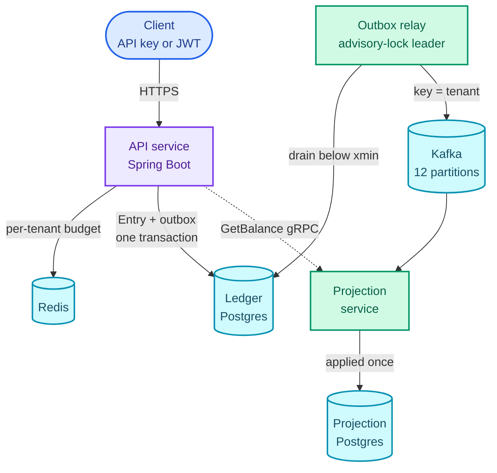

Nostro is the project I lead with for Java backend, SDE and fintech roles, which means it is the project I will be questioned on hardest. A ledger invites the sharpest questions in backend engineering: what happens when two requests race for one row, when the client retries, when Kafka delivers twice, when a slow transaction commits late, when one tenant names another tenant's data. This page is the prep for those questions. Every project fact on it comes from [the repo](https://github.com/rishabh0111/nostro-ledger) (README, `CONTEXT.md`, 16 ADRs, 7 research notes, the load-test notes, the code), [the public write-up]({{ site.baseurl }}/blogs/multitenant-double-entry-ledger/) or my master profile. Where something was not built, the answer says so.

## How to use this page

1. **Learn the pitch and the walkthrough first.** Most interviews spend their first five minutes there, and a clean walkthrough decides which questions come next.
2. **Read the architecture section with the repo open.** Trace one Entry through `EntriesController`, `JpaEntryRecorder`, `EntryWriter`, `OutboxDrain`, `EntryApplier` and `BalanceGrpcService` once. After that, every answer below has a file behind it.
3. **Read the prerequisites until each one fits in two sentences.** Interviewers drop from the project into the concept underneath it ("what does READ COMMITTED actually guarantee?"), and the project answer is worthless if the concept wobbles.
4. **Work the question bank by audience.** Read the question, answer it out loud, then read mine. The follow-ups are where the interview goes next.
5. **Before the interview,** reread the numbers table and the weak spots, and do the self-test at the bottom without looking.

The shape of every good answer here is the same: **the decision, the alternative I rejected and why, and what it cost.** If an answer of mine has no cost in it, the interviewer will supply one.

---

## What to say

### The 30-second pitch

> Nostro is a multitenant double-entry ledger I built in Java 21 and Spring Boot 4. Money moves as Entries whose Postings must sum to zero, and the design goal was to make four failures impossible rather than unlikely: an Entry that doesn't balance, one that gets lost, one applied twice, and one tenant touching another's money. Postgres enforces those in the schema, with a deferred constraint trigger, a guarded balance update with a CHECK behind it, a unique idempotency index and row-level security. It runs as three services, an API, a Kafka outbox relay and a gRPC projection, and 211 tests prove every guarantee on each push. Load-tested with Gatling, one hot account cost half the throughput of the same load spread over 64 accounts, with zero database errors of any kind.

### The 2-minute walkthrough

> A client calls `POST /v1/entries` with an API key. The tenant comes from that key, never from the request. The API service writes the Entry, its Postings, an idempotency record and an outbox row in one Postgres transaction. If the Entry touches a "constrained" account, one that may never go negative, a single guarded `UPDATE` moves its stored balance and refuses by updating zero rows; a `CHECK` constraint stands behind it. A deferred trigger re-checks at `COMMIT` that the Postings sum to zero per currency, so even raw SQL can't commit an unbalanced Entry.
>
> The response carries a **Position**, the transaction's `xid8` prefixed with the database's system identifier. A separate relay service, kept to one active writer by a Postgres advisory lock, drains the outbox into Kafka keyed by tenant, and it publishes a row only once its Position is below `pg_snapshot_xmin`, so a transaction that commits late is never overtaken. A projection service consumes Kafka into its own database and applies each Entry at most once: an `applied_entry` row and the consumer offset are written in the same transaction as the balance. A message it can't apply halts its partition instead of going to a dead-letter queue, because a ledger should stop rather than serve a wrong balance.
>
> Balance reads go from the API to the projection over gRPC. Every balance reports the Position it reflects, and a caller who passes its write's Position back gets a bounded, server-capped wait, always answered `200` with the Position actually reached. The connection is released before waiting, so a lagging projection can't drain the pool. Refusals are records in a sealed interface, mapped to RFC 9457 Problem Details by an exhaustive switch, so a new failure mode without an HTTP mapping doesn't compile.

Then stop, and let them pick a thread.

### Tilting it per audience

| Audience | Lead with | Have ready |
| --- | --- | --- |
| Java / Spring developer | Sealed outcomes and exhaustive switch; Hibernate 7 `StatelessSession` on the transaction's connection; startup-time permission check | Why JPA at all; virtual threads and pinning; the L2 cache default |
| Backend / SDE | The four impossible failures and where each is enforced | Idempotency under concurrency; the retry boundary; Problem Details |
| Database | Guarded `UPDATE` at READ COMMITTED; deferred trigger; RLS with `nullif` and FORCE | Why not SERIALIZABLE or `FOR UPDATE` + `SUM`; SQLSTATEs; lock ordering |
| Distributed systems / Kafka | Outbox, `pg_snapshot_xmin` gate, tenant-keyed partitions, halt-not-DLQ | Why not Kafka EOS, CDC, `SKIP LOCKED`; leader failover |
| System design | Three deployables because two replica counts conflict; CQRS with disclosed lag | Hot accounts, sharding by tenant, what breaks first |
| Fintech | Double-entry, minor units, reversals not edits, floor on reversals | Holds, FX, reconciliation, audit |
| Security | Tenant from credential; RLS fail-closed; 404 not 403; least-privilege roles | API key hashing, JWT revocation, gRPC metadata trust |
| Engineering manager | ADRs, the rule for Kafka/Redis/gRPC, honest load-test caveats | Scope cuts, what I'd do next, how I verified claims |

---

## The architecture end to end



Three deployables from one Maven reactor of ten modules: `nostro-domain` (plain Java, no Spring), `nostro-ledger-schema` (Flyway SQL), `nostro-outbox` (the Kafka message and topic facts), `nostro-persistence` (Hibernate entities and the write path), `nostro-balance-proto` (the `.proto` and stubs), `nostro-grpc-common` (tenant interceptors), `nostro-test-support` (Testcontainers singletons), and the three services. Two extra modules sit behind profiles: the Gatling load test and the end-to-end system test.

### One Entry, from HTTP to the Balance

1. **Authenticate.** `BearerAuthenticationFilter` reads `Authorization: Bearer nk_...`. `ApiKeyAuthenticationProvider` hashes it with SHA-256 and looks up `api_key` by that hash, skipping revoked keys. The result is a `Caller` with a Tenant and a set of Permissions.
2. **Bind the Tenant.** `TenantBindingFilter` puts the Tenant in `TenantContext` (a `ThreadLocal` that refuses nesting) and in the logging MDC.
3. **Rate limit.** `RateLimitFilter` spends one token of the Tenant's Bucket4j bucket in Redis (200 burst, 100 a second). Over budget is `429 rate-limited` with `Retry-After`. If Redis doesn't answer within 100 ms the request goes ahead and `nostro.ratelimit.unchecked` counts it.
4. **Authorize.** `RequiredPermissions` checks the handler's `@Requires(LEDGER_WRITE)` against the Caller.
5. **Parse into domain values.** `EntriesController` builds `Money` with `Money.of(BigDecimal, Currency)`, which refuses any amount that doesn't fit the currency's scale exactly (10.505 USD is not an amount). The command is a `RecordEntry` record.
6. **Retry boundary.** `JpaEntryRecorder` (outside the transaction) runs `EntryWriter.write` inside a `RetryTemplate` that retries only `40001`, `40P01` and `55P03`.
7. **Tenant onto the connection.** When the transaction begins, `TenantContextTransactionListener.afterBegin` runs `SELECT set_config('app.current_tenant', ?, true)` on that transaction's own connection.
8. **Decide, then write.** `EntryWriter`, on a `StatelessSession` bound to the same connection: look up the idempotency record (replay if found); check balance per currency; load the Accounts (another Tenant's are invisible under RLS, so they come back unknown); check currencies; read `pg_current_xact_id()` for the Position; insert the `entry` row, then the `idempotency_record` row, then all Postings in one `insertMultiple`; run the guarded `UPDATE` for each constrained Account, netted per Account, in ascending id order; insert the `outbox` row with the full Entry as JSON.
9. **Commit.** The deferred trigger `entry_balances_per_currency` re-checks that each currency nets to zero. RLS `WITH CHECK`, composite foreign keys and the `CHECK` constraints have already run. The controller answers `201 {"entry": ..., "position": ...}`.
10. **Relay.** The leader relay selects up to 500 rows `WHERE published_at IS NULL AND position < pg_snapshot_xmin(pg_current_snapshot()) ORDER BY position`, sends each to `nostro.ledger.entries` keyed by Tenant, flushes, waits for every ack, then marks the rows `published_at` and `publish_seq` and commits.
11. **Project.** The projection's consumer applies one message per transaction, acting as that Tenant: insert into `applied_entry` (`ON CONFLICT DO NOTHING`); upsert each Account's `projected_balance` (refusing a currency mismatch); raise `tenant_watermark` with `greatest()`; store the next offset in `consumer_position`; commit; then signal any reader waiting on that Tenant.
12. **Read.** `GET /v1/accounts/{id}/balance?minPosition=...`: the API checks the Account exists in the ledger in a short transaction that ends before the remote call, then calls `GetBalance` with a 2 s deadline and the Tenant in metadata `x-nostro-tenant`. If the watermark is below the minimum, the projection parks the call (on a virtual thread, holding no connection) for at most 1 s or the deadline minus 100 ms, then reads and answers with the Position it reflects.

### A reversal

`POST /v1/entries/{id}/reversal` with its own idempotency key. `EntryWriter` loads the original (another Tenant's is `404 unknown-entry`), checks it hasn't been reversed, negates every Posting and records an ordinary Entry with `reverses_entry_id` set. Everything an Entry obeys applies, including the floor, so a reversal can be refused with `422 insufficient-balance`. "At most once" is the unique constraint `entry_reversed_at_most_once` on `(tenant_id, reverses_entry_id)`: if two reversals race, the loser gets `23505` on that constraint and is answered `422 already-reversed`.

### A duplicate request

```mermaid
sequenceDiagram
    autonumber
    participant A as Request A
    participant DB as Ledger Postgres
    participant B as Request B (same key)
    A->>DB: insert entry, insert idempotency row
    B->>DB: insert entry, insert idempotency row
    Note over B,DB: B blocks on the<br/>unique index
    A->>DB: COMMIT
    DB-->>B: 23505 on idempotency_record_pkey
    Note over B: B's transaction is aborted;<br/>JpaEntryRecorder runs it again
    B->>DB: new transaction: record found
    DB-->>B: same entry id and Position (201)
```

Sequential replays are simpler: the lookup finds the record, the SHA-256 fingerprint of the request matches, and the writer returns the first Entry's id and Position. A different body under the same key is `422 idempotency-key-reused`. One detail worth knowing: a refusal is not stored. A floor refusal marks the transaction rollback-only, which also rolls back the idempotency row, so the same key retried later is evaluated again.

### A floor refusal

The guarded `UPDATE` updates zero rows. `EntryWriter` marks the transaction rollback-only and returns `InsufficientBalance` as a value; nothing is committed, no outbox row exists, `nostro.ledger.floor.rejections` goes up, and `LedgerRefusals` maps it to `422` with type `https://nostro.dev/problems/insufficient-balance`. The `CHECK (NOT constrained OR balance_minor >= 0)` never fires on this path. It is there for a future query that forgets the predicate, and it would raise `23514`.

### A relay leader failover

```mermaid
sequenceDiagram
    autonumber
    participant L as Relay (leader)
    participant DB as Ledger Postgres
    participant S as Relay (standby)
    L->>DB: pg_try_advisory_lock = true
    S->>DB: pg_try_advisory_lock = false
    Note over S: retry every 1 s
    L->>DB: select batch, publish to Kafka
    Note over L: dies before marking
    Note over DB: session ends,<br/>lock released
    S->>DB: pg_try_advisory_lock = true
    S->>DB: same rows still unpublished
    Note over S: republishes them;<br/>projection absorbs duplicates
```

The lock is session-level and held on the same dedicated, unpooled connection that drains, so losing the connection loses the lead in the same instant. A failed batch was never marked, so the next leader sends it again. The cost is a gap with nothing published (lag) and duplicates in Kafka, which `applied_entry` absorbs. `OutboxRelayIT.aKilledLeaderIsReplacedAndNothingIsLost` records 300 Entries, kills the leader's backend after 20 are published, starts a replacement, and checks every Entry arrived, first arrivals in recorded order, each at most twice. Note that `compose.yaml` runs one relay; the standby behaviour is proven in that test.

---

## Prerequisites to know cold

### Double-entry bookkeeping

Every movement of money is recorded as at least two signed amounts against different accounts that sum to zero, so value is never created or destroyed, only moved. Debit and credit are the accounting names for the two directions; Nostro just uses the sign. Mistakes are never edited: you record a reversing entry, so the history is append-only and every past balance can be rebuilt.

- **Here:** an Entry is the whole balanced fact, a Posting is one leg, and the zero-sum rule is per currency. `CONTEXT.md` bans the word "transaction" for money (it belongs to the database) and has no "transfer", because an Entry has no lifecycle: it is recorded or refused.
- **The probe:** "why not store just a `from`, `to` and `amount`?" Because N-legged Entries (fees, splits, an exchange across two currencies) are one balanced fact, and a two-party transfer table can't express them atomically.

### Transactions, isolation levels and MVCC

ACID: atomic (all or nothing), consistent (constraints hold at commit), isolated (concurrent transactions don't see each other's half-done work, to the degree the level promises), durable (committed survives a crash). Postgres uses MVCC: each row version carries the transaction ids that created and deleted it, and a statement reads a snapshot, so readers never block writers.

- **READ COMMITTED** (the default, and what Nostro runs): each statement sees a fresh snapshot. When an `UPDATE` finds its target row locked by another writer, it waits, and after that writer commits it re-evaluates its `WHERE` clause against the new row version. That re-check is what makes `balance_minor = balance_minor + :delta WHERE ... balance_minor + :delta >= 0` safe.
- **REPEATABLE READ:** one snapshot for the whole transaction; an update to a row someone else changed fails with `40001`.
- **SERIALIZABLE:** Postgres's SSI tracks read/write dependencies and aborts one transaction (`40001`) when the outcome couldn't have come from some serial order.
- **The probe:** "what does READ COMMITTED not protect you from?" A lost update when the application reads a value, computes in Java, and writes a literal back. Doing the arithmetic in the `UPDATE` avoids it.

### Row locks, deadlocks and lock ordering

An `UPDATE` takes a row lock held until commit. A deadlock is two transactions each waiting on a lock the other holds; Postgres detects it after `deadlock_timeout` and kills one with `40P01`. The standard prevention is a global lock order.

- **Here:** the constrained-Account updates are netted per Account into a `TreeMap` and issued as separate single-row statements in ascending id order. The research note found no documentation of the order a single multi-row `UPDATE` locks rows (it depends on the plan), so one statement per row is the documented-safe shape. `RecordEntryIT.oppositeOrderWritersDoNotDeadlock` runs 24 writers alternating left-to-right and right-to-left, 240 Entries, all recorded.
- **The probe:** "what about `lock_timeout`?" The request-path role has `lock_timeout = 1s`, `statement_timeout = 3s`, `idle_in_transaction_session_timeout = 10s`, so a hot row queues briefly and fails retryably (`55P03`) instead of holding the pool.

### The SQLSTATEs

| SQLSTATE | Name | In Nostro |
| --- | --- | --- |
| `23514` | check_violation | The floor's `CHECK` backstop, and the deferred zero-sum trigger. Never retried: it is an answer. |
| `23505` | unique_violation | A duplicate idempotency key in flight (run again, replay), or a second reversal (answer `already-reversed`). |
| `40001` | serialization_failure | Retried. Doesn't normally happen at READ COMMITTED; it is in the transient set anyway. |
| `40P01` | deadlock_detected | Retried. Lock ordering makes it not happen; the test proves it. |
| `55P03` | lock_not_available | Retried. Raised when `lock_timeout` expires. |
| `42501` | insufficient_privilege | What a native `UPDATE` on `posting` gets from the revoked grant. |

`SqlFailure` reads the SQLSTATE and constraint name off the cause chain, including a `BatchUpdateException`'s *next* exception, because pgjdbc throws plain `PSQLException` and Spring's translator has no entry for class 55. Retries use Spring Framework 7's `RetryTemplate`: 3 retries, 25 ms doubling to at most 400 ms, 25 ms jitter.

### Constraints that do the work

- **`CHECK`** is evaluated per row at write time. The floor is `CHECK (NOT constrained OR balance_minor >= 0)`.
- **A constraint trigger `DEFERRABLE INITIALLY DEFERRED`** runs at `COMMIT` instead of per statement. That matters because an Entry's Postings are inserted one by one (or in a batch); after the first insert the Entry is unbalanced, and only the whole set must sum to zero. `entry_balances_per_currency` fires `AFTER INSERT ON posting` for each row, at commit, and raises `check_violation` if any currency of that Entry nets non-zero.
- **Composite foreign keys** `(tenant_id, account_id, currency) REFERENCES account (tenant_id, id, currency)`: a Posting can only reference an Account of its own Tenant and only in that Account's currency. RLS does not cover referential integrity, so the Tenant travels inside the key.
- **The probe:** "why both the domain check and the trigger?" The domain gives a clean `422` and a precise message; the trigger makes the claim true for write paths nobody has written yet, including raw SQL. `SchemaInvariantsIT.anUnbalancedEntryIsRefusedByTheSchema` proves the second.

### Row-level security, FORCE and roles

RLS adds a policy predicate to every query on a table: `USING` filters what you can see, `WITH CHECK` validates what you write. Table owners and roles with `BYPASSRLS` skip policies unless the table is `FORCE ROW LEVEL SECURITY`.

- **Here:** every tenant-scoped table is `ENABLE` + `FORCE`. Policies compare `tenant_id = nullif(current_setting('app.current_tenant', true), '')::uuid`. The `true` stops a missing setting raising; the `nullif` handles the measured fact that a transaction-local setting reverts to the empty string after commit, not to NULL. With no Tenant set, reads see nothing and writes are refused. Five roles: the owner runs migrations only; `nostro_app` (request path), `nostro_control` (control plane), `nostro_relay` (sees only the outbox, can update two columns) and `nostro_projection` are all `NOSUPERUSER NOBYPASSRLS` and own nothing.
- **The probe:** "why `set_config(..., true)` and not `SET`?" A session-level `SET` survives on a pooled connection and leaks into the next borrower; `set_config(name, value, true)` is transaction-local and, unlike `SET LOCAL`, takes a bind parameter.

### Idempotency

An operation is idempotent if doing it twice has the same effect as once. Networks force at-least-once delivery (the client can't tell a lost request from a lost response), so a ledger needs idempotent writes to get exactly-once effects.

- **Here:** a required, caller-supplied key, unique per Tenant, stored with a SHA-256 fingerprint of the request and the Entry id, in the same transaction as the Entry. The unique index is the concurrency control. There are two different dedupe mechanisms in the system and they must not be confused: the Idempotency Key stops a *caller* recording twice; `applied_entry` stops the *transport* applying twice.
- **The probe:** "what happens after 30 days?" ADR-0005 sets 30-day retention, after which a retry would record a second Entry. The sweep that deletes old records is not built yet; the migration says so.

### The transactional outbox

The dual-write problem: you can't atomically write to your database and publish to a broker. Write to the database then publish, and a crash in between loses the event; publish then write, and a rollback leaves a phantom event. The outbox writes the event as a row in the same transaction as the business data; a separate process publishes rows and marks them.

- **Here:** the outbox row holds the whole Entry as JSON, existed from the first migration ("the one thing expensive to retrofit"), and is drained by predicate (`published_at IS NULL`), never by cursor. Publish-then-mark means a crash between the two republishes: at-least-once, absorbed downstream.
- **The probe:** "why not a cursor (`WHERE position > last`)?" Because positions are assigned at first write, not commit; a cursor can step past a row whose transaction hasn't committed yet and never come back.

### Kafka: partitions, keys, ordering, groups, offsets, exactly-once

A topic is split into partitions; each is an ordered, append-only log. Order is guaranteed only within a partition. A key is hashed to choose the partition, so messages with the same key are ordered relative to each other, as long as the partition count doesn't change. A consumer group divides partitions among its members; each partition goes to one member. An offset is a position in a partition; consumers normally commit offsets back to Kafka. The idempotent producer (`enable.idempotence`) uses a producer id and sequence numbers so retries don't duplicate or reorder within one producer session. Exactly-once semantics (EOS) adds transactions so a consume-transform-produce loop inside Kafka is atomic.

- **Here:** one topic, 12 partitions, keyed by Tenant, one message per Entry with all its Postings. `enable.idempotence=true` is set explicitly (if left defaulted, a conflicting setting like `acks=1` silently disables it; set explicitly, it fails at startup), `acks=all`, `max.in.flight=5`. The relay creates the topic and refuses to start on another partition count, because adding partitions moves Tenants to partitions holding none of their history. The consumer never commits offsets to Kafka: `enable.auto.commit=false`, offsets live in the projection's database, written in the apply transaction.
- **The probe:** "why not EOS?" EOS covers Kafka-to-Kafka. The projection writes to Postgres, an external store, and Kafka's own docs say the answer there is to store the offset with the output. And a relay republish after a crash is a new producer's new message, which idempotence can't recognise anyway.

### CQRS, eventual consistency and read-your-writes

CQRS separates the write model from the read model. The read model is derived asynchronously, so it is eventually consistent: it converges, but a read right after a write may not see it. Read-your-writes is the session guarantee that you at least see your own writes.

- **Here:** the write model is `entry`/`posting` (plus the stored balance, which exists only to enforce the floor); the read model is `projected_balance`. Every write returns a Position; every Balance reports one; passing the write's Position as `minPosition` gets a bounded wait. Lag becomes a disclosed fact instead of a lie.
- **The probe:** "why `200` when the wait times out, not `409` or `503`?" `409` is a conflict the client can resolve, `503` claims the server is unavailable (and trips other people's breakers), and RFC 9110 pairs `Retry-After` with `503` and `3xx` only. A `200` that states the Position it reached is honest at every outcome.

### Leader election with an advisory lock

An advisory lock is an application-defined lock in Postgres, keyed by a number, that the database holds but doesn't attach to any row. A session-level one is held until released or until the session ends. `pg_try_advisory_lock(key)` returns immediately with true or false.

- **Here:** every relay contends on the same constant key. Holding it means you are the single writer. Because it is tied to the session, a crashed process or cut connection releases it automatically, and a standby polling every second takes over. It must be held on a dedicated, unpooled connection: a pool would hand the session to someone else, and a transaction-mode pooler wouldn't keep a session lock at all.
- **The probe:** "what about a zombie leader?" See the Kafka questions below; the short answer is that the drain always publishes a prefix of the outbox in Position order, and apply is idempotent, so a zombie produces duplicates, not reordering of first arrivals.

### gRPC vs REST, deadlines and retries

gRPC is RPC over HTTP/2 with Protobuf contracts and generated stubs: typed, compact, multiplexed, with first-class deadlines (the absolute time by which the caller gives up, propagated to the server) and metadata (headers). REST over JSON is better for public APIs: any client can call it, and it is human-readable.

- **Here:** REST outward, gRPC inward for one call, `GetBalance`. Deadline 2 s per attempt, 3 attempts, 50 ms backoff doubling, retried only on `UNAVAILABLE` and `DEADLINE_EXCEEDED` (safe because a read has no effect to duplicate). The server reads the remaining deadline and caps its wait at deadline minus 100 ms. The Tenant rides in metadata, never in a message field.
- **The probe:** "why is retrying `DEADLINE_EXCEEDED` safe here?" Because `GetBalance` is a pure read. I wouldn't retry a write on a deadline without an idempotency key.

### Connection pool sizing and Little's law

Little's law: the average number of items in a system equals arrival rate times average time in the system, L = λW. For a pool, the connections you need are roughly throughput times how long each request holds a connection. But adding connections only helps if the thing behind them can do more work in parallel.

- **Here:** Hikari's default, 10, for 32 concurrent writers. On one hot row, transactions serialize: 105.8 commits a second means each holds the row about 9.5 ms. With 10 connections the last in the lock queue waits about 95 ms, far inside the 1 s `lock_timeout`. 32 connections would move 22 waiters from Hikari's queue (cheap) into Postgres's lock queue (a backend and an open transaction each), put the last waiter near 300 ms, and add no throughput because the row serializes them anyway.
- **The probe:** "so is 10 right in production?" It is right for that row on that laptop. The spread arm could use more connections; the README says a bigger pool belongs in front of a database with more cores, measured there.

### Java 21: virtual threads, records, sealed interfaces, pattern matching

- **Records:** immutable data carriers with generated constructor, accessors, `equals`/`hashCode`. Compact constructors validate: `Money` refuses a null currency, `Posting` refuses zero, `Entry` refuses an unbalanced list.
- **Sealed interfaces:** a closed set of implementations declared with `permits`. A `switch` over a sealed type with pattern matching is exhaustive, so the compiler rejects a missing case if there's no `default`.
- **Pattern matching:** `case InsufficientBalance insufficient ->` binds and tests in one step; `instanceof` patterns do the same in `if`.
- **Virtual threads:** cheap JVM-managed threads, mounted on a small pool of carrier threads, unmounted when they block. On Java 21, blocking inside `synchronized` pins the carrier (fixed by JEP 491 in later JDKs).
- **Here:** `spring.threads.virtual.enabled: true` puts the API's request handling on virtual threads. The gRPC server ignores that setting, so `ProjectionConfiguration` gives it a `newThreadPerTaskExecutor` of virtual threads; a call parked waiting for a watermark then costs almost nothing. `Watermarks` uses `ReentrantLock` and `Condition` instead of `synchronized` to avoid pinning. The relay and the projection consumer are single platform threads by design: ordering needs exactly one.

### Spring Boot 4, Spring Security, JPA and the StatelessSession

- **Spring Boot 4.1.1**, Spring Framework 7, Hibernate ORM 7. Chosen because Boot 3.5's free support ended on 2026-06-30 with no 3.6, and Spring gRPC is GA only on Boot 4 (ADR-0013).
- **Spring Security:** one stateless filter chain. CSRF, sessions, form login and basic auth are off; a bearer filter feeds three `AuthenticationProvider`s (API key, staff JWT, control key), each answering only for the token shape it recognises.
- **JPA/Hibernate:** an `EntityManager` keeps a persistence context (first-level cache, dirty checking). A `StatelessSession` has none: every `insert` is a statement, nothing is cached, nothing goes stale after a native `UPDATE` changes a row behind it. ORM 7 lets a stateless session batch with `insertMultiple`.
- **Second-level cache:** a cross-session cache. ORM 7's `StatelessSession` uses it by default, and a cached entity outlives the Tenant context that was allowed to load it, so it is off, explicitly, in config and on the session.
- **Here:** Spring's `SharedSessionCreator` didn't deliver a transactional stateless session under `JpaTransactionManager` on Hibernate 7.4 (it failed with "Already value ... bound to thread"). `StatelessSessionConnectionIT` found that. `TransactionalStatelessSession` derives the stateless session from the transaction's `Session` with `.connection()`, which shares the connection that carries `app.current_tenant`, and throws outside a transaction.

### Flyway

Versioned SQL migrations applied in order, recorded in a history table. Here: `V1__ledger_core.sql`, `V2__credentials.sql`, `V3__outbox_relay.sql` for the ledger, `V1__projection.sql` for the projection. They run as the database owner over a direct connection, in a short-lived migration container per database under compose, gated with `service_completed_successfully`. Role passwords come in as Flyway placeholders. Hibernate runs `ddl-auto: validate`, so the schema is Flyway's and Hibernate only checks it.

### Testcontainers

A library that starts real dependencies (Postgres, Kafka, Redis) in Docker for tests. Here: Testcontainers 2.x, singleton containers per module suite, the same image tags as `compose.yaml`, never `withReuse` (documented as unsuited to CI), and one Spring context per deployable, because context rebuilds cost more than container startup.

### Gatling and JFR

Gatling is a load-testing tool where scenarios are code (here, Java) and virtual users run concurrently; it reports throughput and latency percentiles. JFR (Java Flight Recorder) is the JVM's low-overhead built-in profiler: method samples, allocation, GC pauses, lock contention. Here: two arms, 32 users, 60 s each, contended (1 Account) and spread (64), JFR on the API service for 162 s.

### Micrometer metrics and tracing

Micrometer is the metrics facade Spring Boot uses (counters, gauges, timers with percentile histograms), exposed here at `/actuator/prometheus`. Micrometer Tracing (with the Brave bridge here) creates spans and propagates trace context across HTTP and gRPC; `datasource-micrometer` adds JDBC spans. There is no trace exporter: propagation and log correlation are the deliverable, collection is infrastructure. Logs are ECS JSON with trace id and Tenant on every line. Sampling is 100%, which the config says suits a demonstration and not production.

### RFC 9457 Problem Details

A standard JSON error body, `application/problem+json`, with `type` (a URI clients switch on), `title`, `status`, `detail`. Here: a closed enum `ProblemType` with URIs under `https://nostro.dev/problems/`, every one in the generated OpenAPI document, and the framework's own `400`s retyped to `malformed`. Unexpected failures are `500` with no detail; what broke is for the log.

### Rate limiting with Bucket4j

A token bucket holds up to `capacity` tokens and refills at a fixed rate; each request takes one, so a client can burst to capacity and sustain the refill rate. Bucket4j implements it; with its Lettuce integration the bucket state lives in Redis and is updated with compare-and-swap, so every API instance shares one budget per key. Here: key `nostro:rate:<tenant>`, 200 capacity, 100 per second, buckets expire once they would have refilled anyway. Core library rather than the Spring Boot starter, which was stale and unverified on Boot 4.1. Fails open.

### How money is represented

- **Minor units in a `long`**, not `double` (binary floating point can't represent 0.10 exactly) and not `BigDecimal` in the domain. `Money(long minor, Currency currency)`; arithmetic is `Math.addExact`, so overflow throws instead of wrapping.
- **`BigDecimal` only at the edge:** JSON amounts are decimal strings; `Money.of` calls `setScale(currency.scale())` without rounding, so an amount with too many decimals is refused rather than rounded.
- **Currency** is ISO 4217 via `java.util.Currency`, with its default fraction digits as the scale (USD 2, JPY 0, BHD 3); pseudo-currencies with no smallest unit (XAU, XXX) are refused. In the schema, `amount_minor bigint` and `currency ~ '^[A-Z]{3}$'`.

---

## Question bank

Answers are in my voice, the way I'd say them. Follow-ups are the likeliest next questions, with the short answer.

### Java and Spring

**Q1. What makes this a Java project rather than a Postgres project that happens to compile?**

That was literally the first weakness I wrote down for it (ADR-0016), so I designed against it. Three things. First, failure modes are types: recording an Entry returns a `RecordOutcome`, a sealed interface whose `Refused` branch permits exactly seven records, and one exhaustive `switch` with no `default` maps each to a Problem Details response. Add an eighth refusal without a mapping and the build fails. Second, the persistence layer is handled deliberately against a demanding schema: composite keys as `@EmbeddedId` records, a `StatelessSession` that I proved runs on the transaction's connection, the second-level cache off for an isolation reason. Third, the concurrent Java: the relay is a single-threaded `SmartLifecycle` with a leader lock and a crash-safe drain, the projection parks gRPC calls on virtual threads with a `ReentrantLock`/`Condition`, and the retry boundary sits outside the transactional proxy for a reason I can explain.

*Follow-ups:*
- **Q:** Isn't the schema doing all the real work? **A:** It holds the invariants because that's where every write path hits them. The Java decides the refusals as values first, so the database constraint is a backstop, not the error message.
- **Q:** Where is the domain logic? **A:** `nostro-domain`, plain Java with no Spring and no database: `Entry.imbalance`, `Money`, `Position`, the outcome types, unit-tested without starting anything.

**Q2. Why sealed interfaces and records for outcomes instead of exceptions?**

An unbalanced Entry or a breached floor isn't exceptional in a ledger, it's an answer the caller needs, so it should be a value in the return type (ADR-0014). Exceptions are invisible in signatures, so nothing forces a caller to handle a new one; the first anyone hears of an unmapped refusal is a `500` in production. With a sealed `Refused` and an exhaustive `switch`, adding `InsufficientBalance` without deciding its HTTP status is a compile error. Exceptions are still there for programmer error and broken infrastructure, and for the database refusing a race, which escapes the transaction as an exception because Postgres has already aborted it.

*Follow-ups:*
- **Q:** The controller throws `LedgerRefusals.of(refused)`, so you do throw. **A:** At the HTTP edge, yes: the switch builds a `ProblemException` that Spring renders. The domain and persistence layers return values; the throw is how a Spring MVC handler hands over a non-2xx body.
- **Q:** What does exhaustiveness cost? **A:** A new subtype breaks every switch over it, on purpose. `LedgerRefusalsTest` then pins each case to its status and type.

**Q3. Walk me through how the tenant gets from the HTTP request to the SQL.**

The bearer filter authenticates the credential and produces a `Caller` with a Tenant. `TenantBindingFilter` binds it to a `ThreadLocal` in `TenantContext` and the MDC, for the rest of the request. When any transaction begins, a `TransactionExecutionListener` bean, which Spring Boot attaches to every transaction manager, runs `set_config('app.current_tenant', ?, true)` on that transaction's own connection, obtained through the transactional Hibernate `Session` so it can't be a second pooled connection. RLS policies read that setting. Nothing in a controller or repository passes the Tenant around, so no route can forget it.

*Follow-ups:*
- **Q:** What if a query runs outside a transaction? **A:** No setting, so RLS matches no rows: reads are empty and writes refused. Fail-closed by design. The stateless session goes further and throws outside a transaction.
- **Q:** Why a `ThreadLocal` and not `ScopedValue`? **A:** `ScopedValue` was a preview API on Java 21. A `ThreadLocal` works per virtual thread too; `bind` refuses nesting and returns an `AutoCloseable` scope so it is always removed.
- **Q:** What about work on another thread? **A:** It has no Tenant, and the database refuses it. The gRPC client interceptor fails `UNAUTHENTICATED` before a call leaves the process if no Tenant is bound.

**Q4. Why Hibernate's `StatelessSession` on the write path?**

Three reasons. Ids are application-assigned UUIDs, so Spring Data's `save()` would call `merge()` and pay a `SELECT` per row; `insert()` doesn't. The write path runs a native guarded `UPDATE` on `account`, and a persistence context would hold a stale copy of that row; a stateless session has no context to go stale. And ORM 7 lets a stateless session batch with `insertMultiple`, so the Postings go out in one batched statement (`postingsAreBatched` records 20 Postings in at most 8 prepared statements, with `reWriteBatchedInserts` on the driver).

*Follow-ups:*
- **Q:** What did it cost? **A:** Spring doesn't auto-configure a transactional one, and `SharedSessionCreator` failed under `JpaTransactionManager` on Hibernate 7.4. I wrote `TransactionalStatelessSession`: derive it from the transaction's `Session` with `.connection()` so it shares the connection, bind it as a transaction resource, unbind on suspend for `REQUIRES_NEW`, close on completion.
- **Q:** How do you know it's on the same connection? **A:** `StatelessSessionConnectionIT` compares `pg_backend_pid()` across the `EntityManager` and the stateless session, checks the Tenant setting is visible, that it doesn't leak across transactions, and that the L2 cache is off.

**Q5. Why is the second-level cache off?**

A cached entity outlives the Tenant context that authorised loading it. Tenant A loads Account X under RLS; it's cached; tenant B asks for X by id and gets it from the cache without the database ever applying B's policy. ORM 7's `StatelessSession` uses the L2 cache by default, so the default silently undoes the isolation. It's off globally (`hibernate.cache.use_second_level_cache: false`) and the session sets `CacheMode.IGNORE` too, with a test.

*Follow-ups:*
- **Q:** Couldn't you key the cache by tenant? **A:** Hibernate's cache key is the entity id; the composite id does include `tenant_id`, but I'd still be trusting a cache to reproduce a database policy. Reads here are cheap point lookups; the cache buys nothing worth that.
- **Q:** And `open-in-view`? **A:** Off. A lazy load during serialization would run after commit on a connection with no Tenant and return an empty collection instead of an error.

**Q6. Why JPA at all? Wouldn't jOOQ or plain JDBC fit this schema better?**

Yes, and ADR-0016 says so in writing: jOOQ or `JdbcClient` would suit this schema better. JPA was a fixed constraint of the project, because it's what most Spring codebases run on, and the point was to show it handled deliberately against a demanding schema rather than swap the library when it fights back. Where it fights, I handled it and wrote down why: the composite FK mapping that ORM 7 refuses to boot with a partially read-only `@JoinColumns`, so the association is read-only in both columns; `@Immutable` being a hint that silently ignores updates, so the real barrier is `REVOKE UPDATE, DELETE`; `save()` doing a `merge()`. Where JPA adds nothing, I didn't use it: the projection, the relay and the credential lookups use `JdbcClient` or raw JDBC.

*Follow-ups:*
- **Q:** So you'd pick jOOQ next time? **A:** For a schema this constraint-heavy with this much native SQL, probably. I'd still keep the stateless, insert-only discipline.
- **Q:** Is `@Immutable` useless then? **A:** It's documentation and a small optimisation. On ORM 7 bulk HQL `update` on an `@Immutable` entity now throws, which closes one bypass; the grant is still the barrier.

**Q7. Why is the retry in a different bean from the transaction?**

Two Postgres facts. Once any statement in a transaction errors, the transaction is aborted and every further statement gets `25P02`, so you can't retry inside it. And a serialization failure can surface at `COMMIT`, after the `@Transactional` method body has returned. So the retry has to wrap the whole transaction from outside the proxy. `JpaEntryRecorder` is that outer bean; `EntryWriter.write` is the `@Transactional` method. An inner `@Transactional` with default `REQUIRED` would join the same physical transaction, and retrying there produces an `UnexpectedRollbackException` at the outer commit, not a retry.

*Follow-ups:*
- **Q:** What's retried? **A:** `40001`, `40P01`, `55P03` only, three retries, 25 ms doubling to 400 ms with 25 ms jitter. A `23505` on the idempotency key gets one more run (to replay); a `23505` on the reversal constraint becomes `AlreadyReversed`.
- **Q:** Why jitter? **A:** Without it, writers that collided retry in lockstep and collide again.

**Q8. How does the "every endpoint declares a permission" check work?**

`RequiredPermissions` is a `SmartInitializingSingleton`: after the context is up it walks every handler method in the `requestMappingHandlerMapping` that belongs to `io.nostro`, and if any carries neither `@Requires` (with at least one permission) nor `@Public`, it throws and the application doesn't start. The same bean is a `HandlerInterceptor` that enforces the permissions at request time. Refusing to start is stronger than refusing a request, because a check that only runs on request can be missed on an untested path. `RequiredPermissionsTest.anUndeclaredEndpointFailsStartup` proves it.

*Follow-ups:*
- **Q:** Why not `@PreAuthorize`? **A:** An endpoint without `@PreAuthorize` is open by default. I wanted the default to be "won't boot".
- **Q:** Why is `@Requires({})` rejected? **A:** An empty list would let any authenticated credential through; it isn't a declaration.

**Q9. Where do virtual threads help here, and where don't they?**

They help where threads wait. In the API, request handling runs on virtual threads, so 32 concurrent writers waiting on the Hikari pool cost nothing in platform threads. In the projection, a Balance call with a `minPosition` parks waiting for the watermark; on virtual threads that's cheap, which is why I gave the gRPC server a virtual-thread-per-task executor myself, since Spring's `spring.threads.virtual.enabled` doesn't reach it. They don't raise throughput past the real bottleneck: the load test showed requests waiting on the 10-connection pool, and virtual threads only make that wait cheaper. And the relay and consumer are single platform threads on purpose, because ordering needs exactly one.

*Follow-ups:*
- **Q:** Pinning? **A:** On Java 21 a virtual thread blocking inside `synchronized` pins its carrier, so `Watermarks` uses `ReentrantLock` and `Condition`. ADR-0013 notes Java 25 carries JEP 491, which fixes that.
- **Q:** Did you measure the gRPC server's thread behaviour? **A:** The research note marked it unverified; the configuration comment records that without the executor the server runs calls on a cached pool of platform threads, one per call however long parked.

**Q10. Why Spring Boot 4 rather than the battle-tested 3.x line?**

Support, not novelty (ADR-0013). Boot 3.5's free patches ended on 2026-06-30 and 3.5 is the last 3.x line, so a new project on it starts with no future free security fixes. And Spring gRPC, which the design needs, is GA only on Boot 4; the 3.x line stops at a pre-GA 0.12.0. Starting on 3.5 and migrating later would have meant building the gRPC seam twice.

*Follow-ups:*
- **Q:** What hurt? **A:** A lot of internet advice is wrong on Boot 4: `@MockBean`, the old Jackson package, Testcontainers 1.x imports. The Bucket4j starter was stale, so I used the core library. And the `StatelessSession` integration didn't work as documented.
- **Q:** Why Java 21 and not 25? **A:** 21 was a fixed requirement; Boot 4 supports both.

**Q11. How are the composite keys mapped?**

Every tenant-scoped table has `PRIMARY KEY (tenant_id, id)`, mapped as an `@EmbeddedId` record `TenantScopedId(UUID tenantId, UUID id)` that implements `Serializable`, which Hibernate recommends over `@IdClass`. The Posting-to-Entry foreign key shares `tenant_id` with the primary key, and JPA allows one writer per column. ORM 7 refuses to boot if only the shared column is muted in `@JoinColumns`, so the association is read-only in both columns and used for navigation, and the writable copies are the embedded id and a plain `entryId` column, both set from the Entry in the only constructor. If they ever diverged, the composite FK and the RLS `WITH CHECK` would refuse the row.

*Follow-ups:*
- **Q:** Why is the Account a plain column on Posting? **A:** Its FK is three columns, two shared. The database holds that constraint whatever the mapping says.

**Q12. How do Spring and the domain module depend on each other?**

They don't, in that direction. `nostro-domain` has no Spring and no database. The persistence module implements the domain's `EntryRecorder` and `BalanceReader` interfaces. `BalanceReader` had two implementations over time, first a `SUM` over Postings, then the gRPC call to the projection, and the controller and its contract didn't change. The module rules from the research note: the projection may not depend on the ledger's persistence module, and the proto module may not depend on the domain.

*Follow-ups:*
- **Q:** How do you stop a library module from being a fat jar? **A:** `spring-boot-maven-plugin`'s `repackage` runs only in the three service modules; a repackaged jar can't be depended on.

### Backend and SDE

**Q13. What are the guarantees, and where is each one enforced?**

Four. Every Entry balances: the domain refuses it as a value and a deferred constraint trigger re-checks per currency at `COMMIT`. No tenant sees or references another's money: the Tenant comes from the credential, RLS on both databases, composite foreign keys. A constrained Account never goes negative: guarded `UPDATE` plus a `CHECK`. A retry never records twice and nothing is lost or applied twice on the way to a Balance: unique idempotency index in the Entry's transaction, an outbox in the same transaction, `applied_entry` plus stored offsets in the projection. The README lists 25 claims, each naming the test that proves it, and CI ticks that table from the test reports.

*Follow-ups:*
- **Q:** Which one would you defend first? **A:** Tenant isolation, because the failure is silent: a wrong RLS setup returns empty results, not errors. That's why there are tests that use a valid credential for one tenant against another's account.

**Q14. Design the idempotency. What happens with two identical requests at the same instant?**

The key is required and unique per Tenant. Both requests miss the lookup and start writing. Each inserts its own `entry` row, then tries to insert the idempotency record. The first holds the unique index entry; the second blocks on it until the first commits, then fails with `23505` on `idempotency_record_pkey`. Its transaction is gone, so `JpaEntryRecorder` runs the writer once more in a fresh transaction, which now finds the record, compares fingerprints and replays the same Entry id and Position. `RecordEntryIT.concurrentDuplicatesRecordOnce` fires 16 at once: one Entry, 16 identical outcomes. The idempotency row is inserted second, right after the Entry, so a duplicate blocks before any Account row is locked.

*Follow-ups:*
- **Q:** What's in the fingerprint? **A:** SHA-256 over a canonical form of the command: kind, description, each Posting's account, currency and minor amount, in order. Same key, different fingerprint, `422 idempotency-key-reused`.
- **Q:** Is a refusal replayed? **A:** No. Refusals are decided before or roll back with the write, so no record survives; the same key retried later is evaluated again.

**Q15. Why not keep idempotency keys in Redis?**

Redis can't join the Entry's Postgres transaction. Then there's a window: check Redis, write the Entry, set the key, and a crash or a race between those steps either loses the key (duplicate on retry) or sets it for an Entry that rolled back (the retry is told it succeeded). A unique index inside the same transaction makes "Entry exists" and "key exists" the same commit. ADR-0008 records Redis holding keys as rejected.

*Follow-ups:*
- **Q:** Redis is faster. **A:** The lookup is a primary-key read on a table the write already touches. It's not the bottleneck; the hot row and the pool are.
- **Q:** `SET NX` with a TTL? **A:** Same problem: the flag and the Entry are in two systems with no shared commit.

**Q16. Why is the key required? Most APIs make it optional.**

Because an optional key means the duplicate-payment hole is on by default for every client that didn't read the docs (ADR-0005). In a ledger at-most-once recording isn't a feature to opt into.

*Follow-ups:*
- **Q:** What does a retry get back? **A:** The original response, `201` with the same id and Position, not a bare conflict, because a client usually retries precisely because it never saw the first response.

**Q17. What status codes do you return, and why `404` for another tenant's account?**

`400` malformed or unparseable; `422` well-formed but refused by the domain (unbalanced, floor, key reused, already reversed, currency mismatch); `404` for an Account or Entry this Tenant doesn't have; `409` for a name taken (account code, tenant name, staff username); `429` rate-limited; `503` only when the projection doesn't answer, with `Retry-After`. `404` not `403` because a `403` confirms the account exists. The message is the same whether it belongs to nobody or to another Tenant.

*Follow-ups:*
- **Q:** Why `422` and not `400` for unbalanced? **A:** The body parsed fine; the domain refused it. `400` is "fix the request syntax", `422` is "this request is understood and not allowed".
- **Q:** Why does a lagging projection return `200`? **A:** Lag is not an error; the response says which Position it reflects.

**Q18. How does the Balance read avoid exhausting the connection pool when the projection lags?**

The rule from ADR-0007: release the JDBC connection before a waiter parks. `ProjectedBalanceReader` refuses to run inside a transaction. It checks the Account exists in the ledger in its own short read transaction, which returns the connection, and only then calls the projection. The projection reads the Balance, and if the watermark is short it parks on `Watermarks` holding no connection, then reads again. So lag costs parked virtual threads, not connections. `BalanceIT.aLaggingProjectionDoesNotExhaustThePool` and `BalanceServiceIT.parkedCallsHoldNoConnection` prove both sides.

*Follow-ups:*
- **Q:** What's the wait cap? **A:** 1 s on the server by default, and never past the call's deadline minus 100 ms. The client deadline is 2 s, longer than the cap, so a waiting call ends with the projection's honest answer.
- **Q:** What if this projection instance doesn't consume that tenant's partition? **A:** It never gets signalled, wakes at its deadline and reads the database, which is still the truth. The signal is a wake-up, not a source of truth.

**Q19. Why is there no circuit breaker on the gRPC call?**

A breaker is worth as much as the fallback it enables, and there's no honest fallback for a Balance (ADR-0011). I can't invent one, and serving a stale one would mean reinventing the Position semantics. What's left is failing fast, which the 2 s deadline already does. The stronger point: the write path never calls the projection. The floor is checked on the stored balance in the ledger's own database, so a projection outage costs reads, not writes. Money is still recorded correctly.

*Follow-ups:*
- **Q:** Doesn't retrying a dead service make it worse? **A:** Three attempts with doubling backoff from 50 ms, only on `UNAVAILABLE` and `DEADLINE_EXCEEDED`. That's bounded. At much larger scale I'd add a retry budget before a breaker.
- **Q:** What does the client see? **A:** `503` with `Retry-After: 1`, type `about:blank`, because it isn't a domain refusal.

**Q20. Explain the account history pagination.**

`GET /v1/accounts/{id}/postings`, newest first, keyset-paged on `(position, id)`, which is exactly the order of the index `posting_account_history_idx (tenant_id, account_id, position DESC, id DESC)`. The cursor is base64url of `<position token>/<posting id>`, opaque. Postings are insert-only, so a page never changes under a reader, and there's none of offset pagination's drift. What keyset doesn't promise is that nothing appears behind you: a Position is assigned at first write, so an Entry in flight when a page was cut can commit later with an older Position. The code comment says so: a reader that must see it reads again from the top.

*Follow-ups:*
- **Q:** Why denormalise `position` onto `posting`? **A:** So history pages by an index without joining `entry`.

**Q21. How do you represent money, and why not `double` or `BigDecimal`?**

A `long` of minor units plus a `Currency` record carrying the ISO code and scale. `double` can't represent most decimal fractions exactly, so sums drift. `BigDecimal` is exact but its scale travels with each value, `equals` treats 1.0 and 1.00 as different, and it's easy to round by accident. With minor units, every amount is an integer at the currency's fixed scale, addition is `Math.addExact` (overflow throws), and Postgres stores a `bigint`. `BigDecimal` is used only at the JSON edge, and `setScale` without a rounding mode refuses 10.505 USD outright.

*Follow-ups:*
- **Q:** JPY has no minor unit. **A:** Scale 0 from `java.util.Currency`; 500 JPY is `minor = 500`.
- **Q:** Why decimal strings in JSON? **A:** JSON numbers are parsed as doubles by many clients.

**Q22. What does "an Entry has no lifecycle" mean, and why no status column?**

A caller POSTs an Entry and it's recorded or refused synchronously, inside one transaction (ADR-0003). A state machine whose every instance goes pending to posted inside one transaction is ceremony. A status column on an immutable fact is a contradiction and invites `UPDATE` on a table whose value is that it never takes one.

*Follow-ups:*
- **Q:** What about holds? **A:** Considered seriously, rejected on cost: they roughly double the balance model (available vs posted) and add expiry, which means a scheduler. If wanted, they should displace scope, not add to it.

### Databases

**Q23. Why a guarded `UPDATE` instead of `SERIALIZABLE`?**

`SERIALIZABLE` gets correctness by aborting one of two conflicting transactions with `40001`, and the client retries. On a hot account, every concurrent writer conflicts, so you get retry storms under exactly the contention the floor exists for (ADR-0004). The guarded `UPDATE` at READ COMMITTED serializes writers on the row lock instead: the second waits, re-evaluates `balance_minor + :delta >= 0` against the committed row, and either moves the balance or updates zero rows. No aborts, no retries for the common case. And `SERIALIZABLE` can't express the invariant in the schema; the check still lives in application code.

*Follow-ups:*
- **Q:** Did you measure SERIALIZABLE? **A:** No. The research note says the false-positive rate is a measurement no document gives, and I didn't run that comparison. What I measured is that the guarded `UPDATE` produced zero `40001`, `40P01`, `55P03` under 32 writers on one row.
- **Q:** Isn't READ COMMITTED weak? **A:** For this statement it's documented-safe, because the arithmetic happens in the `UPDATE` against the current row.

**Q24. Why not `SELECT ... FOR UPDATE` then `SUM` the postings?**

It's correct, and its cost grows with the Account's entire history (ADR-0004). The fix for that is a checkpoint table, which is a stored running balance with more moving parts. Two traps on top: a locking clause can't be used with aggregation, so lock and sum are two statements; and the shape breaks at REPEATABLE READ, where the snapshot is frozen at the first statement and can predate the work you just waited for.

*Follow-ups:*
- **Q:** Why not lock the account row and keep a balance column read in Java? **A:** That's the classic lost update if the arithmetic happens in Java and a literal is written back. Doing it in the `UPDATE` avoids it.

**Q25. Why do you need the `CHECK` if the `UPDATE` already guards the floor?**

They fail differently. The guarded `UPDATE` refuses by updating zero rows: no error, no SQLSTATE, and a caller that ignores the row count commits a lie. The `CHECK` refuses with `23514`, which can't be ignored. The guard gives the clean business answer; the `CHECK` is what still holds when someone writes a new query without the guard. In the load test the `CHECK` never fired: all 359 refusals were the guard.

*Follow-ups:*
- **Q:** Could the guard use a subquery over postings? **A:** No. After a lock wait Postgres re-evaluates the `WHERE` against the updated row, but a subquery would read from the statement's snapshot; the guarantee would silently disappear. The code comment says the predicate stays on account columns.

**Q26. Do you store balances or compute them?**

Both, for different jobs. Constrained Accounts carry a stored `balance_minor` that exists only to enforce the floor, never to serve a read. Unconstrained Accounts store nothing; their writes are pure append and take no row lock. Reads come from the projection for every Account. The invariant that stored balance equals `SUM` over Postings is tested in CI after specific writes, and the running system checks it every minute with `Reconciliation`, exposed as `nostro.reconciliation.disagreements`, which must be zero.

*Follow-ups:*
- **Q:** Why not read the stored balance? **A:** Unconstrained accounts don't have one, and one read model for all accounts is simpler and keeps reads off the write database's hot rows.

**Q27. How does the deferred constraint trigger work, and why deferred?**

`CREATE CONSTRAINT TRIGGER entry_balances_per_currency AFTER INSERT ON posting DEFERRABLE INITIALLY DEFERRED FOR EACH ROW`. It's queued per Posting row and runs at `COMMIT`, where it sums that Entry's Postings by currency and raises `check_violation` if any currency nets non-zero. It must be deferred because Postings arrive one at a time; after the first insert the Entry is unbalanced by definition. Only the final set has to balance.

*Follow-ups:*
- **Q:** Cost? **A:** One indexed aggregate per Posting at commit, over that Entry's Postings (`posting_entry_idx`). It runs once per row, so an Entry of N Postings sums N times; for small Entries that's cheap, and it's the price of covering every write path.
- **Q:** Why `RETURN NULL`? **A:** It's an `AFTER` trigger; the return value is ignored.

**Q28. How does RLS fail closed, and what's the `nullif` for?**

Policies compare `tenant_id` to `nullif(current_setting('app.current_tenant', true), '')::uuid`. With no setting, `current_setting(..., true)` returns NULL instead of raising; after a transaction that used `set_config(..., true)` commits, the setting reverts to the empty string, not NULL, and `''::uuid` would raise. `nullif` turns both into NULL, and `tenant_id = NULL` matches nothing. So no Tenant means no rows read and every insert refused. `SchemaInvariantsIT.noTenantContextFailsClosed` proves it.

*Follow-ups:*
- **Q:** How did you learn the empty-string behaviour? **A:** The research note marks it as measured, not documented.
- **Q:** Why FORCE? **A:** So even the owning role is subject to policies. The runtime roles don't own the tables anyway; FORCE is the second layer.

**Q29. Why composite foreign keys if RLS already isolates tenants?**

RLS doesn't cover referential integrity: a foreign key check isn't filtered by the referencing session's policies. A Posting with `account_id` pointing at another tenant's Account could pass a plain FK. With `(tenant_id, account_id, currency) REFERENCES account (tenant_id, id, currency)`, a row in another tenant can't satisfy the constraint at all. `SchemaInvariantsIT.aCrossTenantReferenceIsRefusedByTheForeignKey` proves it. The `currency` in the key also makes "a Posting is in its Account's currency" a schema fact.

*Follow-ups:*
- **Q:** What's `account_currency_reference`? **A:** A redundant unique key on `(tenant_id, id, currency)` that exists so the three-column FK has something to reference.

**Q30. How are `entry` and `posting` insert-only?**

The request-path role is granted `SELECT, INSERT` and explicitly revoked `UPDATE, DELETE, TRUNCATE` on `entry`, `posting`, `idempotency_record` and `outbox`. On `account` it holds `UPDATE (balance_minor)` only, and a trigger refuses changes to any other column for every role. There's no `DELETE` policy anywhere. `@Immutable` on the entities is a hint; the grant is the barrier, and it covers HQL, native SQL and the stateless session. `RecordEntryIT.aPostingCannotBeUpdated` shows native SQL refused with `42501`.

*Follow-ups:*
- **Q:** Why write the REVOKEs if they're already absent? **A:** So the barrier reads as a decision, not an accident.

**Q31. Why is a `bigserial` not a Position?**

Not because of gaps. A sequence number is assigned when the `INSERT` executes; the row becomes visible when the transaction commits; nothing ties those orders together. Transaction A takes 10 and is slow, B takes 11 and commits. A reader tailing `WHERE seq > cursor` sees 11, advances, and never returns for 10: one Entry silently never reaches the projection, with no rollback and no error (ADR-0007, research note).

*Follow-ups:*
- **Q:** And `xid8` has the same problem? **A:** Yes, xids are first-write order too. The fix isn't the number, it's the read rule: drain by predicate and only below `pg_snapshot_xmin`.
- **Q:** Why the system identifier prefix? **A:** A token from a restored or rebuilt database fails loudly instead of comparing as a plausible number.

**Q32. Explain `pg_snapshot_xmin` and why the relay gates on it.**

`pg_snapshot_xmin(pg_current_snapshot())` is the oldest transaction id still active in my snapshot. Every transaction id below it is either committed and visible or rolled back, so no row with a lower xid can appear later. The relay publishes only rows whose Position is below that. Combined with `ORDER BY position` and the `published_at IS NULL` predicate, publish order is exactly Position order and nothing can later appear beneath what's already published. `OutboxDrainIT.aLateCommitterIsNotOvertaken` holds a transaction open and checks a later one isn't published past it.

*Follow-ups:*
- **Q:** Cost? **A:** Head-of-line blocking: one long-running write transaction holds back the feed for every Tenant. It's bounded by the request role's `idle_in_transaction_session_timeout` of 10 s and the relay's own timeouts. That's lag the Position discloses, not a lie.
- **Q:** A bug you found here? **A:** A bare `ORDER BY position` resolved to the select list's `position::text` and sorted xids as strings, 1000 before 740. `OutboxRelayIT` caught it; the sort is now on `o.position`, qualified.

**Q33. What indexes exist and why?**

`entry_position_idx (tenant_id, position)`; `posting_entry_idx (tenant_id, entry_id)` for the balance trigger and reversals; `posting_account_history_idx (tenant_id, account_id, position DESC, id DESC)` for keyset history; the partial `outbox_unpublished_idx ON outbox (position) WHERE published_at IS NULL` so the drain reads only unpublished rows in order; unique indexes for idempotency, one outbox row per Entry, account code per tenant, and reversed-at-most-once.

*Follow-ups:*
- **Q:** Why partial? **A:** Published rows are the vast majority and never read by the drain; the partial index stays small.

**Q34. How do you handle a hot account turning into a pool outage?**

Every request blocked on the row holds a pooled connection. With Hikari's defaults (10 connections, 30 s `connectionTimeout`), eleven requests stuck on one row would take down every endpoint, including ones that never touch it. So `lock_timeout` is 1 s on the request role, far below `connectionTimeout`: a request queued too long fails retryably with `55P03` instead of the pool failing everyone. In the load test the last waiter was about 95 ms from the lock, so no `55P03` appeared.

*Follow-ups:*
- **Q:** Why not `REQUIRES_NEW` anywhere on this path? **A:** It takes a second connection while holding the first; under contention that deadlocks the pool. A test asserts nothing in the request path opens a second connection inside a transaction.

**Q35. Why not `@Version` optimistic locking on account?**

Two writers doing `balance = balance + delta` aren't in conflict; addition commutes. Optimistic locking would manufacture a conflict and a retry for every concurrent writer, and a native `UPDATE` doesn't increment the version anyway unless written as `update versioned`.

*Follow-ups:*
- **Q:** When would you use it? **A:** When the update depends on reading a value the database can't recompute, like editing a document.

### Questions that test the database choice

**Q36. Couldn't you use a NoSQL database like MongoDB, DynamoDB or Cassandra for the ledger?**

You could build a ledger on some of them, but not this design, because every guarantee I claim lives in features they don't have. One Entry is a multi-row atomic write: the Entry, N Postings, the balance update, the idempotency record and the outbox row commit together. Then the schema enforces things for every write path: a deferred trigger checks zero-sum at commit, composite foreign keys make cross-tenant references unwritable, RLS filters every query, a `CHECK` holds the floor, grants make history insert-only. And the ordering guarantee uses Postgres internals, `xid8` and `pg_snapshot_xmin`.

Taking them one at a time:
- **MongoDB** has multi-document transactions, so atomicity is possible. But there are no foreign keys, no deferred constraints, no row-level security; zero-sum, tenant scoping and insert-only would all move into application code, where they hold only for the paths that remember. That's exactly what I designed against.
- **DynamoDB** can do the floor neatly: a conditional update `SET balance = balance - :x IF balance >= :x`. Idempotency works as a conditional put, and `TransactWriteItems` gives atomicity over a bounded number of items, with Streams as a natural outbox. What I'd lose is the zero-sum check at commit, cross-item referential integrity and RLS. Isolation becomes IAM leading-key conditions plus application discipline, and a large Entry hits the transaction item limit.
- **Cassandra** is the clearest no: lightweight transactions are per partition, there are no multi-partition atomic writes, so an Entry touching accounts in different partitions can't commit atomically.

So it isn't "NoSQL can't store money". It's that the design's thesis is that the database refuses bad data, and Postgres is the store that can express every refusal.

*Follow-ups:*
- **Q:** What about scale? **A:** A tenant-scoped relational design shards by tenant naturally: `tenant_id` leads every key and every index, and is the Kafka key. Hot single accounts are the real scaling limit, and they're a limit in any store, because the floor needs one serialization point per account.
- **Q:** Would you use NoSQL anywhere here? **A:** Redis already is, for the one job where a shared fast counter fits: rate limits.

### Distributed systems and Kafka

**Q37. Why an outbox? Why not publish to Kafka from the request?**

The dual-write problem. Postgres and Kafka share no transaction. Commit then publish, and a crash in between loses the Entry from the read side forever. Publish then commit, and a rollback leaves an Entry in Kafka that doesn't exist. The outbox row is written in the Entry's own transaction, so "Entry recorded" and "Entry queued for publication" are one commit. The relay then gets at-least-once publication, and the projection makes apply idempotent. It also keeps Kafka off the write path: if the broker is down, writes still succeed and the outbox grows.

*Follow-ups:*
- **Q:** Why was it in the first migration? **A:** Retrofitting an outbox means backfilling events for everything already written. Starting with it costs one insert per Entry.
- **Q:** What's in the payload? **A:** The whole Entry as JSON: tenant, entry id, Position token, reversed Entry, description, every Posting with its id. The relay never parses it; it publishes bytes.

**Q38. Why is the partition key the Tenant? Why not the Account, or the Entry?**

Kafka orders per partition, and a key only orders because it maps to one partition. Keying by Tenant puts all of a Tenant's Entries on one partition in the order the relay published them, which is Position order. Keying by Account would split one Entry's Postings across partitions, and the projection could be observed mid-Entry with Postings that don't sum to zero, the one invariant this project exists to show. It also buys nothing: a balance is a sum, and sums commute. Keying by Entry orders nothing, since each Entry is one message.

*Follow-ups:*
- **Q:** One giant tenant then lands on one partition. **A:** Yes, a tenant's throughput is bounded by one partition and one consumer. That's the trade for per-tenant order and whole Entries. See the system design section for what I'd do.
- **Q:** Could you key by Account if each message were a whole Entry? **A:** A multi-account Entry has no single account to key by.

**Q39. Why exactly 12 partitions, and why does the relay refuse to start on a different count?**

Twelve is enough to show parallelism across Tenants and few enough to reason about; it isn't from a measurement. The count is schema, not configuration: the default partitioner maps `hash(key) % partitions`, so adding partitions moves Tenants to partitions holding none of their history, and nothing orders the old messages against the new. `TopicSchema.ensure` creates the topic if absent and throws if it exists with another count. Auto-create is off on the broker. Changing the count is a new topic and a deliberate cut-over.

*Follow-ups:*
- **Q:** How would you cut over? **A:** Not built. I'd stop the relay, let the projection drain the old topic to the end, start publishing to a new topic, and point the consumer at it with fresh stored offsets. Per-tenant order holds because no Tenant has messages in flight on both.

**Q40. Why not Kafka transactions and exactly-once semantics?**

They don't reach where I need them. EOS makes a consume-transform-produce loop atomic within Kafka. The projection writes to its own Postgres, an external system, and Kafka's documentation says the answer there is to store the offset in the same place as the output. So the projection stores `consumer_position.next_offset` in the same transaction as the balance update and `applied_entry`, and never commits offsets to Kafka. On the produce side, a transactional producer still can't make the Postgres `UPDATE ... SET published_at` atomic with the Kafka write, so a crash between them republishes either way.

*Follow-ups:*
- **Q:** Then why is the consumer's `isolation.level` `read_committed`? **A:** Defensive: the default is `read_uncommitted`, and if the relay ever produced transactionally, aborted records would be applied. Both that and `enable.auto.commit=false` are refused as overrides.
- **Q:** Anything from transactions worth having? **A:** A fixed `transactional.id` would fence a zombie producer during failover. The research note calls it worth having; I didn't build it.

**Q41. The projection has two dedupe mechanisms. Why both?**

They cover different failures (ADR-0010). The stored offset covers a crash between applying and moving on: on restart the consumer seeks to the stored offset, which never advanced, so it resumes at the right message. `applied_entry`, unique on `(tenant_id, entry_id)`, covers everything that arrives at a new offset: the relay republishing after a crash, a replay from zero, a rebuilt topic. The offset can't recognise those. `EntryApplyIT.publishedTwiceAndReplayedFromZero` publishes every Entry twice, replays the topic from offset zero, and checks each Tenant's Balances sum to zero and match.

*Follow-ups:*
- **Q:** Is `applied_entry` the idempotency key? **A:** No, and conflating them is a classic mistake. The Idempotency Key stops a caller recording twice; `applied_entry` stops the transport applying twice.
- **Q:** How long is `applied_entry` kept? **A:** Forever. A projection that can't be rebuilt from zero is one whose correctness can't be shown.

**Q42. Why does the projection halt instead of sending bad messages to a dead-letter queue?**

Skipping an Entry means serving a quietly wrong Balance indefinitely, for every Account it touched, while the DLQ makes that feel handled (ADR-0010). A ledger should stop rather than lie. So a message the projection can't apply (an Entry that doesn't balance, a Posting in another currency than the Account's, a key that doesn't match the Tenant, a Position from another installation) pauses its partition at that message, increments `nostro.projection.halts`, and the gauge `nostro.projection.partitions.halted` goes non-zero immediately. Other partitions carry on. Database unavailability is different: it's retried, seeking back to the message after a pause.

*Follow-ups:*
- **Q:** How do you recover? **A:** Deliberately: fix what produced the message and restart, or, as a recorded decision by a person, move that partition's stored offset past it.
- **Q:** Doesn't halting hurt other tenants on that partition? **A:** Yes, their balances stop advancing; reads still return `200` with an old Position, so the lag is disclosed. That's the cost of not lying.
- **Q:** Can these messages even happen? **A:** The ledger can't write them; the schema refuses each case. They'd mean a bug or a foreign producer. That's why halting is cheap: it should never fire.

**Q43. Why not CDC with Debezium instead of a hand-written relay?**

I looked at it seriously. Logical decoding is the one mechanism whose ordering is documented: changes are decoded in commit order. But that extra guarantee doesn't survive the transport, because Kafka reduces any order to per-partition order, and Debezium's own outbox router still needs a key to keep order. With the key as the Tenant, my relay's per-tenant order is as strong as commit order would have been. CDC is also at-least-once, so it doesn't remove the idempotent apply. And it adds `wal_level=logical` (a restart), a replication slot that fills the disk if the consumer stops, and a Kafka Connect worker, to a stack whose point is `docker compose up`. The honest other side: if the requirement hardens to global commit order, say a second consumer that must see all tenants in one consistent order, logical decoding is the migration and I'd make it.

*Follow-ups:*
- **Q:** Doesn't the outbox shape help CDC? **A:** Yes: it's insert-only, so `REPLICA IDENTITY` never comes up, and with CDC the marking step disappears.

**Q44. Why not `SKIP LOCKED` to run several relays in parallel?**

`SKIP LOCKED` gives each worker rows the others haven't locked, which is great for a work queue and fatal for ordering: the Postgres docs say skipping locked rows gives an inconsistent view of the data. Two workers would publish interleaved batches and Kafka order would be the network's. The relay is the ordering authority, so it's a single writer, and the cheapest way to get one with no new infrastructure is a session-level advisory lock.

*Follow-ups:*
- **Q:** Then how does the relay scale? **A:** It doesn't, today. One thread, batches of up to 500, one flush per batch. See the system design section for partitioning the relay by tenant.

**Q45. What happens with a zombie leader, one that lost the lock but is still publishing?**

Its connection is gone, so it can't mark anything; only the new leader's marks count. It could still have a batch in flight to Kafka, so a partition may get the zombie's batch interleaved with the new leader's. Both batches are prefixes of the unpublished outbox in Position order, so in any interleaving of the two, the first arrival of each Entry is still in Position order; the second copies are duplicates that `applied_entry` absorbs before the watermark check. That's the property the failover test asserts: first arrivals in recorded order, each Entry at most twice. The relay also drops its connection on any failure, so a relay that still holds the lead is the one draining. What I didn't build is producer fencing with a `transactional.id`, which would stop the zombie's sends outright.

*Follow-ups:*
- **Q:** Is the prefix argument documented in the repo? **A:** The test asserts the outcome; the prefix reasoning is mine.
- **Q:** What if the network partitions the leader from Postgres but not from Kafka? **A:** Same case: its next database statement fails, it drops the connection and backs off. In the meantime it can send at most the batch it already selected.

**Q46. How does the producer config protect ordering?**

`enable.idempotence=true` gives each producer an id and per-partition sequence numbers, so a retried batch can't be duplicated or reordered within that producer session, with up to 5 in-flight requests. The trap: it's already the default in Kafka 4.x, but if it's left defaulted and someone sets a conflicting option like `acks=1` for latency, idempotence is silently disabled. Set explicitly, the same conflict throws `ConfigException`. So `ProducerSettings` sets it explicitly, refuses it as an override, and defaults `acks=all`. `ProducerSettingsTest.aConflictingSettingFailsLoudly` proves it.

*Follow-ups:*
- **Q:** Does idempotence dedupe a relay republish? **A:** No. After a restart it's a new producer with a new id, and the republish is a genuinely new message.

**Q47. What is the Position, and how does read-your-writes work end to end?**

The Position is `<system_identifier>:<xid8>`, the xid zero-padded to 20 digits, assigned inside the Entry's transaction by `pg_current_xact_id()`. It's opaque: callers compare by passing it back. The POST returns it. The relay publishes in Position order per Tenant; the projection keeps `tenant_watermark`, the largest Position applied, and because publication never overtakes a late committer, the watermark means "everything up to here". A read with `minPosition` waits until the watermark reaches it, up to the server's cap, and answers with the Position it reflects.

*Follow-ups:*
- **Q:** Why not a Kafka offset as the token? **A:** Offsets are per partition; a scalar is meaningless across partitions, and a vector leaks the partition count into the API contract.
- **Q:** Why not the commit LSN? **A:** A writer can't learn its own commit LSN; the commit record doesn't exist until it commits. The token must be assigned inside the transaction, so it's the xid.

**Q48. What happens if Kafka is down?**

Writes keep working: the write path writes the outbox row and never touches Kafka. The relay's send fails, nothing in the batch is marked, it drops its connection, backs off 1 s and retries; when Kafka returns it publishes the backlog in order. The projection stops advancing, so Balance reads still return `200` with an older Position, and a read-your-writes request waits its 1 s cap and returns that older Position, visibly. The outbox grows meanwhile; nothing is lost.

*Follow-ups:*
- **Q:** And if the projection's database is down? **A:** The consumer treats it as unavailability and retries the same message. Balance reads get `503` with `Retry-After`. Writes unaffected.
- **Q:** And Redis? **A:** Rate limiting fails open, counted. And the ledger Postgres down is a full write outage; it's the source of truth and I didn't build HA.

### System design

**Q49. Why three services? Isn't that over-engineering for this size?**

The seam isn't architectural taste; two replica counts conflict (ADR-0009). The relay must be a single writer to keep order. The API must scale horizontally. One process can't have one replica and many. Embedding the relay in the API would mean running exactly one API instance, or electing a relay leader among API replicas, so every API instance would carry a dormant relay, a dedicated unpooled connection and a producer, with the lead moving whenever the API scaled or deployed. The projection is separate because it owns its own database; if it wrote into the API's Postgres, the boundary would be decorative and gRPC a costume. I deliberately did not split reads from writes: no different scaling need, and it would double the authentication surface.

*Follow-ups:*
- **Q:** Be honest, was there a requirement? **A:** Yes. ADR-0016 records that Kafka, Redis, gRPC and more than one deployable were required of the project. The rule I set was that each piece needs a reason the ledger actually has, and at most one may be labelled generic infrastructure. The split above is where that reason held.
- **Q:** Would you build it as a monolith at a real startup? **A:** At low volume, a modular monolith with the same outbox and the same advisory-lock relay thread would be fine. I'd split when the replica counts actually diverge.

**Q50. ADR-0009 calls leader election a problem the project doesn't need, yet the relay has one. Explain.**

ADR-0009 is about where the relay lives: embedding it in the API would need leader election among API replicas, coupled to API scaling and deploys. In its own deployable, the relay is meant to run as one instance, but "exactly one" can't be a property of the deployment alone: a rolling deploy or a mis-scaled replica set would start two, and two drains interleave publishes. The advisory lock makes single-writer a property of the code, and standby failover came almost free from it, because a session lock is released when the session dies. The compose file still runs one relay.

*Follow-ups:*
- **Q:** What's the failover gap? **A:** Up to the standby's retry interval, 1 s by default, plus detection of the dead session. Lag, not loss.

**Q51. Why gRPC internally and not REST?**

It's internal, frequent and typed, and it needs to carry the Position back with every answer (ADR-0008). The `.proto` is the contract both sides compile against, in its own module. Deadlines are first-class and propagate, which the server uses to cap its wait. Metadata carries the Tenant without putting it in a message field, where someone could pass a Tenant that isn't the caller's. REST stays outward because public clients need it.

*Follow-ups:*
- **Q:** Is gRPC worth it for one RPC? **A:** It's the one service-to-service call in the system, so the honest answer is that the typed contract and deadline propagation are the benefit; the HTTP/2 performance isn't measured here.
- **Q:** Health checks? **A:** The projection serves no HTTP API, so compose's healthcheck uses its management port; the standard gRPC health service runs beside the Balance service and doesn't need a Tenant.

**Q52. Why does the projection have its own database?**

So the service boundary is real (ADR-0008). If the projection wrote into the ledger's Postgres, it could just as well read `posting` directly, and the gRPC call would be decoration. Its own database also means a rebuild from offset zero never touches the write database. It costs one more Postgres under compose and its own tenant isolation, which is the same RLS technique applied again: `nostro_projection` role, FORCE RLS, fail-closed `nullif` policies.

*Follow-ups:*
- **Q:** Why Kafka between them instead of the projection polling the ledger? **A:** Polling can't rebuild from zero without loading the write database, and every extra consumer would be another poller on the write path. Kafka is the replayable transport.

**Q53. How would you scale a single hot account?**

Not built; the current design serializes writes to one constrained Account on its row lock, and the load test measured the cost: half the throughput and 2.3 times the p99 of the same load spread over 64 accounts, with no errors. Options, in the order I'd try them:
1. Make sure it needs a floor. Unconstrained accounts take no row lock at all; a house or settlement account often doesn't need one.
2. Split the account into N sub-accounts ("buckets"), each constrained with its own row, and route each debit to a bucket with enough balance. Throughput scales with N; the cost is that a debit larger than any one bucket needs a rebalancing Entry first, and the balance read sums the buckets.
3. Batch and net: collect pending debits for the hot account for a few milliseconds and apply them as one Entry. Fewer lock acquisitions, at the cost of latency and a more complex failure story for the batch.
4. Shorten the critical section: the lock is held from the `UPDATE` to `COMMIT`, so moving the outbox insert before the balance update, and keeping commits fast (`synchronous_commit` trade-offs aside), cuts hold time.

*Follow-ups:*
- **Q:** Why not drop the floor to an async check? **A:** Then the guarantee becomes "usually", and the reconciliation finds overdrafts after the fact. That's a product decision, not an engineering one.

**Q54. How would you shard this by tenant?**

The schema is already shaped for it: `tenant_id` leads every primary key, every foreign key and every index, nothing references across tenants, and Kafka is keyed by Tenant. So tenant-to-shard routing at the connection level (or Citus with `tenant_id` as the distribution column) works without query changes. The subtle part is the Position: it's prefixed with the database's system identifier, so a tenant's Positions are only comparable within one shard. Moving a tenant between shards changes its installation, and the projection's watermark check would correctly refuse it ("a rebuilt ledger needs a rebuilt projection"), so a tenant move needs that tenant's projection rebuilt. Not built.

*Follow-ups:*
- **Q:** Cross-shard queries? **A:** The control plane's tenant list and the reconciliation loop over tenants; both already iterate tenants rather than querying across them.

**Q55. How did you justify a pool of 10 connections for 32 writers?**

From the measurement, not a formula. In the contended arm every transaction queues on one row and only one holds it at a time; at 105.8 commits a second each holds it about 9.5 ms. Ten connections means at most ten in the lock queue, so the last waits about 95 ms, an order of magnitude inside the 1 s `lock_timeout`. Thirty-two connections would move 22 waiters from Hikari's queue, where waiting costs nothing, into Postgres's lock queue, where each holds a backend and an open transaction, and put the last waiter near 300 ms: no extra throughput, because the row serializes them. The longest pool wait was 0.58 s, with zero timeouts. That's Little's law applied to a serialized resource.

*Follow-ups:*
- **Q:** And the spread arm? **A:** It could use more connections, but the database and the load generator shared twelve threads on one laptop, and the pool wasn't what bounded it. A bigger pool should be measured on a database with more cores.
- **Q:** Anything unexplained? **A:** One connection was held 2.7 s at most, past `lock_timeout`, with no `55P03`. My guess is the first requests meeting a cold JVM, and the results note says it's a guess, not investigated.

**Q56. Isn't this event sourcing? Why not go all the way?**

It's close in spirit: Entries are immutable facts, corrections are reversing Entries, Balances are projections rebuilt from the log, and the projection can replay from zero. It isn't event sourcing in the strict sense, and that was deliberate. The constrained account's stored balance is current state written synchronously in the Entry's transaction, because the floor must be decided before the write commits, against a value the database can lock. Pure event sourcing would rebuild state from events to validate a command, which brings back the `SUM`-over-history cost or a snapshot mechanism. I don't have an ADR titled "event sourcing"; this is how I'd position it.

*Follow-ups:*
- **Q:** Is the Kafka topic the source of truth? **A:** No, Postgres is. Kafka is the replayable transport; the outbox and `entry` tables are authoritative.

**Q57. Why per-tenant rate limiting, and why in Redis?**

A noisy tenant starving the others is a tenant-isolation problem, which is this project's subject. The budget has to be shared by every API instance, which can't be done in process, so it's in Redis. ADR-0008 labels this as the one cross-cutting use of the three technologies. `TenantRateLimiterTest.twoInstancesShareOneBudget` proves two limiter instances draw on one bucket. It fails open: if Redis doesn't answer in 100 ms the request proceeds and `nostro.ratelimit.unchecked` counts it, because a rate limiter that stops the ledger turns a protection into an outage.

*Follow-ups:*
- **Q:** Why after authentication? **A:** So only authenticated, authorised requests spend a Tenant's budget, and an attacker with no key can't drain someone else's.
- **Q:** Unauthenticated abuse? **A:** Not covered here; that belongs at the edge (a gateway or WAF), which this project doesn't deploy.

**Q58. Why must Redis not cache Balances?**

It'd be a third source of truth beside the stored balance and the projection. It would need Position semantics of its own, or it would undo the read-your-writes contract. And anything cached across requests outlives the Tenant context that authorised loading it, the same reason Hibernate's L2 cache is off (ADR-0008).

*Follow-ups:*
- **Q:** Then how would you speed up reads? **A:** The projection is already a read-optimised table keyed by `(tenant_id, account_id)`. Next steps would be read replicas of the projection database, not a cache.

### Fintech domain

**Q59. Explain double-entry to me as if I'm a backend engineer, and how Nostro enforces it.**

Every movement is a set of signed amounts against accounts that sum to zero, so money is moved, never created. Moving 100.00 USD from `bank` to `cash` is one Entry with Postings of -100.00 on `bank` and +100.00 on `cash`. Nostro enforces the sum per currency twice: `Entry.imbalance` returns `Unbalanced` with the net per failing currency, and the deferred trigger checks again at commit. Postings of -100.00 and +90.00 are refused.

*Follow-ups:*
- **Q:** Debits and credits? **A:** Accounting's names for the two signs, with conventions per account type. Nostro is a general ledger without account types, so the sign carries it; tenants give their accounts meaning.

**Q60. How do corrections work? Why not let a client edit an Entry?**

An Entry is immutable; a mistake is corrected by a Reversing Entry that negates every Posting and references the original. Editing would destroy the audit trail and every Balance computed from it. Reversal is at most once (a unique constraint), and the reversal obeys the floor, so a correction can be refused. Where that happens, the remedy is a compensating Entry funded from an account that has the money.

*Follow-ups:*
- **Q:** Why not exempt reversals from the floor? **A:** An exemption can't be written as a `CHECK` constraint. It would move the invariant back into application code, which gives away the whole point (ADR-0004). `EntriesIT.aReversalIsRefusedAtTheFloor` proves it's refused.

**Q61. How do you handle multiple currencies and FX?**

An Entry may span currencies but must balance within each one separately; currencies never net against each other. The ledger never converts and never holds a rate. An exchange is expressed by the caller as Postings against their own accounts: for example -100 USD from `usd-cash` and +100 USD into `usd-fx-clearing`, and -92 EUR from `eur-fx-clearing` and +92 EUR into `eur-cash`, each currency balanced. Each Account has one currency fixed forever, and the composite FK makes a Posting in the wrong currency unwritable.

*Follow-ups:*
- **Q:** Why not store rates? **A:** Rates are a product decision with their own sources and timing; ADR-0002 keeps the ledger a general ledger. Out of scope on purpose.

**Q62. What's a constrained account, and why is the floor a per-account declaration?**

An account declared at creation never to go below zero; the declaration never changes. ADR-0002 made this a property of one account rather than a product feature, so the ledger stays general while keeping the one thing a payments API would have bought: real contention on a hot account with a balance floor. Unconstrained accounts can go negative and take no row lock.

*Follow-ups:*
- **Q:** Can you change it later? **A:** No. A trigger refuses changes to `constrained` and `currency` for every role, and the runtime role can only update `balance_minor`.

**Q63. How would you add holds or authorisations, like a card pre-auth?**

Not built, and rejected on cost (ADR-0003). A hold is a genuine two-phase concept: reserve now, capture or release later. It roughly doubles the balance model to available versus posted, and it adds expiry, which needs a scheduler. If I built it: a `hold` table with amount, expiry and state, the floor guard checking `balance - active_holds + delta >= 0` in the same guarded `UPDATE` (with a `held_minor` column on the account so the predicate stays on account columns), capture recorded as an ordinary Entry that releases the hold in the same transaction, and an expiry sweep.

*Follow-ups:*
- **Q:** Why must held amount be a column, not a subquery? **A:** The guard's re-evaluation after a lock wait only sees the updated row; a subquery reads the old snapshot.

**Q64. How do you audit and reconcile?**

History is insert-only by grant, reversals reference what they undo, every Entry carries its Position and recording time, and `publish_seq` records publish order. Three checks: CI asserts stored balance equals `SUM` over Postings after specific writes; the running API checks every constrained account every minute, per tenant through RLS, and exposes disagreements as a gauge that must be zero (`ObservabilityIT.reconciliationFailureIsAMetric`); and the projection rebuilt from offset zero agrees with `SUM` over Postings in tests.

*Follow-ups:*
- **Q:** Does anything compare the projection to the ledger at runtime? **A:** No; that comparison exists only in tests. A runtime projection-vs-ledger reconciliation is a gap I'd close next.

**Q65. "Balance as of last Tuesday." Can you serve it?**

Not from a running projection; it only knows "now". It needs a `SUM` over bounded history, which brings back the mechanism ADR-0004 rejected for the write path. It's explicitly out of scope. If I needed it, I'd add periodic per-account checkpoints in the projection and sum Postings from the nearest checkpoint, served from the read side, never from the write path.

*Follow-ups:*
- **Q:** Could the history endpoint do it? **A:** It pages Postings newest first by Position; a client could sum, but Position is first-write order, so "as of a time" needs `recorded_at` and a careful definition of which in-flight Entries count.

**Q66. What happens to idempotency records after 30 days?**

ADR-0005 sets 30 days, after which a retry would record a second Entry: unbounded retention is unbounded growth, and the trade is accepted. The sweep that removes old records isn't built yet; the migration says so. Today records are kept indefinitely.

*Follow-ups:*
- **Q:** How would you build it? **A:** A scheduled delete on `created_at`, as a role that holds `DELETE` on that one table (the request role has none), in small batches. Partitioning `idempotency_record` by month would turn it into dropping a partition.

### Security

**Q67. How is the tenant derived, and why never from the request?**

From the credential, always (ADR-0006). An API key is looked up by its SHA-256 hash; a staff JWT names a staff user whose row gives the Tenant. Never a header, path segment, query parameter or body field, so there's nothing a caller can change to act for another tenant. The only exception is the control plane, whose credential acts for no tenant and so names the one it administers in the path.

*Follow-ups:*
- **Q:** What proves it? **A:** `AuthenticationIT.anotherTenantsAccountIsAbsentNotForbidden`: a valid key for one tenant naming another's account finds nothing. And `EndToEndIT.aTenantCannotSeeOrReferenceAnothersMoney` through every service.

**Q68. How are API keys stored? Why SHA-256 and not bcrypt?**

The key is `nk_` plus 32 random bytes from `SecureRandom`, shown once at issue; only its SHA-256 is stored. Bcrypt exists to slow down guessing low-entropy passwords. A 256-bit random key can't be guessed, so a fast hash is enough, and a fast hash allows lookup by hash, which a salted bcrypt can't. Staff passwords are people-chosen, so they're bcrypt, and login compares against a dummy hash when the username is unknown so both paths take similar time.

*Follow-ups:*
- **Q:** Revocation? **A:** `revoked_at`; a revoked key is simply absent from the lookup.
- **Q:** Why the prefix? **A:** So the filter chain knows which provider a bearer belongs to, and so a leaked key is recognisable in scanners.

**Q69. How do staff JWTs work, and how do you revoke one?**

HS256-signed with a secret from the environment (at least 32 bytes), issuer `nostro`, subject the staff user id, 15-minute expiry. A token can't be revoked, so it carries no permissions or tenant: those are re-read from the staff user's row on every request, and revoking the user ends the token's usefulness immediately.

*Follow-ups:*
- **Q:** Why not Keycloak? **A:** ADR-0006 rejected it: a heavy container and realm configuration that isn't the subject, and a startup dependency in front of `docker compose up`.
- **Q:** Why HS256 rather than RS256? **A:** One service issues and verifies; there's no third party that needs to verify without the secret. With several verifiers I'd use an asymmetric key.

**Q70. What stops one tenant reading another's data if the application has a bug?**

Layers, each tested. The Tenant comes from the credential. RLS on every tenant-scoped table, forced, fail-closed. The request role is not a superuser and has no `BYPASSRLS` (`SchemaInvariantsIT.theRequestPathRoleBypassesNothing`). Composite FKs make a cross-tenant reference unwritable even with RLS off. The second-level cache is off. The projection applies the same technique to its own database. And a bug that loses the Tenant context fails closed: empty reads, refused writes, not another tenant's data.

*Follow-ups:*
- **Q:** What about the credential tables? **A:** `api_key` and `staff_user` have no RLS, deliberately: a credential is resolved before there's a Tenant. Exposure is limited by lookup shape (by key hash, by username) and no secret is stored in clear.

**Q71. The projection trusts a tenant id in gRPC metadata. Isn't that impersonation waiting to happen?**

Yes, if the port were reachable. It's defensible only because the projection's gRPC port is published to nothing beyond the compose network, so only the API service can reach it, and the API sets the Tenant from the validated credential via one client interceptor that discards any Tenant already on the call. The code comment says it plainly: the moment that port is exposed, this key is unauthenticated impersonation and the design must change to a signed token. The server interceptor refuses a call with no Tenant, more than one, or one that isn't a UUID.

*Follow-ups:*
- **Q:** What would you change for production? **A:** mTLS between services plus a short-lived signed token carrying the Tenant, verified by the projection.

**Q72. How is the control plane isolated from the ledger?**

It's the one place that legitimately operates across tenants, and that's modelled rather than left as a hole (ADR-0015). It authenticates with a separate bootstrap key (`nc_` plus at least 32 bytes, from the environment, never a row) holding only the `CONTROL` permission, connects through its own pool as `nostro_control`, and the `tenant` table is the only non-tenant-scoped table. A `CHECK` makes it impossible to store a credential holding `CONTROL`. A control credential can't reach a ledger endpoint and a ledger credential can't reach a control endpoint, with a test each way.

*Follow-ups:*
- **Q:** Why not seed tenants only by migration? **A:** Then a stranger couldn't create one, and the isolation demo would look staged.

**Q73. Why is CSRF disabled?**

The API is stateless with bearer tokens in the `Authorization` header and no cookies. CSRF exploits a browser automatically attaching cookies to a cross-site request; a header token isn't attached automatically, so there's nothing to forge. Sessions, form login and basic auth are off too.

*Follow-ups:*
- **Q:** What if you added a browser UI with cookies? **A:** Then CSRF protection, `SameSite` cookies and a different chain for that surface.

**Q74. What's the least-privilege story for the database roles?**

Five roles. The owner runs migrations only and serves no request. `nostro_app` has `SELECT, INSERT` on ledger tables, `UPDATE` on one column of `account`, explicit `REVOKE UPDATE, DELETE, TRUNCATE` on history, plus `lock_timeout`, `statement_timeout` and `idle_in_transaction_session_timeout`. `nostro_control` manages tenants and credentials. `nostro_relay` sees only the outbox, through two policies scoped to it by name, and can update `published_at` and `publish_seq` and nothing else; it can't read an Entry, a Posting or an Account. `nostro_projection` owns nothing in its database and can't update `applied_entry`. All are `NOSUPERUSER NOBYPASSRLS NOINHERIT`.

*Follow-ups:*
- **Q:** How is that tested? **A:** `OutboxDrainIT.theRelayRoleSeesTheOutboxAndNothingElse`, `SchemaInvariantsIT.theRequestPathRoleBypassesNothing`, and the `42501` on a native update to `posting`.

### Testing

**Q75. How do you test concurrency claims, and how do you know the tests would fail if the guarantee broke?**

Against a real Postgres, with real threads. `RecordEntryIT.concurrentWritersToOneConstrainedAccount` funds an account with 1,000 minor units and fires 40 concurrent writers each taking 100: exactly 10 recorded, 30 refused as `InsufficientBalance` and nothing else, stored balance zero, equal to `SUM` over Postings. `oppositeOrderWritersDoNotDeadlock` runs 24 writers alternating direction between two constrained accounts, 240 Entries, all recorded. `concurrentDuplicatesRecordOnce` fires 16 identical requests: one Entry. Each asserts the exact outcome set, so a lost update shows as a negative or wrong balance, a missing lock order as a `40P01`, and a broken idempotency index as a second Entry. A mocked repository could prove none of that.

*Follow-ups:*
- **Q:** Flakiness? **A:** The assertions are on outcomes, not timing, and asynchronous paths wait with Awaitility instead of sleeping.

**Q76. Why Testcontainers rather than H2 or mocks?**

The guarantees are Postgres behaviour: RLS, a deferred constraint trigger, `xid8`, `pg_snapshot_xmin`, advisory locks, SQLSTATEs. H2 has none of those, so a green H2 suite would prove nothing. The containers use the same image tags as `compose.yaml`, and CI deliberately doesn't use the runner's preinstalled Postgres 16 so it exercises what a developer runs. Singleton containers per module suite, never `withReuse` (documented as unsuited to CI). No mocked collaborators in integration tests (ADR-0012).

*Follow-ups:*
- **Q:** Then what's `StandInProjection`? **A:** In the API's `BalanceIT`, a real gRPC server standing in for the projection, so the API's seam is tested over a real socket without starting the whole projection. The real projection meets the API in the end-to-end test.

**Q77. How is the suite structured, and how long does CI take?**

One seam per deployable, tested at its own boundary against real containers: HTTP for the API, Kafka in and gRPC out for the projection, outbox in and Kafka out for the relay. On top, exactly one end-to-end path: record an Entry over HTTP and poll the Balance until the Position catches up, plus the isolation test through every service. 211 JVM tests: 82 unit, 127 Testcontainers integration, 2 end-to-end. CI runs three parallel jobs (domain, invariants, system against the real `docker compose up --wait`) plus a claims job; the last measured run took 2 min 49 s.

*Follow-ups:*
- **Q:** Why only one end-to-end path? **A:** Per-seam tests never prove the wiring (proto compatibility, Tenant metadata, compose config), and a system-wide suite alone is slow and makes every failure a whodunnit. One of each.

**Q78. Why does CI check the Spring context cache?**

Context rebuilds dominate Spring suite time far more than container startup, and `@DynamicPropertySource`, bean overrides and per-test properties are all part of the cache key. The rule is one base configuration per deployable. CI runs with context-cache debug logging and publishes each module's cache statistics to the run summary; each module should show one context built.

*Follow-ups:*
- **Q:** What breaks the rule? **A:** A `@MockitoBean` or a per-class property tweak in one test class silently adds a full application startup.

**Q79. Why must the gRPC isolation test use a real socket?**

gRPC's in-process transport skips metadata serialization by default, and metadata is what carries the Tenant. An in-process isolation test would pass while proving nothing (ADR-0012). `BalanceServiceIT` and `ProjectionIsolationIT` run over a real socket: a call with no Tenant is refused, and another tenant's account looks like an account with no Postings.

*Follow-ups:*
- **Q:** Why "an account with no Postings" and not "not found"? **A:** The projection doesn't know which accounts exist; that's the ledger's to say. The API checks existence in the ledger first and answers `404`.

**Q80. How do you keep the README's claims honest?**

Each of the 25 claims names a test class and method. `ReadmeClaimsTest` checks every named file and method exists and writes a `claims.tsv`; the CI claims job downloads every job's reports and ticks each claim from actual results into the run summary. The Python script that does the ticking has its own unit tests. A claim can't drift from the code without the build going red.

*Follow-ups:*
- **Q:** Is the load test in CI? **A:** Never. A throughput number from a shared runner isn't defensible and a threshold on one is a flaky test. CI never asserts a rate; results are dated notes naming the machine.

**Q81. Walk me through the load test. What did it prove?**

Gatling in Java against the compose stack: two arms, 32 virtual users each looping for 60 s, each arm in its own tenant. Every request moves 1.00 USD between a constrained account and an unconstrained counterparty at random; constrained accounts start at 5.00, so the walk keeps hitting zero and the floor refuses throughout. Contended arm: one constrained account. Spread arm: 64. The claim wasn't a throughput number, it was that every refusal is the floor and nothing else. It held: 6,346 contended requests, 6,311 recorded, 35 refused; 12,769 spread, 12,445 recorded, 324 refused; no other outcome; the SQLSTATE counter never even got created. The server's floor counter read 359, matching the clients' 35 + 324 exactly. The cost of one hot row on that laptop: half the throughput (105.8/s vs 212.8/s) and 2.3 times the p99 (741 ms vs 320 ms).

*Follow-ups:*
- **Q:** And JFR? **A:** Not CPU-bound (no method above 3% of samples), GC 1.44 s across 162 young pauses in 162 s, in-JVM contention was warm-up. The time went to waiting on the database, mostly the Hikari pool.
- **Q:** The rate limit? **A:** Raised out of the way for the run; at the defaults (200 burst, 100 a second) each arm's single tenant would have been throttled first.

### Engineering manager and behavioural

**Q82. Why should I believe your numbers?**

Because I published how weak they are next to them. One run per arm, on one laptop (i5-1245U, 10 cores and 12 threads, 15.8 GB, Docker Desktop on WSL2 with an 8 GB VM), with Gatling, three JVMs, two Postgres servers, Kafka and Redis all on the same machine and one API instance. The results note says the numbers are "to be falsified, not quoted". So I lead with the comparison, half the throughput and 2.3 times the p99 on one hot row, and with the correctness result, zero database errors, which doesn't depend on the machine. The raw TSVs, the Prometheus dump and the JFR views are committed beside the note.

*Follow-ups:*
- **Q:** Did the API scale out under load? **A:** No, only one instance ran. ADR-0009 separates the relay so the API can scale out; this run didn't test that.

**Q83. Tell me about a decision you made that you'd defend against pushback.**

The projection halting instead of dead-lettering. The DLQ is the reflex, and most reviewers will push for it because a halted partition looks like an outage. My argument: skipping one Entry means every Balance it touched is wrong from then on, for every reader, and nothing tells anyone. A halt is loud, it's a metric immediately, it affects only the tenants on that partition, and reads still answer with a disclosed old Position. And the messages that trigger it can't be written by the ledger, so a halt means a real bug upstream that someone must look at. I wrote it down as ADR-0010 with the counter-argument.

*Follow-ups:*
- **Q:** What would change your mind? **A:** A message class that is legitimately skippable, such as an event type a consumer doesn't care about. Ledger Entries aren't that.

**Q84. Tell me about something you got wrong or found late.**

Two. First, the Hibernate research recommended the composite-FK mapping with only the shared column read-only; Hibernate ORM 7 refuses to boot with it, so the association became read-only in both columns with the writable copies set from the Entry in one constructor. Second, and more instructive: the plan said Spring Framework 7's `SharedSessionCreator` would give a transactional `StatelessSession`. ADR-0013 told me to spike `pg_backend_pid()` before building on it, and the spike, kept as `StatelessSessionConnectionIT`, showed it fails under `JpaTransactionManager` on Hibernate 7.4. I wrote `TransactionalStatelessSession` instead. Under fail-closed RLS that failure would have been empty result sets, not an error, so the test is the reason it was found at all. A third, smaller one: the relay's `ORDER BY position` sorted xids as text until `OutboxRelayIT` caught it.

*Follow-ups:*
- **Q:** What's the lesson? **A:** When the failure mode is silent, the check has to be an assertion, not an observation.

**Q85. How did you decide what not to build?**

By writing each rejection down with one sentence of reason, and testing whether the sentence holds. Holds and reservations: they double the balance model and need a scheduler. Balance as of time T: it brings back `SUM` over history. A circuit breaker: no honest fallback, and writes don't depend on reads. A balance cache: a third source of truth. CDC: ordering that doesn't survive Kafka, plus a slot that can fill a disk. Kubernetes and cloud: the problems here are in the schema, concurrency and service boundaries, and none needs a cluster. ADR-0016 lists the seven weaknesses the project was judged against at the start and where each was answered.

*Follow-ups:*
- **Q:** Anything you regret leaving out? **A:** The idempotency sweep and a runtime projection-vs-ledger reconciliation are the two gaps I'd close first.

**Q86. Kafka, Redis and gRPC look like resume-driven choices. Are they?**

They were a requirement on the project, and I said so in ADR-0016 instead of pretending otherwise. The rule I set to resolve that tension: at most one may be justified as generic infrastructure, labelled as such, and the other two must answer a need the ledger actually has. Kafka is the replayable transport that lets the projection rebuild from zero without touching the write database. gRPC is the typed internal Balance query that carries the Position back. Redis is the labelled one: per-tenant rate limits shared across instances. And the tempting misuses were rejected on the record: Redis caching balances or holding idempotency keys.

*Follow-ups:*
- **Q:** Would you still use Kafka without the requirement? **A:** For one consumer, a Postgres-polling projection would do. Kafka earns its place once there's a second consumer or a rebuild that mustn't load the write database.

**Q87. How did you work, day to day? Did you use AI tools?**

Research before code: seven research notes against primary sources (Postgres, Hibernate, Spring, Kafka docs), with claims no document settles marked "needs a test", then turned into tests. Decisions as ADRs, one per file, with the options rejected. CI on every push, with the README claims ticked from the reports. I use Claude Code as my day-to-day development environment, with repo-level conventions and issue specs; generated code goes through the same tests, ADRs and review as anything I write by hand. The tests that found the StatelessSession and `ORDER BY` bugs are the kind of check that makes that safe.

*Follow-ups:*
- **Q:** How do you know AI-written code is right? **A:** The same way I know mine is: the 25 claims each have a test, and the tests run against real infrastructure.

**Q88. What would you do next with another month?**

In order: the idempotency retention sweep; a runtime reconciliation of the projection against the ledger; a second load run with two API instances to test the horizontal-scaling claim the architecture makes; producer fencing for the relay's failover window; and following the two JFR leads (something reflects per request, and both Jackson 2 and Jackson 3 serialize at runtime). Then a trace exporter, so the traces that already propagate across HTTP, gRPC and JDBC are collected somewhere.

*Follow-ups:*
- **Q:** Why the sweep first? **A:** It's the one documented behaviour (30-day retention) that the system doesn't actually do yet.

---

## System design extension

The question here is usually: "Now you have 10,000 tenants and 100 times the writes. What changes?" None of this is built. The value is in knowing what breaks first and why.

### What breaks first, in order

1. **Hot constrained accounts.** One row serializes its writers; on the laptop that cost half the throughput and 2.3 times the p99 against 64 accounts. At 100x, any single hot account (a platform fee account, a settlement account) hits a hard ceiling. **Fix:** don't constrain accounts that don't need a floor (they take no lock), split hot constrained accounts into sub-account buckets, or batch and net debits into fewer Entries.
2. **The single ledger Postgres.** Every write and the relay's drain go through it. **Fix:** shard by tenant. Every key leads with `tenant_id`, nothing references across tenants, so tenant-to-shard routing works without query changes. Positions are per installation, so a tenant lives on one shard, and moving one means rebuilding its projection, which the watermark check already enforces.
3. **The relay as a single writer.** One thread, batches of up to 500, one flush per batch. **Fix:** one relay per shard is natural after sharding. Within one database, relays could own disjoint tenant sets, each with its own advisory-lock key, each draining `WHERE tenant_id IN (its set)` below the same `xmin`. Per-tenant order holds because a tenant is in one relay and one partition. The global `xmin` gate means one long transaction still delays every relay on that database.
4. **Head-of-line blocking from long transactions.** The `xmin` gate holds the feed behind the oldest open write. **Fix:** keep the request path's timeouts tight, keep batch jobs on their own roles with their own limits (the research note says this), and watch the oldest transaction age as a metric.
5. **The projection consumer.** One thread, one Entry per transaction. **Fix:** run up to 12 consumers in the group (one per partition), apply several Entries per transaction with the same `applied_entry` and offset logic, and, beyond 12, a new topic with more partitions and a deliberate cut-over.
6. **One giant tenant.** It's on one partition, so its throughput is one consumer's. **Fix:** this is the real limit of tenant keying. If one tenant needs more, key by a finer unit that still keeps whole Entries together, such as a tenant-defined ledger book, and accept that order is then per book, with the watermark per book too.

### Multi-region and consistency

The floor needs one serialization point per account, so multi-region active-active writes for the same account are out: two regions could both approve the last 5.00. The design I'd propose is a home region per tenant: all of a tenant's writes go to its home region's primary, reads can be served from regional projections with the Position disclosing staleness, and failover promotes a replica. One subtlety: with asynchronous replication, a Position issued just before a failover can name a transaction the new primary never received, so for a ledger I'd use synchronous replication to at least one standby and accept the commit latency. Cross-region read-your-writes works unchanged: the client carries the Position, and the remote projection waits for it.

### Audit and reconciliation at scale

- History is already append-only by grant; reversals reference originals; `publish_seq` records publish order.
- Add a runtime reconciliation of `projected_balance` against `SUM` over Postings per tenant, sampled rather than full at scale.
- Partition `posting` and `idempotency_record` by time, so retention is dropping a partition and history scans stay bounded.
- Export Entries to an immutable archive for the external auditor; the Kafka topic is already the right feed for it, since it carries whole Entries in per-tenant order.

### How I'd present it

Start from what's measured (one hot row costs half the throughput, zero errors), say the next bottleneck is the single database and the single relay, propose sharding by tenant because the schema is already keyed that way, then go deep on one: hot accounts or relay partitioning, whichever the interviewer reacts to.

---

## Honest weak spots

Name these before the interviewer finds them. The pattern: state the limit, say why it was accepted, say what I'd do.

| Weak spot | How I say it |
| --- | --- |
| Load numbers from one laptop, one run per arm | "One run, one laptop, load generator on the same machine. The repo says the numbers are to be falsified, not quoted, so I lead with the comparison and the zero-error result." |
| One API instance under load | "The architecture is built so the API can scale out, and a test shows two rate-limiter instances share one budget, but the load test ran one API instance. I haven't load-tested horizontal scaling." |
| The relay is one thread | "It's a single writer by design for ordering. Its throughput ceiling isn't measured. Partitioning relays by tenant is the next step." |
| Not deployed anywhere | "No Kubernetes, no cloud: deliberate scope (ADR-0016). `docker compose up` is the first run. My infrastructure work is in a different project." |
| No HA for the ledger Postgres | "It's the source of truth and a single instance. A write outage if it's down. I'd use synchronous replication to a standby." |
| Single Kafka broker, replication factor 1 | "Compose runs one KRaft broker. The replication factor is configurable; production needs three brokers with `acks=all` and an appropriate `min.insync.replicas`." |
| Idempotency sweep not built | "ADR-0005 says 30 days; the delete job isn't written, so records are kept indefinitely today." |
| No runtime projection-vs-ledger reconciliation | "Reconciliation checks stored balances against Postings every minute; the projection is checked against the ledger only in tests." |
| Traces propagate but aren't collected | "Micrometer Tracing with Brave, one trace across HTTP, gRPC and JDBC, ECS logs with the trace id, but no exporter and no Prometheus scraping. Sampling is 100%, which suits a demo." |
| No PgBouncer in the stack | "The tenant context is pooler-safe by design (transaction-local `set_config`), and the relay avoids pooled connections for its session lock, but no pooler runs in compose." |
| gRPC trusts tenant metadata | "Defensible only because the port isn't published. Exposed, it would need mTLS and a signed token." |
| No producer fencing | "A zombie leader can produce duplicates during failover; the projection absorbs them. A `transactional.id` would fence it; not built." |
| Unexplained 2.7 s connection hold, JFR leads | "The results note lists them as not investigated: a 2.7 s max connection hold with no lock timeout, per-request reflection, Jackson 2 and 3 both at runtime." |
| Constrained vs unconstrained latency split not exercised | "Every request in the load test touched a constrained account, so the metric that splits them wasn't exercised." |
| Some settings are estimates | "`lock_timeout` 1 s, `statement_timeout` 3 s, the 1 s read wait cap and the rate limits are marked as estimates in the config, to be revisited against measurements." |

**When pushed on something not built,** don't improvise a claim. Say "I didn't build that", say why it was out of scope (there's usually an ADR line), then design it on the spot. An interviewer scores the design, not the pretence.

**Never claim:** that the API was scaled horizontally under load; OpenTelemetry (it's Micrometer Tracing with Brave); production traffic or users; a throughput number without the machine; that the projection is checked against the ledger at runtime.

---

## Numbers to know cold

| Number | What it measures | Setup behind it |
| --- | --- | --- |
| 3 services, 10 modules | API, relay, projection; one Maven reactor | Plus load-test and system-test modules behind profiles |
| 16 ADRs, 7 research notes | Design records in `docs/adr/` and `docs/research/` | One decision per file |
| 25 README claims | Each names the test that proves it | Ticked by CI from the test reports |
| 211 tests | 82 unit, 127 Testcontainers integration, 2 end-to-end | 0 failures |
| 2 min 49 s | CI wall clock | Three parallel jobs plus a claims job |
| 6,778 / 6,348 | Lines of main / test Java | Master profile count |
| 12 partitions | Entries topic, keyed by Tenant | Fixed; relay refuses another count |
| 105.8 entries/s | Contended arm throughput | 1 constrained account, 32 users, 60 s, one laptop |
| 212.8 entries/s | Spread arm throughput | 64 constrained accounts, same load |
| p50 275 / p95 550 / p99 741 ms | Contended latency | Max 1,305 ms |
| p50 142 / p95 250 / p99 320 ms | Spread latency | Max 659 ms |
| Half, 2.3x | Cost of one hot row: throughput, p99 | The comparison to lead with |
| 6,346 / 6,311 / 35 | Contended: requests / recorded / floor refusals | Nothing else |
| 12,769 / 12,445 / 324 | Spread: requests / recorded / floor refusals | Nothing else |
| 359 = 35 + 324 | Server floor counter vs clients | Exact match |
| 0 | Database errors of any SQLSTATE, both arms | `nostro.ledger.sql.failures` never created |
| 19,180 | Writes the server timed | 19,115 requests + 65 funding Entries |
| 109 ms | Mean server write time | Includes waiting for a pooled connection |
| 3% | Highest share of JFR samples for any method | Not CPU-bound |
| 1.44 s / 162 s | Total GC pause / recording length | 162 young-generation pauses |
| 10 | Hikari pool size (default) | For 32 concurrent writers |
| 0.58 s, 0 | Longest pool wait, pool timeouts | Load test |
| 9.5 ms, 95 ms | Row hold per commit; last waiter's lock wait with 10 connections | Derived from 105.8 commits/s |
| 2.7 s | Longest connection hold | Unexplained; likely cold JVM, a guess |
| 40 writers | Concurrent writers on one constrained account in a test | 10 recorded, 30 floor refusals |
| 24 x 10 | Opposite-order writers, Entries each | 240 recorded, no deadlock |
| 16 | Concurrent duplicate requests | One Entry |
| 300 | Entries in the relay kill test | Killed after 20 published; each Entry at most twice |
| 3 retries; 25 ms to 400 ms; 25 ms jitter | Transient SQL retry policy | `40001`, `40P01`, `55P03` |
| 1 s / 3 s / 10 s | `lock_timeout` / `statement_timeout` / `idle_in_transaction_session_timeout` | Request-path role |
| 10 s / 10 s | Relay `statement_timeout` / idle-in-transaction | Relay role |
| 500, 50 ms, 1 s, 1 s | Relay batch size, idle poll, standby retry, failure backoff | Defaults |
| 2 s, 3, 50 ms | gRPC deadline per attempt, attempts, first backoff | Doubles each retry |
| 1 s, 100 ms | Server cap on a read-your-writes wait; margin kept from the deadline | Projection |
| 200, 100/s, 100 ms | Rate-limit burst, refill, Redis timeout | Per tenant; fails open |
| 15 min | Staff JWT lifetime | HS256 |
| 32 bytes | API key randomness (`nk_` prefix); minimum control key and JWT secret | SHA-256 stored for API keys |
| 30 days | Idempotency retention, by ADR | Sweep not built |
| 128 | Max idempotency key length | Domain and `CHECK` |
| 50 | `hibernate.jdbc.batch_size` | With `reWriteBatchedInserts` |
| 60 s | Reconciliation interval | Per tenant, under RLS |
| i5-1245U, 10 cores / 12 threads, 15.8 GB, 8 GB VM | The load-test machine | Windows 11, Docker Desktop on WSL2 |

---

## Self-test

Answer these out loud, without the page. If one takes more than two minutes or needs notes, reread its section.

1. Two requests take 5.00 from an account holding 5.00 at the same instant. Walk through exactly what Postgres does, statement by statement.
2. Why is the floor's `UPDATE` safe at READ COMMITTED, and what single change to its `WHERE` clause would silently break it?
3. Why both a guarded `UPDATE` and a `CHECK`? Which one fired in the load test, and why?
4. Why not `SERIALIZABLE`? Why not `SELECT ... FOR UPDATE` plus `SUM`?
5. Two identical requests arrive at once. Trace both to their responses, including the `23505` and who handles it.
6. Why must the retry boundary be outside the `@Transactional` method?
7. Why is a `bigserial` not a Position, and what does `pg_snapshot_xmin` fix?
8. Why does the outbox drain by predicate and not by cursor?
9. Why is the Kafka key the Tenant, not the Account? What does it cost?
10. Why doesn't Kafka's exactly-once help here, and what do the two dedupe mechanisms in the projection each cover?
11. Defend halt-not-DLQ against an interviewer who thinks it's an outage generator.
12. The relay leader dies after publishing and before marking. What happens, step by step, and what if it's a zombie?
13. Why not Debezium? When would you switch to it?
14. Why three services? Answer the ADR-0009 vs advisory-lock tension.
15. Could this run on DynamoDB? What would you keep and what would you lose?
16. How does the Tenant get from the API key to the RLS policy, and what happens if it's missing?
17. Why is Hibernate's second-level cache off, and how did you prove the `StatelessSession` is on the right connection?
18. Justify 10 connections for 32 writers with numbers.
19. Scale a single hot account to 100 times the writes. Then shard the system by tenant, and explain what happens to Positions.
20. What are the weakest parts of your evidence, and what would you build next?
