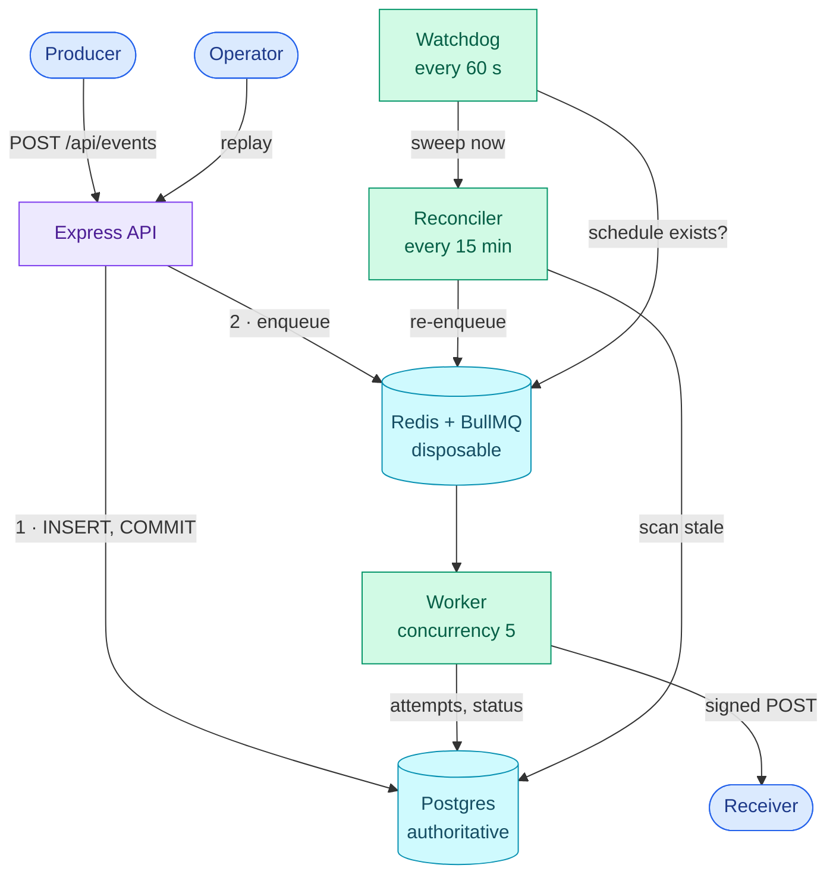
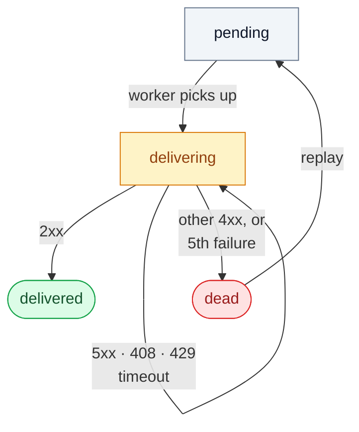

An interviewer once asked me, "Couldn't you use a NoSQL database instead of SQL in the webhook delivery engine?" I didn't answer it well. The honest answer is "yes, with conditions", and the conditions are the interesting part: the engine needs exactly three things from its store, and each NoSQL option provides them at a different price. I knew the system well. What I didn't have was the answer ready, worked out in advance and tied to the code.

This post fixes that for the whole project. Every fact, number and design decision here comes from three places: the [repository](https://github.com/rishabh0111/webhook-delivery-engine), its [benchmark results note](https://github.com/rishabh0111/webhook-delivery-engine/blob/main/docs/results/2026-09-26-benchmarks.md), and my [published write-up](/blogs/webhook-delivery-engine/). Where something wasn't built, the answer says so and explains how I'd build it. General computer-science explanations are mine, and they're labelled as general, not as things I measured.

## How to use this page

1. **Read "What to say" and the architecture section until you can say them without the page.** Those are the first five minutes of every conversation about this project, and the rest of the interview grows from them.
2. **Read the prerequisites once, carefully.** Every hard question is one of those concepts applied to a line of my code. If a question surprises you, the concept behind it is the gap.
3. **Use the question bank for active recall.** Read the question, answer out loud, then compare. The follow-ups are where interviewers actually go, so rehearse those too.
4. **Learn the numbers table cold, with the setup.** A number without its setup ("one laptop, single instance, local receiver") is a claim I can't defend.
5. **Finish with the self-test.** If any of those 20 needs the page, go back to it.

Two rules for the room. When a question touches something I didn't build, I say "I didn't build that; here's how I would" in the first sentence, not the last. And I never round a benchmark number up or drop its caveat.

## What to say

### The 30-second pitch

> "I built a self-hostable webhook delivery engine in Node.js, on Postgres and Redis with BullMQ. Its promise is one sentence: once the API returns 202, the event reaches exactly one terminal state, delivered or dead, and every attempt is recorded. Postgres is the source of truth and Redis is only a scheduler, so I can wipe Redis mid-load and lose nothing. I measured that: 0 of 50,000 events lost through a `FLUSHALL`, with no restart. The first time I ran that test it failed, 23,536 events stuck, and finding and fixing that bug is the part I'm proudest of."

### The 2-minute walkthrough

Say it in this order. Each paragraph is one breath.

**The problem.** A webhook is one system telling another that something happened. The hard part isn't sending it; it's that failure is silent. The receiver is down, the network drops it, or my own process dies right after recording the event and before sending it. Nobody gets an error, and the event is just gone.

**The promise.** Three guarantees: exactly-once acceptance (the same idempotency key is stored once), at-least-once delivery (I retry until a 2xx, so receivers dedupe on a stable `X-Webhook-Id`), and no silent loss (every event ends `delivered` or `dead` with a reason and a one-click replay).

**The design.** The API inserts the event as `pending` in Postgres with `ON CONFLICT (idempotency_key) DO NOTHING`, commits, and only then enqueues a BullMQ job whose id is the event id. The commit is the point of no return; the enqueue is allowed to fail. A worker with concurrency 5 signs the exact raw bytes with HMAC-SHA256, posts with a 10-second timeout, records every attempt, and classifies the result: 2xx is delivered, 5xx, 408, 429 and timeouts retry with exponential backoff over 5 attempts, any other 4xx dies at once.

**The safety net.** A reconciler sweeps Postgres every 15 minutes for events stuck `pending` or `delivering` with no live job and re-enqueues them. That covers a crash between commit and enqueue, and the total loss of Redis.

**The proof.** I wrote a benchmark harness that counts at the receiver. On one laptop it held 5,000 events a minute for 15 minutes at p95 47 ms and p99 139 ms end to end, turned 10,000 duplicated sends into 10,000 deliveries, and survived a mid-load `FLUSHALL` with 0 of 50,000 lost. That last one failed first: the reconciler's own schedule lived in Redis, so the wipe deleted the backstop. A 60-second watchdog now re-registers it and sweeps at once.

**The honesty.** It's not production-ready on purpose, and the README lists what's missing: authentication, fan-out, FIFO ordering, SSRF hardening, encrypted secrets, `Retry-After`, and splitting web and worker into separate services.

### Tilting it per audience

| Interviewer | Lead with | Spend the time on | Avoid |
| --- | --- | --- | --- |
| Backend / SDE (Node.js) | The ingest path and the worker | Raw-body handling, `ON CONFLICT`, `AbortController` timeout, BullMQ error types, the tests | Reciting benchmark tables |
| System design | "Postgres decides, Redis schedules" | Outbox, reconciler, the 100x extension, why not Kafka | Code-level detail unless asked |
| Distributed systems | The delivery-semantics sentence | Where duplicates can come from, crash points, the watchdog bug | Claiming exactly-once |
| Database | The three primitives the store must give | Unique index under concurrency, conditional `UPDATE`, the reconciler index, NoSQL trade-offs | "SQL is just better" |
| SRE / DevOps | The `FLUSHALL` test | Failure modes of each dependency, what I'd alert on, honest benchmarking | Claiming production on-call |
| Security | Signing the raw bytes | Timestamp in the MAC, constant-time compare, replay window, SSRF, secrets at rest | Hiding the open API |
| Engineering manager | "My test proved my headline false" | Scoping decisions, the gap list, how I'd hand it to a team | Overclaiming scale |

## The architecture end to end



Everything above runs in **one Node process**: the Express API, the delivery worker, the reconciler's worker and the watchdog. That's a free-host constraint (no separate worker dyno), and the worker is an isolated module, so splitting it out is a deployment change, not a rewrite.

### The components

| Component | File | Its one job |
| --- | --- | --- |
| Ingest route | `src/routes/events.js` | Validate, insert `pending` with `ON CONFLICT DO NOTHING`, commit, enqueue, `202` |
| Queue | `src/queue.js` | BullMQ queue `deliveries`: 5 attempts, exponential backoff, `jobId = eventId`, `removeOnComplete: true`, `removeOnFail: false` |
| Worker | `src/worker.js` | Load event, skip if delivered, mark `delivering`, sign, POST with timeout, record attempt, classify |
| Signing | `src/signing.js` | `HMAC-SHA256(secret, timestamp + "." + raw_body)`, header `sha256=<hex>` |
| Reconciler | `src/reconciler.js` | Repeatable job on a separate `maintenance` queue; re-enqueues stale non-terminal events with no live job |
| Watchdog | `src/reconciler.js` | Every 60 s, `getJobSchedulersCount()`; if 0, re-register and sweep with pending age 0 |
| Replay route | `src/routes/dead-letters.js` | Guarded `dead → pending` flip, remove the stale failed job, re-enqueue, stamp `replayed_at` |
| Metrics | `src/metrics.js` | Queue counts from Redis, event counts by status from Postgres, cached 10 s |
| Health | `src/routes/health.js` | `/health` touches nothing (keep-alive target); `/health/ready` checks Postgres and Redis |
| Dashboard | `public/dashboard.html` | One self-contained HTML file, no framework, no build; polls every 10 s (1 s in fast mode) |

### The data model

Four tables, created by three migrations:

- **`subscription`**: `id`, `target_url`, `secret` (nullable; `randomBytes(32)` as hex, returned once on creation, stored in plaintext because it has to be read to sign), `description`.
- **`event`**: `id` (UUID), `subscription_id` (FK, cascade delete), `idempotency_key TEXT NOT NULL UNIQUE`, `raw_body BYTEA`, `status` with a `CHECK` over `pending, delivering, delivered, failed, dead`, timestamps. The `failed` value is allowed by the constraint but never written; the real lifecycle is `pending → delivering → delivered | dead`.
- **`delivery_attempt`**: append-only, one row per HTTP attempt: `attempt_number`, `status_code`, `duration_ms`, `response_body` (truncated to 2,048 characters), `error`.
- **`dead_letter`**: `event_id`, `reason` (truncated to 1,000 characters), `replayed_at`. No unique constraint on `event_id`, because an event can die, be replayed and die again.

Indexes: `event(status)`, `delivery_attempt(event_id)`, `dead_letter(event_id)`, plus the unique index behind `idempotency_key`.

The status machine:



### The life of one event

Follow one event, `evt-A`, for subscription `S` with a secret, through every path the system has.

**1. Ingest.** The producer sends `POST /api/events` with headers `X-Subscription-Id: S` and `Idempotency-Key: order-42`, and the body is the payload. `express.raw` is mounted only on this router (limit 1 MB), so `req.body` is a `Buffer` of the exact bytes. The route checks the header is a UUID, the body is non-empty, and the subscription exists (`404` if not). Then:

```sql
INSERT INTO event (subscription_id, idempotency_key, raw_body, status)
VALUES ($1, $2, $3, 'pending')
ON CONFLICT (idempotency_key) DO NOTHING
RETURNING *
```

One row back means new. The statement runs in autocommit, so the row is durable when the query returns. The route then calls `enqueueDelivery(event.id, correlationId)` inside its own `try/catch`: if Redis fails, it logs "enqueue failed; reconciler will recover" and still answers `202`. If the producer retries with the same key, the insert returns zero rows, the route reads the existing event and answers `200` with it, and the queue is never touched.

**2. First attempt, a 503.** A worker takes job `evt-A`. It loads the event, sees it's not `delivered`, loads the subscription, sets `status = 'delivering'`, and computes the next `attempt_number` as `MAX(attempt_number) + 1`. It builds headers `X-Webhook-Id: evt-A`, `X-Webhook-Timestamp: <unix seconds>` and `X-Webhook-Signature: sha256=<hex>`, starts an `AbortController` with a 10-second timer, and POSTs the stored bytes. The receiver answers `503`. The worker inserts the attempt row (status 503, duration, first 2,048 characters of the body) and throws a plain `Error`. BullMQ records the failure and moves the job to its delayed set for 60 seconds. BullMQ's `failed` event fires, and `handleFailedJob` sees neither an `UnrecoverableError` nor `attemptsMade >= attempts`, so it returns and does nothing. The event stays `delivering`.

**3. The retries.** Attempts 2 to 4 follow at 60, 120 and 240 seconds after each failure, then attempt 5 after 480. With the 60-second base, the four gaps add up to 900 seconds, so a receiver that's down for good is dead-lettered about 15 minutes after the first try. In demo fast mode the base is 2 seconds, which is why the dashboard's tour shows gaps of 2, 4, 8 and 16 seconds.

**4. Dead letter.** Attempt 5 also gets a `503`. Now `attemptsMade` equals `attempts`, so `handleFailedJob` calls `deadLetterEvent`, which runs `UPDATE event SET status = 'dead' WHERE id = $1 AND status NOT IN ('dead', 'delivered')` and, only if that touched a row, inserts a `dead_letter` row with the error message as the reason. The failed job stays in Redis because `removeOnFail` is false. Had the receiver answered `401` on attempt 1 instead, the worker would have thrown `UnrecoverableError` and the event would be dead after one attempt.

**5. Replay.** The receiver is fixed and an operator clicks replay, which calls `POST /api/dead-letters/:id/replay`. The route runs `UPDATE event SET status = 'pending' WHERE id = $1 AND status = 'dead'`. Zero rows means someone already replayed it, so the second click gets `409`. One row means this caller won. It removes the stale failed job (an `add` with an existing `jobId` would silently do nothing), enqueues `evt-A` again, and stamps `replayed_at` last, so a crash before the stamp leaves a `pending` event the reconciler will find. The worker delivers, gets a `200`, records attempt 6 (the numbering continues across the replay), sets `delivered`, and BullMQ deletes the completed job.

**6. A Redis wipe.** Rewind to a moment when `evt-A` is waiting in its 120-second backoff and someone runs `FLUSHALL`. The delayed job is gone, and so is the reconciler's repeatable schedule, since that's also Redis state. Postgres still says `delivering`. Within 60 seconds the watchdog asks `getJobSchedulersCount()`, gets 0, logs "reconciler schedule was missing (Redis data loss?)", re-registers the schedule and sweeps immediately with a pending age of 0. Every `pending` event comes back at once. `evt-A` is `delivering`, and that state keeps its 5-minute age guard, because a worker might still be holding it. So it's re-enqueued by the first sweep after it has been untouched for 5 minutes, at the latest one reconcile interval later. The new job starts a fresh BullMQ attempt count, so after a wipe an event can receive more than 5 attempts in total; `attempt_number` in Postgres keeps counting.

That's the whole system: one durable write, one disposable schedule, and a sweep that turns the first back into the second whenever they disagree.

## Prerequisites to know cold

Each concept below: what it is, why it matters in this project, and the probe it invites.

### Delivery semantics

**What.** *At-most-once*: send once, never retry; you can lose messages, never duplicate them. *At-least-once*: retry until acknowledged; never lose (within the retry budget), but you can duplicate. *Exactly-once*: each message has its effect once. Over an unreliable network, exactly-once *delivery* is impossible, because the sender can't tell "the receiver never got it" from "the receiver got it and the acknowledgement was lost". What systems really offer is *effectively-once*: at-least-once delivery plus idempotent processing at the receiver.

**Here.** Acceptance is exactly-once (unique key). Delivery is at-least-once. Receivers get effectively-once by deduping on `X-Webhook-Id`, which is the event id and is the same on every retry and replay.

**The probe.** "Where exactly can a duplicate come from in your system?" (Q37.)

### Idempotency keys and unique constraints

**What.** An idempotency key is a client-chosen identifier for one logical operation; repeating the request with the same key must not repeat the effect. The safe way to enforce it is a unique constraint in the database, because a check-then-insert in application code races.

**Here.** `idempotency_key TEXT NOT NULL UNIQUE` plus `INSERT … ON CONFLICT DO NOTHING RETURNING *`. If the client omits the header, the server generates a UUID, which makes that request unique and gives no protection on a retry. The key is unique across the whole table, not per subscription, and the conflict path doesn't compare bodies.

**The probe.** "Two requests with the same key at the same instant?" (Q5) and "same key, different body?" (Q6).

### The dual-write problem and the transactional outbox

**What.** Writing to two systems (a database and a broker) without a shared transaction means one can succeed and the other fail. The transactional outbox writes the business change and an "outbox" record in one database transaction; a separate relay moves outbox records to the broker, retrying until it succeeds.

**Here.** It's a compact variant: the `event` row *is* the outbox record. The happy path enqueues right after the commit (fast), and the reconciler is the relay of last resort (slow, every 15 minutes). There's no separate outbox table and no relay process polling it.

**The probe.** "Why not a separate outbox relay or CDC?" (Q32.)

### Crash after commit

**What.** The window between "the database says yes" and "the next side effect happened". Any process can die there: OOM kill, deploy, power.

**Here.** Two such windows. Ingest: commit done, enqueue not done, so the event is `pending` with no job. Worker: the receiver returned 2xx, but the `UPDATE … delivered` didn't run, so the job retries and the receiver sees a duplicate. The first is fixed by the reconciler; the second is the reason the contract is at-least-once.

**The probe.** "Trace a crash at each line of the ingest handler." (Q39, Q40.)

### Reconciliation

**What.** A periodic job that compares the source of truth with the derived state and repairs differences. It's the general answer to "what if a step I thought happened didn't?"

**Here.** Postgres says what *should* be in flight (`pending` older than 60 s, `delivering` older than 5 minutes). Redis says what *is* in flight. For each candidate, the reconciler looks up `getJob(id)`. A job in a live state (`waiting`, `active`, `delayed`, `prioritized`, `paused`, `waiting-children`) is left alone; a completed or failed job is removed and a new one added; no job means just add.

**The probe.** "What if the reconciler runs twice at once?" (Q46.)

### BullMQ and Redis internals

**What.** BullMQ stores each job as a Redis hash keyed by queue and job id, and keeps job ids in structures per state: a `wait` list, an `active` list, a `delayed` sorted set scored by run time, `completed` and `failed` sets. A worker moves a job to `active` atomically with a Lua script and holds a lock that it renews; if the lock expires (process died or event loop blocked), the job is *stalled* and gets moved back to wait. Retries with backoff go through the delayed set. Repeatable jobs (job schedulers in BullMQ 5) are stored as a scheduler entry plus the next delayed job. Adding a job with an id that already exists is a no-op. `FLUSHALL` deletes every key in every database on that Redis server: queued, delayed, failed and completed jobs, locks, and schedulers.

**Here.** `jobId = eventId` dedups enqueues while the job exists. `removeOnComplete: true` deletes successes to save memory, so after completion the dedup is gone and the worker's "already delivered" check is the last line. `removeOnFail: false` keeps failed jobs, which is why replay and the reconciler must `remove()` before re-adding. `stalledInterval: 30000` and `maxStalledCount: 2` decide what happens to a job whose worker died. The worker uses its own Redis connection because it issues blocking commands, and BullMQ requires `maxRetriesPerRequest: null` on it.

**The probe.** "What does `FLUSHALL` delete that you forgot about?" (Q41.)

### Redis persistence, and why it's not the source of truth

**What.** RDB snapshots the dataset periodically; you lose everything since the last snapshot. AOF logs every write; with `appendfsync everysec` you can lose about a second, with `always` you lose almost nothing but pay an fsync per write. Replication is asynchronous, so a failover can drop acknowledged writes. Under memory pressure, eviction policies delete keys; `noeviction` makes writes fail instead.

**Here.** Redis runs with `maxmemory-policy noeviction` (docker-compose and the production target), because with eviction BullMQ silently loses keys. I don't rely on persistence at all: the design assumes Redis can come back empty, and the `FLUSHALL` benchmark tests exactly that.

**The probe.** "Why not just turn on AOF and use Redis as the store?" (Q25.)

### Postgres: ACID, MVCC, row locks, unique indexes under concurrency

**What.** Each statement is atomic and durable once committed (WAL fsync). MVCC means an `UPDATE` writes a new row version and readers see a snapshot, so readers don't block writers. A writer takes a row lock; a second writer on the same row waits, then re-evaluates its `WHERE` against the newest version (under READ COMMITTED). For a unique index, a second insert of the same key waits for the first transaction to commit or abort, then either fails (or does nothing with `ON CONFLICT DO NOTHING`) or proceeds.

**Here.** That re-check is what makes the guarded `UPDATE`s safe: two replays race, one flips `dead → pending`, the other re-evaluates `status = 'dead'` against the new version, matches nothing, and gets `409`. The unique index is what makes concurrent duplicate keys safe: the benchmark sent 5,000 pairs concurrently and every pair got one `202` and one `200`.

**The probe.** "What does Postgres actually do when both inserts arrive at once?" (Q53.)

### Exponential backoff and jitter

**What.** Wait `base × 2^(n-1)` before retry *n*, so a struggling receiver gets more and more room. Jitter randomises each delay so retries from many clients don't arrive in synchronised waves (the thundering herd).

**Here.** Base 60 s, 5 attempts, delays of 60, 120, 240 and 480 s, set on each job so demo fast mode (2 s base) affects only new jobs. **No jitter is configured.** If a receiver drops 10,000 events at the same second, their retries land together too. I'd add jitter in production (Q35).

**The probe.** "Why that schedule, and what's missing from it?"

### Retryable and non-retryable status codes

**What.** 5xx means the server failed and might succeed later. 4xx means the request is wrong and repeating it won't help, except 408 (Request Timeout) and 429 (Too Many Requests), which mean "later". Network errors and timeouts are ambiguous: the request might have been processed.

**Here.** `isPermanentStatus` returns true for 400 to 499 except 408 and 429. Permanent means `UnrecoverableError`, dead at once. Everything else, including 3xx and other non-2xx codes, is a plain `Error` and retries. `Retry-After` on 429 isn't honoured yet.

**The probe.** "Is 404 really permanent? What about 410, or 3xx?" (Q10 follow-ups.)

### Dead-letter queue and replay

**What.** A place for messages that can't be processed, kept for inspection and manual or automated reprocessing, so one poison message doesn't block or vanish.

**Here.** The dead-letter "queue" is a Postgres table, not a Redis list: it carries the reason, it survives a Redis wipe, and the dashboard can join it to the event. Replay is guarded by a conditional `UPDATE`, so it's safe against double clicks.

**The probe.** "How do you stop replay double-delivering?" (Q54.)

### HMAC-SHA256 signing

**What.** HMAC combines a shared secret and a message through a hash so that only someone with the secret can produce the tag, and any change to the message changes it. It gives authenticity and integrity, not confidentiality, and not non-repudiation (both sides hold the secret).

**Here.** `HMAC-SHA256(secret, timestamp + "." + raw_body)`, hex, prefixed `sha256=`. It's computed over the stored bytes, never a re-serialization, because a receiver hashing the bytes off the wire would disagree with my hash over one whitespace or key-order difference. The timestamp is inside the MAC, so an attacker can't refresh an old capture's timestamp. A subscription with no secret gets no signature header.

**The probe.** "Why put the timestamp inside the signed payload?" (Q74.)

### Constant-time comparison

**What.** A normal string compare returns at the first differing byte, so response time leaks how many leading bytes of a guess were right; with enough samples an attacker can recover a valid signature byte by byte. `crypto.timingSafeEqual` (Node) and `hmac.compare_digest` (Python) take the same time regardless.

**Here.** It's in the receiver recipe in `docs/signature-verification.md`, with a length check first because `timingSafeEqual` throws on unequal lengths. The engine signs; the receiver verifies. My in-process demo receiver compares with `===`, which is fine for a demo aid and not something I'd copy into a real receiver.

**The probe.** "Show me the verification code." (Q75.)

### Replay windows

**What.** A signature proves a message was genuine once; it doesn't stop someone resending a captured request. Rejecting timestamps older than a window bounds that, and deduping on the message id closes it inside the window.

**Here.** The recipe recommends rejecting anything more than 300 seconds from the receiver's clock. The engine signs each attempt with a fresh timestamp, so a retry an hour later still passes the window. The window is enforced by the receiver, not the engine.

**The probe.** "What does the window not protect against?" (Q76.)

### Timeouts

**What.** Without a deadline, a connection that's accepted and never answered holds a worker slot forever. A timeout turns a hang into a failure you can retry.

**Here.** `AbortController` plus `setTimeout`, 10 seconds by default (3 in fast mode), cleared in `finally`. The abort covers the body read too, since `res.text()` runs before the timer is cleared. A timeout is retryable. The ambiguity: the receiver might have processed it, so a timeout can produce a duplicate.

**The probe.** "A receiver hangs. What happens to everyone else?" (Q28.)

### Back-pressure

**What.** When producers outrun consumers, something has to give: you buffer (memory or disk), drop, or push back on the producer (429, blocking).

**Here.** There's no ingest-side push-back. In the durability benchmark, ingest accepted 34,000 to 43,000 events a minute while the worker ran 5 at a time, so the backlog grew to more than 23,000 jobs. The buffer is Redis memory, and with `noeviction` a full Redis makes enqueue fail instead of silently dropping keys. Because the event is already committed, a failed enqueue becomes the reconciler's problem, not a loss. Postgres is the real buffer.

**The probe.** "What happens when ingest is 10 times faster than delivery for an hour?" (Q34.)

### p95, p99 and benchmarking honestly

**What.** p95 is the latency 95% of requests beat. Means hide tails; the tail is what users of a busy system feel. Honest benchmarks use open-loop load (send on a schedule, whatever the responses do), because closed-loop load slows down when the system does and hides the problem (coordinated omission). They count outcomes at the far end, report every run, and state the setup.

**Here.** `throughput.js` sends event *i* at `start + i × 12 ms`, which is 5,000 a minute. Latency is receiver timestamp minus the send timestamp, same machine clock. Percentiles are nearest-rank over every event, no sampling. Loss and duplicates are counted at the receiver against the set of ids that got a `202`. All runs are in the results note, including two failed ones and a contaminated one.

**The probe.** "Is p99 139 ms good?" (Q69.)

### Ordering (FIFO), and why it's out of scope

**What.** FIFO per key means event 2 is never delivered before event 1 for the same subscription. It requires one in-flight delivery per key, and a failing head blocks everything behind it (head-of-line blocking).

**Here.** Not guaranteed. Concurrency 5 across all subscriptions, and retries reorder. Most providers don't guarantee it either; receivers are told to treat events as notifications and dedupe.

**The probe.** Q27.

### Fan-out

**What.** One event delivered to many destinations, each with its own status, retries and dead letter.

**Here.** Not built. An event belongs to exactly one subscription, and status lives on the event. Fan-out needs a per-target `delivery` entity split from `event`.

**The probe.** Q26.

### SSRF

**What.** Server-side request forgery: the attacker makes your server send requests to places they can't reach, such as `localhost`, internal services or the cloud metadata endpoint at `169.254.169.254`. A webhook sender is SSRF by design, since users choose the URL.

**Here.** Not hardened. `target_url` is validated only as an http(s) URL. Node's `fetch` follows redirects by default and the worker doesn't override that, so a public URL can redirect inward. The demo depends on loopback delivery to its own in-process receiver.

**The probe.** Q77.

### Secrets at rest and KMS

**What.** A signing secret must be readable to sign, so it can't be hashed like a password. The options are plaintext with tight access, application-level encryption with a key from a KMS, or envelope encryption (a data key per row or tenant, itself encrypted by a KMS master key).

**Here.** Plaintext, documented. The secret is returned once on creation and never re-exposed by the list endpoint (`has_secret` only).

**The probe.** Q78.

### Horizontal scaling of workers

**What.** Add worker processes; the queue hands each job to one worker; you need the job to be safe if two workers ever touch it.

**Here.** BullMQ supports many workers on one queue. The repeatable reconciler runs once per interval however many processes exist, and the watchdog in each process is harmless if two fire, because re-registering is idempotent and duplicate enqueues are deduped. Not exercised: two workers racing one event; the benchmark ran one instance.

**The probe.** Q44.

### Rate limiting per receiver

**What.** Cap how fast you send to each destination (a token bucket per endpoint), so you neither overload a slow receiver nor let it eat your workers.

**Here.** Not built. The only limit is global concurrency 5.

**The probe.** Q31.

### Circuit breakers

**What.** After N failures to a dependency, stop calling it for a cool-down period, then let one probe through; it fails fast instead of piling up timeouts.

**Here.** Not built. Each event retries on its own schedule, so a dead endpoint with 10,000 events gets 50,000 attempts. A per-endpoint breaker would pause that endpoint's jobs instead.

**The probe.** Q31.

### Things the code adds

- **Raw-body capture.** Body parsers are mounted per route: `express.raw` for ingest and the demo receiver, `express.json` for the JSON APIs. A global `express.json()` would consume the stream and lose the bytes.
- **Status guard as the last dedup line.** `if (event.status === 'delivered') return;`. It's what made phase C of the idempotency benchmark (10,000 re-enqueues after completion) produce zero extra deliveries.
- **Shallow liveness, deep readiness.** `/health` touches nothing so a keep-alive pinger can't wake the database; `/health/ready` checks both stores and returns 503 if either fails.
- **Cached metrics.** 10 seconds, so a dashboard tab left open doesn't keep the free-tier database awake.
- **Free-tier discipline.** Postgres that autosuspends when idle (so a lazy reconciler), Redis that's memory-metered rather than command-metered (an idle BullMQ worker issues a lot of commands), one process.

## Question bank

88 questions in seven groups. Answers are in my voice.

### Backend and SDE (Node.js)

**Q1. Walk me through what happens on `POST /api/events`.**

I read `X-Subscription-Id` from a header and check it's a UUID, check the raw body isn't empty, and check the subscription exists. Then one statement: `INSERT … ON CONFLICT (idempotency_key) DO NOTHING RETURNING *`. If a row comes back, it's new and committed, so I enqueue a BullMQ job with `jobId` equal to the event id, inside its own `try/catch`, and return `202`. If no row comes back, the key was used before, so I select the existing event and return `200` with it, without enqueuing. The commit is the point of no return; a failed enqueue is logged and left to the reconciler.

- *Why check the subscription before the insert when the FK would catch it?* To return a clean `404` instead of mapping a foreign-key error. It costs one indexed read.
- *Is the insert in an explicit transaction?* No, it's one statement in autocommit, which is atomic on its own. There's nothing else to put in the transaction.

**Q2. Why does routing metadata travel in headers instead of the JSON body?**

Because the body *is* the payload I deliver and sign. If I wrapped it, `{ "subscription_id": …, "payload": {…} }`, I'd have to parse it and re-serialize the inner object, and re-serialization can change whitespace, key order or unicode escaping. The receiver hashes the bytes it receives, so any change breaks the signature. With metadata in headers, the body is stored as `bytea`, signed and sent byte for byte.

- *What does the receiver see as Content-Type?* The worker always sends `application/json`. That's an assumption; a non-JSON payload would be mislabelled. I'd store the producer's content type alongside the body.

**Q3. Why `202` for a new event and `200` for a duplicate?**

`202 Accepted` says what's true: I've durably accepted it, but delivery hasn't happened yet. `201 Created` would also be defensible. On a duplicate key I return `200` with the original event, so the client's retry gets the same answer it would have got the first time, which is the point of an idempotency key. The different status lets a client tell the two apart if it cares.

- *Some APIs return 409 on a duplicate key. Why not?* 409 suits "you sent a conflicting request". A retry with the same key is the normal case the key exists for, so it should succeed.

**Q4. What happens if the client doesn't send an `Idempotency-Key`?**

The server generates a random UUID. The event is stored and delivered normally, but a retry of that request gets a new UUID and becomes a second event. So without a key, ingestion is at-least-once, not exactly-once. I chose the fallback so the API is usable without the header; the docs recommend sending one. In production I'd consider making it required, which is what the strictest payment APIs do for mutating calls.

**Q5. Two requests with the same key arrive at the same instant. Walk me through it.**

Both run the `INSERT`. Postgres lets the first one take the index entry; the second sees an in-progress insert of the same key in the unique index and waits for that transaction. When the first commits, the second's `ON CONFLICT DO NOTHING` resolves to "conflict", it returns zero rows, and my code selects and returns the existing event with `200`. There's no window where both succeed, and no application lock. The benchmark tested it: 5,000 pairs sent concurrently and 5,000 back to back produced 10,000 `202`s, 10,000 `200`s, 10,000 rows, and every pair got the same event id.

- *What if the first transaction aborts?* The second proceeds and inserts. Correct behaviour: the key was never used.

**Q6. Same key, different body?**

Today I return the original event and ignore the new body. That's a gap: it hides a client bug where two different operations reuse a key. The fix is request fingerprinting: store a hash of the body (and the subscription id) with the key, and on conflict compare; same fingerprint returns the original, different fingerprint returns `422` or `409`. I've built exactly that elsewhere, but not here.

**Q7. Why Express and not NestJS or Fastify?**

The API surface is small: about a dozen routes. The hard part of this project is delivery semantics, not request routing, and I wanted every line visible: body parsers per route, a single error envelope, Zod at the edges, pino for logs. Express does that with no framework conventions in the way. I've used NestJS on a bigger multi-module API, and its dependency injection and modules pay off when there are many modules and people; here they'd be ceremony. Fastify would give faster routing and schema-based serialization, but ingest isn't the bottleneck: the `202` came back at p50 14 ms and p95 25 ms in the clean throughput run, and the limit on throughput is worker concurrency and the receiver. If ingest became the bottleneck, swapping Express for Fastify is a contained change, because routes are thin.

- *What would you miss from NestJS?* Structured modules and testable providers once the codebase grows. I'd reconsider at the point where there are several teams.

**Q8. Why Node.js for this at all?**

The workload is I/O-bound: almost all of a delivery's time is waiting on the receiver's HTTP response, and a single event loop handles many concurrent outbound requests cheaply. BullMQ is a Node library, so the queue and worker are first-class. Node's built-in `fetch` and `AbortController` give me timeouts without extra dependencies, and `crypto` gives HMAC and `timingSafeEqual`. The CPU work per delivery is one HMAC over a small payload. Where Node would hurt is CPU-heavy work on the event loop, which would block lock renewals and make jobs look stalled; nothing here is CPU-heavy.

- *Would Go be better?* For very high fan-out, Go's goroutines and lower memory per connection are attractive. At this scale the bottleneck is the receivers, not the runtime.

**Q9. Is it written in TypeScript?**

No, it's plain JavaScript (CommonJS) with Zod validating every input at the boundary. I kept it small enough that types weren't the main risk; the risks were concurrency and failure. If it grew, I'd migrate to TypeScript, starting with the job payload and the row types, because those cross process and storage boundaries. My TypeScript work is in other projects.

**Q10. How do you handle a receiver that accepts the connection and never answers?**

Every attempt runs under an `AbortController` with a 10-second timer, cleared in `finally`. On abort I record "request timed out after 10000ms" as the attempt's error and throw a normal `Error`, so it's retried with backoff. Without that deadline, five hanging receivers would hold all five worker slots forever and stall every other delivery.

- *Is 404 permanent?* I treat it as permanent: the receiver says the URL doesn't exist. Some providers retry 404 for a while in case of a deploy race; that's a reasonable change.
- *3xx?* Node's `fetch` follows redirects by default, so the worker sees the final status. A 3xx that isn't followed falls into "retryable". For security I'd turn redirects off (see Q77).
- *410 Gone?* Permanent today, and arguably it should also disable the subscription.

**Q11. The worker reads `status` and then sends. Isn't that a race?**

Yes, it's check-then-act, and I don't rely on it for mutual exclusion. Two things stop two workers delivering the same event at once: BullMQ gives a job to one worker at a time, and there's one job per event id. The status check exists for a different case: a *later* job for an already delivered event (a reconciler re-enqueue after the original job completed and was removed). If I wanted the database to enforce single-flight, I'd make the flip conditional, `UPDATE event SET status = 'delivering' WHERE id = $1 AND status IN ('pending', 'delivering') RETURNING …`, or take a lease column with an expiry.

**Q12. How is `attempt_number` computed, and what's wrong with it?**

`SELECT COALESCE(MAX(attempt_number), 0) + 1` per event, so numbering continues across replays and the audit trail reads as one story. What's wrong: it's read-then-insert with no unique constraint on `(event_id, attempt_number)`, so two concurrent processors of the same event could write the same number. It can't happen while one job per event holds, but I'd add the unique constraint so the database enforces it, and compute the number in the `INSERT … SELECT` itself.

**Q13. How did you test it?**

51 Jest tests in 9 suites, run with `--runInBand` against a real Postgres and a real Redis, locally from docker-compose and in GitHub Actions as service containers on pushes to main and on pull requests. No mocks for the stores, because the bugs I cared about live in their behaviour: `ON CONFLICT`, conditional updates, BullMQ job ids. The worker's processor takes a job-shaped object, so tests call it directly against a real local HTTP server that returns whatever status the test wants. Covered: ingest and idempotency conflicts, signing and tamper detection, classification (5xx, 408, 429, other 4xx, timeout), dead-lettering and its guards, replay including the double-replay `409` and monotonic attempt numbers, the reconciler's age rules and live-job skipping, the watchdog's re-registration, metrics caching, health, and demo gating. Then the benchmarks test the promise end to end.

- *What did the tests miss?* The Redis-wipe bug. No test wiped Redis while the process kept running, so the reconciler always had its schedule. The durability benchmark found it.

**Q14. Why do the worker and the producer use separate Redis connections?**

A BullMQ worker issues blocking commands to wait for jobs. On a shared connection those block every other command, including enqueues from the API, which shows up as mysterious stalls. BullMQ also requires `maxRetriesPerRequest: null` on worker connections. The reconciler has its own connection for the same reason.

**Q15. Tell me about the BullMQ `failed` event bug.**

BullMQ's `failed` event fires on every failed attempt, not only the last. My first version dead-lettered in that handler unconditionally, so the first `503` wrote a dead letter before any retry ran. The fix is `handleFailedJob`: dead-letter only on `UnrecoverableError` or when `job.attemptsMade >= job.opts.attempts`. `deadLetterEvent` is also guarded on status, so it can't clobber a delivered event or write a second row for an already dead one. Both behaviours have tests.

**Q16. How does shutdown work?**

On SIGTERM or SIGINT I clear the watchdog interval, stop the HTTP server accepting new connections, then close the delivery worker (which waits for active jobs), the reconciler's worker and queue, the producer queue, the Redis connections, and the Postgres pool, then exit. If the platform kills the process before a job finishes, the job's lock expires, BullMQ marks it stalled and runs it again, which is a duplicate the receiver dedupes.

**Q17. How do you validate input and shape errors?**

Zod schemas at every boundary: subscription creation is `.strict()` (unknown fields rejected), `target_url` must be an http(s) URL, ids must be UUIDs. A `validate` middleware turns Zod issues into a `400` with per-field details. Routes throw a typed `ApiError(status, message)`, and one error handler renders every error as `{ error: { message, details? } }`, logging 5xx.

**Q18. Why are the API and worker in one process, and how would you split them?**

The free host has no separate worker service, so one process runs both. I kept the worker in its own module with its own Redis connection and no dependency on Express, so splitting is two entry points: one that starts the HTTP server, one that starts the worker, reconciler and watchdog. Then I'd scale them independently: API on request rate, workers on queue depth.

**Q19. What's demo fast mode, and how do you keep it out of production?**

A runtime toggle that compresses the backoff base to 2 seconds and the delivery timeout to 3 seconds, so "retries exhausted" takes about 30 seconds instead of 15 minutes and the dashboard can show it. It's in-process state, set per job at enqueue, so in-flight retries keep their original schedule. Demo routes are gated by `DEMO_MODE`, which defaults to on outside production and off in production unless explicitly set; when off, the routes return `404`. Fast mode itself defaults off.

### System design

**Q20. Design a webhook delivery system. Go.**

I'd run it like any design round, and my project is the high-level design. Functional: register an endpoint (get a secret), send an event, deliver it with retries, inspect and replay failures. Non-functional: no silent loss once accepted, at-least-once delivery, idempotent ingestion, a bounded retry window, signatures receivers can verify, and isolation so one bad endpoint doesn't hurt others. Entities: subscription, event, delivery attempt, dead letter. Design: API writes the event durably, then schedules; workers sign and deliver; attempts are recorded; a reconciler repairs anything the scheduler lost. Deep dives: the dual write, failure classification, replay safety, signing. Then the parts I'd add at scale: fan-out, per-endpoint concurrency and breakers, partitioning (section below).

**Q21. Why is Postgres authoritative and Redis disposable?**

Because I can only defend one source of truth. Postgres gives me what correctness needs: a durable commit, a unique constraint for idempotency, conditional updates for replay, and queries like "every `pending` event older than 60 seconds". Redis gives me what scheduling needs: fast delayed jobs, backoff and worker coordination. If both held truth, I'd have to reconcile them in both directions. With one authority, the rule is simple: whenever they disagree, Postgres wins and the reconciler rebuilds Redis from it. That's what let me run `FLUSHALL` mid-load and lose 0 of 50,000.

**Q22. Why not Kafka instead of BullMQ?**

Kafka is a log, not a job queue, and webhook delivery needs job-queue features. Per-message delayed retry: Kafka has none; you build retry topics per delay tier and a consumer that waits, and a failing message blocks its partition unless you move it aside. Per-message acknowledgement: Kafka commits offsets per partition, so one slow receiver holds up everything behind it in that partition. Per-endpoint isolation would mean partition design around endpoints. BullMQ gives delayed jobs, backoff, job-id dedup and stall detection out of the box. And operationally, Kafka on a $0 budget wasn't an option, while a small Redis was. Where Kafka wins: very high ingest throughput, replayable history, and many independent consumers of the same events. At scale I'd consider Kafka for ingest (events in) and keep a job-style scheduler for delivery (attempts out). I've used Kafka with an outbox in another project, so this is a choice, not unfamiliarity.

- *Doesn't Kafka give you ordering?* Per partition, yes. I don't promise ordering, and ordering with retries means head-of-line blocking (Q27).

**Q23. RabbitMQ or SQS?**

Both would work for delivery, and both would still sit behind Postgres. SQS fits webhook semantics well: the visibility timeout is a lease (like BullMQ's lock), a redrive policy with `maxReceiveCount` is a dead-letter queue, and per-message delay exists up to 15 minutes, with longer delays needing a scheduler. RabbitMQ needs a plugin or TTL-plus-dead-letter-exchange chains for delays. I chose BullMQ because the whole thing runs on one free host with a Redis, BullMQ gives exponential backoff and `jobId` dedup in-process, and it keeps the stack to two stores. The Postgres-authoritative design doesn't depend on which scheduler sits under it.

**Q24. Why not a Postgres-only queue with `SELECT … FOR UPDATE SKIP LOCKED` and no Redis?**

It's a strong option, and I'd seriously consider it, because it removes the dual write entirely: the job *is* the row. Workers poll `SELECT … WHERE status = 'pending' AND next_attempt_at <= now() ORDER BY … LIMIT n FOR UPDATE SKIP LOCKED`, deliver, and update in the same database. Retries become a `next_attempt_at` column. Two reasons I didn't. First, the deployment constraint: the free-tier Postgres autosuspends when idle, and a polling worker would keep it awake around the clock and burn the compute quota. That same reason is why the reconciler runs every 15 minutes and the watchdog only touches Redis. Second, BullMQ gave me delayed scheduling, backoff and stall detection without writing them. At scale, a Postgres queue puts every poll, lock and status change on the primary, and an update-heavy queue table needs vacuum tuning; Redis takes that churn off the database. I've built a `SKIP LOCKED` scheduler elsewhere, so I know both sides.

- *If you had no free-tier constraint?* For moderate volume, I'd likely go Postgres-only and delete the reconciler, because there'd be nothing to reconcile.

**Q25. Why not just use Redis with AOF as the store?**

AOF reduces one failure mode, a crash, and leaves the others. `FLUSHALL` or a bad deploy script deletes data regardless of AOF. Replication is asynchronous, so a failover can lose acknowledged writes. With `appendfsync everysec` you can lose about a second of writes, which for an API that has returned `202` is a broken promise; `always` costs an fsync per write. Eviction under memory pressure deletes keys unless you run `noeviction`. Beyond durability, Redis is the wrong shape for the questions I ask the store: "all `pending` events older than 60 seconds", "the latest unreplayed dead letter per event", an append-only audit trail joined to events. And managed free-tier Redis gives no persistence guarantee I'd bet on. So Redis can lose everything and I designed for that.

**Q26. How would you add fan-out, one event to many subscribers?**

Split delivery state from the event. `event` keeps the payload and the idempotency key; a new `delivery` table has one row per (event, subscription) with its own status, attempts and dead letter. Ingest writes the event and its delivery rows in one transaction, then enqueues one job per delivery with `jobId = delivery.id`. The worker, reconciler and replay all switch from event id to delivery id. `X-Webhook-Id` stays the event id, so a receiver subscribed twice can still dedupe. Topic routing (which subscriptions want which event types) becomes a lookup at ingest. It's a real schema change, which is why I left it out.

**Q27. What ordering guarantees do you give?**

None, and I say so. Five concurrent workers process different events, and retries put a failed event behind later ones. To offer per-subscription FIFO I'd allow one in-flight delivery per subscription: a per-subscription queue or group key, so event 2 waits until event 1 is delivered or dead. The cost is head-of-line blocking: one failing event stalls that subscription for its whole retry window. Most providers choose not to guarantee order and instead give receivers what they need to cope: a timestamp, a stable id, and sometimes a per-subscription sequence number so the receiver can detect gaps or ignore stale updates. Another pattern is thin events: "order 42 changed", and the receiver fetches current state, which makes order irrelevant.

**Q28. A receiver is slow or down for hours. What happens?**

Down: each event uses its 5 attempts over about 15 minutes, then goes `dead`. After the outage, the operator replays. That's correct but crude: 15 minutes is a short window, and replay is one event at a time. Slow (every request near the 10-second timeout): worse, because concurrency is global. Five jobs to that endpoint occupy all five slots for up to 10 seconds each, so the whole engine drops to about 0.5 deliveries a second while they're in flight. That's the noisy-neighbour problem. Fixes, in order: per-endpoint concurrency caps, a per-endpoint circuit breaker that pauses the endpoint's jobs instead of burning attempts, a longer retry schedule (hours to days, as the big providers use) with jitter, honouring `Retry-After`, automatic disabling of an endpoint that's failed for a long time with a notification, and bulk replay by subscription and time range.

**Q29. How would you handle 1 million events a minute?**

That's about 16,700 a second, roughly 200 times the rate I benchmarked, so this is design, not measurement. Ingest: stateless API instances behind a load balancer; insert in batches; partition the `event` table by time so indexes stay small and old data drops cheaply; if one Postgres primary can't take the write rate, shard by subscription or tenant. Delivery: the arithmetic decides. If a typical receiver takes 200 ms, sustaining 16,700 a second needs about 3,300 deliveries in flight (Little's law: in flight = rate × time), so hundreds of worker processes, each with high concurrency, since the work is waiting on sockets. The queue: partition Redis by shard or move to a broker built for that rate. Per-endpoint concurrency and breakers become mandatory, because at that volume some endpoint is always down. Writes per event (insert, two status updates, one attempt row) are four or more, so I'd also move attempts to an append-optimised store or batch them. Details in the 100x section.

**Q30. Multi-tenant fairness: one tenant sends 90% of the traffic. What happens?**

Today, they get 90% of the worker time, and everyone else waits behind their backlog in one FIFO queue. There's no tenant concept yet, which is one of the documented gaps. I'd add a tenant id, then fair scheduling: a queue or group per tenant with round-robin or weighted pulls, so a burst from one tenant delays only that tenant. Plus per-tenant ingest rate limits (a token bucket in Redis), per-endpoint concurrency caps, and per-tenant metrics so the noisy one is visible.

**Q31. How would you add per-endpoint rate limiting and circuit breaking?**

Rate limiting: a token bucket per subscription in Redis, checked by the worker before sending; if no token, move the job back to delayed for the refill time rather than failing it, so it doesn't burn an attempt. Circuit breaker: count recent failures per endpoint; past a threshold, open the circuit and delay all of that endpoint's jobs for a cool-down; then half-open, letting one job probe. If the probe succeeds, close. Both state stores can live in Redis, because losing them only means one extra probe. Neither is built.

**Q32. Why a reconciler sweep instead of a proper outbox relay or CDC (Debezium)?**

A relay or CDC moves every committed event to the broker reliably, so it would remove the crash-after-commit window properly. I chose the lighter combination: enqueue inline right after commit (which covers the normal case with zero lag), and sweep occasionally for the rare miss. That kept to one process and two stores, and the sweep doubles as recovery from Redis data loss, which CDC alone wouldn't give me (CDC delivers each change once; it doesn't rebuild a wiped queue). The cost is recovery latency: a missed enqueue waits for the next sweep, up to 15 minutes. At scale I'd move to a relay reading the `event` table by status or a logical-replication stream.

**Q33. How do receivers dedupe?**

On `X-Webhook-Id`, which is the event id, identical on every retry and replay. The simplest receiver pattern is a table with the id as primary key: in the same transaction as the side effect, insert the id; a duplicate fails the insert and the receiver returns `200` without acting. If the side effect isn't in a database transaction, store the id with a status and handle "seen but not finished". Keep ids at least as long as the sender's retry window plus replay horizon. The receiver should return `2xx` for a duplicate, not an error, or I'd keep retrying it.

**Q34. What happens when ingest outruns delivery?**

The queue grows. In the durability benchmark ingest ran at 34,000 to 43,000 accepted a minute against a worker doing five at a time, so there were 23,465 jobs waiting when the flush landed. Redis memory is the buffer, and with `noeviction`, a full Redis rejects writes rather than silently evicting jobs. The rejected enqueue doesn't lose the event because it's already committed; the reconciler picks it up later. For a real system I'd add explicit back-pressure: watch queue depth or the age of the oldest `pending` event, and when it passes a threshold either return `429` with `Retry-After` at ingest, or stop enqueueing eagerly and let Postgres hold the backlog while workers pull at their own pace.

**Q35. Why 5 attempts and that schedule?**

Five attempts with a 60-second base gives 60, 120, 240 and 480 seconds between tries, about 15 minutes in total. It's long enough to ride out a deploy or a brief outage, short enough that a demo of exhaustion is watchable in fast mode, and BullMQ expresses it with two options. For production it's too short: real outages last hours. I'd stretch to something like 8 to 10 attempts over a day or more, add jitter so retries from one outage don't arrive as a wave, cap the maximum delay, and honour `Retry-After` on `429` and `503`. The schedule should be configurable per subscription.

### Distributed systems

**Q36. Why not exactly-once delivery?**

Because over HTTP to a system I don't control, it isn't achievable by the sender alone. If the receiver processes the request and the `200` is lost (timeout, connection reset, my process dying before I record it), I can't distinguish that from "never arrived". Either I retry and risk a duplicate, or I don't and risk a loss. I chose never to lose, so I retry. Exactly-once *effect* needs the receiver's cooperation, which is why every delivery carries a stable `X-Webhook-Id` to dedupe on. Systems that advertise exactly-once (Kafka transactions, for example) achieve it inside their own boundary, where they control both the write and the acknowledgement; my receivers are outside it.

**Q37. Where exactly can a duplicate delivery come from in your system?**

Four places I can name. One: the receiver returns `2xx` but my process dies, or Postgres fails, before I write `delivered`; the job retries. Two: a timeout where the receiver did process the request. Three: a stalled job, where a worker's lock expires while it's still sending (event loop blocked or a long GC) and BullMQ gives the job to another worker. Four: an operator replays an event the receiver actually processed (it returned an error after acting). What *doesn't* cause duplicates: duplicate ingest requests (unique key), duplicate enqueues while a job exists (`jobId`), and re-enqueues after delivery (status guard). The benchmarks saw zero duplicates across 50,000, 75,000 and 10,000 event runs, but the design admits them, and the receiver contract says to dedupe.

**Q38. Explain the dual-write problem and how you solved it.**

Ingest writes to Postgres and Redis. If I wrote Redis first and Postgres failed, a job would exist for an event that doesn't. If I wrote Postgres first and Redis failed, an event would exist with no job, `pending` forever, after I'd told the client `202`. No ordering of two independent writes is safe. My solution: Postgres first, commit, then enqueue, and make the enqueue *allowed to fail*: the reconciler finds `pending` events with no live job and enqueues them, and `jobId = event.id` makes a double enqueue harmless. The event row is the outbox.

**Q39. Trace a crash at each point in the ingest handler.**

Before the insert commits: nothing stored; the client gets an error or a dropped connection and retries with the same key, which inserts fresh. After the commit, before the enqueue: the event is `pending` with no job; the client may not have received `202`, so it retries, gets `200` with the existing event; meanwhile the reconciler re-enqueues it once it's older than 60 seconds, at the next sweep. After the enqueue, before the response: job exists, client retries, gets `200`; the delivery happens once. In every case: no loss, no duplicate delivery from ingest.

**Q40. Crash after the receiver returned 2xx but before `UPDATE … delivered`?**

The attempt might not be recorded either. On restart, the job is either stalled (lock expired, moved back to wait) or, if the error was thrown (Postgres failure), retried by BullMQ. Either way the worker runs again, sees `delivering` rather than `delivered`, and sends again. The receiver sees the same `X-Webhook-Id` twice and dedupes. That's the at-least-once contract working as designed. To shrink the window, I'd record the attempt and the status change in one transaction, but the window can't be closed, because the send itself isn't in the transaction.

**Q41. How did 23,536 events get stuck, and what does the watchdog do?**

The reconciler was a BullMQ repeatable job, registered once at boot. A repeatable job lives in Redis. So `FLUSHALL` deleted the delivery jobs *and* the reconciler's schedule, and nothing put the schedule back while the process kept running. In run D2, with the interval cut to 60 seconds to give it ten chances, the reconciler ran zero times after the flush, and 23,536 of 50,000 accepted events stayed `pending` in Postgres for the whole 10-minute wait. Not lost (a restart recovered every one, as run D1 showed), but not delivered either, which breaks the promise. I reproduced it directly: with a 5-second interval, the `bull:maintenance:*` keys were there before the flush and gone 12 seconds after. The fix is a watchdog: every 60 seconds it calls `getJobSchedulersCount()` on the maintenance queue. Zero means Redis lost data, so it re-registers the schedule and sweeps immediately with a pending age of 0. In run D3 it noticed 24 seconds after the flush, the sweep re-enqueued 40,534 events, and all 50,000 were delivered 191.091 seconds after ingest ended, 0 lost, 0 duplicates, no restart. A test covers the re-registration.

- *Why didn't your tests catch it?* None wiped Redis while the process kept running; every test process registered the schedule at startup.
- *Why did the sweep scan 40,534 if only 23,542 were stranded?* The watchdog fired while ingest was still running, so the snapshot included events ingested after the flush. Some of their jobs had completed and been removed by the time the sweep reached them, so it enqueued new jobs, and the worker's status guard skipped them. `reEnqueued` counts enqueue calls, not deliveries.

**Q42. Why does the watchdog sweep `pending` events of any age, but keep the 5-minute guard for `delivering`?**

A `pending` event either has a job or it doesn't; if the schedule is gone, Redis lost data, so its job is almost certainly gone too. Re-enqueuing is safe even if it isn't: an existing job makes the add a no-op, and a completed one is caught by the status guard. A `delivering` event might be held by a worker right now, mid-request, and its job might be locked in an `active` state that survived (or a worker still has it in memory). Re-enqueuing it immediately risks two concurrent sends. Five minutes is well past the 10-second timeout, so by then the attempt is over one way or another.

**Q43. Why not run the reconciler from a plain `setInterval` instead of a BullMQ repeatable job?**

With several processes, a `setInterval` in each runs N sweeps per interval; a BullMQ repeatable job runs once per interval across all of them. That's why I chose it. The bug showed its cost: the schedule is Redis state. The watchdog *is* a `setInterval`, but a cheap one, a single Redis call, and it only sweeps when the schedule vanished. An alternative would be `setInterval` everywhere plus a Postgres advisory lock so only one process sweeps, but that wakes the database every interval, which the free tier punished.

**Q44. Can two workers deliver the same event at the same time?**

Normally no: one job per event id, and BullMQ hands a job to one worker under a lock. The exception is a stall: if a worker's lock expires while it's still working (blocked event loop, very long GC pause), BullMQ moves the job back, another worker picks it up, and both may send. `stalledInterval` is 30 seconds and `maxStalledCount` is 2. The benchmarks ran one instance, so that race wasn't exercised; I say so. To make it impossible at the database level I'd use a lease: `UPDATE event SET status = 'delivering', lease_until = now() + interval '30 s' WHERE id = $1 AND (status = 'pending' OR lease_until < now())`, and only send if a row came back.

**Q45. Redis is wiped while an event is waiting in its backoff. What happens to it?**

Its delayed job is gone. Postgres says `delivering`, with `updated_at` from the last attempt. The watchdog's immediate sweep skips it if that was less than 5 minutes ago; the next sweep after it crosses 5 minutes re-enqueues it. The reconciler checks `getJob(id)` first, finds nothing, and adds a new job. That job starts with a fresh BullMQ attempt count, so the event can get up to 5 more attempts; `attempt_number` keeps counting, so the audit trail shows the total.

**Q46. Is the reconciler idempotent? What if two run at once?**

Yes. It only reads Postgres and enqueues with `jobId = event.id`. If two sweeps overlap, the second add of the same id is a no-op while the first job exists, and if that job already completed and was removed, the worker's status guard stops a second delivery. One edge: both sweeps could find a completed job, both `remove()`, both `add()`; the worst outcome is an extra job the guard skips.

**Q47. Any clock problems?**

Age checks use `updated_at < now() - interval`, all on the database clock, so app-server clock skew doesn't matter there. The signature timestamp uses the worker's clock, and the receiver compares it with its own, so skew beyond the 300-second window would cause false rejections; servers should run NTP. Benchmark latency used one machine's clock for both ends, so it's consistent there and wouldn't be across machines.

**Q48. What does `jobId = event.id` not protect against?**

It dedups only while the job exists in Redis. `removeOnComplete: true` deletes it on success, so a later enqueue creates a fresh job; the worker's status check catches that (benchmark phase C: 10,000 such re-enqueues, zero extra deliveries). It also doesn't help after `FLUSHALL`, since the job is gone. And the stale failed job left by `removeOnFail: false` makes a re-add a *silent no-op*, which is why replay and the reconciler must remove it first. Forgetting that would make replay do nothing.

### Database

**Q49. Couldn't you use a NoSQL database instead of SQL?**

Yes, with conditions, and the conditions are the answer. The engine needs three things from its source of truth:

1. **An atomic uniqueness check at ingest.** Two concurrent requests with the same idempotency key must produce one event.
2. **Atomic conditional updates on one record.** "Set `pending` only if `dead`" for replay; "set `dead` only if not already `dead` or `delivered`" for dead-lettering.
3. **An efficient query for stuck work.** "Every event whose status is `pending` and was last updated more than 60 seconds ago, or `delivering` for more than 5 minutes." The reconciler runs it, and the watchdog's recovery depends on it.

Plus things I'd lose gracefully: joins for the dashboard (events with their attempts and latest dead letter), ad hoc SQL when debugging, and multi-row transactions if I tightened the dead-letter write.

Any store that gives me 1 to 3 can be the authority, because the design rests on "one durable source of truth and a disposable scheduler", not on SQL. Going through the options:

- **MongoDB**: a good fit for 1 and 2. A unique index on `idempotency_key` gives atomic dedup, and `findOneAndUpdate({ _id, status: 'dead' }, { $set: { status: 'pending' } })` is the same guarded update. 3 is an index on `{ status, updatedAt }`. Attempts could be embedded in the event document, which suits the read pattern. The catch is sharding: on a sharded collection, a unique index must include the shard key, so if I shard by subscription the key becomes `(subscription_id, idempotency_key)`, which is the scoping I'd want for multi-tenancy anyway. And embedded attempts grow without bound across replays, so I'd cap or split them.
- **DynamoDB**: 2 is a conditional write (`ConditionExpression: status = :dead`). 1 needs care, because uniqueness exists only on the primary key. Either make the idempotency key the partition key of the event item, or write a separate `IDEMPOTENCY#key` item and the event item together in a `TransactWriteItems` with `attribute_not_exists` on the key item. 3 is the awkward one: a global secondary index on `status` has only a few distinct values, so all `pending` events land in one hot partition; the usual fix is a sparse GSI (only non-terminal items carry the indexed attribute, removed when they finish) with a sharded partition key. GSIs are eventually consistent, so the reconciler could miss a just-written item, which is acceptable for a sweep that runs again. You give up ad hoc queries, and every access pattern must be designed up front.
- **Cassandra**: the weakest fit. 1 and 2 require lightweight transactions (Paxos), which cost several round trips and contend badly. 3 is the classic anti-pattern: a status-indexed table where rows move between states creates tombstones on every transition, and "queue on Cassandra" is a known way to hurt read latency. Cassandra shines at huge append-only write volume, which is the delivery-attempt log, not the event state.

So why Postgres? All three primitives are native and cheap: a unique index, `UPDATE … WHERE status = …`, and a B-tree query. The guarded updates are one statement each, with no extra items or transactions. The operator dashboard is three set-based queries. The raw body stores as `bytea` with no encoding games. The data is small and relational (subscription → event → attempts, dead letters). The free tier I deployed on was Postgres. And at the volume I measured, a single Postgres is nowhere near its limit.

When I'd choose NoSQL: if ingest grew past what one Postgres primary and simple sharding handle, DynamoDB with the event id as the partition key scales writes horizontally with no operational work, and I'd accept designing the reconciler's index carefully. And I'd consider a wide-column or log store for delivery attempts, which are append-only, huge and rarely queried except by event id.

- *Wouldn't schemaless be better for arbitrary payloads?* The payload is opaque bytes I never query; it's a `bytea` column either way. Schemalessness buys nothing here.
- *Isn't Postgres the scaling bottleneck?* Eventually, on writes. The answer is time partitioning and sharding by tenant first; that keeps all three primitives intact within a shard, because no operation spans tenants.
- *What about consistency during a partition?* For ingest I want CP: refusing an event is better than accepting it and losing it. Postgres with synchronous replication gives that; DynamoDB with strong reads on the base table does too.

**Q50. Say more about DynamoDB. How would the tables look?**

One table, single-table design. Event item: `PK = EVENT#<id>`, attributes for subscription, raw body (binary, under the 400 KB item limit, so large payloads go to S3 with a pointer), status, `updatedAt`. Idempotency item: `PK = IDEMPOTENCY#<subscription>#<key>`, pointing at the event id. Ingest is a `TransactWriteItems` putting both with `attribute_not_exists(PK)`; a conditional failure means duplicate, so read the idempotency item and return its event. Attempts: `PK = EVENT#<id>`, `SK = ATTEMPT#<n>`, queryable by event. Reconciler: a sparse GSI, `GSI1PK = STUCK#<shard>`, `GSI1SK = updatedAt`, present only while non-terminal, queried per shard for items older than the threshold. Replay is an `UpdateItem` with `ConditionExpression: status = :dead`.

**Q51. And MongoDB specifically: what changes in the code?**

The ingest insert becomes `insertOne` with a unique index, catching the duplicate-key error (code 11000) and then reading the original, the same shape as my `ON CONFLICT` path. Guarded updates become `updateOne` with the status in the filter and checking `modifiedCount`. The dashboard query becomes one find with embedded attempts or a `$lookup`. Single-document operations are atomic, which covers everything I do today except `deadLetterEvent`, which is two writes; I'd put the dead-letter record inside the event document so it's one atomic update, or use a multi-document transaction.

**Q52. Why is Cassandra a poor fit for the event state but maybe fine for attempts?**

Event state changes several times per event and must be queried by status; Cassandra models a changing status as delete-plus-insert in a status-keyed table, which leaves tombstones that slow reads until compaction, and conditional updates need lightweight transactions. Attempts are the opposite: append-only, written once, read by event id. Partition by event id, cluster by attempt number, and it's exactly Cassandra's strength. At very large scale, splitting the two is reasonable.

**Q53. What does Postgres actually do when two inserts with the same key arrive together?**

The first inserts into the heap and then the unique B-tree index. The second, inserting the same key into the index, finds the first's entry, sees its transaction is still in progress, and waits on that transaction's lock. When the first commits, the second re-checks: the key now exists, so with `ON CONFLICT DO NOTHING` it does nothing and returns zero rows. If the first had aborted, the second would proceed. This is why I never check-then-insert in application code.

**Q54. Why a conditional `UPDATE` for replay instead of `SELECT … FOR UPDATE`?**

One statement does the check and the change atomically: `UPDATE event SET status = 'pending' WHERE id = $1 AND status = 'dead'`. Concurrent replays serialise on the row lock; the loser re-evaluates the `WHERE` against the committed version, matches nothing, and I return `409`. `SELECT FOR UPDATE` would need an explicit transaction, two round trips, and holding a lock across the application code. Same correctness, more surface. The database is a better referee than application locks.

**Q55. What index does the reconciler's query need?**

The query is `status = 'pending' AND updated_at < …` OR `status = 'delivering' AND updated_at < …`. Today there's an index on `status` alone, which is low cardinality; once millions of `delivered` rows exist, the planner can still use it for the rare statuses, but it then filters by time row by row. Better: a partial index `ON event (updated_at) WHERE status IN ('pending', 'delivering')`. It contains only non-terminal events, stays tiny however large the table grows, and serves the range scan directly.

**Q56. The tables grow forever. What would you do?**

There's no retention today. I'd partition `event` and `delivery_attempt` by `created_at` (monthly, say), keep N months online, and drop old partitions, which is instant compared with `DELETE`. The idempotency key's uniqueness would then hold only within retained data; that's the usual contract (keys are valid for a stated period). Raw bodies could move to object storage after delivery if they're large.

**Q57. The event row is updated several times per event. Any Postgres concern?**

Each `UPDATE` writes a new row version under MVCC; the old one is dead until vacuum. An event goes `pending → delivering → delivered`, with `delivering` rewritten on each retry, so the table churns. At volume I'd tune autovacuum for that table, set a `fillfactor` below 100 so updates can be HOT (heap-only tuple, no index update) when indexed columns don't change, and keep the indexes on the event table few. Status is indexed, which prevents HOT updates when status changes; a partial index on `updated_at` changes that trade.

**Q58. Are your multi-statement writes transactional?**

No, and that's worth fixing. `deadLetterEvent` runs the guarded `UPDATE … SET status = 'dead'` and then the `INSERT INTO dead_letter` as separate statements. A crash between them leaves an event that's `dead` with no dead-letter row, so the dashboard has no replay button for it, because replay is keyed by the dead-letter id. Similarly, the worker's attempt insert and status update are separate. The fix is a transaction, or one statement with a CTE: `WITH d AS (UPDATE … RETURNING id) INSERT INTO dead_letter SELECT id, $2 FROM d`. I'd also add a replay-by-event-id path as a safety valve.

**Q59. Why `bytea` for the body and not `jsonb`?**

`jsonb` normalises: it drops whitespace, reorders keys and dedups them. Then the bytes I deliver wouldn't be the bytes I received, and receivers verifying against my signature would still pass (I sign what I send), but the producer's exact payload would be gone. `bytea` stores exactly what arrived, so I sign and deliver the producer's bytes. The cost: I can't query inside payloads, which I never need.

**Q60. The idempotency key is unique across the whole table. Problem?**

In a multi-tenant system, yes. Two tenants who both use `order-42` would collide, and the second would get the first tenant's event back in the `200`: a data leak. Today there are no tenants and the API is open, so it's consistent with the scope, but the fix is a composite unique constraint on `(subscription_id, idempotency_key)`, or on `(tenant_id, idempotency_key)` once tenants exist.

**Q61. What if Postgres goes down?**

Ingest fails: the insert errors, the client gets a `500` and retries with the same key later, which is safe. Nothing is accepted that isn't durable, which is the CP choice. Workers: the first `SELECT` throws, BullMQ treats it as a retryable failure and backs off, so attempts are burned while the database is down. If an event exhausts its attempts during the outage, the failed handler's `deadLetterEvent` also fails (logged as "dead-letter handler failed"), so the event stays `delivering` in Postgres. When the database comes back, the reconciler sees it as stale `delivering`, finds its job in the failed state (not live), removes it and re-enqueues. So it self-heals, with wasted attempts. A better worker would distinguish "my database is down" from "the receiver failed" and not count the former against the receiver. Readiness reports 503 throughout.

**Q62. How do connections scale?**

Each process has one `pg` Pool with its default size, used by the API, worker and reconciler. With many worker processes, total connections grow with process count, and Postgres connections are expensive (a backend process each). I'd put PgBouncer in transaction mode in front, size each pool to the worker concurrency plus a margin for the API, and watch for pool exhaustion as a latency source.

### SRE and DevOps

**Q63. Redis goes down (not wiped, just unreachable). What happens?**

Ingest still commits to Postgres. The enqueue is the problem: the producer connection uses `maxRetriesPerRequest: null`, which tells ioredis to keep retrying a command instead of failing it, so the enqueue waits until Redis returns, and the `202` is delayed with it. The event is safe either way. A client that times out retries with the same key and gets `200`. I'd change that: put a short timeout around the enqueue in the ingest path, so the API answers `202` promptly and leaves the job to the reconciler. Workers pause until Redis is back. If Redis comes back with its data (restart with persistence), delayed jobs resume; if it comes back empty, the watchdog handles it within 60 seconds. Readiness returns 503 while Redis is unreachable.

**Q64. What Redis configuration would you run in production?**

`maxmemory-policy noeviction`, always: with eviction, BullMQ loses keys silently, and a missing job key is a stuck event. Persistence (AOF `everysec`) to make restarts cheap, not for correctness. A memory-metered plan rather than a command-metered one, because an idle BullMQ worker polls continuously. Alerts on memory use, so `noeviction` write errors don't come as a surprise. Replication for availability, knowing failover can lose recent writes, which the reconciler covers.

**Q65. What would you alert on?**

What the user feels first: the age of the oldest non-terminal event (the single best signal that delivery is stuck, and the one that would have caught the D2 bug in minutes), dead-letter rate per subscription, delivery latency percentiles, and queue depth trend. Then causes: watchdog firings (each means Redis lost data), reconciler re-enqueue counts (non-zero means something missed an enqueue), failed dead-letter handler logs, readiness failures, Redis memory. Today `/metrics` returns queue counts and event counts by status as JSON, cached 10 seconds; I'd expose Prometheus metrics and add the age gauge.

**Q66. Why separate `/health` and `/health/ready`?**

The free host sleeps the instance when idle, and a keep-alive ping keeps it awake. If that ping checked Postgres, it would also keep the autosuspending database awake and burn its quota. So `/health` touches nothing and only says the process is alive. `/health/ready` checks Postgres with `SELECT 1` and Redis with `PING`, returning 503 if either fails, for deploy checks and on-demand diagnosis. In Kubernetes terms: liveness restarts a wedged process, readiness takes it out of the load balancer.

**Q67. How did you benchmark, and why that way?**

Three scripts in `bench/`, each starting the real engine and a separate receiver process, driving the public HTTP API, and counting at the receiver. Throughput is open loop: event *i* goes out at `start + i × 12 ms` regardless of responses, so a slow engine can't quietly lower the offered load. Latency is receiver time minus send time, nearest-rank percentiles over every event. Durability sends with 32 requests in flight, runs `FLUSHALL` once half are accepted, then polls Postgres every 10 seconds until everything is terminal, and counts losses and duplicates against the ids that got `202`. Idempotency has three phases that separate the two dedup mechanisms. Every run, including failures, is in the results note with its `summary.json`.

**Q68. One of your runs was contaminated. Why report it?**

Because it happened, and dropping it would make the clean numbers look more certain than they are. T1 booted, re-registered the reconciler, and the first sweep delivered 1,435 events stranded by an earlier smoke test into the same receiver port in seconds 57 to 69. That explains its first minute. It doesn't explain stalls in minutes 3 (p95 5,006 ms) and 10 (p95 1,509 ms), and the engine log had no warnings for them. My best guess is contention on the shared laptop or Docker VM, but that's a guess, not a measurement, so the note says T1 shows the engine *can* stall for seconds on that setup.

**Q69. Is p99 139 ms good?**

For a single process on a laptop with a local receiver that does nothing, it's a fair number and it held flat for 15 minutes. It doesn't say what production latency would be. Real receivers add network round trips and their own processing time, which will dominate. What the number does show: the engine's own overhead (ingest, commit, enqueue, dequeue, sign, record) is tens of milliseconds, the backlog stayed flat (at most 9 sampled), and nothing was lost or duplicated. I quote both clean runs, p95 47 / p99 139 ms and p95 33 / p99 38 ms, because the difference between them is itself information: the first three minutes of T2 had a higher tail.

**Q70. Tell me about running it on free infrastructure.**

The deployment is a free web instance that sleeps after idle, a free Postgres that autosuspends, and a memory-metered Redis. Each shaped the design. One process for API and worker, because there's no free worker service. A 15-minute reconciler, so the database can sleep between sweeps. A watchdog that only touches Redis. A shallow `/health` for keep-alive. Metrics cached for 10 seconds. `removeOnComplete` to keep Redis memory small, `removeOnFail: false` because replay needs failed jobs. Constraints made the authoritative-versus-disposable split concrete: on a free tier, the disposable thing really can vanish.

**Q71. How would you deploy it for real?**

Separate API and worker deployments from the same image, the worker scaled on queue depth and the API on CPU or request rate. Migrations as a separate job before rollout instead of at boot (today `start()` runs them, which is fine for one instance and racy for many, though each migration is transactional). Managed Postgres with a standby and backups, managed Redis with `noeviction`. Graceful shutdown already closes the worker cleanly; I'd set the termination grace period above the delivery timeout. Secrets from a secret manager, authentication in front of the API, outbound traffic through an egress proxy for SSRF control.

**Q72. Dead letters spike at 3 a.m. What's your runbook?**

First, scope: one subscription or many? The dashboard shows reasons per dead letter, and the last attempt's status code and truncated response body tell me which. One subscription with `5xx` or timeouts: their outage, nothing to fix on my side; once they recover, replay. One subscription with `401`: they rotated or broke their verification; contact them, replay after. Many subscriptions at once: suspect my side, such as egress, DNS, or the database (Q61). Check readiness, Redis memory, and whether the watchdog fired. Replay is one event at a time today, so a bulk replay by subscription and time range is the first operator tool I'd add.

### Security

**Q73. Walk me through the signature scheme.**

Each subscription gets a 32-byte random secret, hex encoded, returned once at creation. For each attempt, the worker takes the current Unix time in seconds as the timestamp and computes `HMAC-SHA256(secret, timestamp + "." + raw_body)` over the exact stored bytes, sending `X-Webhook-Id`, `X-Webhook-Timestamp` and `X-Webhook-Signature: sha256=<hex>`. The receiver recomputes over the bytes it received with the header's timestamp, compares in constant time, and rejects timestamps more than 5 minutes off. It's the same shape as Stripe's scheme. `GET /api/events/:id/signature` returns a sample so integrators can check their code.

- *Why include the timestamp in the MAC?* So it can't be changed. If it were only a header, an attacker could replay a captured request with a fresh timestamp and pass the window check.
- *Why a separator?* So the boundary between timestamp and body is unambiguous.

**Q74. Why sign raw bytes rather than the parsed JSON?**

JSON has many byte representations of the same value: whitespace, key order, number formatting, unicode escapes. If I signed a re-serialization, the receiver (hashing the bytes it received) would get a different hash for an identical value. Signing raw bytes means both sides hash the same thing. That's also why the receiver must verify before parsing, using `express.raw` or a `verify` callback, since `express.json()` discards the bytes.

**Q75. Why constant-time comparison?**

A normal compare exits at the first differing byte, so the time it takes reveals how many leading bytes matched. An attacker sending many guesses for a forged request can, with enough samples, find the signature byte by byte. `crypto.timingSafeEqual` takes the same time regardless; it requires equal-length buffers, so the recipe checks length first, which leaks only the length, and that's public. My demo receiver uses `===`, which is fine for a demo and wrong for real use.

**Q76. What does the replay window protect against, and what not?**

It stops an old captured request being resent later than 5 minutes. It doesn't stop a resend *within* 5 minutes; deduping on `X-Webhook-Id` does. It also doesn't stop a resend after my own retry: I re-sign every attempt with a fresh timestamp, which is what makes a retry an hour later valid. And it depends on clocks agreeing within the window.

**Q77. A webhook sender is an SSRF machine. What did you do?**

Not enough, and it's on the documented gap list. Today `target_url` is validated only as an http(s) URL, so a subscriber could point it at `http://169.254.169.254/` (cloud metadata), `localhost`, or an internal service, and my worker would POST there and store the first 2,048 characters of the response, which the API returns. Node's `fetch` follows redirects by default, so even a public URL could redirect inward. The fix has layers: resolve the hostname and reject private, loopback, link-local and metadata ranges (IPv4 and IPv6); pin the resolved IP for the actual connection so DNS rebinding can't swap it after the check; disable redirects or re-validate each hop; restrict ports; ideally send all deliveries through an egress proxy in a network segment that can't reach internal services. And stop returning response bodies to API callers by default. The demo relies on loopback, so the check needs an allow-list for that.

**Q78. Secrets are stored in plaintext. Defend that.**

I can't hash them: I need the secret itself to compute each signature, unlike a password, where I only verify. So the choices are plaintext with database access controls, or encryption at the application layer. Plaintext is a documented gap. The production answer is envelope encryption: a data key per tenant encrypts the secrets, a KMS master key encrypts the data keys, the worker decrypts at signing time and caches briefly. A database dump alone then reveals nothing. Rotation: allow two active secrets per subscription and send two signatures during the overlap, so receivers can switch without downtime. What's already right: the secret is generated server-side from `randomBytes(32)`, shown once, and the list endpoint returns only `has_secret`.

**Q79. The API has no authentication. What's exposed?**

Everything, by design for the demo, and documented. Anyone can create subscriptions, send events, list events with payloads, delete subscriptions, and replay dead letters. One subtle one: `GET /api/events/:id/signature` computes a fresh valid signature for any stored event, so with the open API it's a signing oracle. Someone could resend a stored payload to the receiver with a valid, current signature. Receiver dedup on `X-Webhook-Id` blunts it, but it's a reason auth comes first. Production: API keys per tenant (hashed at rest), every query scoped by tenant, rate limits per key, and the signature endpoint restricted to the subscription's owner.

**Q80. Why HMAC and not asymmetric signatures like Ed25519?**

HMAC is fast, simple and the industry convention for webhooks, and every language has it. Its weakness is that the receiver holds the same secret, so a leak at the receiver lets someone forge messages *to* that receiver, and I need a secret per subscription. Asymmetric signing lets me publish one public key, receivers can't forge, and there's no per-subscription secret to store or encrypt. The cost is slower signing and less familiar verification code for integrators. Some newer webhook standards allow both. For this project HMAC was the right default; with many tenants I'd consider offering Ed25519.

**Q81. Any denial-of-service angles?**

Request bodies are capped at 1 MB by `express.raw`. Response bodies aren't: the worker calls `res.text()` and then truncates, so a receiver returning a huge body makes me read all of it into memory (within the 10-second timeout). I'd stream and stop at the limit. There's no ingest rate limit, so one client can flood the queue; with `noeviction` that ends in Redis write errors, not data loss, but it starves other clients. A per-key rate limit fixes it. And a subscriber can point thousands of subscriptions at a slow endpoint to occupy workers, which per-endpoint concurrency caps fix.

### Engineering manager and behavioural

**Q82. Tell me about a time your own test proved you wrong.**

My README said losing Redis entirely loses no events, because the reconciler rebuilds the queue from Postgres. I'd built the reconciler for exactly that, and every unit test passed. Then I wrote a durability benchmark that did the disaster for real: 50,000 events, `FLUSHALL` halfway. 23,536 were never delivered. They were safe in Postgres, but nothing would pick them up, because the reconciler's schedule lived in Redis too and the flush deleted it. A restart hid the bug, which is why no test caught it. I wrote the bug up in the results note with file and line references, before the fix, then added the watchdog and a test, and re-ran the same benchmark: 0 of 50,000 lost, no restart, all delivered 191 seconds after ingest ended. What I took from it: test the promise, not just the code, and publish the failed run next to the fixed one.

**Q83. What did you deliberately leave out, and why?**

Authentication and tenant isolation, topic fan-out, FIFO ordering, secret encryption at rest, SSRF hardening, honouring `Retry-After`, and separate web and worker services. Each is bounded, known work, and each would have pulled focus from the thing I was trying to learn and prove: delivery semantics under failure. I listed them in the README and the write-up. Writing the list was useful in itself: it separated the hard problems I'd solved from the ones I was quietly choosing not to solve.

**Q84. You have two more weeks on it. What do you do, in order?**

1. Authentication and tenant-scoped queries, including the composite idempotency key, because nothing else matters if anyone can call the API.
2. SSRF hardening, because a public deployment of a webhook sender without it is a liability.
3. Per-endpoint concurrency caps and a longer, jittered retry schedule with `Retry-After`, because a slow receiver is the most likely real-world failure.
4. Make `deadLetterEvent` one statement, add a unique constraint on attempts, and add an oldest-pending-age metric with an alert.
5. Split web and worker, then benchmark two worker instances to exercise the race I haven't tested.

**Q85. How do you decide something is production-ready?**

When its promise is written down, tested against the failure it claims to survive, and the gaps are listed with an owner. This project has the first two and the gap list, and the list says it isn't production-ready. That's the honest state, and I'd rather say that than have someone discover it.

**Q86. What would you do differently if you started again?**

Write the durability benchmark before the reconciler, not after, because it would have caught the schedule bug on day one. Put a tenant id in the schema from the start, since adding it later touches every query. Make every multi-statement state change a single statement or a transaction from the beginning. And, given no free-tier constraint, try the Postgres-only `SKIP LOCKED` queue first, since it removes the dual write instead of managing it.

**Q87. Explain this project to a non-technical stakeholder.**

When something important happens in one system, like a payment, other systems need to hear about it. Messages over the internet sometimes vanish without anyone noticing, and a vanished message means an order that never ships. I built the part that sends those messages and makes sure every one either arrives or is put on a list with the reason it failed, so someone can resend it with one click. I tested it by deliberately destroying part of it in the middle of sending 50,000 messages: none were lost.

**Q88. How would you hand this to a team?**

The README is the operational reference, the write-up explains every decision, and the results note shows how it was measured, including what went wrong. I'd add architecture decision records for the choices people will want to revisit (BullMQ over a Postgres queue, the reconciler cadence, at-least-once), a short runbook for the dead-letter and Redis-loss cases, and turn the gap list into tickets ranked as in Q84. The tests run against real stores in CI, so a new engineer can change the worker and know within minutes if they broke a guarantee.

## System design extension: 100x and beyond

The measured point is 5,000 events a minute on one process with worker concurrency 5. Everything here is design, not measurement.

### What breaks first

In order, as load rises:

1. **Delivery concurrency against real receivers.** With a local receiver, five slots were enough for 5,000 a minute, because each delivery took a few milliseconds. With real receivers at a few hundred milliseconds each, five slots sustain only tens of deliveries a second (5 ÷ 0.2 s = 25 a second, about 1,500 a minute). Raise concurrency per process (the work is waiting on sockets, so hundreds per process is reasonable) and add worker processes.
2. **One slow endpoint taking every slot.** Global concurrency means a hanging endpoint occupies slots for the full 10-second timeout each. Per-endpoint concurrency caps and a circuit breaker come before raw scale.
3. **Postgres write rate.** Each event costs an insert, two or more status updates and one attempt row per try. At 100x (about 8,300 events a second) that's tens of thousands of writes a second on one primary, plus MVCC churn. Batch the ingest inserts, combine the attempt insert and status update into one statement, partition by time, and shard by tenant when one primary isn't enough.
4. **Redis memory when receivers are down.** A backlog of delayed jobs sits in memory. With `noeviction`, a full Redis rejects enqueues; events are safe in Postgres, but the reconciler becomes the main path, which it isn't built to be. Keep jobs small (they hold only ids), size Redis for the worst outage backlog, and add explicit back-pressure.
5. **The reconciler's sweep.** It enqueues one event at a time; in D3 a sweep of 40,534 events took 136 seconds. At 100x it needs batching (`addBulk`), pagination by `updated_at`, and the partial index from Q55.

### The shape at 100x

- **Ingest tier:** stateless API instances behind a load balancer, auth by API key, per-tenant token-bucket rate limits in Redis. Insert into a time-partitioned `event` table, keyed `(tenant_id, idempotency_key)`.
- **Fan-out:** a `delivery` row per (event, subscription), written in the same transaction (Q26).
- **Scheduling:** one logical queue per shard, with fairness across tenants; per-endpoint concurrency limits enforced at dequeue. Optionally Kafka for the ingest stream and a delay-capable scheduler for attempts.
- **Workers:** a separate deployment, autoscaled on the age of the oldest ready job rather than raw depth, high per-process concurrency, keep-alive connection pools per destination host, all egress through an SSRF-filtering proxy.
- **Per-endpoint health:** a breaker per subscription; after a long failure, auto-disable and notify the owner.
- **Storage split:** event state in Postgres (sharded by tenant), delivery attempts in an append-optimised store or a separate partitioned table with short retention, raw bodies over a size threshold in object storage.
- **Reconciler:** per shard, batched, still the backstop for scheduler loss.

### Partitioning

Shard by tenant, falling back to subscription for very large tenants. Every operation the engine does (ingest, deliver, replay, reconcile) touches one tenant's data, so sharding never needs a cross-shard transaction, and the three primitives from Q49 hold within each shard. A very large tenant becomes a hot shard; split it by subscription. Inside a shard, partition tables by time for retention.

### Per-endpoint concurrency

Each subscription gets a limit (default small, say a handful in flight) and a token bucket for rate. The scheduler only hands out a job when its endpoint has capacity; otherwise the job waits without consuming an attempt. This isolates endpoints from each other and gives receivers a predictable load. If FIFO is ever offered, it's the special case of limit 1.

### Multi-region

Two separate questions. *Where events are accepted:* ingest in the producer's region, with the region's Postgres as the authority for events accepted there; no cross-region write on the hot path. Cross-region replication is for disaster recovery, and an asynchronous replica can lose the last seconds on failover, so producers must keep retrying with the same idempotency key, and keys must be checked against the promoted replica. *Where deliveries are sent from:* close to receivers if latency matters, with fixed egress IPs per region, because receivers allow-list them. Signing secrets replicate with the subscription. I'd keep a subscription's deliveries in one region at a time to avoid two regions sending the same event.

### Cost

Most cost at scale is outbound traffic and the database. Levers: keep payloads in the database only as long as needed and push large bodies to object storage; short retention on attempt rows; reuse connections per destination host to cut TLS handshakes; autoscale workers on oldest-job age so idle capacity scales down; and don't run a polling component against a metered database, which is exactly the lesson the free tier taught.

## Honest weak spots

### The documented production gaps

From the README, as scoped decisions:

- **Authentication and per-tenant isolation:** the API is open.
- **Topic fan-out:** one event, one subscription.
- **Per-subscription FIFO ordering:** not guaranteed.
- **Secret encryption at rest:** plaintext, because it must be readable to sign.
- **SSRF hardening:** target URLs not checked against private or link-local ranges.
- **`Retry-After` on `429`:** retried on the normal backoff.
- **Separate web and worker services:** one process today.

### Gaps I found reading the code for this post

None of these are in the README's list; I'd raise them myself before an interviewer does:

- `deadLetterEvent` is two statements, so a crash between them leaves a `dead` event with no dead-letter row and no replay button (Q58).
- `attempt_number` has no unique constraint (Q12).
- The worker's flip to `delivering` is unconditional, so single-flight relies on BullMQ, not the database (Q11, Q44).
- No jitter in the backoff (Q35).
- The idempotency key is global, not scoped to a subscription, and conflicts don't compare bodies (Q6, Q60).
- Response bodies are read fully before truncation (Q81), and redirects are followed (Q77).
- The producer's Redis connection retries forever, so ingest can hang on a Redis outage instead of answering `202` (Q63).
- No retention, and the reconciler's index is on `status` alone (Q55, Q56).
- The demo receiver compares signatures with `===` (Q75); real receivers follow the recipe.

### Benchmark caveats

Say these with the numbers, every time:

- **One laptop.** Load generator, engine, receiver, Postgres and Redis share the same CPUs (12th Gen Intel Core i5-1245U, 16 GB). Network hops are loopback and Docker port forwarding. Unrelated, mostly idle containers were running in the same Docker VM.
- **Single engine instance, worker concurrency 5.** The two-workers-on-one-event race wasn't exercised.
- **The receiver does no work** and answers `200` immediately. Real receivers add latency that will dominate end-to-end time.
- **Small payloads**, about 90 bytes, all HMAC-signed.
- **One offered rate.** 5,000 a minute held, so the maximum wasn't searched for. The only higher-rate hint is incidental: a 10,000-event backlog drained in about 40 seconds during the idempotency run, which was not a sustained test.
- **T1 stalled** for seconds with no explanation in the engine log.

### How to answer when pushed

- "Is it production-ready?" "No, and the README says so, with the list. What it does prove is its delivery guarantees under the failures I tested."
- "So it scales to X?" "I measured 5,000 a minute on one process on a laptop. I didn't search for the maximum. Here's what I'd expect to break first and why." Then the arithmetic from the 100x section, labelled as arithmetic.
- "Zero lost, really?" "Zero of 50,000 in that run, counted at the receiver against every id that got a `202`, with the setup in the results note. The first run of the same test lost delivery for 23,536, and that's in the note too."
- "Did you test multiple workers?" "No. One instance. Here's the race that could matter and how I'd make the database enforce it."
- If I don't know: "I don't know. Here's how I'd find out," and name the experiment.

## Numbers to know cold

| Number | What it measures | Setup / source |
| --- | --- | --- |
| **0 of 50,000** lost, 0 double-sends, no restart | Durability through `FLUSHALL` mid-load, after the fix (D3) | Laptop, single instance, all defaults; results note 26 Sep 2026 |
| **191.091 s** | From end of ingest until all 50,000 were delivered (D3) | Same run |
| **24 s** | Flush (08:36:10) to the watchdog noticing (08:36:34) (D3) | Watchdog interval 60 s |
| **40,534** scanned and re-enqueued; sweep took **136 s** | The watchdog's sweep in D3 | Snapshot included post-flush events; 23,542 were stranded |
| **69.674 s** | Time to accept 50,000 in D3 | 32 requests in flight |
| **23,468** waiting, 5 active, 23,573 Redis keys | Queue at the flush in D3 | Ingest outran the worker on purpose |
| **23,536 of 50,000** never delivered | D2, before the fix, 10-minute wait | Reconciler interval 60 s; 0 sweeps after the flush; 26,464 delivered |
| **23,465** waiting at the flush | D2 | 23,584 Redis keys |
| **0 of 50,000** lost, 0 duplicates, **with** a restart | D1 | All delivered 722.492 s after ingest; one sweep re-enqueued 23,419 |
| **34,000 to 43,000** accepted/min | Ingest rate during the durability runs | Against 5 jobs in flight |
| **5,000 events/min for 15 min = 75,000** | Throughput offered and delivered | Open loop, one event every 12 ms |
| **p50 / p95 / p99 / max 25 / 47 / 139 / 418 ms** | End-to-end latency, T2 | Receiver time minus send time, nearest rank, every event |
| **23 / 33 / 38 / 170 ms** | End-to-end latency, T3 | Same |
| **14 / 25 / 47 / 260 ms** and **13 / 23 / 25 / 116 ms** | Ingest `202` latency p50/p95/p99/max, T2 and T3 | Same |
| **9** and **4** | Max sampled backlog, T2 and T3 | Sampled every 10 s |
| **93, 202, 90 ms** | T2's per-minute p95 for minutes 1 to 3 (then 26 to 40 ms) | T3: every minute 26 to 36 ms |
| **32 / 1,026 / 4,350 / 5,782 ms** | T1 end-to-end, contaminated, not used | 1,435 stranded events; stalls in minutes 3 and 10 |
| **20,000 requests → 10,000 events → 10,000 deliveries** | Idempotency phase A, same key twice | 5,000 pairs concurrent, 5,000 back to back |
| **10,000 duplicated** | Phase B, same event id enqueued twice | BullMQ reported each second add as a no-op |
| **10,000 re-enqueues, 0 extra deliveries** | Phase C, after completion | Status guard skipped all |
| **About 40 s** | Draining a 10,000-event backlog | Incidental, not a sustained-rate test |
| **5 attempts**; backoff **60, 120, 240, 480 s** | Retry policy | `BACKOFF_DELAY_MS` default 60,000 |
| **2 s base, 3 s timeout** | Demo fast mode | Tour shows gaps of 2, 4, 8, 16 s |
| **10 s** | Per-attempt delivery timeout | `DELIVERY_TIMEOUT_MS` |
| **5** | Worker concurrency | Free-instance memory |
| **30 s, 2** | `stalledInterval`, `maxStalledCount` | Worker options |
| **15 min** | Reconciler interval | `RECONCILE_INTERVAL_MS`, lets the database sleep |
| **60 s / 5 min** | Reconciler age thresholds, `pending` / `delivering` | `RECONCILE_PENDING_AGE_MS` / `RECONCILE_DELIVERING_AGE_MS` |
| **60 s** | Watchdog interval | `RECONCILE_WATCHDOG_MS` |
| **10 s** | `/metrics` cache | `METRICS_CACHE_TTL_MS` |
| **2,048** characters | Stored response body | Truncation in the worker |
| **1,000** characters | Stored dead-letter reason | Truncation in `deadLetterEvent` |
| **1 MB** | Ingest body limit | `express.raw` |
| **32 bytes** (64 hex chars) | Signing secret | `randomBytes(32)` |
| **300 s** | Recommended receiver replay window | Signature recipe |
| **4** tables, **3** migrations | Data model | `migrations/` |
| **51** tests in **9** suites | Jest + Supertest against real Postgres and Redis | CI on GitHub Actions |
| **About 2.5k** lines | Size of the codebase | Write-up |
| **i5-1245U, 12 logical CPUs, 16 GB; Node v24.19.0; BullMQ 5.79.3; Postgres 16, Redis 7** | Benchmark machine and versions | Docker VM 12 CPUs / 8 GB |

## Self-test

Answer each out loud, without the page.

1. Couldn't you use a NoSQL database instead of Postgres? Name the three primitives and how Mongo, DynamoDB and Cassandra provide each.
2. State the system's promise in one sentence, then the three guarantees.
3. Where exactly is the point of no return in ingest, and why is the enqueue allowed to fail?
4. Trace a crash at each line of the ingest handler.
5. List every way a duplicate delivery can happen in this system.
6. Why not exactly-once?
7. How did 23,536 events get stuck, why didn't a restart-free test catch it before, and what exactly does the watchdog do?
8. Why does the watchdog sweep `pending` of any age but keep the 5-minute guard on `delivering`?
9. What does Postgres do when two inserts with the same idempotency key arrive together?
10. How does replay avoid double delivery, and why must it remove the old job first?
11. Why not Kafka? Why not a Postgres `SKIP LOCKED` queue? Why not Redis with AOF?
12. Why 5 attempts and that schedule, and what's missing from it?
13. A receiver hangs for an hour. What happens to it, and to every other receiver?
14. Design per-endpoint concurrency, a circuit breaker and tenant fairness.
15. Take it to 1 million events a minute: what breaks first, and the arithmetic.
16. Add fan-out: the schema change and what changes in the worker, reconciler and replay.
17. Walk through the signature: what's signed, why the timestamp is inside, why raw bytes, why constant-time.
18. Every way the worker can be used for SSRF, and the layered fix.
19. What happens when Postgres goes down, and when Redis goes down without losing data?
20. Give every number from the throughput and durability runs with its setup, and say what they do not prove.
